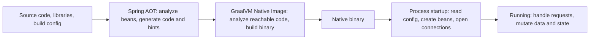

# What Can Change at Runtime and What Is Fixed at Build Time

When migrating a Spring Boot application from the JVM to **GraalVM Native Image**, the key question is not just "how much faster does the app start?", but also: **which decisions must be made at build time, and which decisions can still be made at runtime?** This boundary directly shapes how you design configuration, toggle features, load resources, use reflection, and deploy the same build across multiple environments.

Spring AOT (Ahead-of-Time) pre-computes much of the information Spring normally infers at JVM startup. Then GraalVM `native-image` analyzes reachable code and packages it into an executable for a specific platform. The result is still a stateful application that opens network connections, handles requests, and reads runtime configuration; however, certain **capabilities and structures** must already be decided before the binary is produced.

## 1. Distinguishing Three Points in Time



These three milestones create three kinds of decisions:

1. **Build time:** decides which classes/methods are reachable, reflection metadata, resources embedded in the binary, the AOT-processed bean structure, and part of the state of classes configured for build-time initialization.
2. **Process startup time:** reads command-line arguments, environment variables, external config files, creates Spring beans, and connects to services. These values can differ across two runs of **the same binary**, provided they do not attempt to alter decisions locked in step 1.
3. **While serving requests:** data from HTTP, databases, message queues, caches, counters, or business state continues changing normally. However, modifying an external environment variable **does not automatically** update values already injected into existing beans; hot reloading requires designing an explicit re-read or refresh mechanism.

> **Key takeaway:** "Compiled ahead of time" does not mean every object and every value is frozen. Spring AOT generates code to initialize the application more efficiently; regular beans are still instantiated when the process starts. Conversely, "able to read configuration at runtime" does not mean that configuration can re-introduce beans or classes excluded from the binary.

## 2. Map of What Is Fixed vs. Flexible

| Component | Primarily Decided When? | Can It Change Between Two Runs of the Same Binary? |
| --- | --- | --- |
| Classes and methods deemed reachable by *closed-world* analysis | Native build | Cannot add code absent from the binary using runtime config alone. |
| Bean structure governed by `@Profile`, `@ConditionalOnProperty`, and conditions processed by Spring AOT | AOT processing | Cannot expect changing profiles/properties at runtime to restore beans excluded during AOT. |
| Reflection metadata, JDK dynamic proxy types, JNI, serialization needing explicit registration | Native build | Capabilities not inferred automatically by the tools must be declared upfront. |
| Contents of classpath resources embedded into the native image | Native build | Changing embedded contents usually requires rebuilding; external files can be read at runtime instead. |
| `static` state of classes configured for build-time initialization | Native build | Values are snapshotted into the image heap; not recomputed per process. |
| Classes configured for run-time initialization | Startup or first use | Static initializers run inside the process at actual initialization time. |
| Database addresses, HTTP ports, integration endpoints, timeouts, or config values **not altering the bean graph** | Process startup | Generally yes; supply different values before launching. |
| Request payloads, database records, caches, objects created with `new`, runtime heap state | While the app is running | Yes, according to program logic. |
| OS, CPU architecture, and system library environment targeted by the native executable | Build/release | Binary lacks the cross-platform portability of a JAR on a compatible JVM. |

The word "fixed" in the table refers to **the set of code, capabilities, and decisions baked into the build**. For example, the code executing `new Order()` is fixed in the binary, yet thousands of distinct `Order` objects can still be created and mutated on the heap at runtime.

## 3. Why Does Spring AOT Fix Part of the Application Structure?

On the JVM, Spring can use classpath scanning, reflection, and condition evaluation at startup to determine which beans to instantiate. With Spring AOT, many of these steps run earlier to generate initialization code and hints for GraalVM. Therefore, you must distinguish **configuration values** from **configuration deciding which beans exist**.

### 3.1. Values Injected at Startup Can Still Differ

```java
import org.springframework.beans.factory.annotation.Value;
import org.springframework.stereotype.Service;

@Service
public class GreetingService {
    private final String prefix;

    public GreetingService(
            @Value("${app.greeting-prefix:Hello}") String prefix) {
        this.prefix = prefix;
    }

    public String greet(String name) {
        return prefix + ", " + name;
    }
}
```

For example, a single binary can run with `--app.greeting-prefix=Hello` in environment A and `--app.greeting-prefix=Welcome` in environment B. The bean is still `GreetingService`; only the `prefix` value supplied at startup differs. Similarly, Spring Boot can typically read `server.port`, database connection details, and many other settings at runtime.

This **does not mean hot reload**. Once the constructor receives `prefix`, changing arguments or environment variables while the process is running will not automatically update that `final` field. You must restart the process or design an appropriate dynamic configuration source.

### 3.2. Conditions That Alter the Bean Graph Are a Different Case

```java
import org.springframework.boot.autoconfigure.condition.ConditionalOnProperty;
import org.springframework.context.annotation.Bean;
import org.springframework.context.annotation.Configuration;

@Configuration(proxyBeanMethods = false)
class AuditConfiguration {

    @Bean
    @ConditionalOnProperty(name = "feature.audit.enabled", havingValue = "true")
    AuditService auditService() {
        return new AuditService();
    }
}

class AuditService {
    void record(String event) {
        System.out.println("AUDIT: " + event);
    }
}
```

In Spring AOT mode, conditions affecting bean definitions like the example above are typically evaluated during AOT processing. If `AuditService` was not included in the application structure at build time, setting `feature.audit.enabled=true` when running the binary **is not** a reliable way to make that bean appear. Similarly, select the right profiles at AOT time if they determine which beans are registered.

If the goal is using **one binary** and selecting behavior per environment configuration, one design approach is keeping all required code branches in the bean graph and selecting logic at runtime:

```java
import org.springframework.beans.factory.annotation.Value;
import org.springframework.stereotype.Service;

@Service
class ShippingService {
    private final boolean expressEnabled;

    ShippingService(
            @Value("${shipping.express-enabled:false}") boolean expressEnabled) {
        this.expressEnabled = expressEnabled;
    }

    String shippingMode() {
        return expressEnabled ? "EXPRESS" : "STANDARD";
    }
}
```

`ShippingService` is always present; only `expressEnabled` varies across startups. For systems needing feature changes while running, use feature flags or data from a config service **read at runtime**, while ensuring every needed code branch is included in the native image. Never assume a `@Conditional...` annotation that governs the bean graph will act as a dynamic feature flag.

## 4. The Closed-World Rule: What Code Is Actually in the Binary?

GraalVM Native Image uses *closed-world* analysis: at build time, the tool must determine the set of code the application may execute. Normal Java calls, such as `new PaymentService()` or direct method calls, are usually enough to trace call relationships. Certain dynamic mechanisms require additional metadata or generated code:

- **Reflection:** `Class.forName(name)`, `getDeclaredConstructor()`, `Method.invoke()`, or libraries looking up types by string names. If a class/method is only reached dynamically in a way the tool cannot infer, register the corresponding access rights.
- **JDK dynamic proxies:** the set of interfaces used to create proxies may need hints; Spring AOT handles many proxies known to Spring automatically.
- **Serialization/JNI:** types or members accessed dynamically may require dedicated metadata.
- **Classpath resources:** files read via `getResourceAsStream()` must be included in the native image. Mere presence in the source tree does not guarantee proper embedding.

Spring Boot 3+ provides the **Runtime Hints** mechanism to declare accesses that AOT analysis does not automatically recognize. The name "Runtime Hints" describes **access permissions needed at runtime**, while the hints themselves are collected and processed **at build time**.

The example below illustrates registering reflection and a classpath resource:

```java
package com.example.demo;

import org.springframework.aot.hint.MemberCategory;
import org.springframework.aot.hint.RuntimeHints;
import org.springframework.aot.hint.RuntimeHintsRegistrar;
import org.springframework.boot.SpringApplication;
import org.springframework.boot.autoconfigure.SpringBootApplication;
import org.springframework.context.annotation.ImportRuntimeHints;

@SpringBootApplication
@ImportRuntimeHints(DynamicAccessHints.class)
public class DemoApplication {
    public static void main(String[] args) {
        SpringApplication.run(DemoApplication.class, args);
    }
}

class DynamicAccessHints implements RuntimeHintsRegistrar {
    @Override
    public void registerHints(RuntimeHints hints, ClassLoader classLoader) {
        hints.reflection().registerType(
                InvoiceDto.class,
                MemberCategory.INVOKE_DECLARED_CONSTRUCTORS,
                MemberCategory.INVOKE_PUBLIC_METHODS
        );
        hints.resources().registerPattern("templates/invoice.txt");
    }
}

record InvoiceDto(String code, long total) {}
```

In this example, `src/main/resources/templates/invoice.txt` must exist at build time. If the application accesses the `InvoiceDto` record via reflection along a path Spring does not automatically detect, the hint ensures the native image preserves the needed metadata. This is a **capability declaration**, not an operation pre-creating `InvoiceDto` at build time. If the framework already provides appropriate hints, do not register duplicates.

Suppose the application reads `classpath:templates/invoice.txt`; modifying that file after the native image is built does not change the embedded copy. If the template must change independently of the binary, move it to an external directory or storage service, read it via a path/runtime API, and manage permissions, defaults, and missing-file errors as you would for external config data.

## 5. Class Initialization: What Static State Can Be "Captured" at Build Time?

Clearly separate **GraalVM class initialization** from **Spring bean initialization**:

- A Java class configured for *build-time initialization* can execute its `static` initializer while building the native image; eligible static state can be placed in the **image heap** and reused when the process runs.
- A class configured for *run-time initialization* executes its static initialization inside the native process when the class is initialized.
- A regular Spring singleton is still instantiated when the application context starts via AOT-generated code. Do not interpret "AOT processes beans" as "all singletons and database connections are pre-built inside the executable".

Consider a simple Java example:

```java
import java.time.Instant;

final class InitializationExample {
    static final Instant INITIALIZED_AT = Instant.now();

    static Instant value() {
        return INITIALIZED_AT;
    }
}
```

If `InitializationExample` is actually initialized **at build time**, `INITIALIZED_AT` can reflect the build timestamp. If the class is initialized **at runtime**, it reflects the initialization timestamp inside the running process. Simply seeing `static final` **is not enough** to tell when the class gets initialized; the outcome depends on class initialization configuration and GraalVM's analysis.

Therefore, be especially careful with static initializers that read environment variables, current time, host info, secrets, generate random numbers, or open connections. Those operations can produce stale context or be rejected by GraalVM if run at build time. For classes needing fresh state per process, design runtime initialization or configure class initialization appropriately (such as the Native Image option `--initialize-at-run-time=<class-name>` when needed). With Spring, prefer creating environment-dependent state inside beans at application startup rather than inside uncontrolled `static` blocks.

## 6. Two Deployment Scenarios to Decide Whether Rebuilding Is Necessary

### Scenario A: One Binary for Staging and Production

Suppose code and bean sets are identical across both environments. Staging uses database `staging-db`, production uses `prod-db`; each environment uses its own username, secret, endpoint, and timeout limits. If these values are read at startup from environment variables or an external configuration source, **the same native executable** can run in both places compatible with the platform it was built for.

An illustrative command on Linux (binary name `demo` depends on the project):

```bash
SPRING_DATASOURCE_URL='jdbc:postgresql://staging-db:5432/app' \
APP_GREETINGPREFIX='Staging' \
./target/demo --server.port=8081
```

This is a runtime configuration data change requiring no additional classes, resources, or bean definitions. Do not embed production secrets in YAML files at build time or in build-time initialized static state; supply secrets in the runtime environment.

### Scenario B: Enabling a New Payment Provider with `@ConditionalOnProperty`

Suppose the build only registers the `MockPaymentClient` bean because the build condition selects `payment.provider=mock`, and later production sets `payment.provider=real` expecting `RealPaymentClient` to appear. Under AOT, that expectation can fail: the second bean and code paths referenced solely from it may not exist in the generated native structure.

There are two clear ways to handle this:

1. **Select the provider at build time:** release distinct native binaries for different bean sets and test each variant.
2. **Select behavior at runtime:** include all needed implementations in the build as beans not excluded by build-time conditions, then pick the implementation via runtime data through a suitable router/factory. This allows binary reuse, though you must manage dependencies and secrets for each implementation.

The design rule is: **if configuration only changes values inside an existing bean, it can usually change at startup; if configuration changes which beans are registered, check the AOT boundary**.

## 7. Building, Running, and Verifying the Boundary

For a Spring Boot application configured with GraalVM Native Build Tools and a compatible toolchain, you can build the binary either way:

```bash
# Maven (project with Maven Wrapper and matching native profile)
./mvnw -Pnative native:compile

# Gradle (project applying the GraalVM Native Build Tools plugin)
./gradlew nativeCompile
```

On Windows, use `mvnw.cmd` or `gradlew.bat`; executable paths and extensions depend on the OS. With Maven, the binary is usually placed in `target/`; with Gradle, usually under `build/native/nativeCompile/`. Commands may differ if the project customizes its build. Building a native container also requires choosing a matching builder and target platform; a Linux-built binary cannot automatically run directly like an `.exe` file on Windows.

A short hands-on check to verify the theory:

| Test | Action | Expected Observation |
| --- | --- | --- |
| Runtime value | Run the same binary twice with two `--app.greeting-prefix` values | Greeting strings differ without rebuilding. |
| Bean condition | Put `@ConditionalOnProperty` on a bean; flip property between AOT build and runtime | Check the AOT-processed bean structure; do not assume an excluded bean will appear. |
| Reflection | Compute class/method name dynamically and invoke via reflection | Without metadata/hints, the feature may fail on native even though it works on JVM. |
| Embedded resource | Read `classpath:templates/invoice.txt`, modify the file after building | Old binary still uses embedded content; updating requires rebuilding or switching to an external file. |
| Class initialization | Check a `static` value sensitive to initialization time with build-time/runtime config | Determine when the value is computed rather than inferring from `static` alone. |

When comparing JVM against native, run **identical features, datasets, and runtime configurations** and test commonly missed flows: JSON binding, validation, reflection, templates, resources, serialization, database drivers, TLS, and proxies. Measure time from launch until the application is ready to accept requests; monitor actual process memory (such as RSS) instead of comparing a JVM Java heap limit against native RSS. Native typically improves cold start and memory usage for many workloads, yet build cost, GC behavior, processing load, and actual memory usage must be measured per application; there is no universal improvement percentage across all projects.

## 8. Misconceptions to Avoid

| Misconception | Accurate Understanding |
| --- | --- |
| "Once native, configuration cannot be changed." | Many values can change at startup; check whether the setting alters an AOT decision. |
| "Spring AOT pre-creates all beans inside the binary." | AOT generates code and processes metadata/bean definitions; normal beans are still instantiated when the process starts. |
| "`static final` is always a constant frozen at build time." | Depends on whether the class is initialized at build time or runtime, and whether the value is a compile-time constant. |
| "Native Image does not support reflection at all." | Reflection works when needed metadata is analyzed or registered properly; Spring AOT supplies many common hints automatically. |
| "Putting a file in `src/main/resources` guarantees native can read it." | You must ensure the resource is included in the native image; external resources need runtime paths and permissions. |
| "Rerunning with a different profile will always produce a different set of beans." | Conditions affecting the bean graph may have been locked during AOT processing. |
| "Changing an environment variable at runtime updates `@Value`." | Injected fields do not normally update automatically; the app needs a refresh mechanism or restart. |

## 9. Pre-Release Checklist for a Native Build

- **Code set:** does any part use `Class.forName`, string-based reflection, dynamic proxies, serializers, or JNI that AOT cannot infer?
- **Bean set:** are `@Profile`, `@ConditionalOnProperty`, or other conditions used to pick beans per environment? If so, must the choice happen at build time or should the design shift to runtime selection?
- **Resources:** are template/certificate/schema files embedded or read externally? If content must update without rebuilding, has an external path been designed?
- **Initialization state:** do static initializers touch build-machine time, environment variables, secrets, or resources?
- **Operational config:** when are ports, URLs, accounts, timeouts, logging, and feature flags actually read?
- **Compatibility:** have flows relying on dynamic libraries, connections, JSON, TLS, and resources been tested on the **actual native binary**?
- **Measurements:** have startup time, process memory, and behavior under load been compared against the JVM build under equivalent conditions?

The build-time/runtime boundary is the key to harnessing Spring AOT and GraalVM Native Image: **package required code and capabilities ahead of time**, while placing **operational configuration and business state** at the right point in the lifecycle. Designing this boundary properly lets the application benefit from a native binary while staying deployable and tunable across environments.
