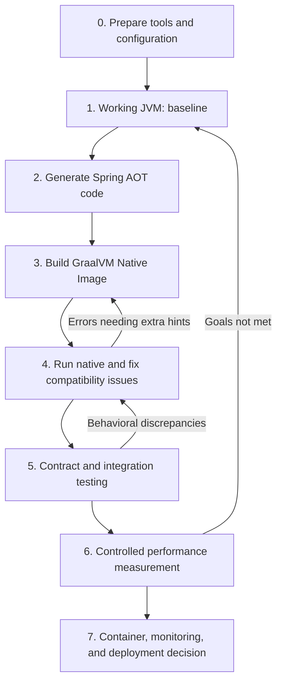

# Prerequisites and Roadmap from a JVM App to a Verified Native Build

## 1. The Destination of This Journey

In the **SPRING_BOOT_NATIVE_IMAGE** module, we compile a Spring Boot application into a **GraalVM Native Image** with the support of **Spring Ahead-of-Time (AOT)**, then measure startup time, memory usage, and verify compatibility. The roadmap covers building with Maven or Gradle, handling reflection/resources, container packaging, and operating the native build.

The goal of this overview is to define **what you need to know before starting**, **which sequence to follow**, and **what evidence confirms the native build is ready**. A single successful build only proves the program compiles; it does not prove the application runs properly under real configurations, data, traffic, and infrastructure.

By the end of the roadmap, learners should produce the following deliverables:

1. A Spring Boot application with verified JVM behavior, along with reproducible configuration and test datasets.
2. A working native build, with reflection, resources, and dynamic proxy needs appropriately identified or declared.
3. A test suite confirming equivalent API, integration, and critical error behavior between both builds.
4. A report measuring startup time, memory, and—where needed—latency/throughput under identical conditions.
5. A tested native container image, equipped with health observability and a rollback path to the JVM build.

> **Guiding principle:** proceed from **working JVM** → **AOT generated and inspected** → **native build succeeds** → **native runs accurately** → **controlled performance measurement** → **container and operations verified**.

## 2. Master the Three Components Before Hands-On Practice

### 2.1. What Do JVM, Spring AOT, and GraalVM Native Image Each Handle?

| Component | Primary Role | Significance in the Roadmap |
| --- | --- | --- |
| **JVM** | Loads and runs Java bytecode; includes JIT, garbage collector, and dynamic class loading. | Serves as the behavioral and performance baseline. |
| **Spring AOT** | Analyzes Spring configuration at build time; generates app initialization code/metadata and provides needed native hints. | Allows inherently dynamic Spring structures to be pre-processed before runtime. |
| **GraalVM Native Image** | Analyzes reachable execution paths and compiles ahead of time into an executable for the target OS/architecture. | Produces a program that runs without installing a separate JVM to launch the app. |

Spring AOT **is not** a machine-code compiler, and GraalVM **does not automatically know** every dynamic behavior in your application. The two tools complement each other. Spring-supported libraries may have runtime hints generated automatically; application code or libraries using user-supplied class/method names, runtime-only resources, or custom proxies may still need extra configuration.

Native Image's **closed-world assumption** states that the compiler must know upfront the set of code and metadata the program requires. For example, a direct call `new OrderService()` can be analyzed statically; calling `Class.forName(nameFromDatabase)` to pick an arbitrary class at runtime may not be fully inferred. Therefore, native compatibility depends on how the application uses Java reflection, resource loading, serialization, dynamic proxies, JNI, and class initialization.

### 2.2. Reasonable Performance Expectations

Native Image is typically worth trying for services demanding fast startup, containers that scale with load, short-lived jobs, or environments with tight memory budgets. However, results **depend on the application**: Native Image can take longer to build and consume significant RAM during builds; the JVM after JIT optimization can achieve better throughput on certain workloads. Memory, startup time, and latency also vary with GC, heap settings, CPU, OS, data, libraries, and connection initialization costs.

Never treat claims like "native is always faster" or "native uses X% less RAM" as your project's outcome. They must be verified using metrics from **the exact service under evaluation**.

## 3. Minimum Knowledge and Environment

### 3.1. Foundational Knowledge

| Topic | What You Should Be Able to Do Before Starting | How to Self-Check |
| --- | --- | --- |
| Java | Understand classes, interfaces, annotations, records/DTOs, exceptions, classpath, and class loaders at a basic level. | Write and run a JSON-returning REST API yourself. |
| Spring Boot | Understand `@SpringBootApplication`, beans, dependency injection, auto-configuration, `@RestController`, profiles, and external config. | Explain why a given bean is created or omitted. |
| Maven or Gradle | Know wrappers, dependencies, plugins, `test`/`package` lifecycles, and how to read build errors. | Run tests and build a JAR file from a repository. |
| HTTP and testing | Understand status codes, JSON, health endpoints; write unit/integration tests. | Verify a valid response and an error case. |
| OS/containers | Understand environment variables, executable permissions, processes, ports, Docker/OCI, and CPU architectures. | Run an app in a container and call the API via its published port. |
| Performance analysis | Distinguish startup time, time to readiness, RSS, heap, latency, and throughput. | Document how to measure both builds under identical conditions. |

You do not need to be a GraalVM expert from day one. However, without a properly running JVM baseline and reliable test cases, it becomes very hard to separate pre-existing application bugs from native compilation issues.

### 3.2. Tools to Prepare

- **Compatible JDK/GraalVM** matching a Java and Spring Boot version supported by the project; a GraalVM distribution with `native-image` installed or build tooling providing an equivalent Native Image setup.
- **Spring Boot with AOT/native support**, plus the **GraalVM Native Build Tools** plugin configured in Maven/Gradle. If creating the project from Spring Initializr, you can select the GraalVM Native Support option at initialization.
- **Native compilation toolchain** matching the OS: on Linux this typically requires a C compiler, linker, headers, and corresponding system libraries. If building via Cloud Native Buildpacks, the build environment lives inside the builder/container.
- **Docker/Podman or compatible OCI runtime** if performing container build/run steps. Only needed when following the container path.
- Sufficient disk space and RAM for compilation; native builds generally consume more resources than JAR packaging. Exact thresholds depend on codebase, dependencies, and environment.

Verify available components with commands suited to your environment:

```bash
java -version
./mvnw -version       # Maven projects
./gradlew --version   # Gradle projects
native-image --version
docker version        # Only when using Docker
```

On Windows, use `mvnw.cmd`/`gradlew.bat` or equivalent tooling; PowerShell and Unix shells use different path conventions. `native-image --version` runs directly only when the tool is on your `PATH`. When using buildpacks, Native Image can be provided by the builder rather than installed locally.

**Environment checkpoint:** explicitly identify the JDK in use, OS, target architecture (`amd64`/`arm64`), Spring Boot version, native plugin version, and build method (local or buildpack). Native binaries are bound to the target platform; you cannot take a Linux executable and run it directly on Windows.

## 4. Hands-On Roadmap with Verification Gates



Each stage below has **inputs**, **tasks**, and **exit criteria**. If a gate fails, return to the relevant stage, record the root cause, and rerun verification; do not skip past a failed gate just to retry the build.

### Stage 0 — Lock Down Scope and Experimental Conditions

Pick a small application that still has enough components to reflect a real service: at least one REST API, one JSON DTO, and one health endpoint. If the real project uses a database, cache, security, message broker, or reflection libraries, list the key flows to test on native. Lock Java, Spring Boot, and dependency versions before measuring, while recording the commit hash and environment configuration.

Create a verification plan table: which APIs must match, which features carry compatibility risks, which metrics to measure, and what the acceptance criteria are. For instance, an order creation API must handle valid payloads, invalid payloads, authentication, database errors, and both request and response serialization.

**Done when:** the environment is reproducible and the critical feature/metric checklist is clear.

### Stage 1 — Establish a Working JVM Baseline

Example of a minimal REST application (placed in `src/main/java/com/example/nativeguide/DemoApplication.java`):

```java
package com.example.nativeguide;

import org.springframework.boot.SpringApplication;
import org.springframework.boot.autoconfigure.SpringBootApplication;
import org.springframework.web.bind.annotation.GetMapping;
import org.springframework.web.bind.annotation.RestController;

@SpringBootApplication
public class DemoApplication {
    public static void main(String[] args) {
        SpringApplication.run(DemoApplication.class, args);
    }
}

@RestController
class HelloController {
    @GetMapping("/api/hello")
    HelloResponse hello() {
        return new HelloResponse("Hello from Spring Boot");
    }
}

record HelloResponse(String message) {}
```

This example assumes the project already declares Spring Boot Web and the corresponding Maven or Gradle plugin. Run tests, package, and start on the JVM:

```bash
./mvnw clean verify
./mvnw spring-boot:run

# For Gradle projects, use the equivalent tasks:
# ./gradlew clean test bootJar
# ./gradlew bootRun
```

Open another terminal and invoke the API:

```bash
curl --fail-with-body http://localhost:8080/api/hello
# Expected: {"message":"Hello from Spring Boot"}
```

`curl --fail-with-body` requires a curl version supporting this flag; you can use `curl -i` to inspect HTTP status and body. Add tests checking status codes, JSON, validation, and error cases, then save sample outputs. Do not treat a single "200 OK" request as proof that the entire app works.

**Done when:** `test`/`verify` passes, the JVM build satisfies all defined scenarios, and baseline configuration and reference data are saved.

### Stage 2 — Generate AOT Code and Understand What Is Locked at Build Time

Ensure the project has compatible AOT/native plugins and configuration. You can run the AOT generation task separately to isolate errors before native compilation:

```bash
./mvnw spring-boot:process-aot    # Maven
# or
./gradlew processAot             # Gradle
```

The goal/task names above apply to projects with the respective Spring Boot plugin. Inspect code-generation logs and the build output directory to catch bean configuration, annotation processing, or dependency errors. Never edit generated files directly; modify source or build configuration and regenerate.

AOT analyzes the Spring application context during the build. Because certain bean/condition decisions are pre-computed, profiles or properties affecting bean structure must be tested under realistic configuration. Distinguish **operational settings still read at runtime** from **bean-creation decisions baked into AOT outputs**.

**Done when:** AOT generation succeeds and critical beans and conditions are verified against the target environment.

### Stage 3 — Build the Native Image

With **Maven**, the standard approach in projects with a configured `native` profile and GraalVM Native Build Tools:

```bash
./mvnw -Pnative native:compile
```

If Maven reports no `native` profile/goal, configure `org.graalvm.buildtools:native-maven-plugin` compatible with Spring Boot before running. `-Pnative` does not auto-create the plugin for an unconfigured project.

With **Gradle**, configure the `org.graalvm.buildtools.native` plugin alongside the Spring Boot plugin at compatible versions, then run:

```bash
./gradlew nativeCompile
```

In typical setups, Maven places the executable in `target/`, while Gradle places it in `build/native/nativeCompile/`; exact name and path depend on project, task, and OS. Read the build output to find the exact path, check executable permissions, and run the binary on the platform it was built for:

```bash
# Example with Maven on Linux/macOS, if the executable is named native-guide:
./target/native-guide --server.port=8080
```

Do not confuse a Spring Boot JAR file with the native executable. If the build fails, capture the first error message pointing to missing metadata, resources, compiler, or linker issues; the final error in the log is sometimes only a cascading symptom.

**Done when:** the build produces a native executable, the process starts, and basic endpoints return the same results as the JVM.

### Stage 4 — Fix Compatibility Using Targeted Runtime Hints

Common symptoms when migrating to native include `ClassNotFoundException`, `NoSuchMethodException`, missing classpath resources, JSON fields disappearing, proxies failing to generate, or a JNI library failing to load. First pinpoint which mechanism is actually being used; do not register reflection wholesale to mask the root cause.

For example, the application calls `Class.forName(...)` to load an `ExternalEvent` type and uses reflection to instantiate it. You can provide a `RuntimeHintsRegistrar` and import it into Spring configuration (the illustrative classes below reside in the same package as the application):

```java
import org.springframework.aot.hint.MemberCategory;
import org.springframework.aot.hint.RuntimeHints;
import org.springframework.aot.hint.RuntimeHintsRegistrar;
import org.springframework.context.annotation.Configuration;
import org.springframework.context.annotation.ImportRuntimeHints;

@Configuration(proxyBeanMethods = false)
@ImportRuntimeHints(DynamicAccessHints.class)
class NativeConfig {}

final class DynamicAccessHints implements RuntimeHintsRegistrar {
    @Override
    public void registerHints(RuntimeHints hints, ClassLoader classLoader) {
        hints.reflection().registerType(
            ExternalEvent.class,
            MemberCategory.INVOKE_DECLARED_CONSTRUCTORS,
            MemberCategory.INVOKE_PUBLIC_METHODS
        );
        hints.resources().registerPattern("templates/*.txt");
    }
}

class ExternalEvent {
    public ExternalEvent() {}
    public String getMessage() { return "Example"; }
}
```

The snippet above **illustrates declarations to integrate** into existing source: replace `ExternalEvent` with your application's actual type, and `templates/*.txt` must match real resources under `src/main/resources/`. When placing classes in separate Java files, add the `package` declaration and required `import` statements. Grant reflection access only to constructors/methods/fields actually invoked. For DTOs used in data binding, `@RegisterReflectionForBinding(...)` is a Spring option when applicable; Spring and AOT-aware libraries may also auto-generate many hints.

To validate hints, you can write tests using Spring Framework's `RuntimeHintsPredicates`, checking required reflection and resource metadata, and then rerun the native build. **Metadata tests do not replace behavioral testing**: valid metadata can still fail due to logic bugs, missing locales, configuration, or external connections.

**Done when:** key dynamic execution paths work in native, root causes and fixes are documented, and no unexplained discrepancies remain.

### Stage 5 — Verify Functional and Integration Equivalence

Run **the same test suite** and identical data against both builds, ideally using a test environment with matching database version, schema, simulated secrets/config, timezone, and locale. Compare on business-meaningful criteria, avoiding naive raw comparisons on naturally varying fields like timestamps, UUIDs, or request IDs.

| Test Group | Specific Checks | Passing Signal |
| --- | --- | --- |
| REST/JSON | Status codes, content type, request/response DTOs, enums, date/time, nulls, validation. | Same API contract and expected error behavior. |
| Dependency injection | Conditional beans, profiles, interceptors/filters, transactions. | Key bean flows operate under target configuration. |
| Integrations | JDBC/R2DBC, migrations, queues, caches, outbound HTTP, timeouts/retries. | Results and data consistency match JVM. |
| Resources and dynamic features | ResourceBundles, templates, reflection, proxies, serialization, native/JNI libraries. | Zero missing metadata, class, or resource errors. |
| Security | Authentication, authorization, TLS/certificates, secrets, headers. | Allow/deny cases conform to policy. |
| Operations | Liveness/readiness, logs, metrics, env configuration, process stop signals. | Observable and cleanly controllable start/stop. |

GraalVM Native Build Tools supports testing in native mode for compatible test types and configurations (commonly via `nativeTest` on Gradle or Maven's native test goal). Additionally, still run system tests after launching the actual executable/container; some errors appear only when accessing external resources or under real deployment conditions.

**Done when:** all critical flows pass, and discrepancies are either resolved or explicitly accepted.

### Stage 6 — Measure Startup Time and Memory Reproducibly

Run JVM and native using identical functional configs; if measuring locally, measure **each build separately** to avoid resource contention. If measuring in containers, set identical CPU/RAM limits and compare against a sensibly configured JVM build, avoiding artificial bias toward either side.

Define start and end points beforehand. You can measure from process creation until `/actuator/health/readiness` (if configured) returns a ready-to-serve status. The "Started ... in ... seconds" log line is an internal Spring indicator and **does not mean** all external dependencies are ready. Never conclude from a single run: run multiple iterations, report median and p95 or a proper distribution, and state cold/warm conditions clearly.

| Metric | Suggested Definition | What Must Stay Consistent |
| --- | --- | --- |
| Startup to ready | From process start until app is ready for requests per test criteria. | Launch method, readiness probe, config, external connection state. |
| RSS/working set | Process memory reported by the OS at a point in time or under fixed load. | Measurement timing, load, container limits, OS. |
| Latency p50/p95/p99 | Request latency for a given dataset and load level. | Load generator, concurrency, request rate, warm-up. |
| Throughput and CPU | Requests/sec and CPU usage at steady state. | Resources, data, bottlenecks, and error rate. |
| Build time/binary size | Executable build cost and artifact size. | Same commit, build machine, cache, and measurement method. |

On Linux, once you know the application's PID, you can check point-in-time RSS:

```bash
ps -o pid=,rss=,etime= -p <PID>
# rss is typically in KiB; replace <PID> with the actual PID.
```

Presentation template for results, **not default Spring Boot measurements**:

| Variant | Startup → ready (median, ms) | Steady RSS (MiB) | p95 latency (ms) | Functional status |
| --- | ---: | ---: | ---: | --- |
| JVM | *measure actual* | *measure actual* | *measure actual* | *pass/fail* |
| Native | *measure actual* | *measure actual* | *measure actual* | *pass/fail* |

Attach iteration count, timestamp, OS/CPU, JDK/GraalVM, commit, flags, memory limit, and metric source. All improvement ratios must come from real measurements; also record trade-offs in build time, artifact size, throughput, or CPU usage.

**Done when:** measurements are reproducible and sufficient to decide whether native fits the service's goals.

### Stage 7 — Package Container and Confirm Operability

With Maven and a project configured with the `native` profile, Spring Boot supports building images via Cloud Native Buildpacks, for example:

```bash
./mvnw -Pnative spring-boot:build-image \
  -Dspring-boot.build-image.imageName=example/native-guide:local

docker run --rm -p 8080:8080 example/native-guide:local
```

With Gradle, you can use `bootBuildImage` once a suitable builder and Native Image mode are configured (e.g., a builder supporting `BP_NATIVE_IMAGE=true`):

```bash
./gradlew bootBuildImage --imageName=example/native-guide:local
```

Verify that the output image genuinely contains the native executable. Two common approaches are **building native directly then creating an OCI image from the binary** or **letting buildpacks build both the native binary and the image**. Each path carries different tooling and OS/architecture requirements.

After running the container, re-verify endpoints, health/readiness, network connectivity, DNS/TLS, environment variables, logs, `SIGTERM` handling, ports, and memory limits. Check image architecture, dependency/base-image update policies, error observability, and the binary rebuild process for security patches. When publishing multi-arch images, build the right artifact per architecture; never tag a single-architecture binary as if it supports every platform.

**Done when:** the container runs on target infrastructure, passes operational tests, emits needed metrics/logs, and has a reliable rollback path to the JVM artifact.

## 5. Common Errors and Diagnostic Directions

| Symptom | Hypothesis to Check | Proper Remediation |
| --- | --- | --- |
| JVM works, native reports missing constructor/method | Reflection undeclared or tool missed dynamic call path. | Identify exact member invoked, add minimal runtime hints, retest. |
| Native cannot find file/template | Resource omitted from image; path or case sensitivity mismatch. | Check `src/main/resources` location, classpath path, and resource hints. |
| JSON missing fields or object instantiation error | Serializer/deserializer or DTO uses reflection/dynamic subtypes. | Check record/constructor, Jackson mapping, binding hints, and round-trip tests. |
| Proxy/AOP behaves differently | Dynamically generated proxy not handled by AOT as expected. | Check Spring beans, AOP/interceptors, proxy hints, or refactor dynamic design. |
| Missing native library/linker during build | C toolchain, headers, libc, or target platform mismatch. | Check toolchain and target platform docs; distinguish local builds from buildpacks. |
| Errors connecting to DB, TLS, or reading locale | Environment-dependent drivers, certificates, timezone, encoding, or resources. | Reproduce in target runtime/container, compare JVM/native config and library support. |
| Fast startup but slow or failing requests | Only measured startup; skipped load, JIT/GC, and real bottleneck testing. | Run benchmarks under representative load with warm-up and error rates. |
| Native build runs out of memory or takes too long | Native compilation places heavy RAM/CPU pressure and dependency load. | Measure build resources, trim unneeded dependencies, tune CI/machine and caching. |

If an error occurs only in native, create a **minimal reproducible example**, documenting run commands, stack traces, and differences from the JVM. That is far stronger evidence than adding speculative reflection configurations.

## 6. Capstone Practice Exercise: Converting an API to Native

**Problem:** starting from the `/api/hello` REST API in Stage 1, add an endpoint reading a text template from `src/main/resources/templates/welcome.txt` and a DTO flow instantiated dynamically via reflection. Then verify both deployments.

Execution sequence:

1. Write tests for the JSON endpoint, template-reading endpoint, valid inputs, and invalid inputs. Run everything on the JVM.
2. Build AOT and Native Image for the first time. Save error logs without wiping traces.
3. If native fails due to Java dynamism, add targeted hints for the right types/resources; avoid adding unused entries.
4. Run native against the same contract tests. Test error scenarios, Unicode/Vietnamese encoding, and runtime configuration.
5. Measure startup-to-ready and RSS across multiple runs, recording experimental conditions; add latency tests if load targets exist.
6. Package the image, run under target resource limits, and verify health, logs, config, and stop signals.

**Submission package** includes: commit/build configuration, JVM and native test reports, added hints with justifications, reproduction commands, metric table with real data, tested image tag/digest, pros/cons conclusion, and JVM rollback plan.

### Acceptance Criteria

| Gate | Question That Must Be Answered "Yes" Before Proceeding |
| --- | --- |
| **Functionality** | Do key contracts and business flows pass on both JVM and native? |
| **Compatibility** | Have reflection, resources, serialization, databases, security, and target configs been tested? |
| **Observability** | Can you inspect health, logs, metrics, and diagnose startup or serving errors? |
| **Performance** | Are real measurements available under identical conditions and pre-agreed criteria? |
| **Deployment** | Does the artifact/image match target OS/architecture, run in target environment, and support rollback? |

If any gate fails, the verdict should be **"insufficient evidence"** detailing remaining issues—never assume native is ready by default. A service may compile natively yet still warrant staying on the JVM if build cost, library risk, or throughput proves unfavorable.

## 7. Self-Check Questions

1. Why can an application running cleanly on the JVM still fail on GraalVM Native Image without any source code changes?
2. What value does Spring AOT provide, and why does AOT alone not produce a native executable?
3. When encountering a reflection-related JSON error, what evidence should you gather before writing a `RuntimeHintsRegistrar`?
4. Why can't the "Started ..." log line serve as the sole measure of readiness?
5. To conclude that native saves more memory than the JVM, which variables must you hold constant and report?
6. Why must containers be tested on the exact target OS, architecture, and runtime conditions?
7. When is faster startup alone still not enough reason to migrate a service to native?

## 8. Official Version-Specific References

Plugin APIs, supported JDK versions, and build commands can vary across releases. In real projects, prioritize documentation matching **your exact versions in use**:

- [Spring Boot Reference — Native Image](https://docs.spring.io/spring-boot/reference/packaging/native-image/index.html): guide to building, testing, and packaging Spring Boot apps natively.
- [Spring Framework Reference — Ahead-of-Time Processing](https://docs.spring.io/spring-framework/reference/core/aot.html): AOT principles, limitations, and runtime hints.
- [GraalVM Native Image Documentation](https://www.graalvm.org/latest/reference-manual/native-image/): closed-world analysis, builds, and diagnostic tools.
- [GraalVM Native Build Tools](https://graalvm.github.io/native-build-tools/latest/): Maven/Gradle plugins and native build/test tasks.

**Key takeaway:** a trustworthy outcome is **a native application verified against the same functional contract and operational conditions** as the JVM build, backed by measurements and reproduction steps. This forms the foundation for deeper upcoming lessons on Spring AOT, runtime hints, native testing, containers, and operational optimization.
