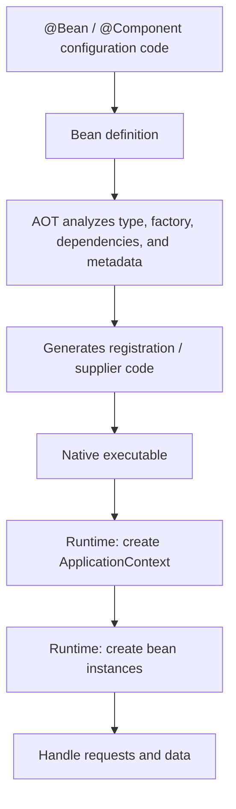
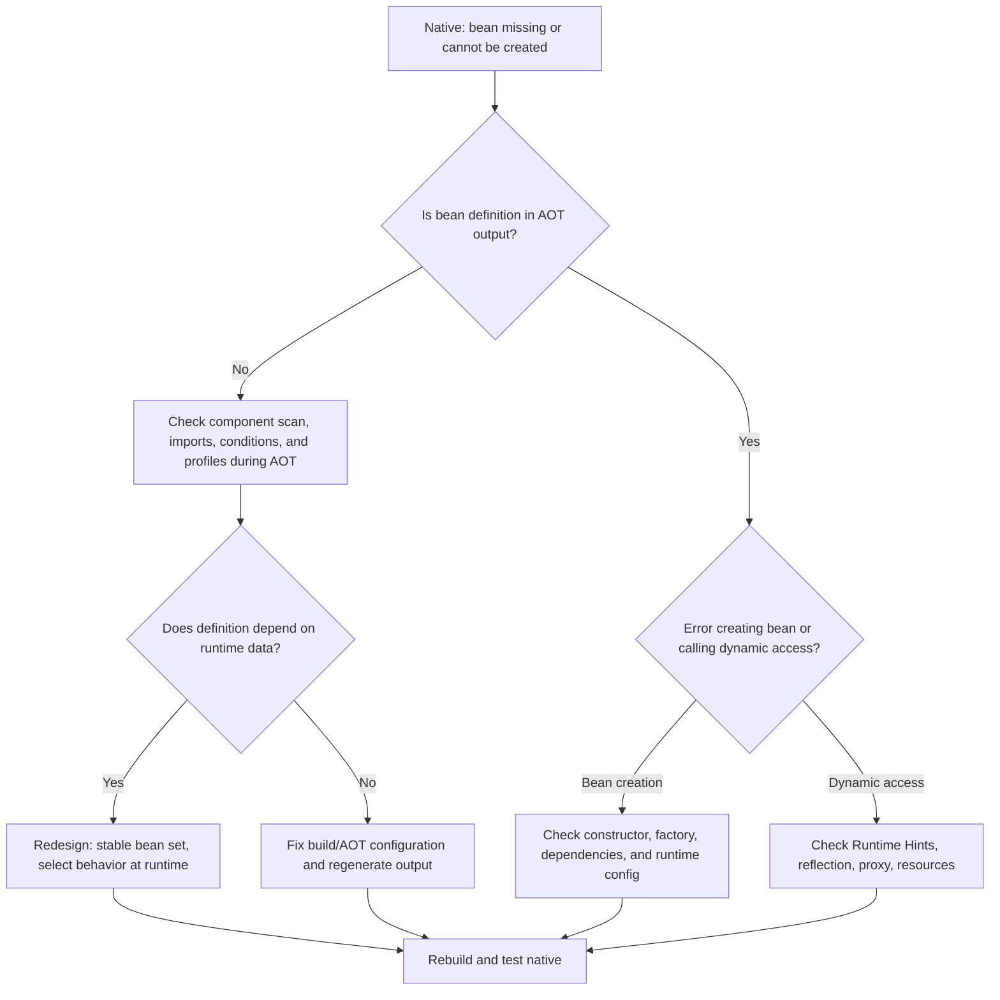

# Bean Definitions Must Be Determined During Analysis

Spring Boot on the JVM typically creates an ApplicationContext when the application starts. During that process, Spring reads configuration, scans components, evaluates conditions, registers bean definitions, and then instantiates the required beans. When using **Spring AOT** to prepare a **GraalVM Native Image**, part of determining the ApplicationContext structure is shifted to the build phase. Therefore, **the set of bean definitions the application needs must be determinable during AOT analysis**.

This does not mean every bean instance is created at build time. AOT needs to know *which beans exist, what types they have, through which path they are created, and what they depend on* in order to generate appropriate registration/instantiation code and metadata. Regular beans are still created when the native process starts; business data, connections, requests, and many configuration values still vary at runtime.

This lesson belongs to the **Beans and AOT** chapter of the `SPRING_BOOT_NATIVE_IMAGE` module. We will distinguish bean definitions from bean instances, explore how conditions affect the bean graph, identify dynamic bean registrations unsuitable for AOT, and design applications that can change behavior based on runtime configuration while keeping the bean structure stable.

## 1. What is a bean definition?

A **bean definition** is a description telling Spring how to manage and create a bean. Depending on how it is declared, a definition may contain or infer:

- The bean name and bean type.
- The constructor, factory method, or instance supplier used to create the object.
- Required dependency injections, qualifiers, and autowiring information.
- Scope such as `singleton`, `prototype`, request/session scope.
- Lazy initialization, primary, role, init/destroy methods, and related metadata.
- Conditions under which the definition is registered, such as `@Profile`, `@ConditionalOnProperty`, `@ConditionalOnClass`.

Example:

```java
@Configuration(proxyBeanMethods = false)
class ClockConfiguration {

    @Bean
    Clock applicationClock() {
        return Clock.systemUTC();
    }
}
```

Spring can register a bean definition named `applicationClock`, of type `Clock`, with the factory method `applicationClock()`. The bean definition describes how to create the object; it **is not the Clock object itself**.



In Spring AOT, the structure of bean definitions must be clear enough for the tooling to generate code for registration and instantiation. Regular bean instances are still created when the running process's ApplicationContext is refreshed. For example, `Clock.systemUTC()` is invoked to create the bean when the runtime context starts, rather than AOT freezing a single shared Clock object into the binary.

## 2. Why does AOT need to know bean definitions in advance?

Native Image uses *closed-world* analysis: the compiler must determine what code can be executed, which types must be retained, and which dynamic accesses require metadata. If an application could arbitrarily load any class from a new JAR after the binary was built, the native compiler could not guarantee that the class was included in the executable or had sufficient reflection/proxy metadata.

Spring AOT addresses the Spring structural part by analyzing the ApplicationContext during the build and generating corresponding code. The high-level process:

1. Spring initializes the analysis environment with the classpath, profiles, and properties used for AOT.
2. Application configuration, component scanning, imports, auto-configuration, and conditions are processed to determine bean definitions.
3. Spring and library processors have the opportunity to contribute AOT code or runtime hints.
4. Spring generates the source code, classes, and resources needed to reproduce the context structure.
5. GraalVM analyzes the application code, generated code, libraries, and metadata to build the native executable.
6. When the native process runs, the generated initialization code registers bean definitions, and Spring creates bean instances according to the runtime lifecycle.

| Phase | What needs to be determined | Examples |
| --- | --- | --- |
| Compile/AOT build | Set of types and bean definitions, registration conditions, bean creation paths, metadata for dynamic access | Component scan, `@Bean`, `@Import`, `@ConditionalOnProperty`, runtime hints |
| Native process startup | Runtime configuration values, ApplicationContext creation, singleton creation, service connections | Database URL, port, timeout, bean instance |
| While the application is running | Business state and values designed to change | Requests, orders, cache, dynamic feature flags, messages |

What must be fixed is **the structure and capabilities the binary needs**, not all data or object state.

## 3. Sources of bean definitions analyzed by AOT

In a Spring Boot application, bean definitions can come from many sources. When investigating native behavior, examine all of these sources rather than looking only for the `@Component` annotation.

| Source | Examples | Things to note |
| --- | --- | --- |
| Component scanning | `@Component`, `@Service`, `@Repository`, `@Controller` | Packages and classpath must be determined at build time. |
| Java configuration | `@Configuration`, `@Bean` | Factory methods and dependencies must be analyzable. |
| Imports | `@Import`, `ImportSelector`, `DeferredImportSelector` | Import results must be determinable within the AOT context. |
| Spring Boot auto-configuration | Starters and `@AutoConfiguration` classes | Auto-configuration conditions are evaluated against the AOT environment. |
| Profiles and conditions | `@Profile`, `@ConditionalOnProperty`, `@ConditionalOnClass` | Conditions affecting the bean graph are typically decided during AOT. |
| Programmatic registration | `BeanDefinitionRegistry`, `BeanDefinitionRegistryPostProcessor` | Registration must be deterministic and compatible with the AOT pipeline. |
| Framework/library integration | Library-provided AOT processors | Libraries need to provide AOT contributions/hints when dynamic behavior is involved. |

Spring AOT does not simply scan annotations and copy a list of classes. It initializes and analyzes the ApplicationContext using Spring's mechanisms; therefore, custom infrastructure code can participate in the process. However, a processor that relies on external data only available at runtime will make analysis results unstable or unpredictable.

## 4. Bean-deciding conditions must be evaluated at the AOT phase

Consider an audit bean example:

```java
@Configuration(proxyBeanMethods = false)
class AuditConfiguration {

    @Bean
    @ConditionalOnProperty(
            name = "feature.audit.enabled",
            havingValue = "true"
    )
    AuditService auditService() {
        return new AuditService();
    }
}

class AuditService {
    void record(String message) {
        System.out.println("AUDIT: " + message);
    }
}
```

The condition `feature.audit.enabled` directly affects whether the `auditService` bean definition is registered or not. In AOT, the condition is evaluated against the analysis environment. If the property is not enabled during AOT processing, the bean may not appear in the generated structure.

| Property during AOT run | Prepared bean definition | Changing property when running native |
| --- | --- | --- |
| `feature.audit.enabled=true` | Audit bean is included in the AOT context | The bean can be used according to the generated structure. |
| `feature.audit.enabled=false` or missing (does not match by default) | Audit bean is excluded | Setting it to `true` at runtime does not recreate a definition that was excluded. |

This is why a configuration that works on the JVM may behave differently when moving to native: on the JVM, Spring usually evaluates conditions each time a process starts; with AOT, condition results may already have been used to generate the context structure at build time.

### 4.1. Profiles also affect the bean graph

Example:

```java
@Configuration(proxyBeanMethods = false)
class StorageConfiguration {

    @Bean
    @Profile("cloud")
    StorageClient cloudStorageClient() {
        return new CloudStorageClient();
    }

    @Bean
    @Profile("local")
    StorageClient localStorageClient() {
        return new LocalStorageClient();
    }
}
```

If AOT processes with the `cloud` profile, the generated context will be prepared with the corresponding structure. When running native, you must respect the profile constraints imposed by Spring Boot AOT: the profiles active during AOT processing must be compatible with runtime. You should not expect switching from `cloud` to `local` after the build to make a bean that was excluded from the generated structure appear.

If the same binary needs to run in multiple environments, keep the required implementations in the bean graph and select behavior via runtime configuration, as shown in the next section.

## 5. Distinguishing bean conditions from runtime configuration

Not every property is fixed at AOT time. The deciding factor is whether the property **only changes a value of an existing bean** or **changes which beans are registered**.

Runtime configuration example:

```java
@Service
class GreetingService {
    private final String prefix;

    GreetingService(
            @Value("${app.greeting-prefix:Hello}") String prefix) {
        this.prefix = prefix;
    }

    String greet(String name) {
        return prefix + ", " + name;
    }
}
```

The `GreetingService` bean still exists in the bean graph. The same binary can receive `--app.greeting-prefix=Hello` in environment A and `--app.greeting-prefix=Welcome` in environment B. The value is injected when the process starts, so two runs can differ without changing bean definitions.

However, changing an environment variable after the bean has already been created **does not automatically update** the `prefix` field. If it must change while the process is already running, you must design an explicit dynamic configuration reading or refresh mechanism.

| Configuration | Changes the bean graph? | Appropriate timing |
| --- | --- | --- |
| `server.port`, database URL, timeout of an existing bean | Usually no | Runtime startup |
| `@Value` / `@ConfigurationProperties` of an always-registered bean | Usually no | Runtime startup; refresh if hot updates are needed |
| `@ConditionalOnProperty` deciding whether a bean exists | Yes | Build/AOT |
| `@Profile` selecting a different set of beans | Yes | Build/AOT |
| Classpath or library types added/removed | May change reachability and auto-configuration | Build |
| Request data, cache, order state | No | Runtime |

## 6. Designing runtime implementation selection while staying AOT-friendly

Suppose a system supports two payment gateways: card and bank transfer. If you use `@ConditionalOnProperty` to register only one implementation, a native binary may contain only the structure for the provider selected at build time.

If the requirement is for **the same binary to select the provider based on startup configuration**, include both implementations in the bean graph and use a router bean to choose between them.

```java
public interface PaymentGateway {
    String charge(String orderId);
}
```

```java
@Component("card")
class CardPaymentGateway implements PaymentGateway {
    @Override
    public String charge(String orderId) {
        return "CARD:" + orderId;
    }
}

@Component("bank")
class BankPaymentGateway implements PaymentGateway {
    @Override
    public String charge(String orderId) {
        return "BANK:" + orderId;
    }
}
```

```java
@Component
class PaymentRouter {
    private final PaymentGateway selected;

    PaymentRouter(
            Map<String, PaymentGateway> gateways,
            @Value("${payment.provider:card}") String provider) {

        PaymentGateway gateway = gateways.get(provider);
        if (gateway == null) {
            throw new IllegalArgumentException(
                    "Unsupported payment.provider: " + provider);
        }
        this.selected = gateway;
    }

    String charge(String orderId) {
        return selected.charge(orderId);
    }
}
```

Spring knows about both the `card` and `bank` beans during AOT analysis. The `payment.provider` property only selects which bean instance the router uses when the process starts. As a result, the same binary can be run with:

```bash
./target/application --payment.provider=card
./target/application --payment.provider=bank
```

The two commands above illustrate two separate processes. If the provider needs to be changed while already running, the router can read a dynamic configuration or accept an updatable selection; concurrency, connection switching, and error handling must be managed according to business requirements.

**Trade-off:** every registered implementation is part of the application that needs to be analyzed and may be retained by the native compiler if a valid reachability path exists. The binary may be larger. In return, you gain the ability to choose among known implementations without changing the bean graph at runtime.

## 7. Why is registering beans based on runtime data risky?

Some applications use `BeanDefinitionRegistryPostProcessor` to register beans based on configuration data, a database, or a plugin catalog. This mechanism is useful in Spring on the JVM, but requires careful consideration when using AOT.

The following conceptual example illustrates a risky design:

```java
// ILLUSTRATIVE CODE — not a complete implementation.
class ExternalPluginRegistrar
        implements BeanDefinitionRegistryPostProcessor {

    @Override
    public void postProcessBeanDefinitionRegistry(
            BeanDefinitionRegistry registry) {

        // Load the plugin list from an external service.
        List<PluginDescriptor> plugins = pluginCatalog.loadFromDatabase();

        for (PluginDescriptor plugin : plugins) {
            Class<?> implementation = resolvePluginClass(plugin);
            RootBeanDefinition definition =
                    new RootBeanDefinition(implementation);

            registry.registerBeanDefinition(
                    plugin.beanName(), definition);
        }
    }
}
```

In this example, the plugin list and implementations are fetched from a database. During AOT analysis, the processor may be invoked while building the context. If the database at build time only has plugin A, the generated context will reflect the corresponding bean set. When production adds plugin B, the already-built native binary will not automatically have the code, classes, and metadata needed for B.

Key risks:

- **Not determinable in advance:** the plugin catalog or bean list is only available at runtime.
- **Non-reproducible results:** the same commit built with AOT at two different times produces two different bean graphs because external data changed.
- **I/O and secrets during build:** AOT accidentally calls a database, API, or requires credentials to perform analysis.
- **Reflection/class loading:** implementations are referenced by string names, which the native compiler cannot fully recognize.
- **Side effects:** the processor sends messages, writes data, or mutates external systems during the build.
- **Environment differences:** the build machine and production have incompatible classpaths/profiles/configurations.

Not all programmatic bean registration is forbidden. If the set of definitions can be stably determined in the AOT context and the integrating library provides appropriate AOT contributions, Spring can include that result in the generated code. The issue is that **you cannot depend on a set of beans that only appears after the binary has been built**.

### 7.1. When can programmatic registration be used?

A registry based on a fixed list in source code can be determined during analysis:

```java
// Conceptual illustration: the list of implementations is a build-time constant.
List<Class<?>> pluginTypes = List.of(
        CsvExporter.class,
        JsonExporter.class
);

for (Class<?> pluginType : pluginTypes) {
    registerKnownPlugin(pluginType);
}
```

Even so, a custom post-processor needs to be tested with the AOT mechanism of the Spring Framework/Spring Boot version in use. If the processor needs to generate custom code or metadata, implement the appropriate AOT extension contracts instead of assuming JVM behavior will automatically be reproduced in a native image.

## 8. What roles do AOT contributions and Runtime Hints play?

Spring Framework provides extension points for frameworks/libraries to contribute code during AOT, such as:

- `BeanFactoryInitializationAotProcessor`: contributes processing/generation at the bean factory initialization level.
- `BeanRegistrationAotProcessor`: contributes processing for each bean registration.
- Corresponding AOT contributions to generate the necessary initialization code.
- `RuntimeHintsRegistrar`: declares reflection, resources, proxies, serialization, or other dynamic capabilities that native image needs to know about.

The latter two groups should be distinguished:

| Mechanism | Responsibility | Does not replace |
| --- | --- | --- |
| AOT bean contribution | Contributes how to reproduce bean structure/registration in the generated context | Ensuring all reflection/resources have metadata |
| Runtime Hints | Provides metadata for dynamic access, resources, and proxies | Adding a bean definition to the ApplicationContext itself |
| Bean definition | Describes the bean and how to create it | Ensuring all dynamic classes are retained in the native executable |

Example of declaring hints for a type invoked via reflection:

```java
import org.springframework.aot.hint.MemberCategory;
import org.springframework.aot.hint.RuntimeHints;
import org.springframework.aot.hint.RuntimeHintsRegistrar;
import org.springframework.context.annotation.Configuration;
import org.springframework.context.annotation.ImportRuntimeHints;

@Configuration(proxyBeanMethods = false)
@ImportRuntimeHints(ReportHints.class)
class ReportConfiguration {
}

class ReportHints implements RuntimeHintsRegistrar {
    @Override
    public void registerHints(
            RuntimeHints hints, ClassLoader classLoader) {

        hints.reflection().registerType(
                ReportPayload.class,
                MemberCategory.INVOKE_DECLARED_CONSTRUCTORS
        );
        hints.resources().registerPattern("reports/default-template.txt");
    }
}
```

The hints above help native image retain the necessary metadata for the constructor and resource. They **do not register** `ReportPayload` as a Spring bean. If you want Spring to manage that type, you need a bean definition from `@Component`, `@Bean`, or an equivalent registration mechanism.

When building a library/framework with native support, you should design AOT integration alongside tests to prove that the generated context and hints reflect the required behavior. Extension APIs may change across Spring Framework generations; consult the documentation for the exact version before implementing.

## 9. Inspecting the bean graph and generated AOT output

Do not just reason from source code. Run AOT and inspect the actual output.

### 9.1. Maven

With a project configured with the Spring Boot Maven Plugin:

```bash
./mvnw spring-boot:process-aot
```

The generated sources/resources typically appear under:

```text
target/
└── spring-aot/
    └── main/
        ├── sources/
        ├── resources/
        └── classes/
```

### 9.2. Gradle

With a project configured with the corresponding plugin:

```bash
./gradlew processAot
```

The output location typically resides under Gradle's generated AOT directory, for example:

```text
build/
└── generated/
    ├── aotSources/
    ├── aotResources/
    └── aotClasses/
```

Directory names may vary depending on plugin version and configuration. Check task logs to see the exact output for your project.

### 9.3. Finding generated bean definitions

Use `rg` (ripgrep) to search for bean names, types, and factory methods:

```bash
# Maven
rg -n "auditService|applicationClock|PaymentRouter" target/spring-aot

# Gradle
rg -n "auditService|applicationClock|PaymentRouter" build/generated
```

Generated class names may contain suffixes such as `__BeanDefinitions`, `__BeanFactoryRegistrations`, or `__ApplicationContextInitializer`, though you should not assume the naming is identical across versions. Search by **bean name** and application type first.

When reading the output, answer in order:

1. Is the bean definition registered?
2. Which constructor or factory method creates it?
3. How are dependencies wired?
4. Which conditions/profiles affect registration?
5. If the bean uses reflection/resources/proxies, are the related hints generated?

Seeing a class name in a generated file is not enough to conclude that a bean instance was created at build time. Look for the definition/supplier registration code and remember that singleton creation usually happens during runtime startup.

## 10. Practice: proving property conditions are decided at AOT time

Create two variants of the same `AuditConfiguration` example. Use two clean build directories or `clean` between runs to avoid reading stale output by mistake.

**Run A — disable audit during AOT:**

```bash
./mvnw clean spring-boot:process-aot \
  -Dspring-boot.run.arguments=--feature.audit.enabled=false
```

How properties are passed to the AOT goal depends on the Maven plugin configuration and version; if the project does not accept the parameter as shown above, configure the property/profile directly on the `process-aot` execution according to the plugin documentation. The important part is verifying that the value is actually present in the environment used by AOT.

**Run B — enable audit during AOT:**

```bash
./mvnw clean spring-boot:process-aot \
  -Dspring-boot.run.arguments=--feature.audit.enabled=true
```

After each run, search for `auditService` in the generated sources and compare. Do not simply look at the Maven command and assume the property was applied; the logs and generated output are the evidence.

Then build a native executable with one variant, and run the binary with the opposite property. Observe that changing the runtime property cannot restore a bean that was excluded from the AOT structure. Repeat with a configuration where the bean always exists but receives `@Value`; this case shows that values can differ across processes.

### 10.1. A test checking bean presence

```java
import org.junit.jupiter.api.Test;
import org.springframework.beans.factory.annotation.Autowired;
import org.springframework.boot.test.context.SpringBootTest;
import org.springframework.context.ApplicationContext;

import static org.assertj.core.api.Assertions.assertThat;

@SpringBootTest
class AuditBeanPresenceTests {

    @Autowired
    ApplicationContext context;

    @Test
    void auditBeanIsPresentWhenConfigured() {
        assertThat(context.containsBean("auditService")).isTrue();
    }
}
```

This test illustrates an assertion for a build/test context configured to enable audit. If running as a native test, ensure the test AOT and the test's profiles/properties are properly prepared. Do not use a JVM test context with a different configuration to infer native results.

## 11. Strategies when extensible plugins or beans are genuinely needed

Before choosing an architecture, define what "extensible" means:

| Need | AOT/native-compatible strategy |
| --- | --- |
| Enable/disable features per environment | Keep required beans in the bean graph, and use properties/feature flags to control runtime behavior. |
| Choose one among several known implementations | Register all needed implementations, and use a router/strategy to select at startup or runtime. |
| Add a new implementation from source code before release | Add the module/dependency, and rebuild AOT and the native executable. |
| Plugin catalog changes while the set of classes remains fixed | Embed the known implementations; read the catalog at runtime to select from that set. |
| Load an arbitrary new JAR/class after the native binary has been released | Native Image is generally not suited for this arbitrary class-loading model; consider the JVM or a separate process/plugin architecture. |
| Bean definitions generated from a schema/configuration known at build time | Generate stable source/configuration before AOT or integrate an appropriate AOT processor. |

Some systems that need plugin updates without rebuilding can separate plugins into distinct processes/services. The main native executable communicates over HTTP, gRPC, or a message broker. That way, independent plugin deployment lives at the process/service boundary without requiring the native image to dynamically load new Java classes.

## 12. Common issues and how to investigate them

| Symptom | Possible cause | How to verify |
| --- | --- | --- |
| Bean exists on JVM but is missing on native | Conditions/profiles differed during AOT; bean definition was registered dynamically from external data | Inspect AOT configuration and generated bean registrations. |
| Changing property at runtime does not make the bean appear | The property deciding `@Conditional...` was already evaluated during AOT | Change the build-time configuration and rebuild the binary, or switch to a runtime strategy. |
| AOT build calls an external database/API | A custom registry/processor reads data during analysis | Identify which post-processor runs during AOT; remove side effects and use stable inputs. |
| Bean definition exists, but native fails when calling constructor/method via reflection | Missing runtime hints or metadata | Read the stack trace and declare the exact members/types that need access. |
| Bean is created, but dependency does not resolve | Qualifier, type, condition, or generated registration mismatch | Inspect bean names/types, dependency graph, and build profiles/properties. |
| Plugin library works on JVM, but native lacks the class | Plugin is loaded dynamically from an external JAR or reachability was not recognized | Include the class in the build, declare the required capabilities, or move plugins to a separate process. |
| Bean instance holds stale config values after changing environment | Values were injected at startup | Restart or use a dynamic configuration/refresh mechanism. |

Investigation workflow:



After fixing conditions, registries, AOT contributions, or hints, you must rebuild the native executable and rerun the relevant tests. Simply restarting the old binary will not update the structure generated at build time.

## 13. Checklist for AOT-compatible bean design

- [ ] Required beans are declared via component scan, configuration, imports, or a registration mechanism supported by AOT.
- [ ] Conditions/profiles that determine the bean graph have deterministic values at AOT time.
- [ ] No reliance on a changing database, API, or plugin catalog to arbitrarily decide which classes are registered when production starts.
- [ ] Custom `BeanDefinitionRegistryPostProcessor`/`BeanFactoryPostProcessor` implementations behave deterministically and have been tested with AOT.
- [ ] Values that need to vary across environments are designed as runtime configuration of already-existing beans.
- [ ] If selecting an implementation at runtime, all required implementations are already present in the bean graph and native image.
- [ ] Reflection, proxies, serialization, and resources have appropriate Runtime Hints/metadata.
- [ ] Generated sources have been inspected to confirm bean names, types, factories, and dependencies.
- [ ] Both JVM and native have been tested using the same functional scenarios.
- [ ] After changing AOT configuration or hints, the binary has been rebuilt and tests rerun.

### Self-assessment questions

1. How does a bean definition differ from a bean instance? Why does Spring AOT need to know definitions in advance without needing to create every singleton at build time?
2. Why can `@ConditionalOnProperty` produce different results when moving from the JVM to native?
3. If the same binary needs to run with two payment providers, how can you keep the bean graph stable while still choosing the provider via configuration?
4. Why is a `BeanDefinitionRegistryPostProcessor` that reads a plugin catalog from a database during AOT a risky design?
5. What problem does `RuntimeHintsRegistrar` solve, and why does it not register a Spring bean on its own?
6. What evidence should you look for in generated sources to confirm that a bean actually has a definition in the AOT context?

**Expected outcome:** be able to design a bean graph that can be determined during analysis, separate structural decisions from runtime values, and explain why a bean is or is not present in a native executable. This is the foundation for Spring Boot AOT and GraalVM Native Image to produce applications with predictable behavior that are easy to test and operate across environments.
