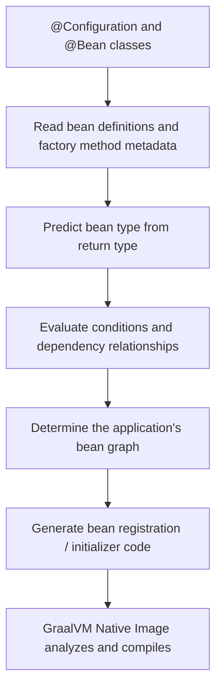

# Declaring Sufficiently Specific Return Types on @Bean Methods

## Lesson Objectives

In Spring Boot, a method annotated with **`@Bean`** is a factory method: Spring invokes the method to obtain an object and registers that object in the `ApplicationContext`. The return type declared on the method signature provides Spring with information about the bean type **even before the instance has been created**.

When using **Spring AOT** to prepare an application for GraalVM Native Image, this type information becomes even more important. Spring needs to analyze bean definitions, configuration conditions, and dependency relationships during the build phase. If a `@Bean` method declares a return type that is too general, such as `Object`, the container may not be able to predict the actual type the factory method will return at the time analysis is needed.

After this lesson, you will be able to:

- Explain why the return type of `@Bean` affects bean type prediction.
- Distinguish between the declared type on the factory method and the actual runtime class of the returned object.
- Choose a return type specific enough for injection and `@ConditionalOnBean` / `@ConditionalOnMissingBean` conditions.
- Identify issues that can arise when Spring AOT analyzes the bean graph.
- Write tests to confirm that a bean is registered and resolved under the expected type.

> **Principle:** declare the most specific return type that the application and configuration conditions actually need. Avoid using `Object` or raw types when you already know the bean type. If your design intentionally exposes only an abstraction, use that abstraction consistently in injection and conditionals.

## 1. How does Spring know a bean's type?

### 1.1. @Bean is a factory method

Consider a simple configuration:

```java
@Configuration(proxyBeanMethods = false)
class ExportConfiguration {

    @Bean
    CsvReportExporter csvReportExporter() {
        return new CsvReportExporter();
    }
}
```

Spring reads the metadata of the `csvReportExporter()` method to create a bean definition. The bean definition holds information about the factory method, bean name, scope, dependencies, and related metadata. From the return type `CsvReportExporter`, Spring can predict that this bean is compatible with that type before invoking the factory method.

Only when the context is refreshed does Spring execute the bean creation steps according to the lifecycle. Therefore, distinguish between:

- **Declared type:** the type written in the `@Bean` method signature.
- **Predicted type:** the type Spring can infer from the bean definition before creating the instance.
- **Runtime type:** the actual class of the object returned by the factory method.

These three types can be the same, but they are not always identical.

### 1.2. The runtime type is not always available at build time

Example:

```java
@Bean
Object reportExporter() {
    return new CsvReportExporter();
}
```

When the method is called, the actual object is `CsvReportExporter`. However, before the factory method runs, the bean metadata only declares the type `Object`. Components that need early type prediction should not have to execute the factory method just to discover the concrete type.

This is especially important for:

- Checking beans by type during configuration processing.
- Auto-configuration conditions based on the presence of a bean.
- Dependency and bean graph analysis during AOT processing.
- Operations that need to know the bean type before instantiating the instance.

You should not assume that declaring `Object` guarantees every injection will fail in all cases. Spring may learn more about the type after the instance is created. The problem is that **early type information is lost**, making prediction and conditions that run before bean instantiation less reliable.

## 2. Example: an overly general return type

Suppose the application has an abstraction and an implementation:

```java
public interface ReportExporter {
    byte[] export();
}

public class CsvReportExporter implements ReportExporter {
    @Override
    public byte[] export() {
        return "id,total\n1,100".getBytes(java.nio.charset.StandardCharsets.UTF_8);
    }
}
```

### 2.1. Declaring the return type as `Object`

```java
@Configuration(proxyBeanMethods = false)
class ReportConfiguration {

    @Bean
    Object reportExporter() {
        return new CsvReportExporter();
    }
}
```

Spring knows the bean named `reportExporter` has declared type `Object`. When inspecting bean definitions, the container does not have enough information from the factory method signature to confirm whether this bean is a `ReportExporter` or a `CsvReportExporter`.

Another configuration wants to depend on the implementation:

```java
@Configuration(proxyBeanMethods = false)
class CsvJobConfiguration {

    @Bean
    @ConditionalOnBean(CsvReportExporter.class)
    CsvExportJob csvExportJob(CsvReportExporter exporter) {
        return new CsvExportJob(exporter);
    }
}
```

If the exporter bean is only declared with return type `Object`, the condition based on `CsvReportExporter.class` may fail to recognize the bean during condition evaluation. The factory method might return the right implementation at runtime, but the condition needs the type metadata before that point.

### 2.2. Declaring a specific return type

Update the method signature:

```java
@Configuration(proxyBeanMethods = false)
class ReportConfiguration {

    @Bean
    CsvReportExporter reportExporter() {
        return new CsvReportExporter();
    }
}
```

Now the bean definition exposes the type `CsvReportExporter`. Spring can predict this concrete type and also knows it is assignable to the `ReportExporter` abstraction.

Therefore, both injection by abstraction:

```java
@Service
class ReportService {
    private final ReportExporter exporter;

    ReportService(ReportExporter exporter) {
        this.exporter = exporter;
    }
}
```

and conditions by implementation:

```java
@Bean
@ConditionalOnBean(CsvReportExporter.class)
CsvExportJob csvExportJob(CsvReportExporter exporter) {
    return new CsvExportJob(exporter);
}
```

have sufficient type information for Spring to process. Condition matching also still depends on the exporter bean definition having been registered before the condition is evaluated.

## 3. Choosing a return type based on the contract the application needs

You do not always have to declare the concrete implementation. What matters is that the return type is specific enough to express **the type Spring needs to recognize**.

Suppose all consumers only need `ReportExporter`:

```java
@Bean
ReportExporter reportExporter() {
    return new CsvReportExporter();
}
```

This declaration is sufficient for Spring to recognize the bean as `ReportExporter`. Injection by interface and `@ConditionalOnBean(ReportExporter.class)` conditions can rely on that type.

If a component genuinely needs `CsvReportExporter` or a condition needs to check for this exact implementation, a return type of `ReportExporter` does not provide subtype information before the instance is created. In that case, consider declaring the return type as `CsvReportExporter`.

| Return type | What Spring can predict | Suitable when |
|---|---|---|
| `Object` | Knows only a very general type | Rarely appropriate for a bean with a known type |
| `ReportExporter` | Knows the bean satisfies this abstraction | Both consumers and conditionals use the interface |
| `CsvReportExporter` | Knows the concrete implementation and the interfaces it implements | A consumer/condition requires the subtype |
| Raw types like `List` | Loses generic element type information | Should be avoided if the element type is known |
| `List<ReportExporter>` | Knows the generic element type | Consumers need accurate generic metadata |

**Balancing abstraction and type prediction:** Spring recommends declaring the most specific return type possible, especially when a bean implements an interface. However, if the architectural goal is to expose only the interface and all consumers/conditions work through that interface, returning the interface type is a clear choice. Avoid arbitrarily narrowing or widening types; let the signature express the exact contract the container needs to know.

## 4. Impact on `@ConditionalOnBean` and `@ConditionalOnMissingBean`

### 4.1. Conditions checking bean types

Spring Boot provides commonly used conditions:

- `@ConditionalOnBean(SomeType.class)`: the configuration is applied only when a bean matching the required type is already present.
- `@ConditionalOnMissingBean(SomeType.class)`: the configuration is applied only when no bean matching the required type is present yet.

These conditions are frequently used in auto-configuration to allow users to replace the default implementation.

Example:

```java
@Configuration(proxyBeanMethods = false)
class DefaultExportConfiguration {

    @Bean
    @ConditionalOnMissingBean(ReportExporter.class)
    ReportExporter reportExporter() {
        return new CsvReportExporter();
    }
}
```

The `ReportExporter` return type is appropriate because the condition also checks `ReportExporter.class`. When a user provides another bean implementing that abstraction, the auto-configuration can back off according to the condition.

### 4.2. Conditions checking implementations

If a condition requires a subtype:

```java
@Bean
@ConditionalOnBean(CsvReportExporter.class)
CsvExportJob csvExportJob(CsvReportExporter exporter) {
    return new CsvExportJob(exporter);
}
```

then the exporter bean needs metadata specific enough to identify `CsvReportExporter`. If the factory method only declares `Object` or only declares an interface that does not reveal the subtype, the condition may not match.

### 4.3. Registration order also matters

A specific return type is a necessary condition for type prediction, but it does not solve all configuration ordering issues. `@ConditionalOnBean` and `@ConditionalOnMissingBean` typically inspect only those bean definitions that have already been processed at the time the condition is evaluated.

In auto-configuration, use ordering mechanisms such as `@AutoConfiguration(after = ...)`, `@AutoConfiguration(before = ...)`, or appropriate ordering relationships to ensure dependent configurations are processed in the right order.

Therefore, when a condition does not match, check all of the following:

1. The return type of the factory method creating the target bean.
2. The actual bean name, type, and qualifiers.
3. When the bean definition is registered.
4. Profiles/properties affecting the condition.
5. Auto-configuration ordering and other conditions on the class/method.

## 5. Why does this matter for Spring AOT?

### 5.1. AOT needs to analyze the bean graph

During AOT processing, Spring analyzes the application configuration and prepares bootstrap components. At a high level:



A clear return type helps Spring know which types a bean can satisfy without relying on an already-created instance. This information supports bean graph analysis and the generation of consistent AOT artifacts.

### 5.2. AOT cannot rely on arbitrary runtime values

For example, a factory method selects an implementation using a class name retrieved from a property:

```java
@Bean
Object paymentGateway(Environment environment) throws Exception {
    String className = environment.getRequiredProperty("payment.gateway-class");
    Class<?> type = Class.forName(className);
    return type.getDeclaredConstructor().newInstance();
}
```

The signature only reveals `Object`. The implementation also depends on a configuration value and classpath at runtime. This is a design that is difficult to analyze statically and may need refactoring to fit AOT/native.

A better approach when the set of implementations is known is to declare them explicitly via configuration:

```java
@Configuration(proxyBeanMethods = false)
class PaymentConfiguration {

    @Bean
    @ConditionalOnProperty(name = "payment.provider", havingValue = "stripe")
    StripePaymentGateway stripePaymentGateway() {
        return new StripePaymentGateway();
    }

    @Bean
    @ConditionalOnProperty(name = "payment.provider", havingValue = "sandbox")
    SandboxPaymentGateway sandboxPaymentGateway() {
        return new SandboxPaymentGateway();
    }
}
```

The implementations and conditions are explicitly declared so Spring can analyze them. With Native Image, ensure the profiles/properties determining the bean graph are configured appropriately during the AOT build; do not assume changing an environment variable at runtime will add a bean that was excluded from the AOT model.

### 5.3. Specific return types do not replace Runtime Hints

Declaring a return type helps **predict bean types**. It does not automatically solve all Native Image issues such as:

- Reflection on classes/members identified by name at runtime.
- Resources loaded via dynamic paths.
- Dynamic proxies or JNI that tooling cannot infer.
- Serialization/deserialization relying on unregistered metadata.

Those cases require checking Spring/library support and adding appropriate `RuntimeHints` or Native Image metadata. Do not add hints just to work around a type prediction issue; fix the `@Bean` signature and bean configuration first.

## 6. Generic types and return types in special cases

### 6.1. Avoid raw types

If a bean actually provides a generic type, preserve the generic information on the method:

```java
@Bean
List<ReportExporter> reportExporters() {
    return List.of(
            new CsvReportExporter(),
            new JsonReportExporter()
    );
}
```

Declaring a raw `List` or `List<?>` loses part of the element type information that Spring can use when resolving generic types and dependencies. If the element type is known, declare the specific generic type.

### 6.2. FactoryBean

With `FactoryBean<T>`, distinguish between the factory's type and the product type that the factory produces. Spring has its own rules for predicting the product type from the generic metadata of `FactoryBean`. If the generic is raw or overly broad, product type prediction may also be limited.

Conceptual example:

```java
class ReportExporterFactoryBean implements FactoryBean<ReportExporter> {
    @Override
    public ReportExporter getObject() {
        return new CsvReportExporter();
    }

    @Override
    public Class<?> getObjectType() {
        return ReportExporter.class;
    }
}
```

When using a factory bean, declare the generic parameter and `getObjectType()` accurately according to the actual product. If you need to reference the factory bean itself instead of its product, Spring uses the `&`-prefixed bean name convention.

### 6.3. Proxied beans

If a bean has AOP or transactions applied, the object received may be a proxy. Declare the return type as the abstraction or class that consumers can use and that the actual proxy can satisfy. With JDK dynamic proxies, the proxy type typically implements interfaces; do not expect to inject the concrete implementation class if the proxy only exposes the interface.

Declaring a specific type does not turn a `final` class into a class that CGLIB can proxy, nor does it replace testing proxy compatibility in native. When encountering proxy errors, check which proxy type Spring selects, the bean's interfaces/class, and the required hints.

## 7. Practice: fixing the return type and verifying the bean

### 7.1. Create a test configuration

Create an interface and an implementation:

```java
public interface MessageFormatter {
    String format(String message);
}

public class PlainMessageFormatter implements MessageFormatter {
    @Override
    public String format(String message) {
        return "[message] " + message;
    }
}
```

Initially declare the bean too broadly:

```java
@Configuration(proxyBeanMethods = false)
class FormatterConfiguration {

    @Bean
    Object messageFormatter() {
        return new PlainMessageFormatter();
    }
}
```

Try a configuration that needs to know the implementation:

```java
@Configuration(proxyBeanMethods = false)
class FormatterJobConfiguration {

    @Bean
    @ConditionalOnBean(PlainMessageFormatter.class)
    FormatterJob formatterJob(PlainMessageFormatter formatter) {
        return new FormatterJob(formatter);
    }
}
```

Observe the condition and type prediction. Then change the return type to `PlainMessageFormatter`:

```java
@Bean
PlainMessageFormatter messageFormatter() {
    return new PlainMessageFormatter();
}
```

Rerun tests and AOT processing. Compare the bean graph/conditions before and after the change. While practicing, place conditional configurations in the proper processing order; if using auto-configuration, declare appropriate ordering.

### 7.2. Verify using ApplicationContext

You can write tests to confirm that the bean can be looked up by type:

```java
@SpringBootTest
class FormatterConfigurationTests {

    @Autowired
    ApplicationContext context;

    @Test
    void formatterIsAvailableByContract() {
        assertThat(context.getBean(MessageFormatter.class))
                .isInstanceOf(PlainMessageFormatter.class);
    }

    @Test
    void formatterIsAvailableByImplementation() {
        assertThat(context.getBean(PlainMessageFormatter.class))
                .isNotNull();
    }
}
```

This example uses AssertJ and Spring Boot Test. When the return type is `Object`, lookup tests by implementation type may behave differently after the bean has already been instantiated; more importantly, verify conditions and bean predictability before instance creation. Therefore, combine context tests with conditional/auto-configuration tests and AOT processing.

### 7.3. Verification steps in a native project

1. Run JVM tests to confirm configuration and dependency injection.
2. Run Spring AOT processing using `./gradlew processAot` or `./mvnw spring-boot:process-aot` when the project is configured accordingly.
3. Inspect the generated sources/metadata and confirm the expected bean is in the generated model.
4. Build native using `./gradlew nativeCompile` or the corresponding Maven command/profile.
5. Run the native executable or container image; verify features that depend on that bean.

You do not need to run both Gradle and Maven in the same project. Use whichever build tool the project adopts; the commands above only illustrate both options.

## 8. Checklist when declaring `@Bean` methods

Before finalizing configuration, check:

- **Are `Object` or raw types being used?** If the real type is known, replace it with an explicit type.
- **What type do consumers need?** An interface, abstract class, or concrete implementation?
- **What type do conditions check?** The return type must be specific enough for conditions to predict the bean accurately.
- **Are there generic dependencies?** Keep generic parameters if Spring needs them for resolution.
- **Is the bean created via reflection/dynamic class loading?** Evaluate AOT analyzability and hints.
- **Are there profiles/properties that alter the bean graph?** Ensure the AOT build configuration matches the deployment.
- **Are proxies or `FactoryBean` involved?** Check the actual proxy/product type exposed by Spring.
- **Have AOT and native tests been run?** Passing JVM tests alone is not enough to prove native compatibility.

## 9. Common errors

| Symptom | Possible cause | Resolution |
|---|---|---|
| `@ConditionalOnBean` does not match even though the factory method returns the right object | Return type is too general, so the bean type cannot be predicted when the condition runs | Declare a specific return type matching the type the condition checks |
| Injection by implementation cannot find the bean | Signature exposes only the interface or parent type | Determine whether consumers truly need the implementation; if so, expose the concrete subtype |
| Default auto-configuration still activates | Condition fails to recognize custom bean or configurations are processed out of order | Check return type, bean registration order, and `@ConditionalOnMissingBean` |
| AOT build produces a different bean graph than expected | Build-time conditions/profiles/properties differ from expected configuration | Inspect the build environment and conditions affecting bean topology |
| Native runtime is missing a class/resource | Reflection/resource metadata issue, not merely the return type | Check Runtime Hints and library metadata |
| Proxied bean cannot be injected by implementation | Proxy only exposes interfaces or the class cannot be proxied as configured | Check JDK/CGLIB proxy behavior and inject through an appropriate abstraction |

**Do not fix every native error by changing return types.** Return types solve type prediction issues. Reflection, resources, proxies, class initialization, and runtime configuration errors have their own distinct causes.

**Remember:** a `@Bean` method signature is part of the metadata Spring uses before creating an instance. Declaring a sufficiently specific return type helps the container predict beans, evaluate conditions, and analyze the bean graph more accurately in Spring AOT. Keep abstractions when they represent the application's true contract, but avoid `Object`/raw types and expose subtypes when conditions or consumers need to know that subtype.
