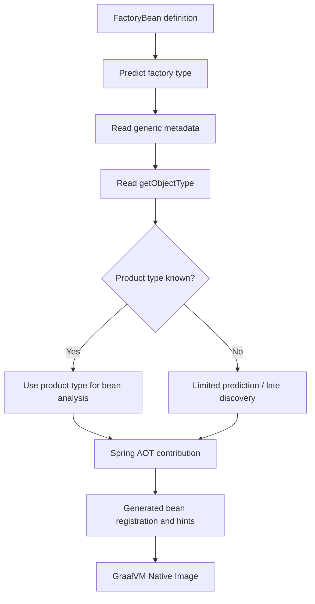

# Generics, FactoryBean, and Type Information AOT Needs to Infer

## 1. Why does type information matter for Spring AOT?

In a Spring Boot application, the container manages beans based on `BeanDefinition`, class types, generic types, qualifiers, annotations, and other metadata. When running on the JVM, Spring can use reflection and certain runtime inference steps to find matching beans, determine a factory's product type, or resolve dependencies.

With **Spring AOT and GraalVM Native Image**, many decisions must be made at build time. Spring AOT analyzes the ApplicationContext structure, generates bean registration/initialization code, and produces runtime hints. If type information is not sufficiently clear, Spring may fail to infer which bean is injected, what the actual generic argument is, or what product type a `FactoryBean` will produce. The consequence can be beans not being properly recognized during AOT, configurations being skipped, or errors appearing only when running native.

This lesson focuses on three elements:

- **Generic types:** preserving type parameter information such as `Repository<Order, UUID>` or `Handler<Invoice>`.
- **FactoryBean:** a factory bean that creates a product object; the factory type and the product type are two distinct concepts.
- **Type prediction:** Spring's ability to predict a bean/product type before creating an instance, supporting autowiring, configuration conditions, and AOT processing.

The goal is not to avoid all generics or `FactoryBean`s. What matters is providing metadata that is accurate and stable enough for Spring to analyze the bean structure before the application runs.

## 2. Bean types and generic types in Spring

Java generics allow expressing type relationships at compile time:

```java
interface MessageHandler<T> {
    void handle(T message);
}

final class Invoice {
    private String code;

    public String getCode() {
        return code;
    }

    public void setCode(String code) {
        this.code = code;
    }
}

@Component
class InvoiceHandler implements MessageHandler<Invoice> {
    @Override
    public void handle(Invoice message) {
        System.out.println(message.getCode());
    }
}
```

From the declaration `InvoiceHandler implements MessageHandler<Invoice>`, Spring can infer the implemented generic interface. This is useful when injecting by type:

```java
@Service
class InvoiceDispatcher {
    private final MessageHandler<Invoice> handler;

    InvoiceDispatcher(MessageHandler<Invoice> handler) {
        this.handler = handler;
    }
}
```

The generic type is not just the raw class name `MessageHandler`; it also contains the type argument `Invoice`. When there are multiple implementations such as `MessageHandler<Invoice>` and `MessageHandler<Shipment>`, generic information helps Spring distinguish candidates in scenarios where generic-aware dependency resolution applies.

However, Java type erasure means generic arguments generally do not exist in full on an instance at runtime. Spring can read generic signatures from class/method/field metadata, but if types are erased via raw type declarations or only determined from runtime data, inference becomes limited.

## 3. What information do raw types and wildcards lose?

Compare:

```java
MessageHandler<Invoice> invoiceHandler;
MessageHandler rawHandler;
MessageHandler<?> anyHandler;
MessageHandler<? extends Number> numberHandler;
```

| Declaration | Inferable information | Limitations |
|---|---|---|
| `MessageHandler<Invoice>` | Specific generic argument is Invoice | Still needs to inspect the declared type and actual candidates |
| `MessageHandler` | Knows only the raw interface | Cannot distinguish Invoice from Shipment |
| `MessageHandler<?>` | Knows there is a generic parameter, but not the specific argument | Cannot rely on a wildcard to select one specific implementation |
| `MessageHandler<? extends Number>` | Knows the upper bound Number | Cannot determine the exact subtype without additional metadata |

When declaring a bean factory method that returns a raw type, Spring may be unable to predict the product's generic type:

```java
@Bean
MessageHandler messageHandler() {
    return new InvoiceHandler();
}
```

Declare the exact return type if that is the bean's actual contract:

```java
@Bean
MessageHandler<Invoice> invoiceMessageHandler() {
    return new InvoiceHandler();
}
```

Note: a method signature returning a generic interface provides better metadata, but Spring still needs to determine the appropriate implementation, qualifiers, and injection conditions. Do not assume changing the signature alone solves every AOT issue.

## 4. How does Spring use generic metadata to select beans?

Spring has a generic-aware dependency resolution mechanism, typically through `ResolvableType` and injection point metadata. Example:

```java
interface Store<T> {
    T find(String id);
}

@Component
class OrderStore implements Store<Order> {
    @Override
    public Order find(String id) {
        return new Order(id);
    }
}

@Component
class CustomerStore implements Store<Customer> {
    @Override
    public Customer find(String id) {
        return new Customer(id);
    }
}
```

A service can request:

```java
@Service
class OrderService {
    private final Store<Order> store;

    OrderService(Store<Order> store) {
        this.store = store;
    }
}
```

Spring can use the generic argument at the injection point to filter candidates. This is container behavior, not an automatic feature of GraalVM. Spring AOT needs to see the metadata of bean definitions and injection points to generate the corresponding initialization structure.

If code uses raw types or selects beans manually by class name read from a runtime property, early inference may be unclear. For a known set of choices, prefer specific generic types, qualifiers, or an explicit bean registry.

## 5. ResolvableType and preserving generic information

Spring provides `ResolvableType` to represent and inspect types with generics:

```java
ResolvableType type = ResolvableType.forClass(InvoiceHandler.class);
ResolvableType[] interfaces = type.getInterfaces();

for (ResolvableType candidate : interfaces) {
    System.out.println(candidate);
}
```

A `ResolvableType` can be created from a field, method parameter, method return type, or class. Example:

```java
class HandlerConfig {
    MessageHandler<Invoice> invoiceHandler;
}

Field field = HandlerConfig.class.getDeclaredField("invoiceHandler");
ResolvableType resolvableType = ResolvableType.forField(field);

Class<?> rawClass = resolvableType.resolve();
ResolvableType generic = resolvableType.getGeneric(0);
Class<?> genericClass = generic.resolve();
```

Expected result: the raw class is `MessageHandler`, and the generic argument resolves to `Invoice` if the signature is preserved and analyzable. Remember to import `org.springframework.core.ResolvableType` and `java.lang.reflect.Field`.

`ResolvableType` is a tool that helps Spring read generic metadata; it cannot recover information completely lost due to raw types or type erasure. If a generic argument is only constructed by runtime logic and does not appear in static metadata, you must redesign or supply additional information.

## 6. FactoryBean: distinguishing the factory from the created object

`FactoryBean<T>` is a Spring abstraction: the bean is registered as a factory, yet when retrieving the bean by its regular name, the container returns **the product created by the factory**. You can retrieve the factory itself by adding the `&` prefix before the bean name.

Example:

```java
public class InvoiceFormatterFactory
        implements FactoryBean<InvoiceFormatter> {

    @Override
    public InvoiceFormatter getObject() {
        return new InvoiceFormatter();
    }

    @Override
    public Class<?> getObjectType() {
        return InvoiceFormatter.class;
    }

    @Override
    public boolean isSingleton() {
        return true;
    }
}
```

Registering the factory:

```java
@Configuration
class FormatterConfiguration {

    @Bean
    FactoryBean<InvoiceFormatter> invoiceFormatter() {
        return new InvoiceFormatterFactory();
    }
}
```

The container distinguishes:

| Access | Object/type received |
|---|---|
| `getBean("invoiceFormatter")` | The `InvoiceFormatter` product |
| `getBean("&invoiceFormatter")` | The `InvoiceFormatterFactory` factory |
| `getObjectType()` | The product type predicted by the factory |
| `@Bean` return type | Metadata declared for bean registration/factory |

This is a critical point for type prediction. If Spring only knows the factory class without knowing what type the factory produces, it may fail to predict the product when analyzing autowiring or bean conditions.

## 7. The role of getObjectType()

The `getObjectType()` method allows a `FactoryBean` to advertise its product type without necessarily calling `getObject()`. This is important information for the container to look up the bean by type before the product is instantiated.

Good implementation:

```java
@Override
public Class<?> getObjectType() {
    return InvoiceFormatter.class;
}
```

Under-informative implementation:

```java
@Override
public Class<?> getObjectType() {
    return null;
}
```

Returning `null` can prevent Spring from predicting the product type when the factory has not yet been initialized. Some operations may still work after the instance is created, but early inference and autowiring by type are restricted.

Practical rules:

- Return the exact product class if it can be stably determined.
- Do not call `getObject()` merely to infer the type if doing so causes side effects or initializes resources.
- Do not return the factory class when the container needs the product type.
- If the product is a proxy or subtype, determine the appropriate contract type so injection works properly.

If the product type depends on unknown runtime data, a `FactoryBean` will struggle to provide a fixed class. In that case, consider designing a shared interface, qualifiers, or separating runtime selection into a service registry.

## 8. Generic FactoryBean and product metadata

A `FactoryBean` can declare a generic type:

```java
class TypedFactoryBean<T> implements FactoryBean<T> {
    private final Class<T> objectType;
    private final Supplier<T> supplier;

    TypedFactoryBean(Class<T> objectType, Supplier<T> supplier) {
        this.objectType = objectType;
        this.supplier = supplier;
    }

    @Override
    public T getObject() {
        return supplier.get();
    }

    @Override
    public Class<?> getObjectType() {
        return objectType;
    }
}
```

The generic `T` provides type information in the signature, while `objectType` provides explicit runtime metadata for the product type. These two sources of information complement each other. If the factory is created with a raw type, or `objectType` is only assigned after an unpredictable runtime step, Spring AOT cannot rely on the generic declaration to infer a reliable concrete type.

Example of explicitly typed registration:

```java
@Bean
FactoryBean<InvoiceFormatter> invoiceFormatterFactory() {
    return new TypedFactoryBean<>(
            InvoiceFormatter.class,
            InvoiceFormatter::new
    );
}
```

The example must ensure the constructor method reference matches the actual class. In real designs, verify that `getObjectType()` returns the exact `InvoiceFormatter.class` before using the bean by type.

## 9. FactoryBean and the AOT lifecycle

Spring AOT analyzes bean definitions, factory methods, and type information that the container can know in advance. With `FactoryBean`, separate:

1. **Factory bean definition:** metadata describing the factory bean.
2. **Factory implementation type:** the class implementing `FactoryBean`.
3. **Product type:** the type of object produced by `getObject()`.
4. **Product instance:** the actual instance, which may only be created when needed at runtime.

AOT analysis needs sufficient information to build the appropriate registration structure. If the product type is clear, Spring can process many type-based decisions before runtime. If the type is unclear, injecting the product by type or evaluating configuration conditions may depend on runtime initialization.



This diagram is a conceptual model; exact processing details depend on the Spring Framework version and bean kind. Not every `FactoryBean` requires a custom AOT processor. First provide accurate type metadata and use Spring's supported mechanisms.

## 10. Configuration conditions and type prediction

Some Spring configurations use conditions based on bean type, such as `@ConditionalOnBean`, `@ConditionalOnMissingBean`, or `@ConditionalOnSingleCandidate` in Spring Boot auto-configuration. These conditions rely on bean metadata predictable at the time the configuration is evaluated.

Example:

```java
@Configuration
class FormatterAutoConfiguration {

    @Bean
    @ConditionalOnMissingBean(InvoiceFormatter.class)
    InvoiceFormatter invoiceFormatter() {
        return new InvoiceFormatter();
    }
}
```

If a `FactoryBean` creates `InvoiceFormatter` but the product type is not clearly predicted, type-based conditions may fail to see the product as expected during evaluation. The result could be creating an extra default bean or activating auto-configuration differently than intended.

When troubleshooting:

- Identify which phase the condition is evaluated in.
- Check the factory method return type, generic signature, and `getObjectType()`.
- Inspect the bean definition/condition evaluation report on the JVM.
- Inspect the AOT output and test native with the exact configuration.

Do not rely on instance initialization order to "fix" type prediction when metadata can be accurately exposed from the start.

## 11. Designing beans so Spring AOT can easily analyze them

Some helpful principles:

### Declare specific return types

```java
@Bean
InvoiceFormatter invoiceFormatter() {
    return new InvoiceFormatter();
}
```

If the contract requires an interface, declare the specific generic interface instead of a raw type:

```java
@Bean
MessageHandler<Invoice> invoiceHandler() {
    return new InvoiceHandler();
}
```

### Avoid FactoryBeans that do not advertise their product type

If the product class is fixed, `getObjectType()` should return that class. If the product type depends on runtime, consider a stable shared contract or a registry mechanism.

### Preserve generic signatures in internal APIs

Avoid raw `List`, `Repository`, or `Handler` whenever generic arguments can be declared. This improves compile-time safety and helps Spring infer types better.

### Limit type discovery from runtime strings

If the list of implementations is known at build time, register concrete beans and select via qualifiers/registry. If plugins are truly loaded after deployment, revisit the architectural requirements because closed-world Native Image does not compile new code on its own.

### Avoid side effects during type prediction

`getObjectType()` should be lightweight, deterministic, and must not open connections, read databases, or construct heavy objects. Spring may invoke this method during type prediction before the product is actually needed.

## 12. Testing generics and FactoryBeans before building native

Start on the JVM with tests verifying the contract:

```java
@SpringBootTest
class InvoiceFormatterFactoryTest {

    @Autowired
    ApplicationContext context;

    @Test
    void factoryProductHasExpectedType() {
        Object product = context.getBean("invoiceFormatter");
        assertThat(product).isInstanceOf(InvoiceFormatter.class);
    }

    @Test
    void factoryItselfCanBeRetrieved() {
        Object factory = context.getBean("&invoiceFormatter");
        assertThat(factory).isInstanceOf(FactoryBean.class);
    }
}
```

The test above requires Spring Boot Test and AssertJ as shown; assertions can be replaced with JUnit. Ensure the bean name matches the actual name and the `FactoryBean` is registered in the context.

For generic injection, add a test initializing a service requiring `MessageHandler<Invoice>` and confirm the right implementation is injected. For conditions, test scenarios with and without the `FactoryBean` product present. Then run the same tests in native test mode or against the actual executable, because JVM tests do not catch every reachability limitation.

## 13. Diagnosing common errors

| Symptom | Possible cause | Resolution |
|---|---|---|
| Desired generic bean not found | Raw type, unclear generic signature, or multiple candidates | Declare specific generics, qualifiers, and inspect the injection point |
| `FactoryBean` product not injected by type | `getObjectType()` returns null/wrong type | Return the exact product class, not the factory class |
| Condition creates default bean even though product exists | Product type was not predicted when the condition ran | Check `FactoryBean` metadata and condition evaluation |
| AOT does not process as expected | Bean definition created dynamically or type depends on runtime | Clarify registration/type at build time or provide an appropriate extension |
| Native fails when creating object reflectively | Missing reflection metadata | Add `RuntimeHints` or library metadata |
| JVM tests pass, but native lacks an implementation | Runtime lookup relies on dynamic information not included in the image | Use an explicit bean registry, add metadata, and run native tests |

Distinguish **type prediction** errors from **reflection reachability** errors. Type prediction determines whether Spring recognizes the bean/product by type in the container; reflection metadata determines whether Native Image retains members for dynamic access. An application can encounter one or both issues.

## 14. Practice exercise: creating a generic FactoryBean with a clear product type

**Context:** a Spring Boot application has two formatters for `Invoice` and `Receipt` that need to be registered through a factory.

**Step 1 — Create the contract.** Declare `Formatter<T>` and two models with concrete generic types.

**Step 2 — Create the FactoryBean.** Implement `FactoryBean<Formatter<Invoice>>` (or a factory returning the appropriate formatter), providing a `getObjectType()` consistent with the actual product.

**Step 3 — Register the bean.** Use `@Bean` with a specific return type, avoiding raw `FactoryBean`.

**Step 4 — Verify on JVM.** Inject the product by type, retrieve the factory using the `&` prefix, and confirm bean-type conditions behave as expected.

**Step 5 — Run Spring AOT.** Observe context analysis and generated output; verify the bean/product type is properly recognized.

**Step 6 — Build native.** Run Maven/Gradle Native Image, test the formatter flows and related reflection/resource accesses.

**Step 7 — Compare.** Record JVM/native results for bean wiring, conditions, startup, and RSS in the same environment.

Completion criteria: generic types are clearly preserved in APIs, the `FactoryBean` exposes the accurate product type, injection/conditions behave as expected on both JVM and native, and no errors occur only on rare runtime branches.

## 15. Conclusion

Spring AOT needs sufficiently clear type metadata to analyze bean definitions and generate appropriate initialization code. **Generic signatures** preserve type relationships for dependency resolution; **`FactoryBean.getObjectType()`** advertises the product type before creating an instance; **type prediction** enables Spring to evaluate injections and configuration conditions earlier.

Raw types, erased generics, or a `FactoryBean` that fails to advertise its product type can make it difficult for Spring to infer container structure. Declaring concrete types, clear factory methods, stable product types, and testing on both JVM and native helps reduce build-time surprises. When a type truly can only be known at runtime, design a contract/registry aligned with GraalVM Native Image's closed-world model.
