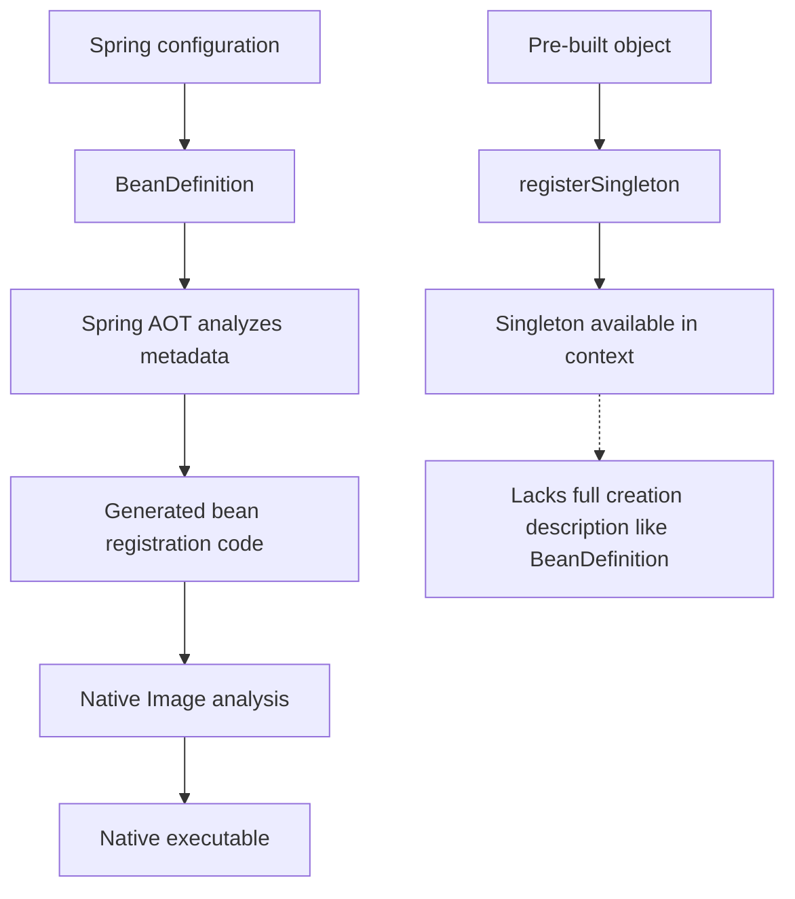

# Analyzable BeanDefinitions Differ from Direct Singleton Registration

## 1. Why does this distinction matter for Spring AOT?

In Spring Framework, the container manages objects through two common concepts: **`BeanDefinition`** and **singleton instance**. A `BeanDefinition` describes how the container creates a bean: class, scope, constructor arguments, factory method, property values, initialization conditions, and related metadata. A singleton instance is a concrete object that has already been created and stored in the container.

In a typical Spring Boot application running on the JVM, many beans can be registered dynamically while the application context initializes. However, when using **Spring AOT** and **GraalVM Native Image**, part of the application model must be analyzed before runtime to generate initialization code and runtime hints. Therefore, how beans are registered affects analyzability.

**A `BeanDefinition` usually describes the structure and intent of bean creation**, giving Spring AOT a basis to inspect the class, constructor, and dependencies and generate appropriate initialization code. Conversely, registering a singleton instance directly only provides an already-created object; the container does not necessarily have enough information about how to recreate that object or its internal dependencies to perform deep analysis.



This **does not mean directly registered singletons are always forbidden in native**. A singleton can be created and registered at runtime if the related code paths and classes remain compatible. The key point is that AOT struggles to infer the structure, creation mechanism, and dependencies of an arbitrary dynamically added object.

## 2. BeanDefinition describes how to create a bean

Example of registering a bean via Java configuration:

```java
@Configuration
class PaymentConfiguration {

    @Bean
    PaymentGateway paymentGateway(PaymentClient client) {
        return new PaymentGateway(client);
    }
}
```

Spring can build metadata for the `paymentGateway` bean: the bean is provided by a factory method, depends on `PaymentClient`, and belongs to a configuration discovered by the framework. Spring AOT can analyze the configuration class, method, and dependencies to generate the corresponding registration/initialization code.

Another perspective is declaring a bean using `GenericBeanDefinition`:

```java
var definition = new GenericBeanDefinition();
definition.setBeanClass(PaymentGateway.class);
definition.setAutowireMode(AbstractBeanDefinition.AUTOWIRE_CONSTRUCTOR);

beanFactory.registerBeanDefinition("paymentGateway", definition);
```

This example illustrates the Spring Framework API; to work properly, the definition must be registered into the appropriate `BeanDefinitionRegistry` before the bean factory completes initialization. For beans with complex dependencies, explicit factory methods or constructor injection generally make the model clearer.

A `BeanDefinition` can contain:

- Bean class or factory bean/method.
- Scope (`singleton`, `prototype`, request scope, etc.).
- Constructor arguments and property values.
- Autowire mode, qualifiers, and dependency metadata.
- Lazy initialization, primary, depends-on, and lifecycle methods.
- Role and source metadata.

The clearer the metadata, the better foundation the framework has to determine the bean graph. However, not every dynamic `BeanDefinition` is automatically supported by Spring AOT; you must consider the registration timing and how it is defined.

## 3. What is a directly registered singleton instance?

Spring allows registering an already-created object into the singleton registry:

```java
PaymentGateway gateway = new PaymentGateway(
    new PaymentClient("https://payments.internal")
);

beanFactory.registerSingleton("paymentGateway", gateway);
```

Here, the application creates the object itself first, then hands the instance to the container. The container knows the bean name and the concrete object, but does not necessarily know:

- Which condition or data drove the class choice.
- Which constructor was called and which arguments were passed.
- How internal dependencies inside the object were created or injected.
- Whether any factory/lifecycle logic needs to be re-executed when creating another application context.
- Which classes/members/resources are accessed dynamically when the object operates.

`registerSingleton` registers the instance in the singleton registry; it is not equivalent to registering a `BeanDefinition` that describes the bean creation process. A directly registered object also does not go through the same full bean creation pipeline as a container-instantiated bean, so you should not assume all `BeanPostProcessor`s or injection mechanisms were applied in the same way.

### Quick comparison

| Aspect | BeanDefinition | Directly registered singleton |
|---|---|---|
| Primary information | Describes how to create the bean | An already-existing instance |
| Constructor/factory metadata | Can be represented | Not automatically stored as a definition |
| Dependency graph | Analyzable from metadata | Dependencies are already inside the object; hard to infer generally |
| Object creation timing | Container creates when needed | Application created it before registration |
| Container lifecycle | Can participate in the full bean creation pipeline | Does not run the full bean creation pipeline by default |
| Spring AOT | Usually easier to analyze if registered at the right time | Hard to analyze creation and dependencies of an arbitrary object |
| Native Image | Can generate code/hints from supported configurations | Must ensure classes and code paths remain reachability-compatible |

## 4. Registration timing determines AOT analyzability

Spring AOT does not simply snapshot the entire state of an arbitrary running context. The AOT process prepares the application in a build-time phase with specific rules for context creation, configuration analysis, and code generation.

Three scenarios can be distinguished:

1. **Beans declared statically via configuration/component scan**: Spring AOT usually recognizes them and generates supporting code.
2. **BeanDefinitions registered dynamically during an AOT-observable/supported phase**: can be analyzed if the API and registration timing are appropriate; must be tested with the specific Spring version.
3. **Singletons created from runtime-only data and registered directly**: AOT cannot know the production run's instances and creation logic in the build-time context. Required classes must still be retained and runtime code paths must be Native Image compatible.

Example of a registry post-processor adding a `BeanDefinition` during context refresh:

```java
class PluginDefinitions implements BeanDefinitionRegistryPostProcessor {
    @Override
    public void postProcessBeanDefinitionRegistry(
            BeanDefinitionRegistry registry) {
        var definition = new RootBeanDefinition(EmailPlugin.class);
        registry.registerBeanDefinition("emailPlugin", definition);
    }

    @Override
    public void postProcessBeanFactory(
            ConfigurableListableBeanFactory beanFactory) {
        // No additional processing needed in this example.
    }
}
```

This illustrates definition registration during the registry processing phase. Whether AOT can analyze it also depends on whether the processor is discovered and executed in the AOT context, the APIs used, and the framework version. Do not conclude that every registry post-processor is supported merely because it creates a `BeanDefinition`.

Conversely, if plugins are loaded from a database after the service starts and code creates instances then calls `registerSingleton`, the AOT build does not have that database data to predict the object list.

## 5. Practical example: configurable plugins

Suppose a Spring Boot application supports data converters. There are two implementation approaches.

### Approach A — declare beans via static configuration

```java
@Configuration
class ConverterConfiguration {

    @Bean
    @ConditionalOnProperty(
        name = "converter.csv.enabled",
        havingValue = "true"
    )
    CsvConverter csvConverter() {
        return new CsvConverter();
    }
}
```

This expresses bean creation intent in configuration that Spring AOT can analyze according to build-time profiles/properties. If conditions decide the bean, ensure build-time properties match the deployed application.

### Approach B — create instances from a runtime class name

```java
String implementation = environment.getProperty("converter.class");
Class<?> type = Class.forName(implementation);
Object plugin = type.getDeclaredConstructor().newInstance();
beanFactory.registerSingleton("runtimeConverter", plugin);
```

This approach depends on a class name from a property and reflection. There are two independent issues:

- Spring AOT cannot know by default which class will be chosen at runtime.
- GraalVM Native Image may require reflection metadata to retain dynamically accessed classes and constructors.

Even adding a reflection hint so the class can be loaded and instantiated **does not turn the instance into a `BeanDefinition` with a dependency graph fully analyzed by Spring AOT**. If the plugin needs injection, lifecycle callbacks, or post-processing, an explicit mechanism must be designed.

### A more analyzable alternative design

If the set of plugins is known before build time, declare them via bean configuration/conditional beans or factory methods. If the plugin list truly must change at runtime, keep a static registry/service bean and let it manage plugins through a well-defined SPI, avoiding asking Spring to rebuild the entire bean graph dynamically.

## 6. Can direct singletons work in Native Image?

Yes. Native Image does not forbid the `registerSingleton` API. If the object is constructed from a statically reachable class, all required constructors/members are retained by reachability analysis, and registration occurs on a valid runtime code path, the singleton can work.

Example:

```java
@Component
class RuntimeRegistry {

    private final ConfigurableListableBeanFactory beanFactory;

    RuntimeRegistry(ConfigurableListableBeanFactory beanFactory) {
        this.beanFactory = beanFactory;
    }

    public void registerHealthMarker() {
        beanFactory.registerSingleton(
            "healthMarker",
            new HealthMarker("ready")
        );
    }
}

record HealthMarker(String value) {}
```

This illustrates runtime behavior, not a recommendation to use the singleton registry to replace normal bean declarations. An object registered after context refresh may not be automatically injected into beans that were already initialized earlier. Furthermore, `registerSingleton` does not automatically run all callbacks of the bean initialization pipeline.

If the class name is chosen dynamically or members are invoked via reflection, metadata must be verified. If the object requires dependency injection or `BeanPostProcessor`s, use an appropriate Spring bean creation mechanism instead of instantiating the object manually and registering the instance.

## 7. FactoryBean, ObjectProvider, and mechanisms to distinguish

Do not equate every dynamic object-creation mechanism with singleton registration.

- **`@Bean` factory method**: clearly describes a bean created by a method; Spring AOT can analyze supported configurations.
- **`FactoryBean<T>`**: supplies objects through Spring's factory contract. Ensure both the factory and its product are AOT/native compatible.
- **`ObjectProvider<T>`**: allows querying/retrieving beans on demand from the container; it does not automatically generate metadata for an arbitrary class absent from the bean graph.
- **`BeanDefinitionRegistryPostProcessor`**: intervenes in the registry before the bean factory finishes; useful for frameworks, but execution timing in AOT must be verified.
- **`registerSingleton`**: adds an already-created instance to the registry; does not provide a bean creation description equivalent to a `BeanDefinition`.

For framework libraries, Spring may provide dedicated AOT contributions. When integrating a library that creates beans dynamically, check its Native Image support documentation and test against a real executable.

## 8. How to test the difference between BeanDefinition and singleton

Write a small test to observe the registry:

```java
@Test
void comparesDefinitionAndSingletonRegistration() {
    var factory = new DefaultListableBeanFactory();

    var definition = new RootBeanDefinition(EmailPlugin.class);
    factory.registerBeanDefinition("emailPlugin", definition);

    factory.registerSingleton(
        "metricsMarker",
        new MetricsMarker("ready")
    );

    assertThat(factory.containsBeanDefinition("emailPlugin")).isTrue();
    assertThat(factory.containsSingleton("metricsMarker")).isTrue();
    assertThat(factory.containsBeanDefinition("metricsMarker")).isFalse();
}
```

The test shows that the two registration kinds are stored by different mechanisms. It does not prove that AOT generated appropriate code, nor does it confirm the classes will work on Native Image.

To verify AOT/native:

1. Write JVM tests for the bean graph and plugin behavior.
2. Run the Spring AOT task with the target profiles/properties.
3. Compile the Native Image.
4. Launch the native executable and exercise the exact bean registration/lookup scenario.
5. If reflection or dynamic plugin loading is involved, add tests for every required class/member and corresponding metadata.
6. Verify lifecycle/injection if objects are created outside the container.

## 9. Common errors and how to address them

| Symptom | Possible cause | Resolution |
|---|---|---|
| Bean exists on JVM but is missing in native | Bean created under different conditions/profiles in AOT | Check build-time profiles/properties and AOT output |
| Plugin class not found | Class name chosen dynamically, missing reachability/reflection metadata | Register required classes/members, test native |
| Singleton is in registry but not injected | Registered after consumer beans already initialized | Design static dependencies or a controlled lookup mechanism |
| Bean does not run `BeanPostProcessor` as expected | Instance created outside container then registered directly | Let the container create the bean from a `BeanDefinition`/factory |
| AOT build misses dynamic config | Data only available at runtime | Move selection into a static runtime registry or provide an AOT contribution |
| Native build succeeds, but plugin fails when invoked | Missing reflection/member/resource or native dependency | Inspect stack trace and metadata, test the exact code path |

## 10. Principles for AOT-friendly bean design

- Prefer components/configurations and `@Bean` methods that clearly express application structure.
- Use `BeanDefinition` when dynamic bean registration is genuinely needed while still being able to describe the class, factory, and dependencies before context completion.
- Use singleton registration for pre-built objects only when there is a specific reason and its lifecycle is well understood.
- Avoid fetching class lists from a database/network during AOT to decide the executable's bean graph.
- Decouple flexible runtime plugins from the core bean graph via a static registry/service bean.
- Add Runtime Hints for reflection/resources/proxies only when necessary dynamic access paths exist.
- Test AOT and the native executable with the exact deployment profiles, properties, and workload.

## 11. Self-check questions

1. What does a `BeanDefinition` describe that a singleton instance does not provide on its own?
2. Why does Spring AOT generally have a better basis for analysis with beans declared via `@Bean`?
3. Is direct singleton registration forbidden in Native Image? Explain the conditions under which it works.
4. Does a reflection hint solve the problem of Spring AOT not knowing the dependency graph of a dynamically created object?
5. Why might a singleton registered after context refresh fail to be injected into an already-created bean?
6. When the plugin list must change at runtime, how can you design a registry to keep the core bean graph stable?

**Remember:** a `BeanDefinition` describes **how the container creates a bean**, whereas singleton registration supplies **an already-existing instance**. With Spring AOT, prefer bean configurations with clear metadata for the framework to analyze; if a runtime singleton is needed, validate class reachability, reflection, dependencies, and lifecycle through tests on the native executable.
