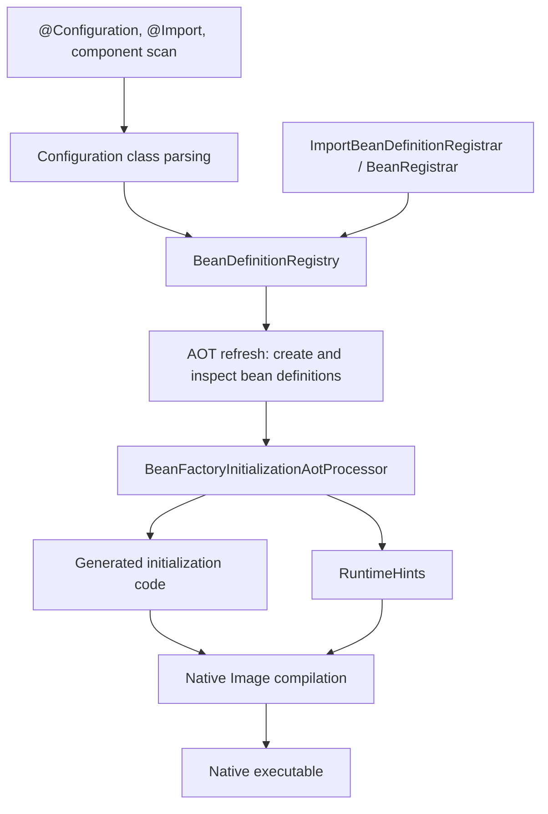

# Programmatic Bean Registration and Choosing AOT-Supported APIs

## 1. Why does the bean registration method affect Native Image?

In a Spring Boot application, beans are typically declared using `@Component`, `@Service`, `@Repository`, `@Configuration`, and `@Bean` methods. Spring reads the configuration, creates `BeanDefinition`s, resolves dependencies, and instantiates objects during the `ApplicationContext` lifecycle.

Some libraries or modules need to **register beans programmatically** rather than annotating every class. For example: an integration library needs to register a group of adapters depending on available modules; a starter needs to add an implementation when imported; or an application needs to create beans whose names and scopes are determined from configuration.

On a regular JVM, many callbacks and APIs can accomplish this. However, with **Spring AOT** and **GraalVM Native Image**, Spring must see the bean structure at build time to generate initialization code and required metadata. If a bean is only added after AOT has analyzed the `ApplicationContext`, the generated code may not contain that bean or may lack the necessary runtime hints.

This lesson focuses on choosing AOT-compatible APIs for programmatic bean registration:

- Spring Framework 7: use `BeanRegistrar` and `BeanRegistry` for new programmatic bean registration needs.
- Spring Framework 6.x: use `ImportBeanDefinitionRegistrar` imported via `@Import`; where appropriate, `BeanDefinitionRegistryPostProcessor` can be used.
- When you need to contribute AOT initialization code or metadata for specialized infrastructure, explore `BeanFactoryInitializationAotProcessor` and `BeanRegistrationAotProcessor`.

The running example is an `orders` module that needs to register `OrderPolicy` and `OrderService`. The configuration selected at build time must produce the same set of beans when the application runs natively.

## 2. How does AOT process bean structure?

### 2.1. From configuration to generated initialization code

During the AOT phase, Spring creates an `ApplicationContext` for analysis. This process processes configurations and creates the required bean definitions, without instantiating all beans like a regular runtime `refresh()`. Then the AOT engine analyzes the `BeanFactory`, generates Java code/bytecode to reproduce the required state, and collects `RuntimeHints` for reflection, resources, serialization, or proxies.



**Key takeaway:** AOT needs to know *which beans will exist* and *what their types are* before the native compiler runs. Creating a single object in a runtime callback is not equivalent to registering a `BeanDefinition` that AOT can analyze.

### 2.2. Limitations to keep in mind

AOT shifts certain decisions from runtime to build time, introducing several constraints:

1. **The classpath is fixed at build time.** You cannot expect a native image to scan the classpath and discover new plugins added after the executable was built.
2. **The set of beans is determined at build time.** `@Profile` conditions and environment properties affecting `@Conditional` are evaluated when AOT runs. Changing that profile or property at runtime does not regenerate the bean structure.
3. **Beans registered as singleton instances** via `registerSingleton(...)` are not converted into AOT initialization code in the usual way.
4. **Bean definitions with arbitrary instance suppliers** (lambdas or method references attached directly to a definition) are not automatically transformed like standard bean definitions. Specifically, Spring Framework 7's `BeanRegistrar` has AOT integration and supports suppliers declared through that API.
5. **Bean type declarations must be sufficiently specific.** If only an interface is exposed while the implementation carries important callbacks, annotations, or type metadata, AOT may miss required behavior.

Therefore, when registering beans, prefer APIs that add **bean definitions to the registry while configuration is being parsed**.

## 3. Choosing an API by Spring Framework version

The Spring Boot version determines which Spring Framework version the project uses. Therefore, check actual dependencies before choosing an API.

| Common Spring Boot line | Included Spring Framework | Preferred programmatic bean registration API |
|---|---|---|
| Spring Boot 3.x | Spring Framework 6.x | `ImportBeanDefinitionRegistrar` and `BeanDefinitionRegistry` |
| Spring Boot 4.x | Spring Framework 7.x | `BeanRegistrar` and `BeanRegistry` |

This is the typical version mapping; projects may manage custom dependencies or BOMs. Do not infer the API solely from module names or the installed JDK.

### 3.1. How to check the Framework version

With Gradle:

```bash
./gradlew dependencyInsight \
  --dependency spring-context \
  --configuration runtimeClasspath
```

With Maven:

```bash
./mvnw dependency:tree -Dincludes=org.springframework:spring-context
```

If the dependency tree shows Spring Framework 6.x, do not import `BeanRegistrar` because this API was introduced in Framework 7.0. If the project already uses Framework 7.x, `BeanRegistrar` is the first choice for programmatic bean registration.

## 4. Spring Framework 7: using `BeanRegistrar`

Spring Framework 7 adds `BeanRegistrar` as the official API dedicated to programmatic bean registration. A registrar is typically brought into configuration via `@Import` on a `@Configuration` class.

### 4.1. Basic bean registration

The example below uses Java and Spring Framework 7:

```java
package com.example.orders.config;

import org.springframework.beans.factory.BeanRegistrar;
import org.springframework.beans.factory.BeanRegistry;
import org.springframework.core.env.Environment;

public final class OrderBeanRegistrar implements BeanRegistrar {

    @Override
    public void register(BeanRegistry registry, Environment environment) {
        if (environment.matchesProfiles("orders")) {
            registry.registerBean(OrderPolicy.class);
            registry.registerBean(OrderService.class);
        }
    }
}
```

`OrderPolicy` and `OrderService` are application classes. For example, `OrderPolicy` has a default constructor so the registry can register it directly:

```java
package com.example.orders;

public final class OrderPolicy {

    public String name() {
        return "standard";
    }
}
```

`OrderService` uses constructor injection to receive `OrderPolicy`:

```java
package com.example.orders;

public final class OrderService {

    private final OrderPolicy policy;

    public OrderService(OrderPolicy policy) {
        this.policy = policy;
    }

    public String policyName() {
        return this.policy.name();
    }
}
```

The registrar is imported as follows:

```java
package com.example.orders.config;

import org.springframework.context.annotation.Configuration;
import org.springframework.context.annotation.Import;

@Configuration(proxyBeanMethods = false)
@Import(OrderBeanRegistrar.class)
public class OrderConfiguration {
}
```

In this example, `Environment` is used right as Spring parses configuration to decide whether to register the beans. The profile condition is therefore locked into the AOT result. When running native, you cannot switch profiles at runtime to make `OrderPolicy` and `OrderService` appear if they were not registered in that build.

### 4.2. Registering with names and customizing beans

`BeanRegistry` allows specifying bean names and customizing scope, lazy initialization, description, or an instance supplier:

```java
public final class OrderBeanRegistrar implements BeanRegistrar {

    @Override
    public void register(BeanRegistry registry, Environment environment) {
        registry.registerBean("orderPolicy", OrderPolicy.class);

        registry.registerBean("orderService", OrderService.class, spec -> spec
                .description("Order processing service")
                .supplier(context -> new OrderService(
                        context.bean(OrderPolicy.class))));
    }
}
```

The `BeanRegistrar` API is supported by Spring Framework 7 in the AOT pipeline, even when using a supplier via `BeanRegistry.Spec`. This is an important difference from manually creating an arbitrary `BeanDefinition` and attaching a lambda supplier to it.

Do not use a supplier just to bypass dependency injection. If a bean has a clear constructor and Spring can resolve dependencies on its own, registering directly with `registry.registerBean(OrderService.class)` is usually simpler and easier to analyze.

### 4.3. Registering from a configuration list

A common use case is creating adapters for each endpoint or connector type declared in configuration. This list must be determinable when AOT runs:

```java
public final class ConnectorRegistrar implements BeanRegistrar {

    @Override
    public void register(BeanRegistry registry, Environment environment) {
        if (environment.matchesProfiles("connectors")) {
            registry.registerBean(HttpConnector.class);
            registry.registerBean(MessageConnector.class);
        }
    }
}
```

If the connector list depends on external configuration, provide that configuration in the AOT build environment. Do not rely on querying a config server at runtime to change the number of beans after the executable has been built.

### 4.4. Kotlin DSL for `BeanRegistrar`

Spring Framework 7 recommends Kotlin users use `BeanRegistrarDsl` to register beans with DSL syntax:

```kotlin
import org.springframework.beans.factory.BeanRegistrarDsl

class OrderBeanRegistrar : BeanRegistrarDsl({
    registerBean<OrderPolicy>()

    registerBean<OrderService>()

    profile("orders") {
        registerBean<ExpeditedOrderService>()
    }
})
```

This is a Spring Framework 7.0+ API. For Kotlin projects running Spring Framework 6.x, use `ImportBeanDefinitionRegistrar` or `@Bean` configurations appropriate for that version.

## 5. Spring Framework 6.x: using `ImportBeanDefinitionRegistrar`

Spring Framework 6.x does not yet have `BeanRegistrar`. The appropriate approach is to implement `ImportBeanDefinitionRegistrar`, register `BeanDefinition`s into `BeanDefinitionRegistry`, and import the registrar via `@Import`.

### 5.1. Example of registering beans using `RootBeanDefinition`

```java
package com.example.orders.config;

import org.springframework.beans.factory.config.BeanDefinition;
import org.springframework.beans.factory.support.BeanDefinitionRegistry;
import org.springframework.beans.factory.support.RootBeanDefinition;
import org.springframework.context.annotation.ImportBeanDefinitionRegistrar;
import org.springframework.core.type.AnnotationMetadata;

public final class OrderBeanRegistrar implements ImportBeanDefinitionRegistrar {

    @Override
    public void registerBeanDefinitions(
            AnnotationMetadata importingClassMetadata,
            BeanDefinitionRegistry registry) {

        if (!registry.containsBeanDefinition("orderPolicy")) {
            RootBeanDefinition definition =
                    new RootBeanDefinition(OrderPolicy.class);
            definition.setRole(BeanDefinition.ROLE_APPLICATION);
            registry.registerBeanDefinition("orderPolicy", definition);
        }

        if (!registry.containsBeanDefinition("orderService")) {
            RootBeanDefinition definition =
                    new RootBeanDefinition(OrderService.class);
            registry.registerBeanDefinition("orderService", definition);
        }
    }
}
```

Import the registrar in configuration:

```java
@Configuration(proxyBeanMethods = false)
@Import(OrderBeanRegistrar.class)
public class OrderConfiguration {
}
```

Spring invokes `registerBeanDefinitions(...)` during configuration analysis. Because the registrar adds bean definitions to the registry before AOT analyzes the bean factory, the AOT engine can see `OrderPolicy` and `OrderService`.

`RootBeanDefinition` provides the concrete bean type so Spring can analyze constructors, injection points, and lifecycle callbacks. If a bean requires constructor injection, declare a clear constructor and let the container manage instantiation.

### 5.2. Why does `ImportBeanDefinitionRegistrar` fit AOT?

`@Import` makes the registrar part of configuration class parsing. This is the exact phase where Spring AOT processes configurations, `@Import`, import selectors, and component scanning. Beans registered here can participate in the set of bean definitions observed by the AOT engine.

Use a registrar when:

- A library or starter needs to register multiple beans for an imported configuration.
- Bean definitions are determined from metadata or build-time conditions.
- You need control over bean names, scopes, primary flags, or definition attributes.
- You want to avoid registering objects directly into the singleton registry after AOT analysis.

## 6. `BeanDefinitionRegistryPostProcessor`: when to use it?

`BeanDefinitionRegistryPostProcessor` is a long-standing Spring extension point. It extends `BeanFactoryPostProcessor` and is invoked before regular bean factory post-processors, allowing additional bean definitions to be registered.

Example:

```java
import org.springframework.beans.BeansException;
import org.springframework.beans.factory.config.ConfigurableListableBeanFactory;
import org.springframework.beans.factory.support.BeanDefinitionRegistry;
import org.springframework.beans.factory.support.BeanDefinitionRegistryPostProcessor;
import org.springframework.beans.factory.support.RootBeanDefinition;

public final class OrderRegistryPostProcessor
        implements BeanDefinitionRegistryPostProcessor {

    @Override
    public void postProcessBeanDefinitionRegistry(
            BeanDefinitionRegistry registry) {

        RootBeanDefinition definition =
                new RootBeanDefinition(OrderPolicy.class);
        registry.registerBeanDefinition("orderPolicy", definition);
    }

    @Override
    public void postProcessBeanFactory(
            ConfigurableListableBeanFactory beanFactory) {
        // No additional operations needed in this example.
    }
}
```

If using this registrar in an AOT application, pay attention to the lifecycle of the processor itself. When a processor is registered as a bean, it may be invoked during AOT and **invoked again at runtime**. If it only exists to create bean definitions at build time without a proper way to reproduce that behavior at runtime, the bean factory state between the two phases may differ.

Spring Framework recommends using `ImportBeanDefinitionRegistrar` for normal bean registration use cases. If `BeanDefinitionRegistryPostProcessor` is genuinely needed as infrastructure, ensure its behavior is accurately reproduced in AOT, for example by implementing `BeanFactoryInitializationAotProcessor` to contribute appropriate AOT code.

Do not choose `BeanDefinitionRegistryPostProcessor` merely out of habit from JVM applications. Choose an extension point that runs in the right configuration phase and can participate in AOT.

## 7. Two SPIs for extending the AOT engine itself

`BeanRegistrar` and `ImportBeanDefinitionRegistrar` serve **bean definition registration**. Meanwhile, some infrastructure libraries need to contribute code to reproduce special behavior when the context is initialized from AOT-generated code. Spring provides two specialized SPIs.

### 7.1. `BeanFactoryInitializationAotProcessor`

`BeanFactoryInitializationAotProcessor` receives the `ConfigurableListableBeanFactory` prepared at build time and creates a `BeanFactoryInitializationAotContribution`. The contribution can:

- Generate bean factory initialization code to reproduce special behavior.
- Register runtime hints for reflection, resources, serialization, or proxies.
- Add resources or classes required for the native compilation step.

An implementation can be registered in `META-INF/spring/aot.factories` under the fully qualified name of the `BeanFactoryInitializationAotProcessor` interface, or registered as a bean. If a bean itself implements this SPI, the bean and its dependencies are instantiated during AOT and that bean is excluded from the AOT-optimized context; therefore, it should only be used for infrastructure beans with minimal dependencies. If declared via a factory method, Spring recommends making that method `static`.

### 7.2. `BeanRegistrationAotProcessor`

`BeanRegistrationAotProcessor` processes each `RegisteredBean` to produce a `BeanRegistrationAotContribution`. This is a low-level API for cases where you need to customize how Spring generates registration code for a specific bean.

The framework already provides default implementations for most bean definitions. Thus, typical application code does not need to implement this SPI itself. It is better suited for libraries or infrastructure that need to replace/enhance how AOT handles a special kind of bean.

### 7.3. Comparing the APIs

| API | Timing/target processed | Primary purpose | Priority in typical applications |
|---|---|---|---|
| `@Bean` | Configuration analysis | Declare beans in Java/Kotlin style | Highest when programmatic registration is not needed |
| `BeanRegistrar` (Framework 7+) | Configuration parsing via `@Import` | Register beans with a modern AOT-supported API | Preferred on Framework 7+ |
| `ImportBeanDefinitionRegistrar` | Configuration parsing via `@Import` | Register `BeanDefinition`s programmatically | Preferred on Framework 6.x |
| `BeanDefinitionRegistryPostProcessor` | Bean definition registry post-processing | Modify registry at infrastructure stage | Use only when truly needed; handle AOT lifecycle carefully |
| `BeanFactoryInitializationAotProcessor` | Build-time AOT | Contribute initialization code and hints for the bean factory | For infrastructure/custom integration |
| `BeanRegistrationAotProcessor` | Build-time, per registered bean | Customize bean registration code | For framework/library integration |
| `registerSingleton` | Direct instance registration | Add a pre-built object to the singleton registry | Avoid for beans that AOT needs to recreate |

## 8. Declaring exact bean types

AOT inspects bean types to detect constructors, injection points, lifecycle callbacks, annotations, and proxy requirements. If a registrar only exposes an interface while the implementation carries essential metadata, AOT may miss that behavior.

Suboptimal example:

```java
@Configuration(proxyBeanMethods = false)
class PaymentConfiguration {

    @Bean
    PaymentGateway paymentGateway() {
        return new DefaultPaymentGateway();
    }
}
```

If `DefaultPaymentGateway` has methods or annotations that AOT needs to process, an overly general return type like `PaymentGateway` may hide them from AOT.

Declare the concrete implementation type instead:

```java
@Configuration(proxyBeanMethods = false)
class PaymentConfiguration {

    @Bean
    DefaultPaymentGateway paymentGateway() {
        return new DefaultPaymentGateway();
    }
}
```

Consumers can still inject via the `PaymentGateway` interface; what needs to be exact is the declared type of the bean definition so AOT has complete information.

For programmatically registered bean definitions, use `RootBeanDefinition` and declare an explicit target type when generics are needed:

```java
RootBeanDefinition definition = new RootBeanDefinition(OrderRepository.class);
definition.setTargetType(
        ResolvableType.forClassWithGenerics(OrderRepository.class, Order.class));
registry.registerBeanDefinition("orderRepository", definition);
```

This example assumes `OrderRepository<T>` is a generic class. Setting `ResolvableType` helps Spring understand the actual type argument rather than seeing only the raw type.

## 9. Registration patterns to avoid in AOT

### 9.1. Direct singleton instance registration

Example:

```java
context.getBeanFactory().registerSingleton(
        "orderPolicy", new OrderPolicy("strict"));
```

An object that is already instantiated and registered as a singleton instance is not a bean definition that AOT can recreate through the standard pipeline. Processing needed for initialization, injection, or generating runtime hints may not be applied.

If the object needs to be managed as a Spring bean, register a `BeanDefinition` through an appropriate registrar. If the object is genuinely an application-managed singleton that does not need the Spring lifecycle, do not expect AOT to turn it into a fully managed bean.

### 9.2. Registering beans too late in runtime callbacks

A listener or callback invoked only after the context has refreshed can add objects or bean definitions when running on the JVM. However, AOT finished its analysis earlier; the generated initializer does not know in advance about beans added later.

Architectural pattern to avoid:

```java
@Component
class LateBeanRegistrar implements ApplicationListener<ContextRefreshedEvent> {

    @Override
    public void onApplicationEvent(ContextRefreshedEvent event) {
        // Do not use late runtime callbacks to register beans needed by AOT.
    }
}
```

Move registration decisions into `@Bean`, `BeanRegistrar`, or `ImportBeanDefinitionRegistrar` so AOT processes them at build time.

### 9.3. Relying on classpath scanning after the executable starts

Native Image does not operate like a JVM with an open classpath where the application can freely scan and discover plugins added after the build. Packages and components to scan must be determined during AOT. If the application requires user-supplied plugins after release, redesign the plugin boundary and consider an alternative deployment mechanism; you cannot assume runtime classpath scanning will work like on a standard JVM.

### 9.4. Conditions depending on runtime configuration

For example, a bean is created only when `feature.enabled=true`. If AOT builds with `false`, the bean may be absent from the generated context. Setting the environment variable `FEATURE_ENABLED=true` when running the container will not make the bean reappear.

For features that vary by deployment environment, either build separate artifacts for each required variant, or keep the bean present and control behavior via runtime state rather than mutating the bean graph after the build.

## 10. Bean registration and Runtime Hints are related but distinct

Properly registering a bean definition lets AOT know the bean exists and how to initialize it. However, if the bean or its dependencies use reflection, resources, serialization, proxies, or JNI in ways that cannot be inferred automatically, the application still needs runtime hints.

Spring provides `RuntimeHintsRegistrar` and `@ImportRuntimeHints` to register required information during AOT processing.

Example of a service loading templates from the classpath by dynamic name:

```java
public class OrderTemplateHints implements RuntimeHintsRegistrar {

    @Override
    public void registerHints(RuntimeHints hints, ClassLoader classLoader) {
        hints.resources().registerPattern("templates/orders/*.html");
    }
}
```

Attach hints close to the component using them:

```java
@Component
@ImportRuntimeHints(OrderTemplateHints.class)
public class OrderTemplateService {
    // Loads templates during request processing.
}
```

Runtime hints do not replace bean registration. Conversely, a registrar creating a bean definition does not automatically guarantee all reflection/resources used by that bean are supported. Verify both aspects when building native.

## 11. Testing AOT configuration before building the Native Image

Do not wait until the native compiler finishes to discover a bean is missing. You can inspect AOT output early on the JVM using the following steps.

### 11.1. Running Spring AOT via the build tool

With Gradle, once the Spring Boot plugin and native build plugin are configured:

```bash
./gradlew processAot
```

With Maven:

```bash
./mvnw -Pnative spring-boot:process-aot
```

Task/goal names and activation depend on the plugin version. In Maven, the Spring Boot parent's `native` profile may already bind the `process-aot` execution to the `package` lifecycle; if so, run the build with the profile rather than invoking a duplicate execution manually.

Inspect the logs and the build's generated sources/resources directories to confirm the registrar was invoked, bean definitions were included in AOT, and runtime hints were generated.

### 11.2. Verifying bean definitions with tests

Example verifying that `OrderService` is registered in the context:

```java
@SpringBootTest
@ActiveProfiles("orders")
class OrderBeanRegistrationTests {

    @Autowired
    ApplicationContext applicationContext;

    @Test
    void registersOrderService() {
        assertThat(applicationContext.getBean(OrderService.class)).isNotNull();
    }
}
```

The test above verifies behavior when the context runs with the `orders` profile. To verify AOT, also run the AOT pipeline or test the context in an appropriate AOT mode; a regular JVM `@SpringBootTest` alone does not prove the bean was generated in the AOT output.

### 11.3. Testing runtime hints separately

If a registrar is also paired with a `RuntimeHintsRegistrar`, you can test hints using `RuntimeHintsPredicates`:

```java
@Test
void registersOrderTemplateResources() {
    RuntimeHints hints = new RuntimeHints();
    new OrderTemplateHints().registerHints(hints, getClass().getClassLoader());

    assertThat(RuntimeHintsPredicates.resource()
            .forResource("templates/orders/confirmation.html"))
            .accepts(hints);
}
```

This is a unit test for metadata. It does not replace integration tests on the native executable, but it helps catch missing resource hints early and makes diagnosis easier.

### 11.4. Running native integration tests

Once the AOT output is correct, build the native executable/container image and run critical flows:

- Registered beans can inject the right dependencies.
- Profiles/conditions matching the build environment apply as expected.
- Lifecycle callbacks and proxies work.
- Reflection, resources, serialization, and JNI are tested if used.
- Business endpoints, health/readiness, and external connections work on the target platform.

## 12. Quick decision table

| Need | API to choose | Why |
|---|---|---|
| One or a few fixed beans | `@Bean` | Clear, directly understood by AOT |
| Programmatic bean registration on Framework 7+ | `BeanRegistrar` + `BeanRegistry` | Dedicated API, supports AOT including suppliers |
| Programmatic bean registration on Framework 6.x | `ImportBeanDefinitionRegistrar` + `BeanDefinitionRegistry` | Runs during configuration parsing; AOT sees the definitions |
| Infrastructure needing to modify the registry during post-processing | `BeanDefinitionRegistryPostProcessor` | Usable, but requires handling runtime callback re-execution in AOT |
| Generating initialization code for the bean factory | `BeanFactoryInitializationAotProcessor` | Contributes behavior at the bean factory level |
| Customizing initialization code for a specific bean | `BeanRegistrationAotProcessor` | Contributes at the registered bean level |
| Registering an already-created object with `registerSingleton` | Avoid if the bean needs AOT | AOT cannot recreate the instance in the standard way |

## 13. Practice exercise: AOT-compatible `OrderService` registration

**Context:** a Spring Boot service has `OrderPolicy` and `OrderService`. You need to register both beans programmatically and build a GraalVM Native Image.

### Option A — Spring Framework 7

1. Create `OrderBeanRegistrar implements BeanRegistrar`.
2. In `register(...)`, call `registry.registerBean(OrderPolicy.class)` and `registry.registerBean(OrderService.class)`.
3. Import the registrar using `@Import(OrderBeanRegistrar.class)` on `@Configuration`.
4. Enable the `orders` profile at build time if the registrar uses `environment.matchesProfiles("orders")`.
5. Run the AOT task and inspect the generated output.

### Option B — Spring Framework 6.x

1. Create `OrderBeanRegistrar implements ImportBeanDefinitionRegistrar`.
2. In `registerBeanDefinitions(...)`, create `RootBeanDefinition`s for `OrderPolicy` and `OrderService`.
3. Register the definitions via `BeanDefinitionRegistry.registerBeanDefinition(...)`.
4. Import the registrar via `@Import` on `@Configuration`.
5. Run the AOT task and inspect the generated output.

### Results to verify

| Check | Expected outcome |
|---|---|
| Framework version | Correct API chosen for 6.x or 7.x |
| Registrar invoked during AOT | Confirmed via logs/breakpoints or generated definitions |
| Bean definitions | `OrderPolicy` and `OrderService` are present in the AOT context |
| Constructor injection | `OrderService` receives `OrderPolicy` |
| Runtime profile | Matches the profile selected during the AOT build |
| Native build | GraalVM Native Image compiles successfully |
| Native integration test | Endpoint using `OrderService` returns the expected result |

## 14. Common errors

| Symptom | Possible cause | Resolution |
|---|---|---|
| `BeanRegistrar` not found | Project uses Spring Framework 6.x | Switch to `ImportBeanDefinitionRegistrar` or upgrade to a compatible Framework/Boot version |
| Bean appears on JVM but is missing in native | Registered via a callback not processed by AOT or registered too late | Move to a registrar during configuration parsing and inspect AOT output |
| `BeanDefinitionRegistryPostProcessor` runs twice | Processor is registered as a bean and invoked in both AOT and runtime | Use `ImportBeanDefinitionRegistrar` or implement an appropriate AOT contribution |
| Bean exists but lacks injection/lifecycle metadata | Type declaration is too broad or definition lacks type info | Use concrete implementation types and `RootBeanDefinition`/`ResolvableType` when needed |
| Changing profile at runtime does not change beans | Profile/condition was evaluated at build time | Build an artifact per target profile or keep beans fixed and control behavior at runtime |
| Reflection/resource error in native | Bean was registered, but `RuntimeHints` are missing | Use `@ImportRuntimeHints`/`RuntimeHintsRegistrar` and test hints |
| `registerSingleton` works on JVM but is not AOT-optimized | Registered an instance instead of a definition | Register a `BeanDefinition` using an appropriate registrar |
| Native build fails when creating bean with custom arguments | AOT cannot infer dynamic constructor/factory method | Use constructor injection or clearly typed factory beans; add hints when needed |

## 15. Conclusion

To register beans programmatically while staying compatible with Spring AOT, the most important rule is to **register bean definitions while Spring is parsing configuration**. On Spring Framework 7, `BeanRegistrar` is the dedicated API supported by AOT, including when using suppliers declared through `BeanRegistry`. On Framework 6.x, `ImportBeanDefinitionRegistrar` combined with `BeanDefinitionRegistry` is the appropriate and standard choice.

`BeanDefinitionRegistryPostProcessor` and the SPIs `BeanFactoryInitializationAotProcessor` and `BeanRegistrationAotProcessor` still have roles in advanced infrastructure, but should not replace simple registrars. Keep the bean graph stable at build time, declare sufficiently specific bean types, test runtime hints separately, and run integration tests on the native executable.

### Official references

- [Spring Framework — Ahead of Time Optimizations](https://docs.spring.io/spring-framework/reference/core/aot.html)
- [Spring Framework — Programmatic Bean Registration](https://docs.spring.io/spring-framework/reference/core/beans/java/programmatic-bean-registration.html)
- [Spring Framework — BeanFactoryInitializationAotProcessor API](https://docs.spring.io/spring-framework/docs/current/javadoc-api/org/springframework/beans/factory/aot/BeanFactoryInitializationAotProcessor.html)
- [Spring Framework — BeanRegistrationAotProcessor API](https://docs.spring.io/spring-framework/docs/current/javadoc-api/org/springframework/beans/factory/aot/BeanRegistrationAotProcessor.html)
- [Spring Boot — Advanced Native Images Topics](https://docs.spring.io/spring-boot/reference/packaging/native-image/advanced-topics.html)
- [Spring Boot — Ahead-of-Time Processing](https://docs.spring.io/spring-boot/maven-plugin/aot.html)
