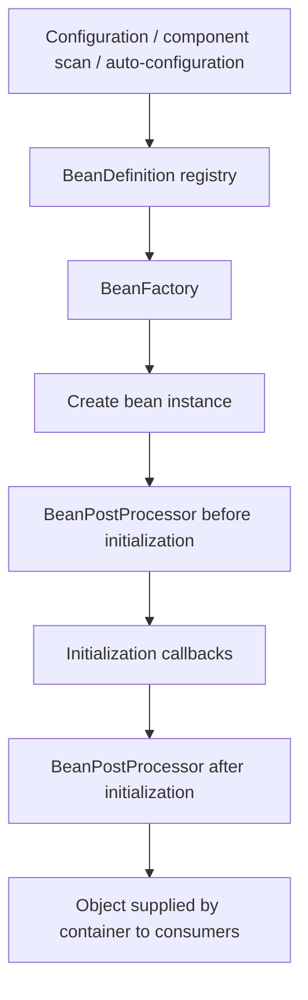

# BeanPostProcessor and Limitations When Changing Bean Structure Beyond Known Information

Spring Framework provides several extension points to intervene in bean creation and management. Among them, **`BeanPostProcessor`** allows processing a bean instance before or after initialization; it is commonly used to inject additional behavior, inspect beans, or wrap beans in proxies. However, when an application uses **Spring AOT** to build a GraalVM Native Image, you must clearly distinguish between **modifying an instance** and **modifying the BeanFactory structure**.

Spring AOT analyzes configurations and bean definitions in the build environment to generate container preparation code. Beans, types, and dynamic access paths that cannot be known at this point may not appear in the AOT output or native executable. A `BeanPostProcessor` running at runtime can still process instances, but it cannot simply add a brand-new bean definition to a pre-prepared structure and expect Native Image to recognize every resulting class, proxy, and dependency.

## 1. Learning objectives

After this lesson, you will be able to:

- Describe when Spring invokes `BeanPostProcessor` and distinguish it from `BeanFactoryPostProcessor` and `BeanDefinitionRegistryPostProcessor`.
- Explain bean instances, bean definitions, the bean graph, and why they matter to Spring AOT.
- Identify post-processing operations that can change the exposed object type, proxies, dependency resolution, or bean structure.
- Understand the limitations when bean structure depends on data that only appears at runtime or is unknown during AOT.
- Design `BeanPostProcessor`s with deterministic behavior, clear types/interfaces, and Native Image compatibility.
- Choose the right AOT extension points and runtime hints when initialization code contributions or dynamic access descriptions are needed.

## 2. Distinguishing BeanDefinition, bean instance, and BeanFactory

Before examining post-processors, separate three concepts:

| Concept | Meaning | Example |
| --- | --- | --- |
| **BeanDefinition** | Metadata describing how the container creates and manages a bean | Bean named `reportService`, type `ReportService`, constructor taking `ReportRepository` |
| **Bean instance** | Actual object created from the bean definition | A `ReportService` object holding a reference to a repository |
| **BeanFactory** | Container managing bean definitions and bean creation/lookup | `DefaultListableBeanFactory` storing definitions and managing singletons |

This can be visualized as:



`BeanDefinition` is the description; `BeanPostProcessor` primarily intervenes on the **instance** created from that description. If you need to add, remove, or modify definition metadata, you must look at factory/registry-level extension points.

Example of a service bean:

```java
public interface ReportOperations {
    String generate();
}

@Service
public class ReportService implements ReportOperations {
    @Override
    public String generate() {
        return "report-ready";
    }
}
```

Spring can register a `BeanDefinition` for `ReportService`. When the container creates the bean, the constructor is invoked and an instance is created. Post-processors can then apply appropriate behaviors before the final object is handed to other beans.

## 3. When does BeanPostProcessor operate?

`BeanPostProcessor` is a Spring SPI for processing bean instances. Two common methods are:

- `postProcessBeforeInitialization(bean, beanName)`: called before the bean's initialization callbacks.
- `postProcessAfterInitialization(bean, beanName)`: called after initialization callbacks; this is where beans are commonly wrapped with proxies.

Simple example:

```java
import org.springframework.beans.BeansException;
import org.springframework.beans.factory.config.BeanPostProcessor;
import org.springframework.stereotype.Component;

@Component
public class ReportBeanInspector implements BeanPostProcessor {
    @Override
    public Object postProcessAfterInitialization(Object bean, String beanName)
            throws BeansException {
        if ("reportService".equals(beanName)) {
            // Can log or inspect the instance.
        }
        return bean;
    }
}
```

This processor receives an already-initialized instance and returns that same instance. It does not create a new `BeanDefinition`, does not modify the registry's list of definitions, and does not ask Spring to rescan configuration.

### 3.1. What can BeanPostProcessor do?

Common scenarios:

- Wrapping a service with a proxy to measure duration or add logging.
- Creating a wrapper implementing a known interface to add retry, metrics, or authorization checks.
- Inspecting bean annotations/metadata and applying behavior to the instance.
- Participating in infrastructure mechanisms such as dependency injection, validation, or Spring AOP.

Spring uses internal `BeanPostProcessor`s for many features. For example, `AutowiredAnnotationBeanPostProcessor` handles injection annotations; auto-proxy creators participate in creating AOP proxies. These processors are part of container internals and do not mean arbitrary processors should add bean definitions while processing instances.

### 3.2. BeanPostProcessor is not a bean registration tool

`BeanPostProcessor` is called while the container is creating bean instances. If the goal is to register additional definitions, use more appropriate APIs:

- `BeanDefinitionRegistryPostProcessor` can interact with the registry and register additional `BeanDefinition`s.
- `BeanFactoryPostProcessor` can read or modify definition metadata before regular beans are instantiated.
- `BeanFactoryInitializationAotProcessor` can contribute BeanFactory initialization code during the AOT phase.
- `BeanRegistrationAotProcessor` can contribute registration/creation logic for a specific bean during the AOT phase.

Do not use `BeanPostProcessor` as a workaround to alter container structure. If a processor creates a secondary object and returns it, that changes **the object consumers receive**; it is still different from registering a new bean definition in the registry.

## 4. Comparing post-processor types

| Extension point | Primary timing/function | Suitable operations | AOT notes |
| --- | --- | --- | --- |
| **BeanDefinitionRegistryPostProcessor** | Before regular beans are created; works with registry | Register or modify bean definitions | Results must be determinable in AOT; avoid depending on runtime-only data |
| **BeanFactoryPostProcessor** | After definitions are loaded, before regular bean instantiation | Adjust BeanFactory/definition metadata | Changes must be reflected in the graph AOT analyzes |
| **BeanPostProcessor** | During creation of each bean instance | Inject behavior, inspect, wrap instance/proxy | Types and dynamic access paths must be compatible with AOT/native output |
| **BeanFactoryInitializationAotProcessor** | When Spring generates AOT contributions for the whole BeanFactory | Generate additional container initialization code | For extensions needing to contribute code at the factory level |
| **BeanRegistrationAotProcessor** | When processing each `RegisteredBean` in AOT | Generate registration/creation code for a specific bean | Must be able to describe bean creation behavior in AOT |
| **RuntimeHintsRegistrar** | Register runtime access metadata for native build | Reflection, resources, proxies, serialization, JNI | Hints describe access capabilities; do not create bean definitions |

The last two groups of APIs are AOT-specific extension points, not alternate names for `BeanPostProcessor`. Choosing the right layer keeps the container model clear and avoids expecting runtime changes to be inferred automatically during the build.

## 5. Why does Spring AOT restrict dynamic bean structure changes?

### 5.1. AOT needs to know the bean graph in advance

At build time, Spring AOT analyzes application configuration and prepares how to initialize the `BeanFactory`. Key inputs can include:

- Configuration classes, component scans, `@Import`, and auto-configuration.
- Classpath and `@Conditional` conditions.
- Profiles and properties affecting bean definitions.
- Registry/factory post-processors able to run during analysis.
- AOT extensions and runtime hints provided by the application/libraries.

The result is a known bean model for Spring to generate code and GraalVM to run reachability analysis. Native Image uses the **closed-world** assumption: required classes and access paths must be known or sufficiently described at build time.

If the bean graph depends on a file created after deployment, a plugin list loaded from the network, a new tenant added to a database, or a class name taken from an unpredictable string, AOT cannot automatically know the full resulting structure.

### 5.2. Structure is decided at build time

Example configuring an audit bean by property:

```java
import org.springframework.boot.autoconfigure.condition.ConditionalOnProperty;
import org.springframework.context.annotation.Bean;
import org.springframework.context.annotation.Configuration;

@Configuration(proxyBeanMethods = false)
class AuditConfiguration {
    @Bean
    @ConditionalOnProperty(
        prefix = "feature",
        name = "audit-enabled",
        havingValue = "true"
    )
    AuditSink auditSink() {
        return new AuditSink();
    }
}

class AuditSink {
}
```

If `feature.audit-enabled=true` in the AOT environment, the bean can be included in the prepared graph. If AOT runs with `false` and therefore does not register the bean, merely changing the property to `true` when running the native executable will not make Spring re-analyze all configuration to generate an extra definition.

This does not mean every property is fixed. A property used for a timeout, URL, or business parameter can still be read from the environment at runtime, as long as it does not need to alter the prepared bean structure. Clearly distinguish which properties are **structural configuration** and which are **operational data**.

### 5.3. Post-processors depending on runtime-only information

For example, a `BeanDefinitionRegistryPostProcessor` loads a plugin list from a remote service and creates a definition for each plugin. When AOT runs in CI, the remote service may be unavailable or return a different list from production. The build output then does not represent the runtime bean graph.

Risky data sources:

- Network/databases reachable only after deployment.
- Current time, random numbers, or fluctuating system state.
- Configuration/secret files mounted separately in production.
- Lists of tenants, plugins, or modules updated independently of the artifact.
- Class names built from external data and loaded via reflection.

For this kind of data, avoid using it to decide a set of bean definitions that must be known in advance. Consider keeping the container structure fixed and representing changing data in a runtime registry/service.

## 6. BeanPostProcessor wrapping a bean with a known wrapper

A suitable use case for `BeanPostProcessor` is wrapping a bean instance with a concrete wrapper class whose type is known from source code.

### 6.1. Define interface and implementation

```java
import org.springframework.stereotype.Service;

interface ReportOperations {
    String generate();
}

@Service("reportService")
class DefaultReportService implements ReportOperations {
    @Override
    public String generate() {
        return "report-ready";
    }
}
```

### 6.2. Create a wrapper with a known type

```java
final class TimedReportOperations implements ReportOperations {
    private final ReportOperations delegate;

    TimedReportOperations(ReportOperations delegate) {
        this.delegate = delegate;
    }

    @Override
    public String generate() {
        long started = System.nanoTime();
        try {
            return delegate.generate();
        }
        finally {
            long elapsedNanos = System.nanoTime() - started;
            System.out.println("reportService took " + elapsedNanos + " ns");
        }
    }
}
```

### 6.3. Use BeanPostProcessor to return the wrapper

```java
import org.springframework.beans.BeansException;
import org.springframework.beans.factory.config.BeanPostProcessor;
import org.springframework.stereotype.Component;

@Component
public class ReportTimingPostProcessor implements BeanPostProcessor {
    @Override
    public Object postProcessAfterInitialization(Object bean, String beanName)
            throws BeansException {
        if ("reportService".equals(beanName)
                && bean instanceof ReportOperations operations) {
            return new TimedReportOperations(operations);
        }
        return bean;
    }
}
```

Consumers should depend on the interface:

```java
import org.springframework.stereotype.Component;

@Component
class ReportController {
    private final ReportOperations reports;

    ReportController(ReportOperations reports) {
        this.reports = reports;
    }

    String getReport() {
        return reports.generate();
    }
}
```

In this example:

1. The `reportService` bean definition is still registered via configuration/component scan.
2. Spring creates `DefaultReportService`.
3. `ReportTimingPostProcessor` receives the instance after initialization and returns `TimedReportOperations`.
4. Consumers receive the object through the `ReportOperations` contract without depending on the concrete implementation.

The wrapper is a static class already referenced in source, making it easier for the compiler and AOT to analyze than a class created from a runtime name. However, this example still needs real behavioral testing with any container features the bean uses.

### 6.4. Consequences of changing the instance type

When `BeanPostProcessor` returns a wrapper, the final object may no longer be an instance of the original implementation. Therefore:

- Injecting by a shared interface is usually clearer than injecting by concrete class.
- Looking up via `getBean(DefaultReportService.class)` may not behave as expected if the finally exposed object is a wrapper not extending that class.
- Conditions, type checks, and bean inspection tools must recognize that the returned instance is wrapped.
- If the wrapper creates a dynamic proxy, check the proxy/reflection metadata required by Native Image.

Avoid wrapping every bean generically without controlling return types, post-processor ordering, circular dependencies, and lifecycle. For common AOP needs, prefer built-in Spring AOP mechanisms with AOT support when appropriate.

## 7. When is registering a new BeanDefinition needed?

If the requirement is truly to add a bean definition, `BeanPostProcessor` is not the right extension point. You can consider `BeanDefinitionRegistryPostProcessor` when the number and types of beans can be determined during analysis.

The following example illustrates registering a fixed definition. It is a pattern for understanding the API; if used in an AOT application, ensure the processor is discovered during AOT and its logic does not depend on changing runtime data:

```java
import org.springframework.beans.BeansException;
import org.springframework.beans.factory.support.BeanDefinitionBuilder;
import org.springframework.beans.factory.support.BeanDefinitionRegistry;
import org.springframework.beans.factory.support.BeanDefinitionRegistryPostProcessor;
import org.springframework.context.annotation.Configuration;

@Configuration(proxyBeanMethods = false)
class FixedAuditRegistration implements BeanDefinitionRegistryPostProcessor {
    @Override
    public void postProcessBeanDefinitionRegistry(
            BeanDefinitionRegistry registry) throws BeansException {
        if (!registry.containsBeanDefinition("fixedAuditSink")) {
            registry.registerBeanDefinition(
                "fixedAuditSink",
                BeanDefinitionBuilder
                    .genericBeanDefinition(AuditSink.class)
                    .getBeanDefinition()
            );
        }
    }

    @Override
    public void postProcessBeanFactory(
            org.springframework.beans.factory.config.ConfigurableListableBeanFactory beanFactory)
            throws BeansException {
        // No additional BeanFactory adjustments needed in this example.
    }
}
```

This definition has a fixed name and type. Spring can see it during analysis if the processor is registered and executed in the AOT context. However, if the logic changes to "read class names from a database and register each class as a bean," the set of definitions is no longer determinable from build inputs.

**Do not confuse a registry post-processor's ability to register definitions with every dynamic registration pattern being AOT-compatible.** Compatibility depends on when the processor runs, what information it needs, whether generated code can reproduce those changes, and whether resulting classes are known to the native compiler.

## 8. AOT-specific extension points

When a library or application has special behavior that default Spring AOT cannot describe, choose the extension point matching the purpose.

### 8.1. BeanFactoryInitializationAotProcessor

`BeanFactoryInitializationAotProcessor` operates at the whole-BeanFactory level during AOT. It can return a contribution for Spring to generate additional initialization code. Use it when an extension needs to inspect overall factory structure or add preparation steps reproducible in generated initialization code.

### 8.2. BeanRegistrationAotProcessor

`BeanRegistrationAotProcessor` processes a specific `RegisteredBean` and can provide a contribution for registering/creating that bean. Use it when creating a bean requires extra AOT code or specialized metadata.

### 8.3. RuntimeHintsRegistrar

`RuntimeHintsRegistrar` registers metadata so Native Image knows about types/members/resources/proxies accessed in ways not easily inferred from static analysis. Example:

```java
import org.springframework.aot.hint.MemberCategory;
import org.springframework.aot.hint.RuntimeHints;
import org.springframework.aot.hint.RuntimeHintsRegistrar;

class ReportRuntimeHints implements RuntimeHintsRegistrar {
    @Override
    public void registerHints(RuntimeHints hints, ClassLoader classLoader) {
        hints.reflection().registerType(
            ReportPayload.class,
            MemberCategory.INVOKE_PUBLIC_CONSTRUCTORS
        );
    }
}
```

This example only registers public constructors for `ReportPayload`. If the application needs to access fields, methods, resources, serialization, or JDK proxies, the corresponding access types must be registered. Hints **do not register `ReportPayload` as a Spring bean** and do not create a new definition.

You can attach the registrar to configuration:

```java
import org.springframework.context.annotation.Configuration;
import org.springframework.context.annotation.ImportRuntimeHints;

@Configuration(proxyBeanMethods = false)
@ImportRuntimeHints(ReportRuntimeHints.class)
class ReportNativeConfiguration {
}
```

### 8.4. Choosing an extension point by requirement

| Need | Suitable approach |
| --- | --- |
| Add logging or wrapper for an existing instance | `BeanPostProcessor` |
| Modify definition metadata | `BeanFactoryPostProcessor` |
| Register known definitions in the registry | `BeanDefinitionRegistryPostProcessor` |
| Add initialization code for the whole factory in AOT | `BeanFactoryInitializationAotProcessor` |
| Add creation/registration logic for a bean in AOT | `BeanRegistrationAotProcessor` |
| Describe reflection/resources/proxies needed by Native Image | `RuntimeHintsRegistrar` |
| Add plugins/tenants changing continuously at runtime | Runtime registry/service, avoiding turning each item into a new Spring bean definition unnecessarily |

## 9. Designing when bean count depends on runtime data

Suppose a multi-tenant application loads a list of tenants from a database. Each tenant has a different report processing configuration.

A design that causes difficulty for AOT is creating a `BeanDefinition` per tenant while the application runs. The number of tenants can change after the build, each tenant may point to a different implementation, and class names may only appear in data.

Instead, keep a fixed service and store tenant configuration as data:

```java
import java.util.Map;
import java.util.concurrent.ConcurrentHashMap;
import org.springframework.stereotype.Component;

record TenantReportConfig(String templateName, boolean enabled) {
}

@Component
class TenantReportRegistry {
    private final Map<String, TenantReportConfig> configurations =
            new ConcurrentHashMap<>();

    void update(String tenantId, TenantReportConfig config) {
        configurations.put(tenantId, config);
    }

    TenantReportConfig find(String tenantId) {
        return configurations.get(tenantId);
    }
}
```

The `TenantReportRegistry` bean has a known type registered in Spring configuration. The number of tenants and configuration values can change in the map at runtime without creating additional Spring bean definitions. If each tenant genuinely requires a different algorithm, use a known set of strategy classes and select the strategy based on tenant data.

### Three questions before creating dynamic beans

1. **Is a separate Spring bean truly needed?** If it is just data, configuration, or state, using objects/records inside a registry is usually simpler.
2. **Are the types and count known at build time?** If not, avoid relying on AOT to infer dynamically emerging definitions.
3. **Can behavior be expressed via a pre-known interface/strategy?** If yes, keep an explicit set of implementations and select at runtime using data.

## 10. Testing BeanPostProcessor and AOT

Do not only test that the context starts successfully. A processor can alter the object consumers receive, causing errors to appear only when injecting by concrete class or when running natively.

### 10.1. Unit/integration tests on the JVM

Verify:

- The processor only processes the expected bean names/types.
- Out-of-scope beans are returned untouched.
- The wrapper preserves the interface and delegates behavior.
- Consumers inject via the expected contract.
- Processor ordering and initialization callbacks do not cause unintended side effects.

Example checking the contract:

```java
import static org.assertj.core.api.Assertions.assertThat;
import org.junit.jupiter.api.Test;
import org.springframework.context.annotation.AnnotationConfigApplicationContext;

class ReportPostProcessorTests {
    @Test
    void exposesReportOperationsContract() {
        try (var context =
                new AnnotationConfigApplicationContext(ReportTestConfiguration.class)) {
            Object bean = context.getBean("reportService");

            assertThat(bean).isInstanceOf(ReportOperations.class);
            assertThat(context.getBean(ReportOperations.class).generate())
                .isEqualTo("report-ready");
        }
    }
}
```

`ReportTestConfiguration` in the test must register the service and processor from the example. The assertion illustrates testing the interface contract; it does not assert that the final object's exact class equals `DefaultReportService`.

### 10.2. Testing the AOT path

Run AOT processing using your configured Maven/Gradle setup, inspect the generated output, and verify:

1. Required processors/configurations are discovered.
2. Expected bean definitions are present in the graph under build conditions.
3. AOT contributions and runtime hints are generated/registered.
4. Required wrapper/proxy types can be recognized by the compiler's reachability analysis.
5. Runtime configuration does not assume it will add bean definitions absent from the build graph.

### 10.3. Integration tests on Native Image

Finally, run the native executable/container and test:

- Beans are exposed under the right interface.
- Proxies/wrappers invoke their delegates.
- Reflection, dynamic proxies, serialization, and resources, if any.
- Profile/condition branches chosen at build time.
- External services, lifecycle, shutdown, and health/readiness.

Passing JVM tests does not prove a native build will succeed. Native Image can uncover missing metadata or reachability issues that the JVM does not require.

## 11. Common design mistakes

| Practice | Problem | Adjustment |
| --- | --- | --- |
| Using `BeanPostProcessor` to register new beans | Wrong API layer; processor handles instances | Use a registry post-processor or appropriate AOT contribution |
| Reading a plugin list from the network during AOT | Build output depends on external environment and is non-reproducible | Use fixed build config or a runtime plugin registry |
| Instantiating classes from names fetched from a database | Native Image struggles to determine reachability/reflection | Use a known set of strategy classes, or supply exact metadata |
| Wrapper changes bean type while consumer injects concrete class | Type lookup/autowiring may fail | Expose and inject via an interface contract |
| Creating JDK proxies without describing required proxies | Native Image may lack proxy metadata | Use supported Spring AOP or register proxy hints |
| Adding reflection hints to fix an unregistered bean | Hints do not replace `BeanDefinition` | Fix configuration/registry/AOT contribution |
| Changing profile at runtime expecting the graph to change | Graph was prepared from build inputs | Build artifacts with appropriate structural conditions |
| Relying on side effects during processor initialization | Build and runtime may execute in different environments | Keep AOT processing pure, deterministic, and reproducible |

## 12. Key takeaways

- `BeanPostProcessor` processes **bean instances** before/after initialization; it can return a wrapper or proxy, but it is not a tool for registering bean definitions.
- `BeanDefinitionRegistryPostProcessor` and `BeanFactoryPostProcessor` operate at the container's structural/metadata layer; changes must align with what Spring AOT can observe and reproduce.
- Spring AOT requires a bean graph determined from configuration, classpath, and build conditions. Structures depending on unpredictable runtime data are a major constraint.
- When wrapping beans, use clear interfaces/types and check impacts on autowiring, lookup, lifecycle, and proxies.
- Use `BeanFactoryInitializationAotProcessor`, `BeanRegistrationAotProcessor`, and `RuntimeHintsRegistrar` for AOT/metadata contributions at the right layer; hints do not create bean definitions.
- For plugins, tenants, or frequently changing data, prefer a runtime registry/service and pre-known strategy classes when needed.
- Test both JVM AOT and the native executable/container to catch differences in bean graph, proxies, reflection, resources, and reachability.

When post-processing is designed within its proper boundaries, the application retains the flexibility it needs while still giving Spring AOT and GraalVM a bean model clear enough to analyze, generate code for, and compile natively.
