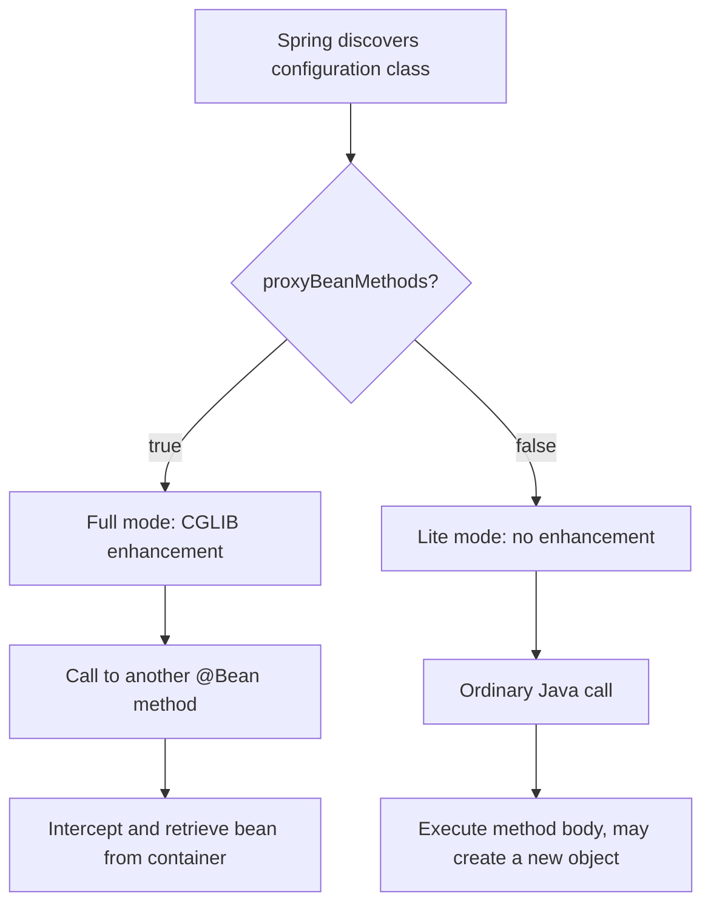

# @Configuration, proxyBeanMethods, and Inter-Bean Method Calls

## 1. Why can a Java call create a different bean?

In Spring, a method annotated with `@Bean` is a factory method: the container invokes the method to create the bean and manages the object's lifecycle. However, inside a configuration class, you can also write Java code that directly calls another `@Bean` method. The outcome depends on the configuration mode.

With `@Configuration(proxyBeanMethods = true)`, Spring enhances the configuration class with CGLIB to intercept calls between `@Bean` methods. When one `@Bean` method calls another `@Bean` method on the same configuration instance, the call is routed back to the container to retrieve the appropriate bean. This preserves container semantics, such as singleton scope.

With `@Configuration(proxyBeanMethods = false)`, Spring does not enhance the configuration class in that way. Method calls between `@Bean` methods are ordinary Java calls. If one factory method directly calls another factory method, it may instantiate a new object outside the container's bean management.

This distinction matters when moving an application to Spring AOT and GraalVM Native Image. We need to preserve bean behavior, understand which proxies are actually required, and avoid relying on method calls that only appear to be container-intercepted.

## 2. Full mode vs. lite mode

Spring distinguishes two ways of processing classes with `@Bean` methods:

| Mode | Common declaration | How calls between `@Bean` methods are handled |
| --- | --- | --- |
| **Full configuration mode** | `@Configuration` with `proxyBeanMethods = true` (default) | CGLIB enhancement intercepts calls and routes them to the container |
| **Lite configuration mode** | `@Configuration(proxyBeanMethods = false)` or a class with `@Bean` that is not a full `@Configuration` | Method calls are ordinary Java calls, not intercepted |

`@Configuration` defaults to `proxyBeanMethods = true`. Example:

```java
@Configuration
class ApplicationConfiguration {
    // Equivalent to proxyBeanMethods = true.
}
```

Explicit declaration:

```java
@Configuration(proxyBeanMethods = true)
class FullConfiguration {
}
```

Lite mode:

```java
@Configuration(proxyBeanMethods = false)
class LiteConfiguration {
}
```

A `@Component` class containing `@Bean` methods also operates in lite mode because it is not processed as a full configuration class. In lite mode, Spring still discovers and registers `@Bean` factory methods; what is omitted is the interception of direct calls between them.



## 3. Full mode: CGLIB preserves container semantics

Consider an example with a `Clock` bean and a `PricingService` bean that depends on it:

```java
import java.time.Clock;
import org.springframework.context.annotation.Bean;
import org.springframework.context.annotation.Configuration;

@Configuration(proxyBeanMethods = true)
class FullModeConfiguration {

    @Bean
    Clock pricingClock() {
        return Clock.systemUTC();
    }

    @Bean
    PricingService pricingService() {
        // This call is intercepted by CGLIB.
        return new PricingService(pricingClock());
    }
}
```

When the container invokes `pricingService()` to create the bean, the `pricingClock()` call on the enhanced configuration instance passes through an interceptor. With the default singleton scope, Spring returns the `Clock` bean already managed by the container (or creates it according to its lifecycle), instead of executing the method body to construct an independent object.

Therefore, in full mode:

- The `pricingClock` bean is managed by the container.
- The `pricingService` bean references the same singleton `Clock` instance provided by the container.
- Post-processors, scopes, lifecycle callbacks, and bean management mechanisms still apply to the bean obtained from the container.

### 3.1. Conditions and limitations of CGLIB enhancement

Full mode requires Spring to generate a subclass of the configuration class to intercept `@Bean` methods. Therefore:

- The configuration class should not be declared `final`.
- `@Bean` methods must be overridable to be intercepted; do not declare them `final` or `private` if you want full-mode semantics.
- Avoid calling configuration methods directly from constructors or before the instance is enhanced by Spring.
- `static` `@Bean` methods are not intercepted by instance CGLIB enhancement like regular methods.

These limitations stem from the subclass/proxy mechanism, not a GraalVM-specific rule. If a configuration class has many `final`/`private` methods or complex inter-method calls, consider switching to dependency injection via factory method parameters.

## 4. Lite mode: inter-method calls are ordinary Java calls

If proxying is disabled:

```java
@Configuration(proxyBeanMethods = false)
class LiteModeConfiguration {

    @Bean
    Clock pricingClock() {
        return Clock.systemUTC();
    }

    @Bean
    PricingService pricingService() {
        // This is a direct Java call; it does not retrieve the bean from the container.
        return new PricingService(pricingClock());
    }
}
```

Spring still invokes `pricingClock()` to register the `Clock` bean. However, when Spring invokes `pricingService()`, the `pricingClock()` call inside it is a normal Java call. It executes the method body again and constructs a new `Clock`. This new object is passed directly into `PricingService`, rather than the `Clock` bean managed by the container.

Illustration of the result:

```text
ApplicationContext
  ├── bean "pricingClock"       → Clock A
  └── bean "pricingService"     → PricingService
                                  └── Clock B (created by Java call)

Clock A != Clock B
```

With `Clock.systemUTC()`, the two objects may return the same time values, yet they are still two distinct instances. In real-world cases, this can silently lose transactions, caching, security proxies, custom configuration, or lifecycle callbacks that Spring applied to the original bean.

**Key takeaway:** `proxyBeanMethods = false` does not mean Spring stops managing `@Bean` methods. It only means direct calls between methods are not routed through the container.

## 5. Recommended approach: inject dependencies via `@Bean` parameters

When one bean needs another bean, the clearest approach is to declare the dependency as a factory method parameter:

```java
import java.time.Clock;
import org.springframework.context.annotation.Bean;
import org.springframework.context.annotation.Configuration;

@Configuration(proxyBeanMethods = false)
class ApplicationConfiguration {

    @Bean
    Clock pricingClock() {
        return Clock.systemUTC();
    }

    @Bean
    PricingService pricingService(Clock pricingClock) {
        // Spring resolves the parameter from the ApplicationContext.
        return new PricingService(pricingClock);
    }
}
```

When Spring creates `PricingService`, the container resolves the `Clock` parameter by type/qualifier and passes the matching bean into the factory method. There is no direct Java call to `pricingClock()`, so the configuration works identically whether `proxyBeanMethods` is enabled or disabled.

Benefits:

1. **Explicit dependencies:** the method signature states which components the bean needs.
2. **No reliance on CGLIB interception:** lite mode can be used without creating objects outside the container.
3. **Easier testing:** dependencies are easy to swap with alternative beans in a test context.
4. **Scope and qualifier support:** the container applies bean resolution rules, qualifiers, and lifecycle management.
5. **AOT-friendly:** dependency relationships appear clearly in bean definitions, aiding analysis and code generation.

If multiple beans share the same type, use `@Qualifier`:

```java
@Bean
@Qualifier("utcClock")
Clock utcClock() {
    return Clock.systemUTC();
}

@Bean
PricingService pricingService(@Qualifier("utcClock") Clock clock) {
    return new PricingService(clock);
}
```

Parameter names can follow bean naming conventions when appropriate, but `@Qualifier` makes selection intent clearer, especially when the application has multiple beans of the same type.

## 6. Singleton, prototype, and other scopes

By default, beans declared via `@Bean` are **singletons** within an `ApplicationContext`. In full mode, method calls between beans are intercepted to honor container-managed scopes. In lite mode, calling a method directly only executes Java code and does not automatically enforce scope rules.

### 6.1. Prototype example

```java
@Configuration(proxyBeanMethods = true)
class FullScopeConfiguration {

    @Bean
    @Scope(ConfigurableBeanFactory.SCOPE_PROTOTYPE)
    TaskContext taskContext() {
        return new TaskContext();
    }

    @Bean
    TaskRunner taskRunner() {
        return new TaskRunner(taskContext());
    }
}
```

In full mode, the `taskContext()` call is intercepted and the container creates a prototype bean according to its scope. With prototype scope, each time the container resolves the bean it creates a new instance; Spring manages initialization steps, though it does not manage full destruction lifecycle of prototype instances once handed to clients.

In lite mode, `new TaskContext()` in the method body may create a new object, but that object **is not created through the bean factory**. It does not necessarily go through bean post-processors, dependency injection, initialization callbacks, or container scope rules.

### 6.2. Prototype injected into a singleton

Even when using factory method parameters, if `TaskRunner` is a singleton and directly receives a prototype `TaskContext`, the container only resolves that prototype once when creating the singleton. Subsequent method calls on `TaskRunner` continue using the same injected instance.

If a fresh prototype is needed per task, inject `ObjectProvider<TaskContext>`:

```java
@Bean
TaskRunner taskRunner(ObjectProvider<TaskContext> taskContexts) {
    return new TaskRunner(taskContexts);
}

// Inside TaskRunner:
void runOneTask() {
    TaskContext context = taskContexts.getObject();
    // Each call to getObject() asks the container to resolve a new prototype.
}
```

This cleanly separates scoped bean retrieval from calls between configuration methods.

## 7. `@Component` classes and lite-mode configuration

A component class can also declare factory methods:

```java
@Component
class InfrastructureBeans {

    @Bean
    Clock systemClock() {
        return Clock.systemUTC();
    }

    @Bean
    PricingService pricingService() {
        // Not intercepted like a full @Configuration.
        return new PricingService(systemClock());
    }
}
```

This class is a lite configuration candidate. Spring detects both `@Bean` methods and registers the corresponding beans, but the `systemClock()` call inside `pricingService()` is an ordinary Java call. If you want a container-managed dependency, write:

```java
@Component
class InfrastructureBeans {

    @Bean
    Clock systemClock() {
        return Clock.systemUTC();
    }

    @Bean
    PricingService pricingService(Clock systemClock) {
        return new PricingService(systemClock);
    }
}
```

In modern application configuration, factory methods are generally best placed in dedicated configuration classes with clear responsibilities, using method parameters for dependencies. There is no need to turn every `@Component` into `@Configuration` solely to get proxying.

## 8. Spring AOT and the impact of proxyBeanMethods

Spring AOT analyzes configurations and bean definitions at build time, then generates code to support bean registration and `ApplicationContext` initialization. This reduces dynamic configuration analysis at runtime and supplies metadata needed for GraalVM to continue reachability analysis.

However, **AOT does not change Java method call semantics**:

- If full mode uses CGLIB to intercept calls between `@Bean` methods, the application must preserve that full configuration mechanism.
- If lite mode disables proxying, calls between methods remain ordinary Java calls.
- AOT does not automatically convert a direct call into dependency injection, nor does it make an object created via `new` into a container-managed bean.

### 8.1. When should `proxyBeanMethods=false` be used?

It is an appropriate choice when:

- `@Bean` methods are independent and do not call each other directly.
- Dependencies between beans are already declared via factory method parameters or injection.
- CGLIB interception is not needed to preserve configuration method call semantics.
- You want to avoid unnecessary configuration class enhancement and keep configuration simple.

The benefit is reducing configuration class subclass enhancement, which can make the configuration model easier to analyze in AOT/native. However, do not treat this as a "enable native mode" flag or a cure-all for Native Image errors.

### 8.2. When should `proxyBeanMethods=true` be kept?

Keep full mode if existing code **intentionally relies on calls between `@Bean` methods to obtain beans from the container**, for example to preserve singleton or scope semantics. If you cannot refactor immediately, keep the existing behavior and verify that Spring AOT/native supports that configuration in the version in use.

If you want to migrate to lite mode, replace direct calls with dependency injection first, then rerun tests to ensure no objects are instantiated outside the container.

### 8.3. Notes on build-time conditions

AOT can process the bean graph based on profiles and conditions active during the build. Ensure the build configuration reflects the deployment variant you intend to ship; changing a runtime property will not necessarily recreate a bean definition already decided in the AOT output. Check `@Profile`, `@Conditional`, and configurations deciding bean registration when building native.

With standard Spring configurations, the framework can provide AOT support and required metadata. If a third-party library uses unsupported runtime bytecode generation or dynamic proxies, check the library's native support documentation and test on a real executable. Do not mechanically add reflection hints to fix bean-method call semantics issues.

## 9. Testing to detect out-of-container instances

You can check dependency identity to verify that a factory method uses the container's bean:

```java
import static org.junit.jupiter.api.Assertions.assertSame;

import java.time.Clock;
import org.junit.jupiter.api.Test;
import org.springframework.context.annotation.AnnotationConfigApplicationContext;

class ConfigurationModeTests {

    @Test
    void pricingServiceUsesContainerClock() {
        try (var context =
                new AnnotationConfigApplicationContext(
                    ApplicationConfiguration.class)) {

            Clock clock = context.getBean(Clock.class);
            PricingService service = context.getBean(PricingService.class);

            assertSame(clock, service.clock());
        }
    }
}
```

This example assumes `PricingService` exposes a `clock()` accessor returning the injected dependency. With a lite configuration using the `Clock pricingClock` parameter, the assertion passes because the container passes in the same singleton bean.

If using lite configuration while the factory method calls `pricingClock()` directly, the assertion can fail: `PricingService` holds a directly constructed instance rather than the context bean. This identity test catches a class of bug that tests checking only timestamps or business output might miss.

### 9.1. Testing both modes

When refactoring configuration:

1. Run tests with the initial full mode and record bean identity, scope, and business results.
2. Switch to lite mode, replacing inter-bean calls with factory method parameters.
3. Rerun the same tests and integration tests.
4. Check prototypes, qualifiers, post-processors, and lifecycle callbacks if used by the beans.
5. Run Spring AOT processing, build native, and run smoke/integration tests on the binary.

Do not only verify that the context starts successfully. A context can start while beans inside accidentally hold objects created outside the container.

## 10. Common errors and misconceptions

| Symptom | Cause | Resolution |
| --- | --- | --- |
| Disabling proxy causes a bean dependency to be created twice | Inter-method call became an ordinary Java call | Inject dependency via factory method parameter |
| Bean is no longer a singleton as expected | Object was created via ordinary method call | Obtain the bean from the container instead of calling configuration methods directly |
| Transaction/cache/security advice is lost | Received dependency is not the proxied bean | Use the container-injected bean and test through the proxy |
| CGLIB cannot enhance configuration class | `final` class/method, `private` method, or incompatible configuration | Remove subclass-blocking modifiers or switch to lite mode + injection |
| JVM tests pass, but native fails | Library has unsupported/undeclared dynamic behavior | Identify proxy/reflection/resources and test native |
| Prototype reuses the wrong instance | Prototype was injected once into a singleton | Use `ObjectProvider` or a scoped proxy as needed |
| `static` `@Bean` lacks interception semantics | Static methods are not overridden by instance CGLIB | Do not rely on calling static methods to retrieve another bean |
| Changing profile does not change bean graph as expected | Bean conditions were processed at AOT build time | Build with appropriate profiles/conditions and retest |

## 11. Practice exercise: refactoring configuration to lite mode

**Context:** A pricing application has two beans, `Clock` and `PricingService`. Initially the configuration uses full mode and directly calls `pricingClock()` inside `pricingService()`.

**Requirements:**

1. Write a full-mode configuration with `@Configuration(proxyBeanMethods = true)` and two `@Bean` methods.
2. Write a test retrieving `Clock` from the context and comparing identity with the dependency inside `PricingService`.
3. Switch to `@Configuration(proxyBeanMethods = false)` **without** yet refactoring the direct call; observe the identity test fail or instances differ.
4. Update the factory method to `pricingService(Clock pricingClock)` so Spring injects the dependency.
5. Rerun unit/integration tests and confirm identity is preserved.
6. Run Spring AOT, build the Native Image, and smoke test the endpoint using `PricingService`.
7. Record AOT/native build times and check whether changing the proxy mode affects startup, memory, or compatibility.

**Success criteria:**

| Item | Requirement |
| --- | --- |
| Full mode | Understands method calls are intercepted by CGLIB |
| Lite mode | Understands method calls are ordinary Java calls |
| Dependency | Uses `@Bean` parameters so the container resolves dependencies |
| Scope | Does not confuse singleton/prototype beans with objects created via `new` |
| Tests | Includes assertions on both bean identity and business results |
| AOT/native | Configuration runs correctly after AOT and native compilation |
| Evaluation | Explains the trade-off between enhancement and explicit configuration |

## 12. Summary

`@Configuration(proxyBeanMethods = true)` uses full configuration mode: Spring enhances the class with CGLIB so calls between `@Bean` methods are routed back to the container, preserving scope and bean lifecycle. `proxyBeanMethods = false` uses lite mode: `@Bean` methods still register beans, but calling another method directly is a plain Java call and may create an object outside the container.

In modern Spring Boot applications, declaring dependencies through **`@Bean` method parameters** is usually clearer and relies less on proxies. When optimizing for Spring AOT/GraalVM Native Image, you can choose lite mode if factory methods are independent or properly refactored to use dependency injection. Keep full mode when current semantics depend on CGLIB interception, and always verify bean identity, scope, and behavior on the native executable before deployment.
