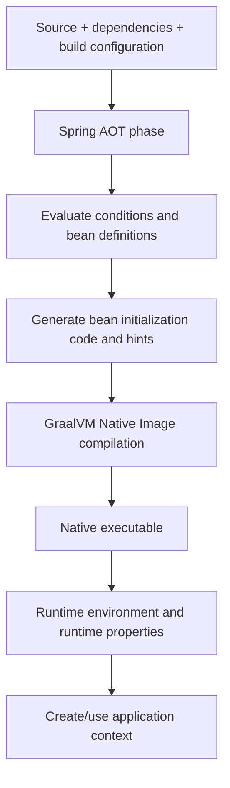

# Distinguishing Properties That Determine Bean Structure from Runtime Configuration Values

## 1. Why Must Two Configuration Phases Be Distinguished?

In a Spring Boot application running on the JVM, many configurations are read when the application starts and Spring creates the ApplicationContext. With **Spring AOT and GraalVM Native Image**, part of this work is shifted to **build time**: Spring AOT analyzes configuration, bean conditions, and generates initialization code; GraalVM then performs reachability analysis and compiles the native executable.

Therefore, two groups of properties must be distinguished:

- **Properties that determine bean structure (structural/build-time configuration):** affect which beans are registered, which configurations are applied, or which proxies or components exist in the ApplicationContext. If evaluated by Spring AOT at build time, the result can be reflected in the generated code and the native image.
- **Properties that only provide values at runtime (runtime value configuration):** change the values the application uses after the executable has been created, without changing the set of beans, bean types, or context structure already locked in during AOT.

Not every property read from `application.properties` is build-time. The timing and purpose of its use determine its meaning. A value such as a service URL can be runtime; the same value, when used in `@ConditionalOnProperty` to enable/disable a bean, can become a structural input.

## 2. The Two-Phase Model



**Build time** produces an executable based on source, dependencies, profiles/properties supplied to Spring AOT, and metadata. **Runtime** launches the executable, reads configurations designed to vary at runtime, and executes business logic.

The key takeaway: a native executable does not automatically re-run full Spring AOT on startup. If a property already decided which beans were generated into the image, changing that property in a container will not automatically create a missing bean.

## 3. Structural Bean Properties: Bean Registration Conditions

Example using `@ConditionalOnProperty` to decide whether to register an implementation:

```java
@Configuration(proxyBeanMethods = false)
class PaymentConfiguration {

    @Bean
    @ConditionalOnProperty(
            name = "payment.gateway",
            havingValue = "stripe"
    )
    PaymentGateway stripeGateway() {
        return new StripePaymentGateway();
    }

    @Bean
    @ConditionalOnProperty(
            name = "payment.gateway",
            havingValue = "mock"
    )
    PaymentGateway mockGateway() {
        return new MockPaymentGateway();
    }
}
```

If Spring AOT evaluates the configuration with `payment.gateway=stripe`, the AOT context may contain `StripePaymentGateway` and omit `MockPaymentGateway`. The native image is built from that structure.

If the container is later run with:

```bash
PAYMENT_GATEWAY=mock
```

you cannot assume `MockPaymentGateway` will appear on its own. The environment variable name only illustrates how Spring maps properties; the outcome depends on whether this property was actually used during the AOT step and how the plugin is configured to pass environment/properties.

For conditional beans that change the context structure, you must select the corresponding AOT configuration at build time, or design the application so that all required implementations exist in the context and are selected using runtime values.

## 4. Runtime Properties: Changing Values While Preserving Structure

A service can read an endpoint from configuration:

```java
@Service
class InventoryClient {

    private final String baseUrl;

    InventoryClient(
            @Value("${inventory.base-url}") String baseUrl) {
        this.baseUrl = baseUrl;
    }

    URI stockUri(String sku) {
        return URI.create(baseUrl + "/stock/" + sku);
    }
}
```

If the `InventoryClient` bean is always registered, and `inventory.base-url` only provides the server address that the client calls, this value can be supplied at runtime via the environment or a config file:

```bash
INVENTORY_BASE_URL=https://inventory.internal
```

The same executable can be used in staging and production with different URLs, provided the bean structure and required capabilities do not change. You should verify that the application does not freeze this value at build time through custom initialization or other AOT configuration.

Other examples of runtime values:

- External service URLs/hostnames.
- Timeouts, retry counts, or business limits.
- Feature thresholds that the code already supports checking at runtime.
- Queue/topic names if the consumer/producer and integration structure have already been created.
- Credentials supplied securely at runtime, not embedded in the binary.

Runtime properties still must be validated and protected. "Changeable at runtime" does not mean every value is safe or that the application automatically reloads configuration when files/environment variables change.

## 5. A Property Can Be Both Structural and a Runtime Value

Do not classify a property solely by its name or where it is declared. Look at **where it is used**.

| Usage | Common classification | Reason |
|---|---|---|
| `@ConditionalOnProperty` enabling/disabling a bean | Structural | Determines bean definition |
| `@Profile("production")` selecting a configuration class | Structural | Changes the set of configurations/beans |
| `@Value("${service.url}")` in an always-present bean | Runtime value if resolved at runtime | Only provides a value to the bean |
| `@Value("${feature.limit}")` in a service | Runtime value if it does not affect registration | Business value |
| Property selecting a class name then calling `Class.forName` | Dynamic/runtime type selection | Native needs to know accessible classes/members ahead of time |
| Property used in a static initializer running at build time | Risk of being frozen | The value may be stored in the image heap |

For example, `feature.enabled` might only control an `if` branch inside an always-present service, in which case it is a runtime value. However, if used in `@ConditionalOnProperty` to register or omit a bean, it becomes a structural input.

## 6. Spring Profiles Can Also Determine Structure

Spring profiles are used to enable configuration classes or beans:

```java
@Configuration
@Profile("production")
class ProductionDataConfiguration {
    @Bean
    DataGateway dataGateway() {
        return new ProductionDataGateway();
    }
}

@Configuration
@Profile("local")
class LocalDataConfiguration {
    @Bean
    DataGateway dataGateway() {
        return new InMemoryDataGateway();
    }
}
```

If AOT runs with the `production` profile, the generated bean graph can reflect the production configuration. You should not build a native image once with the local profile and then merely change `SPRING_PROFILES_ACTIVE=production` at runtime expecting production beans excluded at build time to appear.

When multiple deployment profiles have different bean structures, the options include:

1. Build a separate artifact for each structure/profile.
2. Register all required implementations in the context and use a runtime property to choose among them.
3. Split capabilities with distinct lifecycles into separate services.
4. Design a stable abstraction/registry to change selection data at runtime without changing the bean graph.

The right choice depends on artifact size, security requirements, release process, and the number of deployment variants.

## 7. Passing Properties to Spring AOT

When using Maven or Gradle, the Spring Boot plugin provides AOT tasks/goals. Configuration properties must be passed to the **exact process and phase** that Spring AOT uses.

Maven illustration:

```bash
./mvnw -Pnative \
  -Dspring.profiles.active=production \
  -Dpayment.gateway=stripe \
  native:compile
```

Gradle illustration:

```bash
./gradlew processAot \
  -Dspring.profiles.active=production
```

These commands only illustrate intent. Whether a Maven user property or JVM system property is forwarded into Spring AOT depends on the plugin/version and process configuration. Check logs and generated output to confirm the property was actually used; do not conclude this solely because `-D` appears on the command line.

In some setups, you can set system properties or environment variables for the JVM executing the build, or configure the plugin to pass application arguments/properties into AOT. Refer to the documentation for the exact Spring Boot Maven/Gradle plugin version in use.

After AOT completes, record the structural profiles/properties used as part of the build metadata. This helps reproduce the binary and understand why a bean is present or absent.

## 8. Runtime Configuration After the Executable Is Built

For runtime properties, environment variables can be passed when running:

```bash
INVENTORY_BASE_URL=https://inventory.prod.internal \
PAYMENT_TIMEOUT=2s \
./application
```

Or pass variables into a container:

```bash
docker run --rm \
  -e INVENTORY_BASE_URL=https://inventory.prod.internal \
  -e PAYMENT_TIMEOUT=2s \
  orders-service:1.0
```

Spring Boot property binding supports multiple configuration sources such as command-line arguments, system properties, environment variables, and config data. The exact precedence depends on the property source and how the application is launched; check the Spring Boot externalized configuration documentation for your version.

Crucially, runtime properties must be read at runtime. If custom code runs during the AOT/build phase and stores the value in generated code or the image heap, changing the container environment will not change the frozen value.

Do not embed secrets in build arguments, generated source, or the native image. Supply credentials via a secret manager or runtime mechanism appropriate for the deployment platform.

## 9. Build-Time Initialization and the Risk of Freezing Values

Native Image can initialize certain classes at build time and persist eligible state into the image heap. If a static initializer reads properties or environment variables, values from the build machine may be retained.

Risky example:

```java
final class RuntimeEndpoint {
    static final String URL =
            System.getenv("INVENTORY_BASE_URL");
}
```

If the class is initialized at build time, `URL` may reflect the build environment rather than the runtime environment. To avoid this:

- Read runtime configuration inside beans or logic initialized at runtime.
- Avoid static initializers that depend on environment variables, the network, time, or secrets.
- Only use build-time initialization for immutable data that is safe to freeze.
- If necessary, consider Native Image's initialize-at-run-time option for the appropriate class, after understanding its dependencies and side effects.

Distinguish **compiling methods at build time** from **running static initializers at build time**. These are two separate decisions.

## 10. Runtime Properties Do Not Automatically Change the Bean Graph

Suppose there are two implementations:

```java
@Component
class StripeGateway implements PaymentGateway {}

@Component
class MockGateway implements PaymentGateway {}
```

If both beans are registered and have suitable qualifiers or a registry, a service can select an implementation using a runtime property:

```java
@Service
class PaymentService {
    private final Map<String, PaymentGateway> gateways;

    PaymentService(
            List<PaymentGateway> candidates) {
        this.gateways = candidates.stream()
                .collect(Collectors.toMap(
                        PaymentGateway::name,
                        Function.identity()));
    }

    PaymentGateway select(String name) {
        PaymentGateway gateway = gateways.get(name);
        if (gateway == null) {
            throw new IllegalArgumentException("Unknown gateway");
        }
        return gateway;
    }
}
```

The example requires adding `name()` to the interface and importing the collection/stream types; its purpose is to illustrate a registry over a known set of implementations. A runtime property only selects among existing beans. It does not load new classes or plugins.

In a native image, every implementation to be used must have appropriate reachability. If an implementation has its own reflection, proxy, or resource requirements, corresponding runtime hints or metadata are needed.

## 11. Testing the Difference Between Build-Time and Runtime

A test suite should verify both kinds of configuration:

| Test | Question to answer |
|---|---|
| AOT with structural property A | Does the generated bean graph match expectations? |
| AOT with structural property B | Does a different structural variant require building a separate artifact? |
| Running the same binary with runtime URL A/B | Does the endpoint value change without rebuilding? |
| Running with an invalid runtime value | Are validation/fallback/errors handled properly? |
| Changing the environment after creating the native image | Was any value frozen at build time? |
| Running native integration tests | Do beans, proxies, resources, and dynamic access work? |

To verify runtime properties, build one executable and run it twice with two different URL values, checking logs or behavior to verify each process uses the value supplied at launch. For structural properties, build with each profile and verify the different bean graphs using appropriate tests or logs.

Do not rely solely on JVM tests to prove native behavior. Run the native executable or native test mode and cover the critical paths properly.

## 12. Diagnosing Common Issues

| Symptom | Possible cause | Resolution |
|---|---|---|
| Changing `SPRING_PROFILES_ACTIVE` does not make a bean appear | The bean graph was determined during AOT with another profile | Rebuild with the structural profile or keep both beans in the context |
| URL still holds the build-time value | Static initialization or AOT code froze the property | Move URL reading into a runtime bean/configuration |
| Bean exists on JVM but is missing in native | Structural condition/profile differs between JVM and AOT | Check properties passed to the AOT process and the generated context |
| New runtime property is not picked up | Wrong property name, precedence, or binding | Check Environment/property sources and config binding |
| Native fails with class not found in selection branch | Dynamically selected class is missing from the image | Register type/hints or switch to a static registry |
| Secret leaked in binary/build logs | Secret was placed in build-time config | Remove secret from build, load from runtime secret store |
| Local build differs from CI | Different profile/property/JDK/plugin | Record and pin build inputs, inspect effective config |

When investigating, determine which group the property belongs to first. If it determines bean structure, fix the AOT configuration. If it is a runtime value, check the runtime property source and the possibility of freezing due to initialization.

## 13. Practical Workflow: One Artifact, Two Runtime Environments

**Context:** a Spring Boot service has an `InventoryClient` that is always registered and a service URL that differs between staging and production.

**Step 1 — Separate configuration.** Put the URL in the runtime property `inventory.base-url`; do not use it in `@ConditionalOnProperty` or profiles to enable/disable beans.

**Step 2 — Verify on the JVM.** Run the same JAR twice with two URLs and verify the client reads the respective value.

**Step 3 — Run Spring AOT.** Use the chosen structural profile; record which properties affect the bean graph.

**Step 4 — Build native.** Compile the executable from the AOT output, ensuring no secrets or deployment-specific URLs are inadvertently embedded.

**Step 5 — Run the same binary.** Launch two processes with two different URLs via environment variables or config files. Verify requests go to the corresponding endpoints.

**Step 6 — Test a structural change.** Toggle a bean using `@ConditionalOnProperty`; demonstrate that structural changes must be reflected in the AOT build and a new artifact.

Completion criteria: runtime values can change without rebuilding; structural properties are recorded and used consistently during AOT; native behavior is tested; no secrets or environment-specific values are unexpectedly frozen.

## 14. Conclusion

In Spring Boot Native Image, two-phase configuration requires distinguishing **properties that determine bean structure** from **properties that only provide runtime values**. Spring AOT can evaluate conditions/profiles and generate code based on structural inputs; these decisions are reflected in the executable. Runtime properties such as URLs, timeouts, or business thresholds can vary at runtime as long as they do not alter the context structure and are read at the right time.

Classifying properties by how they are used, recording structural configuration at build time, avoiding environment-dependent static initialization, and testing the same binary with multiple runtime values make applications easier to deploy across staging and production while preserving native image consistency.
