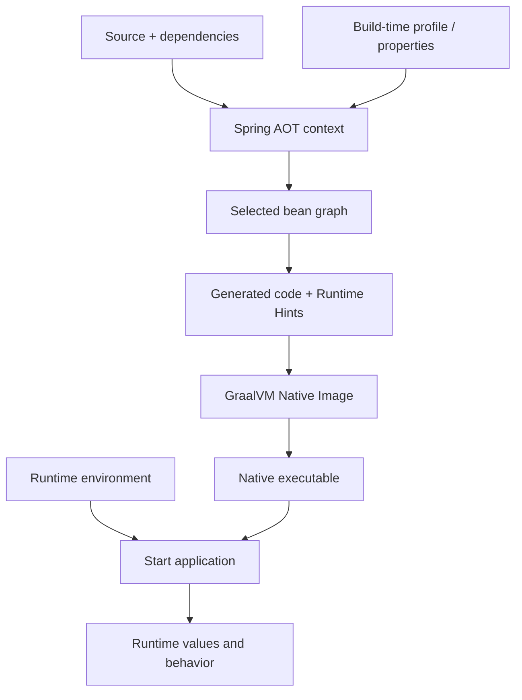

# @Profile and Profile-Specific Configuration During AOT

## 1. Why Do Profiles Matter for Spring AOT?

Spring Boot commonly uses **profiles** to select configurations suited to each environment, such as `local`, `test`, `staging`, or `prod`. The `@Profile` annotation can determine which beans are registered; `application-{profile}.yml` files supply configuration values specific to the corresponding profile.

When an application runs on a standard JVM, Spring evaluates profile conditions while creating the application context. With **Spring AOT**, an application context is pre-processed before runtime to analyze the bean graph, generate initialization code, and produce runtime hints for GraalVM Native Image. Therefore, the profile activated during the AOT phase can determine which beans are included in the prepared model.

This is the core difference of two-phase configuration:

- **Build time / AOT time**: Spring analyzes configuration, profiles, and conditions to determine the bean graph and generate AOT code.
- **Runtime**: the native executable starts with environment values and configurations designed to vary at runtime. Structural decisions already fixed during AOT are not recalculated by default.



**Rule of thumb:** if `@Profile` or `@ConditionalOnProperty` determines whether a bean exists, specify the profile/property used during AOT. Simply setting `SPRING_PROFILES_ACTIVE=prod` when running the native binary does not guarantee that beans present only in the `prod` profile were generated into the executable.

## 2. How Does `@Profile` Work?

Consider an application with two ways of sending notifications:

```java
public interface NotificationSender {
    void send(String message);
}
```

Local configuration:

```java
@Configuration
@Profile("local")
class LocalNotificationConfiguration {
    @Bean
    NotificationSender notificationSender() {
        return message -> System.out.println("[LOCAL] " + message);
    }
}
```

Production configuration:

```java
@Configuration
@Profile("prod")
class ProductionNotificationConfiguration {
    @Bean
    NotificationSender notificationSender(RemoteNotificationClient client) {
        return client::send;
    }
}
```

When the `local` profile is active while Spring creates the context, the bean from `LocalNotificationConfiguration` is registered. When the `prod` profile is active, the production configuration is chosen. If no matching profile is active, neither configuration may create the bean, leading to a missing dependency error when another bean requires `NotificationSender`.

Profile expressions can be used:

```java
@Profile("prod & cloud")
@Configuration
class CloudProductionConfiguration {
}
```

Or:

```java
@Profile("local | test")
@Configuration
class DevelopmentConfiguration {
}
```

Profile expression syntax supports AND (`&`), OR (`|`), and NOT (`!`), and parentheses can be used to clarify precedence. Avoid mixing `&` and `|` without parentheses because expression syntax has specific rules.

## 3. Profile-Specific Configuration Files

Spring Boot supports profile-specific configuration files:

```text
src/main/resources/
  application.yml
  application-local.yml
  application-test.yml
  application-prod.yml
```

Example default file:

```yaml
server:
  port: 8080

notification:
  timeout: 3s
```

File `application-local.yml`:

```yaml
notification:
  mode: console
```

File `application-prod.yml`:

```yaml
notification:
  mode: remote
  timeout: 2s
```

Activating a profile on the JVM:

```bash
java -jar app.jar --spring.profiles.active=local
```

Or:

```bash
SPRING_PROFILES_ACTIVE=prod java -jar app.jar
```

Profile-specific files provide property values. They can be read at runtime if they are part of the application's runtime configuration. However, if a property is used to determine the bean graph during AOT, the value at AOT time must be specified accurately.

## 4. Profile at AOT Time vs. Profile at Runtime

This is the most common source of confusion. Spring AOT generates initialization code based on the prepared context. If AOT builds with the `local` profile, `@Profile("local")` configurations may be processed while `@Profile("prod")` configurations may not be included in that model.

Later, if the executable is run with:

```bash
SPRING_PROFILES_ACTIVE=prod ./app
```

you cannot assume Spring will re-run the entire discovery and bean graph generation process like a standard JVM. Some properties can be re-read at runtime, but bean components excluded during AOT will not appear automatically just by changing an environment variable.

| Decision/configuration | Critical timing | Can it change at runtime? |
|---|---|---|
| Bean selected by `@Profile` in the AOT context | AOT/build time | Should not be assumed to be freely changeable |
| Bean selected by `@ConditionalOnProperty` during AOT | AOT/build time | Should not be assumed that enabling the property creates a new bean |
| HTTP port value | Runtime if not fixed otherwise | Usually yes |
| Datasource URL bound to an existing bean | Runtime if designed for runtime binding | Usually yes |
| Secrets, passwords, tokens | Runtime/deployment | Should be supplied via a secret mechanism |
| Value controlling logic inside an existing bean | Runtime if read dynamically | Possible |

Distinguish **application structure** (the bean graph) from **configuration values** of existing beans. These two categories of data do not share the same flexibility after AOT.

## 5. Selecting a Profile for the AOT Phase

The Spring Boot Gradle Plugin provides the `processAot` task. Application arguments can be passed to the task to activate a profile for AOT, depending on the plugin version's API.

Groovy DSL example:

```groovy
tasks.named("processAot") {
    args("--spring.profiles.active=prod")
}
```

Kotlin DSL example (task type depends on the Spring Boot version):

```kotlin
tasks.named<org.springframework.boot.gradle.tasks.aot.ProcessAot>("processAot") {
    args("--spring.profiles.active=prod")
}
```

This illustrates passing an **application argument** to the Spring context processed during AOT. Check the task API in your project's exact Spring Boot/Gradle Plugin version; do not copy verbatim if the plugin changes the task type or configuration.

With Maven, the native profile and plugin configuration can also pass parameters to the AOT process. The exact declaration depends on the Spring Boot Maven Plugin version and how the project configures its lifecycle. Check AOT logs to verify which profile was actually used.

Do not rely on `SPRING_PROFILES_ACTIVE` being set in your terminal without verifying that the AOT process received it. The Gradle daemon, the AOT process, and the native executable are different processes/stages; their environments may differ.

## 6. Profile-Specific Configuration and Property Source Precedence

Spring Boot has multiple configuration sources: command-line arguments, system properties, environment variables, config data, and others. Precedence order determines the final value of a property when multiple sources declare it.

For example, `application-prod.yml` declares:

```yaml
feature:
  reports-enabled: false
```

But the command line passes:

```bash
--feature.reports-enabled=true
```

The effective value can be overridden according to Spring Boot's precedence rules. During AOT, this matters if the property decides a bean via `@ConditionalOnProperty`.

Do not log the entire `Environment` or all environment variables when investigating precedence because that can expose secrets. Instead, log allowed non-sensitive values, active profile names, or write tests asserting specific beans.

## 7. Build Strategy: One Profile or Multiple Profiles?

There are two common design approaches.

### One Native Executable per Structural Configuration

If local and production have significantly different bean graphs, build a separate executable for each profile:

```text
Build AOT profile=local -> app-local
Build AOT profile=prod  -> app-prod
```

Each artifact needs its own manifest recording the AOT profile, commit, toolchain, and checksum. At deployment time, select the corresponding artifact. This approach increases the number of builds and artifacts to manage, but keeps bean structure straightforward to reason about.

### One Executable with Flexible Runtime Configuration

If the differences are only endpoints, timeouts, log levels, feature parameters, or secrets, keep the bean graph stable and read those values at runtime. For example, the same `NotificationSender` bean can use a URL and token supplied from the runtime environment, as long as the class and bean creation mechanism are already in the AOT image.

Avoid creating two distinct bean implementations merely to change a URL when unnecessary. Designing a single bean backed by configuration properties allows the same executable to be shared across multiple environments.

| Criterion | Separate build per profile | One executable, runtime configuration |
|---|---|---|
| Different bean graphs | Suitable | Not suitable if beans need to be added/removed |
| Different endpoint/timeout values | Possible, but often wasteful | Suitable |
| Environment-specific secrets | Should not be packaged in the build | Supplied at runtime |
| Number of artifacts | Multiple | Few |
| Deployment flexibility | Depends on the chosen artifact | Higher for runtime values |

## 8. Avoiding Secrets and Environment State During AOT

AOT may partially initialize the application context during the build. Therefore, bean constructors or factory methods should not depend on connecting to a production database, calling external APIs, or reading secrets that only exist on a developer or CI machine.

Example to avoid—making a real connection immediately when creating a bean:

```java
@Bean
RemoteClient remoteClient() {
    // Avoid connecting to production during AOT.
    return RemoteClient.connectToProduction();
}
```

Instead, create the client from configuration while deferring I/O until actual use:

```java
@Bean
RemoteClient remoteClient(RemoteClientProperties properties) {
    return new RemoteClient(properties.endpoint(), properties.token());
}
```

Even the second example must be designed carefully so it does not perform network calls in the constructor. Secrets should be supplied via the runtime environment, a secret manager, or a volume mount. Do not bake secrets into generated code, resources, or the native executable.

## 9. Testing Profiles and the Bean Graph

Create tests for each profile to confirm which beans are registered:

```java
@SpringBootTest
@ActiveProfiles("local")
class LocalProfileTest {

    @Autowired
    ApplicationContext context;

    @Test
    void registersLocalNotificationSender() {
        assertThat(context.getBean(NotificationSender.class))
            .isNotNull();
        assertThat(context.containsBean("productionNotificationSender"))
            .isFalse();
    }
}
```

For the production profile, create corresponding tests or use a context runner to verify conditions. Tests on the JVM verify Spring configuration by profile; they do not yet prove that the AOT build used the same profile.

Native Image verification workflow:

1. Run JVM tests for the target profile.
2. Run `processAot` with the profile explicitly defined.
3. Inspect logs and generated output to confirm the AOT context.
4. Run `nativeCompile` or Maven native compile.
5. Launch the native executable with the desired runtime environment.
6. Invoke endpoints or business flows that depend on profile beans and verify behavior.
7. If multiple bean graphs are needed, build and test each native artifact separately.

Testing the executable itself is the decisive evidence. Do not merely check that `processAot` succeeded and assume the production profile is present in the binary.

## 10. Common Pitfalls

| Symptom | Possible cause | Resolution |
|---|---|---|
| Native runs with `prod` profile but `prod` beans are missing | AOT was built with a different profile | Rebuild AOT/native with the appropriate profile |
| Neither implementation is present | No matching profile during AOT or wrong property condition | Check active profiles and property precedence |
| JVM works when switching profiles, native does not change bean graph | Bean decisions were processed during AOT | Split builds by structure or design a stable bean graph |
| AOT fails while initializing a bean | Bean factory method performs I/O or requires secrets | Defer side effects to runtime |
| CI and laptop generate different bean graphs | Different environment/profile/properties/classpath | Record and standardize AOT inputs |
| Secrets appear in logs/build output | Reading/logging environment or embedding sensitive config | Remove secrets from logs and build-time inputs |

## 11. Two-Phase Configuration Checklist

- Identify which beans are selected by `@Profile` or `@ConditionalOnProperty`.
- Identify the profile and properties actually used during AOT.
- Do not assume runtime `SPRING_PROFILES_ACTIVE` will rebuild the bean graph.
- Separate structural configuration from environment values that can change at runtime.
- Avoid connecting to external systems or reading secrets during AOT.
- If bean graphs differ, build and manage separate native executables per profile.
- Record the AOT profile, source commit, toolchain, and checksum in the build report.
- Test the bean graph on the JVM and behavior on the native executable.
- Test the container with configuration/secrets supplied at runtime.

## 12. Self-Check Questions

1. How does `@Profile` affect the bean graph during the AOT phase?
2. Why does activating the `prod` profile at runtime not guarantee that `@Profile("prod")` beans exist in an executable built with the `local` profile?
3. What is the difference between a property that decides bean creation and a property that only controls the behavior of an existing bean?
4. When should you build a separate native executable for each profile?
5. Why should you avoid connecting to a production database in a constructor or factory method invoked during AOT?
6. What evidence is needed to confirm that profile-specific configuration works in the native executable?

**Remember:** Spring AOT analyzes the application context with the profiles and properties in effect at build time. Lock down the choices that determine the bean graph, keep environment-varying values at runtime, and test the exact native artifact for each configuration you intend to deploy.
