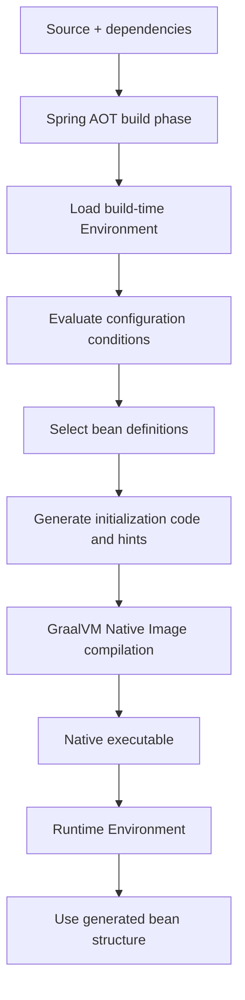

# @ConditionalOnProperty and Conditions Evaluated at Build Time

## 1. Why Do Configuration Conditions Matter for Native Image?

Spring Boot commonly uses conditions to decide which configurations are applied and which beans are registered. For example, an application might create a Stripe payment integration only when `payment.provider=stripe`, or enable an observability component only when `observability.enabled=true`.

On the JVM, Spring conditions are evaluated while creating the ApplicationContext at application startup. With **Spring AOT**, Spring processes the ApplicationContext before releasing the executable. Conditions related to bean registration can be evaluated during the AOT phase; the outcome helps determine the generated bean definitions and initialization code.

With **GraalVM Native Image**, the executable is compiled from code and metadata known at build time. Therefore, if a bean is excluded from the context structure during AOT, changing a property when running the binary will not automatically make that bean reappear.

This lesson focuses on `@ConditionalOnProperty` and Spring Boot/Spring Framework conditions that can affect bean structure. You need to understand clearly:

- Which properties decide whether a bean is registered.
- Which property values are used when running Spring AOT.
- How condition outcomes are reflected in the generated application context.
- When to build separate artifacts, and when to keep beans and choose via runtime properties.

## 2. How `@ConditionalOnProperty` Works

`@ConditionalOnProperty` is a Spring Boot annotation that allows conditioning a configuration class or bean based on a property value in the Spring `Environment`.

Example:

```java
@Configuration(proxyBeanMethods = false)
class PaymentConfiguration {

    @Bean
    @ConditionalOnProperty(
            prefix = "payment",
            name = "provider",
            havingValue = "stripe"
    )
    PaymentGateway stripeGateway() {
        return new StripePaymentGateway();
    }

    @Bean
    @ConditionalOnProperty(
            prefix = "payment",
            name = "provider",
            havingValue = "mock"
    )
    PaymentGateway mockGateway() {
        return new MockPaymentGateway();
    }
}
```

With configuration:

```properties
payment.provider=stripe
```

the `stripeGateway` bean matches the condition, while `mockGateway` does not. With `payment.provider=mock`, the result is reversed.

Main attributes:

| Attribute | Meaning |
|---|---|
| `prefix` | Property prefix, e.g., `payment` |
| `name` | Property name to check, e.g., `provider` |
| `havingValue` | Value that must match for the condition to pass |
| `matchIfMissing` | Whether a missing property is treated as a match |

If `havingValue` is omitted, the default condition typically matches when the property exists and its value does not equal the string `false` (case-insensitive). Therefore, declare `havingValue` explicitly when selecting a provider or multi-value mode.

Example enabling a feature via a boolean:

```java
@Bean
@ConditionalOnProperty(
        prefix = "feature.invoice",
        name = "enabled",
        havingValue = "true",
        matchIfMissing = false
)
InvoiceExportService invoiceExportService() {
    return new InvoiceExportService();
}
```

When the property is missing or is not `true`, the bean is not registered under this condition.

## 3. Where Are Conditions Evaluated in the Lifecycle?

In a standard JVM application, Spring Boot evaluates conditions when processing configuration and creating the ApplicationContext. When starting a new process with a different profile or property, Spring can create a context with a different bean structure.

With AOT, Spring initializes a context in the build environment to analyze and generate code. Conditions affecting bean configuration are evaluated during this process. The AOT result reflects the property sources, profiles, and environment supplied to the AOT processing step.



The key point: a native executable does not automatically re-run the entire AOT pipeline to add back excluded configuration classes. The runtime `Environment` still supplies values for properties read at runtime, but does not by default replace the generated bean structure.

This does not mean every condition is always evaluated at build time in every Spring configuration. Exact handling depends on the condition type, bean registration style, and framework version. Verify the behavior of your actual configuration using AOT output and integration tests.

## 4. Example: Build with Stripe Provider, Re-Run with Mock Provider

Suppose the AOT configuration uses:

```properties
payment.provider=stripe
```

Spring AOT processes `PaymentConfiguration` and sees that `stripeGateway` matches. Native Image then builds the executable from the analyzed structure.

If the binary is deployed with:

```bash
PAYMENT_PROVIDER=mock ./application
```

you cannot assume `mockGateway` will be registered. If this bean is absent from the generated context, changing the environment cannot create a bean that was excluded from the artifact.

This is an important distinction between:

- **Structural selection:** deciding which implementations exist in the ApplicationContext.
- **Runtime data selection:** deciding how an already-existing service handles a request.

If the goal is a single binary usable across both staging and production, consider keeping both implementations in the context and selecting via a runtime property.

## 5. Designing Runtime Selection When the Implementation Set Is Known

If both providers are safe and needed in the artifact, they can be registered as regular beans:

```java
@Component
class StripePaymentGateway implements PaymentGateway {
    @Override
    public String providerName() {
        return "stripe";
    }
}

@Component
class MockPaymentGateway implements PaymentGateway {
    @Override
    public String providerName() {
        return "mock";
    }
}
```

A service selects by runtime property:

```java
@Service
class PaymentGatewaySelector {

    private final Map<String, PaymentGateway> gateways;
    private final String provider;

    PaymentGatewaySelector(
            List<PaymentGateway> candidates,
            @Value("${payment.provider}") String provider) {
        this.gateways = candidates.stream()
                .collect(Collectors.toUnmodifiableMap(
                        PaymentGateway::providerName,
                        Function.identity()));
        this.provider = provider;
    }

    PaymentGateway selectedGateway() {
        PaymentGateway gateway = gateways.get(provider);
        if (gateway == null) {
            throw new IllegalStateException(
                    "Unsupported payment provider: " + provider);
        }
        return gateway;
    }
}
```

You need to add imports for `Map`, `List`, `Collectors`, `Function`, `Service`, `Value`, and define the `PaymentGateway` interface with a `providerName()` method. The example focuses on illustrating a registry: all beans are present in the context, while the property only selects one bean at runtime.

This design lets the same executable run with `PAYMENT_PROVIDER=stripe` or `PAYMENT_PROVIDER=mock`, provided both beans were included in the image and all required dependencies are present. For production providers, manage secrets and credentials via secure runtime configuration.

## 6. `matchIfMissing` and Default Values

`matchIfMissing` directly affects the condition result when a property is not declared.

```java
@Bean
@ConditionalOnProperty(
        prefix = "metrics",
        name = "enabled",
        havingValue = "true",
        matchIfMissing = true
)
MetricsPublisher metricsPublisher() {
    return new MetricsPublisher();
}
```

In this example, the bean is registered when `metrics.enabled=true` or when the property is absent. When `metrics.enabled=false`, the condition does not match.

Be careful with default values. If the AOT environment does not provide the property, `matchIfMissing=true` can cause the bean to be included in the generated structure; the runtime environment will not later remove the bean simply because a different value is set. Conversely, `matchIfMissing=false` can prevent the bean from being created if the property is missing during AOT.

To avoid unexpected outcomes:

- Declare structural properties explicitly in the build configuration.
- Choose a concrete `havingValue` rather than relying on ambiguous truthiness.
- Use `matchIfMissing` intentionally and document the default clearly.
- Test missing, true, false, and invalid property cases.

## 7. Other Spring Conditions That Can Affect AOT Structure

Besides `@ConditionalOnProperty`, common conditions include:

| Annotation/condition | Criterion | Potential impact |
|---|---|---|
| `@Profile` | Active Spring profile | Selects configuration/bean definitions |
| `@ConditionalOnClass` | Class present on classpath | Enables/disables auto-configuration by dependency |
| `@ConditionalOnMissingBean` | No matching bean yet | Selects default or custom bean |
| `@ConditionalOnBean` | Matching bean already registered | Enables configuration depending on another bean |
| `@ConditionalOnResource` | Resource can be found | Selects configuration based on resource |
| `@ConditionalOnWebApplication` | Web application type | Enables corresponding web configuration |

These conditions frequently appear in Spring Boot auto-configuration. AOT must analyze the context structure under the chosen build conditions. For example, `@ConditionalOnClass` depends on the build classpath; adding a dependency after the binary has been built cannot make the corresponding auto-configuration appear.

With `@ConditionalOnMissingBean`, the order and timing of bean definition registration can affect the outcome. Follow Spring Boot's recommended auto-configuration practices and verify the condition evaluation report.

## 8. Which Property Sources Are Used During AOT?

The Spring `Environment` can receive properties from multiple sources: application properties/YAML, profile-specific config data, system properties, environment variables, command-line arguments, and custom sources. During AOT, it is essential to identify **which sources are actually loaded into the AOT processing step**.

Example file:

```properties
# application-native.properties
payment.provider=stripe
metrics.enabled=true
```

If the AOT build uses this configuration, the corresponding conditions can be evaluated against those values. However, do not assume an arbitrarily named file is automatically loaded during AOT. Configure the profile/config location or pass properties via a mechanism supported by the Spring Boot plugin.

When investigating, record:

- Active Spring profiles at the AOT step.
- Loaded property sources and their precedence order.
- Actual values observed by conditions.
- Spring Boot/plugin version and build command.
- Relevant bean definitions/generated initialization code.

Do not print real secrets into logs or reports. You can record property names and whether they were provided rather than printing sensitive values.

## 9. Passing Structural Properties in Maven/Gradle Builds

Maven command example:

```bash
./mvnw -Pnative \
  -Dspring.profiles.active=native \
  -Dpayment.provider=stripe \
  native:compile
```

Gradle example:

```bash
./gradlew processAot \
  -Dspring.profiles.active=native
./gradlew nativeCompile
```

These illustrate passing properties, not a guarantee that every plugin/version automatically forwards every shell flag into Spring AOT. Verify that the Spring Boot plugin actually receives the property in the right process. Some projects configure AOT via environment variables, system properties, or plugin-specific arguments.

If the build and native compile run in two separate commands, ensure the AOT configuration does not change between the two steps and that the AOT output is consumed by native compile. With an integrated lifecycle, inspect the logs/goal/task graph to confirm the AOT phase ran with the desired profile.

Record the build command and structural properties alongside the artifact version. This is very helpful when investigating why a bean exists in the production build but is missing in staging.

## 10. Condition Evaluation Report and Diagnostics

Spring Boot can produce a condition evaluation report explaining which auto-configurations matched or did not match. On the JVM, debug condition reporting can be enabled through configuration, for example:

```properties
debug=true
```

Or by running the application with the corresponding flag:

```bash
java -jar application.jar --debug
```

The output can contain extensive configuration details, so review it before sharing. For AOT, inspect the logs of the AOT process and generated output; runtime reports from the native executable cannot reconstruct all conditions evaluated during the build phase.

Systematic diagnosis steps:

1. Identify which bean is missing or unexpectedly present.
2. Locate the condition on the configuration class or bean method.
3. Determine the property source and value at JVM startup.
4. Determine the properties/profiles used during AOT.
5. Compare condition results and bean registration between the two phases.
6. Rebuild native with the accurate structural configuration or adjust the design to use runtime selection.

## 11. Conditions Are Not Always Equivalent to Runtime Properties

An anti-pattern is using `@ConditionalOnProperty` for a choice that needs to vary flexibly across deployments while expecting a single binary to alter its own bean graph.

Example:

```java
@Bean
@ConditionalOnProperty(name = "search.engine", havingValue = "elasticsearch")
SearchClient elasticsearchClient() {
    return new ElasticsearchClient();
}
```

If `search.engine` is used during AOT to decide bean registration, a different runtime value will not create the other client. If runtime selection is needed, you can:

- Register both Elasticsearch and the alternative implementation in the context if dependencies and compatibility allow.
- Create a single abstraction that reads runtime configuration and selects the strategy in code.
- Split structural variants into separate artifacts, each built with its corresponding structural property.

Do not keep an implementation in the image if it drags in unwanted libraries, credentials, or attack surface. Deciding whether to keep everything or build multiple artifacts requires balancing flexibility, size, security, and CI cost.

## 12. Testing Conditions Before and After AOT

A good test suite should cover both matching and non-matching conditions:

| Case | Value | Expectation |
|---|---|---|
| Stripe provider | `payment.provider=stripe` | Stripe bean is registered |
| Mock provider | `payment.provider=mock` | Mock bean is registered |
| Missing property | Undeclared | Follows configured `matchIfMissing` |
| Unsupported value | `payment.provider=other` | No matching bean or runtime validation raises an error |
| Runtime selection | Both beans coexist | The same binary selects the provider from the runtime property |

On the JVM, use `ApplicationContextRunner` (Spring Boot test) or `@SpringBootTest` with different properties to test bean registration. Example:

```java
new ApplicationContextRunner()
    .withUserConfiguration(PaymentConfiguration.class)
    .withPropertyValues("payment.provider=stripe")
    .run(context -> {
        assertThat(context).hasSingleBean(StripePaymentGateway.class);
        assertThat(context).doesNotHaveBean(MockPaymentGateway.class);
    });
```

The example requires Spring Boot test and AssertJ dependencies. Test configuration must ensure relevant components/beans are registered in the same way the application uses them.

Next, run Spring AOT and native integration tests. For runtime selection, run the same binary multiple times with different properties. For structural selection, build separately for each property and verify each artifact contains the intended structure. Do not use a JVM context test alone to conclude that the native image has complete reachability metadata.

## 13. Common Pitfalls

| Symptom | Possible cause | Resolution |
|---|---|---|
| Bean does not appear in native | Condition did not match in the AOT phase | Check properties/profiles of the AOT process |
| Changing runtime environment still leaves bean missing | Bean was excluded from the generated context | Rebuild with the structural property or keep the bean in the context |
| Bean exists on JVM, missing in AOT | Environment/profile differs between the two phases | Compare property sources and condition results |
| Default bean appears unexpectedly | `@ConditionalOnMissingBean` or condition order/type prediction | Inspect bean definitions and the condition report |
| Boolean property handled incorrectly | Unclear `havingValue`/`matchIfMissing` | Declare explicitly and test missing cases |
| Local build differs from CI | Different profile/property/plugin version | Record commands and pin structural inputs |
| Native fails when loading a class by name | Class is unreachable or missing reflection hints | Register type/member or change design |

When investigating, separate **condition did not match** from **bean was registered but Native Image lacks metadata**. The two cases have different symptoms and require different solutions.

## 14. Hands-On Exercise: One Binary or Multiple Binaries?

**Context:** a service has two payment providers, a mock for testing and a production provider.

**Step 1 — Create the condition.** Use `@ConditionalOnProperty` to select the implementation via `payment.provider`.

**Step 2 — Run on the JVM.** Start twice with `stripe` and `mock`, verifying the corresponding bean is registered.

**Step 3 — Run AOT with stripe.** Record profiles/properties, observe the condition and generated output.

**Step 4 — Build native.** Create the executable from the AOT output, run with the runtime property `stripe`, and confirm behavior.

**Step 5 — Try changing the runtime property to mock.** Observe that the bean graph does not change automatically if the mock bean was excluded during AOT. This demonstrates structural configuration.

**Step 6 — Try the registry design.** Register both implementations in the context, use a runtime property to choose, rebuild a single binary, and run with both values.

**Step 7 — Evaluate.** Compare artifact size, retained dependencies, deployment flexibility, security, and build cost.

Completion criteria: able to explain which conditions are evaluated in AOT, which properties must be fixed at build time, which properties can vary at runtime, and prove behavior using the native executable.

## 15. Conclusion

`@ConditionalOnProperty` is a useful tool for toggling beans by property, but when used with Spring AOT, that property can become **an input that determines the ApplicationContext structure at build time**. Condition outcomes are reflected in bean definitions and generated initialization code; changing the property when running the native executable will not automatically add back excluded beans.

To use a single executable across multiple environments, keep the necessary implementations in the context and choose with runtime values when appropriate. If each environment requires a distinct bean structure, build separate artifacts per structural profile/property. Recording condition inputs, inspecting AOT output, and running native integration tests ensure a Spring Boot Native Image application behaves consistently and predictably.
