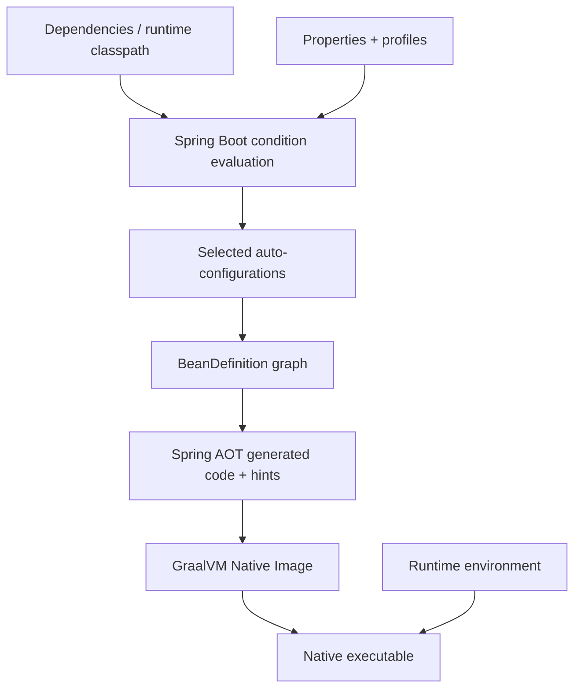

# Impact of the Classpath on Selected Auto-Configuration

## 1. The Classpath Is Part of Spring Configuration

Spring Boot uses **auto-configuration** to automatically register beans based on present classes, properties, resources, and other conditions. Therefore, the application's classpath does not only decide which classes can be loaded; it also affects **which auto-configurations are activated**.

In a regular JVM application, the classpath is set at startup. Spring Boot evaluates conditions such as `@ConditionalOnClass`, `@ConditionalOnMissingBean`, and `@ConditionalOnProperty`, and creates the corresponding application context.

With **Spring AOT** and **GraalVM Native Image**, a context is processed at build time. Spring AOT analyzes the selected auto-configurations, bean definitions, and dependencies to generate initialization code and runtime hints. If the classpath at AOT time differs from the classpath expected at build/release time, the set of auto-configurations may differ, leading to a different bean graph.



**Key point:** adding or removing a dependency can change classpath conditions and the selected auto-configurations. Changing the classpath after AOT has generated code does not make Spring re-analyze the entire configuration automatically.

## 2. Auto-Configuration Selects Configuration Using Conditions

An auto-configuration can be enabled when a specific class exists:

```java
@AutoConfiguration
@ConditionalOnClass(name = "com.example.cache.FastCacheClient")
class FastCacheAutoConfiguration {

    @Bean
    @ConditionalOnMissingBean
    CacheService cacheService(FastCacheClient client) {
        return new FastCacheService(client);
    }
}
```

The example above illustrates two conditions:

- `@ConditionalOnClass`: only applies the configuration if the specified class is present on the classpath.
- `@ConditionalOnMissingBean`: creates a default bean if the context does not already have a matching bean.

When the dependency providing `FastCacheClient` is present, the auto-configuration can be selected. If the dependency is removed from the runtime classpath, the classpath condition is no longer satisfied. In that case, the default `CacheService` bean may not be registered either.

Some other common conditions:

| Annotation/condition | Depends on | Example |
|---|---|---|
| `@ConditionalOnClass` | Class present on classpath | Cache/client integration |
| `@ConditionalOnMissingClass` | Class absent from classpath | Selecting an alternative implementation |
| `@ConditionalOnBean` | Another bean already registered | Adding an adapter when a service exists |
| `@ConditionalOnMissingBean` | No matching bean yet | Providing a default bean |
| `@ConditionalOnProperty` | Property value | Enabling/disabling a feature |
| `@ConditionalOnResource` | Resource can be found | Configure only if a file is present |
| `@ConditionalOnWebApplication` | Application context type | Web server configuration |

Conditions can be combined. Therefore, when an auto-configuration is not selected, do not check only one dependency; inspect the entire condition evaluation and related properties/profiles.

## 3. Compile Classpath vs. Runtime Classpath Differences

In Gradle, dependency configurations have different scopes. This directly affects the classpath that Spring Boot uses at startup and during AOT.

| Configuration | On compile classpath? | On default runtime classpath? |
|---|---:|---:|
| `implementation` | Yes | Yes |
| `api` (with Java Library) | Yes, and exposes API to consumers | Yes, via the dependency graph |
| `runtimeOnly` | No | Yes |
| `compileOnly` | Yes | No |
| `testImplementation` | In test compile | Not in production runtime |
| `testRuntimeOnly` | Not in main compile | Test runtime only |

For example, a starter or driver mistakenly declared with `compileOnly` may allow code to compile successfully while being absent when the application runs or when Native Image analyzes the runtime classpath. In that case, `@ConditionalOnClass` may evaluate to false or code may fail due to a missing class.

With Maven, distinguish between `compile`, `runtime`, `provided`, and `test` scopes as well as dependency exclusions. Misconfigured scopes or exclusions can prevent a dependency from entering the runtime classpath of the executable JAR or native build.

## 4. How Do Dependencies Change Auto-Configuration?

Suppose an application has two cache options:

- A Redis starter providing Redis client classes and Redis auto-configuration.
- A local library providing an in-memory cache.

When adding the Redis starter to the runtime classpath, Spring Boot can detect the Redis classes and select the related auto-configuration if other conditions are satisfied. If the starter is removed from the runtime classpath, Redis auto-configuration is no longer eligible.

A classpath-dependent configuration might look like this:

```groovy
dependencies {
    implementation 'org.springframework.boot:spring-boot-starter-web'
    runtimeOnly 'org.postgresql:postgresql'
    implementation 'org.springframework.boot:spring-boot-starter-data-redis'
}
```

This is an illustrative dependency example; versions are managed by Spring Boot dependency management. The Redis starter typically includes the required classes at compile/runtime. The PostgreSQL driver can be `runtimeOnly` if source code does not directly reference driver types, yet the driver must still be on the runtime classpath to connect.

When investigating, inspect resolved dependencies rather than just reading the build file. Gradle:

```bash
./gradlew dependencies --configuration runtimeClasspath
./gradlew dependencyInsight --dependency spring-boot-starter-data-redis --configuration runtimeClasspath
```

Maven:

```bash
./mvnw dependency:tree
```

Check exclusions, version conflicts, and dependency scopes. The exact same source code can produce a different bean graph if the resolved classpath differs.

## 5. The Classpath at AOT Must Match the Target Artifact

Spring AOT processes the context based on the application's runtime classpath and the configuration supplied to the AOT task. If you run `processAot` with one dependency graph and then package the native executable from a different graph, the AOT output may not reflect the final application.

Common causes:

1. Different Gradle/Maven profiles pull in different dependencies.
2. A dependency is marked `compileOnly` even though it is needed at runtime.
3. An exclusion is applied in another module or configuration.
4. A multi-module build targets the wrong application project.
5. Dependency versions change due to a resolution strategy or version catalog.
6. CI uses a different cache/lockfile than the developer machine.
7. Buildpacks use a different builder/buildpack than the local toolchain.

In a multi-module project, run tasks on the right application module, for example:

```bash
./gradlew :api-app:processAot
./gradlew :api-app:nativeCompile
```

AOT and Native Image must use the same intended dependency graph for `:api-app`. Do not run AOT on one app and take the generated output to build another app.

## 6. Observing Selected Auto-Configuration

When running on the JVM, Spring Boot can output the condition evaluation report via debug mode:

```bash
java -jar app.jar --debug
```

In the logs, look for the **CONDITIONS EVALUATION REPORT** section to see which auto-configurations matched or did not match and why. Detailed logging can be enabled for the auto-configuration package as needed.

For AOT, inspect the logs of the `processAot` or `process-aot` task and verify the context is created with the target classpath, profile, and properties. A debug report from a JVM run with a different configuration cannot fully represent the AOT context.

For a specific condition, classpath availability can be checked:

```java
boolean available = ClassUtils.isPresent(
    "com.example.cache.FastCacheClient",
    getClass().getClassLoader()
);
```

This example uses Spring `ClassUtils`. This is a runtime check against the current classloader; to verify build-time AOT, observe the exact process and classpath used by the AOT task.

## 7. Classpath Changes After AOT: What Happens?

Suppose AOT runs while the Redis starter is present, Redis auto-configuration is selected, and the generated code reflects that bean graph. Then the build pipeline removes the Redis dependency from the runtime classpath or changes the dependency version before native compilation.

This creates an inconsistent state: generated code/hints were produced from the earlier context, whereas the compiled/packaged set of classes is different. Compile, reachability, or runtime errors can occur. Similarly, if AOT ran without Redis while the native executable expects to use Redis at runtime, simply adding Redis environment variables at runtime will not generate beans that were never created during AOT.

**Rule:** dependency/classpath changes affecting auto-configuration must trigger re-running AOT with the right graph, followed by rebuilding the native image.

Gradle has incremental builds and build caching. When dependencies change, Gradle usually detects this via task inputs, but custom tasks or environments that do not declare inputs properly can cause outputs to be reused incorrectly. Check task statuses and logs; use `--rerun-tasks` as a deliberate diagnostic tool, not as a substitute for declaring proper inputs.

## 8. Distinguishing Classpath Conditions from Reflection Metadata

Two issues are often confused:

- **Auto-configuration not selected**: the class is not on the classpath or a property/profile condition is not met; the bean definition is not registered.
- **Class is in the bean graph, but reflection fails**: the class/member is accessed dynamically but lacks reachability/reflection metadata.

Adding Runtime Hints for reflection will not make an excluded auto-configuration get selected. Conversely, adding a dependency so a classpath condition matches does not automatically ensure every reflection-accessed member is retained in the Native Image.

Diagnose in order: is the dependency on the runtime classpath, does the condition match, is the bean definition registered, and only then check reflection/resource/proxy metadata.

## 9. Example of Testing a Classpath Condition

You can write a test checking for class/bean presence:

```java
@SpringBootTest
class CacheConfigurationTest {

    @Autowired
    ApplicationContext context;

    @Test
    void cacheServiceIsRegisteredWhenExpected() {
        assertThat(context.getBeansOfType(CacheService.class))
            .isNotEmpty();
    }
}
```

This test verifies beans in the context of that test run. To test auto-configuration under different classpaths, use `ApplicationContextRunner` and configure the corresponding classpath/test dependencies, or create integration tests for each application variant.

With Native Image, also run tests against the real executable or the native test task supported by the plugin. A passing JVM test does not prove the native binary has the right metadata and dependencies.

## 10. Auto-Configuration Investigation Checklist

- Identify the application module and actual runtime classpath.
- Check dependency scopes, exclusions, version conflicts, and dependency locks.
- Identify `@ConditionalOnClass`, `@ConditionalOnBean`, and `@ConditionalOnProperty` conditions on the auto-configuration you intend to use.
- Verify profiles/properties at AOT time.
- Read the condition evaluation report and `processAot` logs.
- Re-run AOT whenever the dependency graph or build-time conditions change.
- Inspect bean definitions before investigating reflection/resource hints.
- Rebuild the Native Image from the new AOT output.
- Test the exact released executable/container.

## 11. Self-Check Questions

1. Why can adding a dependency to the classpath cause Spring Boot to select a different auto-configuration?
2. How does the difference between `compileOnly` and `runtimeOnly` affect `@ConditionalOnClass`?
3. Why is the debug report from a single JVM run insufficient to prove the AOT context selected the same configuration?
4. What can happen if the dependency graph changes after `processAot` has run?
5. How do you distinguish an unselected auto-configuration error from a missing reflection metadata error?
6. When a dependency changes in a multi-module Gradle project, which steps need to be rebuilt?

**Remember:** the classpath determines which classes and auto-configurations Spring can recognize. With Spring AOT, keep the dependency graph consistent between AOT and native compilation, verify condition evaluation and the bean graph, and only then handle reflection/resource metadata if dynamic code paths are still missing.
