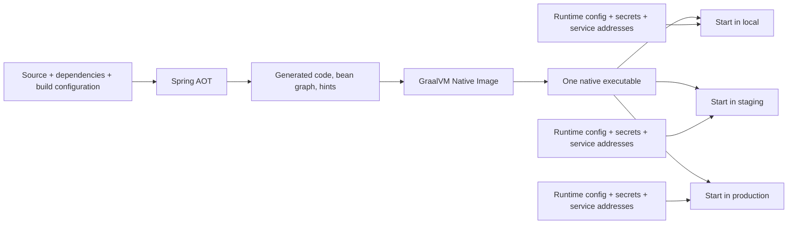

# Values Such as Ports, Service Addresses, and Credentials Can Be Supplied at Runtime

A major benefit of GraalVM Native Image is being able to produce **one native executable** and deploy that executable across multiple environments such as local, staging, and production. To achieve this, environment-dependent values—such as **HTTP ports, database URLs, service endpoints, and credentials**—need to be supplied when the process starts or through a clearly designed runtime configuration source.

This is possible because Spring AOT does not freeze all operational configuration into the binary. AOT prepares the bean structure and required capabilities during the build phase; when the native process runs, Spring Boot still reads externalized configuration, creates the ApplicationContext, injects values into beans, and opens connections. However, properties that alter the bean graph may already have been decided during AOT, and values injected into beans do not update automatically simply because the external environment changes.

This lesson belongs to the **Two-Phase Configuration** chapter of the `SPRING_BOOT_NATIVE_IMAGE` module. We will distinguish build-time from runtime configuration, use environment variables and external configuration files, supply credentials via secret mounts, deploy containers, and verify the same binary operating with multiple configuration sets.

## 1. The Two Phases Have Different Responsibilities

In a native workflow, configuration can be viewed in two groups:

- **Build/AOT time:** determines the application structure and the set of capabilities included in the native image. Examples: classpath/dependencies, beans selected by `@Profile` or `@ConditionalOnProperty`, reflection/proxy/resource metadata to retain, and certain class states configured to initialize at build time.
- **Runtime:** provides operational values for the existing application structure. Examples: HTTP port, database URL, username/password, payment service endpoint, timeouts, log levels, and business data.



For example, an executable can listen on port 8081 in staging and 8080 in production; connect to the `orders-staging` database in staging and `orders-prod` in production. Different values are read at startup, while the request-handling code and required bean graph are already inside the binary.

| Value/decision | Appropriate timing | Can change without rebuilding? |
| --- | --- | --- |
| HTTP port (`server.port`) | Runtime startup | Yes |
| JDBC URL and service addresses | Runtime startup | Yes |
| Database username/password | Runtime startup via config/secret | Yes |
| Payment gateway URL | Runtime startup | Yes |
| Timeouts, log levels, feature settings that only alter behavior of existing beans | Runtime startup | Usually yes |
| `@ConditionalOnProperty` deciding whether a bean is registered | Build/AOT | Rebuild required if bean was excluded from AOT output |
| Profile changing the set of beans processed by AOT | Build/AOT and must match runtime | Should not be assumed freely changeable after build |
| Adding a new library or implementation class | Build | No |
| Adding a classpath file embedded into the image | Build | No; requires rebuild or switching to an external file |

## 2. How Does Spring Boot Read Runtime Configuration?

Spring Boot provides **Externalized Configuration**: a property can come from a configuration file, environment variable, Java system property, command-line argument, or other supported configuration sources. Consequently, the same binary can receive different values depending on the deployment environment.

Common sources:

| Source | Example | When to use |
| --- | --- | --- |
| `application.yaml` inside the artifact | Non-sensitive defaults | Shared configuration usable across environments |
| External YAML file | `/etc/orders/application.yaml` | Configuration operated independently from the binary |
| Environment variable | `SPRING_DATASOURCE_URL` | Containers, orchestrators, CI/CD |
| Java system property | `-Dserver.port=8081` | JVM arguments or process configuration when appropriate |
| Command-line argument | `--server.port=8081` | Manual runs, jobs, or intentional overrides |
| Config tree / secret file | `/run/secrets/spring.datasource.password` | Credentials provided by the platform as files |

Among Spring Boot's standard configuration sources, command-line properties generally take precedence over environment variables and config data. Thus, if the configuration file sets `server.port=8080`, the environment sets `SERVER_PORT=8081`, and the command line passes `--server.port=8082`, the command-line value wins. When investigating misconfiguration, check **all sources and their precedence order**, not just `application.yaml`.

### 2.1. Environment Variable Naming Rules

Spring Boot supports relaxed binding mapping. For typical properties, the common environment variable convention is:

1. Convert lowercase letters to uppercase.
2. Replace dots with underscores.
3. Keep underscores separating words; remove dashes in property names.

Examples:

| Property | Environment variable |
| --- | --- |
| `server.port` | `SERVER_PORT` |
| `spring.datasource.url` | `SPRING_DATASOURCE_URL` |
| `spring.datasource.username` | `SPRING_DATASOURCE_USERNAME` |
| `spring.datasource.password` | `SPRING_DATASOURCE_PASSWORD` |
| `payment.gateway.base-url` | `PAYMENT_GATEWAY_BASEURL` |
| `management.endpoints.web.exposure.include` | `MANAGEMENT_ENDPOINTS_WEB_EXPOSURE_INCLUDE` |

For list/map properties or specially structured names, the mapping rules have additional details. When binding behaves unexpectedly, consult the relaxed binding documentation and verify the actual property through application configuration; do not guess from variable names.

## 3. Declaring Properties in the Application

Example application using Spring Boot Web and JDBC, with `src/main/resources/application.yaml` containing non-sensitive defaults:

```yaml
server:
  port: ${SERVER_PORT:8080}

spring:
  datasource:
    url: ${SPRING_DATASOURCE_URL:jdbc:postgresql://localhost:5432/orders}
    username: ${SPRING_DATASOURCE_USERNAME:orders_app}
    # Password is supplied from a secret source at runtime.

payment:
  gateway:
    base-url: ${PAYMENT_GATEWAY_BASE_URL:http://localhost:8090}

app:
  integration:
    connect-timeout: ${APP_INTEGRATION_CONNECT_TIMEOUT:2s}
    read-timeout: ${APP_INTEGRATION_READ_TIMEOUT:5s}
```

Spring Boot can read values from environment variables to resolve placeholders. For the password, we do not set a default value in the configuration file; the example will supply that property via a secret file in a later section.

A bean can receive configuration via `@ConfigurationProperties`:

```java
package com.example.orders;

import java.net.URI;
import java.time.Duration;

import org.springframework.boot.context.properties.ConfigurationProperties;

@ConfigurationProperties(prefix = "payment.gateway")
public record PaymentGatewayProperties(
        URI baseUrl,
        Duration connectTimeout,
        Duration readTimeout) {
}
```

Register properties using `@ConfigurationPropertiesScan` on the application class or `@EnableConfigurationProperties(PaymentGatewayProperties.class)` in configuration:

```java
@SpringBootApplication
@ConfigurationPropertiesScan
public class OrdersApplication {
    public static void main(String[] args) {
        SpringApplication.run(OrdersApplication.class, args);
    }
}
```

At startup, Spring Boot binds values from the `Environment` into the properties object. The `PaymentGatewayProperties` bean structure was determined during AOT; the `baseUrl` and timeout values are read from runtime configuration. Validation such as `@Validated`, `@NotNull`, or a custom validator can be used to fail fast when required values are missing.

### 3.1. Required Values Should Fail Fast

For production endpoints or mandatory credentials, avoid using a seemingly valid fallback that could accidentally cause the application to connect to the wrong service. Example:

```yaml
spring:
  datasource:
    url: ${SPRING_DATASOURCE_URL}
    username: ${SPRING_DATASOURCE_USERNAME}
```

If the property is not supplied and no other configuration source provides it, the application will report an error when resolving configuration or initializing beans. That is far better than silently using a default database meant for the wrong environment.

For values requiring validation, you can declare:

```java
@Validated
@ConfigurationProperties(prefix = "payment.gateway")
public record PaymentGatewayProperties(
        @NotNull URI baseUrl,
        @NotNull Duration connectTimeout,
        @NotNull Duration readTimeout) {
}
```

The example above requires importing `jakarta.validation.constraints.NotNull` and having a corresponding validation implementation in dependencies. Performing validation at startup catches misconfiguration before serving requests.

## 4. Supplying Ports and Service Addresses at Runtime

### 4.1. HTTP Port

The same binary can be run with different ports:

```bash
# Staging
SERVER_PORT=8081 ./target/orders-service

# Production
SERVER_PORT=8080 ./target/orders-service
```

Or using a command-line argument:

```bash
./target/orders-service --server.port=8081
```

The port the application listens on inside a container is distinct from the published host port. For example, `-p 18080:8080` maps host port 18080 to container port 8080; the application still needs to listen on port 8080 inside the container (such as `SERVER_PORT=8080`). Docker `EXPOSE 8080` only declares port metadata and does not configure Spring Boot.

### 4.2. Database and Integration Service Addresses

PostgreSQL database address example:

```bash
SPRING_DATASOURCE_URL='jdbc:postgresql://orders-db:5432/orders' \
SPRING_DATASOURCE_USERNAME='orders_app' \
./target/orders-service
```

The `orders-db` address must be resolvable from the network namespace where the native process runs. In Docker Compose or Kubernetes, an internal service DNS name is typically used; do not assume `localhost` points to another database container. Inside a container, `localhost` always refers to that container itself.

The payment gateway endpoint can also be supplied independently:

```bash
PAYMENT_GATEWAY_BASE_URL='https://payments.staging.internal' \
./target/orders-service
```

A single binary works across environments once DNS, routing, firewalls, TLS trust, and service access permissions are properly configured in each environment.

## 5. Supplying Credentials and Secrets Securely

Credentials are runtime values, but how they are distributed matters greatly. Do not place passwords, tokens, or private keys in:

- Source code or committed `application.yaml` files.
- Maven/Gradle build arguments, Docker build arguments, or the environment of the native image build step.
- The native executable, image layers, generated source, or metadata stored in the artifact.
- Logs, exception messages, command history, or build reports.

A Spring Boot-friendly approach is a **config tree**: the platform mounts each secret as a file; Spring Boot reads the filename as the property key and the file contents as the property value.

Example secret mount layout:

```text
/run/secrets/
├── spring.datasource.username
└── spring.datasource.password
```

Each file contains only its corresponding value. Add the config tree to runtime configuration via an environment variable:

```bash
SPRING_CONFIG_IMPORT=optional:configtree:/run/secrets/ \
./target/orders-service
```

If the secret mount is mandatory, remove the `optional:` prefix so the application fails fast when the directory does not exist. The path must be where the platform actually mounts secrets and the process must have read permissions. Once imported, Spring Boot binds the two keys `spring.datasource.username` and `spring.datasource.password` into the datasource configuration.

**Do not log secret contents.** Only record that the secret source was mounted/read successfully, or the database connection status. Do not print the entire `Environment`, properties objects, or exceptions that may contain URLs or credentials.

### 5.1. Why Are Config Trees Useful in Containers?

- Secrets do not need to live in the source tree or native image.
- Different values can be supplied per deployment.
- File permissions can restrict read access.
- Secrets can be replaced using platform mechanisms without rebuilding the executable.

Note: applications typically read and bind credentials at startup. The platform updating secret file contents does not guarantee that a connection pool or already-injected bean immediately switches credentials. To rotate secrets while a process is running, you need an explicit reload/connection recreation mechanism or to restart the workload via operational procedures.

## 6. Passing External Configuration Files at Runtime

An external `application.yaml` file can be mounted outside the executable:

```text
/etc/orders/
└── application.yaml
```

Run the application with an additional configuration location:

```bash
SPRING_CONFIG_ADDITIONALLOCATION=file:/etc/orders/ \
./target/orders-service
```

Spring Boot will look for config data in that location alongside the default locations. The trailing slash explicitly indicates a directory. If using `SPRING_CONFIG_LOCATION`, note that this property **replaces** the default locations; misusing it can stop the application from reading `application.yaml` on the classpath. `SPRING_CONFIG_ADDITIONALLOCATION` is usually appropriate when adding external configuration while keeping defaults.

An external file might contain:

```yaml
server:
  port: 8082

spring:
  datasource:
    url: jdbc:postgresql://orders-db-prod:5432/orders

payment:
  gateway:
    base-url: https://payments.prod.internal
```

An external config file is not embedded into the native image if it is only mounted at runtime. Ensure the path is correct, read permissions are granted, and the config import/location is supplied before Spring Boot creates the `Environment`.

## 7. Distinguishing Embedded Config Files from External Config Files

Two files both named `application.yaml` can originate from two different sources:

| Source | Location | Characteristics |
| --- | --- | --- |
| Classpath resource | `src/main/resources/application.yaml` | Packaged in the artifact; changing contents usually requires rebuilding. |
| External config | e.g., `/etc/orders/application.yaml` | Can be mounted/changed independently of the binary; read at startup if location is configured. |
| Config tree | e.g., `/run/secrets/` | Filename represents property key; file content is the value. |
| Environment variable | Process/container environment | Can vary between runs; requires restart for already-bound beans to pick up new values. |

A config file on the classpath can contain placeholders to pull values from the `Environment`, such as `${SPRING_DATASOURCE_URL}`. In this case, a **default template** is packaged, while the actual value is resolved at runtime. Not everything in the file is a build-time constant.

## 8. Container Packaging Without Embedding Environment Configuration

A minimal Dockerfile for a native executable (for example, a Linux binary compatible with the base image):

```dockerfile
FROM debian:bookworm-slim

WORKDIR /app
COPY target/orders-service /app/orders-service

# Create a non-root user to run the application.
RUN useradd --system --uid 10001 appuser \
    && chown appuser:appuser /app/orders-service

USER 10001
EXPOSE 8080
ENTRYPOINT ["/app/orders-service"]
```

The base image must match the built binary: CPU architecture, libc, and required native libraries. If the binary was built targeting a different environment, a minimal container might lack runtime libraries. Use a compatible builder/base image or choose a static/musl workflow suited to your release target; verify with an actual container.

Run the container with runtime configuration:

```bash
docker run --rm \
  -p 8080:8080 \
  -e SERVER_PORT=8080 \
  -e SPRING_DATASOURCE_URL='jdbc:postgresql://orders-db:5432/orders' \
  -e SPRING_CONFIG_IMPORT='optional:configtree:/run/secrets/' \
  -v ./secrets:/run/secrets:ro \
  orders-service:native
```

In production, secret mounts should be provided by Docker/Kubernetes secret managers or an appropriate secret management platform. Do not put passwords directly in `docker run -e` commands in a terminal or saved scripts; the example above only mounts secret files.

### 8.1. Kubernetes: ConfigMap and Secret

`ConfigMap` is suited for non-sensitive configuration such as service addresses and ports. `Secret` is suited for usernames/passwords/tokens, paired with RBAC and the cluster's encryption/storage mechanisms.

Illustrative manifest:

```yaml
apiVersion: apps/v1
kind: Deployment
metadata:
  name: orders-native
spec:
  replicas: 2
  selector:
    matchLabels:
      app: orders-native
  template:
    metadata:
      labels:
        app: orders-native
    spec:
      containers:
        - name: orders
          image: registry.example.com/orders-service:native
          ports:
            - name: http
              containerPort: 8080
          env:
            - name: SERVER_PORT
              value: "8080"
            - name: SPRING_DATASOURCE_URL
              valueFrom:
                configMapKeyRef:
                  name: orders-config
                  key: datasource-url
            - name: SPRING_CONFIG_IMPORT
              value: "optional:configtree:/run/secrets/"
          volumeMounts:
            - name: database-secret
              mountPath: /run/secrets
              readOnly: true
      volumes:
        - name: database-secret
          secret:
            secretName: orders-database
```

The `Secret` can create keys corresponding to property names:

```yaml
apiVersion: v1
kind: Secret
metadata:
  name: orders-database
type: Opaque
stringData:
  spring.datasource.username: orders_app
  spring.datasource.password: replace-with-secret-manager-value
```

This is a manifest structure example, not a real secret. Do not commit real passwords to Git. In an actual cluster, configure encryption at rest, RBAC, external secret providers, rotation, and volume access permissions according to organizational policy.

If a secret is updated, the application does not necessarily reload the datasource automatically. Establish a rollout/restart or safe reload mechanism so the connection pool picks up new credentials.

## 9. TLS, Truststores, and Environment-Dependent Files

Some endpoints are only reachable with a CA certificate or client certificate. These files can be mounted outside the binary and configured by path at runtime, but must be tested on the real native image:

- Does the file path exist inside the container?
- Does the process user have read permissions?
- Does the HTTP library/driver in use read the truststore/certificate from runtime configuration?
- Does Native Image/the toolchain require extra configuration for TLS or security providers?
- When replacing a certificate, do connection pools or clients need to be recreated?

Example supplying a truststore path at runtime:

```bash
./target/orders-service \
  -Djavax.net.ssl.trustStore=/run/certs/service-truststore.p12
```

Depending on the GraalVM version, JSSE provider, client libraries, and how the native image was built, do not assume every JVM truststore mechanism behaves identically in native mode. Do not embed private keys or secret-containing truststores into the image; mount files with restricted permissions and verify the TLS handshake with the actual binary/container.

## 10. When Are Runtime Values Read? Do They Hot-Reload Automatically?

Distinguish **supplying at startup** from **changing while the process is running**.

Example:

```java
@Service
class PaymentClient {
    private final URI baseUrl;

    PaymentClient(
            @Value("${payment.gateway.base-url}") URI baseUrl) {
        this.baseUrl = baseUrl;
    }
}
```

Spring injects `baseUrl` when creating the bean. If you change an environment variable in the terminal or edit a configuration file after the process is running, the `baseUrl` field on the existing instance will not update automatically. Similarly, a datasource connection pool may still hold connections created with old credentials.

| Change | Typical default outcome | How to apply |
| --- | --- | --- |
| Change `SERVER_PORT` before startup | Server listens on the new port | Restart process/container with the new value |
| Change DB URL/username/password before startup | Datasource uses the new values | Restart/recreate datasource |
| Change external config file before next startup | Spring reads the new contents | Restart process |
| Replace secret file while process is running | No guarantee beans/connection pool update automatically | Design reload/rotation or rollout restart |
| Change property bound to an immutable configuration object | Existing instance retains bound value | Rebind/refresh via a designed mechanism |
| Change feature flag in a dynamic config service read on each use by the bean | Can take effect immediately | Manage caching, consistency, and failure modes |

Do not use the term "runtime configuration" to imply every change hot-reloads. Many runtime properties are read **once at startup**; they simply differ across runs of the same binary.

## 11. Values That Should Not Be Captured at Build Time

Native Image may initialize certain classes during the build if configuration allows it. If a static initializer reads environment variables, time, hostname, secret files, or opens connections, that state may reflect the build environment rather than production.

Design example to avoid:

```java
final class PaymentSettings {
    static final String ENDPOINT =
            System.getenv("PAYMENT_GATEWAY_BASE_URL");
}
```

If this class is initialized at build time, the value risks being captured from the build environment. Even if the class is initialized at runtime, static fields are only evaluated once when the class initializes; changing the environment afterward does not update the field.

Use Spring configuration bound at startup instead:

```java
@ConfigurationProperties(prefix = "payment.gateway")
public record PaymentGatewayProperties(URI baseUrl) {
}
```

Do not embed credentials in:

- Static fields or static initializers that might run at build time.
- Build arguments, Maven properties, or the native build pipeline environment.
- Generated AOT source/resources or the image heap.
- Dockerfile `ENV`, layers, shell history, or released artifacts.

Values that must remain secret should be supplied by a secret manager at runtime. To produce reproducible native images, the build environment should not need to know production passwords or private production endpoints.

## 12. How to Verify One Binary Works in Two Environments

A practical exercise to prove the two-phase boundary:

1. Build the native executable **once** from the same commit and dependencies.
2. Prepare two runtime configuration sets: local and staging (using mock/test databases and services).
3. Run the same binary with both configuration sets, each using its own port and service addresses.
4. Verify endpoints, data, and side effects using the same request suite.
5. Verify credentials do not appear in source, the native artifact, logs, or image layers.
6. Restart with different values and verify beans receive the new configuration.
7. If changing a property causes a bean to appear/disappear, verify the condition was evaluated during AOT and rebuild the appropriate variant.

Sample observation table:

| Check | Local | Staging | What should match/differ |
| --- | --- | --- | --- |
| Binary checksum | Record SHA-256 | Record SHA-256 | Identical if the same artifact |
| Internal port | 8080 | 8081 | Differs per runtime config |
| Database URL | Local/test DB | Staging DB | Differs per environment |
| Database credentials | Local secret | Staging secret | Differs; never print values to logs |
| Payment endpoint | Stub/local | Staging gateway | Differs per environment |
| Required bean graph | Same structure | Same structure | Must support the same features |
| Request suite | Run same cases | Run same cases | Equivalent business results |

You can use `sha256sum` on Linux or `Get-FileHash` in PowerShell to compare checksums. An identical checksum proves the executable bytes are identical; it **does not prove** two environments share the same dependencies, network, secrets, data, or behavior. Functional tests must be run in each environment.

## 13. Common Pitfalls

| Symptom | Cause to check | Resolution |
| --- | --- | --- |
| Binary works locally, but production connects to wrong DB | Default URL in classpath config overrides expectation or environment wasn't passed | Check property sources/precedence and deployment config |
| Application reports unresolved placeholder | Missing required environment/config tree property | Supply the exact key before startup; fail-fast intentionally |
| Container cannot connect to database by hostname | Used `localhost` instead of DNS/service name on the container network | Use a service address resolvable from inside the container |
| Server not listening on published port | Confused host port with container port or `SERVER_PORT` | Align internal port, `containerPort`, and `-p` mapping |
| Old password still used after updating secret | Bean/datasource bound value at startup | Restart/rollout or implement rotation |
| Secret appears in image or logs | Secret placed in build args, Dockerfile, or logged `Environment` | Remove secret from build; use secret mounts and redact logs |
| Runtime config does not change bean | Property was a condition decided during AOT | Keep bean in graph and select behavior at runtime, or build a new variant |
| TLS works on JVM but fails in native | Different truststore/provider/certificate or native metadata | Verify certificate path, security provider, and handshake with native executable |
| Config file edited, but app does not pick up new value | File is read at startup, wrong location, or higher-precedence source overrides | Check `SPRING_CONFIG_ADDITIONALLOCATION`, precedence, and restart |

## 14. Pre-Deployment Checklist

- [ ] One native executable is built from a known commit/dependency set.
- [ ] The bean graph and AOT conditions match all environments where the binary will run.
- [ ] Ports, database URLs, and service endpoints are supplied at runtime.
- [ ] Usernames/passwords/tokens/private keys are absent from source, build logs, AOT output, native binary, and container layers.
- [ ] Config trees or secret mounts have the right path and read permissions.
- [ ] External config files are added with an appropriate location without accidentally replacing default config.
- [ ] Containers use proper DNS/service addresses; never use `localhost` to reach another container.
- [ ] Host port, container port, and `SERVER_PORT` are clearly distinguished.
- [ ] TLS truststores/certificates are tested with the actual native executable.
- [ ] A restart or reload procedure exists when credentials or configuration change.
- [ ] Logs and diagnostics do not leak secrets.
- [ ] The same request suite has been executed across environments with expected business outcomes.

### Self-Assessment Questions

1. Why can the same native executable run with two different database URLs?
2. What is the difference between `SPRING_CONFIG_LOCATION` and `SPRING_CONFIG_ADDITIONALLOCATION`?
3. Why should database passwords be mounted via secrets/config trees rather than written into `application.yaml` in source?
4. When changing an environment variable after a bean has been created, why does a `@Value` field usually not change?
5. Why might a property used in `@ConditionalOnProperty` need to be decided during AOT instead of just passed at runtime?
6. In a container, how does `-p 18080:8080` differ from `SERVER_PORT=8080`?
7. Is having the same binary checksum enough to prove local and staging deployments are equivalent? What else needs verification?

**Target outcome:** release a single native executable shared across environments, supply ports, service addresses, and credentials via runtime configuration, protect secrets, and clearly distinguish startup-read values from structural decisions locked in during Spring AOT. This makes native applications easier to deploy, more secure, and consistently operable from local to production.
