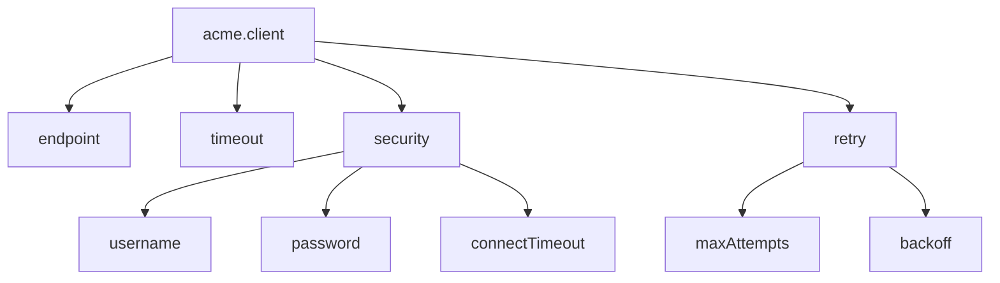

# Nested Properties and @NestedConfigurationProperty

> **Chapter: Two-Phase Configuration.** The **SPRING_BOOT_NATIVE_IMAGE** module compiles Spring Boot applications into GraalVM Native Images using Spring AOT. When configuring applications, @ConfigurationProperties often groups multiple properties into structured objects. This lesson explains how to organize nested properties, the role of @NestedConfigurationProperty in metadata, and what to check during AOT/native builds.

## 1. Learning Objectives

After this lesson, you will be able to:

1. Model Spring Boot configuration as nested objects instead of one class with too many flat fields.
2. Distinguish **configuration metadata generated at build time** from **configuration values bound at runtime**.
3. Explain the exact role of @NestedConfigurationProperty: assisting the annotation processor in generating metadata for nested properties.
4. Configure nested objects using JavaBeans, constructor binding, or records and read data from YAML/properties.
5. Inspect metadata in an IDE and verify binding on both the JVM and GraalVM Native Image.

## 2. What Are Nested Properties?

An application often has multiple related configuration groups. For example, an HTTP client has an endpoint, timeout, retry settings, and security credentials. Placing all of them as top-level fields makes field names long, hard to group, and difficult to extend.

We can model configuration as a tree:



Corresponding property paths:

| Property | Meaning |
|---|---|
| acme.client.endpoint | URL of the external service |
| acme.client.timeout | Overall timeout |
| acme.client.security.username | Authentication username |
| acme.client.security.password | Password or secret |
| acme.client.security.connect-timeout | Connection establishment timeout |
| acme.client.retry.max-attempts | Maximum retry attempts |
| acme.client.retry.backoff | Delay between attempts |

In Java, `security` and `retry` are child objects. When Spring Boot binding reads configuration, the Binder traverses the property path to assign values to the corresponding object. This is a way of structuring objects; it does not require creating a separate Spring bean for each subgroup.

## 3. Distinguishing the Two Phases: Metadata and Binding

When working with @ConfigurationProperties, two distinct activities are often confused:

**Phase 1 — Generating configuration metadata at build time.** Spring Boot's annotation processor analyzes configuration classes, data types, getters/setters, constructors, and related annotations. The processor creates a metadata file so IDEs can offer autocompletion for property names, types, default values, and descriptions. @NestedConfigurationProperty is a directive for this phase.

**Phase 2 — Binding configuration values at runtime.** Spring Boot reads the `Environment` from sources such as `application.yml`, `application.properties`, environment variables, system properties, or command-line arguments. `ConfigurationPropertiesBinding`/Binder converts the values and assigns them to the configuration object. The binding process does not need the metadata file generated in phase 1.

| Aspect | Metadata generation | Runtime binding |
|---|---|---|
| Timing | At compile/build time | When Spring creates and configures the application |
| Component | spring-boot-configuration-processor | Spring Boot Binder and @ConfigurationProperties |
| Input | Java structure, annotations, property types | Environment and configuration object |
| Output | META-INF/spring-configuration-metadata.json | Object populated with configuration values |
| Purpose | IDE hints, documentation, and tooling | Supplying values to the application |
| @NestedConfigurationProperty | Guides the processor | Does not control binding |

**Key point:** @NestedConfigurationProperty does not make the Binder start binding child objects. The Binder can bind nested properties based on type structure and binding rules even without this annotation. The annotation primarily helps the processor understand that a field or property of another type should be represented as a nested property group in metadata.

## 4. JavaBean Example with Nested Properties

Suppose an application has HTTP client configuration:

```java
package com.example.demo.config;

import java.time.Duration;
import org.springframework.boot.context.properties.ConfigurationProperties;
import org.springframework.boot.context.properties.NestedConfigurationProperty;
import org.springframework.validation.annotation.Validated;

@Validated
@ConfigurationProperties(prefix = "acme.client")
public class ClientProperties {

    private String endpoint = "https://api.example.com";
    private Duration timeout = Duration.ofSeconds(3);

    @NestedConfigurationProperty
    private Security security = new Security();

    @NestedConfigurationProperty
    private Retry retry = new Retry();

    public String getEndpoint() {
        return endpoint;
    }

    public void setEndpoint(String endpoint) {
        this.endpoint = endpoint;
    }

    public Duration getTimeout() {
        return timeout;
    }

    public void setTimeout(Duration timeout) {
        this.timeout = timeout;
    }

    public Security getSecurity() {
        return security;
    }

    public void setSecurity(Security security) {
        this.security = security;
    }

    public Retry getRetry() {
        return retry;
    }

    public void setRetry(Retry retry) {
        this.retry = retry;
    }
}
```

The child classes can be separate top-level types:

```java
package com.example.demo.config;

import java.time.Duration;

public class Security {
    private String username;
    private String password;
    private Duration connectTimeout = Duration.ofSeconds(2);

    public String getUsername() {
        return username;
    }

    public void setUsername(String username) {
        this.username = username;
    }

    public String getPassword() {
        return password;
    }

    public void setPassword(String password) {
        this.password = password;
    }

    public Duration getConnectTimeout() {
        return connectTimeout;
    }

    public void setConnectTimeout(Duration connectTimeout) {
        this.connectTimeout = connectTimeout;
    }
}
```

```java
package com.example.demo.config;

import java.time.Duration;

public class Retry {
    private int maxAttempts = 3;
    private Duration backoff = Duration.ofMillis(200);

    public int getMaxAttempts() {
        return maxAttempts;
    }

    public void setMaxAttempts(int maxAttempts) {
        this.maxAttempts = maxAttempts;
    }

    public Duration getBackoff() {
        return backoff;
    }

    public void setBackoff(Duration backoff) {
        this.backoff = backoff;
    }
}
```

When child classes are independent top-level types, placing `@NestedConfigurationProperty` on the `security` and `retry` fields helps the configuration metadata processor recognize the nested structure. If the child type is an **inner class** structured in a way the processor recognizes, the processor can infer the nested relationship automatically; when the child type is extracted into a separate class, the annotation states the intent explicitly.

### 4.1. Configuring with YAML

```yaml
acme:
  client:
    endpoint: https://orders.example.com
    timeout: 5s
    security:
      username: orders-service
      password: ORDERS_API_PASSWORD
      connect-timeout: 1500ms
    retry:
      max-attempts: 4
      backoff: 300ms
```

Or using `application.properties`:

```properties
acme.client.endpoint=https://orders.example.com
acme.client.timeout=5s
acme.client.security.username=orders-service
acme.client.security.password=ORDERS_API_PASSWORD
acme.client.security.connect-timeout=1500ms
acme.client.retry.max-attempts=4
acme.client.retry.backoff=300ms
```

In a real environment, passwords should be supplied via a secret manager or environment variables—do not commit sensitive values to YAML files. The value `ORDERS_API_PASSWORD` in the example is an illustrative placeholder; real configurations can reference environment variables using Spring's property placeholder syntax.

Spring Boot supports relaxed binding: property names in configuration files can use kebab-case, while Java fields typically use camelCase. For instance, `connect-timeout` binds to `connectTimeout`. `Duration` types can use suffixes like `ms`, `s`, `m`; choose explicit units to avoid ambiguity.

### 4.2. Registering Configuration Properties

`@ConfigurationPropertiesScan` can be used on the application class:

```java
package com.example.demo;

import com.example.demo.config.ClientProperties;
import org.springframework.boot.SpringApplication;
import org.springframework.boot.autoconfigure.SpringBootApplication;
import org.springframework.boot.context.properties.ConfigurationPropertiesScan;

@SpringBootApplication
@ConfigurationPropertiesScan(basePackageClasses = ClientProperties.class)
public class DemoApplication {
    public static void main(String[] args) {
        SpringApplication.run(DemoApplication.class, args);
    }
}
```

Or register explicitly with `@EnableConfigurationProperties(ClientProperties.class)` in a Spring configuration class. Choose one clear mechanism so the configuration class is registered; merely putting `@ConfigurationProperties` on a class does not automatically ensure it becomes a bean in all application setups.

## 5. Exact Role of @NestedConfigurationProperty

The annotation resides in package:

```java
org.springframework.boot.context.properties.NestedConfigurationProperty
```

It is a marker telling the **configuration metadata processor** to treat that property as a nested property group when generating metadata. For example, instead of describing `acme.client.security` merely as a single object, the metadata can represent the group and its child properties such as `acme.client.security.username` and `acme.client.security.connect-timeout`.

This annotation does **not**:

- Automatically register `ClientProperties` as a Spring bean.
- Add `@ConfigurationProperties` to the child class.
- Change `Environment` configuration sources or precedence order.
- Automatically validate child fields without appropriate validation annotations.
- Generate reflection hints for GraalVM Native Image.
- Act as a prerequisite for the Binder to bind child objects.

### 5.1. When Is It Needed?

| Structure | Metadata handling |
|---|---|
| Scalar properties like String, int, Duration | Processor recognizes standard property types |
| Nested type is an inner class recognized by the processor | Usually no annotation needed |
| Nested type is a separate top-level class used as a field in configuration properties | Use @NestedConfigurationProperty to declare a nested group |
| Third-party or complex types not inferred properly by the processor | Inspect metadata; consider the annotation or additional metadata |
| Property is a Map, List, or generic collection | Metadata depends on generic element/value type; do not mechanically annotate every collection |

Do not add the annotation to every field just because its type is an object. Inspect the generated metadata file and how the IDE displays it before making changes.

### 5.2. Nested Class vs. Top-Level Class

Another way to organize this is to declare the child class directly inside the configuration class:

```java
@ConfigurationProperties("acme.client")
public class ClientProperties {

    private Security security = new Security();

    public Security getSecurity() {
        return security;
    }

    public void setSecurity(Security security) {
        this.security = security;
    }

    public static class Security {
        private String username;

        public String getUsername() {
            return username;
        }

        public void setUsername(String username) {
            this.username = username;
        }
    }
}
```

With an eligible inner class, the processor can detect the nested relationship automatically. When extracting `Security` into a top-level class for reuse, `@NestedConfigurationProperty` helps the metadata processor preserve the right group structure. Both approaches remain object graphs handled by the Binder; choose based on reusability, clarity, and domain design.

## 6. Where Is Metadata Generated and What Is It Used For?

For IDEs to offer configuration hints, add `spring-boot-configuration-processor` to the annotation processor path.

With Gradle:

```groovy
dependencies {
    annotationProcessor "org.springframework.boot:spring-boot-configuration-processor"
}
```

With Maven:

```xml
<dependency>
    <groupId>org.springframework.boot</groupId>
    <artifactId>spring-boot-configuration-processor</artifactId>
    <optional>true</optional>
</dependency>
```

After compiling, inspect the file:

- Gradle: `build/classes/java/main/META-INF/spring-configuration-metadata.json`.
- Maven: `target/classes/META-INF/spring-configuration-metadata.json`.

Paths may differ if the project customizes source sets, output directories, or module builds. With Gradle, inspect the compile task and output directory rather than assuming the file is always at the exact same path.

Metadata has two major sections:

- groups: configuration groups, such as `acme.client`, `acme.client.security`, `acme.client.retry`.
- properties: individual properties, such as `acme.client.timeout`, `acme.client.security.username`, `acme.client.retry.max-attempts`.

Simplified illustration of metadata structure (type/source names abbreviated):

```json
{
  "groups": [
    {
      "name": "acme.client",
      "type": "com.example.demo.config.ClientProperties"
    },
    {
      "name": "acme.client.security",
      "type": "com.example.demo.config.Security"
    },
    {
      "name": "acme.client.retry",
      "type": "com.example.demo.config.Retry"
    }
  ],
  "properties": [
    {
      "name": "acme.client.endpoint",
      "type": "java.lang.String"
    },
    {
      "name": "acme.client.security.username",
      "type": "java.lang.String"
    },
    {
      "name": "acme.client.retry.max-attempts",
      "type": "java.lang.Integer"
    }
  ]
}
```

This is an illustrative example, not verbatim processor output. Actual metadata can also include `sourceType`, `description`, `defaultValue`, `deprecation`, and other fields.

If the IDE does not suggest nested properties:

1. Verify `spring-boot-configuration-processor` is on the annotation processor path.
2. Run compile/build so the processor actually executes.
3. Open `spring-configuration-metadata.json` and check whether child groups/properties were generated.
4. Check fields/getters and data types, especially separate top-level classes.
5. If the structure is still not inferred, add `@NestedConfigurationProperty` on the right field and rebuild.
6. Check additional metadata if the property comes from an external dependency or source cannot be modified.

Metadata serves tooling; the application can still bind values even if the IDE does not suggest them. Conversely, an IDE suggesting a property does not prove runtime binding succeeds: key names, type conversions, validation, and value sources must still be tested.

## 7. Constructor Binding and Records with Nested Properties

For immutable configuration, constructor binding or Java records can be used. Example:

```java
package com.example.demo.config;

import java.time.Duration;
import org.springframework.boot.context.properties.ConfigurationProperties;

@ConfigurationProperties("acme.client")
public record ClientProperties(
        String endpoint,
        Duration timeout,
        Security security,
        Retry retry) {

    public record Security(
            String username,
            String password,
            Duration connectTimeout) {
    }

    public record Retry(
            int maxAttempts,
            Duration backoff) {
    }
}
```

Spring Boot can bind nested structures via constructors or record components. For constructor binding, follow the rules of your Spring Boot version, such as having a single eligible constructor or a record canonical constructor. Do not add setters just to make an immutable example work.

@NestedConfigurationProperty is neither a replacement for constructor binding nor does it decide whether the Binder uses JavaBean or constructor binding. If nested metadata is needed for a standalone type, check the processor for your version and place the annotation where supported by the API.

## 8. Validation for Child Properties

@NestedConfigurationProperty does not trigger validation. To validate values inside child objects, use Bean Validation with `@Valid` on the parent field and constraints on child fields.

Example:

```java
import jakarta.validation.Valid;
import jakarta.validation.constraints.NotBlank;
import org.springframework.validation.annotation.Validated;

@Validated
@ConfigurationProperties("acme.client")
public class ClientProperties {

    @Valid
    private Security security = new Security();

    public Security getSecurity() {
        return security;
    }

    public void setSecurity(Security security) {
        this.security = security;
    }

    public static class Security {
        @NotBlank
        private String username;

        public String getUsername() {
            return username;
        }

        public void setUsername(String username) {
            this.username = username;
        }
    }
}
```

In this example:

- `@Validated` enables validation on the configuration properties bean.
- `@Valid` instructs validation to cascade into the `security` object.
- `@NotBlank` checks that `username` has a non-empty value after binding.

If `@Valid` is omitted, constraints inside the child object may not cascade as expected. Add the appropriate Bean Validation dependency, such as the validation starter, if the application uses it.

## 9. Considerations When Using Spring AOT and Native Image

For native applications, separate three distinct kinds of information:

1. **Configuration metadata**: JSON files generated by the annotation processor for IDEs and tooling. @NestedConfigurationProperty belongs to this layer.
2. **Spring AOT output**: code/hints generated when Spring analyzes application structure at build time.
3. **Runtime configuration values**: actual values read from files, environment variables, system properties, or command-line arguments when the native app runs.

Do not assume adding `@NestedConfigurationProperty` automatically registers reflection for GraalVM. This annotation is not a runtime hint. Spring Boot AOT can recognize and process registered `@ConfigurationProperties` in the application, but data types, binding styles, and custom libraries should still be verified per version.

### 9.1. Checklist for Native Binding

- Register configuration classes with `@ConfigurationPropertiesScan` or `@EnableConfigurationProperties`.
- Check that nested types have constructors/accessors compatible with the chosen binding style.
- Verify configuration values coming from the runtime environment are actually read when the native executable runs.
- For immutable objects/records, verify constructor binding and validation in the native build.
- For reflection or custom serialization libraries inside nested objects, inspect runtime hints/reachability metadata separately.
- Do not embed secrets or production environment values into the image at build time.
- Run integration tests against the native executable with both default and overridden configurations.

### 9.2. Binding Test Example

Bound objects can be tested using `@SpringBootTest`:

```java
package com.example.demo;

import com.example.demo.config.ClientProperties;
import org.junit.jupiter.api.Test;
import org.springframework.beans.factory.annotation.Autowired;
import org.springframework.boot.test.context.SpringBootTest;
import org.springframework.test.context.TestPropertySource;

import static org.junit.jupiter.api.Assertions.assertEquals;

@SpringBootTest
@TestPropertySource(properties = {
    "acme.client.security.username=test-user",
    "acme.client.retry.max-attempts=5"
})
class ClientPropertiesTest {

    @Autowired
    ClientProperties properties;

    @Test
    void bindsNestedProperties() {
        assertEquals("test-user", properties.getSecurity().getUsername());
        assertEquals(5, properties.getRetry().getMaxAttempts());
    }
}
```

Run JVM tests first:

```bash
./gradlew test
```

If the project configures GraalVM Native Build Tools, continue with native tests:

```bash
./gradlew nativeTest
```

Or build the application executable and run integration/smoke tests with runtime configuration:

```bash
./gradlew nativeCompile
```

The binary name depends on the project name and Gradle configuration. Do not assume every project produces a file named `application`; check the task output under `build/native/nativeCompile/`.

JVM and native tests should use the same test value set, while also verifying environment overrides when running in containers. For example, `ACME_CLIENT_SECURITY_USERNAME` can serve as a higher-precedence configuration source than a YAML file; verify Spring Boot's relaxed binding and precedence rules accurately.

## 10. Common Pitfalls and How to Diagnose Them

| Symptom | Possible cause | Resolution |
|---|---|---|
| IDE does not suggest `acme.client.security.*` | Missing processor or nested type not described in metadata | Check annotation processor and `@NestedConfigurationProperty` |
| Metadata has `acme.client.security` but lacks child properties | Processor cannot read type/accessors or nested structure | Check source type, getters/setters, processor, and metadata output |
| Binder does not bind `security` object | Configuration class not registered, wrong key name, or incompatible object structure | Check `@ConfigurationPropertiesScan`, prefix, and accessors/constructors |
| Child object is null | Field uninitialized and no suitable instantiation mechanism | Initialize nested object or use constructor binding properly |
| Validation does not catch blank username | Missing `@Valid`, `@Validated`, or Bean Validation provider | Check cascade validation and dependencies |
| JVM binds fine, native fails with reflection error | Missing runtime hints or unanalyzed dynamic access | Inspect Spring AOT output, stack trace, and reachability metadata |
| IDE suggests property, but app does not receive value | Metadata is not runtime binding; wrong key, source, or precedence | Check `Environment`, profile, env vars, and binding logs |
| Secret has build-time value but is wrong in production | Value was placed in build/image config instead of runtime | Move secret to secret manager or runtime environment |

When diagnosing, first determine whether the issue lies in **metadata generation**, **runtime binding**, **validation**, or **native reachability**. These four layers can exhibit similar symptoms yet require different fixes.

## 11. Practice Exercise

Create a configuration group for a payment service:

```yaml
payment:
  gateway:
    base-url: https://payments.example.com
    timeout: 4s
    credentials:
      client-id: demo-client
      client-secret: PAYMENT_CLIENT_SECRET
    retry:
      max-attempts: 3
      backoff: 250ms
```

Requirements:

1. Create `PaymentGatewayProperties` with prefix `payment.gateway`.
2. Create two standalone child types: `Credentials` and `Retry`.
3. Place `@NestedConfigurationProperty` where needed so the metadata processor recognizes nested groups.
4. Add the configuration processor to the Gradle or Maven annotation processor path.
5. Build the project and verify `spring-configuration-metadata.json` contains the child groups/properties.
6. Register the properties bean and verify values bound from YAML.
7. Add validation for `baseUrl` and `clientId`; verify cascade validation on child objects.
8. Run tests on the JVM, then `nativeTest` or the native executable with equivalent configuration.
9. Override `PAYMENT_CLIENT_SECRET` at runtime and verify the application receives the secret from the deployment environment.

| Item | Result |
|---|---|
| Metadata processor ran | Pass/Fail |
| Group payment.gateway.credentials | Yes/No |
| Group payment.gateway.retry | Yes/No |
| Nested properties bound on JVM | Pass/Fail |
| Nested object validation | Pass/Fail |
| Nested properties bound in native | Pass/Fail |
| Runtime secret override | Pass/Fail |

## 12. Self-Check Questions

1. Which stage in the configuration lifecycle does `@NestedConfigurationProperty` assist?
2. Why does omitting this annotation not necessarily stop the Binder from binding child objects?
3. What is the difference between `groups` and `properties` in configuration metadata?
4. When should you use an inner class versus extracting a nested type into a top-level class?
5. Why can a nested object bind properly while the IDE still does not suggest child properties?
6. How do `@Valid` and `@NestedConfigurationProperty` differ in their roles?
7. Why can annotation metadata not replace GraalVM runtime hints?
8. How can you prove a nested property is bound from an environment variable when the native executable runs?

## Takeaways

**Nested properties describe configuration object structure; the Binder uses that structure to bind values at runtime; @NestedConfigurationProperty helps the configuration metadata processor describe nested property groups accurately.** Metadata, runtime binding, and Spring AOT/native hints are separate layers. When building native images, register configuration properties, verify binding and validation with tests, and add runtime hints if the application performs dynamic access that Spring AOT does not detect automatically.

## References

- [Spring Boot — Configuration Metadata](https://docs.spring.io/spring-boot/reference/configuration-metadata/index.html): role of the annotation processor, metadata, and @NestedConfigurationProperty.
- [Spring Boot — Generating Your Own Metadata](https://docs.spring.io/spring-boot/specification/configuration-metadata/annotation-processor.html): processor configuration, nested properties, and additional metadata.
- [Spring Boot — Type-safe Configuration Properties](https://docs.spring.io/spring-boot/reference/features/external-config.html): @ConfigurationProperties, binding, and validation.
- [Spring Boot API — NestedConfigurationProperty](https://docs.spring.io/spring-boot/api/java/org/springframework/boot/context/properties/NestedConfigurationProperty.html): annotation definition.
- [Spring Boot — AOT Processing](https://docs.spring.io/spring-boot/reference/packaging/aot.html): AOT processing and build-time configuration limits.
- [Spring Boot — GraalVM Native Images](https://docs.spring.io/spring-boot/reference/packaging/native-image/introducing-graalvm-native-images.html): Spring AOT and Native Image.
