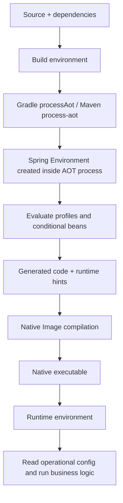
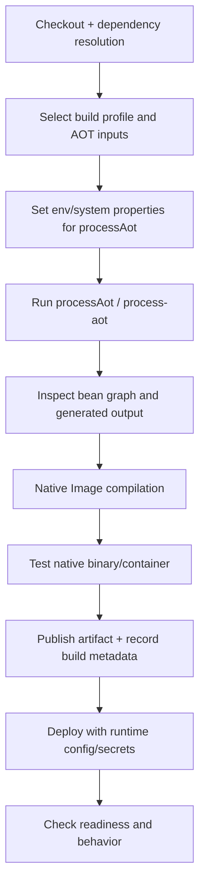

# Passing the Environment to processAot or process-aot

When Spring Boot runs **Spring AOT**, the application is initialized during the build phase so Spring can analyze configuration, evaluate conditions, and prepare the BeanFactory. Therefore, environment variables, system properties, arguments, and Spring profiles that affect the bean graph must be passed to the **exact AOT process**. Setting a variable on the outer build command or on the container at runtime later does not automatically mean the AOT process received the same value.

With Gradle, the **`processAot`** task is a `JavaExec` task, so environment variables, system properties, JVM arguments, and application arguments can be configured directly on it. With Maven, the **`spring-boot:process-aot`** goal has its own parameters such as `profiles`, `systemPropertyVariables`, `jvmArguments`, and `arguments`. The two tools are configured differently; do not copy Gradle syntax into Maven.

## 1. Learning Objectives

After this lesson, you will be able to:

- Explain why the AOT process environment affects the build output.
- Distinguish environment variables of the shell/CI, the Gradle/Maven process, the AOT process, and the native application at runtime.
- Pass environment variables, system properties, JVM arguments, and application arguments to Gradle `processAot`.
- Configure Maven `process-aot` using Spring profiles, `systemPropertyVariables`, `jvmArguments`, and `arguments`; understand how to supply OS environment variables before invoking Maven.
- Distinguish the Maven profile `-Pnative` from Spring profiles `prod` or `native`.
- Identify which properties change the bean graph at build time and which can change at runtime.
- Verify the actual values seen by the AOT process without leaking secrets.

## 2. Why Must the Environment Be Passed to the AOT Process?

Spring AOT initializes the application in the build environment to analyze configuration. When the BeanFactory is prepared, conditions such as `@Profile`, `@ConditionalOnProperty`, `@ConditionalOnClass`, `@ConditionalOnBean`, and `@ConditionalOnMissingBean` are evaluated against the inputs present at that moment.

For example, an audit feature is only registered when `feature.audit.enabled=true`:

```java
@Configuration(proxyBeanMethods = false)
class AuditConfiguration {
    @Bean
    @ConditionalOnProperty(
        prefix = "feature",
        name = "audit.enabled",
        havingValue = "true"
    )
    AuditService auditService() {
        return new AuditService();
    }
}
```

If the AOT process sees `false` or does not see the property, the bean may be omitted from the prepared graph. Changing the variable to `FEATURE_AUDIT_ENABLED=true` when running the native container will not automatically make Spring re-analyze and add a new bean definition.

Therefore, treat the AOT environment as **part of the artifact's inputs**:



**The two phases have two different purposes:**

| Phase | Example data | Impact |
| --- | --- | --- |
| **Build/AOT** | Profile enabling beans, property conditions, classpath, settings deciding auto-configuration | Can change the bean graph and generated code/hints |
| **Runtime** | Database URL, password, API endpoint, timeout, or business values read at runtime | Configures operation of the built application |

Not every property is frozen during AOT. Profiles that only change ordinary configuration values without changing bean conditions can still be used at runtime. The key boundary is whether the property changes the **container structure**.

## 3. Distinguishing Parameter Channels

Build tools offer multiple channels for passing values. They are not interchangeable:

| Channel | Example | Where is it read? | When to use? |
| --- | --- | --- | --- |
| **OS environment variable** | `SPRING_PROFILES_ACTIVE=prod` | `System.getenv` and Spring Environment | Environment-specific config, well suited for CI/containers |
| **JVM system property** | `-Dfeature.audit.enabled=true` | `System.getProperty` and Spring Environment | Configuration for the AOT JVM process |
| **Application argument** | `--feature.audit.enabled=true` | Spring Boot command-line property source | Passing a property as an application argument |
| **JVM argument** | `-Xmx2g`, `-Duser.timezone=UTC` | JVM running the AOT process | Tuning memory, encoding, debugging, or JVM behavior |
| **Spring profile** | `prod`, `native` | Spring Environment | Selecting configuration/beans by profile |
| **Maven profile** | `-Pnative` | Maven model/build lifecycle | Enabling plugin executions and build configuration |
| **Gradle project property** | `-PtargetEnv=prod` | Gradle build script | Controlling Gradle build logic; does not automatically become AOT process env/property |

Several examples look similar but target different things:

- `./mvnw -Pnative ...` activates a **Maven profile** named `native`. It does not automatically set `spring.profiles.active=native`.
- `./gradlew -PtargetEnv=prod processAot` supplies a **Gradle project property**. For the AOT process to receive the corresponding Spring property, map it to the task's `environment`, `systemProperty`, or `args`.
- `SPRING_PROFILES_ACTIVE=prod` is a process environment variable; Spring Boot can read it when the AOT process inherits or is configured to receive that variable.
- `-Dspring.profiles.active=prod` is a JVM system property if set on the actual AOT JVM process.

If multiple sources set the same key to different values, Spring Boot applies its property source precedence rules. For reproducible AOT results, choose **one primary source per property** to avoid unintended overrides of profiles or conditions.

## 4. Passing the Environment to the Gradle `processAot` Task

### 4.1. Requirements for the `processAot` Task

The `processAot` task is provided by the `org.springframework.boot.aot` plugin. This plugin is applied automatically when the project uses a compatible GraalVM Native Image Gradle plugin. If you only want to run an AOT-processed application on the JVM, you can apply the Spring Boot AOT plugin directly.

Example `build.gradle` with Groovy:

```groovy
plugins {
    id 'org.springframework.boot' version '4.2.0'
    id 'org.graalvm.buildtools.native' version '1.1.18'
    id 'java'
}
```

If the project only needs AOT without configuring the native plugin yet, apply `org.springframework.boot.aot` according to the documentation for your Spring Boot version.

### 4.2. Configuring Environment Variables

`processAot` is a `JavaExec` task. You can set environment variables specifically for this Java process:

```groovy
tasks.named(
    'processAot',
    org.springframework.boot.gradle.tasks.aot.ProcessAot
) {
    environment 'SPRING_PROFILES_ACTIVE', 'prod'
    environment 'FEATURE_AUDIT_ENABLED', 'true'
    environment 'APP_REGION', 'ap-southeast-1'
}
```

When running:

```bash
./gradlew processAot
```

the AOT process receives those variables. Spring Boot can map `FEATURE_AUDIT_ENABLED` to the property `feature.audit.enabled` according to relaxed binding rules.

### 4.3. Kotlin DSL

With `build.gradle.kts`:

```kotlin
tasks.named<org.springframework.boot.gradle.tasks.aot.ProcessAot>("processAot") {
    environment("SPRING_PROFILES_ACTIVE", "prod")
    environment("FEATURE_AUDIT_ENABLED", "true")
    environment("APP_REGION", "ap-southeast-1")
}
```

Specifying the concrete task type helps the IDE and Gradle validate the configuration better. If the task name does not exist, verify whether the AOT plugin has been applied and whether your Spring Boot version provides this task.

### 4.4. Passing System Properties, Application Arguments, and JVM Arguments

Because `processAot` inherits from `JavaExec`, other channels can be configured:

```kotlin
tasks.named<org.springframework.boot.gradle.tasks.aot.ProcessAot>("processAot") {
    // Environment of the application being processed by AOT.
    environment("SPRING_PROFILES_ACTIVE", "prod")

    // JVM system properties inside the AOT process.
    systemProperty("feature.audit.enabled", "true")
    systemProperty("user.timezone", "UTC")

    // Application arguments read by Spring Boot when creating the AOT context.
    args("--spring.main.banner-mode=off")

    // JVM arguments, such as heap size for the AOT process.
    jvmArgs("-Xmx2g")
}
```

There is no need to pass the same property through environment, system properties, and arguments simultaneously. The example above intentionally uses different properties to illustrate each channel. When a property appears in multiple sources, the final value depends on Spring `Environment` precedence.

### 4.5. Mapping a Gradle Project Property to the AOT Task

A pipeline might use `-PtargetEnv` to select the build environment:

```kotlin
val targetEnv = providers.gradleProperty("targetEnv")
    .orElse("dev")

tasks.named<org.springframework.boot.gradle.tasks.aot.ProcessAot>("processAot") {
    environment("SPRING_PROFILES_ACTIVE", targetEnv.get())
}
```

Run:

```bash
./gradlew processAot -PtargetEnv=prod
```

`targetEnv` is a Gradle build property. It affects the AOT process only because the build script **explicitly maps** it to the `SPRING_PROFILES_ACTIVE` environment variable. Removing that task configuration means `-PtargetEnv=prod` will not activate a Spring profile on its own.

### 4.6. Environment Variables from the Shell and Gradle Daemon

You can try setting variables in the shell before running Gradle:

```bash
SPRING_PROFILES_ACTIVE=prod FEATURE_AUDIT_ENABLED=true ./gradlew processAot
```

However, when using the Gradle daemon, the daemon's environment and the task's environment must be considered separately. For reproducible builds, **configuring `environment(...)` directly on `processAot`** is usually clearer than relying on the environment of an already-running daemon.

## 5. Passing the Environment to the Maven `process-aot` Goal

### 5.1. Configuring the `process-aot` Goal

The Spring Boot Maven Plugin provides the `spring-boot:process-aot` goal to run the AOT engine on the application. Example:

```xml
<build>
    <plugins>
        <plugin>
            <groupId>org.springframework.boot</groupId>
            <artifactId>spring-boot-maven-plugin</artifactId>
            <executions>
                <execution>
                    <id>process-aot</id>
                    <goals>
                        <goal>process-aot</goal>
                    </goals>
                    <configuration>
                        <profiles>
                            <profile>prod</profile>
                        </profiles>
                        <systemPropertyVariables>
                            <feature.audit.enabled>true</feature.audit.enabled>
                            <user.timezone>UTC</user.timezone>
                        </systemPropertyVariables>
                        <arguments>
                            <argument>--spring.main.banner-mode=off</argument>
                        </arguments>
                        <jvmArguments>-Xmx2g</jvmArguments>
                    </configuration>
                </execution>
            </executions>
        </plugin>
    </plugins>
</build>
```

Fields in the example:

- `profiles`: Spring profiles used when AOT processes the application.
- `systemPropertyVariables`: JVM system properties passed into the AOT process.
- `arguments`: application arguments considered when creating the context.
- `jvmArguments`: JVM flags for the AOT process, such as heap size.

This configures the **Spring Boot Maven Plugin**, not a Maven profile. If the plugin is already declared in `<build><plugins>` or managed via a parent POM, add the execution/configuration to the existing declaration to avoid duplicate plugin declarations.

### 5.2. Setting OS Environment Variables Before Running Maven

Maven `process-aot` inherits the OS environment in which the Maven process is launched. The simplest approach is setting variables in the shell/CI step before the Maven command; child processes launched by Maven inherit the parent process's environment per OS behavior.

Linux/macOS:

```bash
SPRING_PROFILES_ACTIVE=prod \
FEATURE_AUDIT_ENABLED=true \
APP_REGION=ap-southeast-1 \
./mvnw clean compile spring-boot:process-aot
```

PowerShell:

```powershell
$env:SPRING_PROFILES_ACTIVE = "prod"
$env:FEATURE_AUDIT_ENABLED = "true"
$env:APP_REGION = "ap-southeast-1"
.\mvnw.cmd clean compile spring-boot:process-aot
```

The variables above are supplied to the AOT runtime environment. If using the Maven `native` profile, the command might be `./mvnw -Pnative ...`, while still distinguishing the Maven profile from a Spring profile.

**Important note:** the official parameter list of the `process-aot` goal includes `profiles`, `systemPropertyVariables`, `jvmArguments`, and `arguments`; it does not have an `environmentVariables` parameter like the `spring-boot:run` goal. Therefore, do not copy `<environmentVariables>` from the run goal into a `process-aot` execution expecting the plugin to forward it. For the AOT goal, use shell/CI environment variables or the supported AOT parameters.

### 5.3. A Spring Profile Is Not a Maven Profile

Example:

```bash
# Activate the Maven profile named native
./mvnw -Pnative package
```

`-Pnative` tells Maven to activate the `native` profile in the POM/parent. That profile may configure AOT execution or Native Build Tools, but it is not by default equivalent to the Spring `native` profile.

A Spring profile can be passed via AOT configuration:

```xml
<profiles>
    <profile>prod</profile>
</profiles>
```

Or via the OS environment:

```bash
SPRING_PROFILES_ACTIVE=prod ./mvnw spring-boot:process-aot
```

Do not set both sources to conflicting values. If a profile alters the bean graph, specify clearly which profile was used during AOT.

### 5.4. When to Use `systemPropertyVariables` Instead of Environment Variables?

Suppose you need to set `feature.audit.enabled=true`:

```xml
<systemPropertyVariables>
    <feature.audit.enabled>true</feature.audit.enabled>
</systemPropertyVariables>
```

Spring can read this system property inside the AOT process. If you prefer standard environment configuration, you can set `FEATURE_AUDIT_ENABLED=true` in the shell/CI. Both approaches can resolve to the same Spring property, though their configuration source and precedence differ.

`jvmArguments` should be reserved for JVM options like `-Xmx2g`, `-Dfile.encoding=UTF-8`, or debugging flags. `arguments` is for application arguments like `--spring.main.banner-mode=off`. Do not mistakenly pass `-Xmx2g` as an application argument.

## 6. Two Equivalent Configuration Examples

Suppose AOT requires:

- Active Spring profile is `prod`.
- Audit bean enabled via `feature.audit.enabled=true`.
- AOT JVM process has UTC timezone and 2 GB max heap.

### Gradle Kotlin DSL

```kotlin
tasks.named<org.springframework.boot.gradle.tasks.aot.ProcessAot>("processAot") {
    environment("SPRING_PROFILES_ACTIVE", "prod")
    environment("FEATURE_AUDIT_ENABLED", "true")
    systemProperty("user.timezone", "UTC")
    jvmArgs("-Xmx2g")
}
```

Run:

```bash
./gradlew processAot
```

### Maven

```xml
<execution>
    <id>process-aot</id>
    <goals>
        <goal>process-aot</goal>
    </goals>
    <configuration>
        <profiles>
            <profile>prod</profile>
        </profiles>
        <systemPropertyVariables>
            <feature.audit.enabled>true</feature.audit.enabled>
            <user.timezone>UTC</user.timezone>
        </systemPropertyVariables>
        <jvmArguments>-Xmx2g</jvmArguments>
    </configuration>
</execution>
```

Run:

```bash
./mvnw clean compile spring-boot:process-aot
```

In the Maven example, the Spring profile `prod` is set via the `profiles` parameter; in Gradle it is set via an environment variable. The two mechanisms differ in how they pass values, yet both aim to construct the right Spring `Environment` inside the AOT process.

## 7. Build-Time Environment and Runtime Environment Must Be Managed Separately

A native application may need configuration in both phases. Example:

| Property | AOT/build | Native runtime | Notes |
| --- | --- | --- | --- |
| `spring.profiles.active` | Needed if the profile alters the bean graph | Can have runtime values | Do not expect runtime to add back beans excluded during AOT |
| `feature.audit.enabled` | Needed if a condition decides whether the audit bean exists | Can change if it only controls runtime logic | When used in `@ConditionalOnProperty`, the build value decides registration |
| `DB_URL` / `SPRING_DATASOURCE_URL` | Usually no DB connection needed just to analyze structure | Needed when the service opens connections | Do not make AOT builds depend on production databases unnecessarily |
| `DB_PASSWORD` | Do not supply production secrets to AOT | Supplied via secret provider at runtime | Never write into POM, Gradle scripts, or logs |
| `APP_TIMEOUT` | Usually does not affect the bean graph | Can be read at runtime | If timeout is used in a bean creation condition, reconsider |
| `user.timezone` | Can affect code executed during AOT | JVM/native process has its own setting | Set only when clearly required by the application |
| `JAVA_TOOL_OPTIONS` | Can be picked up by the JVM in the build process | Can be picked up when running JAR/JVM | Broad scope; easily affects Maven/Gradle and child processes |

### 7.1. Example of a Profile That Changes the Bean Graph

```java
@Configuration(proxyBeanMethods = false)
class StorageConfiguration {
    @Bean
    @Profile("prod")
    StorageClient productionStorageClient() {
        return new ProductionStorageClient();
    }

    @Bean
    @Profile("dev")
    StorageClient localStorageClient() {
        return new LocalStorageClient();
    }
}
```

If AOT runs with the `prod` profile, the prepared graph may contain `ProductionStorageClient`. Changing `SPRING_PROFILES_ACTIVE=dev` when running native does not guarantee switching to `LocalStorageClient`, because generated initialization code was produced from the build-time graph.

If a profile only changes a configuration value that does not affect conditions or bean registration, Spring Boot can continue reading that value at runtime via standard external configuration mechanisms. Do not conclude "all profiles are locked" for every application; inspect what the specific profile affects.

### 7.2. Keep Secrets at Runtime

Do not pass production passwords, private keys, or tokens into `processAot` merely to connect to real systems during the build. AOT should analyze container structure in a reproducible build environment without performing business work or depending on production resources.

If connection tests are needed during the build, use test services or mock data and safely managed short-lived credentials. Runtime secrets should be provided via Kubernetes Secrets, container secret mounts, a vault, or mechanisms suited to the deployment platform.

## 8. Verifying the AOT Process Received the Right Environment

Do not look only at whether the build command succeeded. Confirm critical values reached the right process and the bean graph matches expectations.

### 8.1. Recording Configuration Without Leaking Secrets

In a test environment, you can use an initializer or configuration diagnostic that prints only **non-sensitive** values:

```java
import org.springframework.boot.ApplicationRunner;
import org.springframework.context.annotation.Bean;
import org.springframework.context.annotation.Configuration;
import org.springframework.core.env.Environment;

@Configuration(proxyBeanMethods = false)
class AotEnvironmentDiagnostics {
    @Bean
    ApplicationRunner printAotInputs(Environment environment) {
        return args -> {
            System.out.println(
                "Active profiles: "
                    + String.join(",", environment.getActiveProfiles())
            );
            System.out.println(
                "Audit enabled: "
                    + environment.getProperty("feature.audit.enabled")
            );
        };
    }
}
```

This is a simple diagnostic example. In a real application, a runner may also execute at runtime; enable it only in tests or a diagnostic profile and avoid printing URLs containing credentials, tokens, passwords, or other secrets.

Another approach is using bean conditions as evidence:

- With `feature.audit.enabled=true`, verify the audit bean is present in the AOT graph/output.
- With `false`, verify the bean is not registered as expected.
- Build separate artifacts for each structural configuration you need to support, and test the corresponding native binaries.

### 8.2. Checking Gradle

Run:

```bash
./gradlew processAot --info
```

Observe the `processAot` task executing and inspect AOT logs. If the task does not exist, verify the AOT/native plugin is applied and configured properly. You can run `tasks --all` to confirm task names in the project.

### 8.3. Checking Maven

Run:

```bash
./mvnw clean compile spring-boot:process-aot
```

To see more detailed logs:

```bash
./mvnw -X clean compile spring-boot:process-aot
```

Debug logs may contain paths, properties, or configuration details; do not share unreviewed logs publicly. Inspect AOT output in the build directory configured by the plugin, and verify bean conditions match the intended Spring profiles/properties.

### 8.4. Two-Phase Testing Matrix

| Build-time condition | Runtime setting | Expectation |
| --- | --- | --- |
| Audit enabled | Audit enabled | Audit bean is in the graph and the feature works |
| Audit disabled | Audit disabled | Audit bean is absent; application runs with the non-audit graph |
| Audit disabled | Audit enabled | Do not assume the bean appears automatically; detect mismatch and build matching artifact |
| Audit enabled | Audit disabled | Bean may still exist; logic can be disabled if designed to read a runtime property |

This matrix helps distinguish **bean registration errors during AOT** from **runtime configuration-reading logic errors**.

## 9. Common Pitfalls

| Symptom | Possible cause | Resolution |
| --- | --- | --- |
| Gradle task `processAot` not found | `org.springframework.boot.aot` or GraalVM Native plugin not applied | Check plugins/versions and task list |
| Env var is in shell, but AOT does not receive it | Gradle daemon/task environment differs from expectations | Configure `environment(...)` directly on the task; print non-sensitive values in tests |
| `-PtargetEnv=prod` does not activate Spring profile | It is only a Gradle project property | Map project property to `environment`, `systemProperty`, or `args` |
| Maven AOT ignores `<environmentVariables>` | The `process-aot` goal does not declare that parameter like the `run` goal | Set OS env before the Maven command or use `profiles`/`systemPropertyVariables`/`arguments` |
| `-Pnative` does not enable the Spring `native` profile | Maven profiles differ from Spring profiles | Configure Spring profiles separately for the AOT process |
| Wrong bean condition after native build | AOT used a different profile/property than expected | Set the right build environment and rebuild the artifact |
| Build needs production DB to create context | Initialization code performs I/O during AOT | Separate connections from structural config; use test services/fixtures |
| Secrets appear in build logs | Printing the entire `Environment` or passing unnecessary secrets | Log only non-sensitive keys, use a secret provider, and audit logs |
| Runtime switches profile, but bean is missing | Runtime graph cannot expand beyond the generated AOT graph | Build artifact with the matching structural conditions |

## 10. Recommended CI/CD Workflow



For each artifact, record:

- Commit SHA and dependency versions.
- Versions of JDK, Spring Boot, Gradle/Maven, and GraalVM.
- Maven profile or Gradle task options used.
- Spring profiles and **non-sensitive** properties affecting the bean graph.
- OS environment keys supplied (without storing secret values).
- AOT test and native integration test results.
- Executable/JAR checksum and container image digest.

If multiple structural variants are needed, such as `prod` with audit and `edge` without audit, build and test each variant explicitly. Avoid changing the environment between steps without recording it, as that can produce non-reproducible artifacts.

## 11. Practice Exercise

**Context:** a Spring Boot application has an `AuditService` registered only when `feature.audit.enabled=true`. The goal is to build AOT with the `prod` profile and audit enabled.

### With Gradle

1. Apply the Spring Boot AOT plugin (or compatible GraalVM Native plugin).
2. Configure the `processAot` task:

```kotlin
tasks.named<org.springframework.boot.gradle.tasks.aot.ProcessAot>("processAot") {
    environment("SPRING_PROFILES_ACTIVE", "prod")
    environment("FEATURE_AUDIT_ENABLED", "true")
}
```

3. Run `./gradlew processAot` and confirm the task executes.
4. Inspect the generated output/bean graph to verify `AuditService` is registered.
5. Proceed with `nativeCompile` and test the native executable with the audit feature.

### With Maven

1. Configure the Spring Boot Maven Plugin `process-aot` execution.
2. Set `profiles` to `prod` and `systemPropertyVariables` for `feature.audit.enabled=true`.
3. Run `./mvnw clean compile spring-boot:process-aot`.
4. Inspect AOT logs/output and the audit bean.
5. Continue the native build using Native Build Tools or buildpacks per project configuration.

### Mismatch Experiment

Create another build with `feature.audit.enabled=false` and then try enabling this property at runtime. Observe whether the bean appears. Explain the result based on when the condition was evaluated and the BeanFactory structure prepared by AOT.

## 12. Takeaways

- `processAot` and `process-aot` run during the **build phase**, using the environment to create a Spring `Environment` and prepare the bean graph.
- Gradle `processAot` is a `JavaExec`: you can configure `environment`, `systemProperty`, `args`, and `jvmArgs` directly on the task.
- Maven `process-aot` supports `profiles`, `systemPropertyVariables`, `arguments`, and `jvmArguments`. To set OS environment variables, supply them before invoking Maven; do not mistakenly use the `spring-boot:run` goal's `environmentVariables` configuration.
- Maven profile `-Pnative` and Gradle properties `-P...` control the build tool; they do not automatically become Spring profiles or properties of the AOT process.
- Conditions that change the bean graph must be passed accurately during AOT. Runtime configuration can only change behavior designed to be read at runtime; it cannot add back bean definitions excluded at build time.
- Do not pass or print production secrets during AOT builds. Record non-sensitive configuration, toolchain versions, and test results to reproduce artifacts.

When the right environment is passed to the AOT process, the build output accurately reflects the required features and beans. This is essential for a native executable to behave consistently between build time and deployment.

## Official References

- [Spring Boot Gradle Plugin — Ahead-of-Time Processing](https://docs.spring.io/spring-boot/gradle-plugin/aot.html): the `processAot` task is a `JavaExec` and can configure environment variables, system properties, and arguments.
- [Spring Boot Maven Plugin — Ahead-of-Time Processing](https://docs.spring.io/spring-boot/maven-plugin/aot.html): parameters `profiles`, `systemPropertyVariables`, `jvmArguments`, and `arguments` of the `process-aot` goal.
- [Spring Boot Maven Plugin — Running your Application with Maven](https://docs.spring.io/spring-boot/maven-plugin/run.html): reference for `environmentVariables` on the `spring-boot:run` goal; do not assume it is a parameter of `process-aot`.
