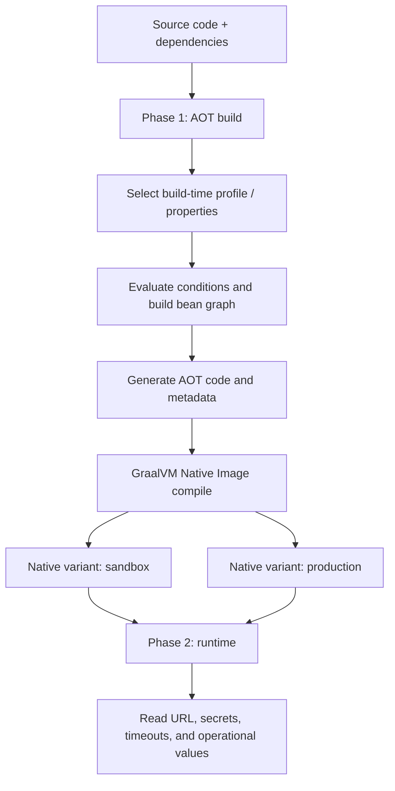
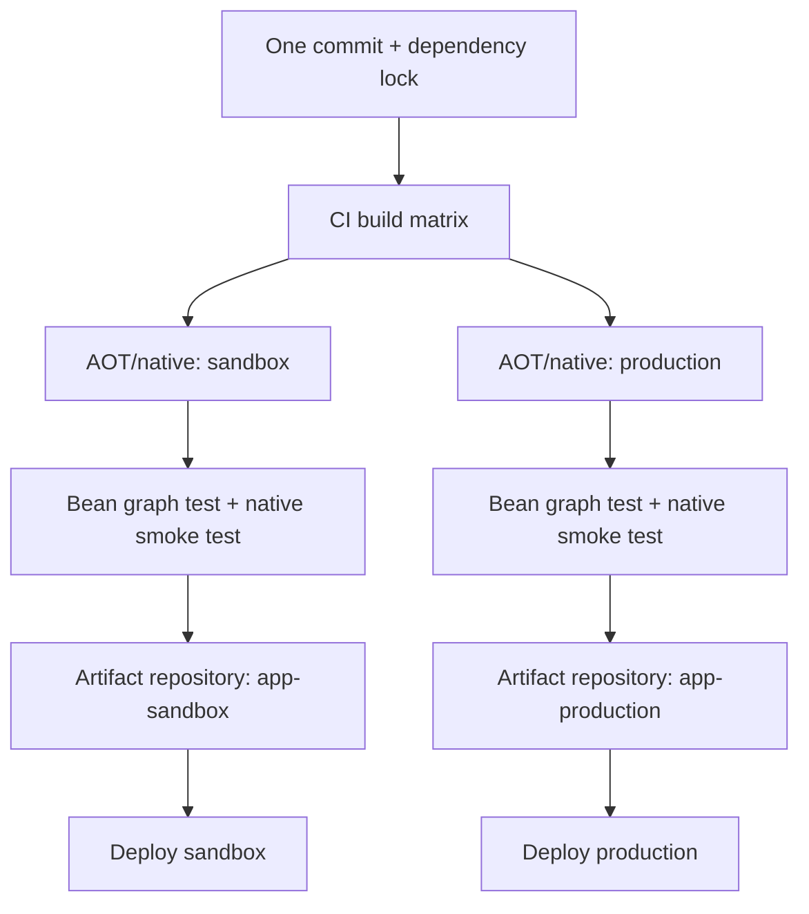

# Creating Build Variants When Bean Sets Must Differ by Environment

## Lesson Objectives

A Spring Boot application may need different sets of beans across **sandbox**, **staging**, and **production** environments. For example, a sandbox environment uses a mock payment gateway, while production needs an implementation that connects to a real provider. When running on a standard JVM, Spring can read profiles and properties at startup to choose the appropriate configuration.

With **Spring AOT** and **GraalVM Native Image**, configuration selection gains another critical milestone: **the AOT build time**. Spring analyzes the ApplicationContext, evaluates configuration conditions, and generates code based on the environment present during AOT processing. If a condition alters the set of beans, you need to create **separate build variants** for each required bean set.

This lesson helps you:

- Distinguish configuration that determines bean structure from configuration that only changes runtime values.
- Understand why profiles and conditionals can be decided during the AOT build.
- Create environment-specific native variants using Maven or Gradle.
- Manage artifacts, image tags, and runtime configurations for each variant.
- Verify the bean graph, run native tests, and avoid deploying the wrong variant.

> **Rule of thumb:** if environments require **different sets of beans**, build corresponding AOT/native variants. If environments only differ in URLs, credentials, timeouts, or business values without changing the bean graph, you can usually reuse the same binary and pass configuration at runtime.

## 1. Why Are Multiple Build Variants Needed?

### 1.1. Example: Different Payment Gateways by Environment

A system has two implementations:

- `SandboxPaymentGateway`: returns mock results for testing without calling a real payment provider.
- `ProductionPaymentGateway`: sends HTTP requests to the payment provider.

When running on the JVM, Spring can use profiles to register only the matching implementation:

```java
public interface PaymentGateway {
    PaymentResult charge(PaymentRequest request);
}

@Component
@Profile("sandbox")
class SandboxPaymentGateway implements PaymentGateway {
    @Override
    public PaymentResult charge(PaymentRequest request) {
        return PaymentResult.approved("sandbox-transaction");
    }
}

@Component
@Profile("production")
class ProductionPaymentGateway implements PaymentGateway {
    @Override
    public PaymentResult charge(PaymentRequest request) {
        // Call real payment provider
        return paymentProviderClient.charge(request);
    }
}
```

The code snippet is a structural example; `paymentProviderClient` and the request/result types need to be declared in a real application. When only the `sandbox` profile is active, the sandbox bean is registered. When only `production` is active, the production bean is registered.

If both profiles are active at once, both beans may be created and injecting by `PaymentGateway` can become ambiguous unless `@Primary`, `@Qualifier`, or another design handles that case. Therefore, the two profiles in the example must be selected mutually exclusively.

### 1.2. What Changes When Using AOT?

In the AOT workflow, Spring initializes a context for analysis at **build time**. Configurations and conditions affecting bean definitions are evaluated in that environment. The result is used to generate bean registration code and metadata.

If the AOT build runs with the `sandbox` profile, the analyzed model will contain `SandboxPaymentGateway`. A native executable built from that model cannot be treated as a multi-configuration binary where you can arbitrarily enable `production` at runtime to add a bean that was omitted from the AOT model.

Two-phase diagram:



The two variants `sandbox` and `production` are produced by **two AOT/native builds with different build-time inputs**. Each binary retains the bean graph suited to its variant; runtime values can still be supplied when the container starts.

## 2. Distinguishing Bean Structure from Runtime Values

Not every difference between environments requires a separate native binary. Determine whether the change affects **which beans exist** or only **values used by beans at runtime**.

### 2.1. Differences That Alter the Bean Graph

Cases that commonly require separate AOT/native variants:

- `@Profile` selecting a different configuration group or implementation.
- `@ConditionalOnProperty` enabling/disabling a bean or a group of auto-configurations.
- `@ConditionalOnClass` depending on dependencies/classpath differing between builds.
- An adapter, driver, or integration included in only one variant.
- An environment that must completely exclude a component capable of sensitive actions, rather than merely configuring it as inactive.

For example, sandbox must not contain a bean that issues real payment charges; creating a variant containing only the sandbox bean enforces this boundary more clearly than a runtime flag checked across scattered logic.

### 2.2. Differences That Are Only Runtime Values

The following values can typically keep the same bean graph:

- URLs of databases, caches, or external services.
- Usernames/passwords, API tokens, and secrets supplied at deployment time.
- Timeouts, retry counts, connection limits.
- Ports, log levels, and operational limits.
- Feature flags controlling behavior inside an existing bean, if toggling them does not require adding new beans or dependencies.

Example:

```java
@ConfigurationProperties(prefix = "payment.provider")
public record PaymentProviderProperties(
        URI baseUrl,
        Duration timeout
) {}

@EnableConfigurationProperties(PaymentProviderProperties.class)
@Configuration(proxyBeanMethods = false)
class PaymentClientConfiguration {

    @Bean
    PaymentProviderClient paymentProviderClient(
            PaymentProviderProperties properties) {
        return new PaymentProviderClient(
                properties.baseUrl(),
                properties.timeout()
        );
    }
}
```

If both sandbox and production use the same `PaymentProviderClient` type and differ only in `baseUrl` and `timeout`, one binary can read those two values from the environment/configuration at runtime. There is no need to create two variants merely because the URLs differ.

### 2.3. Decision Table

| Difference between environments | Separate AOT/native variant needed? | Reason |
|---|---|---|
| Selecting a different bean implementation via `@Profile` | Usually yes | Bean graph is chosen during the AOT build |
| `@ConditionalOnProperty` makes a bean appear/disappear | Yes, if different bean sets are needed | Condition affects context structure |
| Different database URLs | Usually no | Beans and dependencies remain the same; only config values change |
| Different API keys/credentials | No | Secrets should be supplied at runtime |
| Different timeouts/retries | No, if they are just properties of existing beans | Does not change the bean set |
| Adding a different driver/dependency to the classpath | Usually yes | Classpath and reachability change at build time |
| Production must not contain a sensitive integration | Possibly yes | A separate variant removes that bean/dependency from the artifact |
| Feature flag only changing branches inside the same bean | Not necessarily | Flag can be read at runtime |

The final decision is based on the **actual bean graph** and security/operational requirements, not merely environment names.

## 3. When Are Configuration Conditions Evaluated?

### 3.1. `@Profile`

`@Profile` determines whether a configuration or bean is registered based on active profiles. When AOT analyzes the context, the profiles provided for that AOT run affect the generated bean graph.

Example:

```java
@Configuration(proxyBeanMethods = false)
class NotificationConfiguration {

    @Bean
    @Profile("local")
    NotificationSender localNotificationSender() {
        return new ConsoleNotificationSender();
    }

    @Bean
    @Profile("production")
    NotificationSender productionNotificationSender(
            MailProviderClient client) {
        return new MailNotificationSender(client);
    }
}
```

To obtain one native build for `local` and one for `production`, you must run the AOT build in the two respective profile environments. Simply passing `SPRING_PROFILES_ACTIVE=production` when running a binary built via AOT with `local` does not regenerate bean registration code decided at build time.

### 3.2. `@ConditionalOnProperty`

Example:

```java
@Configuration(proxyBeanMethods = false)
class AuditConfiguration {

    @Bean
    @ConditionalOnProperty(
            prefix = "audit",
            name = "enabled",
            havingValue = "true"
    )
    AuditPublisher auditPublisher() {
        return new HttpAuditPublisher();
    }
}
```

When `audit.enabled=true` in the AOT environment, the `AuditPublisher` bean can be included in the processed model. When `false`, the bean can be excluded from that variant's bean graph.

If you need two binaries with different bean sets, the `audit.enabled` property must be supplied **before and during AOT processing**. Changing the property only at runtime cannot add back a bean excluded from the AOT model.

Note that `havingValue`, `matchIfMissing`, and prefix/name must be understood properly. The example above does not declare `matchIfMissing=true`, so when the property is absent the condition is not considered satisfied by default.

Example creating two variants for this property using Gradle:

```bash
AUDIT_ENABLED=true ./gradlew --no-daemon clean nativeCompile
AUDIT_ENABLED=false ./gradlew --no-daemon clean nativeCompile
```

In Windows PowerShell, set `$env:AUDIT_ENABLED` before running the wrapper. Environment variables are mapped by Spring Boot using relaxed binding; make sure that value is present in the **process executing AOT**, not merely in the command running the native binary after the build.

### 3.3. Classpath-Dependent Conditions

`@ConditionalOnClass` and similar conditions can produce variants when dependencies differ between builds:

```java
@Configuration(proxyBeanMethods = false)
@ConditionalOnClass(name = "com.vendor.search.SearchClient")
class VendorSearchConfiguration {

    @Bean
    SearchService searchService(SearchClient client) {
        return new VendorSearchService(client);
    }
}
```

If the dependency providing `SearchClient` is present in only one variant, build with the corresponding dependency/classpath and inspect the AOT output again. Do not expect changing the classpath after the executable is built to add an implementation into the binary.

### 3.4. Not Every Property Is Fixed

Spring AOT does not turn every configuration value into a constant in the binary. An existing bean can still read properties, environment variables, or secrets at runtime.

Distinguish:

- Properties used to **evaluate bean registration conditions**: must have the right value during the AOT build if they determine the bean graph.
- Properties read by beans to **execute business logic**: can remain runtime configuration if they do not change context structure.

When a property serves both purposes, clearly separate the part that determines the bean graph from the part that only tunes behavior. If the bean graph needs to change, create the corresponding build variant.

## 4. Creating AOT/Native Variants with Gradle

### 4.1. Selecting the Profile Before Running AOT

With Gradle, the Spring AOT task is typically named **processAot**. When Native Build Tools are integrated, the **nativeCompile** task consumes AOT outputs according to the task graph configured by the plugin.

On Linux/macOS, build the sandbox variant:

```bash
SPRING_PROFILES_ACTIVE=sandbox ./gradlew --no-daemon clean nativeCompile
```

Build the production variant:

```bash
SPRING_PROFILES_ACTIVE=production ./gradlew --no-daemon clean nativeCompile
```

The **--no-daemon** option ensures the run uses the current command's environment, avoiding confusion when an existing Gradle daemon was started with a different environment. If the project has custom task configuration or CI uses a dedicated daemon, ensure environment variables are forwarded to the exact process executing AOT.

To inspect AOT output separately before native compilation:

```bash
SPRING_PROFILES_ACTIVE=sandbox ./gradlew --no-daemon clean processAot
```

After verifying the profile and generated output, run the native task per project configuration. In a standard integrated setup, **nativeCompile** can pull in required AOT/compile tasks; not every project needs to invoke each task manually.

### 4.2. PowerShell on Windows

Set the environment variable before running Gradle:

```powershell
$env:SPRING_PROFILES_ACTIVE = 'sandbox'
.\gradlew.bat --no-daemon clean nativeCompile

$env:SPRING_PROFILES_ACTIVE = 'production'
.\gradlew.bat --no-daemon clean nativeCompile

Remove-Item Env:SPRING_PROFILES_ACTIVE
```

If building native on Windows while the deployment target is Linux, check the builder/toolchain or use an appropriate Linux environment to produce a Linux executable or container image. Picking the right profile does not replace target OS/CPU requirements.

### 4.3. Inspecting Each Variant's AOT Output

After each build, check logs to see whether the profile and relevant conditions were recorded. Inspect generated sources/resources in the output directory reported by the plugin, typically under **build/generated/** or corresponding AOT directories.

A helpful verification technique is creating a dedicated marker bean per profile:

```java
@Configuration(proxyBeanMethods = false)
class VariantMarkerConfiguration {

    @Bean
    @Profile("sandbox")
    BuildVariantMarker sandboxMarker() {
        return new BuildVariantMarker("sandbox");
    }

    @Bean
    @Profile("production")
    BuildVariantMarker productionMarker() {
        return new BuildVariantMarker("production");
    }
}

record BuildVariantMarker(String name) {}
```

A marker bean helps tests confirm which variant was selected. You do not necessarily need to keep the marker in production applications if it has no operational value; it can be used in tests or an endpoint/health detail restricted to testing environments.

### 4.4. Preventing Two Variants from Overwriting Each Other's Artifacts

Gradle defaults to sharing the **build/** directory. When building **sandbox** and then building **production** with **clean**, the previous run's output is deleted. This is normal behavior and must be accounted for in pipelines.

There are two common management approaches:

1. **Sequential builds:** build one variant, verify and store the artifact in a repository with a clear name/tag, then run **clean** and build the next variant.
2. **Isolated workspaces:** each variant runs in a separate checkout/worktree or CI workspace so they do not contend over **build/** and cached outputs.

Do not run two builds with different profiles concurrently in the same project directory if both write to **build/**. Doing so can mix or overwrite generated AOT sources, classes, and executables.

## 5. Creating AOT/Native Variants with Maven

### 5.1. Passing the Profile to the Maven Process

With Maven, the Spring Boot Maven plugin provides the **spring-boot:process-aot** goal; Native Build Tools provide the native compile goal when the project configures the appropriate plugin/profile.

On Linux/macOS, you can run AOT processing for sandbox:

```bash
SPRING_PROFILES_ACTIVE=sandbox ./mvnw clean spring-boot:process-aot
```

Then build native with the corresponding profile configuration:

```bash
SPRING_PROFILES_ACTIVE=sandbox ./mvnw -Pnative native:compile
```

For production, follow the same workflow with the `production` profile:

```bash
SPRING_PROFILES_ACTIVE=production ./mvnw clean spring-boot:process-aot
SPRING_PROFILES_ACTIVE=production ./mvnw -Pnative native:compile
```

**Maven configuration note:** many projects already bind AOT processing to the lifecycle or native profile. In that case, **native:compile** may invoke the relevant AOT/compile steps automatically. Check the project's plugin configuration and task logs to avoid assuming running **process-aot** separately followed by compiling in another build is always required. What is mandatory is that the build-time profile is applied to the AOT run that generates the artifact consumed by the native compiler.

### 5.2. PowerShell on Windows

```powershell
$env:SPRING_PROFILES_ACTIVE = 'sandbox'
.\mvnw.cmd clean spring-boot:process-aot
.\mvnw.cmd -Pnative native:compile

$env:SPRING_PROFILES_ACTIVE = 'production'
.\mvnw.cmd clean spring-boot:process-aot
.\mvnw.cmd -Pnative native:compile

Remove-Item Env:SPRING_PROFILES_ACTIVE
```

The goals and **native** profile must exist in the project's Maven configuration. If the wrapper script or plugin names differ, adjust to match the project; do not invent an assumed profile and treat it as a Maven default.

### 5.3. Output Directory and Artifact Naming

Maven typically writes outputs under **target/**, including classes, generated AOT sources/resources, and the native executable. The executable name depends on **artifactId**, plugin configuration, and the OS.

Like Gradle, running **clean** before the next variant deletes prior outputs. After finishing one profile's build, store the executable alongside its build metadata in a dedicated artifact location before starting the next build.

## 6. Designing a Pipeline for Multiple Variants

### 6.1. One Commit, Multiple AOT Inputs

For fair comparison and reproducibility, variants should be built from the **same source commit** and the same dependency versions. Differences are controlled via build-time inputs such as selected profiles/properties or classpaths.

Conceptual pipeline:



Each branch should record traceability metadata:

- Git commit or source revision.
- Versions of Java, Spring Boot, Gradle/Maven, GraalVM, and Native Build Tools.
- Profiles/properties used during the AOT build.
- Target OS/CPU and builder/run image if producing containers.
- Test results, build duration, and artifact checksum.

This information helps determine which binary was produced from which configuration when an incident occurs.

### 6.2. Naming Artifacts and Images Clearly

Do not share an ambiguous tag like **latest** across all variants. Naming examples:

| Variant | Executable/artifact | Container image |
|---|---|---|
| Sandbox | **payment-service-sandbox** | **registry.example.com/payment-service:sandbox-REVISION** |
| Production | **payment-service-production** | **registry.example.com/payment-service:production-REVISION** |

The names above are naming conventions by example. If the plugin outputs the same default name, the pipeline must save/copy the artifact after each build into a variant-named release directory or configure a distinct image name per plugin version API.

With Spring Boot Buildpacks, the **bootBuildImage** task can be configured with a separate image name per build. If sharing the same workspace, ensure each AOT and native build receives the right profile before creating its corresponding image.

### 6.3. Verifying Variants Before Publishing

A minimum verification step should confirm:

1. The build-time profile matches the variant name.
2. Marker beans or context tests confirm the right implementation is registered.
3. Beans disallowed in that variant do not appear in the bean graph.
4. The native executable/container image was built from that exact variant's AOT output.
5. Smoke tests pass on the native executable/container.
6. Artifact metadata and image tags accurately reflect commit/profile/OS/CPU.

Do not publish an artifact merely because the build task finished successfully without verifying the bean set. Selecting the wrong profile can yield a technically valid binary with the wrong functionality or security boundary.

## 7. Runtime Configuration for Each Variant

### 7.1. Keep the Runtime Profile Aligned with the AOT Profile

For AOT-processed Spring Boot applications, active profiles used during AOT processing should stay consistent with the profiles used at runtime. If AOT ran with **sandbox**, run that variant with the same profile; do not switch it to **production** expecting Spring to register production implementations at runtime. Spring Boot may detect a profile mismatch and refuse to start because runtime configuration does not match the configuration used to generate the AOT artifact.

Example:

| Binary | Profile at AOT build | Profile at runtime |
|---|---|---|
| payment-service-sandbox | sandbox | sandbox |
| payment-service-production | production | production |

When the container starts, URLs, credentials, timeouts, and other runtime values can still be supplied. The profile must reflect the built variant; business properties may vary if they do not alter the bean graph prepared by AOT.

### 7.2. Passing Runtime Properties

Example running the production container:

```bash
docker run --rm \
  -e SPRING_PROFILES_ACTIVE=production \
  -e PAYMENT_PROVIDER_BASE_URL=https://payments.example.com \
  -e PAYMENT_PROVIDER_TIMEOUT=3s \
  -e PAYMENT_PROVIDER_API_KEY \
  -p 8080:8080 \
  registry.example.com/payment-service:production-REVISION
```

In the example, `PAYMENT_PROVIDER_API_KEY` is passed from the deployment environment; secret values must be supplied via an appropriate secret manager/orchestrator, never written directly into Dockerfiles, source code, or build logs.

For sandbox:

```bash
docker run --rm \
  -e SPRING_PROFILES_ACTIVE=sandbox \
  -e PAYMENT_PROVIDER_BASE_URL=https://sandbox-payments.example.com \
  -e PAYMENT_PROVIDER_TIMEOUT=10s \
  -p 8080:8080 \
  registry.example.com/payment-service:sandbox-REVISION
```

Environment variable names for ConfigurationProperties follow Spring Boot's relaxed binding rules and the actual prefix/property names. Inspect the application configuration to ensure variable names match target fields.

### 7.3. Do Not Package Secrets into the Binary

Do not use secret properties such as API keys, database passwords, or private keys to decide a bean graph when avoidable. These values should be provided at runtime through secret/config management.

If a component only exists in production, the AOT variant can select the production bean, while production credentials must still be supplied at deployment time. **Having the implementation in the binary does not mean the binary contains credentials to call the real service.**

If the goal is to guarantee a sandbox binary contains zero production libraries/integrations, merely using `@Profile` to exclude a bean from the context may not suffice: classes or dependencies can still be pulled into the image if reachable from elsewhere. When a strict boundary is needed, separate dependencies/modules or classpaths per variant and verify artifact contents.

## 8. Testing Each Variant

### 8.1. Testing the Bean Graph with the Corresponding Profile

With Spring Boot Test, you can write a dedicated test for sandbox:

```java
@SpringBootTest
@ActiveProfiles("sandbox")
class SandboxPaymentConfigurationTests {

    @Autowired
    PaymentGateway paymentGateway;

    @Autowired
    ApplicationContext context;

    @Test
    void usesSandboxGateway() {
        assertThat(paymentGateway)
                .isInstanceOf(SandboxPaymentGateway.class);
        assertThat(context.getBeansOfType(ProductionPaymentGateway.class))
                .isEmpty();
    }
}
```

And a test for production:

```java
@SpringBootTest
@ActiveProfiles("production")
class ProductionPaymentConfigurationTests {

    @Autowired
    PaymentGateway paymentGateway;

    @Test
    void usesProductionGateway() {
        assertThat(paymentGateway)
                .isInstanceOf(ProductionPaymentGateway.class);
    }
}
```

This tests the bean graph on the JVM per profile. It validates standard Spring conditions, yet **does not by itself prove** the two native executables were AOT-built with the right profiles. You must run separate AOT/native builds and test each variant's executable.

### 8.2. Checking the Native Artifact

For each variant, perform:

1. Record the profile passed into the AOT process.
2. Run AOT processing/native compilation.
3. Inspect logs and generated output to confirm the right bean graph.
4. Store the executable or OCI image under a clear variant name.
5. Start the executable/container with its matching profile.
6. Run smoke tests across critical business flows.
7. Confirm the intended bean/implementation works properly and unwanted integrations are not activated.

If the application uses a database, queue, or external API, use mock endpoints or a controlled test environment. Never let the sandbox variant's smoke test accidentally send requests to production services.

### 8.3. Comparing Build Variants and Runtime Config

| Item to verify | Sandbox | Production |
|---|---|---|
| Active profile during AOT | sandbox | production |
| PaymentGateway implementation | SandboxPaymentGateway | ProductionPaymentGateway |
| Credentials | No production secrets | Supplied from secret manager at deploy time |
| Provider URL | Sandbox endpoint or mock | Production endpoint |
| Native artifact/image tag | Includes sandbox suffix | Includes production suffix |
| Smoke test | Does not call real provider | Verified against appropriate environment/provider |

Do not merely retag the same binary and treat it as two variants. Two artifacts must be built from the corresponding AOT inputs if their bean graphs truly differ.

## 9. Common Pitfalls When Creating Build Variants

| Symptom | Possible cause | Resolution |
|---|---|---|
| Native sandbox still exhibits production behavior | AOT build ran with production profile/properties or profile was passed to wrong process | Inspect the environment right when `processAot` runs and generated output |
| Changing `SPRING_PROFILES_ACTIVE` at runtime does not change beans | Bean graph was decided during the AOT build | Build a new variant with the required profile |
| AOT app reports profile mismatch at startup | Runtime active profiles differ from profiles used during AOT processing | Run with the built profile or build an artifact for the new profile |
| `@ConditionalOnProperty` does not create expected bean | Property was absent or had wrong value during AOT | Check prefix, name, `havingValue`, `matchIfMissing`, and build environment |
| Profile-scoped bean is not registered | Profile inactive during AOT or config outside component scan | Check profiles, package scan, and other conditions |
| Two beans implementing the same interface cause ambiguous injection | Both profiles active or config registers both beans | Select mutually exclusive profiles or use `@Primary`/`@Qualifier` intentionally |
| Later variant build overwrites earlier variant | Shared `build/` or `target/` directory with `clean` | Archive artifacts after each build or use separate workspaces |
| Parallel CI builds corrupt each other's outputs | Multiple jobs share the same checkout/output directory | Use a separate workspace for each matrix job |
| Sandbox lacks production bean but still contains production classes | Classes/dependencies remain reachable through other configs or libraries | Split modules/classpaths if strict removal is needed; inspect binary/dependencies |
| Runtime URL/secret does not update as expected | Wrong env var, property name, or config source precedence | Check relaxed binding, profile config, and property sources |

### 9.1. Diagnosing by the Right Stage

When a variant is wrong, trace errors in order:

```text
Build invocation
    |
    v
Environment / active profiles / build properties
    |
    v
Spring AOT processing
    |
    v
Generated bean definitions and metadata
    |
    v
GraalVM Native Image compilation
    |
    v
Runtime profile and environment
    |
    v
Bean creation / dependency injection / external integration
```

If generated AOT output already contains the wrong implementation, the issue usually lies in the build-time environment or configuration conditions. If AOT output is right but the app fails to start, inspect runtime profiles, runtime properties, dependency injection, and native compatibility. Do not start by adding Runtime Hints when the real root cause is selecting the wrong profile.

## 10. Complete Practical Workflow

### Step 1 — Identify Environment Differences

List which beans must exist in sandbox and production. Separately classify values that only differ at runtime such as URLs, timeouts, and secrets. Do not create variants if the bean graph does not need to change.

### Step 2 — Declare Conditions Explicitly

Use `@Profile` or `@ConditionalOnProperty` to express implementation choices. Declare `@Bean` return types specifically enough for Spring type prediction; keep shared abstractions for consumers where that is the intended contract.

### Step 3 — Test JVM Configurations

Run tests with `@ActiveProfiles("sandbox")` and `@ActiveProfiles("production")`. Confirm the right implementation is registered, there is no injection ambiguity, and wrong integrations are never invoked.

### Step 4 — Build AOT/Native for Each Variant

Pass profiles/properties to the process executing AOT. Run the appropriate Gradle or Maven tasks; build sequentially and archive artifacts separately, or use an isolated workspace per variant.

### Step 5 — Inspect Outputs and Run Smoke Tests

Verify AOT output, native executable/image tags, runtime profiles matching build profiles, and critical business flows working as expected.

### Step 6 — Publish and Deploy

Attach commit, profile, toolchain, OS/CPU, and checksum to artifact metadata. Deploy the right image tag; supply secrets and runtime values from the target environment's configuration/secret management system.

### Self-Check Questions

1. Why does changing a database URL usually not require building a separate native binary, whereas swapping a bean implementation with `@Profile` might?
2. When must `SPRING_PROFILES_ACTIVE` be set so Spring AOT evaluates `@Profile` accurately?
3. If a native binary was AOT-built with `sandbox`, what happens when launching it with the `production` profile?
4. Why does excluding a bean from the context with `@Profile` not necessarily exclude all related classes from the native executable?
5. How can CI produce two artifacts from the same commit without overwriting `build/` or `target/`?

**Remember:** Spring AOT turns application configuration into a meaningful build input for the bean graph. When bean sets must differ across environments, build separate AOT/native variants with the corresponding profiles/properties, verify the bean graph, and store artifacts separately. Operational values like URLs, credentials, and timeouts should still be supplied at runtime if they do not alter the bean structure.
