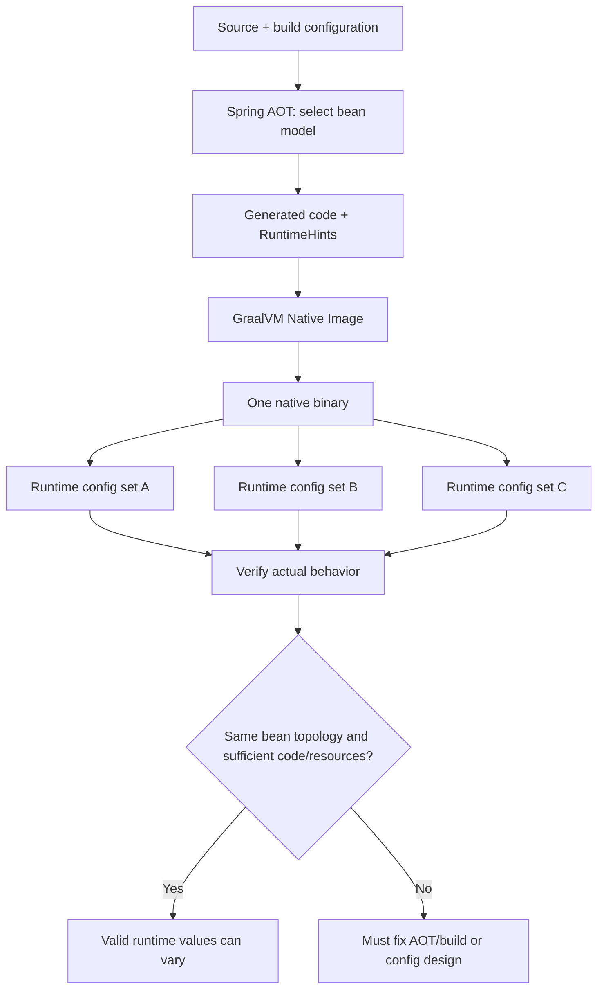

# Testing Runtime Configuration to Catch False Assumptions About Binary Flexibility

> **Chapter:** Two-Phase Configuration  
> **Module:** `SPRING_BOOT_NATIVE_IMAGE`  
> **Objective:** Design tests against **the exact same native binary** with multiple runtime configuration sources; distinguish properties that can change at startup from bean/class/resource decisions fixed in Spring AOT; catch false assumptions before release.

## 1. Why Must Runtime Configuration Be Tested on the Real Binary?

An operational benefit of Spring Boot Native Image is being able to build one executable and deploy it across multiple environments. Ports, external service URLs, timeouts, log levels, messages, and connection details can typically be supplied at startup via configuration files, environment variables, or command-line arguments.

However, **not all configuration remains flexible after the build**. Spring AOT analyzes the application context and certain configuration conditions at build time. GraalVM Native Image also packages the reachable code and resources based on that analysis and the supplied metadata.

A common false assumption is: "Simply changing `SPRING_PROFILES_ACTIVE` or a property in YAML will make the binary recreate all beans according to the new configuration." This is untrue if that change alters the application context topology or requires classes/resources not included in the native image.

Therefore, test two independent groups:

- **Runtime configuration:** values read when the process starts, such as ports, endpoints, timeouts, log levels, or messages.
- **Build-time/AOT configuration:** profiles and conditions deciding which beans exist, which classes can be loaded, which proxies are created, which resources are packaged, and which native hints are applied.

The goal is to prove what actually varies on **the same binary**, rather than inferring from a working JVM run or a successful native build.



## 2. Classify Configuration Before Writing Tests

Before building a test matrix, list each property and answer: **Does this property only change a value at runtime, or does it alter which components are created in the application context?**

| Group | Example | Expectation with the same binary |
|---|---|---|
| Operational values | `server.port`, `server.address` | Can change at startup |
| External service info | Upstream URL, timeout, retries, pool size | Usually changeable if the bean already exists and reads runtime properties |
| Business values | Messages, order limits, processing thresholds | Usually changeable if purely configuration data |
| Logging | `logging.level.root` | Usually changeable via Spring Boot configuration |
| Credentials | Username/password, tokens, secret mounts | Can be supplied at runtime; protect and verify the connecting bean reads the right source |
| Conditional bean selection | `@Profile`, `@ConditionalOnProperty`, `@ConditionalOnClass` | Conditions are evaluated during AOT; do not assume new beans can be created post-build |
| Dynamic classes/plugins | Class name read from config, plugin JAR added after deploy | Constrained by the set of analyzed and packaged classes |
| Reflection/proxies | Dynamically determined methods or interfaces | Requires appropriate runtime hints in the native build |
| Classpath resources | Packaged templates, schemas, JSON, certificates | Must be included in the native image; an old binary will not pick up new resources automatically |
| OS and architecture | Linux amd64, Linux arm64, Windows | Must build an artifact matching the platform |

**Do not classify solely by property name.** A boolean property might merely switch behavior inside an existing bean, or it might be used in `@ConditionalOnProperty` to decide whether a bean is registered. Those two cases have different requirements.

### 2.1. Example of Two Properties with Different Effects

Standard runtime value:

```java
@Value("${app.greeting:Hello}")
private String greeting;
```

The bean always exists; at startup, Spring injects the `app.greeting` value chosen from property sources.

Bean creation condition:

```java
@Bean
@ConditionalOnProperty(
        prefix = "app.feature",
        name = "enabled",
        havingValue = "true")
OptionalFeature optionalFeature() {
    return new OptionalFeature();
}
```

Here `app.feature.enabled` decides **whether the bean exists in the context**. The condition is processed during Spring AOT. Changing that property after the binary has been built does not mean Spring will re-run analysis and generate the new bean.

## 3. Define the Application's Configuration Contract

A thorough test needs representative properties for the groups under verification. Suppose a service has:

| Property | Default | Used to test |
|---|---|---|
| `server.port` | 8080 | Changing the HTTP server port |
| `app.greeting` | `Hello from native` | Checking precedence and env vars |
| `app.upstream-url` | `http://localhost:9000` | Changing external service endpoint |
| `app.request-timeout` | `2s` | Checking duration binding |
| `logging.level.root` | INFO | Checking log configuration |
| `spring.profiles.active` | Chosen build profile | Checking AOT profile constraints |

You can group application properties with `@ConfigurationProperties` for strong typing and early binding error detection.

Example:

```java
package com.example.nativeconfig;

import java.net.URI;
import java.time.Duration;

import org.springframework.boot.context.properties.ConfigurationProperties;

@ConfigurationProperties(prefix = "app")
public record AppRuntimeProperties(
        String greeting,
        URI upstreamUrl,
        Duration requestTimeout) {
}
```

Register properties with `@ConfigurationPropertiesScan` on the application class or an equivalent registration mechanism:

```java
@SpringBootApplication
@ConfigurationPropertiesScan
public class NativeConfigApplication {

    public static void main(String[] args) {
        SpringApplication.run(NativeConfigApplication.class, args);
    }
}
```

And default configuration:

```yaml
server:
  port: 8080

app:
  greeting: "Hello from native"
  upstream-url: "http://localhost:9000"
  request-timeout: 2s
```

In a real application, you can add validation such as `@NotBlank`, `@NotNull`, or positive duration constraints so the binary fails fast on invalid configuration. Ensure the validation dependency and matching annotations are present in the project.

## 4. Test Behavior Rather Than Just Reading Configuration Values

Do not merely check that an environment variable exists. Prove **the application uses that value in actual behavior**.

Simple illustrative controller:

```java
@RestController
class GreetingController {

    private final AppRuntimeProperties properties;

    GreetingController(AppRuntimeProperties properties) {
        this.properties = properties;
    }

    @GetMapping("/greeting")
    String greeting() {
        return properties.greeting();
    }
}
```

If the application starts with `APP_GREETING="Hello from test"`, calling `GET /greeting` must return `Hello from test`. This proves the property was bound and consumed by the runtime bean.

For URLs and timeouts, test with a real HTTP client calling a mock server or test service. For example:

- Start a mock upstream on port 9000.
- Configure `APP_UPSTREAM_URL` to point to another mock server on port 9001.
- Send a business request through the binary.
- Verify the request reaches the new upstream.
- Lower `APP_REQUEST_TIMEOUT` to a small value and verify the timeout is enforced.

If exposing a diagnostic endpoint only to inspect properties, enable it solely in test environments or guard access. **Never return secrets, tokens, passwords, or the entire `Environment` from a public endpoint.**

## 5. Build One Fixed Binary as the Test Subject

To prove runtime flexibility, build the binary **once**, record its hash, and use that exact file across all test runs.

Example with Maven, assuming the project has configured a compatible native profile and toolchain:

```bash
./mvnw clean -Pnative native:compile
```

Or Gradle:

```bash
./gradlew clean nativeCompile
```

Assume the actual output is `target/native-config`. Inspect the file and record its hash:

```bash
ls -l target/native-config
sha256sum target/native-config
```

The hash confirms all runs use the exact same binary. If code, runtime hints, resources, or AOT-affecting configuration change and you rebuild, the hash changes and it must be treated as **a different build variant**.

Record the build context:

- Commit/source revision.
- Versions of Spring Boot, Spring Framework, JDK, and GraalVM.
- OS, CPU architecture, and native toolchain.
- Profiles and properties present during AOT processing.
- Required `RuntimeHints` and resources.
- Executable path, size, and SHA-256.
- Build timestamp and build status.

Do not record only the binary name. A file with the same name might have been rebuilt with a different profile or metadata.

## 6. Runtime Test Matrix on the Same Binary

After building, execute each run as a separate process. Stop the process before reusing a port. Below is an example matrix for the `target/native-config` binary.

| Case | Configuration source | Example | What to verify |
|---|---|---|---|
| R0 — Baseline | Packaged config | No extra properties passed | Default values and endpoints work |
| R1 — Environment | OS environment | `APP_GREETING=Hello-env` | Endpoint returns the env value |
| R2 — CLI override | Command line | `--app.greeting=Hello-cli` | CLI overrides lower-precedence env/config |
| R3 — External file | External file | `spring.config.additional-location` | Binary reads file from filesystem |
| R4 — Combined sources | Env + file + CLI | Each source sets a different value | Precedence works properly per property |
| R5 — Typed values | Environment/config | `APP_REQUEST_TIMEOUT=500ms` | Duration binding and timeout behavior |
| R6 — Compatible profile | Profile used in AOT build | `SPRING_PROFILES_ACTIVE=prod` | Same bean topology and features work |
| R7 — Incompatible profile | Profile differing from AOT build | `SPRING_PROFILES_ACTIVE=dev` | Catch false assumptions; do not expect new beans to appear |
| R8 — Missing required config | Non-existent location, non-optional | `file:/etc/native-config/` | Startup fails fast per contract |
| R9 — Invalid typed config | Unparseable timeout or port | `APP_REQUEST_TIMEOUT=not-a-duration` | Clear binding error rather than silently running wrong |

### 6.1. Case R0 — Baseline

```bash
./target/native-config --server.port=9100
```

Call the endpoint:

```bash
curl --fail --show-error http://127.0.0.1:9100/greeting
```

Expect the default value from application config. Record the elapsed time from process start until the endpoint is ready.

### 6.2. Case R1 — Environment

```bash
SERVER_PORT=9101 APP_GREETING="Hello from env" ./target/native-config
```

Call `http://127.0.0.1:9101/greeting` and verify the response is `Hello from env`.

This is a key test: the binary does not need rebuilding to change a runtime value. If the value does not change, check property names, binding style, profiles, and property sources before concluding native does not support environment variables.

### 6.3. Case R2 — CLI Overrides Environment

```bash
APP_GREETING="Hello from env" \
  ./target/native-config \
  --server.port=9102 \
  --app.greeting="Hello from CLI"
```

Expect the endpoint to return `Hello from CLI`. In standard Spring Boot configuration, command-line properties have higher precedence than OS environment variables. If the application disables command-line property support, the result may differ; check how `SpringApplication` is constructed.

### 6.4. Case R3 — External Config File

Create `./test-config/application.yml`:

```yaml
app:
  greeting: "Hello from external file"
  request-timeout: 750ms
```

Run:

```bash
./target/native-config \
  --server.port=9103 \
  --spring.config.additional-location=file:./test-config/
```

Expect the endpoint to return `Hello from external file`. If the application sets `APP_GREETING` or CLI flags with higher precedence, the value can be overridden; run this case in a clean environment to test the external file in isolation.

Relative paths depend on the working directory. In CI or containers, prefer absolute paths or explicitly set `WORKDIR`.

### 6.5. Case R4 — Verify Precedence per Property

Set distinct values for the same `app.greeting`:

- Packaged config: `Packaged default`.
- External file: `External file`.
- Environment: `From environment`.
- CLI: `From command line`.

Run:

```bash
APP_GREETING="From environment" \
  ./target/native-config \
  --server.port=9104 \
  --spring.config.additional-location=file:./test-config/ \
  --app.greeting="From command line"
```

Expect `/greeting` to return `From command line`. Next, drop the CLI property and verify environment beats the file; drop the environment variable to verify the external file beats the default per the configured location.

Do not draw conclusions about all property sources from a single run. Precedence applies **per individual property**, and config document ordering is also affected by location, profiles, imports, and Spring Boot settings.

### 6.6. Case R5 — Binding Typed Values

Set:

```bash
APP_REQUEST_TIMEOUT=500ms ./target/native-config --server.port=9105
```

Verify `Duration` binds to 500 milliseconds and that the real HTTP client enforces this timeout. A diagnostic endpoint printing `500ms` does not prove the client applies the timeout; use a slow mock upstream to verify the request times out properly.

### 6.7. Cases R6 and R7 — Profiles and Bean Topology

Profiles used during AOT processing affect the generated bean model. For native images, keep runtime profiles aligned with the profile used when AOT generated its output. Switching profiles can alter bean registration conditions; do not treat this as a flexible runtime property.

Bean example:

```java
@Configuration(proxyBeanMethods = false)
class StorageConfiguration {

    @Bean
    @Profile("prod")
    StorageClient productionStorageClient() {
        return new ProductionStorageClient();
    }

    @Bean
    @Profile("dev")
    StorageClient developmentStorageClient() {
        return new DevelopmentStorageClient();
    }
}
```

If AOT was built with `prod`, test the binary with `prod` and confirm the production client is present. When running the same binary with `dev`, do not expect Spring to recreate a full bean graph that was not generated at build time. Exact behavior may be failing to start, missing the bean, or being rejected by the Spring Boot version's AOT profile check; the key rule is **never accept an incorrect outcome as a valid variant**.

If both topologies must be supported, create two explicit build variants:

- `native-config-prod` AOT-processed with the `prod` profile.
- `native-config-dev` AOT-processed with the `dev` profile.

Record separate hashes and metadata for each variant. If the goal is one binary across environments, design a shared bean topology and only vary configuration values read by existing beans at runtime.

## 7. Verifying AOT Profiles in a Controlled Way

Do not infer the right profile merely from whether the application starts. Identify **the profile used during AOT** and **the active profile at runtime**.

| Phase | Information to record |
|---|---|
| Build | Active profiles and properties affecting bean conditions |
| AOT processing | Which beans were created/excluded by profile and conditions |
| Native compile | Which generated output produced the binary |
| Runtime | `Environment.getActiveProfiles()` and whether required beans exist |
| Functional test | Invoke each implementation's use cases to prove right behavior |

If the project uses combined profiles, such as `prod,metrics`, record the exact profile set and order per build/runtime configuration. Do not assume profiles can be added arbitrarily after compilation.

**How to handle topology changes:** rebuild with the right profile/properties at the AOT stage. If only URLs, secrets, timeouts, or feature values inside an existing bean need to change, prefer runtime configuration to avoid unnecessary binary proliferation.

## 8. Writing Integration Tests That Run on the Native Executable

Unit tests on the JVM are valuable but insufficient to prove native binary compatibility. You need a test layer that launches the real executable, waits for readiness, makes HTTP calls, and checks results.

A test harness can use Java `ProcessBuilder` or a shell script. Pseudocode:

```java
Process process = new ProcessBuilder(
        "./target/native-config",
        "--server.port=19100",
        "--app.greeting=Native-test")
    .redirectErrorStream(true)
    .start();

try {
    // Poll health endpoint until ready or deadline expires.
    // Call /greeting and assert response == "Native-test".
    // Verify process stays alive throughout the test.
}
finally {
    process.destroy();
    if (!process.waitFor(10, TimeUnit.SECONDS)) {
        process.destroyForcibly();
    }
}
```

In real tests, ensure you:

- Use dedicated ports or a conflict-free port selection mechanism.
- Set a readiness polling deadline rather than a long fixed sleep.
- Capture stdout/stderr for diagnostics if the process exits early.
- Stop the process in `finally` even if assertions fail.
- Use temporary directories for external configs to avoid depending on files on developer machines.
- Assert only non-sensitive properties; never log passwords or tokens.
- Run tests on the binary's exact target OS/architecture.

### 8.1. Testing Negative Cases

| Scenario | Expectation |
|---|---|
| Port out of valid range | Startup fails with clear binding/validation error |
| Malformed timeout | Startup or binding fails fast |
| Missing mandatory config file | Startup fails instead of silently falling back to defaults |
| Missing mandatory secret | Bean validation/initialization fails per contract |
| Profile mismatched with AOT build | Detected and rejected rather than released as a valid variant |
| Required resource lacks hint | Native integration test catches failure on the exact feature |
| Unreachable upstream URL | Health/readiness or request behavior reflects dependency failure by design |

Not every error must exit with the same exit code. Verify the application's **failure contract**: logs have sufficient detail, readiness reflects state, and the service avoids taking traffic when unready.

## 9. Testing Container Images with the Same Principles

When deploying via OCI images, pin the artifact by image digest rather than relying only on mutable tags like `latest`. Build the image once, record the digest, and run multiple container configurations against it.

Example:

```bash
docker image inspect native-config:local --format '{{index .RepoDigests 0}}'
```

If the image only has a local tag, inspect the image ID:

```bash
docker image inspect native-config:local --format '{{.Id}}'
```

Run the environment case:

```bash
docker run --rm \
  -p 19101:8080 \
  -e SERVER_PORT=8080 \
  -e APP_GREETING="Hello from container env" \
  native-config:local
```

Run the external config case:

```bash
docker run --rm \
  -p 19102:8080 \
  -v "$PWD/test-config:/config:ro" \
  -e SPRING_CONFIG_ADDITIONAL_LOCATION=file:/config/ \
  native-config:local
```

Both runs must use **the same image ID/digest**, differing only in runtime configuration. If you edit the Dockerfile, rebuild the image, or update a resource layer, that is a different artifact and must be tracked separately.

With Kubernetes, follow the same approach using the same image digest, changing `ConfigMap`/`Secret` mounts or environment variables, and creating new pods so the application reads configuration at startup. Updating a `ConfigMap` in the cluster does not hot-refresh every property inside the application; most externalized configuration is read at startup unless the application implements a supported refresh mechanism.

## 10. Detecting False Assumptions: Signals and Investigation Steps

| False assumption | Signal in tests | How to investigate |
|---|---|---|
| Changing env can toggle any feature | Property updates, yet required bean is missing | Check whether the property controls a bean condition |
| Changing runtime profile will add beans | Application lacks the implementation or fails startup | Compare AOT profile and runtime profile |
| Resource is in the JAR so it must be in native | Only the native binary reports template not found | Inspect `RuntimeHints` and resource inclusion |
| JAR works so native must work | JVM tests pass, native reflection/proxy fails | Run integration tests against the binary |
| Building an image means the image contains native | Container runs JVM or logs show no native compiler | Check native profile, buildpack, and build logs |
| Editing an external config file changes every property | New property value has no effect on behavior | Check precedence, binding, read timing, and bean topology |
| Editing ConfigMap auto-refreshes the app | Process keeps using old value | Restart pods or implement a supported refresh mechanism |
| Same binary name means same artifact | Test results change across builds | Compare SHA-256 hashes and build metadata |
| Successful build is sufficient | Some production endpoints fail | Test native business flows, resources, reflection, TLS, and database |

A systematic investigation process:

1. Confirm the binary/image digest matches the artifact under test.
2. Confirm the runtime property source was loaded and the value took effect.
3. Confirm the required bean exists in the context.
4. Confirm classes/resources/proxies needed for that path exist in the native image.
5. Re-run the exact use case on both JVM and native to separate config errors from native limitations.
6. If the issue stems from a build-time decision, fix AOT inputs or redesign to move that value to runtime without changing topology.

## 11. Designing a Release Environment Matrix

For a service deployed to dev, staging, and production, do not simply write "shared binary." Document clearly what is shared and what differs.

| Property | Dev | Staging | Production | Can share binary? |
|---|---|---|---|---|
| Container port | 8080 | 8080 | 8080 | Yes |
| Upstream URL | dev endpoint | staging endpoint | production endpoint | Yes, if read at runtime |
| Credentials | dev secret | staging secret | production secret | Yes, if bean exists and secrets are supplied at runtime |
| Log level | DEBUG | INFO | WARN | Usually yes |
| Profile deciding beans | dev | staging | prod | Only if topology matches AOT build; otherwise build variants |
| Additional class/plugin | dev plugin | staging plugin | prod plugin | Cannot assume post-build addition |
| Packaged resources | dev template | staging template | prod template | Needs same resource set or build variants; external resources are an alternative |

If you want one shared binary, aim for **the same set of beans and classes**, varying environment values via externalized configuration. If the three environments have different bean architectures, managing separate binaries with distinct build metadata/hashes is the more transparent choice.

## 12. Recording Test Results

A test report should record artifact identity, runtime inputs, and outcomes. Never store real secret values.

| Field | Example content to record |
|---|---|
| Artifact | Executable name or OCI image digest |
| SHA-256 / image ID | Hash identifying the artifact |
| Build revision | Commit, dependency versions |
| AOT profile | Profile/properties used during AOT processing |
| Runtime profile | Active profile at startup |
| Runtime config source | Env, CLI, external file, config tree |
| Case ID | R0, R1, R2... |
| Expected behavior | Endpoint/bean/use case expected to work |
| Actual behavior | Observed outcome |
| Startup-to-ready | Time from process/container start to readiness |
| Memory | RSS/PSS or cgroup memory at measurement time |
| Result | PASS/FAIL and relevant logs with secrets redacted |

Sample results table:

| Case | Binary hash | AOT/runtime profile | Config source | Expected | Actual | Result |
|---|---|---|---|---|---|---|
| R0 | hash-... | prod/prod | packaged | Default greeting | ... | ... |
| R1 | hash-... | prod/prod | environment | Env greeting | ... | ... |
| R2 | hash-... | prod/prod | env + CLI | CLI greeting | ... | ... |
| R3 | hash-... | prod/prod | external file | File greeting | ... | ... |
| R7 | hash-... | prod/dev | runtime profile mismatch | Reject/flag unsupported | ... | ... |

Do not fill in assumed results as PASS. If a case has not been run against the real binary, mark it clearly as unverified.

## 13. Pre-Acceptance Checklist for a Multi-Environment Binary

- [ ] Classified properties into runtime values vs. build-time bean/class/resource decisions.
- [ ] Recorded profiles and properties used during Spring AOT processing.
- [ ] Built the binary once, recorded SHA-256, and kept the artifact unchanged across cases.
- [ ] Tested default config, environment, CLI, and external config individually.
- [ ] Tested precedence when multiple sources define the same property.
- [ ] Verified typed binding, validation, and missing/invalid config cases.
- [ ] Verified runtime profiles are compatible with the AOT build profile.
- [ ] Tested conditional bean branches, reflection, proxies, serialization, and required resources.
- [ ] Executed integration tests on the native executable, not only the JVM JAR.
- [ ] When deploying containers, pinned the image digest and tested multiple runtime configs on the same image.
- [ ] Secrets do not appear in diagnostic responses, logs, or reports.
- [ ] Startup/readiness and memory results were measured under reproducible conditions.

## 14. Takeaways

Testing runtime configuration must answer two questions: **which values can actually vary on the same binary, and does changing them violate assumptions Spring AOT relied on at build time?**

Ports, endpoints, timeouts, messages, logging, and credentials are typically operational data that can be supplied at startup. Profiles/conditions that decide beans, dynamically loaded classes/plugins, proxies, and native resources depend on what was analyzed and packaged at build time.

Build a binary with a clear identity, run it through an intentional configuration matrix, verify real endpoint and dependency behavior, and record the hash, AOT/runtime profiles, and results. Only when cases pass on the exact executable or released image can you conclude the binary is flexible enough for the target environments.

### References

- [Spring Boot Reference — Ahead-of-Time Processing](https://docs.spring.io/spring-boot/reference/packaging/aot.html)
- [Spring Boot Reference — Externalized Configuration](https://docs.spring.io/spring-boot/reference/features/external-config.html)
- [Spring Boot Reference — GraalVM Native Images](https://docs.spring.io/spring-boot/reference/packaging/native-image/introducing-graalvm-native-images.html)
- [Spring Framework Reference — Ahead of Time Optimizations](https://docs.spring.io/spring-framework/reference/core/aot.html)
- [GraalVM Native Image — Reachability Metadata](https://www.graalvm.org/latest/reference-manual/native-image/metadata/)
