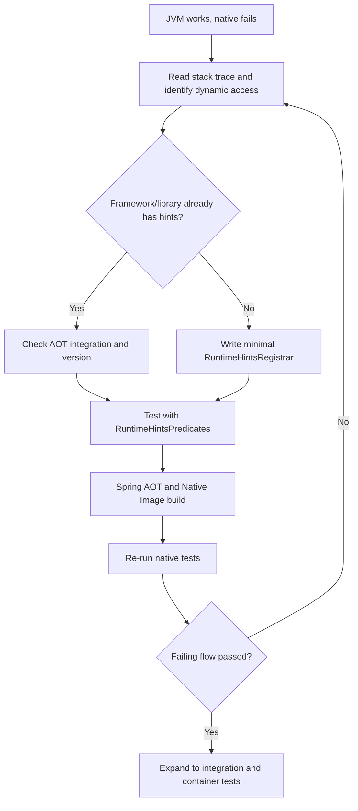

# RuntimeHints and Additional Information for Accesses Not Inferred by Static Analysis

## 1. Why Does an Application Need Runtime Hints?

In the **SPRING_BOOT_NATIVE_IMAGE** module, we use **Spring AOT** to prepare a Spring Boot application for GraalVM Native Image, then verify compatibility, startup time, memory usage, and container packaging/operation. A core challenge of native compilation is that the compiler needs to know in advance which components the application will access at runtime.

On the JVM, an application can use a class name from configuration to call `Class.forName`, instantiate objects via reflection, read templates by filename, create dynamic interface proxies, or serialize a type selected at runtime. These behaviors can work even when the bytecode contains no direct calls to the corresponding class/member/resource. Native Image's static analysis may not be able to infer all of those paths completely.

**Runtime Hints** is Spring Framework's API for describing such dynamic access requirements. Spring AOT collects hints while processing the application context and transforms them into appropriate information for the native build step. As a result, Native Image can retain or permit access to the required components in the executable.

After this lesson, learners will be able to:

1. Explain why an application that runs on the JVM may still miss classes, members, or resources when running natively.
2. Choose the right hint categories for reflection, resources, JDK proxies, serialization, and JNI.
3. Write a `RuntimeHintsRegistrar` and wire it with `@ImportRuntimeHints`.
4. Test hints independently using `RuntimeHintsPredicates`.
5. Distinguish Spring Runtime Hints from GraalVM reachability metadata and understand how they work together.
6. Diagnose errors based on stack traces, dynamic access paths, and build evidence.

> **Principle:** only declare information that static analysis cannot determine but the application genuinely needs. Overly broad hints increase the runtime surface and can enlarge the binary; missing or incorrect hints still cause errors when running natively.

## 2. What Can Static Analysis Miss?

GraalVM Native Image analyzes the reachable code set at build time under the **closed-world** model. For example, the compiler easily recognizes a direct call:

```java
OrderService service = new OrderService();
service.createOrder();
```

However, if the class is selected by a configuration string:

```java
String implementation = environment.getProperty("plugin.class");
Class<?> type = Class.forName(implementation);
Object plugin = type.getDeclaredConstructor().newInstance();
```

The compiler does not necessarily know the value of `plugin.class` across every environment. If the selected type and constructor are not described with appropriate metadata, Native Image may omit them from the executable or disallow reflection access at runtime.

Common access categories to watch out for:

| Behavior | Why is it hard to infer statically? | Hints that may be needed |
| --- | --- | --- |
| Reflection | Class/member selected from string names or framework introspection. | Type, constructor, method, field. |
| Resource | Filename constructed from configuration, locale, or runtime data. | Resource pattern or specific resource. |
| Dynamic proxy | Proxy interface(s) selected/created at runtime. | List of interfaces for JDK proxy. |
| Serialization | Type serialized/deserialized through a mechanism requiring metadata. | Corresponding serialization type. |
| JNI | Native code accesses Java classes/members. | JNI type/member and corresponding native library. |

Not every library using reflection requires hints written by the application itself. Spring and many libraries with built-in AOT/native support may already provide the necessary information. Reproduce the error or inspect existing metadata before adding configuration.

## 3. What Categories Does RuntimeHints Include?

Spring Framework provides `RuntimeHints` as an aggregate object for hint categories. Commonly used APIs include:

- `hints.reflection()`: registers classes and members accessed via reflection.
- `hints.resources()`: registers classpath resources that must be retained.
- `hints.proxies()`: registers JDK dynamic proxies for interfaces.
- `hints.serialization()`: registers types requiring serialization support for the corresponding mechanism.

API names and overloads may vary across Spring Framework versions; use the API from the version managed by your Spring Boot project. JNI is a separate requirement of GraalVM/native libraries, not an accessor group on Spring `RuntimeHints` in the API presented here. Hints also do not replace OS-level native dependencies: JNI metadata does not automatically package `.so`, `.dylib`, or `.dll` files.

### 3.1. Reflection hints

Reflection hints describe which members need dynamic access. For example:

```java
import org.springframework.aot.hint.MemberCategory;
import org.springframework.aot.hint.RuntimeHints;

final class PluginHints {
    static void register(RuntimeHints hints) {
        hints.reflection().registerType(
            JsonPlugin.class,
            MemberCategory.INVOKE_DECLARED_CONSTRUCTORS,
            MemberCategory.INVOKE_PUBLIC_METHODS
        );
    }
}
```

In this example, the application needs to invoke the declared constructor of `JsonPlugin` and its public methods via reflection. If it needs to read fields, invoke non-public declared methods, or use other access permissions, the appropriate member category must be registered. Avoid using a broad permission group if only a single constructor is needed.

Registering a class does not mean every reflection operation on that class is allowed. Match the exact operations in the code: constructors, methods, fields, annotation introspection, or accessing private members all have different requirements.

### 3.2. Resource hints

When an application reads resources from the classpath, you can register a pattern:

```java
import org.springframework.aot.hint.RuntimeHints;

final class TemplateHints {
    static void register(RuntimeHints hints) {
        hints.resources().registerPattern("templates/*.txt");
        hints.resources().registerPattern("i18n/messages*.properties");
    }
}
```

Patterns must match the resource path relative to the classpath, not a filesystem path like `src/main/resources/templates/...`. For example, `templates/*.txt` assumes files are packaged under `templates/` on the classpath. Only register files that are actually read via dynamic paths.

If a specific file is known, you can register that exact resource using the resource hints API appropriate for your Spring version. When using patterns, check Spring ResourceHints pattern rules and verify with the native executable to avoid accidentally missing files in subdirectories.

### 3.3. JDK dynamic proxy hints

A JDK dynamic proxy creates an object implementing one or more interfaces at runtime. For example, an application or library may call `Proxy.newProxyInstance(...)` with a dynamically determined list of interfaces. You can register:

```java
import org.springframework.aot.hint.RuntimeHints;

interface PaymentGateway {
    Receipt charge(long amount);
}

interface Auditable {
    String auditId();
}

final class ProxyHints {
    static void register(RuntimeHints hints) {
        hints.proxies().registerJdkProxy(
            PaymentGateway.class,
            Auditable.class
        );
    }
}
```

Register the exact combination of interfaces that the proxy will generate. Do not confuse JDK dynamic proxies with CGLIB/class-based proxies; the two mechanisms have different requirements and you should check whether the framework/plugin already handles the specific case. For Spring AOP, prefer Spring configuration and built-in AOT support before declaring proxies manually.

### 3.4. Serialization hints

Some serialization mechanisms require knowing the encoded/decoded types in advance. For example, Spring's API can register a type:

```java
import org.springframework.aot.hint.RuntimeHints;

final class SerializationHints {
    static void register(RuntimeHints hints) {
        hints.serialization().registerType(StoredEvent.class);
    }
}
```

This illustrates Spring serialization hints, not a universal replacement for every serializer. Jackson JSON binding, Java native serialization, Kryo, and custom serializers can have different requirements. For Jackson/Spring MVC, check framework AOT and binding hints support first; only add serialization hints if the mechanism genuinely uses that API category.

### 3.5. JNI and native libraries

JNI allows native code to call into Java or Java to call native methods. If a library uses JNI and needs Native Image to retain classes/members for that call path, provide JNI reachability metadata in the GraalVM format supported by your target version, or use metadata distributed by the library itself. This is a Native Image-level configuration, not calling a `hints.jni()` method on Spring `RuntimeHints`. Metadata does **not** replace providing the appropriate native library:

- The native library file must exist for the target OS/architecture.
- The library name, path, loader, and dynamic linking must match the environment.
- You must test loading/unloading and actual behavior inside the container.

If the application does not use JNI, do not add JNI metadata simply because Native Image is a compiler that builds executables.

## 4. Creating a RuntimeHintsRegistrar

When a group of hints belongs to the application, a reusable way to organize them is to write a class implementing `RuntimeHintsRegistrar`. Spring invokes the `registerHints` method during AOT processing:

```java
package com.example.orders;

import org.springframework.aot.hint.MemberCategory;
import org.springframework.aot.hint.RuntimeHints;
import org.springframework.aot.hint.RuntimeHintsRegistrar;

public final class OrderRuntimeHints implements RuntimeHintsRegistrar {

    @Override
    public void registerHints(RuntimeHints hints, ClassLoader classLoader) {
        hints.reflection().registerType(
            OrderPlugin.class,
            MemberCategory.INVOKE_DECLARED_CONSTRUCTORS,
            MemberCategory.INVOKE_PUBLIC_METHODS
        );

        hints.resources().registerPattern("templates/order-*.txt");
    }
}
```

Explanation:

- `RuntimeHintsRegistrar` is Spring's extension point for registering hints programmatically.
- `RuntimeHints` is where reflection/resources/proxies/serialization/JNI requirements are added.
- `ClassLoader` is passed in so the registrar can check for class presence when needed; avoid relying on an indeterminate context classloader.
- The types and resources in the example must exist and actually be accessed dynamically.

Do not perform I/O operations, call databases, fetch secrets, or depend on the production environment inside `registerHints`. This is a build-time step; the registrar must be deterministic and reproducible in the build environment. If metadata depends on a profile or conditional dependency, design the corresponding AOT configuration and test each supported variant.

### 4.1. Connecting the registrar with @ImportRuntimeHints

Create a Spring configuration class and import the registrar:

```java
package com.example.orders;

import org.springframework.context.annotation.Configuration;
import org.springframework.context.annotation.ImportRuntimeHints;

@Configuration(proxyBeanMethods = false)
@ImportRuntimeHints(OrderRuntimeHints.class)
class NativeRuntimeHintsConfiguration {
}
```

Place the configuration class in a package discovered by the application's component scan, or import it explicitly via Spring configuration. If the configuration class is not part of the application context processed by AOT, the registrar may not be invoked.

`@ImportRuntimeHints` can be placed on an appropriate Spring configuration class; this annotation tells Spring which registrar provides hints. It is not a runtime annotation that modifies the classloader while the application is already running.

### 4.2. Registering hints directly via API when needed

In some cases, Spring provides more convenient annotations or APIs. For example, `@RegisterReflectionForBinding` can be useful for data types requiring reflection for binding. Choose the approach based on the goal:

| Need | Preferred option to consider |
| --- | --- |
| DTO used for Spring-supported binding/serialization | Binding hints annotation or automatic framework AOT support. |
| Class/plugin selected by configuration name | `RuntimeHintsRegistrar` with clearly scoped reflection hints. |
| Resource whose name is constructed at runtime | Resource hints. |
| JDK proxy with dynamic interface list | Proxy hints. |
| Dependency without Spring integration but with Native Image metadata | Reachability metadata inside the dependency JAR. |

Do not add both `@RegisterReflectionForBinding` and manual reflection hints for the same DTO if existing support already covers it; inspect the AOT output and tests to avoid redundant configuration.

## 5. Testing Runtime Hints Before Building Native

A registrar can compile yet register the wrong type, member, or resource. Spring provides `RuntimeHintsPredicates` to verify registered requirements. The approach is to invoke the registrar against a fresh `RuntimeHints` instance, then assert the corresponding predicates.

Example testing reflection and resources:

```java
package com.example.orders;

import org.junit.jupiter.api.Test;
import org.springframework.aot.hint.RuntimeHints;
import org.springframework.aot.hint.predicate.RuntimeHintsPredicates;

import static org.assertj.core.api.Assertions.assertThat;

class OrderRuntimeHintsTests {

    @Test
    void registersPluginConstructorAndTemplate() {
        RuntimeHints hints = new RuntimeHints();
        new OrderRuntimeHints().registerHints(
            hints,
            getClass().getClassLoader()
        );

        assertThat(
            RuntimeHintsPredicates.reflection()
                .onType(OrderPlugin.class)
                .withMemberCategory(
                    org.springframework.aot.hint.MemberCategory.INVOKE_DECLARED_CONSTRUCTORS
                )
        ).accepts(hints);

        assertThat(
            RuntimeHintsPredicates.resources()
                .forResource("templates/order-confirmation.txt")
        ).accepts(hints);
    }
}
```

This example illustrates common Spring Framework predicate APIs; verify the exact imports/packages and overloads for your Spring version. When testing a multi-file pattern, check the corresponding actual resource(s). A passing predicate proves that metadata was registered according to that criterion—it **does not prove that the entire flow will definitely run properly in the native executable**.

### 5.1. Testing proxies/serialization

For proxies, check the predicate for the list of interfaces the application expects to create. For serialization, check the registered type. Use the predicate APIs appropriate for your current Spring version; do not write a test that merely asserts the registrar throws no exception. Tests must verify the exact required types/members/resources.

### 5.2. Testing with the native executable

Unit tests for hints should be paired with native integration/smoke tests:

1. Run the business flow that uses reflection/resources/proxies.
2. Verify that responses, data, and side effects match the JVM build.
3. Test missing class/resource cases to confirm the application handles errors properly.
4. Test different profiles/configurations if they change the selected classes or resources.

A successful Native Image build and passing predicates are still insufficient if the dynamic path has not been executed in native mode.

## 6. Distinguishing Spring Runtime Hints from GraalVM Reachability Metadata

The two mechanisms are related but have different roles:

| Aspect | Spring Runtime Hints | GraalVM reachability metadata |
| --- | --- | --- |
| Owner | Spring Framework/Spring application | Native Image toolchain and artifact/library |
| Declaration method | Java API, registrar, annotation | Metadata files under `META-INF/native-image`, or metadata supplied by tooling |
| Processing time | Spring AOT processes during build | GraalVM Native Image analyzes during native build |
| Goal | Describe runtime requirements of Spring/app | Supply reachability configuration to the compiler |
| Distribution | Application source code and generated AOT outputs | Can ship with dependency JARs or application resources |

For example: an application has a plugin selected by a configuration name. You can write a `RuntimeHintsRegistrar` so Spring AOT knows the required constructor/methods. A third-party library may package `reachability-metadata.json` inside its own JAR to describe the library's own reflection/resources.

During a native build, both Spring AOT outputs and dependency metadata can serve as inputs. You do not need to manually convert every `RuntimeHints` entry into JSON; Spring Boot/Native Build Tools handle the integration for supported versions. Conversely, do not assume Spring automatically generates all metadata for every dependency: libraries may need to supply their own metadata or the application may need to supplement it.

### 6.1. Metadata location in a project

Some libraries provide GraalVM metadata following this structure:

```text
some-library.jar
└── META-INF/
    └── native-image/
        └── com.vendor/
            └── some-library/
                └── reachability-metadata.json
```

An application can also place its own metadata in resources:

```text
src/main/resources/
└── META-INF/native-image/
    └── com.example/
        └── orders-api/
            └── reachability-metadata.json
```

This is one way to organize artifact-level metadata. When using Spring RuntimeHints, it is usually better to place the registrar in source code and connect it to the application context so AOT manages it. Avoid declaring the same requirement in both places without a clear reason.

## 7. Workflow for Handling a Native Error Caused by Dynamic Access

Suppose the JVM build runs normally, but the native executable reports that the constructor of `OrderPlugin` cannot be found.

### Step 1 — Reproduce and identify the access point

Read the stack trace, identify the invoked class/member, and locate the code making the reflection call. Check whether the class name comes from a property, configuration file, service discovery, or database.

### Step 2 — Check existing support

Check whether the dependency and framework already provide AOT/native support or bundled metadata. Do not duplicate registration for a class that already has complete hints from Spring or a library.

### Step 3 — Add minimal hints

Write a registrar for the constructor/methods actually used. If a resource is missing, add the corresponding resource pattern. If a proxy interface is created dynamically, register the exact interface set.

### Step 4 — Test the registrar

Use `RuntimeHintsPredicates` to assert that the metadata is registered. If the predicate does not match, fix the registrar or check the Spring configuration importing the registrar.

### Step 5 — Run Spring AOT and Native Image build

With Maven (assuming the native profile/plugin is configured):

```bash
./mvnw -Pnative spring-boot:process-aot
./mvnw -Pnative native:compile
```

With Gradle:

```bash
./gradlew processAot
./gradlew nativeCompile
```

Inspect the logs to confirm the expected GraalVM/toolchain, AOT outputs, and metadata are used. Do not edit generated sources directly; update the registrar or source configuration and rebuild.

### Step 6 — Run native tests

Re-run the failing path, then expand to integration/API tests. If the error persists, verify that the member category matches the exact type of access; registering a constructor does not automatically allow all private methods/fields. Also verify resource paths, classpath, and native dependencies.



## 8. Common Mistakes

| Mistake | Consequence | Better practice |
| --- | --- | --- |
| Registering every member of every class | Broad metadata; binary can become larger and harder to reason about. | Only declare members dynamically invoked and backed by evidence. |
| Assuming `@ImportRuntimeHints` activates automatically in every project | Registrar is not invoked if the configuration is outside the AOT application context. | Place/import the configuration properly and test the registrar/AOT. |
| Using a filesystem resource path instead of a classpath path | Native Image fails to match the required resource. | Use paths relative to the classpath and inspect output resources. |
| Running only hint unit tests | Runtime errors inside the native executable can be missed. | Add native integration/smoke tests. |
| Treating RuntimeHints as GraalVM JSON metadata | Confuses abstraction layers and processing stages. | Use the Spring API for app hints; artifact metadata for libraries/toolchains when appropriate. |
| Adding JNI metadata without the native library | Binary cannot load the native library on the target OS. | Package the right library and verify linker/runtime dependencies. |
| Running the tracing agent once and treating metadata as complete | Unobserved code paths can be missed. | Combine scenario tests, metadata review, and native tests. |
| Editing generated AOT output directly | Changes are overwritten on the next build. | Fix the registrar, annotation, or source configuration. |

## 9. Hands-on Exercise: Dynamic Plugin and Resource Template

**Context:** a Spring Boot service selects an `OrderPlugin` implementation from the `orders.plugin-class` configuration and reads the `templates/order-confirmation.txt` template. The JVM build runs fine, but Native Image is missing the constructor and template.

### Tasks

1. Create a plugin interface and an implementation with a public constructor.
2. Write code that selects the class from the property and instantiates it via reflection; write JVM tests for both a valid flow and an invalid class name.
3. Create the template resource under `src/main/resources/templates/`.
4. Write `OrderRuntimeHints` registering the genuinely needed constructor/members and an appropriate resource pattern.
5. Import the registrar using `@ImportRuntimeHints` on a configuration class belonging to the application context.
6. Write tests using `RuntimeHintsPredicates` for the constructor and template.
7. Run Spring AOT and the native build; inspect logs without editing generated files.
8. Run the native executable with valid/invalid properties; compare responses and error handling with the JVM build.
9. Record metadata, GraalVM/Spring versions, build commands, and reproduction conditions.

### Evidence Log

| Evidence | Details to record |
| --- | --- |
| Dynamic access | Property selecting the class, invoked constructor/method, resource path. |
| Registrar | Registered hints and rationale. |
| Spring configuration | Where `@ImportRuntimeHints` is declared and how the configuration is discovered. |
| Predicate tests | Reflection/resource/proxy/serialization assertions if applicable. |
| AOT/native build | Commands, versions, logs, and executable path. |
| Native runtime tests | Valid flow, class error, resource error, API results. |
| JVM/native comparison | Differences observed and how they were resolved. |

### Completion Criteria

- [ ] Can explain which dynamic behaviors cannot be fully inferred by static analysis.
- [ ] Chooses the right Runtime Hints category for each access.
- [ ] Registrar is invoked by Spring AOT through valid configuration.
- [ ] Predicate tests verify the exact required types/members/resources.
- [ ] Native executable runs both the plugin and template flows.
- [ ] Error cases are tested, not only the happy path.
- [ ] Can reproduce the build and explain the boundary between Spring hints and GraalVM metadata.

## 10. Self-Assessment Questions

1. Why can `Class.forName` with a class name read from configuration require reflection hints when building natively?
2. At which stage is `RuntimeHintsRegistrar` invoked, and how must it be connected to the Spring application context?
3. Why do resource hints use classpath-relative paths instead of `src/main/resources` paths?
4. Does registering a constructor guarantee that all methods/fields of the class are accessible via reflection?
5. When should you use `@RegisterReflectionForBinding` or framework AOT support instead of a custom registrar?
6. How do `RuntimeHints` and `reachability-metadata.json` differ in terms of declaration owner and processing time?
7. Why should predicate tests be supplemented with native integration tests?
8. Which part does JNI reachability metadata solve, and which part still depends on the operating system/container?

## 11. Official Documentation

Exact APIs depend on the Spring Framework version managed by Spring Boot. When implementing, cross-check the documentation for your specific release:

- [Spring Framework — Runtime Hints](https://docs.spring.io/spring-framework/reference/core/aot.html): reflection, resources, proxies, serialization, and RuntimeHintsRegistrar.
- [Spring Framework API — RuntimeHints](https://docs.spring.io/spring-framework/docs/current/javadoc-api/org/springframework/aot/hint/RuntimeHints.html): hint categories and registration APIs.
- [Spring Framework API — RuntimeHintsRegistrar](https://docs.spring.io/spring-framework/docs/current/javadoc-api/org/springframework/aot/hint/RuntimeHintsRegistrar.html): extension point for registering hints.
- [Spring Framework API — ImportRuntimeHints](https://docs.spring.io/spring-framework/docs/current/javadoc-api/org/springframework/context/annotation/ImportRuntimeHints.html): connecting a registrar to Spring configuration.
- [Spring Framework API — RuntimeHintsPredicates](https://docs.spring.io/spring-framework/docs/current/javadoc-api/org/springframework/aot/hint/predicate/RuntimeHintsPredicates.html): testing hints.
- [GraalVM Native Image — Reachability Metadata](https://www.graalvm.org/latest/reference-manual/native-image/metadata/): artifact metadata and how information is provided to Native Image.
- [Spring Boot — GraalVM Native Image](https://docs.spring.io/spring-boot/reference/packaging/native-image/index.html): AOT/native workflow for Spring Boot applications.

**Key takeaway:** Runtime Hints is the contract describing the dynamic accesses an application needs. Registering accurate hints, connecting the registrar to Spring AOT, testing predicates, and running native integration tests turn assumptions about reflection/resources/proxies into verifiable evidence.
