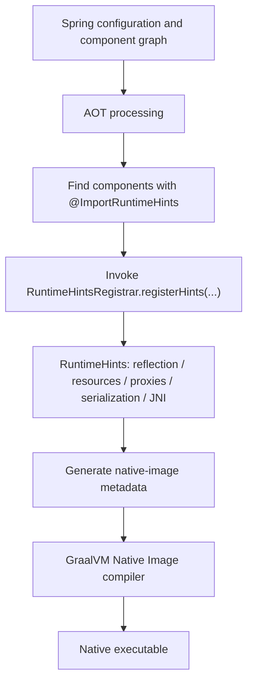
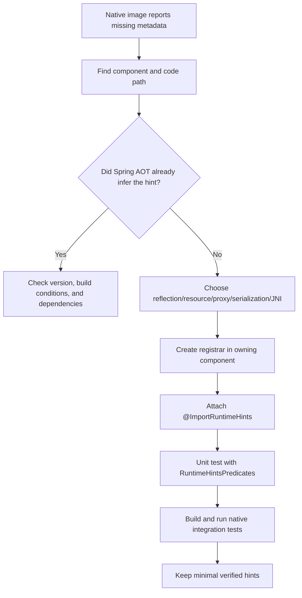

# `RuntimeHintsRegistrar` and Organizing Hints by Owning Component

## 1. Why Organize Runtime Hints by Component?

When running a Spring Boot application on the JVM, many libraries can use reflection, read files from the classpath, create JDK proxies, or use Java serialization without developers declaring every operation in advance. With **GraalVM Native Image**, the compiler performs reachability analysis at build time and needs to know about such dynamic behaviors upfront. A class or resource accessed only by name at runtime may not be automatically included in the executable.

Spring AOT and Spring Framework provide `RuntimeHints` to describe these required capabilities. When the core container cannot infer a requirement, you can supplement hints using **`RuntimeHintsRegistrar`**.

For example, consider an ordering system with the following components:

- `InvoiceExportService` reads templates and invokes certain methods via reflection.
- `PaymentGatewayClient` uses a JDK dynamic proxy for an integration interface.
- `LegacyXmlAdapter` optionally integrates a third-party XML library.
- `NativeCompressionAdapter` calls a native library via JNI.

If you bundle all hints into one large registrar in the central application configuration, every time a component is added or removed you have to modify a shared list. This makes it easy for hints of an optional library to end up in the image even when the library is unused.

**Important principle:** whichever component owns the dynamic behavior should own the corresponding registrar. Placing `@ImportRuntimeHints` next to the bean or `@Bean` factory method that needs the hints ensures Spring only contributes hints when that component is actually present in the `BeanFactory`.

After this lesson, you will be able to:

- Write a `RuntimeHintsRegistrar` and register it with `@ImportRuntimeHints`.
- Choose the appropriate APIs for reflection, resources, JDK proxies, Java serialization, and JNI.
- Organize hints by owning component, module, or library.
- Handle optional dependencies using the provided `ClassLoader`.
- Test registrars with `RuntimeHintsPredicates` and verify behavior on the native executable.

## 2. Where Does `RuntimeHintsRegistrar` Operate?

### 2.1. Runtime hints are build-time metadata

`RuntimeHints` is not a runtime service that enables reflection after the application starts. It is a set of descriptions of behaviors that must be retained or supported when creating a native image. Spring AOT invokes registrars **during AOT processing at build time**, collects the hints, and generates the corresponding configuration for the native compiler.



Consequence: if a bean is excluded from the `BeanFactory` by a configuration condition, the registrar attached to that bean also does not contribute hints via `@ImportRuntimeHints`. If conditions change after the native executable has been built, hints cannot be added again at runtime.

### 2.2. Interface and primary method

`RuntimeHintsRegistrar` is a functional interface in the `org.springframework.aot.hint` package:

```java
package org.springframework.aot.hint;

public interface RuntimeHintsRegistrar {

    void registerHints(RuntimeHints hints, ClassLoader classLoader);
}
```

The `RuntimeHints` and `RuntimeHintsRegistrar` APIs were introduced in Spring Framework 6.0. From Spring Boot 3.x onward, this is the standard Spring AOT mechanism; older Spring Native examples from the Spring Boot 2 ecosystem may use different configuration approaches.

`registerHints(...)` accepts two arguments:

| Parameter | Meaning | How to use |
|---|---|---|
| `RuntimeHints hints` | The hint collection that the AOT engine is gathering | Register required reflection, resources, proxies, serialization, or JNI |
| `ClassLoader classLoader` | Class loader of the deployment unit; may be `null` in some environments | Use to check whether classes/resources exist, especially for optional dependencies |

A registrar should have a **no-argument constructor** and must not depend on application runtime beans. The AOT engine instantiates the registrar to collect metadata, not to use it as a regular service in the `ApplicationContext`.

Do not read production configuration files, query databases, make HTTP calls, or open external connections inside `registerHints(...)`. Builds must be reproducible; the registrar should only describe metadata based on the classpath and known build information.

## 3. Registering a Registrar with `@ImportRuntimeHints`

### 3.1. Placing the annotation close to the owning component

Spring provides `@ImportRuntimeHints` in the `org.springframework.context.annotation` package. The annotation can be placed on a Spring bean or on a `@Bean` method.

Example of an invoice export service reading templates by name:

```java
package com.example.orders.invoice;

import java.util.Locale;
import java.util.List;

import org.springframework.aot.hint.ExecutableMode;
import org.springframework.aot.hint.RuntimeHints;
import org.springframework.aot.hint.RuntimeHintsRegistrar;
import org.springframework.context.annotation.ImportRuntimeHints;
import org.springframework.core.io.ClassPathResource;
import org.springframework.stereotype.Component;

@Component
@ImportRuntimeHints(InvoiceExportRuntimeHints.class)
public class InvoiceExportService {

    public ClassPathResource template(Locale locale) {
        return new ClassPathResource(
                "templates/invoice/" + locale.getLanguage() + ".html");
    }

    static class InvoiceExportRuntimeHints implements RuntimeHintsRegistrar {

        @Override
        public void registerHints(RuntimeHints hints, ClassLoader classLoader) {
            hints.resources().registerPattern("templates/invoice/*.html");
            hints.reflection().registerType(InvoiceRow.class, typeHint -> typeHint
                    .withMethod("toExternalFormat", List.of(), ExecutableMode.INVOKE));
        }
    }
}
```

In this example, `InvoiceExportRuntimeHints` is placed directly inside the class that owns the resource. Patterns are resolved from the **classpath root**; for example, `src/main/resources/templates/invoice/en.html` has the resource name `templates/invoice/en.html`. Do not add the `src/main/resources/` prefix to the pattern.

If `InvoiceExportService` is not scanned/imported or is excluded by a configuration condition, its hints will also not be contributed through this annotation. This is why Spring recommends placing `@ImportRuntimeHints` as close as possible to the component that needs the hints.

### 3.2. Registering via a `@Bean` factory method

When a component is created by Java configuration instead of component scanning, you can attach the annotation to the factory method:

```java
package com.example.orders.invoice;

import org.springframework.context.annotation.Bean;
import org.springframework.context.annotation.Configuration;
import org.springframework.context.annotation.ImportRuntimeHints;

@Configuration(proxyBeanMethods = false)
class InvoiceConfiguration {

    @Bean
    @ImportRuntimeHints(InvoiceExportService.InvoiceExportRuntimeHints.class)
    InvoiceExportService invoiceExportService() {
        return new InvoiceExportService();
    }
}
```

If the `@Bean` method also carries `@Conditional`, the registrar only contributes hints when the corresponding bean definition is registered. This is useful for starters or modules that can be enabled/disabled by configuration.

### 3.3. When to use `META-INF/spring/aot.factories`?

Spring also supports static registrar registration in the `META-INF/spring/aot.factories` file:

```properties
org.springframework.aot.hint.RuntimeHintsRegistrar=com.example.shared.SharedLibraryRuntimeHints
```

This approach suits libraries or infrastructure that need to contribute global hints whenever the module is present on the classpath, without being tied to a specific Spring bean. However, if the library is optional or hints are only needed when a component is created, `@ImportRuntimeHints` generally provides better scoping.

| Registration method | Scope | When to use |
|---|---|---|
| `@ImportRuntimeHints` on a component | Tied to the bean/component added to the `BeanFactory` | Default choice for application components and optional integrations |
| `@ImportRuntimeHints` on a `@Bean` method | Tied to the bean created by the factory method | Java configuration, conditional beans, or starters |
| `META-INF/spring/aot.factories` | Registrar statically registered per deployment unit | Shared library/infrastructure hints not tied to a specific bean |

## 4. Hint Categories and Commonly Used APIs

`RuntimeHints` provides the following primary access points:

| API | Description | Example use case |
|---|---|---|
| `hints.reflection()` | Reflection on types, constructors, methods, fields | A library invoking a method via reflection |
| `hints.resources()` | Classpath resources and resource bundles | Reading packaged templates, schemas, dictionaries, or config files |
| `hints.proxies()` | JDK dynamic proxies and class proxies | Creating an interface proxy at runtime |
| `hints.serialization()` | Java object serialization | Writing/reading objects via `ObjectOutputStream`/`ObjectInputStream` |
| `hints.jni()` | Reflection-like access needed for JNI | Accessing class members from native code via JNI |

Not every serialization or proxy operation requires manual hints. Spring AOT and supported libraries can infer several requirements automatically. Only add hints for dynamic behaviors that the framework cannot detect on its own.

## 5. Reflection Hints: Registering Only the Members That Need to Be Invoked

### 5.1. Example of a component owning reflection

Suppose an export library uses reflection to invoke `toExternalFormat()` on `InvoiceRow`:

```java
package com.example.orders.invoice;

public class InvoiceRow {

    public String toExternalFormat() {
        return "invoice-row";
    }
}
```

The registrar can register the exact method:

```java
hints.reflection().registerType(InvoiceRow.class, typeHint -> typeHint
        .withMethod("toExternalFormat", java.util.List.of(), ExecutableMode.INVOKE));
```

This is the reflection portion folded into `InvoiceExportRuntimeHints` in the earlier example. If a component has multiple independent requirement groups, you can split them into separate registrars and list multiple classes in `@ImportRuntimeHints`. `ExecutableMode.INVOKE` indicates the method will be invoked via reflection. If the library needs a specific constructor or field, register that exact constructor/field or the appropriate `MemberCategory` values.

Example registering public constructors and public methods when a library genuinely needs that entire group of members:

```java
import org.springframework.aot.hint.MemberCategory;

hints.reflection().registerType(
        InvoiceRow.class,
        MemberCategory.INVOKE_PUBLIC_CONSTRUCTORS,
        MemberCategory.INVOKE_PUBLIC_METHODS);
```

Avoid registering broad member categories when only a single method is invoked. The broader the hints, the more metadata the native image must retain and the harder it becomes to tell which reflection accesses are truly required.

### 5.2. Optional dependencies: use `registerTypeIfPresent`

A starter may integrate with an external library without requiring that library to be present in every application. Do not reference optional classes directly in registrar code if doing so would cause class loading to fail when the dependency is not installed.

You can use `registerTypeIfPresent(...)`:

```java
import org.springframework.aot.hint.ExecutableMode;
import org.springframework.aot.hint.RuntimeHints;
import org.springframework.aot.hint.RuntimeHintsRegistrar;

public class OptionalXmlRuntimeHints implements RuntimeHintsRegistrar {

    @Override
    public void registerHints(RuntimeHints hints, ClassLoader classLoader) {
        hints.reflection().registerTypeIfPresent(
                classLoader,
                "com.vendor.xml.XmlEncoder",
                typeHint -> typeHint.withMethod(
                        "encode",
                        java.util.List.of(org.springframework.aot.hint.TypeReference.of(String.class)),
                        ExecutableMode.INVOKE));
    }
}
```

The registrar uses the class loader supplied by Spring and only registers the hint when the class can be found. This is useful for starter libraries supporting multiple optional integrations.

Do not replace `classLoader` with `ClassLoader.getSystemClassLoader()` out of habit. The application's class loader may differ from the system class loader; the argument passed into the registrar reflects the deployment unit being analyzed and may be `null` in some cases.

## 6. Resource Hints: Packaging Resources by Owning Module

### 6.1. Pattern-based resources

Classpath resources are not automatically retained in a native image simply because code can assemble filenames at runtime. Register patterns in the registrar of the component reading the resources:

```java
public class InvoiceTemplateRuntimeHints implements RuntimeHintsRegistrar {

    @Override
    public void registerHints(RuntimeHints hints, ClassLoader classLoader) {
        hints.resources().registerPattern("templates/invoice/*.html");
        hints.resources().registerPattern("schemas/invoice/*.xsd");
    }
}
```

Resource patterns are relative to the classpath root. For example:

```text
src/main/resources/
  templates/
    invoice/
      en.html
      vi.html
  schemas/
    invoice/
      invoice-v1.xsd
```

If the application only needs `templates/invoice/vi.html`, you can register that exact file. Broad patterns like `**/*` can retain a large number of resources and increase image size.

### 6.2. Resource bundles

If a component uses `ResourceBundle` by base name, register the bundle:

```java
hints.resources().registerResourceBundle("messages.invoice");
```

With the structure:

```text
src/main/resources/
  messages/
    invoice.properties
    invoice_en.properties
    invoice_vi.properties
```

The base name is `messages.invoice`, not the filename with the `.properties` extension.

### 6.3. Registering a resource only if present

In a library with optional resources, you can use `registerPatternIfPresent(...)` to check before contributing a hint:

```java
hints.resources().registerPatternIfPresent(
        classLoader,
        "META-INF/vendor/xml-defaults.properties",
        resourceHint -> resourceHint.includes("META-INF/vendor/xml-defaults.properties"));
```

This method checks whether `location` exists on the classpath via `classLoader`; the `resourceHint` callback declares the pattern that should actually be included in the image. This avoids registering a resource hint for a file missing from the deployment.

## 7. JDK Proxy Hints: The Component Creating the Proxy Registers It

Some libraries create JDK dynamic proxies with `Proxy.newProxyInstance(...)`. Native Image needs to know in advance which interfaces the proxy will implement.

Suppose `PaymentGatewayClient` creates a proxy for the `PaymentGateway` interface:

```java
public interface PaymentGateway {
    PaymentResult authorize(PaymentRequest request);
}
```

Registrar owning the proxy:

```java
import org.springframework.aot.hint.RuntimeHints;
import org.springframework.aot.hint.RuntimeHintsRegistrar;

public class PaymentGatewayRuntimeHints implements RuntimeHintsRegistrar {

    @Override
    public void registerHints(RuntimeHints hints, ClassLoader classLoader) {
        hints.proxies().registerJdkProxy(PaymentGateway.class);
    }
}
```

Attach the registrar to the integration component:

```java
@Component
@ImportRuntimeHints({
        PaymentGatewayRuntimeHints.class,
        PaymentSerializationRuntimeHints.class
})
public class PaymentGatewayClient {
    // Create or use a JDK dynamic proxy for PaymentGateway.
}
```

If the proxy is created by Spring AOP or a framework library, verify whether the framework already registers the proxy hints automatically. For Spring AOP proxies, `AopProxyUtils.completeJdkProxyInterfaces(...)` can be helpful when registering the complete set of interfaces manually. Do not register a proxy merely because an interface *could* be proxied; there must be an actual code path creating that proxy.

## 8. Java Serialization Hints: Do Not Confuse with JSON Binding

`hints.serialization()` is for **Java native object serialization**, such as `ObjectOutputStream` and `ObjectInputStream`. It does not apply to a DTO being serialized to JSON by Jackson in a REST API.

For example:

```java
import java.io.Serializable;

public class PaymentSnapshot implements Serializable {

    private static final long serialVersionUID = 1L;

    private String transactionId;

    public PaymentSnapshot() {
    }
}
```

If a component genuinely uses Java serialization for this type:

```java
import org.springframework.aot.hint.RuntimeHints;
import org.springframework.aot.hint.RuntimeHintsRegistrar;

public class PaymentSerializationRuntimeHints implements RuntimeHintsRegistrar {

    @Override
    public void registerHints(RuntimeHints hints, ClassLoader classLoader) {
        hints.serialization().registerType(PaymentSnapshot.class);
    }
}
```

In Spring MVC/WebFlux applications returning JSON DTOs, Spring AOT can usually infer many reflection/binding hints from controller return types. If a DTO is serialized dynamically in a way the core container cannot see (e.g., inside a `WebClient` method body, manual mapping, or a custom library), evaluate `@RegisterReflectionForBinding` if supported by your Spring version, or register precise reflection hints.

Do not add `hints.serialization()` for every JSON DTO. Java serialization and JSON serialization are two distinct mechanisms.

## 9. JNI Hints: Registering Java Elements Accessed by Native Code

A component calling a native library via JNI may need to declare the classes/members accessed from native code:

```java
import org.springframework.aot.hint.MemberCategory;
import org.springframework.aot.hint.RuntimeHints;
import org.springframework.aot.hint.RuntimeHintsRegistrar;

public class NativeCompressionRuntimeHints implements RuntimeHintsRegistrar {

    @Override
    public void registerHints(RuntimeHints hints, ClassLoader classLoader) {
        hints.jni().registerType(
                NativeCompressionBridge.class,
                MemberCategory.INVOKE_PUBLIC_METHODS,
                MemberCategory.INVOKE_PUBLIC_CONSTRUCTORS);
    }
}
```

JNI hints describe Java accessibility from native code. They **do not package or convert** `.so`, `.dll`, or `.dylib` libraries. You must still ensure the native library is present in the image, targets the right OS/CPU architecture and ABI, and can be found by the loader.

Place the registrar right next to `NativeCompressionAdapter` or the JNI module owning the bridge. When the integration is not used, its hints and native dependencies should not be pulled into the image unnecessarily.

## 10. Organizing Hints by Owning Component

### 10.1. Suggested package structure

```text
com.example.orders/
  invoice/
    InvoiceExportService.java
    InvoiceRow.java
  payment/
    PaymentGatewayClient.java
    PaymentGatewayRuntimeHints.java
    PaymentSerializationRuntimeHints.java
  xml/
    OptionalXmlAdapter.java
    OptionalXmlRuntimeHints.java
  nativecompression/
    NativeCompressionAdapter.java
    NativeCompressionRuntimeHints.java
```

Each registrar reflects the needs of one component or integration. It is not mandatory to create a separate registrar for every small class; group hints together when they belong to the same component and share the same enable/disable lifecycle.

### 10.2. Ownership rules

| Owner | Hints to manage | Where to register |
|---|---|---|
| Invoice export | Reflection on `InvoiceRow`, invoice templates | `InvoiceExportService` |
| Payment gateway | JDK proxy for `PaymentGateway`, Java serialization if genuinely used | `PaymentGatewayClient` |
| Optional XML adapter | XML library reflection/resources if class is present | `OptionalXmlAdapter` or conditional bean configuration |
| Native compression | Bridge JNI members, supporting classes/resources | `NativeCompressionAdapter` |
| Shared library infrastructure | Deployment-wide mandatory hints, independent of a specific bean | `META-INF/spring/aot.factories` when appropriate |

### 10.3. Why attach registrars close to components?

Suppose `OptionalXmlAdapter` is created as follows:

```java
@Configuration(proxyBeanMethods = false)
class XmlConfiguration {

    @Bean
    @ConditionalOnClass(name = "com.vendor.xml.XmlEncoder")
    @ConditionalOnProperty(prefix = "orders.xml", name = "enabled", havingValue = "true")
    @ImportRuntimeHints(OptionalXmlRuntimeHints.class)
    OptionalXmlAdapter optionalXmlAdapter() {
        return new OptionalXmlAdapter();
    }
}
```

When the vendor class is absent or the property is disabled at build time, the bean definition is not contributed and the registrar attached to the factory method is not processed through this path either. As a result, native metadata is not added unconditionally just because the application has the starter dependency.

Note: `@Conditional` and `@Profile` conditions affecting the bean graph are evaluated during the AOT build. A native executable cannot enable a new integration by changing a property at runtime if that integration was already excluded from the AOT structure.

### 10.4. Avoiding an oversized central registrar

An aggregate registrar can be convenient for a small library, but easily becomes a bottleneck with unclear ownership as an application grows:

```java
// Design that becomes hard to maintain as the system grows
public class AllApplicationRuntimeHints implements RuntimeHintsRegistrar {
    @Override
    public void registerHints(RuntimeHints hints, ClassLoader classLoader) {
        // Reflection for invoice, payment, xml, native compression...
        // Resources from multiple modules...
        // Proxies and serialization from other integrations...
    }
}
```

Common problems:

- Removing a module while forgetting to delete its hints and related dependencies.
- Hints for optional integrations are always added even when the bean does not exist.
- Maintainers cannot tell which class uses that reflection or resource.
- A change in a small component forces edits to the application-wide registrar.

Instead, split registrars by component/module and use `@ImportRuntimeHints` to link metadata with where it is used.

## 11. Testing Registrars with `RuntimeHintsPredicates`

Do not only verify that the native build succeeds. Verify that the registrar produces the right hints before invoking the native compiler. Spring Core provides `RuntimeHintsPredicates` for reflection, resources, serialization, and proxies.

### 11.1. Unit tests for resources and reflection

```java
package com.example.orders.invoice;

import org.junit.jupiter.api.Test;
import org.springframework.aot.hint.RuntimeHints;
import org.springframework.aot.hint.predicate.RuntimeHintsPredicates;

import static org.assertj.core.api.Assertions.assertThat;

class InvoiceExportRuntimeHintsTests {

    @Test
    void registersInvoiceTemplateAndReflection() {
        RuntimeHints hints = new RuntimeHints();
        new InvoiceExportService.InvoiceExportRuntimeHints().registerHints(
                hints, getClass().getClassLoader());

        assertThat(RuntimeHintsPredicates.resource()
                .forResource("templates/invoice/vi.html"))
                .accepts(hints);

        assertThat(RuntimeHintsPredicates.reflection()
                .onMethod(InvoiceRow.class, "toExternalFormat")
                .invoke())
                .accepts(hints);
    }
}
```

This test invokes the registrar directly, then checks whether the declared hints cover the requirements used by the component. If a template or method is renamed without updating the hints, the test catches it early.

### 11.2. Unit tests for proxies and Java serialization

```java
package com.example.orders.payment;

import org.junit.jupiter.api.Test;
import org.springframework.aot.hint.RuntimeHints;
import org.springframework.aot.hint.predicate.RuntimeHintsPredicates;

import static org.assertj.core.api.Assertions.assertThat;

class PaymentRuntimeHintsTests {

@Test
void registersPaymentProxyAndSerialization() {
    RuntimeHints hints = new RuntimeHints();
    new PaymentGatewayRuntimeHints().registerHints(
            hints, getClass().getClassLoader());
    new PaymentSerializationRuntimeHints().registerHints(
            hints, getClass().getClassLoader());

    assertThat(RuntimeHintsPredicates.proxies()
            .forInterfaces(PaymentGateway.class))
            .accepts(hints);

    assertThat(RuntimeHintsPredicates.serialization()
            .onType(PaymentSnapshot.class))
            .accepts(hints);
}
}
```

Predicates validate metadata structure; they do not execute the code that creates proxies or performs serialization. Add integration tests for the actual code paths.

`RuntimeHintsPredicates` provides predicates for reflection, resources, proxies, and Java serialization; JNI hints must be verified by running an integration test or native path that invokes the corresponding bridge.

### 11.3. Testing optional dependencies

For `registerTypeIfPresent`, test two cases:

1. Optional class present in the test runtime: the registrar must contribute the reflection hint.
2. Optional class absent from the classpath: the registrar must not throw `ClassNotFoundException` or fail the AOT build simply because the integration is not installed.

This is an important responsibility of a starter/library supporting multiple optional dependencies.

### 11.4. When you need to observe actual dynamic behavior

Unit tests only verify cases you already know about. When it is unclear which library uses reflection or proxies, you can run the test suite or application with the **GraalVM Tracing Agent** to record dynamic operations and generate suggested JSON configuration.

The Tracing Agent only records code paths executed during the observed run. It does not prove that every branch, profile, input, or integration was exercised. Use the output as investigative data, then translate the needed hints into Spring's `RuntimeHintsRegistrar` mechanism and test again.

Spring Framework also provides the `spring-core-test` module with a Runtime Hints Agent to record hint-related invocations and compare them against contributed `RuntimeHints`. This is useful for libraries/infrastructure needing finer-grained reflection verification.

## 12. Workflow When Native Image Reports a Missing Hint

When the JVM application runs normally but the native image reports a reflection or resource error, follow this sequence:

1. **Locate the failing code path:** read the exception and stack trace, and identify the component invoking reflection or reading the resource.
2. **Identify the owner:** is the error coming from an application module, a Spring integration, or a third-party library? The registrar should belong to the module owning that code path.
3. **Check whether the framework already inferred it:** Spring may already generate hints for controllers, event listeners, or common bindings. Do not duplicate registrations merely because you are using native image.
4. **Choose the right hint category:** reflection, resource, JDK proxy, Java serialization, or JNI. A missing resource error is not fixed with a reflection hint.
5. **Register close to the component:** use `@ImportRuntimeHints` on a bean or `@Bean` method; use `aot.factories` for genuinely global needs.
6. **Write unit tests:** use `RuntimeHintsPredicates` to confirm the registrar declares the hints accurately.
7. **Build and run natively:** confirm the previously failing code path works in the actual executable.
8. **Narrow the hints:** remove members, patterns, or proxies that are no longer needed; keep metadata minimal and sufficient.



## 13. Common Errors

| Symptom | Possible cause | How to resolve |
|---|---|---|
| Registrar is not invoked | Class lacks `@ImportRuntimeHints`, bean/config is not imported, or registrar is not registered in `aot.factories` | Inspect the configuration graph and AOT logs |
| Hints still appear even though integration is disabled | Registrar is registered globally in `aot.factories` | Move to `@ImportRuntimeHints` on a conditional bean/factory method if appropriate |
| `ClassNotFoundException` for an optional dependency | Registrar references the class directly or uses the wrong class loader | Use `registerTypeIfPresent(classLoader, className, ...)` |
| Resource missing from the native image | Wrong pattern path or registrar was not invoked | Use a path relative to the classpath root and test with `RuntimeHintsPredicates.resource()` |
| Reflection still fails even though type is registered | Type is registered, but the accessed method/constructor/field is missing | Register the exact member and `ExecutableMode`/`MemberCategory` |
| JDK proxy fails when created in native | Missing proxy hint or interface list mismatch | Register the exact interfaces in order and check whether the framework generates the hint automatically |
| Java serialization fails | Java serialization type is not registered or object graph contains unsupported types | Use `hints.serialization()` for genuinely serialized types; test the actual object graph |
| JNI cannot find method or class | Missing JNI hints or native library absent/wrong platform | Check `hints.jni()` and native files, ABI, OS/CPU separately |
| Overly broad hints, large image | Broad resource wildcards or registering all members | Narrow down by component and code path |
| Registrar calls external services during AOT | Registrar design depends on runtime state | Turn required data into stable build inputs; keep the registrar side-effect-free |

## 14. Hands-on Exercise: Organizing Hints for Invoice and Payment Modules

**Context:** the `order-service` has two independent modules. The invoice module reads HTML templates and invokes a method via reflection; the payment module creates a JDK proxy and uses Java serialization for legacy-compatible snapshots.

### Step 1 — Create registrars by component

- `InvoiceExportRuntimeHints`: resource `templates/invoice/*.html` and method `InvoiceRow.toExternalFormat()`.
- `PaymentGatewayRuntimeHints`: JDK proxy for `PaymentGateway`.
- `PaymentSerializationRuntimeHints`: register `PaymentSnapshot` if the code genuinely uses Java serialization.

### Step 2 — Attach registrars close to components

Place `@ImportRuntimeHints` on `InvoiceExportService`, or register both `PaymentGatewayRuntimeHints` and `PaymentSerializationRuntimeHints` on `PaymentGatewayClient`. If the payment module is toggled by conditional configuration, the registrars should be attached to the bean controlled by that condition.

### Step 3 — Write unit tests

Create tests using `RuntimeHintsPredicates` to verify resource, reflection, proxy, and serialization hints. Try changing a resource pattern or method name to confirm the test fails when metadata no longer matches.

### Step 4 — Build AOT/native

Run the AOT/native tasks using Maven or Gradle configured in the project. Confirm that the registrars are invoked during the AOT build, metadata is generated, and the native compiler finishes.

### Step 5 — Run integration tests

Test the invoice export, payment proxy creation, and snapshot serialization flows on the native executable. If there is an optional integration, build an additional variant without that dependency to ensure the registrar does not pull optional classes/resources into AOT processing.

### Results Checklist

| Component | Hint type | Unit test | Native integration test |
|---|---|---|---|
| Invoice export | Reflection + resource | _(PASS/FAIL)_ | _(PASS/FAIL)_ |
| Payment gateway | JDK proxy | _(PASS/FAIL)_ | _(PASS/FAIL)_ |
| Payment snapshot | Java serialization | _(PASS/FAIL)_ | _(PASS/FAIL)_ |
| Optional XML adapter | Optional reflection/resource | _(PASS/FAIL)_ | _(PASS/FAIL)_ |
| Native compression | JNI | _(PASS/FAIL)_ | _(PASS/FAIL)_ |

## 15. Summary

`RuntimeHintsRegistrar` is the extension point for contributing metadata to Spring AOT at build time. `@ImportRuntimeHints` is the preferred registration mechanism when hints belong to a specific Spring bean or `@Bean` method; it ensures hints are only contributed when the component actually participates in the `BeanFactory`. `META-INF/spring/aot.factories` is better suited for global library infrastructure registrars.

Organizing hints by owning component makes modules easy to toggle, test, and maintain. Choose the right metadata category, use the supplied class loader for optional dependencies, write tests with `RuntimeHintsPredicates`, and verify with integration tests on the native executable. Keep only hints proven to be necessary.

### Official References

- [Spring Framework — Ahead of Time Optimizations](https://docs.spring.io/spring-framework/reference/core/aot.html)
- [Spring Framework — RuntimeHintsRegistrar Javadoc](https://docs.spring.io/spring-framework/docs/current/javadoc-api/org/springframework/aot/hint/RuntimeHintsRegistrar.html)
- [Spring Framework — RuntimeHints Javadoc](https://docs.spring.io/spring-framework/docs/current/javadoc-api/org/springframework/aot/hint/RuntimeHints.html)
- [Spring Framework — ImportRuntimeHints Javadoc](https://docs.spring.io/spring-framework/docs/current/javadoc-api/org/springframework/context/annotation/ImportRuntimeHints.html)
- [Spring Framework — RuntimeHintsPredicates Javadoc](https://docs.spring.io/spring-framework/docs/current/javadoc-api/org/springframework/aot/hint/predicate/RuntimeHintsPredicates.html)
- [GraalVM — Tracing Agent](https://www.graalvm.org/latest/reference-manual/native-image/metadata/AutomaticMetadataCollection/)
