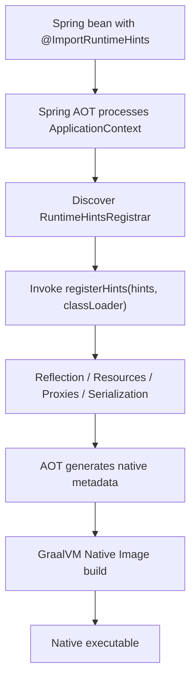

# @ImportRuntimeHints to Wire a Registrar into the Application

## 1. Why Does a RuntimeHintsRegistrar Need to Be Wired into Spring?

When running on the JVM, many Java operations can use information determined at runtime: class names read from configuration, constructors invoked via reflection, resources opened by path, or proxies created from a set of interfaces. When compiling into a **GraalVM Native Image**, these components must be identified at build time so Native Image can prepare the corresponding code and metadata.

Spring AOT provides the `RuntimeHints` API to describe these requirements. An application or library can write a class implementing `RuntimeHintsRegistrar`, then use the **`@ImportRuntimeHints`** annotation to attach the registrar to the bean that needs those hints.

The key point of this annotation is that the registrar is discovered and invoked by Spring **during AOT processing**, rather than being registered as a business bean that runs every time the application starts. Spring passes the `RuntimeHints` instance managed by the AOT engine to the registrar; the registrar contributes reflection, resource, serialization, proxy, or JNI information.

In the **SPRING_BOOT_NATIVE_IMAGE** module, this organization keeps native metadata close to the component that uses it. When a service needs to read resources by locale or invoke a plugin via reflection, you can place the annotation directly on that bean. When a bean is excluded from the `ApplicationContext` by build configuration, the hints attached to that bean do not need to be contributed either.

After this lesson, learners will be able to:

- Explain the relationship between `@ImportRuntimeHints`, `RuntimeHintsRegistrar`, and Spring AOT.
- Properly attach a registrar to a Spring bean or a `@Bean` method.
- Register resource, reflection, and proxy hints for a specific requirement.
- Write unit tests to verify registrar contents.
- Recognize when the annotation is not processed because the bean is not part of the application's AOT configuration.

## 2. Role and Lifecycle of Each Component

| Component | Responsibility |
|---|---|
| `@ImportRuntimeHints` | Declares one or more `RuntimeHintsRegistrar` classes associated with a bean or bean factory method |
| `RuntimeHintsRegistrar` | Provides the `registerHints(RuntimeHints, ClassLoader)` callback to supply metadata |
| `RuntimeHints` | Collects reflection, resource, serialization, proxy, and JNI requirements |
| Spring AOT engine | Builds the `ApplicationContext` at build time, discovers registrars, and collects hints |
| GraalVM Native Image | Uses the generated metadata for reachability analysis and native executable compilation |

Conceptual processing flow:



`@ImportRuntimeHints` does not create a registrar bean in the `ApplicationContext`. It tells Spring which registrar class should be invoked to contribute hints. The registrar does not need to be annotated with `@Component` or component-scanned like a regular service.

The annotation can be placed on:

- A Spring bean, such as a class annotated with `@Component` or a bean configured via `@Configuration`.
- A `@Bean` factory method in a Spring configuration class.

In terms of API packages, the annotation lives in `org.springframework.context.annotation`, while `RuntimeHints` and `RuntimeHintsRegistrar` belong to `org.springframework.aot.hint`.

## 3. Example: Attaching a Registrar to a Bean Reading Dynamic Resources

Suppose a service reads language dictionaries. The resource path is constructed at runtime based on the locale:

```java
package com.example.dictionary;

import java.io.IOException;
import java.io.InputStream;
import java.util.Locale;

import org.springframework.aot.hint.RuntimeHints;
import org.springframework.aot.hint.RuntimeHintsRegistrar;
import org.springframework.context.annotation.ImportRuntimeHints;
import org.springframework.core.io.ClassPathResource;
import org.springframework.stereotype.Component;

@Component
@ImportRuntimeHints(DictionaryService.DictionaryRuntimeHints.class)
public class DictionaryService {

    public InputStream openDictionary(Locale locale) throws IOException {
        String path = "dicts/" + locale.getLanguage() + ".txt";
        return new ClassPathResource(path).getInputStream();
    }

    public static class DictionaryRuntimeHints implements RuntimeHintsRegistrar {

        @Override
        public void registerHints(RuntimeHints hints, ClassLoader classLoader) {
            hints.resources().registerPattern("dicts/*");
        }
    }
}
```

There are two parts to distinguish in this example:

1. `DictionaryService.openDictionary()` performs work while the application is running. It constructs a path like `dicts/en.txt` or `dicts/vi.txt` and opens the file on the classpath.
2. `DictionaryRuntimeHints.registerHints()` is invoked during the AOT phase. It declares that resources matching the `dicts/*` pattern must be included in the native image configuration.

If the file-reading code exists without corresponding metadata, the JVM can find the resource on the classpath, whereas the native image may not contain that resource. In that case, `getInputStream()` can fail in the native build even though compilation succeeded.

### Why place the annotation directly on the service?

`DictionaryService` is the component that needs the resources. Placing `@ImportRuntimeHints` here lets readers immediately see:

- That the service uses dynamic resources.
- Which hints serve the service.
- Which registrar must be invoked when the service participates in AOT configuration.

Spring recommends placing the annotation as close as possible to the component requiring hints. If the bean is not contributed to the `BeanFactory`, hints attached to that bean are not contributed either. This avoids registering metadata for a feature that is disabled in the build configuration.

## 4. Attaching a Registrar via a `@Bean` Method

Placing the annotation on a `@Component` class is not mandatory. If a bean is created by a factory method, you can place `@ImportRuntimeHints` directly on the `@Bean` method.

Example:

```java
package com.example.dictionary;

import org.springframework.aot.hint.RuntimeHints;
import org.springframework.aot.hint.RuntimeHintsRegistrar;
import org.springframework.boot.autoconfigure.condition.ConditionalOnProperty;
import org.springframework.context.annotation.Bean;
import org.springframework.context.annotation.Configuration;
import org.springframework.context.annotation.ImportRuntimeHints;

@Configuration(proxyBeanMethods = false)
public class DictionaryConfiguration {

    @Bean
    @ConditionalOnProperty(
        name = "dictionary.enabled",
        havingValue = "true"
    )
    @ImportRuntimeHints(DictionaryRuntimeHints.class)
    DictionaryService dictionaryService() {
        return new DictionaryService();
    }

    static class DictionaryRuntimeHints implements RuntimeHintsRegistrar {

        @Override
        public void registerHints(RuntimeHints hints, ClassLoader classLoader) {
            hints.resources().registerPattern("dicts/*");
        }
    }
}
```

In this example, hints are only contributed if the `dictionaryService` bean is registered. If the `dictionary.enabled=true` condition is not met during AOT processing, the factory method does not create the bean and the registrar attached to that method is not processed for that bean.

### Note on `@Profile` and `@Conditional`

Spring AOT processes the `ApplicationContext` configuration at build time. Conditions affecting whether a bean exists, such as `@Profile` or `@ConditionalOnProperty`, are evaluated during this step. Profiles or properties that determine the AOT configuration must be selected properly at build time; do not expect changing them arbitrarily when running the native executable to make Spring create extra beans or hints that were omitted from the image.

This is why placing a registrar near a conditional bean is usually better than registering all hints globally: metadata accurately reflects the features selected for the build.

## 5. A Bean Can Use Multiple Registrars

`@ImportRuntimeHints` accepts an array of `RuntimeHintsRegistrar` implementation classes. When a component needs multiple hint groups, you can declare multiple registrars:

```java
@Component
@ImportRuntimeHints({
    DictionaryResourceHints.class,
    DictionaryReflectionHints.class
})
public class DictionaryService {
    // ...
}
```

This helps separate responsibilities:

- `DictionaryResourceHints` only registers resources.
- `DictionaryReflectionHints` only registers reflection needed for the reader/plugin.
- Each registrar can be unit-tested independently.

If multiple beans reference the same registrar implementation during a single `BeanFactory` processing pass, Spring only invokes that implementation once for that processing pass. Therefore, a registrar should focus solely on contributing hints and must not rely on the callback being invoked once per referencing bean.

Do not create business side effects inside `registerHints()`: do not send emails, write application data, connect to production systems, or mutate external state. This is a build-time callback, not a service lifecycle hook.

## 6. Registrar Examples for Reflection and JDK Proxies

Beyond resources, the same mechanism can register reflection or proxies.

### 6.1. Reflection for plugins known at build time

Suppose the application selects an implementation from configuration and invokes its constructor via reflection:

```java
String implementation = environment.getRequiredProperty("report.plugin");
Class<?> pluginType = Class.forName(implementation);
ReportPlugin plugin =
    (ReportPlugin) pluginType.getDeclaredConstructor().newInstance();
```

If the class name is only provided in configuration at runtime, Native Image may not infer the required constructor. For a set of plugins known before the build, register each implementation:

```java
import org.springframework.aot.hint.MemberCategory;
import org.springframework.aot.hint.RuntimeHints;
import org.springframework.aot.hint.RuntimeHintsRegistrar;

public class ReportPluginRuntimeHints implements RuntimeHintsRegistrar {

    @Override
    public void registerHints(RuntimeHints hints, ClassLoader classLoader) {
        hints.reflection().registerType(
            CsvReportPlugin.class,
            MemberCategory.INVOKE_DECLARED_CONSTRUCTORS
        );
        hints.reflection().registerType(
            PdfReportPlugin.class,
            MemberCategory.INVOKE_DECLARED_CONSTRUCTORS
        );
    }
}
```

Attach the registrar to the bean managing the plugins:

```java
@Component
@ImportRuntimeHints(ReportPluginRuntimeHints.class)
public class ReportPluginRegistry {
    // Select an implementation packaged in the application.
}
```

Registering a constructor does not mean registering every field/method of the class. If the code also invokes methods via reflection, add the exact member category or member hint needed. Each class must also be present on the classpath at build time; `RuntimeHints` cannot pull an arbitrary plugin JAR downloaded only after the native executable has been released into the image.

### 6.2. JDK dynamic proxy

If the application creates a JDK proxy for a known set of interfaces, you can contribute proxy hints:

```java
import org.springframework.aot.hint.RuntimeHints;
import org.springframework.aot.hint.RuntimeHintsRegistrar;

public class BillingProxyRuntimeHints implements RuntimeHintsRegistrar {

    @Override
    public void registerHints(RuntimeHints hints, ClassLoader classLoader) {
        hints.proxies().registerJdkProxy(
            BillingOperations.class,
            Auditable.class
        );
    }
}
```

Then attach the registrar to the bean using the proxy:

```java
@Component
@ImportRuntimeHints(BillingProxyRuntimeHints.class)
public class BillingProxyFactory {
    // Create proxy for BillingOperations and Auditable.
}
```

Register the exact list of interfaces that the proxy actually implements. If you change the proxy's interface set, re-check metadata and native tests. For proxies created by Spring AOP/the framework, many hints are already handled automatically; only add a registrar when a specific use case is not automatically supported.

## 7. Choosing Where to Place the Annotation: Component or `@Bean` Method?

| Scenario | Suitable location | Reason |
|---|---|---|
| A service is always component-scanned and needs its own resources | On the service class | Metadata stays with the bean using the resources |
| A bean only exists when a property/profile is enabled | On the `@Bean` method creating the bean | Hints are only contributed when the factory method is selected |
| A group of beans shares metadata | Can create a shared registrar and reference it from related beans | Reuses code while still tying it to consuming components |
| Metadata is genuinely global, independent of a specific bean | Consider `META-INF/spring/aot.factories` | Static registrar registration during AOT processing |
| A common reflection operation already has a dedicated annotation | Prefer the dedicated annotation if it meets the need | Reduces manual registrar boilerplate |

For registrars tied to specific features, prefer `@ImportRuntimeHints` near the bean that needs them. Static registration via `META-INF/spring/aot.factories` is a different mechanism, better suited when hints do not depend on a specific bean's presence or when developing a library that must participate in AOT globally.

Example `META-INF/spring/aot.factories` file (single configuration line):

```properties
org.springframework.aot.hint.RuntimeHintsRegistrar=com.example.nativeimage.GlobalRuntimeHints
```

Do not use both approaches simultaneously for the same registrar if doing so causes redundant hint declarations. With `@ImportRuntimeHints`, Spring knows which bean/method owns the hints; with `aot.factories`, the registrar is registered statically.

## 8. Testing a Registrar with RuntimeHintsPredicates

Do not wait until the native build to discover that a registrar forgot to register a resource or constructor. Spring Core provides `RuntimeHintsPredicates` to test whether `RuntimeHints` satisfies a given requirement.

Example testing resources from `DictionaryRuntimeHints`:

```java
import org.junit.jupiter.api.Test;

import org.springframework.aot.hint.RuntimeHints;
import org.springframework.aot.hint.predicate.RuntimeHintsPredicates;

import static org.assertj.core.api.Assertions.assertThat;

class DictionaryRuntimeHintsTests {

    @Test
    void shouldRegisterDictionaryResources() {
        RuntimeHints hints = new RuntimeHints();

        new DictionaryService.DictionaryRuntimeHints()
            .registerHints(hints, getClass().getClassLoader());

        assertThat(RuntimeHintsPredicates.resource()
            .forResource("dicts/en.txt"))
            .accepts(hints);

        assertThat(RuntimeHintsPredicates.resource()
            .forResource("dicts/vi.txt"))
            .accepts(hints);
    }
}
```

This test invokes the registrar directly and verifies that the resource pattern covers the required paths. Equivalent predicates can be written for reflection, serialization, or proxies using the API for your Spring Framework version.

For reflection, a predicate can check a specific method or constructor. For example:

```java
RuntimeHints hints = new RuntimeHints();
new ReportPluginRuntimeHints().registerHints(hints, getClass().getClassLoader());

assertThat(RuntimeHintsPredicates.reflection()
    .onType(CsvReportPlugin.class)
    .withMemberCategory(MemberCategory.INVOKE_DECLARED_CONSTRUCTORS))
    .accepts(hints);
```

Make sure the test source imports the corresponding classes:

```java
import org.springframework.aot.hint.MemberCategory;
import org.springframework.aot.hint.RuntimeHints;
import org.springframework.aot.hint.predicate.RuntimeHintsPredicates;
```

Unit tests verify the **registrar's contents**; they do not by themselves prove that the annotation was discovered in the application configuration. Therefore, also verify that:

1. The bean carrying `@ImportRuntimeHints` is actually component-scanned/imported or created by a factory method.
2. `@Profile`/`@Conditional` conditions are satisfied during AOT processing.
3. Maven/Gradle actually executes Spring AOT processing for the native build.
4. The native executable runs the resource/reflection/proxy branch after the build.

## 9. Verifying by Building and Running Natively

Once registrar unit tests pass, run the project's native build pipeline. Common examples when Maven/Gradle are configured accordingly:

```bash
# Maven: the native profile must be configured in the project
./mvnw -Pnative native:compile

# Gradle: the project already applies the Spring Boot and Native Build Tools plugins
./gradlew nativeCompile
```

Task/goal names and how AOT is enabled may vary depending on Spring Boot, Maven/Gradle plugin configuration, and version. Use the commands documented for your project's specific release.

During the build, inspect the AOT logs and generated native metadata. Exact output locations depend on the plugin, but configuration typically appears under `META-INF/native-image` in output/build artifacts. Do not edit generated files directly as a long-term fix; fix the registrar or metadata source and rebuild.

Then run the native executable and exercise the exact business flow:

- For resources: choose a locale with a corresponding dictionary file and verify its contents can be read.
- For reflection: select each registered plugin implementation, instantiate it, and invoke its method.
- For proxies: create the proxy and invoke methods through the declared interfaces.
- For conditional beans: build with the chosen profile/property and verify the feature is actually present in the image.

If an execution path fails, read the stack trace to distinguish missing resources, missing reflection, missing proxies, or incompatible dependencies. Widen metadata only when evidence shows the operation is required.

## 10. Common Errors

| Symptom | Possible cause | How to resolve |
|---|---|---|
| Registrar is not invoked | The annotated bean is not registered in the AOT `ApplicationContext` | Check component scan, `@Import`, and `@Bean` factory methods |
| Registrar runs, yet resource is still missing | Wrong pattern or resource is not on the classpath at build time | Check classpath path, filename, and build output |
| Hints do not appear when using a profile | Profile/property excludes the bean at AOT time | Select the appropriate profile/property when building natively |
| Constructor reflection fails | Class is registered, but lacks the category for the invoked constructor | Add `INVOKE_DECLARED_CONSTRUCTORS` or the exact hint |
| Method reflection fails | Only constructor was registered, not the dynamically invoked method | Register the required method/category |
| JDK proxy cannot be created | Proxy interface set does not match hints | Register the exact set of proxy interfaces |
| JVM tests pass, native fails | JVM does not require the same metadata level as Native Image | Test that branch on the native binary |
| Registrar causes strange side effects during build | Business logic or runtime dependencies placed inside the AOT callback | Keep the registrar pure, deterministic, and reproducible |
| Using `@ImportRuntimeHints` on a plain class has no effect | The class is not a bean and is not included in Spring AOT processing | Attach the annotation to an actually registered bean or `@Bean` method |
| Same registrar invoked from multiple places duplicates logic | Registrar design depends on invocation count | Only contribute hints; do not use the callback as a lifecycle hook |

## 11. Design Rules for Maintainable Registrars

- **Attach close to usage:** declare the registrar alongside the component needing those resources/reflection.
- **Register minimally:** only declare classes/members/resources/proxies that are truly needed; avoid overly broad reflection permissions.
- **Keep testable:** separate registrars into small classes that can be invoked directly in unit tests.
- **Stay deterministic:** identical source and AOT configuration must produce the identical hint set; avoid making decisions from runtime-only production data.
- **Not a classpath substitute:** hints describe how to access components already in the application; they do not package arbitrary plugin JARs downloaded after the build.
- **Respect bean conditions:** if a feature is toggled by profile/property, select that condition at AOT time and attach the registrar to the corresponding bean.
- **Reuse framework metadata:** Spring and many libraries already provide hints; do not manually re-add every hint without an error or specific need.

## 12. Hands-on Exercises

### Exercise A — Registering resources for a service

Create `DictionaryService` reading `dicts/{language}.txt` via `ClassPathResource`. Write `DictionaryRuntimeHints` and attach it with `@ImportRuntimeHints` on the bean. Write unit tests using `RuntimeHintsPredicates.resource().forResource(...)` to verify at least two resources are registered.

**Completion criteria:** unit tests confirm the pattern covers the dictionary files, and the native executable reads the files at runtime.

### Exercise B — Attaching hints to a conditional bean

Create a `@Bean` with `@ConditionalOnProperty` and place `@ImportRuntimeHints` on the factory method. Run an AOT build with the property enabled and verify the registrar contributes its hints; build with the property disabled and verify the corresponding bean and hints are excluded from the AOT configuration.

**Question:** why can changing the property when running the native executable not recreate hints that were not contributed at build time?

### Exercise C — Registering constructors for plugins

Create two plugin implementations present on the classpath. Write a registrar registering the constructors to be invoked via reflection, attach it to the plugin-managing bean, and verify with `RuntimeHintsPredicates`. Build natively and test both implementations in turn.

**Completion criteria:** both constructors are invoked via reflection in the native build; no need to register all members of all classes if unused.

## 13. Pre-Completion Checklist

- [ ] Bean or factory method carrying `@ImportRuntimeHints` is discovered by Spring AOT.
- [ ] Registrar properly implements `RuntimeHintsRegistrar` and the `registerHints` method.
- [ ] Hints accurately reflect runtime operations (reflection/resource/proxy/serialization).
- [ ] Registrar contains no business side effects or non-reproducible runtime data dependencies.
- [ ] Profiles/conditionals are properly selected at AOT time.
- [ ] Unit tests verify hints using `RuntimeHintsPredicates`.
- [ ] Native build succeeds and logs confirm AOT processing.
- [ ] Native binary executes the business branch requiring metadata.
- [ ] No redundant metadata is registered and generated files are not edited directly.

## References

- [Spring Framework Reference — Ahead of Time Optimizations, Runtime Hints, and @ImportRuntimeHints](https://docs.spring.io/spring-framework/reference/core/aot.html): how to register a registrar on a Spring bean or `@Bean` method, invocation timing, and testing with `RuntimeHintsPredicates`.
- [Spring Framework Javadoc — @ImportRuntimeHints](https://docs.spring.io/spring-framework/docs/current/javadoc-api/org/springframework/context/annotation/ImportRuntimeHints.html): annotation targets and registrar declaration contract.
- [Spring Framework Javadoc — RuntimeHintsRegistrar](https://docs.spring.io/spring-framework/docs/current/javadoc-api/org/springframework/aot/hint/RuntimeHintsRegistrar.html): the `registerHints` callback.
- [Spring Framework Javadoc — RuntimeHints](https://docs.spring.io/spring-framework/docs/current/javadoc-api/org/springframework/aot/hint/RuntimeHints.html): reflection, resource, proxy, serialization, and JNI hint categories.

## Conclusion

`@ImportRuntimeHints` is how you attach a `RuntimeHintsRegistrar` to a bean or `@Bean` method that needs native metadata. Spring AOT discovers the registrar and invokes it during the build to collect reflection, resource, proxy, or serialization requirements for GraalVM Native Image. Placing the annotation close to the consuming component, controlling bean conditions at AOT time, and testing the registrar with `RuntimeHintsPredicates` keep metadata clear, testable, and free of redundant registrations. Finally, building and running the native executable along the exact business branch confirms that the hints were contributed and take effect in the final artifact.

