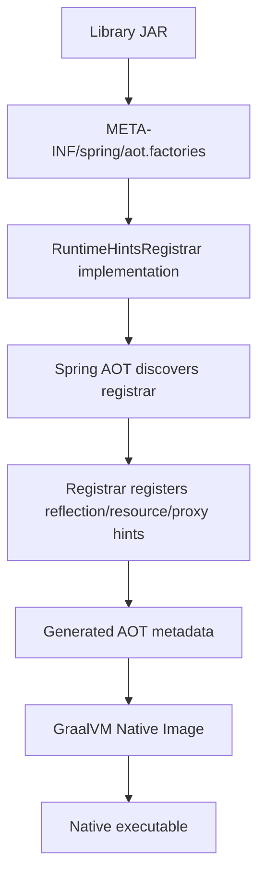

# META-INF/spring/aot.factories for Shared RuntimeHintsRegistrar

## 1. Why Does a Library Need to Register a RuntimeHintsRegistrar?

When a library is used in a Spring Boot application, it may need to provide additional information so **Spring AOT** and **GraalVM Native Image** can handle dynamic operations. For example, the library might load classes by name, read resources by pattern, create JDK dynamic proxies, or access constructors/methods via reflection.

If every application had to rewrite Runtime Hints for each library, native configuration would be duplicated and prone to missing entries when upgrading dependencies. A library can package its own `RuntimeHintsRegistrar` and declare a shared registration point in metadata:

`META-INF/spring/aot.factories`

This mechanism allows Spring AOT to discover the registrar from dependencies on the classpath and invoke it while contributing Runtime Hints. As a result, metadata travels with the library and is reused across Spring applications that depend on it.

In the **SPRING_BOOT_NATIVE_IMAGE** module, keep in mind that the registrar provides hints for AOT; it does not automatically add dependencies to the classpath, does not replace auto-configuration, and does not guarantee that every code path in the library is native-compatible.



## 2. What Is a RuntimeHintsRegistrar?

Spring provides the `RuntimeHintsRegistrar` interface for libraries or applications to register runtime hint requirements:

```java
package com.example.codec;

import org.springframework.aot.hint.RuntimeHints;
import org.springframework.aot.hint.RuntimeHintsRegistrar;

public class CodecRuntimeHints implements RuntimeHintsRegistrar {

    @Override
    public void registerHints(RuntimeHints hints, ClassLoader classLoader) {
        // Register required classes/members/resources/proxies.
    }
}
```

The `registerHints` method receives:

- `RuntimeHints hints`: registry for declaring reflection, resources, serialization, proxies, and other hints supported by Spring.
- `ClassLoader classLoader`: class loader bound to AOT processing, usable for checking or loading appropriate classes/resources.

A registrar should have an easy-to-instantiate default constructor and avoid depending on runtime beans, networks, databases, or secrets. It runs during the AOT phase; therefore, the code inside must be deterministic and safe in the build environment.

## 3. `META-INF/spring/aot.factories` Metadata

A library can place the following file in its resources:

```text
src/main/resources/
  META-INF/
    spring/
      aot.factories
```

Registrar declaration contents:

```properties
org.springframework.aot.hint.RuntimeHintsRegistrar=\
com.example.codec.CodecRuntimeHints
```

This is a properties format following the Spring AOT factories mechanism: the key is the interface/extension point name, and the value is the implementation class name. A trailing backslash continues the same property onto the next line. Multiple implementations can be declared as a comma-separated list per the factories format.

Example with two registrars:

```properties
org.springframework.aot.hint.RuntimeHintsRegistrar=\
com.example.codec.CodecRuntimeHints,\
com.example.codec.TemplateRuntimeHints
```

Use the exact key `org.springframework.aot.hint.RuntimeHintsRegistrar` and the exact interface package for your Spring version. This is metadata for **Spring AOT**, not the legacy `spring.factories` file used to register all kinds of Spring Boot auto-configurations.

## 4. Example Registrar Registering Reflection and Resources

Suppose a codec library has an implementation instantiated via reflection and a schema file read from the classpath.

```java
package com.example.codec;

public class JsonCodec {
    public JsonCodec() {
    }

    public String decode(String input) {
        return input;
    }
}
```

Library resource:

```text
src/main/resources/
  codec/
    schema.json
```

Registrar:

```java
package com.example.codec;

import org.springframework.aot.hint.MemberCategory;
import org.springframework.aot.hint.RuntimeHints;
import org.springframework.aot.hint.RuntimeHintsRegistrar;

public class CodecRuntimeHints implements RuntimeHintsRegistrar {

    @Override
    public void registerHints(RuntimeHints hints, ClassLoader classLoader) {
        hints.reflection().registerType(
            JsonCodec.class,
            MemberCategory.INVOKE_PUBLIC_CONSTRUCTORS
        );

        hints.resources().registerPattern("codec/schema.json");
    }
}
```

In this example, the registrar:

- Allows Native Image to retain the ability to invoke the public constructor of `JsonCodec` for reflection needs.
- Registers the `codec/schema.json` resource so the file is included in the native image via resource hints.

If the library only calls `new JsonCodec()` in static code and does not use reflection, a reflection hint may not be needed. Register only the access permissions the library actually uses; do not enable every field/method/constructor unnecessarily.

## 5. Packaging the Registrar into the Library JAR

Complete library structure:

```text
codec-library/
  build.gradle
  src/main/java/com/example/codec/
    JsonCodec.java
    CodecRuntimeHints.java
  src/main/resources/
    codec/schema.json
    META-INF/spring/aot.factories
```

With Gradle Java Library, files under `src/main/resources` are packaged into the JAR by default resource processing:

```groovy
plugins {
    id 'java-library'
}

group = 'com.example'
version = '1.0.0'
```

Build the library:

```bash
./gradlew :codec-library:jar
```

Inspect the JAR:

```bash
jar tf codec-library/build/libs/codec-library-1.0.0.jar
```

Ensure all of the following are present:

```text
META-INF/spring/aot.factories
com/example/codec/CodecRuntimeHints.class
codec/schema.json
```

The JAR filename depends on archive configuration. If the metadata is absent from the JAR, Spring AOT in the consuming application cannot discover the registrar from that artifact.

## 6. How Spring AOT Discovers the Registrar

When an application runs an AOT task, Spring processes the sources contributing Runtime Hints on the classpath. The `META-INF/spring/aot.factories` metadata lets the framework locate the `RuntimeHintsRegistrar` implementation from the library.

The consuming application only needs to declare a dependency on the library on its runtime classpath:

```groovy
dependencies {
    implementation 'com.example:codec-library:1.0.0'
}
```

Then run AOT and the native build according to the project configuration:

```bash
./gradlew processAot
./gradlew nativeCompile
```

These two tasks assume the Spring Boot Gradle Plugin and GraalVM Native Build Tools are compatibly configured. If the library is only in `testImplementation` or `compileOnly`, the registrar may not appear on the production application's runtime/AOT classpath.

With Maven, declare the dependency in the appropriate scope and run the native lifecycle according to the Spring Boot Maven Plugin configuration. Check the dependency tree and AOT logs to confirm the library JAR is actually on the classpath.

## 7. Distinguishing `aot.factories` from `spring.factories`

The two files have similar names but different purposes:

| Metadata | Purpose | Example key |
|---|---|---|
| `META-INF/spring/aot.factories` | Registers AOT contributions, including RuntimeHintsRegistrar | `org.springframework.aot.hint.RuntimeHintsRegistrar` |
| `META-INF/spring.factories` | Historical Spring Boot factories mechanism for supported extension points | Corresponding Spring Boot keys |

Do not copy auto-configuration keys from `spring.factories` into `aot.factories`. Modern Spring Boot auto-configuration is usually declared via its own imports file per Spring Boot's mechanism; `RuntimeHintsRegistrar` is a different extension point.

Also do not confuse `aot.factories` with GraalVM's JSON reachability metadata file. One file is used by Spring AOT to discover registrars; the other describes reachability for Native Image using the GraalVM schema.

## 8. Multiple Registrars and Reusability

A large library can split registrars by responsibility:

- `CodecRuntimeHints`: reflection for the codec.
- `TemplateRuntimeHints`: resource templates.
- `ProxyRuntimeHints`: JDK dynamic proxies.
- `SerializationRuntimeHints`: types needing serialization hints if required by the mechanism used.

Then declare multiple classes in `aot.factories`. Each registrar should be small, clearly scoped, and only register metadata belonging to its library.

Do not create duplicate registrars just to register the same class/member. Hints can be merged, but duplicated metadata makes configuration hard to read and maintain.

A registrar can check for the presence of optional classes via `ClassLoader` if the library supports multiple integrations. However, do not use class checks to hide a missing required dependency; if an integration is mandatory, declare the dependency explicitly.

## 9. Testing the Registrar

You can test a registrar directly by creating `RuntimeHints` and invoking the method:

```java
@Test
void registersCodecHints() {
    RuntimeHints hints = new RuntimeHints();

    new CodecRuntimeHints().registerHints(
        hints,
        getClass().getClassLoader()
    );

    assertThat(hints.reflection().getTypeHint(JsonCodec.class))
        .isPresent();

    assertThat(hints.resources().getResourceHint(
        "codec/schema.json"
    )).isPresent();
}
```

This is a guiding example; hint query APIs may differ by Spring Framework version. The test goal is to confirm the registrar actually adds the expected hints, not merely that the class exists.

In addition to registrar unit tests, integration tests are needed:

1. Build the library JAR.
2. Verify the JAR contains `META-INF/spring/aot.factories`.
3. Add the JAR as a dependency of a Spring Boot application.
4. Run `processAot` and confirm the registrar is discovered via AOT logs/output.
5. Build the native executable.
6. Exercise the reflection code path and resource reading on the executable itself.

A registrar unit test does not prove Spring discovered the metadata inside the JAR; an integration test verifies the registration path end-to-end.

## 10. Common Errors

| Symptom | Possible cause | How to resolve |
|---|---|---|
| Registrar is not invoked | Wrong path, wrong key, or JAR missing metadata file | Check `jar tf` and `aot.factories` contents |
| `ClassNotFoundException` for registrar | Wrong package/class name or class missing from artifact | Check compiled classes and metadata |
| Hints have no effect | Registrar not discovered during AOT or build uses stale artifact | Verify dependency graph, rerun AOT/native |
| Reflection still fails | Missing constructor/method/field needed for access | Identify exact member and add category/hint |
| Resource missing in native | Wrong pattern or resource missing from JAR | Check path, case sensitivity, and resource hint |
| AOT fails when instantiating registrar | Registrar has side effects or depends on runtime beans | Keep registrar simple, avoid accessing external systems |
| Library has metadata, yet app does not use it | Dependency only in test/compileOnly or excluded | Check `runtimeClasspath`/dependency tree |

## 11. Design Principles for Native Image–Supporting Libraries

- Place `META-INF/spring/aot.factories` in the proper resources directory of the JAR.
- Use the exact key and fully qualified class name of the `RuntimeHintsRegistrar`.
- Keep the registrar independent of Spring application beans or external services.
- Register only the minimal required reflection/resource/proxy hints.
- Verify metadata and implementation are packaged in the released artifact.
- Test both registrar unit tests and AOT/native integration tests.
- Document the verified Spring Framework/Spring Boot/GraalVM versions.
- Never embed secrets or environment configuration into hints/generated output.

## 12. Self-Check Questions

1. How does `META-INF/spring/aot.factories` help Spring AOT locate a `RuntimeHintsRegistrar`?
2. Why must a library package both the metadata file and the implementation class in its JAR?
3. What is the difference between `aot.factories` and `spring.factories`?
4. Why does registering a reflection hint for a constructor not automatically guarantee all methods/fields are accessible?
5. When a registrar unit test passes but the native executable still lacks a resource, what steps should you check?
6. Why should a `RuntimeHintsRegistrar` not connect to a database or read secrets during AOT?
7. How can you verify that a consuming application actually discovers the registrar from a dependency?

**Remember:** `META-INF/spring/aot.factories` is the registration point for a library to contribute a `RuntimeHintsRegistrar` to Spring AOT. Packaging accurate metadata, the registrar class, and minimal hints in the JAR—then verifying both AOT processing and code paths on Native Image—makes native support reusable across applications.
