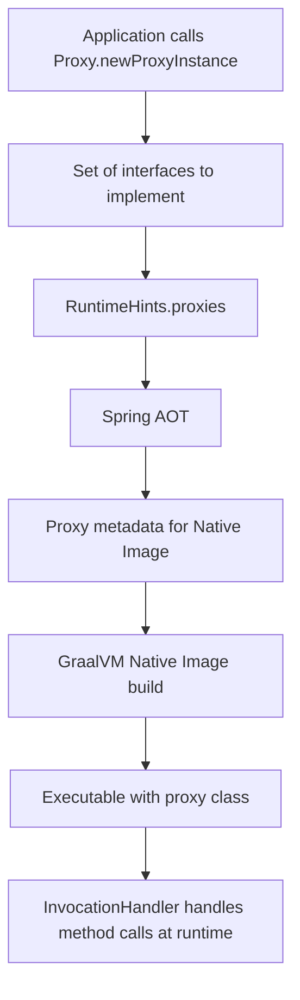

# ProxyHints for JDK Dynamic Proxies

## 1. Why Does Native Image Need JDK Dynamic Proxy Declarations?

A Java **JDK dynamic proxy** creates an object at runtime implementing one or more interfaces. Method invocations on the proxy are forwarded to an `InvocationHandler`, where the application or framework can perform logging, security, transactions, routing, or remote calls.

On the HotSpot JVM, proxy classes are typically generated dynamically when the program calls `Proxy.newProxyInstance`. With **GraalVM Native Image**, the build process analyzes the types that may be used ahead of time. If the proxy's interface set is determined dynamically at runtime, Native Image may not know which proxy class needs to be generated.

Spring provides **RuntimeHints.proxies()** to register required JDK proxies. When Spring AOT processes hints, this information is passed to native compilation so the corresponding proxy class is prepared in the executable.

In the **SPRING_BOOT_NATIVE_IMAGE** module, this is part of configuring reflection/resource/proxy hints, compatibility testing, and container packaging. Remember that a proxy hint only describes the proxy interfaces; it does not register a Spring bean, build a dependency graph, or replace metadata for reflection or native libraries.



## 2. How Does a JDK Dynamic Proxy Work?

A JDK proxy requires at least one interface. The generated proxy object implements that list of interfaces; method invocations are dispatched to the `InvocationHandler`.

Example interface:

```java
package com.example.billing;

public interface InvoiceService {
    String issue(String customerId);
}
```

Creating a proxy:

```java
InvoiceService proxy = (InvoiceService) Proxy.newProxyInstance(
    InvoiceService.class.getClassLoader(),
    new Class<?>[] { InvoiceService.class },
    (object, method, args) -> {
        if (method.getName().equals("issue")) {
            return "invoice-for-" + args[0];
        }
        return method.invoke(object, args);
    }
);
```

The snippet above illustrates the idea, though the `method.invoke(object, args)` branch would invoke the proxy itself and cause recursion if `object` is the proxy instance. In a real application, the handler should delegate to a separate target object and handle `equals`, `hashCode`, and `toString` intentionally.

A more complete example:

```java
InvoiceService target = customerId -> "invoice-for-" + customerId;

InvocationHandler handler = (proxyObject, method, args) -> {
    try {
        return method.invoke(target, args);
    } catch (InvocationTargetException ex) {
        throw ex.getTargetException();
    }
};

InvoiceService proxy = (InvoiceService) Proxy.newProxyInstance(
    InvoiceService.class.getClassLoader(),
    new Class<?>[] { InvoiceService.class },
    handler
);
```

In this example, the proxy implements `InvoiceService`; the handler delegates calls to `target`. The interface list and its order are critical for identifying the proxy.

## 3. Registering Proxies with RuntimeHints

Spring Framework provides the `RuntimeHints.proxies().registerJdkProxy(...)` API.

Example registrar:

```java
package com.example.billing;

import org.springframework.aot.hint.RuntimeHints;
import org.springframework.aot.hint.RuntimeHintsRegistrar;

public class BillingProxyHints implements RuntimeHintsRegistrar {

    @Override
    public void registerHints(RuntimeHints hints, ClassLoader classLoader) {
        hints.proxies().registerJdkProxy(InvoiceService.class);
    }
}
```

When the registrar is supplied to Spring AOT via `@ImportRuntimeHints` or a library's shared registration mechanism, Spring records the proxy hint for the `InvoiceService` interface.

With application configuration:

```java
@Configuration
@ImportRuntimeHints(BillingProxyHints.class)
class BillingConfiguration {
}
```

Ensure `org.springframework.context.annotation.ImportRuntimeHints` is properly imported and the registrar is on the AOT classpath. Simply creating a registrar class without registering it will not cause Spring AOT to invoke it automatically.

## 4. Proxies Implementing Multiple Interfaces

A proxy can implement multiple interfaces:

```java
public interface Auditable {
    String auditId();
}

public interface Retryable {
    void retry();
}
```

Registration:

```java
hints.proxies().registerJdkProxy(
    InvoiceService.class,
    Auditable.class,
    Retryable.class
);
```

The interface list must match how the application creates the proxy. When creating a multi-interface proxy, interface order can be part of the proxy's identity; do not arbitrarily change the order between hint registration and proxy creation.

If there are multiple distinct proxy variants, register each interface set actually used. Avoid broadly registering all interfaces in the application, as that bloats metadata and obscures unclear proxy design.

## 5. When Are ProxyHints Needed?

Not every proxy in Spring Boot requires manual registration. Spring AOT and framework integrations can automatically detect or contribute hints for proxies created from static configuration. Manual additions are needed when proxies are created dynamically in ways AOT cannot detect.

Scenarios worth checking:

- The application calls `Proxy.newProxyInstance` directly with interfaces chosen from runtime data.
- A plugin system loads interfaces from configuration and builds custom proxies.
- An external library creates JDK proxies along code paths not analyzed by Spring AOT.
- The proxy interface set is determined via reflection or dynamic configuration.

For example, proxies created by Spring AOP or Spring Data may already have framework AOT support. When encountering an error, identify which mechanism created the proxy before adding manual hints. Do not redundantly register a proxy merely because you see a bean is an AOP proxy.

## 6. JDK Proxies Differ from Class-Based Proxies

JDK dynamic proxies are interface-based. Class-based proxies typically generate a subclass of the target class via bytecode generation, such as certain CGLIB use cases.

| Characteristic | JDK dynamic proxy | Class-based proxy |
|---|---|---|
| Proxied type | Interface | Concrete class |
| Mechanism | `java.lang.reflect.Proxy` | Subclass/bytecode generation |
| Primary requirement | Suitable interface(s) present | Class can be subclassed within framework constraints |
| Spring hint | `hints.proxies().registerJdkProxy(...)` | Not solved solely by JDK `ProxyHints` |
| Common use case | Interface-based service proxy | Class-based proxy when no interface is used |

Do not use `registerJdkProxy` to fix all CGLIB or bytecode-generation errors. For class-based proxies, inspect Spring's AOT mechanism, library support, and separate Native Image constraints.

## 7. InvocationHandler and Reflection Are Two Separate Concerns

A proxy hint gives Native Image the information needed to generate a proxy for the interface set. However, if the `InvocationHandler` invokes methods on the target via reflection, those dynamically accessed methods/classes may still need reflection hints.

For example:

```java
Method method = target.getClass().getMethod("issue", String.class);
Object result = method.invoke(target, customerId);
```

Proxy metadata does not automatically register every method of the target for reflection. Distinguish:

1. **Proxy class**: needs to know which interfaces are proxied.
2. **Invocation handler**: the logic receiving calls; must be in the reachability graph.
3. **Target method**: if invoked via reflection, may need reflection metadata.
4. **Target class**: must be on the runtime classpath and retained by Native Image.

If the handler calls the target via static interface method invocation, a reflection hint for that method is usually not required merely because a proxy is present. Declare metadata based on the actual code path.

## 8. Spring AOP and Interface Proxy Example

Suppose a Spring application has an interface:

```java
public interface OrderService {
    Order findById(long id);
}
```

An aspect applies logging:

```java
@Aspect
@Component
class LoggingAspect {

    @Around("execution(* com.example.OrderService.*(..))")
    Object log(ProceedingJoinPoint joinPoint) throws Throwable {
        return joinPoint.proceed();
    }
}
```

Spring can create a proxy for the bean according to the AOP configuration. If the proxy is interface-based and Spring AOT recognizes the configuration, the framework can contribute appropriate hints. If the application creates proxies manually or a library creates proxies via another dynamic path, inspect AOT logs and add a registrar when needed.

Do not add `ProxyHints` for every service interface without first identifying the proxy mechanism. A runtime failure may stem from a non-matching pointcut, an unregistered bean, or a missing dependency—not necessarily missing proxy metadata.

## 9. Testing ProxyHints

You can test a registrar with `RuntimeHints` and assert the proxy hint:

```java
@Test
void registersInvoiceServiceProxy() {
    RuntimeHints hints = new RuntimeHints();

    new BillingProxyHints().registerHints(
        hints,
        getClass().getClassLoader()
    );

    assertThat(hints.proxies().jdkProxies())
        .contains(/* expected JDK proxy hint */);
}
```

The API for reading the proxy hint list may vary between Spring Framework versions; replace the placeholder assertion with the query matching your version. Do not leave placeholder assertions unverified against compiling/running tests on your actual version.

More importantly, integration tests are needed:

1. Run Spring AOT with the registrar registered.
2. Build the Native Image.
3. Launch the native executable.
4. Invoke methods through the proxy and verify the results.
5. Test exception/handler paths and any additional interfaces as well.

A unit test confirming the registrar added a hint does not prove the native executable actually creates and invokes the proxy properly.

## 10. Common Troubleshooting

| Symptom | Possible cause | Resolution approach |
|---|---|---|
| Proxy works on JVM, yet fails in native | Interface set not registered/recognized | Inspect proxy creation path and `RuntimeHints` |
| Native build reports missing proxy metadata | Registrar not discovered or wrong interface set | Check AOT registration and interface order |
| Proxy is created, yet method fails | Handler, target method, or reflection hint missing | Inspect invocation path and target metadata |
| Class-based proxy still fails after adding JDK hint | Confused proxy mechanisms | Investigate CGLIB/bytecode generation and AOT support |
| Spring AOP bean does not exist | Bean condition, component scan, or profile | Inspect application context before modifying proxy hints |
| Proxy tests pass on JVM, yet fail in native | Tests have not been run on the native executable | Run native integration tests |

## 11. Design Principles and Checklist

- Prefer clear interfaces and a well-defined proxy interface set.
- Leverage built-in Spring AOT/framework hints before adding manual registrations.
- Register the exact interface set and order matching the actual proxy.
- Keep `InvocationHandler` simple and delegate clearly to the target.
- Add separate reflection hints if the handler accesses target methods via reflection.
- Distinguish JDK proxies from class-based proxies.
- Ensure the registrar is imported or discovered via AOT metadata.
- Test the registrar, AOT output, and the native executable.
- Record the Spring Framework, Spring Boot, and GraalVM versions when verifying.

## 12. Self-Check Questions

1. What types does a JDK dynamic proxy require, and where does it forward method calls?
2. What information does `registerJdkProxy` describe for Native Image?
3. Why should interface ordering in proxy registration be consistent?
4. Does `ProxyHints` automatically provide reflection metadata for target methods?
5. What is the difference between a JDK dynamic proxy and a class-based proxy?
6. Why should you avoid adding manual `ProxyHints` for every AOP bean?
7. What testing is required to prove a proxy works in the native executable?

**Remember:** `ProxyHints` lets Spring AOT describe **JDK dynamic proxies for specific interface sets**. Identify the right proxy mechanism, register minimal metadata, distinguish proxy hints from reflection hints, and test real invocations on Native Image.
