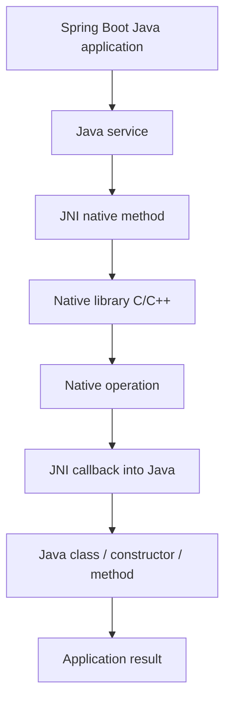

# RuntimeHints.jni() and Access Types from Native Code

## 1. Why Does JNI Need Runtime Hints?

Java Native Interface (JNI) lets Java code interact with native code, typically a C/C++ library loaded into the process. An application can call C functions from Java, or a native library can call back into methods/constructors/fields of Java objects through JNI.

On the JVM, the runtime can look up classes and members by name dynamically. With GraalVM Native Image, reachability analysis happens primarily at build time. Types and members accessed only from native code may not appear in the regular Java call graph, so Native Image must be explicitly informed about the JNI capabilities the program uses.

Spring provides the **`RuntimeHints.jni()`** API to register types requiring JNI access. This API is part of Spring AOT's `RuntimeHints` system; hints are collected at build time and converted into metadata that Native Image uses when creating the executable.

This lesson focuses on:

- Distinguishing Java calling native from native calling back into Java.
- Registering required types/members with `RuntimeHints.jni()`.
- Understanding JNI permissions such as invoke, allocate, and construct.
- Combining JNI hints with native library loading, resource hints, and OS configuration.
- Testing both interaction directions on the native executable.

## 2. JNI Works in Two Directions

JNI can be used in two directions:

1. **Java-to-native:** Java declares a `native` method and invokes it. The JVM/Native Image must bind the method to the corresponding native function.
2. **Native-to-Java:** C/C++ code uses the JNI API to find classes, instantiate objects, look up field/method IDs, and call Java methods. These classes/members may not be visible to reachability analysis from Java bytecode.



A Spring Boot application may use JNI indirectly through libraries for image processing, cryptography, compression, machine learning, or device SDKs. Your Java source does not necessarily declare `native` methods directly; a dependency may encapsulate JNI internally.

## 3. JNI Hints in RuntimeHints

The primary API is exposed through `RuntimeHints`:

```java
RuntimeHints hints = new RuntimeHints();
hints.jni();
```

`jni()` returns the hints object dedicated to types accessed from JNI. A registrar can register a type along with the required permissions:

```java
hints.jni().registerType(
        NativeCallback.class,
        JNIAccess.INVOKE
);
```

These API types live in the `org.springframework.aot.hint` package, including `RuntimeHints` and `JNIAccess`. Exact APIs may differ across Spring Framework versions; check the Javadoc for your project's version if enum names or overloads differ.

A complete registrar:

```java
final class NativeBridgeHints implements RuntimeHintsRegistrar {

    @Override
    public void registerHints(
            RuntimeHints hints,
            ClassLoader classLoader) {

        hints.jni().registerType(
                NativeCallback.class,
                JNIAccess.INVOKE
        );
    }
}
```

Attach the registrar to configuration processed by Spring AOT:

```java
@Configuration(proxyBeanMethods = false)
@ImportRuntimeHints(NativeBridgeHints.class)
class NativeBridgeConfiguration {
}
```

Spring AOT collects these declarations before GraalVM Native Image analyzes and compiles the application. Simply creating a `RuntimeHints` instance in runtime code without wiring the registrar into the AOT pipeline will not update the metadata of a built executable.

## 4. What Capabilities Does JNIAccess Represent?

`JNIAccess` describes the kinds of operations native code needs to perform on a Java type. Common permissions:

| Permission | Usage meaning |
|---|---|
| `INVOKE` | Native code can invoke methods of the Java type through JNI |
| `ALLOCATE` | Native code can allocate objects via the appropriate JNI mechanism |
| `CONSTRUCT` | Native code can instantiate objects through constructors |
| `PUBLIC` | Scope of public members per API/version support |
| `DECLARED` | Scope of members declared directly on the type per API/version support |

The exact names and combinations of `JNIAccess` constants depend on the Spring Framework version; some versions may represent public/declared scopes together with actions differently. Do not copy an enum list from another version without verifying your project's API. The examples below use common permissions such as `INVOKE`, `ALLOCATE`, and `CONSTRUCT`; verify the actual enum in your Javadoc/IDE.

Choose permissions based on what the C/C++ code actually does. If native code only calls a method on an object already created by Java, there is no need to register constructors merely because the class has constructors. If native code instantiates objects via JNI, ensure the corresponding allocation/construction capability is granted.

## 5. Example: Native Callback Invoking a Java Method

Suppose a C library processes events and calls back into a Java callback:

```java
public class NativeCallback {

    public NativeCallback() {
    }

    public void onCompleted(int status) {
        System.out.println("Native status: " + status);
    }
}
```

Native code can look up the class/method and invoke it via JNI:

```c
jclass callbackClass =
    (*env)->GetObjectClass(env, callback);

jmethodID method = (*env)->GetMethodID(
    env,
    callbackClass,
    "onCompleted",
    "(I)V"
);

(*env)->CallVoidMethod(env, callback, method, status);
```

This C snippet only illustrates the JNI flow; in production code, check for errors after each JNI call and properly manage local/global references and exceptions.

Because `onCompleted` is invoked from native code, Java reachability analysis may not see that call. You can register the type with a JNI invoke hint:

```java
hints.jni().registerType(
        NativeCallback.class,
        JNIAccess.INVOKE
);
```

If native code constructs the callback object itself via a JNI constructor, also register the appropriate creation/constructor permission for your API version. If Java creates the object and passes a reference to native code, opening constructors for JNI is not strictly necessary.

## 6. Java Calling a Native Method

An example of Java declaring a native method:

```java
public final class ImageCodec {

    static {
        System.loadLibrary("imagecodec");
    }

    public native byte[] resize(
            byte[] source,
            int width,
            int height);
}
```

Java-side call:

```java
byte[] output = codec.resize(input, 320, 240);
```

In this direction, the Java call to the native method is static per the method declaration, yet Native Image still requires JNI binding support and the corresponding native library. Depending on the Native Image build mechanism and metadata, JNI hints for the relevant types/methods, native library configuration, and ensuring the library can be located at runtime may be needed.

Do not confuse JNI hints with packaging the library file itself. The two requirements are independent:

- **JNI hints:** describe Java classes/members accessed by native code.
- **Native library packaging/loading:** ensure `libimagecodec.so` (Linux), `imagecodec.dll` (Windows), or `libimagecodec.dylib` (macOS) is present and discoverable by the loader.

## 7. Registering Types and Required Access Scopes

Suppose a native library invokes a method on `NativeCallback`, instantiates `NativeResult`, and writes its `code` field. Build an access table before registering:

| Type | What native needs to do | Hint to consider |
|---|---|---|
| `NativeCallback` | Call `onCompleted` | JNI invoke |
| `NativeResult` | Instantiate via constructor | JNI construct/allocate per API |
| `NativeResult` | Write field `code` | JNI field access per API support |
| `NativeResult` | Read method metadata | JNI introspection if the library genuinely introspects |

Do not register every type in a package with all permissions. Overly broad hints inflate metadata and retain more elements than necessary. Register according to the native interface contract and test the corresponding code path.

If the JNI API in your Spring version only exposes certain type-level permission groups, verify how they map to Native Image metadata and select an appropriate scope. For specific fields/methods, supplementary GraalVM metadata may be needed if Spring's abstraction does not express enough detail.

## 8. JNI Hints Do Not Replace Reflection Hints

JNI and Java reflection serve similar purposes, yet they are two distinct access paths.

| Mechanism | Who initiates the access? | Related hints |
|---|---|---|
| Java reflection | Java code calling `Class.forName`, `Method.invoke`, `Constructor.newInstance` | `hints.reflection()` |
| JNI callback | C/C++ calling JNI APIs to look up classes/members and call Java | `hints.jni()` |
| Java resource loading | Java reading classpath resources | `hints.resources()` |
| Dynamic proxy | Framework creating proxies by interface/runtime | `hints.proxies()` |

If a native library calls back into Java, registering only `reflection()` is not necessarily sufficient. Conversely, JNI hints do not replace reflection hints if Java code also uses reflection on the same class.

A single type may need both hint categories when accessed through multiple mechanisms. Identify each access path rather than registering one hint type expecting it to cover every dynamic API.

## 9. Loading Native Libraries and the Runtime Environment

`System.loadLibrary("imagecodec")` asks the loader to locate the native library following platform conventions. On Linux, the name typically corresponds to `libimagecodec.so`; on Windows, `imagecodec.dll`; on macOS, usually `libimagecodec.dylib`.

Things to check:

- The library exists in the runtime image or at the configured path.
- The library architecture matches the executable (`amd64`/`arm64`).
- The ABI and libc are compatible (`glibc`/`musl` on Linux).
- Shared libraries that the native library depends on are also present.
- The container user has appropriate read/execute permissions.
- The loader can find the library via standard mechanisms or `java.library.path`/appropriate native library paths.

JNI hints do not automatically bundle native libraries into the executable. If the library file is packaged as a resource, consider resource hints and how it is extracted to the filesystem; if installed in the OS image, control the packages and version of the runtime base image.

## 10. Managing JNI References and Threads

JNI enforces reference and threading rules that C/C++ code must obey:

- **Local references** are generally valid only within the current JNI call and current thread; do not cache them arbitrarily after the native method returns.
- **Global references** retain objects across multiple JNI calls and must be freed with `DeleteGlobalRef` when no longer needed.
- A native thread wishing to call into Java must attach to the JVM/Native Image runtime via the supported JNI API, and detach when finished if attached manually.
- Do not retain `JNIEnv*` and use it from a different thread; it is bound to the current thread.
- Check for exceptions after JNI calls and do not continue arbitrary operations while an exception is pending.

Native Image provides JNI support within its runtime scope; native code assumptions must be tested on the real executable. Improper reference/thread management can cause memory corruption, crashes, or unstable behavior that metadata hints cannot fix.

## 11. Testing JNI Hints

Unit tests can verify that a registrar registered the JNI hint. Spring provides `RuntimeHints` predicate utilities depending on the version; check the API matching your project. However, metadata tests are no substitute for calling the JNI library inside the native process.

Verification workflow:

1. Write a registrar test confirming the type is registered in `RuntimeHints.jni()`.
2. Run Spring AOT to confirm the registrar is discovered.
3. Build the native executable with GraalVM Native Image.
4. Exercise the Java-to-native path: invoke the native method and verify the result.
5. Exercise the native-to-Java path: the native library calls callbacks, creates objects, or accesses members per contract.
6. Test thread/reference lifecycles if the library uses asynchronous callbacks.
7. Run inside the target runtime container, verifying the native library and its dependencies are present.

A smoke test that only invokes a native method without testing callbacks does not cover the native-to-Java path. Likewise, JVM tests do not prove JNI metadata in the native image is complete.

## 12. Common Errors and Troubleshooting

| Symptom | Possible cause | How to resolve |
|---|---|---|
| JNI callback cannot find class | Type not registered or wrong class name in native code | Check class name, JNI hints, and build metadata |
| `GetMethodID` returns null | Wrong method name/signature or method unsupported | Cross-check JNI descriptor and invoke hint |
| Native code cannot instantiate object | Missing appropriate construct/allocate capability | Register corresponding JNI permissions and check constructors |
| `UnsatisfiedLinkError` | Native library missing, wrong name, or dependencies failed to load | Check path, architecture, ABI, and shared libraries |
| Fails only on ARM64 | Native library built only for x86-64 | Provide a library matching the target architecture |
| JVM works, native callback fails | Native Image lacks JNI reachability metadata | Register JNI hints and rebuild |
| Crash during callback from separate thread | Thread not attached or reference/`JNIEnv` misused | Fix JNI lifecycle/thread management |
| Hint exists in unit tests, yet native still fails | Registrar not included in AOT or error lies in native library | Verify AOT output and run executable integration tests |

Distinguish metadata errors from ABI/loader errors and JNI programming bugs. Adding hints cannot fix a wrong signature, wrong-architecture library, or a native reference use-after-free.

## 13. Hands-on Exercise: Spring Boot Calling a C Library with a Callback

**Context:** a service executes background tasks through a C library `libtaskengine.so`. Java passes a callback to receive results when native execution completes.

**Step 1 — Define the JNI contract.** List callback classes, invoked methods, constructors/objects native code may create, and any fields native code reads/writes.

**Step 2 — Write the registrar.** Use `RuntimeHints.jni()` to register the required types and permissions. Attach the registrar via `@ImportRuntimeHints`.

**Step 3 — Prepare the native library.** Build `libtaskengine.so` for the same architecture/ABI as the executable. Identify dependent shared libraries.

**Step 4 — Run AOT/native build.** Run Maven/Gradle with the Native Image configuration; verify the registrar executes and hints enter the image.

**Step 5 — Exercise both directions.** Call the Java native method, then have C invoke the Java callback. Verify status, returned data, and exception handling.

**Step 6 — Test in container.** Package the executable and native library into a compatible runtime image. Test under the actual deployment user, filesystem, and architecture.

**Step 7 — Evaluate runtime behavior.** Monitor crashes/logs, memory, threads, and latency. Ensure references are released and callbacks do not use a JNI environment from the wrong thread.

Completion criteria: minimal JNI types/members registered, native library loads cleanly, callbacks work on the native executable and target container, and no thread/reference errors occur.

## 14. Conclusion

`RuntimeHints.jni()` lets Spring AOT declare Java types that native code will access. It is particularly important for callbacks, constructor/object creation, and JNI operations invisible to reachability analysis from Java bytecode. JNI hints differ from reflection hints, resource hints, and native library packaging; an application may need to combine multiple configuration mechanisms.

When integrating JNI into Spring Boot Native Image, define the Java/C contract clearly, register exact JNI permissions, verify library/architecture/ABI compatibility, follow reference and threading rules, and test on the native executable inside the real container. Both accurate metadata and safe JNI code are essential for stable operation.
