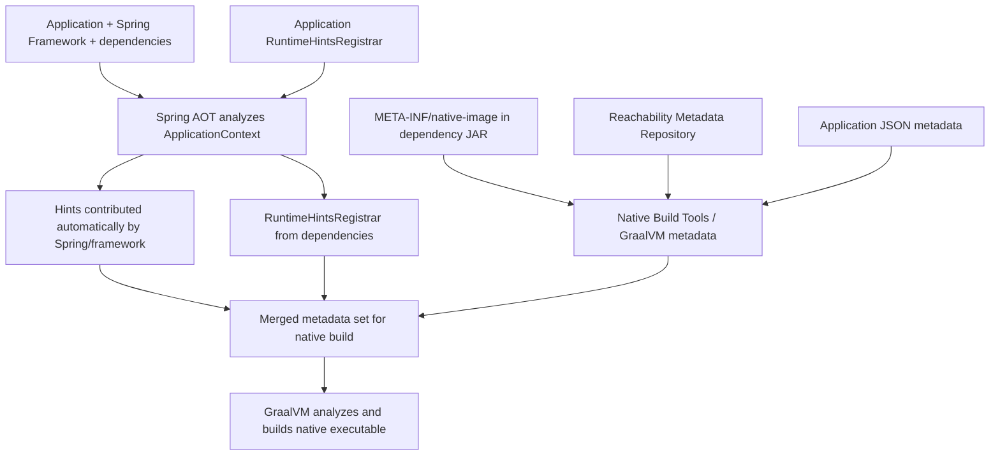

# Distinguishing Spring-Generated, Dependency-Provided, and Application-Declared Hints

When compiling Spring Boot into a **GraalVM Native Image**, the compiler must know which operations can occur at runtime that cannot be fully inferred from direct call sites. For example: a library invokes a constructor via reflection, the application reads files by dynamically constructed names, or a framework generates a JDK proxy for a set of interfaces. **Runtime Hints** provide additional information so those capabilities still work in the native executable.

Hints can come from three primary sources:

1. **Spring-generated during AOT:** Spring analyzes the `ApplicationContext`, beans, and framework contracts to automatically generate the code and hints needed for parts Spring understands.
2. **Dependency-provided:** a library packages native metadata or registers a `RuntimeHintsRegistrar` to describe how the library itself is used.
3. **Application-declared:** the development team adds hints for the application's own dynamic access paths that neither Spring nor dependencies describe.

All three sources contribute to building the native image. Understanding their origins helps locate the right place to fix issues, avoid duplicate or overly broad permissions, and keep metadata aligned with the component that owns the behavior.

This lesson belongs to the **Runtime hints** chapter of the `SPRING_BOOT_NATIVE_IMAGE` module. We will distinguish contribution mechanisms, inspect artifacts, write application registrars, test hints, and investigate missing-metadata errors.

## 1. What Do Runtime Hints Describe?

Native Image uses *closed-world* analysis to determine which code can execute. Direct Java calls normally let the compiler trace the call graph. For dynamic behaviors, however, call paths may appear only through string names, metadata, or framework APIs. The compiler needs to know about these capabilities in advance.

Spring Framework provides the `RuntimeHints` API to describe several capability groups:

| Hint group | Purpose | Example |
| --- | --- | --- |
| Reflection | Retain metadata for dynamically accessed types, constructors, methods, or fields | `Class.forName(...)`, `getDeclaredConstructor()`, `Method.invoke()` |
| Resources | Include required classpath resources in the native image | Reading `templates/invoice.txt` via `ClassPathResource` |
| Serialization | Support types used with a serialization mechanism requiring metadata | Types serialized/deserialized by the corresponding mechanism |
| JDK proxies | Describe interface sets used to create dynamic proxies | `Proxy.newProxyInstance(...)` |
| JNI | Describe certain accesses through the Java Native Interface | Java calling native methods or native code accessing Java members |

Hints are **not class source code**, do not add new dependencies to the project, and do not create bean definitions on their own. They inform the native-image tool that a type/member/resource must be retained or permitted for access in ways static analysis cannot automatically detect.

For example, declaring reflection for a constructor does not make the class appear on the classpath by itself. The class must still exist in the application or a dependency. Similarly, a resource hint does not create a file; the resource must exist in the build inputs.

## 2. Map of the Three Hint Sources



| Source | Who is responsible? | Common mechanism | When to inspect? |
| --- | --- | --- | --- |
| Spring-generated | Spring Framework/Spring Boot AOT processors | Hints inferred during AOT from bean definitions and Spring-recognized contracts | Standard framework features work on JVM yet need metadata in native |
| Dependency-provided | Library authors or metadata maintainers | `RuntimeHintsRegistrar`, `META-INF/native-image`, Reachability Metadata Repository | Error lies inside a library such as a driver, serializer, SDK, or framework extension |
| Application-declared | Application development team | `@ImportRuntimeHints`, `META-INF/spring/aot.factories`, application JSON metadata | Application has custom reflection, resources, proxies, or serialization |

The final output may contain merged contributions from many sources. Looking at a single JSON file in the generated directory alone does not necessarily reveal which registrar supplied a hint. To pinpoint the origin, trace back through application source, dependency JARs, and build configuration.

## 3. Spring-Generated Hints

Spring AOT analyzes the `ApplicationContext` at build time and produces the assets needed to reconstruct the context. The output typically includes:

- Generated Java sources to register bean definitions and initialize the context.
- Bytecode for certain required classes, such as pre-generated proxies.
- Runtime Hints for dynamic accesses Spring can recognize from configuration and framework contracts.

For example, when Spring sees a controller returning a DTO serialized to JSON, AOT can infer appropriate reflection metadata for that data type. Spring also handles many internal container requirements and framework features under its control.

The key point is that **Spring can only auto-generate hints for behaviors it can recognize**. It cannot infer every arbitrary reflection call that an application or library performs by string name, nor can it know every file a library will read based on external data.

Example:

```java
@RestController
class InvoiceController {

    @GetMapping("/invoice")
    InvoiceResponse invoice() {
        return new InvoiceResponse("INV-100", 125000);
    }
}

record InvoiceResponse(String code, long total) {}
```

Spring MVC and AOT can recognize the controller's return type along with the framework-managed serialization path. This is the kind of behavior the framework has the opportunity to analyze and contribute hints for automatically.

Conversely, the following example has a class name determined only at runtime:

```java
Object create(String className) throws ReflectiveOperationException {
    Class<?> type = Class.forName(className);
    return type.getDeclaredConstructor().newInstance();
}
```

If `className` comes from a request or config, Spring AOT cannot automatically know all valid classes. The application must restrict the set of allowed classes and declare hints for that set, or redesign using a strongly typed registry/strategy.

### 3.1. Where are generated hints written?

In common Maven/Gradle Spring Boot setups, generated resources typically live under:

```text
# Maven
target/spring-aot/main/
├── sources/
├── resources/
│   └── META-INF/native-image/
└── classes/

# Gradle
build/generated/
├── aotSources/
├── aotResources/
└── aotClasses/
```

Exact directory names and structure depend on plugin/version. Inspect AOT logs and actual project outputs.

Files in `META-INF/native-image` may contain JSON metadata read by GraalVM during the build. Generated Java sources help explain bean registrations; metadata helps explain reflection/resources/proxies. The two artifact types answer different questions.

## 4. Dependency-Provided Hints

A third-party library may use reflection, resources, or proxies internally. Library authors usually understand those call paths far better than applications consuming the library. Therefore, metadata should be packaged with the dependency or distributed through a compatible metadata source.

There are three common approaches.

### 4.1. Dependency packages Native Image metadata

A JAR may contain metadata under `META-INF/native-image`, for example:

```text
some-library.jar
└── META-INF/
    └── native-image/
        └── com.vendor/
            └── invoice-client/
                ├── reachability-metadata.json
                ├── reflect-config.json
                └── resource-config.json
```

This is an illustrative layout. A dependency may include only a subset of files, use the unified metadata format, or use legacy formats depending on the GraalVM/tooling version.

These metadata files can describe:

- Types/members requiring reflection.
- Resource patterns to package.
- Interfaces used for JDK proxies.
- Types requiring serialization or JNI metadata.

When the dependency is placed on the native build classpath, Native Build Tools/GraalVM can read this metadata following supported conventions. The application does not need to copy every library hint into its own source.

### 4.2. Dependency registers a RuntimeHintsRegistrar

If a library integrates with Spring, it can supply a `RuntimeHintsRegistrar` implementation and register it in:

```text
META-INF/spring/aot.factories
```

Illustrative contents:

```properties
org.springframework.aot.hint.RuntimeHintsRegistrar=\
com.vendor.invoice.InvoiceClientRuntimeHints
```

Spring AOT discovers the registrar and invokes it during analysis to contribute to `RuntimeHints`. This mechanism lets a library package hint logic in Java, leverage the classloader, and register metadata conditionally based on checks the library can perform.

A dependency can also place `@ImportRuntimeHints` on its own configuration/component. This ties hints to the imported component so hints are only contributed when that component is actually registered.

### 4.3. Reachability Metadata Repository

Not every library ships pre-built native metadata inside its JAR. GraalVM and the community maintain the **Reachability Metadata Repository** to provide metadata for popular dependencies.

Native Build Tools can integrate with this repository to pull matching metadata during the build, depending on plugin version and configuration. That provides support for libraries where the application team did not directly write hints.

However, the repository does not guarantee coverage for every version or every usage path of every library. Verify:

- Whether the actual dependency version is supported.
- Whether the metadata matches the exact library version in use.
- Whether the features the application uses fall within the metadata scope.
- Whether the build fetches/applies repository metadata under the current configuration.

**Note on responsibility:** Spring Boot does not include hints for every third-party library. Hints for dependencies normally come from the library itself or the Reachability Metadata Repository. If a library lacks metadata and uses dynamic reflection, the development team must supplement hints in the application or contribute appropriate metadata upstream.

## 5. Application-Declared Hints

An application should declare its own hints when it has custom dynamic access paths not yet described by Spring or dependencies. Spring Framework provides `RuntimeHintsRegistrar` and `@ImportRuntimeHints` for this purpose.

For example, the application needs to:

- Instantiate `ReportPayload` via reflection.
- Read templates matching `reports/*.txt`.
- Create a JDK dynamic proxy for `PaymentGateway`.

```java
package com.example.orders;

import org.springframework.aot.hint.MemberCategory;
import org.springframework.aot.hint.RuntimeHints;
import org.springframework.aot.hint.RuntimeHintsRegistrar;
import org.springframework.context.annotation.Configuration;
import org.springframework.context.annotation.ImportRuntimeHints;

@Configuration(proxyBeanMethods = false)
@ImportRuntimeHints(OrdersRuntimeHints.class)
class OrdersNativeConfiguration {
}

class OrdersRuntimeHints implements RuntimeHintsRegistrar {

    @Override
    public void registerHints(RuntimeHints hints, ClassLoader classLoader) {
        hints.reflection().registerType(
                ReportPayload.class,
                MemberCategory.INVOKE_DECLARED_CONSTRUCTORS,
                MemberCategory.INVOKE_PUBLIC_METHODS
        );

        hints.resources().registerPattern("reports/*.txt");

        hints.proxies().registerJdkProxy(PaymentGateway.class);
    }
}
```

The imports in the example come from the Spring Framework AOT API. `ReportPayload` and `PaymentGateway` are application types that must exist in source/dependencies. Hints only describe the dynamic access capabilities that native image must preserve.

Attaching `@ImportRuntimeHints` close to the component needing hints is usually easier to maintain: if the configuration/component is excluded from the bean factory, its attached hints are not contributed either. For a set of hints that is genuinely global to the deployment unit, you can register the registrar via `META-INF/spring/aot.factories`.

### 5.1. Declare only the exact permissions needed

Avoid registering every member of every class when only a constructor and a few methods are needed. Select the corresponding access level:

| Actual need | How to declare |
| --- | --- |
| Instantiate via declared constructor | `INVOKE_DECLARED_CONSTRUCTORS` |
| Invoke public methods via reflection | `INVOKE_PUBLIC_METHODS` |
| Read resources by name/pattern | `resources().registerPattern(...)` |
| Create a JDK proxy for known interfaces | `proxies().registerJdkProxy(...)` |

If a library API can use direct calls or typed beans instead of reflection, consider redesigning before expanding metadata. Hints are no substitute for managing dependencies or clarifying contracts.

## 6. Which Scope Should Register a Registrar?

The two common registration mechanisms have different scopes.

### 6.1. Importing near a component with @ImportRuntimeHints

```java
@Component
@ImportRuntimeHints(DictionaryHints.class)
class DictionaryService {
    // Service reading dictionaries by locale.
}
```

When the component enters the bean factory, the registrar is processed during AOT. This is suitable when hints are needed for a single component or feature. It avoids contributing metadata for disabled features.

The annotation can be placed on a configuration class or a bean factory method, depending on application structure and Spring Framework version. When using conditions, attach hints to the conditional component itself so metadata scope travels with the bean.

### 6.2. Global registration via META-INF/spring/aot.factories

Structure in an application project:

```text
src/main/resources/
└── META-INF/
    └── spring/
        └── aot.factories
```

Contents:

```properties
org.springframework.aot.hint.RuntimeHintsRegistrar=\
com.example.orders.GlobalOrdersRuntimeHints
```

The registrar class must have a no-argument constructor so Spring can instantiate it via discovery. Global registration is useful when hints are shared across the deployment unit, though care is needed to avoid adding metadata for features absent from the application.

| Scope | Advantage | Consideration |
| --- | --- | --- |
| `@ImportRuntimeHints` near component | Hints stay coupled to the component owning the requirement | Component/configuration must actually be imported |
| `META-INF/spring/aot.factories` | Can register a shared registrar without annotating every location | Registrar has global scope; conditions must be managed manually |
| JSON under `META-INF/native-image` | Static metadata without writing a Java registrar | Hard to express complex conditions; must manage files and package scope |

## 7. When Should Application JSON Metadata Be Used?

Spring Boot supports declaring static native-image metadata under `src/main/resources/META-INF/native-image`. For example:

```text
src/main/resources/
└── META-INF/
    └── native-image/
        └── com.example/
            └── orders-additional-hints/
                └── reflect-config.json
```

An illustrative JSON file using the legacy format:

```json
[
  {
    "name": "com.example.orders.ReportPayload",
    "allDeclaredConstructors": true
  }
]
```

Using JSON can be appropriate when:

- Simple static metadata needs to be declared.
- Sharing metadata for native-image builds without needing Java logic.
- A legacy library already provides JSON configuration.
- Packaging metadata independently of Spring AOT registrars.

The example path uses `orders-additional-hints` to avoid colliding with the metadata directory AOT generates for the artifact itself. If generated and static directories collide, writing outputs can cause overwrites or make provenance hard to trace.

The JSON format and filenames depend on the GraalVM version. Legacy files like `reflect-config.json`, `resource-config.json`, and `proxy-config.json` may still appear in many projects; newer metadata may use the unified `reachability-metadata.json` schema. Check the documentation for your Native Build Tools/GraalVM version.

## 8. Distinguishing Sources When Investigating a Hint

Suppose a native build reports missing reflection for `com.vendor.codec.PayloadReader`. Do not immediately add a hint in the application. First identify who owns that reflection path.

| Question | Clue to look for | Resolution approach |
| --- | --- | --- |
| Is this behavior performed by Spring? | Stack trace passes through Spring internals; AOT generated source/hints involved | Verify framework version and whether Spring recognizes the contract |
| Is this internal dependency behavior? | Stack trace enters library package; JAR has a registrar or native metadata | Upgrade dependency or inspect bundled/repository metadata |
| Is this invoked directly by application code? | Source uses custom reflection, resource pattern, proxy, or serializer | Add registrar/JSON in application or refactor design |
| Hint exists, yet error persists? | Generated metadata has type/member, yet permissions are insufficient or runtime uses a different type | Compare class name, member, access mode, classloader, and version |
| Hint comes from external metadata? | Native Build Tools logs metadata download; dependency includes reachability metadata | Check plugin version, repository, and matching metadata version |

A single dependency can provide hints through multiple mechanisms at once. For instance, a Spring-aware library might have a registrar for Spring AOT while also packaging JSON native metadata for GraalVM. Therefore, do not treat the three sources as mutually exclusive silos.

### 8.1. Inspecting a dependency JAR

If you know the JAR path, inspect its contents without modifying the dependency:

```bash
jar tf path/to/library.jar | grep -E 'META-INF/(native-image|spring/aot.factories)'
```

On Windows PowerShell, you can use:

```powershell
jar tf path	olibrary.jar | Select-String 'META-INF/(native-image|spring/aot.factories)'
```

If you find `META-INF/spring/aot.factories`, open the file in the JAR to check the registrar. If you find `META-INF/native-image`, inspect the JSON metadata and declared packages/types. Not finding those files is insufficient proof that the dependency lacks native support: metadata may come from the Reachability Metadata Repository or from another dependency.

### 8.2. Reading generated output

With Maven, generated hints typically reside under `target/spring-aot/main/resources/META-INF/native-image`; with Gradle, typically under `build/generated/aotResources/META-INF/native-image`. Exact paths may vary by plugin configuration.

Search for relevant classes:

```bash
# Maven
rg -n "PayloadReader|ReportPayload" target/spring-aot

# Gradle
rg -n "PayloadReader|ReportPayload" build/generated
```

Generated JSON shows that metadata was aggregated into AOT output. However, the final file may not record the exact provenance of every entry. To determine whether a hint came from Spring or a specific registrar, search application sources, dependency JARs, and the metadata repository.

## 9. Testing Application Registrars

Do not wait for a native build failure to discover whether a registrar registered the right entries. Spring provides `RuntimeHintsPredicates` for writing unit tests per hint.

Example test:

```java
package com.example.orders;

import org.junit.jupiter.api.Test;
import org.springframework.aot.hint.MemberCategory;
import org.springframework.aot.hint.RuntimeHints;
import org.springframework.aot.hint.predicate.RuntimeHintsPredicates;

import static org.assertj.core.api.Assertions.assertThat;

class OrdersRuntimeHintsTests {

    @Test
    void registersRequiredHints() {
        RuntimeHints hints = new RuntimeHints();
        new OrdersRuntimeHints().registerHints(
                hints, getClass().getClassLoader());

        assertThat(RuntimeHintsPredicates.reflection()
                .onType(ReportPayload.class)
                .withMemberCategory(MemberCategory.INVOKE_DECLARED_CONSTRUCTORS))
                .accepts(hints);

        assertThat(RuntimeHintsPredicates.resource()
                .forResource("reports/default.txt"))
                .accepts(hints);
    }
}
```

This test confirms the registrar contributes the expected metadata. It does not prove the full native executable received all hints from Spring and dependencies. Add native integration tests exercising the actual code paths.

### 9.1. Testing with the RuntimeHints Agent

Spring Framework provides a test module supporting observation of runtime-hint-related operations. The RuntimeHints Agent can record reflection/resource/proxy invocations during test runs, then compare them against declared `RuntimeHints`.

Approach:

1. Run the test suite or a specific business flow with the agent.
2. Collect the dynamic accesses that flow genuinely uses.
3. Compare those accesses against application/dependency hints.
4. Add missing metadata, then re-run tests.
5. Run the native build and verify the real binary.

The GraalVM tracing agent can also record metadata from observed execution paths. Both tools depend on **which code paths are actually executed**: if tests never exercise a rare branch, an agent cannot detect that branch automatically. They assist discovery, rather than replacing understanding of contracts and designing thorough test coverage.

## 10. Avoiding Duplicate or Overly Broad Declarations

Because hints from multiple sources are aggregated, an application can accidentally re-declare metadata already provided by Spring or a dependency.

Before adding a new hint:

1. Identify the exact failing operation and the related type/member/resource.
2. Inspect Spring AOT output to see whether the hint was already generated.
3. Inspect dependency registrars, `META-INF/native-image`, and reachability metadata.
4. If metadata already exists, verify whether it grants sufficient access permissions and targets the right class version.
5. Add only what is missing, with the narrowest possible scope.

| Practice | Consequence |
| --- | --- |
| Registering all declared members for a wide package | May retain unnecessary metadata, increasing size and obscuring actual access permissions |
| Copying JSON from a dependency into the application | Prone to duplication and version drift when upgrading dependencies |
| Registering a global registrar for an optional feature | Hints may still be contributed even when the feature is unused |
| Attaching `@ImportRuntimeHints` near the component owning the need | Easy to trace and keeps hint lifecycle synchronized with the component |
| Using typed APIs/direct calls instead of reflection where reasonable | Reduces dynamic metadata requirements and simplifies native builds |

A broad hint does not automatically make code safer or more compatible. It only widens what the native image retains/allows via metadata. Apply the principle: **declare only capabilities genuinely used**.

## 11. Summary Example: Finding the Right Source for Resources and Reflection

Suppose an application has an invoice-generation endpoint. Regular controllers and DTOs are recognized by Spring AOT; a PDF library uses reflection internally; and the application reads locale-specific templates from the classpath.

| Requirement | Sensible hint source | Why |
| --- | --- | --- |
| DTO returned from controller | Spring-generated if framework can infer it | Serialization path belongs to the Spring MVC contract that AOT can analyze |
| Internal reflection of the PDF library | Dependency-provided | Library author knows which classes/members the PDF engine accesses |
| Template `templates/invoice-vi.txt` chosen by application per locale | Application-declared | Resource pattern is part of application logic |
| JDK proxy for custom plugin interface | Application-declared, unless dependency already contributed it | Application owns the interface set to be proxied |

The application registrar can declare the resources:

```java
class InvoiceTemplateHints implements RuntimeHintsRegistrar {

    @Override
    public void registerHints(RuntimeHints hints, ClassLoader classLoader) {
        hints.resources().registerPattern("templates/invoice-*.txt");
    }
}
```

Attach the registrar to the component reading templates:

```java
@Component
@ImportRuntimeHints(InvoiceTemplateHints.class)
class InvoiceTemplateService {
    // Read template by locale.
}
```

For the PDF library, check the JAR/metadata before adding reflection hints in the application. If the dependency already supplies metadata for the right version, let the dependency own it. If not, you can write a tested registrar in the application as a workaround, then consider contributing upstream to the library or the Reachability Metadata Repository so other applications benefit too.

## 12. Investigation and Release Checklist

- [ ] Identify the failing dynamic operation: reflection, resource, proxy, serialization, or JNI.
- [ ] Distinguish whether the code belongs to Spring, a dependency, or the application.
- [ ] Inspect Spring AOT generated resources/sources.
- [ ] Check dependency JARs for `META-INF/spring/aot.factories` or `META-INF/native-image`.
- [ ] Check the Reachability Metadata Repository and Native Build Tools logs if the dependency does not bundle metadata.
- [ ] Register application hints with `@ImportRuntimeHints` near components where appropriate.
- [ ] Use `META-INF/spring/aot.factories` for globally scoped registrars with a no-argument constructor.
- [ ] Use JSON metadata when appropriate; place in a directory that does not collide with generated outputs.
- [ ] Test registrars with `RuntimeHintsPredicates`.
- [ ] Run tests/agents on code branches involving dynamic access.
- [ ] Build the native executable and verify real usage paths.
- [ ] Avoid mechanically copying dependency metadata or registering unnecessary members broadly.

### Self-Assessment Questions

1. For which kinds of behavior can Spring AOT auto-generate reflection hints, and why can it not infer every `Class.forName` call?
2. Through which mechanisms can a dependency supply hints?
3. What is the difference between `@ImportRuntimeHints` and `META-INF/spring/aot.factories`?
4. Why does a dependency containing `META-INF/native-image` not guarantee coverage of every version or feature of the library?
5. Can application-declared hints substitute for bean definitions or dependencies absent from the classpath?
6. What do `RuntimeHintsPredicates` tests prove, and why are native integration tests still needed?
7. When seeing metadata in generated output, how do you trace a hint's origin if the JSON file does not record provenance?

## References

- [Spring Framework — Ahead-of-Time Optimizations and Runtime Hints](https://docs.spring.io/spring-framework/reference/core/aot.html): how AOT generates code, classes, and RuntimeHints; contracts handled automatically by Spring and how to test hints.
- [Spring Boot — Advanced Native Image Topics](https://docs.spring.io/spring-boot/reference/packaging/native-image/advanced-topics.html): custom hints, static metadata, file locations, and third-party dependency support limits.
- [Spring Framework — RuntimeHintsRegistrar API](https://docs.spring.io/spring-framework/docs/current/javadoc-api/org/springframework/aot/hint/RuntimeHintsRegistrar.html): contract for contributing RuntimeHints and registration via annotation or `META-INF/spring/aot.factories`.
- [Spring Framework — ImportRuntimeHints API](https://docs.spring.io/spring-framework/docs/current/javadoc-api/org/springframework/context/annotation/ImportRuntimeHints.html): scope of hint registration attached to components/bean methods.
- [GraalVM — Reachability Metadata](https://www.graalvm.org/latest/reference-manual/native-image/metadata/): format and how Native Image uses metadata for dynamic accesses.

**Expected outcome:** when a native image lacks metadata, you can determine whether the needed hints should come from Spring, a dependency, or the application; know where to inspect and how to supplement them with proper scope. Keeping hints aligned with the component owning the behavior makes dependency upgrades easier, prevents duplicate metadata, and maintains native compatibility in a controlled manner.
