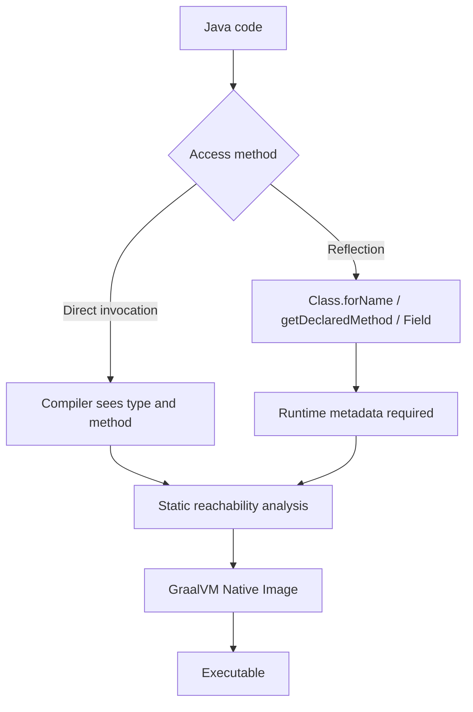

# Distinguishing Direct Invocation from Accessing Classes, Constructors, Methods, and Fields via Reflection

## 1. What Is Reflection and Why Does Native Image Care?

Java provides **reflection** so a program can inspect and interact with classes, constructors, methods, fields, and annotations at runtime. Instead of calling a method by a name known at compile time, a program can obtain a class or member name from configuration, look up metadata via the reflection API, and then perform the operation.

In a Spring Boot application, reflection can appear in the framework, serialization libraries, dependency injection, validation, ORM, plugin systems, and application-authored code. On the HotSpot JVM, class metadata and dynamic class loading support many reflection use cases. With **GraalVM Native Image**, the build process performs reachability analysis ahead of time; classes/members accessed dynamically may need metadata so they are retained and allowed to be accessed in the executable.

Two groups of behavior must be distinguished:

- **Direct invocation**: source code references specific classes/members; the compiler sees the call and Native Image can usually trace it through static analysis.
- **Reflective access**: the program looks up classes/members via the reflection API, often by name or data known only at runtime; the build tool may not fully infer the targets.



Reflection is neither bad nor forbidden in Native Image. What matters is identifying the exact metadata required, providing it via Spring Runtime Hints or reachability metadata, and testing the actual code paths.

## 2. Direct Class and Method Invocation

Example of a service:

```java
package com.example.payment;

public class PaymentService {
    public String charge(String orderId) {
        return "charged:" + orderId;
    }
}
```

Direct invocation:

```java
PaymentService service = new PaymentService();
String result = service.charge("ORD-1001");
```

The compiler knows:

- Class `PaymentService` is referenced.
- The no-argument constructor is called.
- Method `charge(String)` is called.
- The return type and parameter types are determined in bytecode.

Native Image can trace these static references during reachability analysis. If the class and method are not excluded by other conditions, a reflection hint is usually not needed just for direct invocation.

However, the fact that a class is invoked directly does not guarantee that all of its private fields, constructors, and methods are kept for reflection. If the application also accesses other members via reflection, the corresponding permissions must be registered.

## 3. Loading a Class by Name: `Class.forName`

Reflection often begins when the class name is only available at runtime:

```java
String className = configuration.getProperty("payment.handler");
Class<?> handlerType = Class.forName(className);
Object handler = handlerType.getDeclaredConstructor().newInstance();
```

Here, the compiler does not know for sure what the value of `className` will be. If the property can hold multiple implementations, Native Image cannot automatically infer every class from a single runtime string alone.

Configuration example:

```properties
payment.handler=com.example.payment.CardHandler
```

If the chosen class is always fixed, the design can use static class references or a static registry to help AOT analysis. If dynamic selection is genuinely required, the classes that may be used and the members accessed must be registered.

### Distinguishing Class Loading from Instance Creation

- `Class.forName(name)` loads/initializes the class according to the corresponding overload and class initialization mechanism.
- `getDeclaredConstructor()` looks up the constructor.
- `newInstance()` on `Constructor` creates the object.
- `Class.newInstance()` is an old deprecated API; prefer `getDeclaredConstructor().newInstance()`.

Registering only the class is not enough. If the code invokes a constructor via reflection, the matching constructor must also be permitted.

## 4. Finding and Invoking Methods via Reflection

Example:

```java
Method method = PaymentService.class.getDeclaredMethod(
    "charge",
    String.class
);

Object result = method.invoke(service, "ORD-1001");
```

Steps:

1. Identify the class.
2. Look up the method by name and parameter type list.
3. Obtain the `Method` object.
4. Call `invoke` with the target and corresponding arguments.

`getMethod` searches only public methods, including matching inherited methods. `getDeclaredMethod` searches methods declared directly in the class, which may be private/protected/package-private. If invoking a non-public member, access rules and the use of `setAccessible`/Java module access must also be considered.

Private method example:

```java
Method method = PaymentService.class.getDeclaredMethod(
    "calculateInternal",
    long.class
);
method.setAccessible(true);
Object result = method.invoke(service, 100L);
```

Opening access via reflection is constrained by the module system, runtime policy, and Native Image capabilities. Do not use `setAccessible(true)` as a default approach; prefer public APIs or redesign if possible.

When using `Method.invoke`, exceptions thrown by the invoked method are typically wrapped in `InvocationTargetException`. Inspect `getCause()` to find the root cause.

## 5. Accessing Fields via Reflection

Field reflection allows reading/writing fields by name:

```java
Field field = PaymentRequest.class.getDeclaredField("customerId");
field.setAccessible(true);
Object value = field.get(request);
field.set(request, "CUST-200");
```

Distinction:

- `getField(name)`: finds a public field, including inherited fields.
- `getDeclaredField(name)`: finds a field declared directly in the class, regardless of modifier.
- `Field.get(object)`: reads the value.
- `Field.set(object, value)`: writes the value if access and field semantics allow it.

`final`, static, private fields and primitive types have their own access rules. Not every field can be written arbitrarily. Reflection also does not completely bypass the encapsulation rules of the Java module system.

## 6. Comparison Table: Direct Invocation vs. Reflection

| Criterion | Direct Invocation | Reflection |
|---|---|---|
| How class/member is identified | Referenced in code | Looked up via API and runtime metadata |
| Method name | Checked by compiler | Usually a string |
| Parameter types | Checked at compile time | Passed via Class/argument array |
| Error detection | Many errors caught early | Some errors only appear at runtime |
| Optimization | Easier for static analysis | Can be harder to infer targets |
| Native Image | Usually recognized by reachability analysis | May require reflection metadata |
| Use case | Standard business logic | Frameworks, plugins, serializers, mappers |

Reflection brings flexibility, but increases complexity in testing and Native Image configuration. If dynamic class/member selection is not needed, direct invocation or a static registry is usually easier to maintain.

## 7. Types of Reflection Metadata to Distinguish

Native Image may need to know about different kinds of reflection operations:

- **Type access/introspection**: retrieving class, annotation, superclass, and interface metadata.
- **Constructor access**: looking up or invoking constructors, creating instances.
- **Method access**: looking up, reading metadata, or invoking methods.
- **Field access**: looking up, reading, or writing fields.
- **Related resource/class lookup**: finding classes/resources by name or pattern.

Registering a type does not automatically mean all of its members are open for every operation. Register the minimum access required for the code path.

## 8. Registering Reflection with Spring RuntimeHints

Spring provides `RuntimeHints.reflection()` to declare required types and members.

Example of a class instantiated by constructor and invoked via reflection:

```java
public class CardHandler {
    public CardHandler() {
    }

    public String handle(String payload) {
        return "card:" + payload;
    }
}
```

Registrar:

```java
import org.springframework.aot.hint.MemberCategory;
import org.springframework.aot.hint.RuntimeHints;
import org.springframework.aot.hint.RuntimeHintsRegistrar;

public class PaymentReflectionHints implements RuntimeHintsRegistrar {

    @Override
    public void registerHints(RuntimeHints hints, ClassLoader classLoader) {
        hints.reflection().registerType(
            CardHandler.class,
            MemberCategory.INVOKE_DECLARED_CONSTRUCTORS,
            MemberCategory.INVOKE_PUBLIC_METHODS
        );
    }
}
```

Registering the registrar:

```java
@Configuration
@ImportRuntimeHints(PaymentReflectionHints.class)
class PaymentConfiguration {
}
```

The example above allows declared constructors and public methods by category. If actual code needs private methods or fields, register the corresponding permissions rather than assuming those categories cover every member.

Spring AOT collects Runtime Hints when the registrar is discovered and invoked during AOT processing. Simply writing the registrar class without importing/registering it is not enough.

## 9. Registering Specific Members Instead of Over-Exposing

If only a no-arg constructor and a specific method are needed, members can be registered in detail:

```java
hints.reflection().registerType(
    CardHandler.class,
    typeHint -> typeHint
        .withConstructor(new Class<?>[0],
            ExecutableMode.INVOKE)
        .withMethod(
            "handle",
            List.of(String.class),
            ExecutableMode.INVOKE
        )
);
```

The builder API and `ExecutableMode` import depend on the Spring Framework version. This directional example illustrates declaring the constructor and method that need to be invoked. When implementing, verify the exact API signature for your version and run compile tests.

Minimal registration has benefits:

- Avoids keeping unnecessary members in the executable.
- Reduces redundant metadata.
- Clarifies the intent of the reflection path.
- Makes auditing easier when libraries or classes change.

If a class has multiple constructors, overloaded methods, or complex generic types, declare the exact parameter types and verify the actual signature.

## 10. Reflection Metadata in Reachability Metadata JSON

In addition to Spring RuntimeHints, GraalVM Native Image supports reachability metadata in JSON format. Illustrative example of the reflection section:

```json
{
  "reflection": [
    {
      "type": "com.example.payment.CardHandler",
      "methods": [
        {
          "name": "<init>",
          "parameterTypes": []
        },
        {
          "name": "handle",
          "parameterTypes": ["java.lang.String"]
        }
      ]
    }
  ]
}
```

The exact structure and supported fields depend on the GraalVM reachability metadata schema version. Do not copy JSON from examples without checking the documentation for the Native Image version in use.

In Spring Boot applications, RuntimeHints is usually the natural integration because hints are collected by Spring AOT. Metadata JSON may be appropriate when a library wants to provide reachability metadata independently of Spring or via GraalVM's mechanism. Avoid unnecessary duplicate declarations between the two sources.

## 11. Reflection and Closed-World Analysis

Native Image uses a closed-world analysis model: the tool needs to determine the set of classes and members that can be used. Direct calls create easily recognizable edges in the reachability graph. Reflection by runtime name can create edges that static analysis does not see.

Example:

```java
String implementation = request.getParameter("handler");
Class<?> type = Class.forName(implementation);
```

If the value can be any class from external input, the set of classes is unbounded. This is both a native compatibility issue and an application security issue. Never allow requests to arbitrarily choose which class to instantiate. Use an allowlist of implementation names and register hints only for the allowed classes.

## 12. Tracing Agent: Discovering Reflection in the JVM

The GraalVM Native Image Tracing Agent can observe reflection operations that occur while the application runs on the JVM and generate suggested metadata.

Example command (exact syntax depends on the GraalVM version):

```bash
java -agentlib:native-image-agent=config-output-dir=target/native-agent-config \
     -jar target/app.jar
```

After running business scenarios, the agent records the observed dynamic operations. This data can help generate reflection, proxy, resource, and JNI configurations.

However, the agent only sees executed code paths. A brief smoke test does not guarantee all production flows were captured. Run a sufficiently broad test suite, review the generated configuration, remove unnecessary metadata, and add rare paths that were not executed.

## 13. Testing Reflection on Native Image

A testing workflow should include:

1. Write JVM tests for the reflection behavior: class name, constructor, method/field, and exceptions.
2. Identify the classes/members actually accessed dynamically.
3. Register appropriate RuntimeHints or reachability metadata.
4. Run Spring AOT and build the Native Image.
5. Run the same test cases against the native executable or native test task.
6. Test both valid and error cases: disallowed class, missing constructor, wrong method signature, access denied.
7. Run integration tests in the target container to verify OS/libraries and resources.

Do not conclude native compatibility merely from a successful build. A reflection method called only when a rare endpoint is hit can still fail in production if untested.

## 14. Common Errors

| Symptom | Possible Cause | Resolution |
|---|---|---|
| `ClassNotFoundException` | Incorrect class name or class not included in the image | Check runtime classpath, allowlist, and reachability |
| `NoSuchMethodException` | Constructor/method signature does not exist or is not supported by metadata | Check name, parameter types, and hints |
| `IllegalAccessException` | Access modifier/module boundary or missing reflection permission | Use a public API or declare appropriate access |
| `InvocationTargetException` | Target method threw an exception | Inspect the exception cause |
| Runs on JVM but fails reflection in native | Missing metadata or registrar not discovered | Check RuntimeHints and AOT output |
| Field cannot be read/written | Field access not registered or field semantics disallow it | Identify the exact field operation |
| Tracing Agent misses the error | Test scenario did not cover the code path | Expand integration tests and review manually |

## 15. Design Principles

- Prefer direct invocation when classes/members are known at compile time.
- If reflection is needed, restrict classes via an allowlist and avoid arbitrary class names from requests.
- Register only the constructors/methods/fields actually needed.
- Keep `RuntimeHintsRegistrar` simple and registered with Spring AOT.
- Do not confuse reflection hints with resource hints or proxy hints.
- Use the tracing agent as an assistive tool, not as complete proof.
- Test on the native executable and in the real target container.
- Note the Spring/GraalVM versions when sharing metadata and examples.

## 16. Self-Check Questions

1. Why are direct calls usually easier for Native Image to analyze than reflection by runtime name?
2. What roles do `Class.forName`, `getDeclaredConstructor`, `Method.invoke`, and `Field.get` play?
3. Does registering a type automatically open all of its constructors, methods, and fields for reflection?
4. When should you use `MemberCategory` versus declaring specific members?
5. Why does the tracing agent not guarantee it has recorded every production reflection path?
6. Does reflection metadata solve the problem of a dependency not being on the runtime classpath?
7. Why should a client not be allowed to send an arbitrary class name for the application to instantiate via reflection?

**Key takeaway:** direct invocation creates static references that Native Image can easily analyze; reflection looks up classes/members dynamically and may therefore require separate metadata. Identify the exact operation type, register minimal metadata via Spring RuntimeHints or reachability metadata, and test on the native executable.
