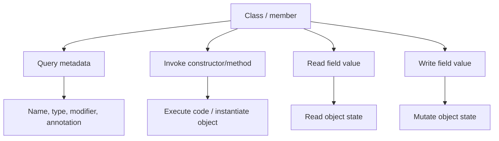

# Distinguishing Member Introspection from Invocation and Read/Write Permissions

> **Chapter:** Reflection  
> **Module:** `SPRING_BOOT_NATIVE_IMAGE`  
> **Objective:** Distinguish querying class/member metadata from executing methods/constructors or reading/writing field values; understand why Native Image requires declaring reflection capabilities separately; know how to express those needs with Spring RuntimeHints and test the exact operations on the native executable.

## 1. Knowing a Member Exists Does Not Mean You Are Allowed to Use It

Java Reflection lets a program observe a class's structure at runtime: which methods, constructors, and fields a class has, and what their names, types, modifiers, and annotations are. Reflection also allows performing certain operations on those members: instantiating objects, calling methods, reading fields, or writing fields.

These two sets of capabilities are related but **not synonymous**:

- **Member introspection/query:** discovering metadata, such as calling `getDeclaredMethods()` to list methods or `getDeclaredField("code")` to look up field metadata.
- **Execution or value access (invoke/read/write):** calling `Method.invoke()`, instantiating an object via `Constructor.newInstance()`, reading via `Field.get()`, or writing via `Field.set()`.

One program may only need to list method names to generate documentation or inspect annotations. Another needs to invoke a method chosen from configuration. A third only reads field values to serialize an object; a fourth also needs to write values back into fields. Each need requires a different permission level.

In a standard JVM environment, class metadata and reflective access are handled dynamically at runtime. With **GraalVM Native Image**, the compiler performs reachability analysis at build time and does not keep every member for every reflection operation by default. Thus, declaring "need to view metadata" does not automatically mean "allowed to invoke method" or "allowed to write field."



## 2. Four Reflection Operations to Distinguish

| Requirement | Typical API | Meaning | Does Not Imply |
|---|---|---|---|
| **Inspect method info** | `getMethod()`, `getDeclaredMethod()`, `getMethods()`, `getDeclaredMethods()` | Obtain `Method` object and metadata | Does not mean the method is allowed to be invoked |
| **Invoke method** | `Method.invoke()` | Execute method on target object or class | Does not mean every other method can be invoked |
| **Inspect field info** | `getField()`, `getDeclaredField()`, `getFields()`, `getDeclaredFields()` | Obtain `Field` object, name, and type | Does not mean values can be read or written |
| **Read/write field** | `Field.get()`, `Field.set()` | Access or modify value on an object | Does not mean every field is accessible |

Constructors also have two similar levels:

- **Introspection:** retrieving metadata via `getDeclaredConstructors()` or `getDeclaredConstructor(...)`.
- **Invocation:** creating an instance via `Constructor.newInstance(...)`.

For example, `getDeclaredMethod("approve")` can return metadata for a private method if the class and metadata are retained appropriately. However, to call the method, the application also needs invocation permission, an appropriate target object (if it is an instance method), and to pass Java/module access checks.

## 3. Java Example: Inspecting a Method vs. Invoking a Method

Suppose there is a business class:

```java
package com.example.payment;

public class PaymentCommand {

    private String reference;

    public PaymentCommand() {
        this.reference = "P-001";
    }

    public String getReference() {
        return this.reference;
    }

    private void approve() {
        System.out.println("Approved: " + this.reference);
    }
}
```

### 3.1. Only Inspecting Method Metadata

```java
Class<?> type = PaymentCommand.class;

for (Method method : type.getDeclaredMethods()) {
    System.out.println(
            method.getName()
            + " / return type: "
            + method.getReturnType().getName()
            + " / modifiers: "
            + Modifier.toString(method.getModifiers()));
}
```

This snippet asks the JVM to provide the metadata list of methods declared directly in the class, including private methods. It does not call `approve()` and does not execute any business logic.

The APIs have different scopes:

- `getMethods()` lists visible public methods, including matching inherited methods.
- `getDeclaredMethods()` lists methods declared directly on the class, without filtering by public/private.
- `getMethod(name, parameterTypes...)` looks up a public method by name and signature.
- `getDeclaredMethod(name, parameterTypes...)` looks up a directly declared method, including non-public ones.

**The result of introspection is descriptive information.** It does not automatically grant permission to execute the method.

### 3.2. Invoking a Method Is a Different Operation

```java
PaymentCommand command = new PaymentCommand();

Method approve = PaymentCommand.class.getDeclaredMethod("approve");

if (!approve.trySetAccessible()) {
    throw new IllegalStateException("Cannot access approve()");
}

approve.invoke(command);
```

This snippet has additional requirements:

1. Find the exact method by name and signature.
2. Have metadata and invocation capability for the method in the running environment.
3. Have a target object because `approve()` is an instance method.
4. Pass Java/module access checks.
5. The method is actually executed; it can mutate state, write logs, call external services, or throw exceptions.

`trySetAccessible()` requests bypassing Java language access checks if the module environment allows it. It returns `false` when deep access cannot be enabled. Calling `setAccessible(true)` is not a way around every security boundary; in the Java module system, accessing private members of an unopened package can be denied.

## 4. Inspecting Field Metadata vs. Reading or Writing Values

Continuing with the `PaymentCommand` class above.

### 4.1. Only Inspecting Field Info

```java
Field field = PaymentCommand.class.getDeclaredField("reference");

System.out.println(field.getName());
System.out.println(field.getType().getName());
System.out.println(Modifier.toString(field.getModifiers()));
```

These lines only inspect the field's name, type, and modifiers. They do not read the `"P-001"` value from an object, nor do they modify data.

### 4.2. Reading a Field Value

```java
PaymentCommand command = new PaymentCommand();
Field field = PaymentCommand.class.getDeclaredField("reference");

if (!field.trySetAccessible()) {
    throw new IllegalStateException("Cannot read reference");
}

Object value = field.get(command);
System.out.println(value);
```

`Field.get(object)` reads the value of the field on a specific instance. For a static field, the target argument is typically ignored or passed as `null`. If the field is not accessible, Java can throw `IllegalAccessException` or reject enabling access earlier.

### 4.3. Writing a Field Value

```java
PaymentCommand command = new PaymentCommand();
Field field = PaymentCommand.class.getDeclaredField("reference");

if (!field.trySetAccessible()) {
    throw new IllegalStateException("Cannot write reference");
}

field.set(command, "P-002");
System.out.println(command.getReference());
```

`Field.set(object, value)` changes object state. It requires the corresponding write permission, compatible data type, and valid access permission. `final` fields, primitive conversions, static fields, or module rules have specific limitations; do not assume every field can be written arbitrarily.

### 4.4. Difference Matrix

| Operation | API | Actual Requirement |
|---|---|---|
| Inspect field name | `getDeclaredField()` + `getName()` | Metadata |
| Inspect field type | `getType()` | Metadata |
| Read value | `get()` | Field read access |
| Write value | `set()` | Field write access |
| Inspect methods | `getDeclaredMethods()` | Method metadata |
| Invoke method | `invoke()` | Method invocation |
| Inspect constructors | `getDeclaredConstructors()` | Constructor metadata |
| Create instance | `newInstance()` on `Constructor` | Constructor invocation |

A serializer framework may need to read fields without writing. A binder/deserializer may need to write fields or call setters. An analysis tool only needs to inspect metadata. **Do not broadly grant write or invocation permissions when the use case only needs query/read.**

## 5. Java Access Checks Still Apply

Whether Native Image retains reflection metadata and whether Java permits accessing a member are two separate issues.

### 5.1. Public, Protected, Package-Private, and Private

- **public:** accessible if the class and package are visible under Java/module rules.
- **protected:** depends on package, inheritance relationship, and how it is accessed.
- **package-private:** accessible only under same-package/corresponding-module rules.
- **private:** directly accessible only within the class; reflection may require opening deep access.

Java language access rules remain in effect in a native executable. Adding reflection metadata does not turn a private member into a public one.

### 5.2. Java Platform Module System (JPMS)

In applications using named modules, distinguish:

- `exports` allows public packages to be accessed by other modules per module rules.
- `opens` allows deep reflective access to the opened package.
- `open module` opens all packages of the module for deep reflection per module system rules.

If a library needs to access a private member of a package inside an unopened module, `trySetAccessible()` may return `false` or `setAccessible(true)` may throw `InaccessibleObjectException`. Native Image runtime hints do not automatically add `opens` to a module descriptor and do not bypass JVM/Java access policies.

**Rule:** check two separate questions: has the native build retained the reflection metadata/operation, and does Java/the module system allow that operation?

## 6. Why Does Native Image Separate Introspection from Invocation/Read/Write?

The HotSpot JVM typically runs with class loading and dynamic reflection handling. Native Image analyzes the program ahead of time under a **closed-world** model: the compiler needs to know which classes/members can be used and how they are accessed.

If the application only needs to inspect method names and annotations, the compiler may only need to retain metadata for queries. If the application also calls the method via reflection, the compiler must know that method requires invocation capability. For fields, keeping metadata to look up a field differs from granting the ability to read or write its value.

A mental model:

| Capability | Meaning in Native Build |
|---|---|
| **Introspection/query** | Retain metadata needed to find and describe the member |
| **Invocation** | Retain ability to invoke constructor/method via reflection |
| **Field read** | Allow accessing the field value at runtime |
| **Field write** | Allow modifying the field value at runtime |

GraalVM Native Image separates reflection metadata into query and invoke groups. Spring AOT provides the `RuntimeHints` API to describe the corresponding needs. If you only declare query, do not assume `Method.invoke()` will work automatically. If you only register method invocation, do not assume every other method/annotation in the class has full metadata for introspection.

Over-broad registration also carries a cost: unnecessary metadata and members can increase image size, expand the code retained, and complicate analysis. Declare only the exact members and operations required.
## 7. Declaring Exact Requirements with Spring RuntimeHints

Spring Framework provides the `RuntimeHints` API to describe dynamic accesses that must be preserved during AOT/native builds. In reflection hints, choose **the exact member and the exact operation type**.

Example with Spring Framework 6+:

```java
import java.lang.reflect.Field;
import java.lang.reflect.Method;

import org.springframework.aot.hint.ExecutableMode;
import org.springframework.aot.hint.MemberCategory;
import org.springframework.aot.hint.RuntimeHints;
import org.springframework.aot.hint.RuntimeHintsRegistrar;

public class PaymentReflectionHints implements RuntimeHintsRegistrar {

    @Override
    public void registerHints(RuntimeHints hints, ClassLoader classLoader) {
        // Only need to inspect metadata of directly declared methods.
        hints.reflection().registerType(
                PaymentCommand.class,
                MemberCategory.INTROSPECT_DECLARED_METHODS);

        try {
            // Only the approve method needs to be invoked via reflection.
            Method approve = PaymentCommand.class.getDeclaredMethod("approve");
            hints.reflection().registerMethod(approve, ExecutableMode.INVOKE);

            // The reference field needs to be read and written via reflection.
            Field reference = PaymentCommand.class.getDeclaredField("reference");
            hints.reflection().registerField(
                    reference,
                    fieldHint -> fieldHint.allowWrite(true));
        }
        catch (NoSuchMethodException | NoSuchFieldException ex) {
            throw new IllegalStateException(
                    "Payment reflection metadata does not match the class", ex);
        }
    }
}
```

Registering the registrar via Spring configuration:

```java
import org.springframework.context.annotation.Configuration;
import org.springframework.context.annotation.ImportRuntimeHints;

@Configuration(proxyBeanMethods = false)
@ImportRuntimeHints(PaymentReflectionHints.class)
class PaymentAotConfiguration {
}
```

Reading the example:

- `INTROSPECT_DECLARED_METHODS` requests metadata to observe directly declared methods. It does not automatically request invoking all those methods.
- `registerMethod(..., ExecutableMode.INVOKE)` specifies that the `approve` method needs to be invoked via reflection.
- `registerField(..., fieldHint -> fieldHint.allowWrite(true))` registers the specific field and enables write operations when needed. If the use case is read-only, do not enable write permission unnecessarily.
- `@ImportRuntimeHints` enables Spring AOT to discover the registrar during configuration processing.

If instantiating via reflection is needed, you must declare invocation capability for the corresponding constructor. For example, for a no-argument constructor invoked via reflection, you can register the specific constructor in `ExecutableMode.INVOKE`. If only listing constructors to inspect metadata, use the corresponding introspection category.

**Note:** API names and hint capabilities must match the Spring Framework/Spring Boot version in use. When writing extensions, check the Javadoc of the actual dependency and verify the metadata generated during build. The example above illustrates operation-specific declaration principles; it does not replace compile verification against your project's version.

### 7.1. Common MemberCategory Groups

| Group | Examples | Meaning |
|---|---|---|
| Introspect constructors | `INTROSPECT_PUBLIC_CONSTRUCTORS`, `INTROSPECT_DECLARED_CONSTRUCTORS` | Inspect constructor metadata |
| Invoke constructors | `INVOKE_PUBLIC_CONSTRUCTORS`, `INVOKE_DECLARED_CONSTRUCTORS` | Instantiate objects via reflection |
| Introspect methods | `INTROSPECT_PUBLIC_METHODS`, `INTROSPECT_DECLARED_METHODS` | Inspect method metadata |
| Invoke methods | `INVOKE_PUBLIC_METHODS`, `INVOKE_DECLARED_METHODS` | Invoke methods via reflection |
| Fields | `PUBLIC_FIELDS`, `DECLARED_FIELDS`, or per-field registration | Declare field metadata; specific field registration can indicate write permission |

Use class-wide categories when the application genuinely needs to operate on many members. If only one method or field is used, registering the specific member usually conveys intent more clearly and reduces unnecessary metadata.

### 7.2. RuntimeHints Do Not Replace Java Access Rules

For instance, a registrar can request keeping metadata for the private method `approve`. That does not mean every module permits accessing private members. If a package belongs to a named module not opened for deep reflection, `trySetAccessible()` can still fail.

Likewise, allowing field writes in native metadata does not turn a `final` field or immutable state into a supported mutation API. Design classes and reflection operations in accordance with Java semantics.

## 8. Native Image Metadata: Query and Invoke Are Two Needs

GraalVM Native Image also distinguishes metadata for **querying** from metadata for **reflective execution**. In reachability metadata, there are query-type declarations allowing member metadata discovery and invoke-type declarations for calling constructors/methods. For fields, metadata also describes read and write capabilities.

Conceptually:

| Goal | Metadata Type to Consider |
|---|---|
| Find class and inspect class info | Type metadata and appropriate query access |
| List declared methods | Query metadata for declared methods |
| Invoke a specific method | Invocation metadata for that method |
| List constructors | Query metadata for constructors |
| Create object via constructor reflection | Invocation metadata for the constructor |
| Find field and inspect type/modifiers | Field metadata for introspection |
| Read field value | Corresponding field read permission |
| Write field value | Corresponding field write permission |

A query-only configuration is not shorthand for full reflection access. Conversely, registering invoke on one method does not mean every other method in the same class can be called dynamically.

If using GraalVM reachability metadata JSON directly, use the schema for your exact GraalVM version and choose the corresponding query/invoke or field write flags. Do not copy old metadata from another project without checking the schema. In Spring Boot applications, prefer expressing needs via Spring RuntimeHints when an appropriate API exists so metadata integrates cleanly into the AOT pipeline.

### 8.1. Why Should You Not Register All Reflection?

Registering all declared methods, constructors, and fields can cause the native image to retain far more metadata and access surface than actually required. This:

- Increases the amount of metadata to process.
- Can widen the set of members kept in the binary.
- Makes it hard during code review to identify which members are truly needed.
- Creates extra dynamic access surface that needs to be controlled.

Start from the concrete operation in code: query, invoke, field read, or field write. Then register the smallest scope that meets the requirement.

## 9. Designing Separate Tests for Each Operation

Do not write one generic "reflection works" test and conclude every capability functions. Split tests by behavior:

| Test | Action | What Needs to Be Proven |
|---|---|---|
| T1 — Method introspection | Call `getDeclaredMethods()` and find `approve` | Required method metadata is present |
| T2 — Method invocation | Call `Method.invoke()` on target | Method is retained for invocation and access is valid |
| T3 — Constructor introspection | Call `getDeclaredConstructors()` | Constructor metadata to inspect is present |
| T4 — Constructor invocation | Call `Constructor.newInstance()` | Constructor is retained for invocation |
| T5 — Field introspection | Call `getDeclaredField("reference")`, inspect name/type | Field metadata is present |
| T6 — Field read | Call `Field.get(target)` | Field value can be read |
| T7 — Field write | Call `Field.set(target, value)` | Write permission exists and new value is stored |
| T8 — Access control | Attempt deep reflection on an unopened package/module | Application handles access denial as expected |

### 9.1. Testing Method Metadata

A test can confirm the method is found:

```java
Method approve = PaymentCommand.class.getDeclaredMethod("approve");

assertThat(approve.getName()).isEqualTo("approve");
assertThat(Modifier.isPrivate(approve.getModifiers())).isTrue();
```

This test proves query metadata only. It **does not prove** `approve.invoke(command)` works.

### 9.2. Testing Invocation

```java
PaymentCommand command = new PaymentCommand();
Method approve = PaymentCommand.class.getDeclaredMethod("approve");

assertThat(approve.trySetAccessible()).isTrue();
assertThatCode(() -> approve.invoke(command)).doesNotThrowAnyException();
```

This test checks invocation along with access behavior. In a real application, also assert side effects or business outcomes rather than only asserting no exception was thrown.

### 9.3. Testing Field Read/Write

```java
PaymentCommand command = new PaymentCommand();
Field reference = PaymentCommand.class.getDeclaredField("reference");

assertThat(reference.trySetAccessible()).isTrue();
assertThat(reference.get(command)).isEqualTo("P-001");

reference.set(command, "P-002");
assertThat(command.getReference()).isEqualTo("P-002");
```

Separate read and write tests if the application only needs one of them. If you only test `Field.get()`, you cannot conclude `Field.set()` is also permitted.

### 9.4. Running Tests on the Native Executable

Unit tests run in Surefire/Gradle test tasks typically execute on the JVM. They do not prove native metadata is correct. You must run integration tests or a test harness against the built native binary:

1. Build the native executable with Spring AOT and RuntimeHints.
2. Launch the binary in the test environment.
3. Call the endpoint or use case that performs the reflection operation.
4. Assert the exact member is found, invoked, read, or written.
5. Record error logs and build metadata if the operation fails.
6. Re-run the same test on the JVM JAR to compare and isolate the issue.

You can use Spring Native/AOT test support and test configurations appropriate for your project version. What matters is that the final test target must be the **native executable**, not just test classes on the JVM.

## 10. Error Cases and How to Read Symptoms

| Symptom | Possible Cause | What to Check |
|---|---|---|
| JVM finds method, native cannot find metadata | Method was not declared for introspection or class was not retained | RuntimeHints and native reachability metadata |
| JVM invokes method, native fails on invoke | Only query metadata was registered; invocation metadata is missing | `ExecutableMode.INVOKE` or invoke category |
| `getDeclaredMethods()` does not return all methods | Query metadata does not cover the methods to list | Introspection category and correct declared/public scope |
| Field found, but `Field.get()` fails | Value access not permitted or access check failed | Field registration, Java access, and module openness |
| Field read works, but `Field.set()` fails | Metadata does not permit write, field is final, or Java access rule | Field write hint, modifiers, and class design |
| `trySetAccessible()` returns false | Java/module does not permit deep reflection | Whether package is opened by module policy |
| `InaccessibleObjectException` | Attempted to open a member in a disallowed package/module | JPMS, `opens`, and dependencies |
| Native build succeeds, but reflection feature fails | Reflection branch was not tested or hints are missing | Exercise the exact use case on the binary |
| Added hints, but still failing | Registrar not discovered by AOT, metadata not used by build, or wrong member declared | `@ImportRuntimeHints`, AOT logs, and metadata output |

Exact exception names and how Native Image reports missing registrations may vary by GraalVM version. Rely on the binary's stack trace and check the exact operation type instead of adding all reflection metadata by guesswork.

## 11. Misconceptions to Avoid

**"Getting a `Method` means I can call the method."** False. `Method` is an object describing the member. `Method.invoke()` is a separate execution operation requiring invocation metadata and appropriate access permissions.

**"If `getDeclaredFields()` succeeds, both `Field.get()` and `Field.set()` work."** False. Listing fields does not prove permission was granted to read/write values.

**"Registering invocation automatically opens private packages."** False. RuntimeHints do not disable Java language access or JPMS. Metadata and access permission are two separate conditions.

**"Field read and field write are the same."** False. A framework may only need to read fields; write operations require permission and can be constrained by final semantics.

**"Once reflection is declared for a class, every member is supported."** False. You must check which specific category or member was registered and which operation the code actually performs.

**"Adding all reflection metadata is safer."** Not necessarily. Broad metadata increases the access surface, retains unnecessary members, and complicates reviews.

## 12. Workflow for Handling a Reflection Error in a Spring Boot Native Image App

When a feature runs on the JVM but fails on native, work through this sequence:

1. **Find the exact failing API:** `getDeclaredMethod`, `Method.invoke`, `Field.get`, `Field.set`, or `Constructor.newInstance`.
2. **Classify the operation:** metadata query only, invoke, field read, or field write.
3. **Inspect the member:** class, name, parameter types, visibility, and actual module/package.
4. **Check Java access:** is deep reflection needed, is the package opened, what does `trySetAccessible()` return.
5. **Check AOT hints:** was the registrar discovered, are categories/methods/fields declared accurately.
6. **Rebuild native:** RuntimeHints changes must go through Spring AOT and Native Image compilation.
7. **Test the exact operation on the binary:** separate query tests, invoke tests, and read/write tests.
8. **Narrow metadata:** remove permissions no longer needed, keeping the minimal declaration for the use case.

Do not treat adding a hint and getting a successful build as completion. The required proof is the **actual reflection operation** running successfully on the native executable under expected deployment conditions.

## 13. Design and Testing Checklist

- [ ] Clearly listed classes/members accessed via reflection.
- [ ] Distinguished introspection/query from method/constructor invocation.
- [ ] Distinguished inspecting field metadata from reading values and writing values.
- [ ] Registered only needed members/categories in Spring RuntimeHints.
- [ ] If using field write, declared the corresponding write permission.
- [ ] Checked public/private, package visibility, and JPMS access.
- [ ] Did not assume Native Image hints can bypass Java module access checks.
- [ ] Confirmed `RuntimeHintsRegistrar` is discovered by Spring AOT.
- [ ] Rebuilt native after modifying hints.
- [ ] Executed separate introspection, invocation, field read, and field write tests on the binary.
- [ ] Tested access-denied cases as well.
- [ ] Avoided registering full reflection when the application only needs a few members.

## 14. Takeaways

**Inspecting member info is one operation; calling methods/constructors or reading/writing fields are different operations.** Reflection metadata only answers what the program can discover about classes/members. Invocation and field access require additional capabilities while still obeying Java and module system access rules.

In Spring Boot Native Image, express the exact need via Spring RuntimeHints or GraalVM reachability metadata: query when inspecting metadata, invoke when calling, field read when reading, and field write when modifying. Then test each behavior on the native executable itself. This approach avoids missing metadata at runtime and avoids retaining reflection permissions the application never uses.

### References

- [Spring Framework — Runtime Hints](https://docs.spring.io/spring-framework/reference/core/aot.html)
- [Spring Framework Javadoc — RuntimeHints](https://docs.spring.io/spring-framework/docs/current/javadoc-api/org/springframework/aot/hint/RuntimeHints.html)
- [Spring Framework Javadoc — MemberCategory](https://docs.spring.io/spring-framework/docs/current/javadoc-api/org/springframework/aot/hint/MemberCategory.html)
- [Java Platform — AccessibleObject](https://docs.oracle.com/en/java/javase/21/docs/api/java.base/java/lang/reflect/AccessibleObject.html)
- [Java Platform — Method](https://docs.oracle.com/en/java/javase/21/docs/api/java.base/java/lang/reflect/Method.html)
- [Java Platform — Field](https://docs.oracle.com/en/java/javase/21/docs/api/java.base/java/lang/reflect/Field.html)
- [GraalVM Native Image — Reachability Metadata](https://www.graalvm.org/latest/reference-manual/native-image/metadata/)
