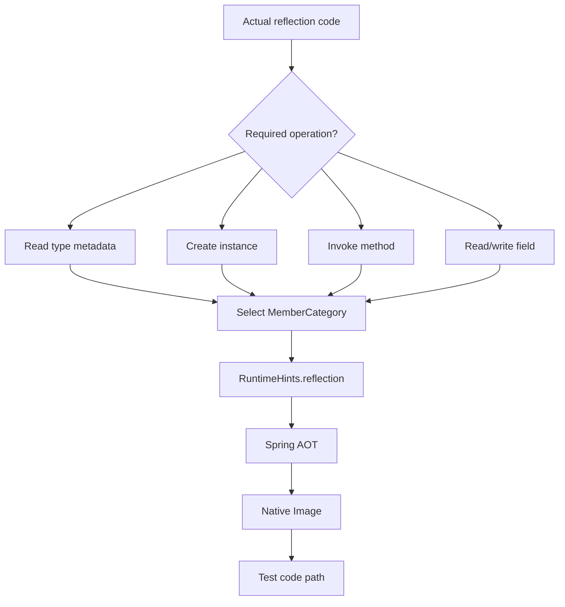

# MemberCategory and Choosing the Appropriate Declaration Scope

## 1. Why Is Choosing the Right MemberCategory Important?

When a Spring Boot application uses reflection, GraalVM Native Image needs to know which classes and members must be retained for runtime access. Spring AOT provides the `RuntimeHints.reflection()` API; one way to declare this is registering a type together with **MemberCategory** values describing the group of reflection operations the application requires.

Choosing too narrow a category can cause the native executable to fail—for instance, not finding a constructor or method when that code path executes. Choosing too broad a category can retain unnecessary metadata and members, increasing image size and obscuring configuration intent during reviews.

In the **SPRING_BOOT_NATIVE_IMAGE** module, treat `MemberCategory` as an explicit contract between reflection-using code and Native Image analysis. Start from the actual operation: metadata introspection only, object instantiation, method invocation, field read, or field write.



## 2. Which Access Permission Groups Does MemberCategory Describe?

Spring AOT provides the `org.springframework.aot.hint.MemberCategory` enum to specify groups of members to support. Common categories include:

| Category | Practical Meaning |
|---|---|
| `INTROSPECT_PUBLIC_CONSTRUCTORS` | Allows metadata introspection of public constructors |
| `INVOKE_PUBLIC_CONSTRUCTORS` | Allows invoking public constructors via reflection |
| `INTROSPECT_DECLARED_CONSTRUCTORS` | Introspects constructors declared directly on the class |
| `INVOKE_DECLARED_CONSTRUCTORS` | Invokes constructors declared directly on the class |
| `INTROSPECT_PUBLIC_METHODS` | Introspects public methods |
| `INVOKE_PUBLIC_METHODS` | Invokes public methods via reflection |
| `INTROSPECT_DECLARED_METHODS` | Introspects methods declared directly on the class |
| `INVOKE_DECLARED_METHODS` | Invokes methods declared directly on the class |
| `INTROSPECT_PUBLIC_FIELDS` | Introspects public fields |
| `ALLOW_PUBLIC_FIELD_GET` | Reads public fields via reflection |
| `ALLOW_PUBLIC_FIELD_SET` | Writes public fields via reflection |
| `INTROSPECT_DECLARED_FIELDS` | Introspects fields declared directly on the class |
| `ALLOW_DECLARED_FIELD_GET` | Reads fields declared directly on the class |
| `ALLOW_DECLARED_FIELD_SET` | Writes fields declared directly on the class |
| `DECLARED_CLASSES` | Accesses nested/declared class info as supported |

The exact names and scopes of categories must be verified against the Spring Framework version used by the project. Categories may change across versions. Do not infer that `INVOKE_PUBLIC_METHODS` implies access to all private methods or that registering a type automatically opens every member.

## 3. Introspection vs. Invocation

Two key category groups are **INTROSPECT** and **INVOKE/ALLOW**.

- Introspection serves structural discovery: retrieving lists of constructors, methods, fields, modifiers, annotations, or signatures.
- Invocation/access serves action: calling constructors/methods, reading fields, or writing fields.

Example of a library that only reads method names to render API documentation:

```java
for (Method method : Plugin.class.getDeclaredMethods()) {
    System.out.println(method.getName());
}
```

This case requires method metadata introspection. If the application also invokes the method via `Method.invoke`, appropriate invocation permission is needed.

Method invocation example:

```java
Method method = plugin.getClass().getMethod("execute", String.class);
Object result = method.invoke(plugin, payload);
```

Registering `INTROSPECT_PUBLIC_METHODS` alone should not be considered sufficient for invocation. Conversely, if code only calls the method directly using Java syntax, there is no need to open reflection invocation simply because the method exists.

## 4. Constructors: Introspect or Invoke?

Suppose a plugin is instantiated via reflection:

```java
Class<?> type = Class.forName("com.example.plugins.CsvPlugin");
Constructor<?> constructor = type.getDeclaredConstructor();
Object plugin = constructor.newInstance();
```

The code needs to look up the constructor and invoke it. If the constructor is public, the corresponding category can be `INVOKE_PUBLIC_CONSTRUCTORS`; if accessing a directly declared constructor regardless of visibility is needed, consider `INVOKE_DECLARED_CONSTRUCTORS` alongside Java access/module constraints.

`RuntimeHints` example:

```java
hints.reflection().registerType(
    CsvPlugin.class,
    MemberCategory.INVOKE_PUBLIC_CONSTRUCTORS
);
```

If a library only inspects constructor signatures without creating instances, use the matching introspection category. Do not register both public and declared constructors if code does not need both.

## 5. Methods: Public vs. Declared

`getMethod` searches public methods, including inherited public methods; `getDeclaredMethod` searches methods declared directly on the class and can return non-public methods.

```java
Method publicMethod = type.getMethod("execute", String.class);
Method declaredMethod = type.getDeclaredMethod("validateInternal", String.class);
```

If the application invokes public methods via reflection, `INVOKE_PUBLIC_METHODS` is usually the category to consider. If invoking directly declared methods including private/protected ones, consider `INVOKE_DECLARED_METHODS` and access rules.

Do not register declared methods just to invoke a single public method. The declared category can cover a broader scope and retain unnecessary metadata. For cases needing only one signature, declaring the specific method can be more precise.

## 6. Fields: Reading and Writing Are Two Distinct Permissions

Example of a mapper reading a field:

```java
Field field = CustomerRecord.class.getDeclaredField("customerId");
Object value = field.get(customer);
```

Example of a binder writing a field:

```java
Field field = CustomerRecord.class.getDeclaredField("status");
field.set(customer, "ACTIVE");
```

Reading and writing can require different categories:

- `ALLOW_DECLARED_FIELD_GET`: read directly declared fields.
- `ALLOW_DECLARED_FIELD_SET`: write directly declared fields.
- `ALLOW_PUBLIC_FIELD_GET` and `ALLOW_PUBLIC_FIELD_SET`: corresponding public scope.

If code only calls `Field.get`, do not automatically grant set permission. If a field is `final`, static, or restricted by Java module access, categories do not remove all language/runtime constraints.

## 7. Registering Categories with Spring RuntimeHints

Example of a class instantiated via a public constructor and whose public method is invoked:

```java
public class CsvPlugin {
    public CsvPlugin() {
    }

    public String execute(String input) {
        return "csv:" + input;
    }
}
```

Registrar:

```java
public class PluginHints implements RuntimeHintsRegistrar {

    @Override
    public void registerHints(RuntimeHints hints, ClassLoader classLoader) {
        hints.reflection().registerType(
            CsvPlugin.class,
            MemberCategory.INVOKE_PUBLIC_CONSTRUCTORS,
            MemberCategory.INVOKE_PUBLIC_METHODS
        );
    }
}
```

Registering the registrar in Spring configuration:

```java
@Configuration
@ImportRuntimeHints(PluginHints.class)
class PluginConfiguration {
}
```

Import the corresponding Spring APIs and confirm the registrar is invoked during AOT. If the class is chosen by a runtime name, ensure the class is reachable and registered; `MemberCategory` does not automatically bring a dependency missing from the runtime classpath into the executable.

## 8. When Should Specific Member Declarations Be Used?

`MemberCategory` is convenient when a library truly needs a broad group of members, such as invoking many public methods under a contract. However, if only one constructor and one method are needed, specific members can be declared via the builder API.

Directional example:

```java
hints.reflection().registerType(
    CsvPlugin.class,
    typeHint -> typeHint
        .withConstructor(new Class<?>[0], ExecutableMode.INVOKE)
        .withMethod(
            "execute",
            List.of(String.class),
            ExecutableMode.INVOKE
        )
);
```

The builder API, `ExecutableMode` enum, and imports depend on the Spring Framework version. Check the Javadoc of the project's dependency and run compile tests before using. The idea is to describe the exact signature to invoke instead of granting permission to an entire method group.

| Case | Appropriate Declaration |
|---|---|
| Multiple public constructors are invoked | `INVOKE_PUBLIC_CONSTRUCTORS` |
| Only one constructor with a fixed signature | Specific member |
| Need to introspect list of public methods | `INTROSPECT_PUBLIC_METHODS` |
| Invoke a single public method | Specific method member or appropriate public category |
| Only read one directly declared field | Specific field GET / corresponding category |
| Need to read and write multiple declared fields | Both corresponding GET/SET categories if genuinely needed |

## 9. Avoid Over-Registering All Members

An overly broad declaration can look convenient:

```java
hints.reflection().registerType(
    CsvPlugin.class,
    MemberCategory.values()
);
```

This should not be the default choice. It can widen reflection scope far beyond actual code paths, retain extra metadata, and make it hard for reviewers to see why each member is needed. Some categories also differ in scope across framework versions.

Instead:

1. Find the reflection APIs actually called.
2. Identify the specific classes, constructors, methods, and fields.
3. Distinguish introspection from invoke/get/set.
4. Choose the smallest category that satisfies the behavior.
5. If only one member is needed, use specific member declarations when the API supports it.
6. Run native tests to confirm.

## 10. Distinguishing MemberCategory from GraalVM Reachability Metadata

Spring `RuntimeHints` is a Spring AOT abstraction. GraalVM Native Image also has its own reachability metadata format, typically provided via JSON files in libraries or applications.

The two mechanisms have similar goals, but different APIs/schemas:

- Spring `RuntimeHints` is collected and forwarded by Spring AOT according to framework integration.
- GraalVM reachability metadata directly describes what must be retained for Native Image per GraalVM's schema.

Do not copy `MemberCategory` names into GraalVM JSON as if they were the same format. If a library supports both Spring AOT and pure Native Image, it can provide both appropriate metadata formats, while checking to avoid duplication and version incompatibility.

## 11. Testing Category Scope

Registrar unit tests should verify that the right types and hints are registered. Example:

```java
@Test
void registersOnlyRequiredPluginHints() {
    RuntimeHints hints = new RuntimeHints();

    new PluginHints().registerHints(hints, getClass().getClassLoader());

    assertThat(hints.reflection().getTypeHint(CsvPlugin.class))
        .isPresent();
}
```

This test confirms the type hint exists, but does not yet prove the specific category grants the intended permissions. Depending on the Spring Framework version, you can use hint query APIs or `RuntimeHintsPredicates` to test specific constructor/method invocations.

Next, integration tests on Native Image are required:

1. Run Spring AOT with the registered registrar.
2. Build the native executable.
3. Call the code path that instantiates the plugin and invokes the method.
4. Attempt an unpermitted operation to confirm the scope is controlled (if appropriate for testing).
5. Inspect logs and runtime errors.

Do not run only JVM unit tests and conclude Native Image metadata is correct.

## 12. Common Errors

| Symptom | Possible Cause | How to Handle |
|---|---|---|
| Constructor cannot be instantiated | Registered introspection only, but invoke is required | Choose constructor invocation category |
| Method found, but invoke fails | Missing invoke permission or wrong signature | Check public/declared and parameters |
| Field read succeeds, but write fails | Registered GET only, missing SET, or field cannot be written | Identify operation and field semantics |
| Private method cannot be accessed | Registered public methods only or restricted by Java access | Check declared method hints and module access |
| Native build succeeds, but runtime fails | Missing hints for untested code path | Add tests and properly scoped metadata |
| Image size grows after adding hints | Over-broad registration | Narrow categories/members |
| Registrar has no effect | Not imported/registered or AOT used stale artifacts | Verify AOT discovery and rebuild |

## 13. Checklist for Choosing MemberCategory

- Identify which classes are accessed via reflection.
- Distinguish public from declared members.
- Distinguish introspection from invoke.
- For fields, distinguish GET and SET.
- Register only categories needed for actual behavior.
- Use member-specific hints when scope is small and the API supports it.
- Check Java module/access restrictions separately.
- Ensure `RuntimeHintsRegistrar` is discovered by Spring AOT.
- Test on the native executable and record Spring/GraalVM versions.

## 14. Self-Check Questions

1. What is the difference between `INTROSPECT_PUBLIC_METHODS` and `INVOKE_PUBLIC_METHODS`?
2. Why might `getDeclaredMethod` require a different metadata scope than `getMethod`?
3. When code only reads a field, why should write permission not be registered?
4. When is `MemberCategory` more convenient than declaring individual members?
5. Why should `MemberCategory.values()` not be the default choice?
6. How do Spring `RuntimeHints` and GraalVM reachability metadata differ?
7. How do you confirm the chosen category works on the native executable?

**Key takeaway:** `MemberCategory` expresses **the group of reflection operations that need to be supported**. Distinguish introspection/invocation, public/declared, and field get/set; choose the smallest appropriate scope, then verify via AOT and native integration tests.
