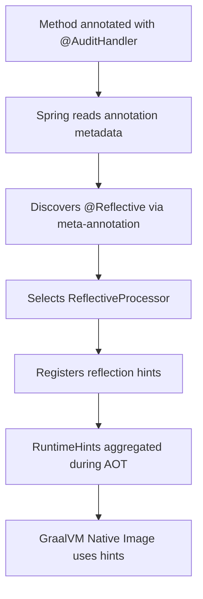

# @Reflective and Related Annotation Processing Mechanisms

When compiling a Spring Boot application into a **GraalVM Native Image**, code that invokes reflection must be described upfront so Native Image knows which types, constructors, fields, or methods to preserve. Spring Framework provides **`@Reflective`** as a way to declare directly on an annotation, class, constructor, field, or method that the element has reflection requirements. During Spring AOT, this mechanism is discovered and converted into **runtime hints** for native compilation.

`@Reflective` also supports **meta-annotations** and custom `ReflectiveProcessor` processors. This lets libraries define their own domain annotations and attach the corresponding logic to generate reflection hints. Related annotations such as `@ReflectiveScan`, `@RegisterReflection`, and `@RegisterReflectionForBinding` extend how reflection needs are discovered and declared.

## 1. Learning Objectives

After this lesson, you will be able to:

- Explain how `@Reflective` marks reflection needs for a Java element.
- Distinguish an annotation applied directly from an annotation used via a meta-annotation.
- Describe how Spring AOT discovers annotations and generates reflection hints.
- Use `@ReflectiveScan` to scan packages for elements needing reflection outside standard Spring beans.
- Choose `@RegisterReflection` or `@RegisterReflectionForBinding` for common reflection declaration cases.
- Write a custom `ReflectiveProcessor` to translate library-specific annotations into hints.
- Distinguish Spring's `ReflectiveProcessor` from a Java compile-time annotation processor.
- Test runtime hints before building a Native Image.

## 2. Why Is @Reflective Needed?

On a standard JVM, many libraries can use Java Reflection to look up classes by name, retrieve constructors, read fields, call methods, or inspect annotations. The JVM can load and inspect those components on demand at runtime.

Native Image performs reachability analysis during the build phase. Components accessed only indirectly via reflection may not be fully recognized without appropriate metadata. When running the binary, the application can fail even though the exact same code flow works on the JVM.

For example, a small framework finds methods annotated with `@AuditHandler` and invokes them via reflection:

```java
Method handler = target.getClass()
    .getDeclaredMethod("handle", AuditEvent.class);
handler.setAccessible(true);
handler.invoke(target, event);
```

On the JVM, this code can run if the class and method are present, access permissions match, and no other restrictions apply. With Native Image, it must be declared that this method must be invocable via reflection. `@Reflective` provides a declaration point for Spring AOT to collect this requirement.

**A reflection hint is not reflection execution code.** The annotation does not invoke methods itself, does not create proxies, and does not turn dynamic code into static code. It tells AOT/native compilation which access permissions must be preserved.

## 3. What Is @Reflective?

`@Reflective` belongs to the package:

```java
org.springframework.aot.hint.annotation.Reflective
```

This annotation was introduced in Spring Framework 6.0. Its key characteristics are:

| Attribute | Meaning |
| --- | --- |
| `@Target` | Can be placed on annotation types, classes, constructors, fields, and methods |
| `@Retention(RUNTIME)` | Present in runtime metadata so Spring can discover it during AOT processing |
| `processors` | List of `ReflectiveProcessor` implementations invoked for the marked element |
| `value` | Alias for `processors` |
| Default processor | `SimpleReflectiveProcessor` |

Shorthand declaration:

```java
@Reflective
public @interface SomeReflectiveMarker {
}
```

When discovered within AOT scope, the annotation signals that the corresponding element has reflection needs. By default, Spring uses `SimpleReflectiveProcessor` to register a reflection hint for the marked element. For a method that must be called via reflection, the appropriate hint is **method invocation** capability.

### 3.1. @Reflective Does Not Automatically Register Every Member of a Class

A common misconception is thinking that placing `@Reflective` on a class automatically permits all reflection operations across the entire class, nested classes, and all related DTO types. You must determine the exact element and actual access type:

- Invoking a method via reflection requires an invocation hint for that method.
- Instantiating an object via reflection requires a hint for the matching constructor.
- Reading/writing a field requires a hint for the field and appropriate access mode.
- Using reflection to bind/serialize a DTO may require constructors, fields, properties, and record components.
- Using JDK dynamic proxies requires corresponding proxy hints; a regular reflection hint does not substitute for a proxy hint.

If a method is marked, yet code also accesses a DTO via reflection for binding, additional hints for the DTO must be registered according to actual needs.

### 3.2. Spring Beans Are Inspected by Default

By default, Spring beans are inspected when Spring AOT processes `@Reflective`. Thus, if the annotation appears on a method of a Spring component, AOT can discover it without manually scanning entire packages.

For example, Spring's `@EventListener` is meta-annotated with `@Reflective` because Spring invokes listener methods reflectively. Users do not need to manually add `@Reflective` to every `@EventListener` method when the framework already provides the proper metadata.

```java
import org.springframework.context.event.EventListener;
import org.springframework.stereotype.Component;

record OrderCreated(String orderId) {
}

@Component
class OrderEventHandler {
    @EventListener
    public void onOrderCreated(OrderCreated event) {
        System.out.println(event.orderId());
    }
}
```

This is an example of a Spring annotation that is already prepared. When using annotations from third-party libraries, do not assume the annotation already carries the `@Reflective` meta-annotation; verify the library's documentation or metadata.

## 4. Meta-Annotations and Composed Annotations

Spring supports a multi-layered annotation model. One annotation can be placed on another annotation; the outer annotation is called a **meta-annotation** of the annotation that uses it.

Example:

```java
@Target(ElementType.METHOD)
@Retention(RetentionPolicy.RUNTIME)
@Reflective
public @interface AuditHandler {
}
```

When a method uses `@AuditHandler`, Spring AOT can recognize `@Reflective` through the meta-annotation:

```java
@Component
class AuditEventHandler {
    @AuditHandler
    public void handle(AuditEvent event) {
        // Handle audit event.
    }
}
```

High-level processing flow:



The important point is that `@Reflective` does not have to appear directly on the method. It can sit on the annotation type that the method uses. This is how libraries encapsulate a reflection contract into their own domain annotations.

### 4.1. Role of the Spring Merged Annotation Model

Spring has an annotation-reading mechanism that supports meta-annotations, composed annotations, and mapped attributes. Therefore, when designing custom annotations:

- Use `@Retention(RetentionPolicy.RUNTIME)` so the annotation can be read during AOT processing.
- Choose `@Target` appropriate to where it is applied.
- Place `@Reflective` on the annotation type if every element using that annotation shares the same reflection policy.
- Use `@AliasFor` when attribute mapping is needed between a composed annotation and a meta-annotation.
- Test multi-level nested annotation cases rather than assuming plain Java annotation reflection always matches how Spring resolves annotations.

Not every annotation in an application needs `@Reflective`. Mark only places with an actual reflection contract; annotations used purely for static configuration or direct code processing typically do not need extra hints.

## 5. @ReflectiveScan for Scanning Types Outside Spring Beans

By default, Spring AOT inspects Spring beans. If a library has non-bean classes containing annotations that need reflection, `@ReflectiveScan` can be used.

`@ReflectiveScan` belongs to the package:

```java
org.springframework.context.annotation.ReflectiveScan
```

This annotation was introduced in Spring Framework 6.2. It instructs AOT to deeply scan specified packages for `@Reflective`, either directly or via meta-annotations.

Example:

```java
import org.springframework.context.annotation.Configuration;
import org.springframework.context.annotation.ReflectiveScan;

@Configuration(proxyBeanMethods = false)
@ReflectiveScan("com.example.audit.handlers")
class AuditReflectionConfiguration {
}
```

A marker class can be used to avoid string-based package names:

```java
@Configuration(proxyBeanMethods = false)
@ReflectiveScan(basePackageClasses = AuditHandlerPackage.class)
class AuditReflectionConfiguration {
}

// Place marker class in the package to scan.
final class AuditHandlerPackage {
}
```

Inside a scanned package, a type does not need `@Reflective` at the class level to be considered. Scanning traverses classes, constructors, methods, fields, and nested elements; Spring checks `@Reflective` directly or as a meta-annotation. Scanning occurs **during AOT processing**, not as a new package scan at native runtime.

### 5.1. Scan Scope and Cost

| Declaration | Scope |
| --- | --- |
| Without `@ReflectiveScan` | Spring beans within default AOT processing scope |
| `@ReflectiveScan("com.example.audit")` | Specified package and its subpackages |
| `@ReflectiveScan(basePackageClasses = Marker.class)` | Package containing the marker class and its subpackages |
| `@ReflectiveScan` with no package specified | Recursive scan from the package of the class declaring the annotation |

Choose narrow packages containing the handlers to process. Scanning an entire large library package can increase AOT duration, load many classes, and generate unnecessary hints. Classes to scan must be present on the build classpath.

## 6. Specialized Annotations: @RegisterReflection and @RegisterReflectionForBinding

Spring provides specialized annotations to avoid writing custom processors for common reflection needs.

### 6.1. @RegisterReflection

`@RegisterReflection` is a specialization of `@Reflective`. It lets you declare one or more target types and the member categories needing reflection.

Example:

```java
import org.springframework.aot.hint.MemberCategory;
import org.springframework.aot.hint.annotation.RegisterReflection;
import org.springframework.context.annotation.Configuration;

@Configuration(proxyBeanMethods = false)
@RegisterReflection(
    classes = LegacyAccountService.class,
    memberCategories = {
        MemberCategory.INVOKE_PUBLIC_CONSTRUCTORS,
        MemberCategory.INVOKE_PUBLIC_METHODS
    }
)
class LegacyReflectionConfiguration {
}
```

In this example, AOT registers the requirement to invoke public constructors and public methods of `LegacyAccountService` via reflection. Choose categories matching actual operations; there is no need to grant reflection permission to all members if the application only calls a few methods.

`@RegisterReflection` can be placed on a class or method to clearly indicate where the need originates. It can also serve as a meta-annotation when a library wants a composed annotation for a specific use case.

### 6.2. @RegisterReflectionForBinding

`@RegisterReflectionForBinding` is suited for reflection-based data binding or serialization. It registers the hints needed for constructors, fields, properties, and record components of the declared type; types referenced across properties/record components may also be processed recursively.

Example of a DTO that Spring cannot infer directly from an endpoint/controller:

```java
import org.springframework.aot.hint.annotation.RegisterReflectionForBinding;
import org.springframework.stereotype.Component;

record InvoiceLine(String sku, int quantity) {
}

record InvoicePayload(String invoiceId, InvoiceLine line) {
}

@Component
class ExternalInvoiceClient {
    @RegisterReflectionForBinding(InvoicePayload.class)
    public void submit(InvoicePayload payload) {
        // Send payload via HTTP client or serializer.
    }
}
```

When a DTO is used in request/response types that Spring Web can already infer from controller signatures, the framework can register the needed hints automatically. This annotation is useful when the type appears only inside a method body, a client call, or a binding flow that AOT cannot infer from the web contract.

### 6.3. Quick Comparison

| Annotation | Purpose | When to Use |
| --- | --- | --- |
| `@Reflective` | Marks an element needing reflection; can specify a processor | Annotations, methods, constructors, fields, or types with a custom reflection contract |
| `@ReflectiveScan` | Scans packages for elements using `@Reflective` | Non-Spring-bean types need processing |
| `@RegisterReflection` | Declares reflection for classes and member categories | Need access to constructors/methods/fields by defined category |
| `@RegisterReflectionForBinding` | Registers hints for binding/serialization of DTOs and related types | DTO is accessed via a reflection-based serializer or binder |

These annotations work together but do not replace one another. `@ReflectiveScan` only widens discovery scope; `@RegisterReflection` and `@RegisterReflectionForBinding` describe the type of reflection required; `@Reflective` serves as the marker and processor selector.

## 7. What Is ReflectiveProcessor?

`ReflectiveProcessor` is a Spring interface in the `org.springframework.aot.hint.annotation` package. It receives:

- `ReflectionHints`: the object used to register reflection requirements.
- `AnnotatedElement`: the Java element being processed, such as a class, method, field, constructor, or annotation type.

Method contract:

```java
void registerReflectionHints(
    ReflectionHints hints,
    AnnotatedElement element
);
```

Spring invokes the processor declared in the `processors` attribute of `@Reflective`. The default processor is `SimpleReflectiveProcessor`. Libraries can provide custom processors to read annotation attributes and register hints for related elements.

### 7.1. Custom Annotation Example

Suppose a library defines `@NativeEndpoint` to mark methods invoked via reflection. The annotation also has an `exposedTypes` attribute containing types requiring public constructors.

```java
import java.lang.annotation.Documented;
import java.lang.annotation.ElementType;
import java.lang.annotation.Retention;
import java.lang.annotation.RetentionPolicy;
import java.lang.annotation.Target;

import org.springframework.aot.hint.annotation.Reflective;

@Target(ElementType.METHOD)
@Retention(RetentionPolicy.RUNTIME)
@Documented
@Reflective(processors = NativeEndpointReflectiveProcessor.class)
public @interface NativeEndpoint {
    Class<?>[] exposedTypes() default {};
}
```

### 7.2. Writing the Processor

```java
import java.lang.reflect.AnnotatedElement;
import java.lang.reflect.Method;

import org.springframework.aot.hint.ExecutableMode;
import org.springframework.aot.hint.MemberCategory;
import org.springframework.aot.hint.ReflectionHints;
import org.springframework.aot.hint.annotation.ReflectiveProcessor;

public final class NativeEndpointReflectiveProcessor
        implements ReflectiveProcessor {

    @Override
    public void registerReflectionHints(
            ReflectionHints hints, AnnotatedElement element) {

        if (!(element instanceof Method method)) {
            return;
        }

        // Method invoked by the framework via reflection.
        hints.registerMethod(method, ExecutableMode.INVOKE);

        NativeEndpoint annotation =
                method.getAnnotation(NativeEndpoint.class);

        if (annotation != null) {
            for (Class<?> exposedType : annotation.exposedTypes()) {
                // Only allow invoking public constructors of the declared types.
                hints.registerType(
                    exposedType,
                    MemberCategory.INVOKE_PUBLIC_CONSTRUCTORS
                );
            }
        }
    }
}
```

The processor checks the element type, registers an invocation hint for the method, and reads the annotation attribute to additionally register public constructors for the exposed types. If the annotation is placed on something other than a method, the processor skips it rather than assuming the element is always a method.

### 7.3. Using the Annotation in a Bean

```java
import org.springframework.stereotype.Component;

record AuditPayload(String actor, String action) {
}

@Component
class AuditEndpointHandler {
    @NativeEndpoint(exposedTypes = AuditPayload.class)
    public void handle(AuditPayload payload) {
        // Invoked by the framework via reflection.
    }
}
```

When Spring AOT discovers `@NativeEndpoint` on a bean method, the `@Reflective` meta-annotation selects `NativeEndpointReflectiveProcessor`. The processor registers the method invocation and the public constructor of `AuditPayload`.

**Limitation of this example:** registering constructors does not automatically register all DTO fields/properties for JSON binding. If a serializer needs to access fields, getters/setters, or record components, use `@RegisterReflectionForBinding` or add the exact required hints.

### 7.4. When Is a Custom Processor Needed?

Write a `ReflectiveProcessor` when a custom annotation expresses a specific reflection rule, for example:

- An annotation on a handler method means the framework will invoke that method via reflection.
- An annotation has class attributes and those classes require a specific set of constructors/methods.
- A composed annotation represents a library-specific access contract.
- Multiple projects share the same annotation and want hints registered consistently.

If you only need to declare a few DTOs for serialization, `@RegisterReflectionForBinding` is usually simpler. If you need to register resources, proxies, serialization, or multiple hint kinds beyond reflection, `RuntimeHintsRegistrar` may be a more suitable extension point.

## 8. How Does ReflectiveProcessor Differ from a Java Annotation Processor?

The two concepts have similar names, but operate at different stages and for different purposes:

| Criterion | Spring `ReflectiveProcessor` | Java compile-time annotation processor |
| --- | --- | --- |
| API | `org.springframework.aot.hint.annotation.ReflectiveProcessor` | `javax.annotation.processing.Processor` or corresponding JDK API |
| Input | `AnnotatedElement` and `ReflectionHints` | Source/type/element model during compilation |
| Timing | When Spring AOT processes the application | When the Java compiler runs annotation processing |
| Purpose | Register runtime reflection hints | Analyze annotations and optionally generate sources/resources at compile time |
| Output | Hints aggregated for GraalVM Native Image | Generated sources, resources, or diagnostics depending on processor |
| Builds native binary itself? | No | No |

`ReflectiveProcessor` is not a `javax.annotation.processing.Processor` and does not replace `javac` annotation processing. It operates within the Spring AOT model to describe the application's reflection needs.

## 9. ReflectiveRuntimeHintsRegistrar and Related Mechanisms

`ReflectiveRuntimeHintsRegistrar` is a Spring component used to process elements marked with `@Reflective` and register the corresponding runtime hints. It exposes APIs such as:

- `isCandidate(Class<?>)` to determine whether a type is a candidate for processing.
- `registerRuntimeHints(RuntimeHints, Class<?>...)` to register hints from known types.

In standard Spring AOT processing, this mechanism handles annotations on beans/types within supported scope. For libraries with types outside Spring beans, you can combine build-time type discovery with `BeanFactoryInitializationAotProcessor` and `ReflectiveRuntimeHintsRegistrar`. Or use `@ReflectiveScan` if packages can be scanned explicitly.

Each component has a distinct role:

| Component | Responsibility |
| --- | --- |
| `@Reflective` | Marks reflection needs and selects the processor |
| `ReflectiveProcessor` | Reads the annotated element and registers reflection hints |
| `ReflectiveRuntimeHintsRegistrar` | Coordinates processing of marked elements |
| `@ReflectiveScan` | Extends element discovery to specified packages |
| `RuntimeHintsRegistrar` | Registers general hint types: reflection, resource, proxy, serialization… |
| `BeanFactoryInitializationAotProcessor` | Contributes code/hints at the `BeanFactory` level during AOT |

Do not use `ReflectiveProcessor` to replace a `RuntimeHintsRegistrar` when requirements are mainly resource patterns or proxy hints. Choosing the right API makes extensions easier to understand and test.

## 10. Testing Reflection Hints

Registering an annotation is not enough to prove the native binary works. You must verify the generated hints and test the actual runtime behavior.

### 10.1. Testing the Processor with RuntimeHintsPredicates

Spring Core provides `RuntimeHintsPredicates` to verify whether `RuntimeHints` covers a specific reflection behavior.

Example checking method invocation after running a custom processor:

```java
RuntimeHints hints = new RuntimeHints();
Method method = AuditEndpointHandler.class
    .getDeclaredMethod("handle", AuditPayload.class);

new NativeEndpointReflectiveProcessor()
    .registerReflectionHints(hints, method);

assertThat(
    RuntimeHintsPredicates.reflection()
        .onMethod(method)
        .invoke()
).accepts(hints);
```

With Spring Framework 7, newer predicate APIs such as `onMethodInvocation(method)` may be preferred over older deprecated API forms. Use the exact method for the Spring Framework version in your project.

### 10.2. Testing Hints of Declared Classes

For `exposedTypes`, verify that the corresponding constructors are also registered. You can use `RuntimeHintsPredicates` for constructors or inspect `ReflectionHints` directly for the type. Assert the exact required member category rather than writing tests that only verify the class exists without verifying the needed invoke permission.

### 10.3. Verifying AOT Processing

Run AOT processing via your configured Maven/Gradle build and confirm:

1. The bean containing the annotated method is discovered.
2. The `@Reflective` meta-annotation is recognized.
3. The custom processor is invoked.
4. Runtime hints are aggregated into the AOT/native metadata output.
5. Non-Spring-bean types are processed if `@ReflectiveScan` or a custom registration mechanism is configured.

If using `@ReflectiveScan`, check the chosen package and verify an element nested deep in a subpackage. A scan runs only at AOT time; if a class is absent from the build classpath, it cannot be processed as expected.

### 10.4. Running Integration Tests and the Native Executable

Once hints are generated, run tests against the native executable or native container. Have at least one test that exercises the real reflection path:

- The framework finds the handler by annotation and invokes the method.
- Constructors are located and invoked via reflection.
- DTOs are bound/serialized using the exact mechanism the application uses.
- Related fields, proxies, or resources work if applicable.

JVM tests can pass even when native hints are missing, because the JVM does not enforce the same reachability model as Native Image.

## 11. Common Errors and How to Handle Them

| Symptom | Possible Cause | How to Handle |
| --- | --- | --- |
| Annotation present, but no hint | Type is not a Spring bean and `@ReflectiveScan` is not used | Bring type into scan scope or register via an AOT contribution |
| Meta-annotation not discovered | Missing runtime retention, wrong target, or annotation reader does not support meta-annotations | Use `@Retention(RUNTIME)`, check `@Target`, and use Spring's annotation model |
| Method hint exists, but DTO binding still fails | Method hint does not cover DTO constructors/fields/properties | Use `@RegisterReflectionForBinding` or register exact members |
| Custom processor does not run | Wrong `processors` declaration, processor missing from build classpath, or element not scanned | Check meta-annotation, processor class, and AOT logs |
| Package scanned, but type missed | Wrong package, class not on build classpath, or class failed to load | Narrow/adjust base package and verify dependencies |
| Native binary reports missing constructor/method | Only type registered or insufficient member category | Register exact constructor/method and `INVOKE`/`INTROSPECT` mode |
| Hints added, still failing on proxy | Proxy hints differ from reflection hints | Register JDK proxy or use a proxy mechanism supported by Spring AOT |
| Build has hints, but runtime still fails | Actual execution path differs from tests, overloaded member, or different reflection access | Test the exact overload/member and use tracing agent if needed |
| Hints too broad, binary grows | Registered all members unnecessarily | Grant permissions only to members actually called |

## 12. Best Practices When Using @Reflective

1. **Start from real reflection paths.** Identify which classes/members are invoked reflectively before adding annotations.
2. **Prefer framework-provided metadata.** If Spring already marks `@EventListener` or built-in annotations, do not register them redundantly.
3. **Use meta-annotations for library contracts.** Encapsulate reflection policies inside custom annotations so applications use them consistently.
4. **Limit `@ReflectiveScan` scope.** Scan only packages containing types that need processing.
5. **Choose the right processor.** Use custom processors when annotations carry custom semantics; use `@RegisterReflection` and `@RegisterReflectionForBinding` for common needs.
6. **Register minimal members.** Do not enable full reflection on a class if only one method or constructor is needed.
7. **Test hints.** Use `RuntimeHintsPredicates` and AOT tests to inspect metadata before native compilation.
8. **Test on the native binary.** Verify real behavior because the JVM does not catch every reachability gap.
9. **Track Spring versions.** `@Reflective` was added in Spring Framework 6.0 and `@ReflectiveScan` in 6.2; hint/predicate APIs may be added or deprecated across versions.

## 13. Comprehensive Practice Exercise

**Context:** an audit library provides the `@AuditHandler` annotation. The framework uses reflection to invoke marked methods. Some methods accept payload types that AOT cannot fully infer.

Steps to perform:

1. Create the `@AuditHandler` annotation with `@Target(METHOD)` and `@Retention(RUNTIME)`.
2. Meta-annotate `@AuditHandler` with `@Reflective`.
3. If related types must also be registered, create `AuditHandlerReflectiveProcessor` and declare it via `@Reflective(processors = ...)`.
4. Place the annotation on a method inside a Spring bean and run AOT.
5. If there are handlers outside Spring beans, add `@ReflectiveScan` for the narrow package containing those handlers.
6. If payloads use reflection-based binding, add `@RegisterReflectionForBinding` for the DTOs.
7. Write `RuntimeHintsPredicates` tests to verify the invocation hint and required constructor/field hints.
8. Build the Native Image, invoke the handler through the framework's actual reflection mechanism, and verify the execution flow succeeds.

**Self-check question:** Why does `@Reflective` on a method not automatically guarantee that a DTO passed into that method can be serialized successfully in Native Image? Because the default hint describes the reflection needs of the marked element itself; DTO binding may additionally require constructor, field, property, and record component hints. Use the specialized binding annotation or a processor that registers the exact required members.

## 14. Takeaways

- `@Reflective` marks elements needing reflection and can be discovered directly or via meta-annotations.
- Spring AOT inspects Spring beans by default; `@ReflectiveScan` extends deep scanning to specified packages.
- `SimpleReflectiveProcessor` is the default processor; custom `ReflectiveProcessor` implementations read annotation attributes and register additional hints.
- `@RegisterReflection` declares member categories for classes; `@RegisterReflectionForBinding` suits DTOs requiring data binding/serialization.
- `ReflectiveProcessor` is a Spring AOT API, distinct from a Java compile-time annotation processor.
- Reflection hints, resource hints, serialization hints, and proxy hints are distinct needs; do not use one hint type in place of all others.
- Test using `RuntimeHintsPredicates`, AOT output, and the native executable to ensure real reflection paths work.

`@Reflective` helps libraries express reflection contracts cleanly right at the annotation level. Combined with meta-annotations, scoped scanning, and appropriate processors, Spring AOT can turn those requirements into testable runtime hints used when building a GraalVM Native Image.

## Official References

- [Spring Framework — Ahead of Time Optimizations](https://docs.spring.io/spring-framework/reference/core/aot.html): AOT scope, runtime hints, `@Reflective`, `@ReflectiveScan`, and `@RegisterReflection`.
- [Javadoc — @Reflective](https://docs.spring.io/spring-framework/docs/current/javadoc-api/org/springframework/aot/hint/annotation/Reflective.html): target, retention, and `processors` attribute.
- [Javadoc — ReflectiveProcessor](https://docs.spring.io/spring-framework/docs/current/javadoc-api/org/springframework/aot/hint/annotation/ReflectiveProcessor.html): contract for registering reflection hints.
- [Javadoc — @ReflectiveScan](https://docs.spring.io/spring-framework/docs/current/javadoc-api/org/springframework/context/annotation/ReflectiveScan.html): package scanning in AOT.
- [Javadoc — @RegisterReflection](https://docs.spring.io/spring-framework/docs/current/javadoc-api/org/springframework/aot/hint/annotation/RegisterReflection.html): registering reflection via member categories.
- [Javadoc — @RegisterReflectionForBinding](https://docs.spring.io/spring-framework/docs/current/javadoc-api/org/springframework/aot/hint/annotation/RegisterReflectionForBinding.html): hints for binding and serialization.
