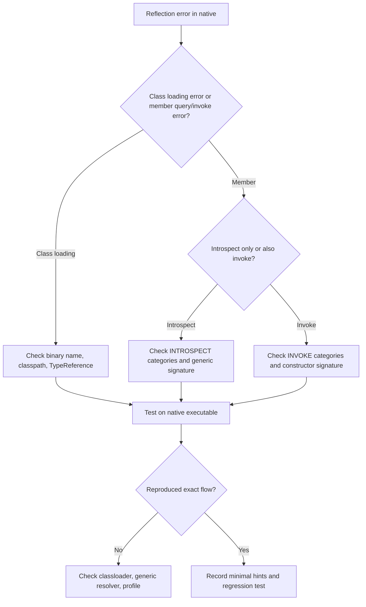

# Generics, Nested Types, and Types Appearing Only as String Names

## 1. Why Must These Types Be Handled Specifically During Native Build?

In the **SPRING_BOOT_NATIVE_IMAGE** module, we use **Spring AOT** to prepare a Spring Boot application for **GraalVM Native Image**, then verify compatibility, measure startup time and memory, package containers, and operate the native build. Reflection is an area requiring control because the application may access classes/members using information that appears only at runtime.

Commonly overlooked cases include:

- Fields with generic types such as `List<Order>` or `Map<String, List<Order>>`, where the application reads type information via `Field.getGenericType()`.
- Methods returning generic types or accepting generic parameters, where frameworks call `getGenericReturnType()` or `getGenericParameterTypes()`.
- Classes nested inside other classes, looked up only by string names such as `com.example.Outer$NestedPlugin`.
- Plugins selected from properties or configuration data via `Class.forName(className)`.
- Generic classes with subclasses concretizing type variables, or inner classes requiring an outer class instance when instantiating objects.

On the JVM, these paths typically work because bytecode and class metadata are loaded dynamically. Native Image analyzes the reachable code set at build time under a **closed-world** model. If a type or member is accessed only via reflection without appropriate metadata, the class may not be retained or the query/invoke operation may fail.

After this lesson, learners will be able to:

1. Distinguish generic types in source code from the actual types the JVM stores at runtime.
2. Read generic signatures via `Type`, `ParameterizedType`, `TypeVariable`, `WildcardType`, and `GenericArrayType`.
3. Recognize binary names of static nested classes, inner classes, local classes, and anonymous classes.
4. Register reflection hints for classes/members selected by string name.
5. Distinguish **introspect/query** metadata permissions from **invoke** constructor/method/field permissions.
6. Test the exact same access path on both the JVM and the native executable.

> **Principle:** generic signatures, binary names, and class reachability are three separate concerns. Correct hints must accurately describe the type being looked up, the members to query, and the operations to perform.

## 2. Generics in Java: Type Erasure Does Not Mean All Generic Info Disappears

Java uses **type erasure** to implement generics. Many generic types are replaced by raw types or upper bounds when bytecode runs. Example:

```java
List<String> names = new ArrayList<>();
List<Long> ids = new ArrayList<>();

System.out.println(names.getClass() == ids.getClass()); // true
```

At runtime, both objects have the class `java.util.ArrayList`. You cannot call `names.getClass()` and ask the JVM whether that object was originally declared as `List<String>` or `List<Long>`.

However, the Java compiler typically writes a **generic Signature attribute** into the class file for field, method, superclass, and interface declarations when needed. The Reflection API can read that declared metadata:

| API | Declared Information |
| --- | --- |
| `Field.getGenericType()` | Generic type of the field. |
| `Method.getGenericReturnType()` | Generic return type of the method. |
| `Method.getGenericParameterTypes()` | Generic parameter types. |
| `Class.getGenericSuperclass()` | Superclass type with generic arguments. |
| `Class.getGenericInterfaces()` | Declared generic interfaces. |
| `Class.getTypeParameters()` | Type variables declared on the class/interface. |

This creates three concepts to distinguish:

- **Runtime object type:** the actual type of an object, usually erased.
- **Declared generic signature:** generic info stored on field/method/class declarations and readable via reflection if the corresponding metadata remains available.
- **Resolved type argument:** the concrete type obtained after resolving a type variable through inheritance/interface relationships; this may require hierarchy traversal algorithms and does not emerge automatically from the object.

Therefore, do not conclude Native Image must preserve every generic argument of every object. Only when the application/framework **queries generic signatures or uses inferred types to perform dynamic access** do we need to control reflection metadata for that path.

### 2.1. Reading the Generic Type of a Field

Example of a model with a deeply nested generic field:

```java
package com.example.model;

import java.util.List;
import java.util.Map;

public class OrderCatalog {
    private Map<String, List<Order>> ordersByRegion;

    public Map<String, List<Order>> getOrdersByRegion() {
        return ordersByRegion;
    }
}
```

When querying the field:

```java
Field field = OrderCatalog.class.getDeclaredField("ordersByRegion");
Type declaredType = field.getGenericType();

System.out.println(declaredType.getTypeName());
```

`declaredType` is a `ParameterizedType` rather than a simple `Class<?>`. You can inspect the nested layers:

```java
ParameterizedType mapType = (ParameterizedType) declaredType;

Type keyType = mapType.getActualTypeArguments()[0];   // String
Type valueType = mapType.getActualTypeArguments()[1]; // List<Order>

ParameterizedType listType = (ParameterizedType) valueType;
Type elementType = listType.getActualTypeArguments()[0]; // Order
```

`ParameterizedType` describes a raw type and its actual type arguments. For `Map<String, List<Order>>`, the raw type is `Map`, the first argument is `String`, and the second argument is another `ParameterizedType` representing `List<Order>`.

If the application only needs the type name for logging, `getTypeName()` can be used. If further structural analysis is needed, check the `Type` subtype using `instanceof`; do not cast every result to `Class<?>`.

### 2.2. Five Common Forms of Type

`java.lang.reflect.Type` is the common interface. Common forms include:

| Form | Meaning | Declaration Example |
| --- | --- | --- |
| `Class<?>` | Non-parameterized type or raw type. | `String`, `List`. |
| `ParameterizedType` | Type with actual type arguments. | `List<Order>`, `Map<String, Order>`. |
| `TypeVariable<?>` | Type variable declared on a class/method. | `T` in `class Box<T>`. |
| `WildcardType` | Wildcard type with upper/lower bounds. | `List<? extends Number>`, `List<? super Order>`. |
| `GenericArrayType` | Array whose component type is generic. | `T[]` when `T` is a type variable. |

Method example:

```java
public <T extends Number> List<? super T> convert(
        T value, List<? extends T> source) {
    // ...
}
```

`getGenericParameterTypes()` can return a `TypeVariable` for `T` and a `ParameterizedType` containing a `WildcardType` for `List<? extends T>`. `getGenericReturnType()` returns the structure for `List<? super T>`. Bounds of type variables and wildcards can be read via `getBounds()`, `getUpperBounds()`, or `getLowerBounds()`.

To handle safely:

1. Accept the result as `Type`.
2. Check `instanceof Class`, `ParameterizedType`, `TypeVariable`, `WildcardType`, or `GenericArrayType`.
3. Recursively traverse owner type, raw type, actual arguments, and bounds when needed.
4. Convert to `Class<?>` only when the type is actually a `Class` or a type variable has been resolved.

### 2.3. Type Erasure and Type Variables

Consider:

```java
class Envelope<T> {
    private T payload;
}

class OrderEnvelope extends Envelope<Order> {
}
```

The `payload` field in `Envelope` is declared with `T`; `Field.getGenericType()` returns a `TypeVariable`, not `Order` automatically just because the concrete object is an `OrderEnvelope`.

To resolve `T` to `Order`, reflection code must:

1. Read `OrderEnvelope.class.getGenericSuperclass()`.
2. Receive the `ParameterizedType` corresponding to `Envelope<Order>`.
3. Retrieve the type variable `T` declared on `Envelope`.
4. Pair `T` with the actual type argument `Order`.
5. When inspecting field `payload`, substitute the type variable using the discovered mapping.

This is the generic hierarchy resolution algorithm. Spring, serializers, or mappers may perform similar logic. In native builds, ensure the classes and members that the algorithm **queries via reflection** have appropriate introspection metadata; the type argument `Order` must also be retained if the application continues to introspect or instantiate that type.

### 2.4. Generic Owner Types of Nested Classes

A non-static inner class can use a type parameter from its outer class:

```java
class Registry<T> {
    class Entry<U> {
        T key;
        U value;
    }
}

Registry<String>.Entry<Long> entry;
```

The declaration `Registry<String>.Entry<Long>` carries generic info on both the **owner type** and the inner type. When reading `ParameterizedType`, besides `getActualTypeArguments()`, there is `getOwnerType()`. Reading only the raw type or actual arguments of the inner class while ignoring the owner type can lose the `String` declared on `Registry<String>`.

For multi-level generic nested classes, traverse `getOwnerType()` recursively instead of assuming all parameters live on the innermost type.

## 3. Nested Classes: Source Name Differs from Binary Name

Java allows several kinds of declarations inside a class. Distinguishing them is critical when using reflection or `Class.forName`.

```java
package com.example.plugins;

public class PluginContainer {

    public static class StaticPlugin {
        public StaticPlugin() {}
    }

    public class InnerPlugin {
        public InnerPlugin(String name) {}
    }

    public void registerLocal() {
        class LocalPlugin {}
        Runnable task = new Runnable() {
            @Override
            public void run() {}
        };
    }
}
```

| Kind | Characteristics | Typical Binary Name |
| --- | --- | --- |
| Top-level class | Declared at package level. | `com.example.plugins.Plugin` |
| Static nested class | Declared inside a class with `static`; does not need an outer instance to instantiate. | `com.example.plugins.PluginContainer$StaticPlugin` |
| Non-static member/inner class | Tied to an outer instance; constructor has an implicit outer instance parameter. | `com.example.plugins.PluginContainer$InnerPlugin` |
| Local class | Declared inside a method/constructor/block. | Compiler-generated name, typically with a sequence number and `$`. |
| Anonymous class | Has no explicit source name. | Compiler-generated name, typically with a sequence number and `$`. |

### 3.1. Use the Binary Name for Class.forName

For nested classes, source notation is:

```java
PluginContainer.StaticPlugin.class
```

but `Class.getName()` returns the binary name:

```text
com.example.plugins.PluginContainer$StaticPlugin
```

This is the appropriate name to pass to `Class.forName`. The `$` character is part of the binary name, not a package separator. Example:

```java
String className =
    "com.example.plugins.PluginContainer$StaticPlugin";

Class<?> pluginType = Class.forName(
    className,
    false,
    Thread.currentThread().getContextClassLoader()
);
```

The `false` argument requests not initializing the class immediately during this load. When initialization is needed, it occurs later per JVM rules. Choose the classloader appropriate for the application; the context classloader may differ from the caller's classloader.

Do not use `getCanonicalName()` to build `Class.forName` strings for nested classes: canonical names use dots and can be `null` for local/anonymous classes. `getName()` returns the binary name, which is the proper form for class loading.

### 3.2. Constructors of Static Nested and Inner Classes Differ

A static nested class can be instantiated like a standalone class:

```java
Class<?> type = Class.forName(
    "com.example.plugins.PluginContainer$StaticPlugin"
);
Object plugin = type.getDeclaredConstructor().newInstance();
```

A non-static inner class requires an instance of the outer class. Its actual constructor receives the outer instance as a parameter:

```java
Class<?> innerType = Class.forName(
    "com.example.plugins.PluginContainer$InnerPlugin"
);

PluginContainer outer = new PluginContainer();
Constructor<?> constructor =
    innerType.getDeclaredConstructor(PluginContainer.class, String.class);

Object inner = constructor.newInstance(outer, "payments");
```

Therefore, if you only register or look up a no-argument constructor for an inner class, the code will fail. Inspect `getDeclaredConstructors()` on the JVM to understand the actual signature; compiler-generated parameters can appear in reflection.

**Design recommendation:** if a class is configured by string name as a plugin, prefer a top-level class or a static nested class with a clear constructor. Local/anonymous classes are unsuitable as plugin names in configuration because their binary names depend on the compiler and can change when source code changes.

### 3.3. Listing Nested Classes via Reflection

You can query classes declared directly inside a class:

```java
Class<?>[] nestedTypes = PluginContainer.class.getDeclaredClasses();
for (Class<?> nested : nestedTypes) {
    System.out.println(nested.getName());
    System.out.println("member=" + nested.isMemberClass());
    System.out.println("local=" + nested.isLocalClass());
    System.out.println("anonymous=" + nested.isAnonymousClass());
}
```

`getDeclaredClasses()` lists directly declared member classes/interfaces; it is not a package-wide class scan and does not list local/anonymous classes the way newcomers might expect. Local/anonymous classes must be identified via appropriate enclosing relationships/metadata if the application truly needs them.

If code calls `getDeclaredClasses()`, introspection metadata for nested classes is required. If it subsequently invokes a constructor or method of a nested class, corresponding invoke permissions must also be added for that specific type.

## 4. Classes Appearing Only via String Names

A plugin registry might store the implementation name in configuration:

```properties
orders.plugin-class=com.example.plugins.JsonOrderPlugin
```

Code loading the implementation:

```java
String className = environment.getRequiredProperty("orders.plugin-class");

Class<?> pluginType = Class.forName(
    className,
    false,
    Plugin.class.getClassLoader()
);

if (!Plugin.class.isAssignableFrom(pluginType)) {
    throw new IllegalArgumentException("Configured class is not a Plugin");
}

@SuppressWarnings("unchecked")
Class<? extends Plugin> implementation =
    (Class<? extends Plugin>) pluginType;

Plugin plugin = implementation.getDeclaredConstructor().newInstance();
```

`Plugin.class.getClassLoader()` is an illustrative choice for an application; in modular/plugin systems or Spring containers, pick the classloader according to the real architecture. The `isAssignableFrom` check verifies the type implements the expected interface, but **does not automatically solve reachability metadata** for Native Image.

### 4.1. Using TypeReference When Class Names Are Known Only in Build Configuration

If code has no compile-time reference to the implementation class, Spring Runtime Hints lets you register types by name via `TypeReference`:

```java
package com.example.nativeapp;

import org.springframework.aot.hint.MemberCategory;
import org.springframework.aot.hint.RuntimeHints;
import org.springframework.aot.hint.RuntimeHintsRegistrar;
import org.springframework.aot.hint.TypeReference;

public final class PluginRuntimeHints implements RuntimeHintsRegistrar {

    @Override
    public void registerHints(RuntimeHints hints, ClassLoader classLoader) {
        hints.reflection().registerType(
            TypeReference.of("com.example.plugins.JsonOrderPlugin"),
            MemberCategory.INVOKE_DECLARED_CONSTRUCTORS,
            MemberCategory.INTROSPECT_PUBLIC_METHODS
        );
    }
}
```

`TypeReference.of(...)` describes a type by name. It is helpful when a registrar does not want a compile-time link to an optional implementation, though the name must still be exact and the class must be present on the native build classpath. `TypeReference` **does not add dependencies automatically** and cannot cause an arbitrary class to be loaded from outside the classpath.

If the plugin list is known before the build, register each supported type. If operators can supply an arbitrary class name after the executable has already been built, Native Image cannot inject new code into the binary at runtime. In that situation, design an allowlist/build variants or a plugin mechanism suited to closed-world constraints.

### 4.2. Binary Names for Nested Plugins

If the implementation is a static nested class:

```java
public class BuiltInPlugins {
    public static class JsonPlugin implements Plugin {
        public JsonPlugin() {}
    }
}
```

then both the configuration value and `TypeReference` must use:

```properties
orders.plugin-class=com.example.plugins.BuiltInPlugins$JsonPlugin
```

Do not use `com.example.plugins.BuiltInPlugins.JsonPlugin` as the binary class name for `Class.forName`. Add tests verifying the exact configuration string, because a single wrong dot or `$` can cause plugin loading to fail only at runtime.

### 4.3. Do Not Turn Class Name Configuration into an Arbitrary Code-Loading Vector

A class-name property can open the door to instantiating unintended implementations. Only permit classes in an application-controlled registry/allowlist; validate the interface/base type, constructor, package, and configuration source. Never accept arbitrary class names from HTTP requests or untrusted data and pass them straight to reflection.

With Spring, consider using a bean registry, conditional beans, or a strategy map instead of building a custom reflection-based plugin loader when implementations can be declared statically. This makes the bean graph easier for Spring AOT to see.

## 5. Runtime Hints: Distinguishing Introspection from Invocation

A common configuration mistake is registering method invocation permissions when the application only queries generic signatures, or registering only introspection and later invoking a constructor.

Spring `MemberCategory` distinguishes two groups:

- **Introspection/query:** allows viewing member info, such as listing methods/fields/constructors, reading generic return/parameter types, or modifiers.
- **Invocation:** allows invoking constructors/methods or accessing fields via reflection.

For example, if the application only calls `getDeclaredMethods()` and `getGenericReturnType()`, introspection permission for declared methods is needed. If the application also calls the method via `Method.invoke`, appropriate invocation permission is needed.

| Operation | Hints to Consider |
| --- | --- |
| `getDeclaredMethods()`, reading `getGenericReturnType()` | `INTROSPECT_DECLARED_METHODS`. |
| `getMethods()`, reading generic signatures of public methods | `INTROSPECT_PUBLIC_METHODS`. |
| `getDeclaredFields()`, reading `getGenericType()` | `INTROSPECT_DECLARED_FIELDS`. |
| `getDeclaredConstructors()` to inspect signatures | `INTROSPECT_DECLARED_CONSTRUCTORS`. |
| `getDeclaredClasses()` | `DECLARED_CLASSES`. |
| `getDeclaredConstructor(...).newInstance()` | `INVOKE_DECLARED_CONSTRUCTORS`. |
| `Method.invoke(...)` for a declared method | `INVOKE_DECLARED_METHODS` or appropriate public category. |
| Accessing fields via reflection | Field invocation/access category matching visibility and API used. |

Exact category names and overloads must be verified against your Spring Framework version. Do not assume `INVOKE_PUBLIC_METHODS` automatically allows querying all declared private methods, or that `INTROSPECT_DECLARED_METHODS` automatically allows invoking methods.

### 5.1. Registrar for Generics and Nested Types

Suppose the application introspects `OrderCatalog.ordersByRegion`, inspects method generic signatures, lists nested types in `PluginContainer`, and instantiates a static nested plugin by string name:

```java
package com.example.nativeapp;

import org.springframework.aot.hint.MemberCategory;
import org.springframework.aot.hint.RuntimeHints;
import org.springframework.aot.hint.RuntimeHintsRegistrar;
import org.springframework.aot.hint.TypeReference;

public final class ReflectionRuntimeHints implements RuntimeHintsRegistrar {

    @Override
    public void registerHints(RuntimeHints hints, ClassLoader classLoader) {
        hints.reflection().registerType(
            OrderCatalog.class,
            MemberCategory.INTROSPECT_DECLARED_FIELDS,
            MemberCategory.INTROSPECT_PUBLIC_METHODS
        );

        hints.reflection().registerType(
            TypeReference.of("com.example.plugins.PluginContainer"),
            MemberCategory.DECLARED_CLASSES
        );

        hints.reflection().registerType(
            TypeReference.of(
                "com.example.plugins.PluginContainer$StaticPlugin"
            ),
            MemberCategory.INVOKE_DECLARED_CONSTRUCTORS,
            MemberCategory.INTROSPECT_DECLARED_METHODS
        );

        hints.reflection().registerType(
            TypeReference.of("com.example.model.Order"),
            MemberCategory.INTROSPECT_PUBLIC_METHODS
        );
    }
}
```

This is an example for hypothetical requirements, not a universal configuration for every application:

- `OrderCatalog` needs field and public method introspection to read signatures.
- `PluginContainer` needs nested class listing; if the application only loads a known class by name, listing all nested classes may not be necessary.
- `StaticPlugin` needs constructor invocation because code instantiates it.
- `Order` needs further introspection if logic uses the type argument to read metadata of that type.

If `Order` only appears in a generic signature and is never introspected/instantiated by the application, check actual behavior before registering extra permissions. Hints are not an inventory of every type present in source code.

### 5.2. Connecting the Registrar to Spring AOT

Create a configuration belonging to the application context:

```java
import org.springframework.context.annotation.Configuration;
import org.springframework.context.annotation.ImportRuntimeHints;

@Configuration(proxyBeanMethods = false)
@ImportRuntimeHints(ReflectionRuntimeHints.class)
class NativeReflectionConfiguration {
}
```

Ensure the configuration is component-scanned or imported into the context processed by Spring AOT. If the registrar is not discovered, hints in code will not reach AOT output automatically. Do not edit generated sources directly to compensate for a missed registrar.

## 6. Testing Hints and Generic Reflection

A good test suite should verify both **registered hints** and **the reflection paths actually used**. Predicate tests catch missing categories; native integration tests confirm metadata suffices for real behavior.

### 6.1. Verifying the Registrar with RuntimeHintsPredicates

Example:

```java
import org.junit.jupiter.api.Test;
import org.springframework.aot.hint.MemberCategory;
import org.springframework.aot.hint.RuntimeHints;
import org.springframework.aot.hint.predicate.RuntimeHintsPredicates;

import static org.assertj.core.api.Assertions.assertThat;

class ReflectionRuntimeHintsTests {

    @Test
    void registersGenericModelIntrospection() {
        RuntimeHints hints = new RuntimeHints();
        new ReflectionRuntimeHints().registerHints(
            hints,
            getClass().getClassLoader()
        );

        assertThat(
            RuntimeHintsPredicates.reflection()
                .onType(OrderCatalog.class)
                .withMemberCategory(MemberCategory.INTROSPECT_DECLARED_FIELDS)
        ).accepts(hints);
    }
}
```

Passing the predicate confirms the registrar registered the requested category for that type. It does not test the `TypeVariable` resolution algorithm, prove resources or dependencies are packaged, or replace native tests.

### 6.2. Testing Generic Signatures on Model Classes

A simple JVM test confirms the generic parsing code works accurately:

```java
import java.lang.reflect.Field;
import java.lang.reflect.ParameterizedType;
import java.lang.reflect.Type;
import java.util.List;
import java.util.Map;

@Test
void readsNestedGenericFieldSignature() throws Exception {
    Field field = OrderCatalog.class.getDeclaredField("ordersByRegion");
    Type type = field.getGenericType();

    assertThat(type).isInstanceOf(ParameterizedType.class);

    ParameterizedType map = (ParameterizedType) type;
    assertThat(map.getRawType()).isEqualTo(Map.class);
    assertThat(map.getActualTypeArguments()[0]).isEqualTo(String.class);

    Type value = map.getActualTypeArguments()[1];
    assertThat(value).isInstanceOf(ParameterizedType.class);

    ParameterizedType list = (ParameterizedType) value;
    assertThat(list.getRawType()).isEqualTo(List.class);
    assertThat(list.getActualTypeArguments()[0]).isEqualTo(Order.class);
}
```

This test checks the generic signature in the class file used by the code. Run a similar test in native mode to catch missing reflection metadata.

### 6.3. Testing Nested Binary Names and Constructors

```java
@Test
void loadsStaticNestedPluginByBinaryName() throws Exception {
    String binaryName =
        "com.example.plugins.PluginContainer$StaticPlugin";

    Class<?> type = Class.forName(
        binaryName,
        false,
        getClass().getClassLoader()
    );

    assertThat(type.getName()).isEqualTo(binaryName);
    assertThat(type.isMemberClass()).isTrue();
    assertThat(type.getDeclaredConstructor()).isNotNull();
}
```

If the test instantiates an object, call `newInstance()` on the constructor after registering invocation hints. For a non-static inner class, the test must supply an outer instance and constructor parameters matching the exact signature.

## 7. Building and Verifying on Maven/Gradle

### 7.1. Maven

For projects configured with Spring Boot AOT and GraalVM Native Build Tools:

```bash
./mvnw -Pnative spring-boot:process-aot
./mvnw -Pnative test
./mvnw -Pnative native:compile
```

Read the logs to confirm:

- Spring AOT processed the configuration containing `@ImportRuntimeHints`.
- The native plugin used the right GraalVM and classpath/dependencies.
- Reflection metadata for required types/members was included in the build.
- The native executable compiled successfully and can run reproduction tests.

Profile/goal names depend on POM configuration and plugin versions. If the project uses a dedicated native test goal, run per supported configuration and inspect test reports to see which tests actually executed.

### 7.2. Gradle

For projects applying the Spring Boot Gradle plugin and GraalVM Native Build Tools:

```bash
./gradlew processAot
./gradlew test
./gradlew nativeCompile
```

When inspecting the task graph/logs:

```bash
./gradlew nativeCompile --dry-run
./gradlew nativeCompile --info
```

Verify the AOT task appears in the proper graph, the right Java/GraalVM toolchain is selected, and the right native executable is built. Do not rely solely on `java -version` in the terminal to conclude the plugin is using the same JDK.

### 7.3. Runtime Testing

Run the native executable with realistic class name configurations and generic models. Include:

- Valid top-level class name.
- Static nested class name with `$`.
- Wrong package or wrong binary name.
- Non-existent or mismatched constructor.
- Multi-level nested generic fields/methods.
- Subclass concretizing a type variable.
- Inner class requiring an outer instance.
- Different profiles/plugin configurations if supported.

Record stack traces and classify errors: class not reachable, member lacks invocation permission, missing introspection metadata, wrong classloader, or flawed generic resolver logic.

## 8. Common Errors

| Symptom | Possible Cause | How to Handle |
| --- | --- | --- |
| `ClassNotFoundException` for nested class | Used a dot instead of `$`, or class is not on native classpath. | Use `Class.getName()` to determine binary name; check dependencies and hints. |
| `NoSuchMethodException` when instantiating inner class | Looked up no-arg constructor while inner class needs outer instance. | Inspect `getDeclaredConstructors()` and pass outer class to `getDeclaredConstructor(...)`. |
| `getGenericType()` or `getGenericReturnType()` lacks info / fails on native | Insufficient member introspection metadata or signature stripped from class artifact. | Register appropriate introspection category; check class files and shrinkers/obfuscators. |
| Casting `Type` to `Class<?>` throws `ClassCastException` | Result is `ParameterizedType`, `TypeVariable`, `WildcardType`, or `GenericArrayType`. | Inspect `Type` using `instanceof` and handle recursively. |
| Cannot obtain `Order` from field `T payload` | Type variable not resolved via generic superclass/interface. | Traverse hierarchy and build a `TypeVariable` -> actual type argument mapping. |
| `getDeclaredClasses()` misses / lacks expected class | Confused local/anonymous class with member class or missing introspection metadata. | Check `isMemberClass`, `isLocalClass`, `isAnonymousClass` and register declared classes if needed. |
| JVM loads plugin, but native reports missing class | Class appears only as a string and lacks reachability registration. | Register `TypeReference` for each supported implementation. |
| Class found, but constructor cannot instantiate | Only introspection registered, missing constructor invocation or wrong constructor signature. | Add `INVOKE_DECLARED_CONSTRUCTORS` and verify actual parameters. |
| Predicate passes, yet native still fails | Predicate only checks category; runtime path still lacks another type/member/resource. | Add native integration tests and trace the stack trace. |
| Local/anonymous plugin name changes across builds | Compiler-generated binary name is unstable. | Switch to top-level or static nested classes with stable names. |

### 8.1. Diagnostic Sequence



## 9. Practice Exercise: Nested Generic Plugin Selected by String Name

**Context:** a Spring Boot service has a registry for order-processing plugins. Each plugin is configured by class name. Model `OrderCatalog` holds `Map<String, List<Order>>`; an adapter uses reflection to read generic signatures and pick a converter. One implementation is a static nested class inside `BuiltInPlugins`.

### Tasks

1. Create `OrderCatalog` with nested generic field `Map<String, List<Order>>` and a method returning a generic type.
2. Write a utility traversing `Type`, handling `ParameterizedType`, `TypeVariable`, `WildcardType`, `GenericArrayType`, and `getOwnerType()`.
3. Create `BuiltInPlugins.JsonPlugin` as a static nested class; configure the class name using the binary name with `$`.
4. Add a non-static inner class to compare a constructor taking an outer instance with a static nested constructor.
5. Write a `RuntimeHintsRegistrar` registering introspection for generic fields/methods, declared classes when needed, and plugin constructor invocation.
6. Connect the registrar to the application context via `@ImportRuntimeHints`.
7. Write predicate tests for hints and unit tests for the generic resolver/binary name.
8. Build Spring AOT and the native executable with Maven or Gradle.
9. Run native tests with a valid plugin, invalid class name, nested generic type, and inner class; compare with the JVM.
10. Document metadata, required access types, and build/runtime evidence.

### Results Record

| Evidence | Content to Record |
| --- | --- |
| Generic model | Field/method signatures and actual `Type` tree. |
| Nested type | Source name, binary name, class kind, and constructor signature. |
| String configuration | Valid class names, allowlist, and selected classloader. |
| Runtime hints | Types, introspection categories, and invocation categories. |
| Predicate tests | Assertions for required types/members. |
| AOT/native build | Plugin/version, build commands, logs, and executable. |
| Native runtime tests | Generic resolver, plugin loading, inner/static nested constructors. |
| JVM/native comparison | Differences, stack traces, and fixes. |

### Completion Criteria

- [ ] Can explain type erasure and generic Signature metadata.
- [ ] Can handle `Type` implementations without casting everything to `Class`.
- [ ] Can resolve type variables across generic superclasses/interfaces when needed.
- [ ] Uses exact binary names for nested classes and understands inner class constructors.
- [ ] Registers introspection and invocation separately according to real operations.
- [ ] Native executable runs the plugin and generic reflection scenarios.
- [ ] Plugin names are controlled and error cases are tested.

## 10. Self-Assessment Questions

1. Why does `new ArrayList<String>().getClass()` not reveal the actual type argument `String`?
2. Where is the generic signature stored, and how does it differ from an object's runtime type?
3. What does `ParameterizedType.getOwnerType()` mean for `Outer<String>.Inner<Long>`?
4. Why is `Class.forName("pkg.Outer.Inner")` not the right binary name for a nested class?
5. Why does a non-static inner class usually not have the no-arg constructor you see in source code?
6. When calling only `getGenericReturnType()`, how should you distinguish introspection hints from invocation hints?
7. What does `TypeReference.of("...")` solve for plugins selected by string name, and what does it not solve?
8. Why are local/anonymous classes unsuitable as plugin names stored in configuration?

## 11. Official Documentation

Java reflection APIs and Spring hint categories may change across versions. Verify documentation against the exact JDK/Spring Framework versions used by your project:

- [Java API — Type](https://docs.oracle.com/en/java/javase/21/docs/api/java.base/java/lang/reflect/Type.html): hierarchy of generic reflection types.
- [Java API — ParameterizedType](https://docs.oracle.com/en/java/javase/21/docs/api/java.base/java/lang/reflect/ParameterizedType.html): raw type, owner type, and actual type arguments.
- [Java API — TypeVariable](https://docs.oracle.com/en/java/javase/21/docs/api/java.base/java/lang/reflect/TypeVariable.html): type variables and bounds.
- [Java API — Class.forName](https://docs.oracle.com/en/java/javase/21/docs/api/java.base/java/lang/Class.html#forName(java.lang.String,boolean,java.lang.ClassLoader)): loading classes by binary name and classloader.
- [Java Language Specification — Binary Names](https://docs.oracle.com/javase/specs/jls/se21/html/jls-13.html#jls-13.1): binary naming rules for nested/local/anonymous classes.
- [Spring Framework — Runtime Hints](https://docs.spring.io/spring-framework/reference/core/aot.html): RuntimeHints, RuntimeHintsRegistrar, and AOT.
- [Spring Framework API — MemberCategory](https://docs.spring.io/spring-framework/docs/current/javadoc-api/org/springframework/aot/hint/MemberCategory.html): introspection/invocation categories.
- [GraalVM Native Image — Reachability Metadata](https://www.graalvm.org/latest/reference-manual/native-image/metadata/): how to describe reflection access for native builds.

**Key takeaway:** generic signatures reveal declared type structure; binary names identify classes to load; Runtime Hints describe members to introspect or invoke. When these three layers of information are controlled and tested separately, frameworks relying on generic reflection and plugin loading can run natively with greater stability.
