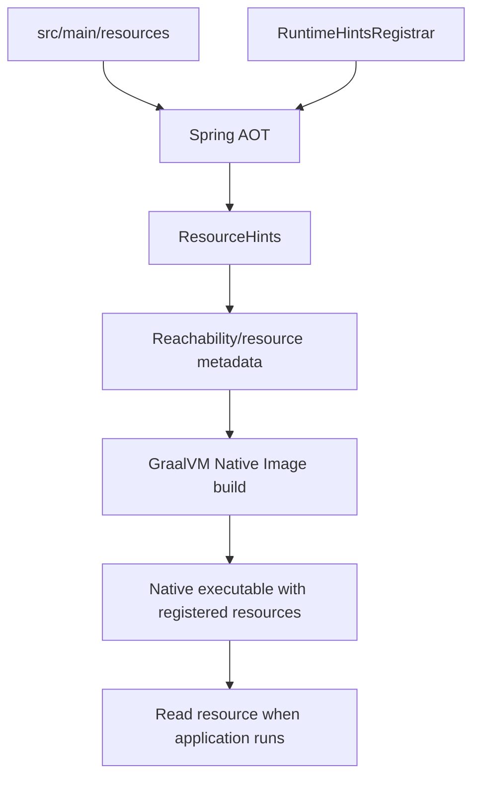

# ResourceHints and Path Patterns to Package

> **Chapter: Resources.** The **SPRING_BOOT_NATIVE_IMAGE** module compiles Spring Boot applications into a GraalVM Native Image using Spring AOT. When creating a native executable, classpath resources must be identified at build time so they can be packaged into the image. This lesson covers using Spring Runtime Hints/ResourceHints, choosing appropriate patterns, and testing resources after packaging.

## 1. Learning Objectives

After this lesson, you will be able to:

1. Explain why resources read dynamically on the JVM may not appear in a Native Image.
2. Distinguish between classpath resources, resource bundles, and external filesystem files.
3. Register resources using `RuntimeHintsRegistrar` and `@ImportRuntimeHints`.
4. Choose accurate patterns for a single file, a directory, or a multi-level directory tree.
5. Verify resources in the JVM, AOT, and native executable; handle missing-resource errors.
6. Avoid over-packaging data or embedding secrets and environment-specific configuration into the image at build time.

## 2. Why Does Native Image Need Resource Hints?

On the JVM, an application can use a name built from runtime data to locate a file on the classpath:

```java
String template = request.getParameter("template");
InputStream input = getClass().getClassLoader()
        .getResourceAsStream("templates/" + template + ".html");
```

The JVM can usually look up resources in the JAR/classpath at runtime. GraalVM Native Image performs static analysis on the application and needs to know in advance which resources will be accessed. If a path name only appears as a string concatenated at runtime, the analysis may not detect which file needs to be included in the executable.

Spring provides the **Runtime Hints API** to describe capabilities required at runtime. `ResourceHints` is the part dedicated to resources: registering files or path patterns so Spring AOT translates that information into appropriate metadata for Native Image.



**Key takeaway:** A Resource Hint informs the build process that a classpath resource may be used at runtime. It does not create files, automatically download resources from the Internet, turn a filesystem path into a classpath resource, or grant access to arbitrary files on the host.

## 3. Distinguishing Resource Types

| Resource type | Example | How to handle |
|---|---|---|
| Single file on classpath | templates/invoice.html | Register specific resource or pattern |
| Directory tree on classpath | templates/email/*.html | Register a pattern covering the exact required levels |
| Resource bundle | messages.properties, messages_vi.properties | Register the bundle via `registerResourceBundle` |
| File outside JAR/container | /etc/orders/application.yml | Mount/provide the file at runtime; do not use `ResourceHints` to package it |
| Uploaded file or user-generated data | /data/uploads/123.pdf | Read from runtime filesystem/object storage per application design |
| Dependency resources | Files provided by third-party libraries | Check dependency reachability metadata; add hints if needed |

Having `src/main/resources/application.yml` used by Spring Boot for application configuration does not mean every other YAML file is automatically packaged. Distinguish framework-recognized resources from resources loaded by the application via dynamic names.

### 3.1. Classpath and Filesystem Are Not the Same

Classpath resources are typically read via `ClassLoader`, `ClassPathResource`, or Spring resource APIs. After packaging, a resource may reside inside the executable or internal image structure; you should not assume it always exists as a physical file with a path that can be passed to `File`.

Recommended example:

```java
try (InputStream input = getClass().getClassLoader()
        .getResourceAsStream("templates/invoice.html")) {
    if (input == null) {
        throw new IllegalStateException("Missing invoice template");
    }
    // Read content from stream.
}
```

For resources outside the classpath, you can use `File`, `Path`, `Files.newInputStream`, or `FileSystemResource` as needed. When deploying containers, mount volumes or inject files via secret/config mechanisms. These files can change independently of the binary, so they neither need nor should be registered as classpath resources.

## 4. Registering Resources with RuntimeHintsRegistrar

Suppose the application has this structure:

```text
src/main/resources/
  templates/
    invoice.html
    receipt.html
    email/
      order-confirmed.html
      payment-failed.html
  messages/
    labels.properties
    labels_vi.properties
```

Create a hints registrar class:

```java
package com.example.orders.config;

import org.springframework.aot.hint.RuntimeHints;
import org.springframework.aot.hint.RuntimeHintsRegistrar;

public class OrderResourceHints implements RuntimeHintsRegistrar {

    @Override
    public void registerHints(RuntimeHints hints, ClassLoader classLoader) {
        hints.resources().registerPattern("templates/invoice.html");
        hints.resources().registerPattern("templates/receipt.html");
        hints.resources().registerPattern("templates/email/*.html");
        hints.resources().registerResourceBundle("messages.labels");
    }
}
```

`registerPattern` accepts a resource path relative to the classpath root. In the example, the pattern `templates/email/*.html` applies to HTML files located directly in the `email` directory. If the application also has deeper subdirectories, choose a pattern that covers those levels and verify with tests; do not assume `*` and `**` have the same meaning.

`registerResourceBundle` takes the **base name** of the bundle according to Java `ResourceBundle` rules, not a file path with a `.properties` extension. For `messages/labels.properties`, the base name is `messages.labels`.

### 4.1. Connecting Hints to Spring AOT

Use `@ImportRuntimeHints` so Spring AOT discovers the registrar:

```java
package com.example.orders.config;

import org.springframework.context.annotation.Configuration;
import org.springframework.context.annotation.ImportRuntimeHints;

@Configuration(proxyBeanMethods = false)
@ImportRuntimeHints(OrderResourceHints.class)
public class OrderResourceConfiguration {
}
```

Ensure this configuration class is component-scanned or imported by the application configuration. If the registrar is not discovered during AOT processing, its hints will not be included in the output.

You can declare the registrar via other Spring AOT APIs if suited to the module structure, but ensure it is invoked during AOT processing. Do not just create a `RuntimeHintsRegistrar` class and assume Spring automatically finds every implementation on the classpath.

### 4.2. Registering a Specific File

If only one file is loaded dynamically, prefer narrow registration:

```java
@Override
public void registerHints(RuntimeHints hints, ClassLoader classLoader) {
    hints.resources().registerPattern("templates/invoice.html");
}
```

Accurate registration helps control the size of packaged resources and clearly documents which files the application actually uses.

## 5. Choosing the Right Path Pattern

A resource pattern is usually selected relative to the classpath root. Examples:

| Pattern | Intended scope |
|---|---|
| templates/invoice.html | Only the `invoice.html` file |
| templates/*.html | HTML files directly inside `templates` |
| templates/email/*.html | HTML files directly inside `templates/email` |
| templates/** | Resource tree under `templates`, per pattern syntax supported by Spring/GraalVM |
| i18n/messages | This is a resource bundle base name if using `registerResourceBundle`, not a regular file pattern |

When an application needs multiple directory levels, a broader pattern can be useful. However, do not use `**` across the entire classpath just to avoid missing-resource errors. An overly broad pattern can package unnecessary files, increase executable size, and make it hard to control what gets included in the image.

### 5.1. Example of Choosing Patterns by Structure

Suppose:

```text
templates/
  invoice.html
  receipt.html
  email/
    created.html
    cancelled.html
    admin/
      alert.html
```

If only the two templates at the root and two templates in `email` are used, you can register:

```java
hints.resources().registerPattern("templates/invoice.html");
hints.resources().registerPattern("templates/receipt.html");
hints.resources().registerPattern("templates/email/*.html");
```

If `admin/alert.html` is also loaded by a dynamic name, add the specific pattern:

```java
hints.resources().registerPattern("templates/email/admin/alert.html");
```

Or use an appropriate recursive pattern if the entire template tree is allowed to be packaged:

```java
hints.resources().registerPattern("templates/**");
```

With recursive patterns, confirm the behavior by building and running a Native Image with the exact GraalVM/Spring Framework version. Do not assume that a pattern matching on a regular filesystem will necessarily be interpreted identically by metadata parsers across all versions.

## 6. Resource Bundles, Encoding, and Locale

Java applications can use `ResourceBundle` to select content by locale:

```java
ResourceBundle bundle = ResourceBundle.getBundle(
        "messages.labels",
        Locale.forLanguageTag("vi")
);

String title = bundle.getString("order.title");
```

If the bundle is selected by locale at runtime, register the base name:

```java
hints.resources().registerResourceBundle("messages.labels");
```

This tells Native Image that the bundle must be present. If the application uses multiple different bundle base names, register each required bundle. Test both the default locale and the actual deployed locales, including fallback to the base bundle.

For properties files with Vietnamese characters, save them with the proper encoding and check how the API you are using reads them. Also verify the locale data/charset required by the application on the GraalVM runtime; a Resource Hint only solves resource packaging and does not automatically include all JDK locale data.

## 7. Resources from Third-Party Libraries

A dependency may load resources by name, such as XML schemas, templates, JSON metadata, or algorithm configuration files. If a resource is not explicitly accessed from application code, GraalVM may not detect it.

The recommended order of steps:

1. Check whether the library provides **reachability metadata** for that exact version.
2. Check whether that metadata is picked up during the build by GraalVM Native Image or Spring AOT.
3. If missing, add a resource hint in the application or metadata using the mechanism supported by your GraalVM version.
4. Write a test that triggers the exact library code path and run the test on the native executable.

Spring `RuntimeHints` is suitable when the application needs to declare resources that depend on its own configuration. Metadata shipped with a dependency has the advantage of being packaged with the library and reusable across multiple applications. Avoid creating a broad hint in the application to mask missing metadata from multiple dependencies without identifying which resources are actually needed.

## 8. GraalVM Metadata and Relationship with Spring ResourceHints

At the GraalVM layer, Native Image uses reachability metadata to know which resources to keep. The JSON metadata format and configuration location can change across GraalVM versions. Older projects may have `resource-config.json` under `META-INF/native-image`; newer versions may support a unified metadata schema.

With Spring Boot, prefer the `RuntimeHints` API for application hints:

- Spring AOT collects hints from `RuntimeHintsRegistrar`.
- Spring Native/AOT integration converts them into configuration suitable for Native Image.
- GraalVM uses that metadata during analysis and executable creation.

Illustration of a traditional JSON resource metadata structure:

```json
{
  "resources": {
    "includes": [
      { "pattern": "templates/invoice\\.html" },
      { "pattern": "templates/email/.*\\.html" }
    ]
  }
}
```

This is an example of the resource metadata format, **not a file to copy blindly into every project**. The regex/schema rules of GraalVM metadata are not identical to the patterns accepted by Spring `ResourceHints.registerPattern`. Let Spring AOT convert hints whenever possible; if you must write GraalVM metadata manually, follow the schema and documentation for the exact release, and verify the metadata location discovered by the build tool.

Do not declare the same resource through multiple mechanisms without reason. Duplicate hints generally add no capability, while fragmented configuration makes it harder to trace sources during upgrades.

## 9. Testing Resources on the JVM and Native Image

A simple smoke test helps catch resources missing from the executable:

```java
package com.example.orders;

import java.io.InputStream;
import org.junit.jupiter.api.Test;

import static org.junit.jupiter.api.Assertions.assertNotNull;

class TemplateResourceTest {

    @Test
    void invoiceTemplateIsAvailable() {
        try (InputStream input = getClass().getClassLoader()
                .getResourceAsStream("templates/invoice.html")) {
            assertNotNull(input, "Invoice template must be packaged");
        } catch (Exception ex) {
            throw new AssertionError("Cannot read invoice template", ex);
        }
    }
}
```

The test above verifies that the file can be found, but does not check its contents or whether a template engine parses it properly. For critical resources, read the content, check markers, or execute the actual rendering flow.

### 9.1. Layered Testing

| Stage | How to test | What to verify |
|---|---|---|
| JVM test | `./mvnw test` or `./gradlew test` | Resource path and content are valid on the classpath |
| Spring AOT | Run AOT build per project config | Registrar is discovered, hints are collected |
| Native test | Run native test via the configured plugin task/goal | Resource exists in the native test executable |
| Native application | Build and run the binary, call endpoints using templates/resources | Resource is present in the production binary |
| Container image | Run the image on the target platform | Resource is readable when running in the deployment environment |

Task/goal names and native test configuration depend on the Spring Boot version, GraalVM Native Build Tools, and the Maven/Gradle plugin. Use your project's actual task/goal; do not assume every project shares the same `nativeTest` alias.

### 9.2. Testing Both Valid and Invalid Paths

If template names come from requests or database records, verify:

- Registered valid names can be loaded and rendered.
- Non-existent names return a controlled application error.
- Names containing `../` or unusual characters cannot arbitrarily read files outside the template directory.
- Every template/locale used in production is tested.
- Unnecessary files are not packaged by an overly broad pattern.

A Resource Hint is not a substitute for input validation. If the application accepts a file name from users, map it through an allowlist or enum rather than arbitrarily concatenating strings into paths.

## 10. Common Errors and Diagnostics

| Symptom | Possible cause | Resolution |
|---|---|---|
| Works on JVM, returns null in native | Resource was not included in Native Image | Register pattern/file in `ResourceHints`, rebuild, and run native tests |
| Hint added but resource still missing | Registrar not imported/discovered or pattern does not match classpath path | Check `@ImportRuntimeHints`, AOT logs, and root-relative path |
| Only subdirectory templates missing | `*` pattern only covers direct level or does not cover directory tree | Register pattern for exact level or recursively and test each file |
| `ResourceBundle` cannot find locale | Bundle base name not registered or missing locale variant | Use `registerResourceBundle`, test locales and fallback |
| `FileNotFoundException` when using `new File(...)` | Classpath resource is not a physical file in the executable | Read via `InputStream`/Spring `Resource`; if external file, mount at runtime |
| Dependency resource missing | Dependency lacks reachability metadata or library loads dynamically | Check metadata for exact version, add narrow hint, and test |
| Unusually large image | Pattern too broad or many unnecessary resources packaged | Narrow the pattern, audit resource tree, and re-measure size |
| Secret appears in binary | Secret placed in `src/main/resources` or written into resources at build time | Remove from build-time resources; obtain secrets from runtime environment/secret store |

Diagnostic workflow:

1. Identify the exact resource path the code requests, including letter casing.
2. Confirm the file exists in the application's classpath output before the native build.
3. Verify the registrar is discovered by Spring AOT and the pattern matches the file.
4. Rebuild the native executable after changing hints.
5. Run tests directly on the native binary; if using containers, double-check that the deployed image is the new one.
6. If the resource comes from a dependency, check the metadata and library version.

## 11. Hands-On Exercise

An order service renders emails from templates:

```text
src/main/resources/
  mail/
    order-created.html
    order-cancelled.html
    locale/
      labels.properties
      labels_vi.properties
  schemas/
    order-v1.json
    order-v2.json
```

Requirements:

1. Create `MailResourceHints` to register the two email templates and the `mail.locale.labels` resource bundle.
2. Register the JSON schemas with a narrow pattern matching the two versions.
3. Wire the registrar using `@ImportRuntimeHints` in a configuration discovered by Spring AOT.
4. Write tests reading both templates, the Vietnamese resource bundle, and the JSON schemas.
5. Run JVM tests, native tests, and a smoke test on the native application/container.
6. Add an invalid template name case and ensure the application cannot read arbitrary files outside the `mail` tree.
7. Check image size after narrowing patterns; list the exact packaged files.

| Check | Result |
|---|---|
| mail/order-created.html | Pass/Fail |
| mail/order-cancelled.html | Pass/Fail |
| Resource bundle mail.locale.labels | Pass/Fail |
| Schemas order-v1.json and order-v2.json | Pass/Fail |
| Native executable reads resources | Pass/Fail |
| Container smoke test | Pass/Fail |
| Path traversal test | Pass/Fail |
| Image size before/after narrowing pattern | … |

## 12. Self-Check Questions

1. Why might `getResourceAsStream()` work on the JVM yet return null in Native Image?
2. How do `registerPattern` and `registerResourceBundle` differ in their inputs?
3. Why shouldn't `templates/*.html` be assumed to cover all subdirectories?
4. What role does `@ImportRuntimeHints` play during Spring AOT processing?
5. Can a Resource Hint package `/etc/app/secret.yml` on the production machine into the executable? Why or why not?
6. When should you use `ResourceHints` versus mounting a file at runtime?
7. Why shouldn't GraalVM JSON metadata be copied across versions without checking the schema?
8. Why should you test resources on the native application/container even when native tests pass?

## Remember

**A Resource Hint describes classpath resources required when Native Image runs.** Use `RuntimeHintsRegistrar` and `@ImportRuntimeHints` to declare files, patterns, and resource bundles. Choose sufficiently narrow patterns, read classpath resources via streams/appropriate APIs, manage external files and secrets at runtime, and verify on the native executable or container. Build-time generated metadata does not replace testing actual behavior.

## References

- [Spring Framework — Runtime Hints](https://docs.spring.io/spring-framework/reference/core/aot.html): RuntimeHints API and AOT integration.
- [Spring Framework API — ResourceHints](https://docs.spring.io/spring-framework/docs/current/javadoc-api/org/springframework/aot/hint/ResourceHints.html): registering resource patterns and resource bundles.
- [Spring Framework API — RuntimeHintsRegistrar](https://docs.spring.io/spring-framework/docs/current/javadoc-api/org/springframework/aot/hint/RuntimeHintsRegistrar.html): interface for registering hints.
- [Spring Framework API — ImportRuntimeHints](https://docs.spring.io/spring-framework/docs/current/javadoc-api/org/springframework/context/annotation/ImportRuntimeHints.html): connecting a registrar to configuration.
- [Spring Boot — GraalVM Native Images](https://docs.spring.io/spring-boot/reference/packaging/native-image/introducing-graalvm-native-images.html): Spring AOT and Native Image.
- [GraalVM — Reachability Metadata](https://www.graalvm.org/latest/reference-manual/native-image/metadata/): metadata for resources, reflection, proxy, and JNI.
- [GraalVM — Resource Metadata](https://www.graalvm.org/latest/reference-manual/native-image/metadata/#resource-metadata): version-specific rules for declaring Native Image resources.
