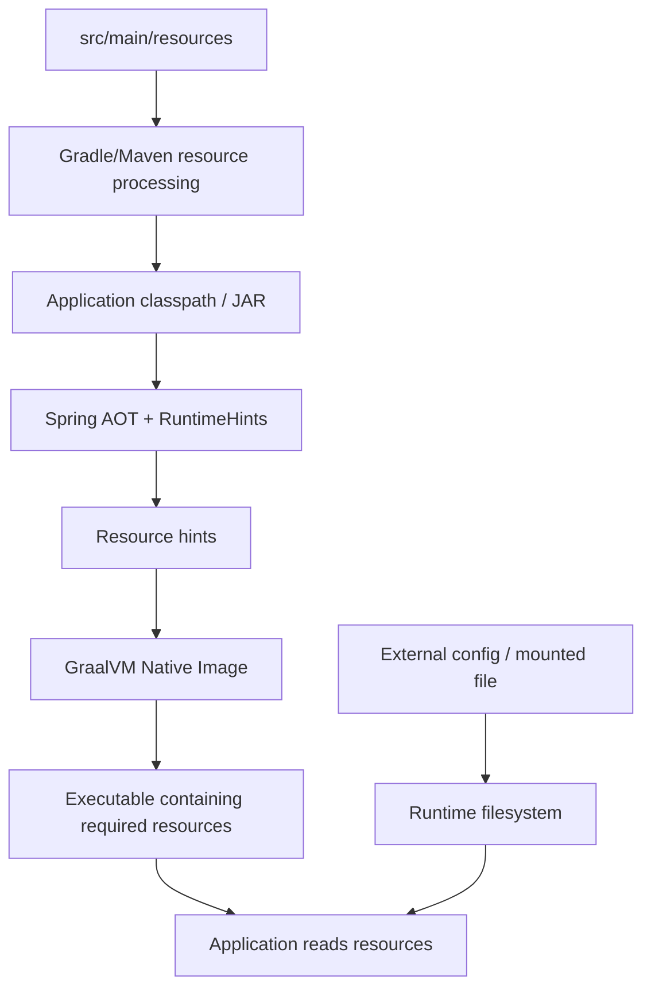

# Templates, SQL Files, Configuration Files, and Data Read via ClassLoader

## 1. Why Do Resources Need Attention When Building a Native Image?

Spring Boot applications frequently read non-Java data from the **classpath**: email templates, SQL files, JSON schemas, default configuration files, message bundles, public certificates, or initialization data. On the JVM, developers commonly call `ClassLoader.getResource`, `Class.getResource`, or `getResourceAsStream` and see the file work immediately because the resource is in the JAR/classpath.

With **GraalVM Native Image**, the build process analyzes in advance what can be accessed. Resources read by dynamic names or patterns may not be detected without metadata. As a result, the native application starts up normally and only fails when a rare endpoint uses a template or runs a SQL migration.

In the **SPRING_BOOT_NATIVE_IMAGE** module, you must clearly distinguish which resources belong on the classpath and must be packaged into the executable, and which resources are external filesystem files that need to be mounted at runtime. Spring AOT and Runtime Hints can declare resource patterns so Native Image retains the required files.



## 2. Classpath Resources Differ from Filesystem Resources

The two types of resources are managed differently:

- **Classpath resource**: packaged with the application or dependency JAR, accessed via class loader/resource loader. Examples: `templates/invoice.html`, `db/migration/V1__init.sql`.
- **Filesystem resource**: a file located on the filesystem of the running machine/container, such as `/etc/myapp/application-extra.yml` or `/var/lib/myapp/import.csv`. This file is mounted/copied/provided at runtime.

| Criterion | Classpath resource | Filesystem resource |
|---|---|---|
| Storage location | JAR/classes/dependencies | Filesystem |
| Access | ClassLoader, Class, Spring ResourceLoader | Path/File/Resource |
| Lifecycle | Usually travels with the artifact | Managed by the deployment environment |
| Native Image | May require resource hints | Not automatically packaged just by having a path |
| Examples | Default templates, SQL migrations | Secret files, import data, environment config |

Do not package secrets, private keys, or environment-specific data into the native executable. Provide them via a secret manager, environment variables, or volume mounts at runtime.

## 3. Placing Resources in a Spring Boot Project

Example structure:

```text
src/main/resources/
  templates/
    invoice.html
  db/
    migration/
      V1__create_invoice.sql
  config/
    default-rules.json
  messages/
    messages.properties
```

Maven and Gradle process `src/main/resources` by default and place the contents into the classpath output. When packaging a JAR, the files typically appear in the archive under the corresponding paths.

Inspect the JAR:

```bash
jar tf build/libs/app.jar
```

With Maven, you can inspect files under `target/`. Artifact paths depend on project configuration. If a resource belongs to a library dependency, verify that the dependency is on the runtime classpath of the application module.

## 4. Reading Resources via ClassLoader

Example of reading a JSON file from the classpath:

```java
public String readDefaultRules() throws IOException {
    ClassLoader classLoader = Thread.currentThread().getContextClassLoader();

    try (InputStream input = classLoader.getResourceAsStream(
            "config/default-rules.json")) {
        if (input == null) {
            throw new FileNotFoundException("config/default-rules.json");
        }
        return new String(input.readAllBytes(), StandardCharsets.UTF_8);
    }
}
```

Resource names in `ClassLoader.getResourceAsStream` typically do not start with `/`. The API returns `null` if not found; always check for null and close the stream.

You can use the class loader of a specific class to avoid depending on the context class loader:

```java
InputStream input = InvoiceService.class
    .getResourceAsStream("/templates/invoice.html");
```

With `Class.getResource`, a path starting with `/` is resolved from the classpath root; a path without `/` is resolved relative to the class's package.

Spring also provides the `ResourceLoader` and `Resource` abstractions. For example:

```java
Resource resource = resourceLoader.getResource(
    "classpath:config/default-rules.json"
);
try (InputStream input = resource.getInputStream()) {
    // Read contents.
}
```

Reading through an abstraction makes it easier to change the resource source, but you still must declare required classpath resources when Native Image cannot detect them automatically.

## 5. Registering Resources with Spring RuntimeHints

Spring provides the `RuntimeHints.resources()` API to declare files/patterns to keep.

Example registrar:

```java
import org.springframework.aot.hint.RuntimeHints;
import org.springframework.aot.hint.RuntimeHintsRegistrar;

public class ApplicationResourceHints implements RuntimeHintsRegistrar {

    @Override
    public void registerHints(RuntimeHints hints, ClassLoader classLoader) {
        hints.resources().registerPattern("templates/*.html");
        hints.resources().registerPattern("db/migration/*.sql");
        hints.resources().registerPattern("config/default-rules.json");
    }
}
```

Register the registrar in a configuration class:

```java
@Configuration
@ImportRuntimeHints(ApplicationResourceHints.class)
class ResourceConfiguration {
}
```

When Spring AOT processes the application context, the registrar is invoked and resource hints are collected. If the registrar is not imported or discovered through the AOT mechanism, the patterns will have no effect.

Patterns must match the resource path on the classpath, not the source path like `src/main/resources/...`. For example, the resource `src/main/resources/templates/invoice.html` has the classpath path `templates/invoice.html`.

## 6. Choosing Narrow and Accurate Patterns

Do not register all resources if only a small group is needed. For example:

```java
hints.resources().registerPattern("templates/*.html");
```

This pattern is scoped according to the glob syntax of the corresponding Spring/GraalVM API; verify the specific semantics of your version. If files reside in deep subdirectories, check whether the pattern covers them properly—do not assume `*` always matches every directory level.

You can declare specific resources when known in advance:

```java
hints.resources().registerPattern("templates/invoice.html");
hints.resources().registerPattern("db/migration/V1__create_invoice.sql");
```

Registering an overly broad pattern such as the entire classpath can increase executable size and retain unnecessary data. In particular, avoid putting files containing secrets, private keys, credentials, or personal data into the image.

## 7. Template Engines and Dynamic Resources

A template engine may look up a template by name at request handling time:

```java
String templateName = request.getParameter("template");
Template template = configuration.getTemplate(templateName);
```

If the template name comes from a request, Native Image will not necessarily know in advance which files to retain. You can register a pattern for allowed templates:

```java
hints.resources().registerPattern("templates/*.html");
```

However, you should use a template name allowlist at the application layer. Do not let clients choose arbitrary paths like `../../etc/passwd`; that is a path traversal risk independent of Native Image.

Another option is to use a static registry mapping valid template names to specific resources. This clarifies the resource scope and is easier to test.

## 8. SQL Files and Database Migrations

Migration libraries such as Flyway/Liquibase typically read migration scripts from the classpath or filesystem depending on configuration. For migrations packaged in the JAR:

```text
src/main/resources/db/migration/
  V1__create_invoice.sql
  V2__add_status.sql
```

If resources are not detected during the native build, declare the corresponding pattern or use the AOT/native integration provided by the library. Do not assume all Flyway/Liquibase versions have identical Native Image support; check the version documentation and run migration tests on the native executable.

Example of reading SQL manually:

```java
try (InputStream stream = getClass().getClassLoader()
        .getResourceAsStream("db/migration/V1__create_invoice.sql")) {
    if (stream == null) {
        throw new IllegalStateException("Migration script missing");
    }
    String sql = new String(stream.readAllBytes(), StandardCharsets.UTF_8);
}
```

Do not replace a migration framework by reading files manually in production if the application needs versioning, transactions, and migration history.

## 9. Configuration Files: Packaged Defaults and Runtime Provision

Non-sensitive default configuration such as `config/default-rules.json` can be packaged. However, production environment configuration such as datasource passwords, API tokens, private keys, or internal endpoints should be supplied at runtime.

Example of Spring Boot reading an external file:

```bash
java -jar app.jar --spring.config.additional-location=file:/etc/myapp/
```

With a native executable, passing the config location works similarly if the application is configured with Spring Boot:

```bash
./app --spring.config.additional-location=file:/etc/myapp/
```

The `/etc/myapp/` directory/file must exist in the container or be mounted. External filesystem resources do not need to be added to Native Image resource hints; however, access rights, paths, encoding, and permissions still need testing.

Do not place external configs into classpath hints. Proper source classification helps avoid baking secrets into the binary.

## 10. Native Image Reachability Metadata for Resources

Besides Spring `RuntimeHints`, GraalVM supports reachability metadata to declare resources. Illustrative JSON structure example:

```json
{
  "resources": [
    {
      "glob": "templates/*.html"
    },
    {
      "glob": "db/migration/*.sql"
    }
  ]
}
```

The schema, metadata location, and glob semantics depend on the GraalVM Native Image version. For Spring Boot applications, `RuntimeHints` is usually convenient because it is collected by Spring AOT. For standalone libraries or metadata managed by GraalVM, you can provide reachability metadata following the supported schema.

Do not mix GraalVM JSON with the Spring `RuntimeHints` API; they are two ways of describing metadata at different layers.

## 11. Testing Resources on Native Image

Verification workflow:

1. Check that the resource is in source resources or a dependency JAR.
2. Run JVM tests to verify the path and encoding.
3. Register `RuntimeHints` if the resource is read dynamically or not auto-detected.
4. Run Spring AOT and the Native Image build.
5. Run the native executable and call the exact endpoints reading templates/SQL/config.
6. Test the missing-resource case to ensure clear errors.
7. Package the container and verify both classpath resources and runtime-mounted files.

Example integration test:

```java
@Test
void loadsDefaultRulesFromClasspath() throws Exception {
    try (InputStream input = getClass().getClassLoader()
            .getResourceAsStream("config/default-rules.json")) {
        assertThat(input).isNotNull();
        assertThat(input.readAllBytes()).isNotEmpty();
    }
}
```

This test checks the resource on the JVM test classpath. You must run an equivalent check on the native executable or native test pipeline to prove the resource is packaged in the image.

## 12. Common Errors

| Symptom | Possible cause | Resolution |
|---|---|---|
| `getResourceAsStream` returns null in native | Resource not included in image or wrong path | Check JAR/classpath and `RuntimeHints` |
| Works on JVM, fails in native | Build lacks resource metadata | Register pattern and rebuild |
| Template fails only for a specific name | Pattern does not cover file or dynamic name is invalid | Check pattern/allowlist |
| Migration cannot find SQL | Dependency/version or wrong resource path | Check migration artifact and native support |
| Runtime configuration file not found | Volume/path does not exist or wrong permissions | Check mount, working directory, permissions |
| External resource included in executable | Filesystem path confused with classpath resource | Switch to runtime mount/config |
| Image size increases abnormally | Resource pattern registered too broadly | Narrow pattern, remove unnecessary files |

When modifying `RuntimeHints`, you must re-run the AOT/native build to produce a new executable. Restarting the old binary will not apply updated metadata.

## 13. Resource Management Checklist

- Determine whether a resource is classpath or filesystem.
- Verify the resource is in the JAR or runtime dependencies.
- Use the proper classpath path, without including `src/main/resources`.
- Register narrow patterns via `RuntimeHints` when needed.
- Ensure the registrar is discovered by Spring AOT.
- Do not put secrets/private keys/sensitive config into the image.
- Check encoding, case sensitivity, and nested paths.
- Test on the actual native executable and container.
- Verify runtime-mounted files, paths, and permissions separately.

## 14. Self-Check Questions

1. Why might a resource present in `src/main/resources` still be unreadable in a Native Image?
2. What is the difference between `ClassLoader.getResourceAsStream` and reading a file from the filesystem?
3. Why should resource patterns be restricted by directory and file type?
4. When do you need to register resources using Spring `RuntimeHints`?
5. Why shouldn't private keys or passwords be packaged into the native executable?
6. Why is a passing JVM resource-reading test not sufficient proof that the native image contains the resource?
7. When using SQL migrations, what other factors besides resource hints should you check?

**Remember:** classpath resources must be packaged and may require Runtime Hints if accessed dynamically; filesystem files are provided via the runtime environment. Classify your sources, register minimal patterns, avoid packaging secrets, and test directly on the native executable/container.
