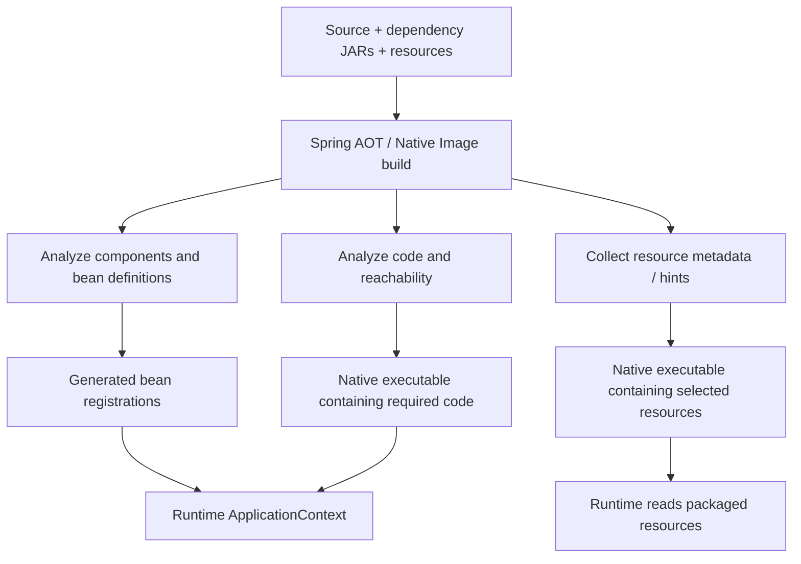

# Classpath Scanning, Resource Enumeration, and Limitations Requiring Design Changes

On the JVM, many Spring applications scan the classpath, find classes by package, list files inside JARs, or pick plugins by resource name. When moving to **GraalVM Native Image**, these operations must be reconsidered: a native executable is built from a known set of code and resources at build time, so the program cannot arbitrarily discover any class or file that might appear on the classpath like a JVM running with an extensible JAR system.

Spring AOT helps pre-process part of the scanning and resolve the application structure. For resources, Native Image needs to know which files must be packaged; for classes, the compiler needs to know which types may be used. If an application relies on **arbitrary runtime discovery**, you may need to add hints or change the design so the set of classes/resources is stably determined.

This lesson belongs to the **Resources** chapter of the `SPRING_BOOT_NATIVE_IMAGE` module. We will distinguish component scanning from resource scanning, understand `classpath:` and `classpath*:`, use `PathMatchingResourcePatternResolver`, register resource hints, handle `ResourceBundle`/`ServiceLoader`, and choose the filesystem or a registry when dynamic extensibility is required.

## 1. Classpath Scanning and Resource Scanning Are Two Different Things

Both may use a classloader or Spring libraries to locate content on the classpath, but their goals differ.

- **Component/class scanning:** finding annotated or condition-matching classes to create Spring beans, or finding types by package/name.
- **Resource scanning:** finding files such as JSON, XML, YAML, templates, schemas, images, properties files, or metadata on the classpath.
- **Runtime enumeration:** listing all URLs/resources/classes accessible in a classpath region at runtime, typically using `ClassLoader.getResources(...)`, `classpath*:`, or JAR scanning.

| Activity | Target | Example |
| --- | --- | --- |
| Component scanning | Java classes and class metadata | `@ComponentScan("com.example")` |
| Classpath resource lookup | A file with a known name | `new ClassPathResource("templates/invoice.html")` |
| Resource pattern scanning | Files matching a pattern | `resolver.getResources("classpath*:rules/*.json")` |
| Dynamic package/class discovery | Classes found by name/package at runtime | Scanning a package to find all implementations of an interface |
| Service provider discovery | Providers registered in service descriptors | `ServiceLoader.load(PaymentPlugin.class)` |

An application may use all five mechanisms. Identify the exact mechanism in play to know whether to configure Spring AOT, resource hints, reflection hints, or change the design.

## 2. Why Can't Native Image Scan the Classpath Arbitrarily?

Native Image performs *closed-world* analysis. When creating an executable, GraalVM needs to know which code can run, which types can be accessed dynamically, and which resources must be embedded. A native executable is not equivalent to a JVM that can add arbitrary JARs to the classpath after startup.

For Spring Boot applications, Spring AOT can scan components, evaluate configurations and conditions at build time, and generate bean registrations. When the native process runs, Spring uses that prepared structure to build the context. This reduces dependence on dynamic classpath scanning at startup.

For resources, if the application needs to read a classpath file in a native image, that file must be included in the image via automatic analysis or metadata/hints. A file existing in the source tree does not automatically guarantee it is packaged into the executable.



Distinguish clearly:

- **A class in a dependency** does not mean every class in that dependency is kept in the native executable.
- **A resource in a JAR** does not mean it is automatically included in the native image.
- **Having a resource hint** does not mean the file is created; the file must still exist in the build input.
- **Having AOT bean registrations** does not mean the runtime can load a new class from a JAR mounted after the build.

## 3. Looking Up a Known Resource with the Spring Resource API

If the application knows the exact resource name, direct lookup is usually simple and easy to control.

Example structure:

```text
src/main/resources/
├── templates/
│   └── invoice.html
├── rules/
│   └── tax-rule.json
└── config/
    └── defaults.yaml
```

Reading a template with `ClassPathResource`:

```java
import java.io.IOException;
import java.nio.charset.StandardCharsets;

import org.springframework.core.io.ClassPathResource;
import org.springframework.stereotype.Component;

@Component
class InvoiceTemplateReader {

    String readTemplate() throws IOException {
        ClassPathResource resource =
                new ClassPathResource("templates/invoice.html");

        try (var input = resource.getInputStream()) {
            return new String(input.readAllBytes(), StandardCharsets.UTF_8);
        }
    }
}
```

The path here is relative to the classpath root, not a file path on the build machine. On the JVM, the resource may live in the classes directory or a JAR; on native, it needs to be included in the image.

If Spring AOT or Native Image does not automatically detect the access path, declare a resource hint:

```java
import org.springframework.aot.hint.RuntimeHints;
import org.springframework.aot.hint.RuntimeHintsRegistrar;

class InvoiceResourceHints implements RuntimeHintsRegistrar {

    @Override
    public void registerHints(
            RuntimeHints hints, ClassLoader classLoader) {

        hints.resources().registerPattern("templates/invoice.html");
    }
}
```

Attach the registrar to configuration:

```java
import org.springframework.context.annotation.Configuration;
import org.springframework.context.annotation.ImportRuntimeHints;

@Configuration(proxyBeanMethods = false)
@ImportRuntimeHints(InvoiceResourceHints.class)
class InvoiceResourceConfiguration {
}
```

A resource hint only helps the native image retain the corresponding file. At runtime when reading the resource, code still needs to handle missing files or I/O errors. For fixed resource names, prefer direct lookup instead of scanning the entire classpath.

## 4. Enumerating Multiple Resources with PathMatchingResourcePatternResolver

Some applications need to read all JSON rules in a classpath directory. Spring provides `PathMatchingResourcePatternResolver` to find resources by pattern:

```java
import java.io.IOException;
import java.nio.charset.StandardCharsets;
import java.util.Arrays;
import java.util.List;

import org.springframework.core.io.Resource;
import org.springframework.core.io.support.PathMatchingResourcePatternResolver;
import org.springframework.stereotype.Component;

@Component
class RuleCatalog {

    private final PathMatchingResourcePatternResolver resolver =
            new PathMatchingResourcePatternResolver();

    List<String> loadRules() throws IOException {
        Resource[] resources =
                resolver.getResources("classpath*:rules/*.json");

        return Arrays.stream(resources)
                .map(this::read)
                .toList();
    }

    private String read(Resource resource) {
        try (var input = resource.getInputStream()) {
            return new String(input.readAllBytes(), StandardCharsets.UTF_8);
        }
        catch (IOException ex) {
            throw new IllegalStateException(
                    "Cannot read rule resource: " + resource.getDescription(), ex);
        }
    }
}
```

The pattern `classpath*:rules/*.json` asks Spring to find matching resources across multiple classpath locations. On the JVM, the resolver can traverse directories and JARs to find matches. In a native image, the result depends on which resources were included in the image and what enumeration capabilities the runtime supports.

If the rule set is fixed by the application, declare resource patterns:

```java
// Register each known resource in the application's rule set.
hints.resources().registerPattern("rules/tax.json");
hints.resources().registerPattern("rules/vat.json");
```

The `classpath*:rules/*.json` pattern of `PathMatchingResourcePatternResolver` is Spring's resource search syntax. Do not copy that exact string verbatim into `RuntimeHints.resources().registerPattern(...)`: the hints API creates metadata for Native Image and has its own semantics depending on the Spring/GraalVM version. When the resource set is small and fixed, registering each exact path is easiest to verify. If you need a broad pattern, consult documentation for your exact version and inspect the generated native metadata.

### 4.1. Distinguishing classpath: and classpath*:

| Prefix | Common meaning | Example |
| --- | --- | --- |
| `classpath:` | Find a resource in a single classpath location; typically resolves one matching resource | `classpath:rules/default.json` |
| `classpath*:` | Find all resources matching the name/pattern across classpath locations | `classpath*:META-INF/spring.factories` |
| `file:` | Read files from the filesystem | `file:/etc/orders/rules/` |

`classpath*:` is useful when the same resource name can come from multiple dependency JARs. However, it does not turn a native executable into a plugin system capable of discovering new JARs at runtime. In a native image, you must ensure the target resources are already included in the image, or move to an external source designed for runtime.

### 4.2. Dynamically Generated Resource Names

Example:

```java
String resourceName = "templates/invoice-" + locale + ".html";
Resource resource = new ClassPathResource(resourceName);
```

The filename depends on the locale. Native Image may not infer all possible resource names. If the locale list is finite, declare a pattern or individual resources:

```java
hints.resources().registerPattern("templates/invoice-vi.html");
hints.resources().registerPattern("templates/invoice-en.html");
```

If the filename comes from a request/user input, do not allow arbitrary access to the classpath. Restrict valid names with an allowlist, prevent path traversal, and verify the resource exists. If the resource list changes after release, use the filesystem or object storage instead of classpath resources.

## 5. Component Scanning and Class Discovery

On the JVM, component scanning typically uses package metadata and the classpath to find classes with stereotype annotations. Example:

```java
@SpringBootApplication
@ComponentScan("com.example.orders")
public class OrdersApplication {
}
```

Spring AOT runs context analysis during the build, finds matching components, and generates bean registrations. When the native executable starts, the application uses those pre-built registrations. Therefore, the application's packages and classpath must be stable between build and runtime.

Certain types of class discovery are not equivalent to component scanning:

```java
// Illustrative example of finding a class by name/package at runtime.
Class<?> type = Class.forName(configuredImplementationClass);
Object plugin = type.getDeclaredConstructor().newInstance();
```

If the class name comes from external config, the compiler does not necessarily know which classes to keep or which constructors need metadata. You can declare reflection hints for a fixed set of classes, but if a new implementation is added via a JAR after the native image is released, hints cannot add bytecode that does not exist in the executable.

### 5.1. Using a Typed Registry Instead of Classpath Scanning

If the application has a known set of implementations, declare them explicitly:

```java
public interface DocumentExporter {
    String export(String content);
}

@Component("csv")
class CsvExporter implements DocumentExporter {
    @Override
    public String export(String content) {
        return "CSV:" + content;
    }
}

@Component("json")
class JsonExporter implements DocumentExporter {
    @Override
    public String export(String content) {
        return "JSON:" + content;
    }
}
```

Then inject the map of beans and select by runtime key:

```java
@Component
class ExportService {
    private final Map<String, DocumentExporter> exporters;

    ExportService(Map<String, DocumentExporter> exporters) {
        this.exporters = exporters;
    }

    String export(String format, String content) {
        DocumentExporter exporter = exporters.get(format);
        if (exporter == null) {
            throw new IllegalArgumentException("Unsupported format: " + format);
        }
        return exporter.export(content);
    }
}
```

Spring AOT can identify the `csv` and `json` beans at build time. Properties or requests only select among existing beans. This is a suitable model when the set of implementations is known upfront.

## 6. ServiceLoader and META-INF/services

Java `ServiceLoader` is a mechanism for discovering providers by service interface. A JAR can declare:

```text
META-INF/services/com.example.orders.DocumentExporter
```

The file lists provider class names, one class per line:

```text
com.example.orders.CsvExporter
com.example.orders.JsonExporter
```

The application loads providers:

```java
import java.util.ServiceLoader;

ServiceLoader<DocumentExporter> exporters =
        ServiceLoader.load(DocumentExporter.class);

for (DocumentExporter exporter : exporters) {
    // Use provider.
}
```

For providers declared via a `META-INF/services` file on the classpath, provider classes must satisfy `ServiceLoader`'s instantiation rules (typically a `public` class with a `public` no-argument constructor); each provider is normally in its own Java file. The `@Component` example in the earlier Spring registry section is a different bean registration approach and does not automatically turn an arbitrary Spring bean into a `ServiceLoader` provider.

This is a discovery mechanism based on resource descriptors and provider classes. Native Image supports `ServiceLoader` in recognized cases, though specific capabilities depend on the GraalVM version, how providers are packaged, and how the service is used. Do not assume that merely having a `META-INF/services` file in the source tree guarantees every provider works automatically in every native build.

When errors occur, verify:

1. Is the descriptor file `META-INF/services/<service-interface>` present in the input dependencies/resources?
2. Do the provider names have the exact package/class and are the classes on the build classpath?
3. Is the metadata/service registration recognized by the native compiler or declared appropriately?
4. Do the constructor/provider use reflection or dynamic access requiring additional hints?
5. Does a native integration test actually call `ServiceLoader.load(...)` and iterate through all providers?

If the provider set is fixed, consider an explicit registry or ensure `ServiceLoader` metadata is included in the native image. If new providers must be loaded from arbitrary JARs after release, consider splitting plugins into a separate process/service or using a JVM host for the plugin part.

## 7. ResourceBundle and Locale-Specific Properties Files

A special group of resources is `ResourceBundle`, commonly used for multilingual messages:

```text
src/main/resources/
└── messages/
    ├── labels.properties
    ├── labels_vi.properties
    └── labels_en.properties
```

Reading a bundle:

```java
import java.util.Locale;
import java.util.ResourceBundle;

ResourceBundle bundle =
        ResourceBundle.getBundle("messages.labels", Locale.forLanguageTag("vi"));

String title = bundle.getString("invoice.title");
```

Native Image has a dedicated metadata mechanism for resource bundles. Spring `RuntimeHints` provides the corresponding API:

```java
hints.resourceBundles().registerBundle("messages.labels");
```

If locales are finite and bundle base names are known, explicit registration ensures the native image retains the required bundles. Test every locale the application supports; a test running only `Locale.ENGLISH` does not prove `labels_vi.properties` was included in the image.

Do not confuse resource bundles with Spring Boot configuration YAML files. Bundles typically serve localization/message lookup; `application.yaml` belongs to Spring Boot's config data system and has its own loading/precedence rules.

## 8. Dependency-Provided vs. Application-Declared Resource Metadata

Resource hints can come from multiple sources, similar to reflection hints:

| Source | Example | Responsibility |
| --- | --- | --- |
| Spring-generated | Resources recognized by Spring AOT/framework from configuration and used features | Spring Framework/Spring Boot |
| Dependency-provided | Library's internal schemas/templates or metadata; registrar or `META-INF/native-image` | Library author or Reachability Metadata Repository |
| Application-declared | Invoice templates, JSON rules, custom message bundles | Application |

If a PDF library already provides resource metadata for its internal fonts/schemas, do not copy all of that metadata into the app. If the application has its own templates, the app should own hints for those templates. When upgrading dependencies, library-managed metadata gets updated alongside the library version.

Example registrar for application resources:

```java
import org.springframework.aot.hint.RuntimeHints;
import org.springframework.aot.hint.RuntimeHintsRegistrar;

class ApplicationResourceHints implements RuntimeHintsRegistrar {

    @Override
    public void registerHints(RuntimeHints hints, ClassLoader classLoader) {
        hints.resources().registerPattern("templates/invoice.html");
        hints.resources().registerPattern("templates/receipt.html");
        hints.resources().registerPattern("rules/tax.json");
        hints.resources().registerPattern("rules/vat.json");
        hints.resourceBundles().registerBundle("messages.labels");
    }
}
```

The paths above are specific known resources. Resolver pattern syntax and Native Image hints pattern syntax should not be assumed identical by default. If you need to register a broad pattern, check the Spring/GraalVM docs for your exact version and inspect the generated metadata files.

## 9. When Resources Need to Change After Release

Classpath resources embedded in a native image are part of the artifact. If operators need to change content without rebuilding, move that content to a runtime source.

| Requirement | Appropriate design |
| --- | --- |
| Templates fixed per application version | Classpath resource + resource hint |
| Rules changing per environment | External YAML/JSON file, mounted via volume or external config |
| Large/frequently updated content catalog | Database, object storage, or content management service |
| Plugin classes changing per release | Dependency/module in build, then rebuild native |
| Arbitrary plugins installed post-deploy | Separate process/service or JVM plugin host |
| Fixed provider set, runtime selection only | Bean registry/`ServiceLoader` with known, packaged providers |

Example of reading rules from the filesystem:

```java
import java.io.IOException;
import java.nio.file.Files;
import java.nio.file.Path;
import java.util.List;

import org.springframework.beans.factory.annotation.Value;
import org.springframework.stereotype.Component;

@Component
class ExternalRuleReader {

    private final Path ruleDirectory;

    ExternalRuleReader(
            @Value("${app.rules.directory:/etc/orders/rules}") String directory) {
        this.ruleDirectory = Path.of(directory);
    }

    List<String> listRuleFiles() throws IOException {
        try (var paths = Files.list(ruleDirectory)) {
            return paths
                    .filter(path -> path.getFileName().toString().endsWith(".json"))
                    .sorted()
                    .map(Path::toString)
                    .toList();
        }
    }
}
```

In this design, rule files are not classpath resources. The native image does not need to embed files in `/etc/orders/rules`; they are mounted or provisioned on the machine/container at runtime. However, ensure the directory exists, the process has read permissions, and contents are validated. Do not directly concatenate request-supplied paths into filesystem paths without an allowlist/path normalization.

## 10. Limitations That Often Force Design Changes

### 10.1. Scanning All Classes in a Package at Runtime

**Symptom:** using a package-scanning library to find all implementations of an interface, then instantiating them by annotation or class name.

**Limitation:** native image cannot retain every class that might appear on the classpath after build. Reflection hints also cannot add bytecode from a new JAR.

**Design:** use component scan/AOT for a fixed set of classes, an explicit registry, a generated index, or `ServiceLoader` with packaged providers. If plugins are truly installed post-deploy, separate them into an independent service/process.

### 10.2. Enumerating All Resources from Multiple JARs with classpath*

**Symptom:** `classpath*:**/*.json` or overly broad patterns to collect every file across all dependencies.

**Limitation:** native image only contains resources included in the image; enumeration results will not necessarily match the JVM classpath. Broad patterns also make it hard to know exactly which resources need to be packaged.

**Design:** narrow the pattern to specific directories/names, declare resource hints, or generate an index at build time. If the list changes post-release, move to a directory/DB/object storage.

### 10.3. Resource Names Built from External Data

**Symptom:** concatenating filenames from unrestricted request, tenant, locale, or config values.

**Limitation:** the compiler cannot know every possible referenced resource in advance; overly broad patterns can package many unnecessary files.

**Design:** allowlist valid resources, register scoped patterns, or store dynamic content outside the native image.

### 10.4. New Plugins Mounted After the Binary Is Built

**Symptom:** mounting a JAR into a container and expecting the native classloader to load new classes.

**Limitation:** the executable was already analyzed/compiled with a known code set; resource/reflection hints cannot add new machine code.

**Design:** rebuild native when adding plugins, or communicate with a separate plugin process/service. If architecture mandates dynamic classloader/JAR loading, evaluate using the JVM for that component.

## 11. Workflow for Verifying Resources on Native Image

Try this on an application with a fixed resource lookup and a pattern enumeration:

1. Add `templates/invoice.html`, `rules/tax.json`, and `messages/labels_vi.properties` to `src/main/resources`.
2. Write code to read the template directly, list rules via `classpath*:rules/*.json`, and load a `ResourceBundle` for locale `vi`.
3. Run tests on the JVM to verify content and resource counts.
4. Add Runtime Hints for resource patterns and bundles if AOT/native does not detect them automatically.
5. Run Spring AOT and inspect generated resources/metadata to confirm hints were contributed.
6. Build the native executable and run the exact lookup/enumeration code paths.
7. Test a non-existent resource to confirm errors are handled intentionally.
8. Try swapping an external file (if external resources were designed) without rebuilding, confirming the app reads the runtime source properly.

Maven can typically run AOT with:

```bash
./mvnw spring-boot:process-aot
./mvnw -Pnative native:compile
```

Gradle typically uses:

```bash
./gradlew processAot
./gradlew nativeCompile
```

Goals/tasks require the appropriate plugins and toolchain; generated output locations depend on configuration. Do not just verify the JSON metadata file exists—run the native binary, because what needs verification is the actual reading path.

## 12. Resource/Classpath Troubleshooting Table

| Symptom | Causes to check | Resolution |
| --- | --- | --- |
| JVM reads file, native reports not found | Resource not included in native image | Add resource hint, check generated metadata, and rebuild |
| `classpath*:` returns fewer results on native | Some resources not packaged or pattern does not cover them | Narrow/adjust pattern and inspect output |
| Component exists on JVM, missing in native | Bean graph/conditions evaluated differently in AOT | Check profiles, conditions, and generated bean registrations |
| Reflection class instantiation fails in native | Missing reflection hint or class not in binary | Check classpath, registrar, and metadata; rebuild if needed |
| `ServiceLoader` cannot find provider | Missing descriptor/provider or metadata not recognized | Check `META-INF/services`, provider classes, and native integration tests |
| `ResourceBundle` missing locale | Bundle not registered or wrong base bundle name | Register bundle and test each locale |
| External file unreadable in container | Wrong volume/path/permissions | Check mount, UID/GID, and runtime path |
| Updated resource, native still reads old content | Resource is embedded in the binary | Move to external file/object storage or rebuild |

## 13. Checklist for AOT/Native-Friendly Resource Design

- [ ] Clearly distinguish class scanning, resource lookup, and runtime enumeration.
- [ ] Identify which resources are classpath resources and which are external files.
- [ ] For fixed-name resources, use direct lookup and declare hints if needed.
- [ ] For resource patterns, only register the scope actually used.
- [ ] For `ResourceBundle`, register the base name and test all locales.
- [ ] For `classpath*:`, verify the resource count on the native executable.
- [ ] For `ServiceLoader`, verify descriptors, provider classes, and appropriate metadata.
- [ ] Do not expect reflection/resource hints to add new classes or JARs into the binary.
- [ ] If the catalog changes post-deploy, use the filesystem, database, or an external service.
- [ ] If dynamic plugin code is needed, choose a build-time plugin set or a separate process/JVM plugin host.
- [ ] Test actual reading paths using the native executable and runtime container.
- [ ] Handle missing files, permissions, encoding, and path traversal intentionally.

### Self-Assessment Questions

1. How do component scanning and resource scanning differ in what they look for and what they produce?
2. Why does `classpath*:` on the JVM not guarantee enumerating the same number of files in a native image?
3. What can a resource hint do, and what can it not do for a new plugin JAR mounted after deployment?
4. When should you use `ClassPathResource`, and when should you use `PathMatchingResourcePatternResolver`?
5. Why must `ResourceBundle` be tested per locale?
6. If JSON rules change daily and you do not want to rebuild the native image, where should the data source be moved?
7. Why might a `ServiceLoader` provider with a descriptor still fail to work in a native executable?

**Expected outcomes:** know how to distinguish class scanning from resource enumeration, accurately declare classpath resources that need packaging, verify `ServiceLoader`/`ResourceBundle`, and recognize when a design change is required. Fixed sets of classes and resources are handled at build time; content that needs post-release updates is moved to an appropriate runtime source. As a result, Spring Boot Native Image behaves predictably, relies less on dynamic classpath scanning, and operates reliably across environments.
