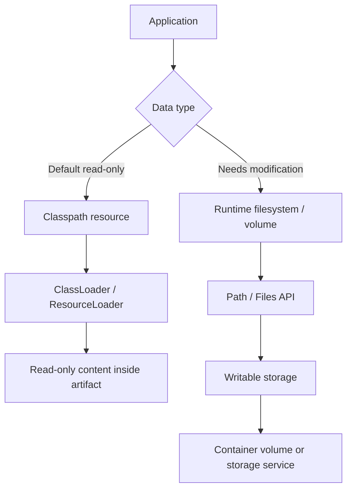

# Reading and Writing Runtime Files Without Assuming Embedded Resources Are Writable

## 1. Distinguishing Embedded Data from Runtime Data

Spring Boot applications frequently need to read templates, SQL migrations, default configuration files, and JSON schemas from the classpath. These resources can be packaged inside a JAR or Native Image for the application to read at runtime. However, **embedded resources are not ordinary files that can be modified in place**.

When compiled into a GraalVM Native Image, classpath resources may be included in the image as packaged data or mapped via Native Image's runtime mechanism. They do not necessarily exist as individual files on the filesystem. Therefore, trying to resolve a file path and overwrite a classpath resource is generally invalid.

Distinguish two purposes:

- **Immutable (read-only) resources**: default templates, SQL migrations, schemas, message bundles, default configurations. Packaged with the application and read via `ClassLoader`/Spring `Resource`.
- **Mutable runtime data**: uploaded files, reports, state, disk caches, updated configuration files, import/export data. Stored on an appropriate filesystem, volume, or object/database storage.

In the **SPRING_BOOT_NATIVE_IMAGE** module, this is especially critical when containerizing: the container's filesystem may be ephemeral, some directories may be read-only, and data that must survive restarts needs to be stored on a volume or persistent storage service.



## 2. Why Are Classpath Resources Not Writable Files?

A resource in `src/main/resources` is typically copied into the output classes or JAR:

```text
src/main/resources/
  templates/invoice.html
  config/default-rules.json
  db/migration/V1__create_invoice.sql
```

When running from an IDE, a resource may happen to sit in a build directory like `build/resources/main`; in that case, the path on disk looks like an ordinary file. When running from a JAR, however, the resource may live inside an archive. When running a Native Image, the resource may be packaged into the executable via its own mechanism.

The following code is unsafe:

```java
URL url = getClass().getClassLoader()
    .getResource("config/default-rules.json");
File file = new File(url.toURI());
Files.writeString(file.toPath(), updatedJson);
```

Problems:

- `url` can be `null` if the resource is not found.
- The URL may use the `jar:` protocol rather than `file:`.
- Native Image does not guarantee that a resource has a standalone filesystem path.
- Even if the URL is a file in dev, the directory may not be writable in a container.
- Modifying files inside an artifact is not the proper way to update deployment configuration.

The right approach is to read the resource content and, if a modified version must be saved, write it to a separately configured runtime location.

## 3. Reading Classpath Resources via ClassLoader

Example of reading default JSON:

```java
public String loadDefaultRules() throws IOException {
    ClassLoader loader = Thread.currentThread().getContextClassLoader();

    try (InputStream input =
            loader.getResourceAsStream("config/default-rules.json")) {
        if (input == null) {
            throw new FileNotFoundException(
                "Classpath resource config/default-rules.json not found");
        }
        return new String(input.readAllBytes(), StandardCharsets.UTF_8);
    }
}
```

Key points to keep in mind:

- `ClassLoader.getResourceAsStream` typically uses a resource name without a leading `/`.
- Always check for `null` and close the stream.
- Specify an explicit charset like UTF-8 rather than relying on the machine's default charset.
- Do not assume `InputStream` is seekable or writable.
- Resource contents should be treated as read-only input.

You can also read relative to a class:

```java
try (InputStream input = InvoiceService.class
        .getResourceAsStream("/templates/invoice.html")) {
    if (input == null) {
        throw new FileNotFoundException("templates/invoice.html");
    }
    // Read contents.
}
```

With `Class.getResource`, a path starting with `/` is resolved from the classpath root; without `/`, it is resolved relative to the class's package.

## 4. Using the Spring Resource Abstraction for Reading

Spring provides `ResourceLoader` and `Resource`, keeping code decoupled from a specific URL type:

```java
@Service
class DefaultRulesService {
    private final ResourceLoader resourceLoader;

    DefaultRulesService(ResourceLoader resourceLoader) {
        this.resourceLoader = resourceLoader;
    }

    String load() throws IOException {
        Resource resource = resourceLoader.getResource(
            "classpath:config/default-rules.json");

        try (InputStream input = resource.getInputStream()) {
            return new String(input.readAllBytes(), StandardCharsets.UTF_8);
        }
    }
}
```

The `Resource` abstraction supports multiple sources such as classpath, filesystem, and URLs. However, when using the `classpath:` prefix, still treat that resource as read-only data. `Resource.getFile()` is not guaranteed to work for every resource; in particular, never use it as a way to convert every classpath resource into a `File`.

If you need to check whether a resource exists, use `resource.exists()` or handle `IOException` appropriately. Do not rely on `getFile()` to write content.

## 5. When Content Needs to Change: Write to the Runtime Filesystem

Suppose an application needs to save generated reports. Instead of modifying the embedded template `templates/invoice.html`, read the template and write the resulting report into a runtime directory, such as `/var/lib/quote-service/reports`.

Use `Path` and `Files`:

```java
@Service
class ReportStorage {
    private final Path reportDirectory;

    ReportStorage(@Value("${app.storage.reports-dir}") String directory) {
        this.reportDirectory = Paths.get(directory).toAbsolutePath().normalize();
    }

    Path save(String fileName, byte[] content) throws IOException {
        Files.createDirectories(reportDirectory);

        Path target = reportDirectory.resolve(fileName).normalize();
        if (!target.startsWith(reportDirectory)) {
            throw new IllegalArgumentException("Invalid report path");
        }

        Files.write(
            target,
            content,
            StandardOpenOption.CREATE,
            StandardOpenOption.TRUNCATE_EXISTING,
            StandardOpenOption.WRITE
        );
        return target;
    }
}
```

Example configuration:

```yaml
app:
  storage:
    reports-dir: /var/lib/quote-service/reports
```

This is a runtime directory, not the classpath. The container must grant write permission there or mount a volume. Checking `normalize()` and `startsWith()` prevents filenames from escaping the target directory; for user uploads, also validate filenames, size limits, file types, and access permissions.

For multi-instance applications, each container's local filesystem is not automatically shared across replicas. If sharing is required, use shared storage/object storage or a database per system requirements.

## 6. Safer File Writing with Temporary Files and Atomic Move

If a file is updated frequently, prevent readers from seeing partially written contents. Write to a temporary file on the same filesystem, then move it to the target name:

```java
Path target = reportDirectory.resolve("latest-report.json");
Path temporary = Files.createTempFile(
    reportDirectory, "latest-report-", ".tmp");

try {
    Files.writeString(
        temporary,
        json,
        StandardCharsets.UTF_8,
        StandardOpenOption.TRUNCATE_EXISTING
    );

    try {
        Files.move(
            temporary,
            target,
            StandardCopyOption.ATOMIC_MOVE,
            StandardCopyOption.REPLACE_EXISTING
        );
    } catch (AtomicMoveNotSupportedException ex) {
        Files.move(
            temporary,
            target,
            StandardCopyOption.REPLACE_EXISTING
        );
    }
} finally {
    Files.deleteIfExists(temporary);
}
```

Atomic move is only supported when the underlying filesystem/provider meets the requirements; the fallback does not provide the same atomicity guarantee. The temporary file should reside on the same filesystem as the target file to maximize the likelihood of an atomic move.

If multiple concurrent requests update the same file, add synchronization, locking, or a design that writes separate names/versions. Atomic move alone does not resolve business-level concurrency conflicts.

## 7. Configuring Runtime Paths per Environment

Write paths should be configurable rather than hardcoded in source code:

```yaml
app:
  storage:
    reports-dir: ${REPORTS_DIR:/var/lib/quote-service/reports}
```

Locally, you can set `REPORTS_DIR=./data/reports`; in a production container, configure the appropriate mount path. The runtime value is read when the application starts and does not need to be packaged as an embedded resource.

Run example:

```bash
REPORTS_DIR=/data/reports ./app
```

In a container:

```bash
docker run --rm \
  -p 8080:8080 \
  -e REPORTS_DIR=/data/reports \
  -v quote-reports:/data/reports \
  example/quote-service:1.0.0
```

The `quote-reports` volume preserves data independently of the container lifecycle via Docker volumes. If using a bind mount, verify the host path and the container process's UID/GID permissions.

## 8. Container Filesystems May Be Ephemeral or Read-Only

A container image typically contains the application artifact and base filesystem. When a container runs, the container's writable layer can be lost when the container is replaced. Therefore:

- Files written to the container's ephemeral writable layer can be lost when the container is removed.
- Volumes or bind mounts are appropriate when data must survive across deployments.
- Some environments enable a read-only root filesystem; the application can only write to explicitly granted volumes/temp paths.
- Temporary directories such as `java.io.tmpdir` must be configured and granted permissions if the application uses them.
- Logs should go to stdout/stderr or a centralized logging system, avoiding long-term storage inside the container layer.

Docker Compose example:

```yaml
services:
  quote-service:
    image: example/quote-service:1.0.0
    read_only: true
    environment:
      REPORTS_DIR: /data/reports
    volumes:
      - reports:/data/reports

volumes:
  reports:
```

This example requires the application to write only to the `/data/reports` volume; if frameworks or libraries also need to write elsewhere (temporary files, logs), provide appropriate writable paths. Do not disable `read_only` just to mask write-permission errors without identifying what needs to be written.

## 9. Resource Hints Are Only for Packaged Resources

Spring `RuntimeHints` can declare classpath resources to retain:

```java
hints.resources().registerPattern("templates/*.html");
hints.resources().registerPattern("config/default-rules.json");
```

This hint tells Native Image to retain the resource inside the artifact. It **does not create writable directories**, does not grant filesystem permissions, and does not turn a classpath resource into a modifiable file.

For runtime files mounted at `/data/reports`, no resource hint is needed just because the application reads/writes them using `Files`. Configure the volume/path and permissions in the runtime environment.

Do not register whole filesystem paths like `/etc/myapp/**` as classpath resources. Classify the source before adding metadata.

## 10. Updating Configuration: Embedded File or External File?

There are two cases:

**Default configuration packaged inside the application**

- Uses `application.yml` or default resources.
- Read as a classpath resource.
- Changing default values requires building a new artifact.
- Do not modify files inside the native executable directly.

**External environment configuration**

- Supplied via environment variables, mounted files, or Spring config locations.
- The path must exist and the process must have read permissions.
- Do not bake passwords/tokens into the binary or image.
- Clearly define precedence when external configuration overrides defaults.

External config file example:

```bash
./app --spring.config.additional-location=file:/etc/quote-service/
```

The `/etc/quote-service/` path is on the runtime filesystem. Container orchestration must mount this file/directory. This is how you change configuration without modifying resources inside the executable.

## 11. Testing Reading and Writing on Native Image

Your test suite should verify both types of data:

1. **Classpath read test**: read a template or default JSON from the native executable.
2. **Filesystem write test**: write a file to the configured runtime directory, read it back, and compare contents.
3. **Permission test**: run the container with the actual production user; confirm the directory has appropriate permissions.
4. **Read-only root test**: enable a read-only root filesystem and mount only allowed writable directories.
5. **Persistence test**: restart/recreate the container and verify data remains if a volume is required.
6. **Path traversal test**: test filenames containing `../` and verify they are rejected.
7. **Concurrency test**: if multiple requests update files, verify no data loss or unintended overwrites occur.

Filesystem test example:

```java
@Test
void writesAndReadsRuntimeFile() throws Exception {
    Path directory = Files.createTempDirectory("reports-test");
    Path file = directory.resolve("result.txt");

    Files.writeString(file, "native-ready", StandardCharsets.UTF_8);

    assertThat(Files.readString(file, StandardCharsets.UTF_8))
        .isEqualTo("native-ready");
}
```

Unit tests using a temporary directory on the JVM help test filesystem logic; integration tests on the actual container/native executable are still needed to verify real paths, users, and volumes.

## 12. Common Errors

| Symptom | Possible cause | Resolution |
|---|---|---|
| `Resource.getFile()` fails in JAR/native | Resource is not a filesystem file | Use `getInputStream()` to read |
| Cannot write to classpath resource | Resource is packaged/read-only | Write modified version to a runtime path |
| `AccessDeniedException` | Container user lacks write permission | Check UID/GID, mount ownership, and permissions |
| File disappears after container recreation | Written to ephemeral writable layer | Use a volume or persistent storage |
| Native Image cannot find template | Missing resource hint or wrong classpath path | Check JAR, registrar, and pattern |
| Read-only container fails to start | Framework writes to an unmounted directory | Identify needed writable paths and mount explicitly |
| File written to wrong directory | Relative path depends on working directory | Use an absolute configured path |
| Upload writes outside directory | Path traversal via filename | Normalize, verify boundaries, and use safe identifiers |

## 13. Storage Design Checklist

- Classify every piece of data: classpath read-only vs. runtime mutable.
- Use `ClassLoader`/`ResourceLoader` to read embedded resources.
- Do not use `Resource.getFile()` as a classpath-writing API.
- Configure runtime paths via properties/environment variables.
- Use `Path`/`Files`, validate filenames, and prevent path traversal.
- Use temporary files/atomic moves when partial writes must be avoided.
- Mount volumes for data that must persist across container lifecycles.
- Test write permissions with the actual user and a read-only root filesystem.
- Do not package secrets or environment-specific data into the Native Image.
- Test on the native executable and application container.

## 14. Self-Check Questions

1. Why shouldn't classpath resources in a JAR or Native Image be treated as modifiable files?
2. What is the difference between `ClassLoader.getResourceAsStream` and `Files.write`?
3. When should you use Spring `ResourceLoader`, and why does `Resource.getFile()` not always work?
4. Why can data written inside a container be lost when the container is replaced?
5. What problem do volumes solve, and do they automatically protect data against all forms of loss?
6. Does a resource hint grant write permission to a filesystem path?
7. How do you prevent path traversal when saving user-submitted files?

**Remember:** resources embedded on the classpath are read-only data traveling with the artifact; data that needs modification must be written to the runtime filesystem or external storage. With Native Image/containers, configure paths, permissions, and volumes explicitly, then test on the actual deployment environment.
