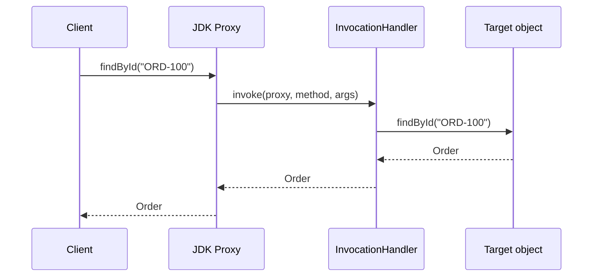
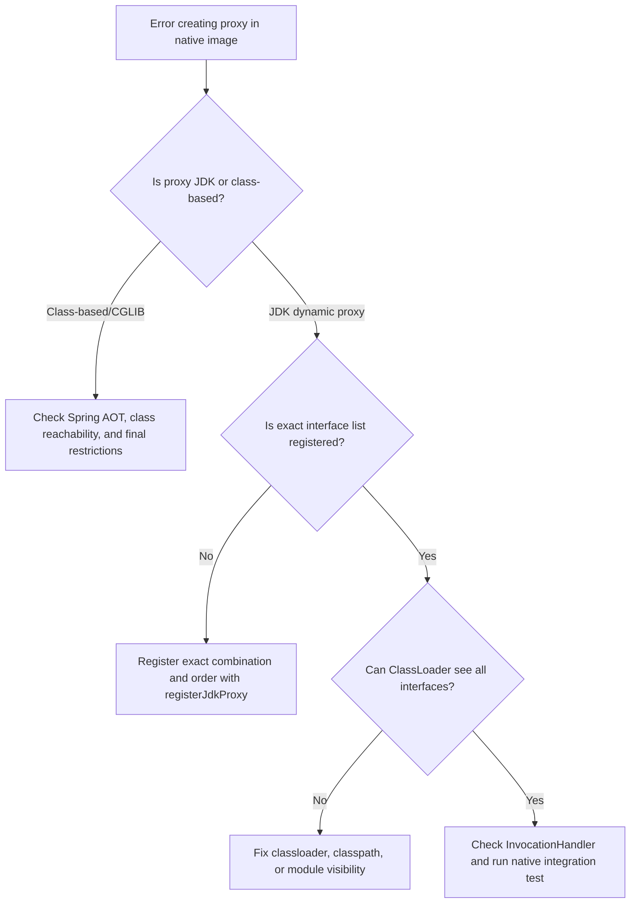

# JDK dynamic proxies and knowing interface lists ahead of time

## 1. Why must JDK dynamic proxies be declared when building a Native Image?

In Spring Boot applications, proxies are used to add behavior without modifying business classes directly. For example: permission checks, logging, timing, opening transactions, or invoking a remote adapter. A common way Java creates proxies is **JDK dynamic proxy**: the JVM generates a class that implements one or more interfaces and forwards method calls to an `InvocationHandler`.

On a standard JVM, an application can call `Proxy.newProxyInstance(...)` with an interface list determined at runtime. However, **GraalVM Native Image** analyzes code and generates the executable at build time. The compiler cannot arbitrarily generate a new proxy class for any set of interfaces that the application only discovers after the executable starts running.

Therefore, for a native image, the interface combinations used to create JDK dynamic proxies must be known ahead of time and registered during AOT/build processing. Spring provides `RuntimeHints.proxies().registerJdkProxy(...)` to describe these exact combinations.

After this lesson, you will be able to:

- Explain `Proxy`, `InvocationHandler`, and the role of the interface list.
- Understand why **the set of interfaces and their order** are part of a proxy's definition.
- Register proxies using `RuntimeHintsRegistrar` and `@ImportRuntimeHints`.
- Recognize proxies created by Spring AOP and distinguish them from proxies created dynamically in application code.
- Test proxy hints and troubleshoot errors when running on GraalVM Native Image.

The running example is an `OrderService` wrapped by a proxy implementing `OrderOperations` and `Auditable`. Both interfaces must be declared in the exact combination when building native.

## 2. How does a JDK dynamic proxy work?

### 2.1. Proxy implements interfaces and delegates calls

A JDK dynamic proxy creates an object that can be used through the specified interfaces. When code invokes a method on the proxy, the call is forwarded to `InvocationHandler.invoke(...)`.



A proxy does not necessarily contain business logic. It serves as an interception point where the handler decides whether to process, delegate, or add behavior before/after the call.

### 2.2. Declaring business interfaces

```java
package com.example.orders;

public interface OrderOperations {
    Order findById(String orderId);
}
```

```java
package com.example.orders;

public interface Auditable {
    String auditId();
}
```

The target object implementing the business logic:

```java
package com.example.orders;

public record Order(String id) {
}
```

```java
package com.example.orders;

public class OrderService implements OrderOperations {

    @Override
    public Order findById(String orderId) {
        return new Order(orderId);
    }
}
```

`Order` here is an application data type. The example focuses on the proxy mechanism; object initialization, repositories, and error handling of a real-world service are omitted.

### 2.3. Creating a proxy with `Proxy.newProxyInstance`

```java
import java.lang.reflect.InvocationHandler;
import java.lang.reflect.Proxy;

OrderService target = new OrderService();

InvocationHandler handler = (proxy, method, args) -> {
    if (method.getDeclaringClass() == Object.class) {
        return switch (method.getName()) {
            case "toString" -> "OrderOperationsProxy";
            case "hashCode" -> System.identityHashCode(proxy);
            case "equals" -> proxy == args[0];
            default -> throw new UnsupportedOperationException(method.getName());
        };
    }

    if (method.getDeclaringClass() == Auditable.class) {
        return "order-service";
    }

    return method.invoke(target, args);
};

Object proxy = Proxy.newProxyInstance(
        OrderOperations.class.getClassLoader(),
        new Class<?>[] { OrderOperations.class, Auditable.class },
        handler);

OrderOperations orders = (OrderOperations) proxy;
Auditable audit = (Auditable) proxy;
```

Here:

- `OrderOperations.class` and `Auditable.class` are the interfaces that the proxy must implement.
- `InvocationHandler` receives each method invocation and decides how to handle it.
- `target` performs the `findById` business logic; the handler directly handles `auditId` and `Object` methods.
- The proxy object can be cast to both `OrderOperations` and `Auditable`.

In a real application, consider exception handling, default interface methods, methods with matching signatures across multiple interfaces, and unwrapping `InvocationTargetException` when delegating via reflection.

## 3. The interface list is part of the proxy definition

### 3.1. Native Image needs to know interface combinations ahead of time

On the JVM, the following code can obtain the interface list from runtime configuration:

```java
Class<?>[] interfaces = discoverInterfacesFromConfiguration();

Object proxy = Proxy.newProxyInstance(
        applicationClassLoader,
        interfaces,
        invocationHandler);
```

If `interfaces` is only discovered after the application starts running, the native compiler does not know which proxy classes to generate at build time. For a native image, you must determine in advance which combinations can occur:

```text
Combination A: [OrderOperations]
Combination B: [OrderOperations, Auditable]
Combination C: [PaymentOperations, Auditable]
```

Each combination is a separate proxy configuration. Register only the combinations that the application can actually create.

### 3.2. Interface order also matters

Do not treat the interface list as an unordered set. JDK proxy uses the interface order when generating the proxy class. If two interfaces declare a method with the same name and parameters, `InvocationHandler` may receive the `Method` corresponding to the interface that appears first in the list. Native Image proxy metadata also describes interface lists in order.

For example:

```java
new Class<?>[] { OrderOperations.class, Auditable.class }
```

is different from:

```java
new Class<?>[] { Auditable.class, OrderOperations.class }
```

If code can create both orders, both combinations must be registered. If the application uses only one order, keep that order consistent where the proxy is created and where hints are registered.

### 3.3. Constraints on the interface list

`Proxy.newProxyInstance(...)` has several important conditions:

- Every element must be an interface, not a regular class.
- The same interface must not appear more than once in a list.
- All interfaces must be visible from the passed-in class loader.
- If any non-`public` interfaces are included, non-`public` interfaces in the same proxy must satisfy the Java Proxy API's package/module rules.
- If multiple interfaces have methods with the same signature but incompatible return types, proxy creation may fail.

Therefore, declaring hints in the right order is still not enough if the runtime class loader cannot see the interfaces or if the interface structure is invalid.

## 4. Registering JDK proxies with Spring Runtime Hints

Spring AOT provides a dedicated API for declaring proxy interfaces. With Spring Framework 6 and later, you can use `RuntimeHintsRegistrar` and `@ImportRuntimeHints`.

### 4.1. Writing a registrar for an interface combination

```java
package com.example.orders;

import org.springframework.aot.hint.RuntimeHints;
import org.springframework.aot.hint.RuntimeHintsRegistrar;

public class OrderProxyRuntimeHints implements RuntimeHintsRegistrar {

    @Override
    public void registerHints(RuntimeHints hints, ClassLoader classLoader) {
        hints.proxies().registerJdkProxy(
                OrderOperations.class,
                Auditable.class);
    }
}
```

The `registerJdkProxy(...)` call registers an ordered proxy combination: `OrderOperations` before `Auditable`. The arguments are interface classes, not class names as strings and not service implementation classes.

### 4.2. Attaching hints to the component that creates the proxy

```java
package com.example.orders;

import java.lang.reflect.Proxy;

import org.springframework.context.annotation.Bean;
import org.springframework.context.annotation.Configuration;
import org.springframework.context.annotation.ImportRuntimeHints;

@Configuration(proxyBeanMethods = false)
@ImportRuntimeHints(OrderProxyRuntimeHints.class)
public class OrderProxyConfiguration {

    @Bean
    OrderOperations orderOperations(OrderService target) {
        return (OrderOperations) Proxy.newProxyInstance(
                OrderOperations.class.getClassLoader(),
                new Class<?>[] { OrderOperations.class, Auditable.class },
                (proxy, method, args) -> {
                    if (method.getDeclaringClass() == Auditable.class) {
                        return "order-service";
                    }
                    return method.invoke(target, args);
                });
    }
}
```

In a complete application, you also need to handle `Object` methods and reflection exceptions as shown in the earlier example. The important part here is that the interface list in `newProxyInstance(...)` **matches the order** of the list passed to `registerJdkProxy(...)`.

You can attach `@ImportRuntimeHints` to the component or `@Bean` method that owns the proxy rather than a global configuration. This keeps metadata tied to the specific integration and avoids adding unnecessary proxy hints.

In the example, the factory method exposes the bean with type `OrderOperations`; `Auditable` is an additional interface on the same proxy object. If the application needs to inject the bean directly by both interfaces during AOT analysis, declare a composite bean type that explicitly expresses both contracts or design the factory/bean metadata so Spring knows the full set of assignable types.

### 4.3. Registering multiple proxy combinations

If the application creates multiple kinds of proxies, register each combination separately:

```java
public class ApplicationProxyRuntimeHints implements RuntimeHintsRegistrar {

    @Override
    public void registerHints(RuntimeHints hints, ClassLoader classLoader) {
        hints.proxies().registerJdkProxy(OrderOperations.class);

        hints.proxies().registerJdkProxy(
                OrderOperations.class,
                Auditable.class);

        hints.proxies().registerJdkProxy(
                PaymentOperations.class,
                Auditable.class);
    }
}
```

Do not register one list containing every interface across the system hoping it covers all combinations. `[A, B]` and `[A, C]` are two different proxies; `[A, B, C]` does not replace those two combinations.

## 5. Testing proxy hints

### 5.1. Using `RuntimeHintsPredicates`

Spring provides a predicate to verify that a JDK proxy combination has been registered:

```java
package com.example.orders;

import org.junit.jupiter.api.Test;
import org.springframework.aot.hint.RuntimeHints;
import org.springframework.aot.hint.predicate.RuntimeHintsPredicates;

import static org.assertj.core.api.Assertions.assertThat;

class OrderProxyRuntimeHintsTests {

    @Test
    void registersTheExpectedOrderedInterfaceList() {
        RuntimeHints hints = new RuntimeHints();
        new OrderProxyRuntimeHints().registerHints(
                hints, getClass().getClassLoader());

        assertThat(RuntimeHintsPredicates.proxies()
                .forInterfaces(OrderOperations.class, Auditable.class))
                .accepts(hints);
    }
}
```

This test confirms that the registrar declares the expected proxy combination. If you change the interface order in the proxy-creation code, update both the registrar and the test. The predicate does not prove that every `InvocationHandler` behavior is correct; you need separate tests for delegation and special methods.

### 5.2. Testing proxy behavior on the JVM

```java
@Test
void delegatesBusinessMethodAndExposesAuditInterface() {
    OrderService target = new OrderService();
    Object proxy = OrderProxyFactory.create(target);

    OrderOperations orders = (OrderOperations) proxy;
    Auditable audit = (Auditable) proxy;

    assertThat(orders.findById("ORD-100").id()).isEqualTo("ORD-100");
    assertThat(audit.auditId()).isEqualTo("order-service");
}
```

`OrderProxyFactory.create(...)` represents the factory that creates the proxy using the same registered interface list. The JVM test confirms that the handler and target work together properly; it does not replace running a native image.

### 5.3. Testing on the native executable

After the hints unit test and JVM behavior test pass, build the native application and execute the exact code path that creates the proxy. Verify:

- The proxy is created without missing proxy metadata errors.
- The proxy can be cast to each declared interface.
- Each method is routed to the right branch of `InvocationHandler`.
- `equals`, `hashCode`, and `toString` behave as designed.
- Optional interface combinations are only used when the corresponding module is included in the build.

Do not conclude that a proxy is native-compatible just because `nativeCompile` succeeds. Many errors only surface when the code path calling `Proxy.newProxyInstance(...)` is actually executed.

## 6. Does Spring AOP use JDK dynamic proxies?

Spring AOP can use either JDK dynamic proxies or class-based proxies. The choice depends on configuration and the target type:

| Proxy type | Mechanism | Characteristics |
|---|---|---|
| JDK dynamic proxy | Generates a class implementing interfaces | Clients typically interact through interfaces; the proxy is not a subclass of the target |
| Class-based proxy (commonly using CGLIB) | Generates a subclass of the target class | Can proxy classes without interfaces; cannot override `final` classes/methods |

Example of a service with an interface:

```java
public interface PaymentService {
    void pay(String paymentId);
}

@Service
public class DefaultPaymentService implements PaymentService {

    @Override
    @Transactional
    public void pay(String paymentId) {
        // Process payment.
    }
}
```

Spring AOP can create a proxy for `PaymentService` to apply transaction advice. If the configuration forces JDK proxies (for example `proxyTargetClass = false` and the target has an interface), the required interface list must be known. If class-based proxies are used, that is a different mechanism and is not registered via `registerJdkProxy(...)`.

### 6.1. Proxies managed by Spring AOT

Spring AOT can analyze AOP/proxy configurations declared statically in bean definitions and contribute the required metadata. Therefore, for proxies created by Spring from AOT-recognizable configuration, let Spring AOT handle them first and inspect the generated hints/build output.

Do not manually add duplicate proxy hints just because a bean has `@Transactional`, `@Async`, or `@Cacheable`. Only add `RuntimeHints.proxies()` when your application or library creates a JDK proxy with a combination that Spring AOT does not automatically detect.

### 6.2. Proxies created dynamically from a runtime interface list

The following example is difficult to make compatible with native image if the interface list is not known ahead of time:

```java
Class<?>[] interfaces = pluginRegistry
        .findPlugin(pluginName)
        .proxyInterfaces();

Object proxy = Proxy.newProxyInstance(
        pluginClassLoader,
        interfaces,
        invocationHandler);
```

If a plugin can supply an arbitrary set of interfaces after the native executable is built, it is impossible to accurately register every combination unknown to the compiler. You must change the design to constrain the possible proxy combinations at build time, or use a plugin/deployment mechanism better suited to that extensibility requirement.

## 7. Distinguishing JDK proxies from CGLIB and other proxy types

`RuntimeHints.proxies().registerJdkProxy(...)` only describes **JDK dynamic proxies**. Do not use this API to register a CGLIB subclass proxy.

| Indicator | JDK dynamic proxy | Class-based/CGLIB proxy |
|---|---|---|
| Proxy object implements interfaces | Yes | Possibly, but not required |
| Proxy is a subclass of target class | No | Yes |
| Created via `Proxy.newProxyInstance` | Yes | No |
| Registered via `registerJdkProxy` | Yes | No |
| Restriction on `final` classes/methods | Does not apply in a subclass sense | Cannot override to intercept |
| Native metadata | Register interface combination if not auto-detected by AOT | Depends on proxy/AOT mechanism and class-based proxy reachability |

When investigating a proxy error in a native image, first determine whether the proxy is actually created by JDK `Proxy`, Spring AOP, or CGLIB. Choosing the wrong hint type can render the metadata ineffective.

## 8. Common errors

| Symptom | Possible cause | Resolution |
|---|---|---|
| Works on JVM but native fails when creating proxy | Exact interface combination not registered | Add `registerJdkProxy(...)` for the exact list and order |
| Proxy has one interface but misses another | Hints registered only one interface or a different combination | Register all interfaces from the `newProxyInstance` call |
| Proxy fails when changing interface order | Proxy combination registered with a different order or conflicting method signatures | Keep order consistent; separately register orders actually used |
| `IllegalArgumentException` when creating proxy | An element is not an interface, duplicate interface, or method conflict | Check the interface list and `Proxy.newProxyInstance` rules |
| `ClassNotFoundException`/visibility error | Class loader cannot see all interfaces | Use the appropriate loader and check classpath/module visibility |
| Native image builds successfully but proxy code path fails | Proxy creation code path wasn't exercised in tests or metadata is missing | Add a native integration test exercising that exact code path |
| Added `registerJdkProxy` but CGLIB error persists | Using class-based proxy, not JDK proxy | Check `proxyTargetClass` and the actual proxy type |
| Spring AOP works on JVM but native lacks proxy | AOP config not recognized by AOT or proxy created dynamically outside the bean graph | Inspect AOT output, narrow configuration, and add hints for custom combinations |

### 8.1. Diagnostic workflow



## 9. Hands-on lab: creating a proxy for `OrderService`

**Context:** an ordering service needs to wrap `OrderService` with a proxy implementing two interfaces `OrderOperations` and `Auditable`. The proxy is created in Spring configuration and must work on GraalVM Native Image.

### Step 1 — Create target and interfaces

Create `OrderService implements OrderOperations`, along with the `Auditable` interface. Ensure the interface list is valid, has no duplicates, and all types are visible from the class loader creating the proxy.

### Step 2 — Create the proxy factory

Encapsulate the `Proxy.newProxyInstance(...)` call in a factory. Keep the `[OrderOperations, Auditable]` order fixed. The handler must handle business methods, audit methods, and `Object` methods according to application requirements.

### Step 3 — Register runtime hints

Create `OrderProxyRuntimeHints implements RuntimeHintsRegistrar`, calling:

```java
hints.proxies().registerJdkProxy(
        OrderOperations.class,
        Auditable.class);
```

Attach the registrar using `@ImportRuntimeHints` on the configuration or component that owns the proxy.

### Step 4 — Write unit tests

Use `RuntimeHintsPredicates.proxies().forInterfaces(...)` to verify the interface combination. Also write a separate test to confirm that `InvocationHandler` delegates methods correctly.

### Step 5 — Build and test native

Run the project's Spring AOT/native build pipeline, produce the executable, and call a real endpoint that uses the proxy. Run both JVM tests and native executable integration tests.

### Result checklist

| Item | Value to record |
|---|---|
| Proxy type | JDK dynamic proxy / CGLIB |
| Ordered interface list | `OrderOperations`, `Auditable` |
| Class loader creating proxy | _(record)_ |
| Runtime hints registrar | `OrderProxyRuntimeHints` |
| Proxy predicate unit test | PASS/FAIL |
| JVM behavior test | PASS/FAIL |
| Native integration test | PASS/FAIL |
| Tested methods | Business, audit, `equals`, `hashCode`, `toString` |

## 10. Key takeaways

A JDK dynamic proxy is a generated class implementing **a specific list of interfaces** and forwarding calls to an `InvocationHandler`. For native images, this interface list must be known ahead of time. Furthermore, interface order is part of the proxy configuration; a combination in a different order must be declared separately if the application actually creates it.

For custom proxies, use `RuntimeHints.proxies().registerJdkProxy(...)` inside a `RuntimeHintsRegistrar` and attach the registrar close to the proxy-creating component via `@ImportRuntimeHints`. For proxies managed by Spring AOP, first verify whether Spring AOT already detects and contributes the metadata. Distinguish JDK proxies from CGLIB, test both the interface list and the `InvocationHandler`, and run integration tests on the native executable.

### Official references

- [Java SE — `java.lang.reflect.Proxy`](https://docs.oracle.com/en/java/javase/25/docs/api/java.base/java/lang/reflect/Proxy.html)
- [Java SE — `InvocationHandler`](https://docs.oracle.com/en/java/javase/25/docs/api/java.base/java/lang/reflect/InvocationHandler.html)
- [Spring Framework — Runtime Hints and AOT](https://docs.spring.io/spring-framework/reference/core/aot.html)
- [Spring Framework — `RuntimeHints` Javadoc](https://docs.spring.io/spring-framework/docs/current/javadoc-api/org/springframework/aot/hint/RuntimeHints.html)
- [Spring Framework — `ProxyHints` Javadoc](https://docs.spring.io/spring-framework/docs/current/javadoc-api/org/springframework/aot/hint/ProxyHints.html)
- [GraalVM Native Image — Dynamic Proxy Metadata](https://www.graalvm.org/latest/reference-manual/native-image/metadata/)
