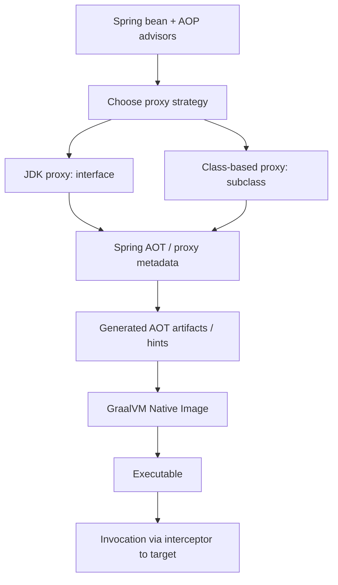

# Class-based proxies and proxy code prepared by Spring AOT

## 1. What is a class-based proxy?

In Spring AOP, a proxy stands between the caller and the target object to perform additional behavior such as transactions, logging, security, retries, or metrics. There are two common proxy styles:

- **JDK dynamic proxy**: creates an object implementing one or more interfaces; calls are forwarded to an `InvocationHandler`.
- **Class-based proxy**: creates a subclass of the target class (typically via bytecode generation such as CGLIB in a JVM environment); methods are overridden to route calls through an interceptor and then to the target.

Class-based proxies are useful when a bean does not have a suitable interface or when configuration requests class proxying. However, they are subject to inheritance limitations: `final` classes cannot be subclassed; `final`, `private`, or non-overridable methods cannot be intercepted by standard subclass proxying.

In the **SPRING_BOOT_NATIVE_IMAGE** module, Spring AOT prepares part of the proxy work at build time so GraalVM Native Image can analyze it and generate the executable. The goal is to make required proxies known ahead of time rather than relying on arbitrary bytecode generation while the native application is running.



Not every proxy in Spring needs manual configuration. Spring AOT and framework integrations can detect proxies from bean/AOP configuration. When an error occurs, identify which proxy is being created and which mechanism creates it before adding metadata.

## 2. When does Spring use a class-based proxy?

Spring AOP typically chooses a JDK dynamic proxy when a bean implements an interface and configuration permits interface proxying. A class-based proxy may be chosen when:

- The bean does not implement a suitable interface.
- The application enables `proxy-target-class`.
- The AOP configuration requests class proxying.
- The framework needs to proxy a concrete class rather than exposing only an interface.

Example Spring Boot configuration:

```yaml
spring:
  aop:
    proxy-target-class: true
```

This property instructs Spring AOP to prefer class-based proxies within the corresponding Spring Boot configuration scope. Actual behavior still depends on the proxy type and framework integration; do not assume it converts every proxy across the entire application to the same kind.

With Java configuration, you can use:

```java
@Configuration
@EnableAspectJAutoProxy(proxyTargetClass = true)
class AopConfiguration {
}
```

If you already use Spring Boot auto-configuration, you do not need to mechanically add `@EnableAspectJAutoProxy`. Avoid duplicate configuration declarations if the application already enables AOP via the starter and properties.

## 3. Example of a class-based proxy with Spring AOP

Suppose a service does not implement an interface:

```java
@Service
public class InvoiceService {

    public String issue(String customerId) {
        return "invoice:" + customerId;
    }
}
```

An aspect that records invocations:

```java
@Aspect
@Component
class TimingAspect {

    @Around("execution(* com.example.invoice.InvoiceService.*(..))")
    Object measure(ProceedingJoinPoint joinPoint) throws Throwable {
        long start = System.nanoTime();
        try {
            return joinPoint.proceed();
        } finally {
            long elapsed = System.nanoTime() - start;
            System.out.println("elapsed-ns=" + elapsed);
        }
    }
}
```

When Spring creates the bean and applies the aspect, the proxy class can extend `InvoiceService` and override eligible methods to route calls through the interceptor. Callers receive the proxy as an `InvoiceService`, while additional logic runs before/after the target method.

This is a conceptual AOP proxy example. The pointcut must match the method and the bean must be Spring-managed; if the aspect does not run, check component scanning, the pointcut, bean creation, and self-invocation before concluding it is a Native Image bug.

## 4. Limitations of subclass proxies

Class-based proxies rely on the ability to create subclasses and override methods. Note the following cases:

| Element | Impact |
|---|---|
| `final` class | Cannot create a standard subclass proxy |
| `final` method | Cannot be overridden to insert an interceptor |
| `private` method | Not overridden and not a suitable join point for subclass proxies |
| Method/package access | Overridability depends on package, visibility, and class loader |
| Constructor | Subclass must satisfy class initialization rules; the framework may use an appropriate instantiation mechanism |
| Sealed class | May restrict subclasses outside the `permits` list |
| Native method | Cannot be overridden like a regular Java method |

If a method is not intercepted, check its modifiers and how it is invoked first. Not every method on a target automatically goes through the proxy.

### Self-invocation

In proxy-based AOP, a call from one method of the target to another method on the same `this` typically does not go through the proxy:

```java
public void process() {
    this.save(); // self-invocation: typically bypasses the proxy interceptor
}

@Transactional
public void save() {
    // persist data
}
```

If `process()` calls `save()` internally on the same instance, transaction advice may not be applied as expected. This is a characteristic of proxy AOP, not specific to Native Image. You can extract the method into another bean or redesign service boundaries so the call goes through the proxy.

## 5. Why does Native Image need proxies prepared ahead of time?

On the JVM, some proxy mechanisms can generate bytecode at runtime. Native Image applies closed-world analysis: the set of classes and required dynamic behaviors must be determined early enough for the compiler to retain and generate the corresponding code.

If a library tries to arbitrarily generate proxy classes via bytecode generation after the native executable is built, that mechanism may be incompatible with the native environment. Spring AOT helps by analyzing configuration and preparing the proxy components that the framework knows ahead of time.

Distinguish three activities:

1. **Choosing the proxy strategy**: JDK interface proxy or class-based proxy.
2. **Preparing proxies for AOT/native**: the framework determines the required proxy types, target classes, interfaces, and advisors.
3. **Executing runtime invocations**: the prepared proxy routes calls through interceptors to the target.

AOT succeeding does not guarantee that every proxy dynamically generated by third-party libraries is supported. Libraries must provide appropriate AOT/native integrations, or the application must change how proxies are created.

## 6. Proxy code prepared by Spring AOT

During the Spring AOT process, the framework analyzes the application context and beans that may be proxied. Depending on the Spring Framework/Spring Boot version and proxy type, AOT may generate artifacts or metadata so Native Image knows which proxies will be used.

Practical implications:

- The set of target classes and interfaces is determined at build time.
- Required advisors/interceptors are linked to bean configurations.
- Required proxies are prepared via the AOT mechanism supported by the framework version.
- Native Image can analyze the generated or registered classes/hints.

Do not treat "Spring AOT generates proxy code" as an identical detail across every proxy type, Spring version, and library. Internal APIs, generated artifact types, and support capabilities depend on versions. Check AOT logs, generated sources/resources, and the Spring Native/AOT documentation for your actual version.

If your application directly invokes CGLIB or ASM to generate subclasses based on runtime data, Spring AOT does not automatically turn all those generated classes into static code. Check whether the library provides AOT contributions, or switch to a design where proxies can be determined before build time.

## 7. Distinguishing class-based proxies from JDK proxy hints

Spring `RuntimeHints` provides `hints.proxies().registerJdkProxy(...)` for JDK dynamic proxies based on an interface set. That API is **not** how you register all class-based proxies.

| Mechanism | What it describes | Resolution direction |
|---|---|---|
| JDK dynamic proxy | List of proxied interfaces | JDK proxy hints when AOT does not auto-detect |
| Class-based proxy | Subclass of the target class | Rely on Spring's or the corresponding library's AOT/proxy support |
| Reflection on target | Dynamically accessed constructors/methods/fields | Separate reflection hints if needed |
| Resources used in interceptor | Dynamically read classpath files | Separate resource hints if needed |

Do not add a JDK proxy hint to fix a CGLIB/subclass proxy error. Also do not add reflection hints for an entire class expecting it to automatically generate a subclass proxy.

## 8. Checking the proxy strategy and configuration

When you need to determine how a bean is being proxied, you can observe it in tests or debugging:

```java
Object bean = applicationContext.getBean(InvoiceService.class);

System.out.println(AopUtils.isAopProxy(bean));
System.out.println(AopUtils.isJdkDynamicProxy(bean));
System.out.println(AopUtils.isCglibProxy(bean));
```

These methods belong to Spring AOP utilities. They help distinguish proxy objects in a JVM/test context. With Native Image, run a similar check in the executable if the application allows it, or verify behavior through integration tests.

Do not rely on generated class names like `InvoiceService$$SpringCGLIB$$...`, because naming and implementation details can change across versions, builds, and AOT mechanisms.

## 9. Testing AOT and Native Image

A useful testing workflow:

1. Run JVM tests to confirm the aspect/proxy works.
2. Identify which beans are proxies, the proxy type, and the applied pointcuts/advisors.
3. Run Spring AOT with the exact profile and dependency graph.
4. Check logs/generated artifacts to confirm the proxy is handled by the framework.
5. Build Native Image using Gradle `nativeCompile` or Maven native compile.
6. Run the native executable and invoke the method requiring the interceptor.
7. Test public/final methods, self-invocation, exception paths, and related integrations.
8. Run the same flow on the target container.

Example test:

```java
@SpringBootTest
class InvoiceAopTest {

    @Autowired
    InvoiceService invoiceService;

    @Test
    void invoiceMethodCanBeInvokedThroughProxy() {
        assertThat(invoiceService.issue("C-100"))
            .isEqualTo("invoice:C-100");
    }
}
```

This test verifies the method result; to prove the advice actually ran, inject a spy/counter or assert the interceptor's side effect. Then run the test against the native executable. Passing JVM tests alone does not prove native proxies were prepared properly.

## 10. Common errors

| Symptom | Possible cause | Resolution direction |
|---|---|---|
| Bean is not a proxy | Aspect/pointcut does not match or AOP is not enabled | Check dependencies, component scan, pointcut |
| Cannot proxy class | `final` or `sealed` class, or constructor/access constraint | Use an interface proxy or change design |
| Method is not intercepted | `final`/`private` method or self-invocation | Check modifiers and call path |
| Runs on JVM, fails on native when creating proxy | Runtime bytecode generation not supported by AOT | Check framework/library AOT support |
| JDK proxy hints do not fix the error | Error belongs to class-based proxy | Identify the exact proxy strategy |
| AOT passes but advice does not run | Advisor/bean graph/pointcut not as expected | Inspect generated AOT context and integration tests |
| Proxy runs but reflection in target fails | Missing metadata for dynamically invoked members | Add separate reflection hints |

## 11. Design principles

- Prefer interfaces when the service contract naturally has an interface and JDK proxies meet requirements.
- If using class-based proxies, avoid `final` classes/methods at points needing interception.
- Design bean boundaries to avoid self-invocation when advice is required.
- Use Spring AOP/framework integrations with AOT support instead of arbitrary custom bytecode generation.
- Do not confuse JDK proxy hints with class-based proxy support.
- Register separate reflection/resource metadata when interceptors or targets perform dynamic access.
- Test proxies on the native executable and real container.
- Record Spring Boot, Spring Framework, GraalVM, and plugin versions in the build report.

## 12. Self-check questions

1. How does a class-based proxy differ from a JDK dynamic proxy in how it is created and the types it proxies?
2. Why can a `final` class or method prevent subclass proxying?
3. How does Spring AOT assist with proxies before GraalVM Native Image compilation?
4. Why does `registerJdkProxy` not resolve class-based proxy errors?
5. How does self-invocation affect transaction/AOP advice?
6. How do you determine whether a bean uses a JDK or class-based proxy?
7. What tests are needed to prove that advice works on a native executable?

**Key takeaway:** class-based proxies rely on subclassing and carry inheritance limitations; Spring AOT prepares proxies that the framework can determine ahead of time for Native Image processing. Identify the proxy strategy, avoid non-overridable members, distinguish from JDK proxy hints, and test advice behavior on the native executable.
