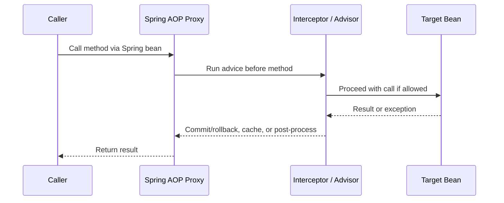
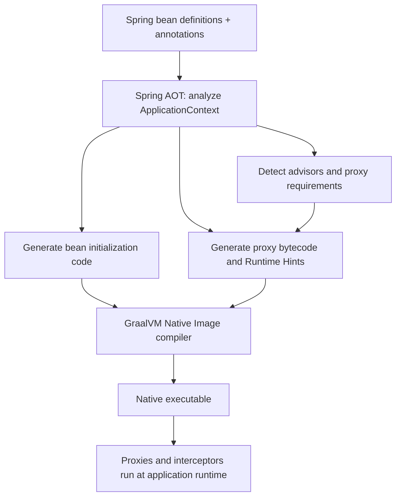

# @Transactional, @Async, caching, and method security in native applications

> **Chapter: Proxies and AOP.** The **SPRING_BOOT_NATIVE_IMAGE** module compiles Spring Boot applications into GraalVM Native Images using Spring AOT. Transaction management, asynchronous processing, caching, and method-level security typically rely on Spring AOP proxies. This lesson explains how proxies are prepared for Native Image, which limitations to watch out for, and how to test so that annotations actually take effect in the native binary.

## 1. Learning objectives

After this lesson, you will be able to:

1. Explain why @Transactional, @Async, @Cacheable, and @PreAuthorize typically operate through proxies.
2. Distinguish JDK dynamic proxies, CGLIB class proxies, and proxies prepared by Spring AOT at build time.
3. Describe the role of Spring AOT and Runtime Hints when creating a native executable.
4. Configure transactions, an async executor, a cache manager, and method security in a Spring Boot application.
5. Identify self-invocation issues, final/private method issues, profile/condition issues, and third-party library metadata issues.
6. Write tests proving that transactions, async execution, caching, and authorization still work on Native Image.

## 2. Why do these annotations need proxies?

Annotations such as @Transactional or @Cacheable are primarily **metadata** describing desired behavior. Spring needs a mechanism wrapping method invocations to enforce that behavior:

- Before the method runs, an interceptor can open a transaction, check permissions, or look up a cache.
- The original method is invoked if conditions permit.
- After the method returns or throws an exception, the interceptor can commit/rollback the transaction, store the cached result, or handle post-invocation logic.

In proxy mode, the bean that other code receives is a **proxy** wrapping the target object. Calls must go through the proxy to pass through the interceptor/advisor chain.



For example, when calling a method annotated with @Transactional, the transaction interceptor reads the transaction configuration from the annotation and asks `PlatformTransactionManager` to open an appropriate transaction. When the method finishes, the interceptor commits or rolls back according to the outcome and rollback rules.

**Annotations do not generate behavior on their own.** If transaction management, caching, async execution, or method security is not enabled, or if the call does not pass through the proxy, the method may still run while the desired behavior does not occur.

## 3. JDK proxies, CGLIB, and differences on Native Image

Spring AOP has two common proxy types:

| Proxy type | How it works | Conditions and limitations |
|---|---|---|
| JDK dynamic proxy | Creates a proxy implementing one or more interfaces | Callers typically access the bean through the proxied interface |
| CGLIB class proxy | Creates a subclass of the target class and overrides interceptable methods | Class cannot be `final`; methods to intercept cannot be `final` or `private` |

If the target implements an interface, Spring may use a JDK proxy. If class proxying is needed or configuration forces class proxies, Spring may use CGLIB. Actual defaults depend on Spring Framework, Spring Boot, and the application's proxy configuration; do not guess the proxy type solely from whether a class has an interface.

### 3.1. Interface-based proxy example

```java
public interface OrderOperations {
    void confirmOrder(String orderId);
}

@Service
public class OrderService implements OrderOperations {

    @Override
    @Transactional
    public void confirmOrder(String orderId) {
        // Update order status and persist related data.
    }
}
```

A JDK proxy can implement `OrderOperations` and route the call through the transaction interceptor before invoking the target. Service consumers should depend on the interface if the design requires an interface proxy.

### 3.2. Class-based proxy example

```java
@Service
public class InventoryService {

    @Transactional
    public void reserve(String sku, int quantity) {
        // Reserve inventory quantity.
    }
}
```

If Spring creates a CGLIB proxy, the proxy is a subclass of `InventoryService`. Therefore:

- `final` classes cannot be subclassed.
- `final` methods cannot be overridden to insert advice.
- `private` methods cannot be overridden.
- Methods without appropriate visibility may also fail to be intercepted.

For services that need proxying, prefer proxiable classes and methods; use interfaces when appropriate for the design. Do not force CGLIB globally without a specific reason.

## 4. How does Spring AOT prepare proxies for Native Image?

On a standard JVM, Spring can analyze beans and create proxies dynamically at application startup. Native Image uses a closed-world model: GraalVM must know ahead of time which classes, methods, and proxies may be needed. Creating arbitrary classes via bytecode/classloaders at runtime does not offer the same flexibility as on the JVM.

Spring AOT processes `ApplicationContext` at build time and generates the required additional artifacts. Depending on application structure, the output typically includes:

- Java sources to instantiate beans and configure the context explicitly.
- Pre-generated proxy bytecode/classes to include in the native executable.
- Runtime Hints for reflection, resources, serialization, and JDK dynamic proxies.



**Standard proxies managed by Spring can be prepared at build time.** Applications do not need to manually register every proxy simply for using @Transactional or @Async. However, dynamically created proxies, interface lists determined from runtime data, custom advisors, or third-party libraries may require special handling.

### 4.1. Scope fixed at build time

Spring AOT analyzes a specific classpath and `Environment`. Several decisions are locked in at build time:

- The profile selected for AOT must match the profile used when running native.
- `@Conditional` conditions affecting whether a bean is created are evaluated during AOT.
- Beans registered dynamically via `registerSingleton` or custom instance suppliers may not be transformed by AOT like regular bean definitions.
- Advisors, interceptors, and proxy-creating configurations must be present in the processed context.

For example, if `@EnableMethodSecurity` is only brought into the context when a profile is active, that profile must be properly selected during AOT processing. Changing profiles at runtime will not make Spring magically create security beans that build time excluded from the context.

### 4.2. When are manual Runtime Hints needed?

For standard Spring features, Spring AOT usually collects hints automatically. Consider adding hints when:

- Manually creating JDK proxies with `Proxy.newProxyInstance` using interfaces determined dynamically.
- A third-party library uses reflection or proxies without providing reachability metadata.
- Custom security expressions, serializers, cache providers, or interceptors access data types via reflection not detected by AOT.
- Using `@AuthorizeReturnObject` with a return type affected by generic erasure so Spring Security cannot determine the class to proxy.

Example of manually registering a JDK proxy via `RuntimeHintsRegistrar`:

```java
public class OrderProxyHints implements RuntimeHintsRegistrar {

    @Override
    public void registerHints(RuntimeHints hints, ClassLoader classLoader) {
        hints.proxies().registerJdkProxy(OrderOperations.class);
    }
}
```

Connect the registrar to Spring AOT:

```java
@Configuration(proxyBeanMethods = false)
@ImportRuntimeHints(OrderProxyHints.class)
class NativeProxyConfiguration {
}
```

This is an example for a **JDK interface proxy** created in a custom way. Do not add this hint mechanically to every Spring bean. For proxies recognized by Spring AOT from bean definitions, inspect AOT output before adding duplicate configuration.

## 5. @Transactional in native applications

@Transactional declares transaction boundaries for a method call. To work, the application needs:

1. Transaction management enabled, directly with `@EnableTransactionManagement` or via the appropriate Spring Boot auto-configuration.
2. A `PlatformTransactionManager` matching the data access technology.
3. Method invocation through the Spring-managed proxy.
4. A transaction manager and JDBC/JPA driver with Native Image support or appropriate reachability metadata.

Example:

```java
@Service
public class OrderCommandService {

    private final OrderRepository orders;
    private final InventoryRepository inventory;

    public OrderCommandService(
            OrderRepository orders,
            InventoryRepository inventory) {
        this.orders = orders;
        this.inventory = inventory;
    }

    @Transactional
    public void confirm(String orderId) {
        Order order = orders.findById(orderId).orElseThrow();
        inventory.reserve(order.getSku(), order.getQuantity());
        order.confirm();
        orders.save(order);
    }
}
```

When a runtime error occurs, the transaction interceptor applies rollback rules based on the exception type and annotation settings. For example, by default, unchecked exceptions and `Error` trigger rollback; checked exceptions do not automatically roll back unless an appropriate `rollbackFor` is declared.

### 5.1. Self-invocation error

The following code is easy to misunderstand:

```java
@Service
public class OrderService {

    public void process(String orderId) {
        save(orderId); // Internal call, does not go through the proxy.
    }

    @Transactional
    public void save(String orderId) {
        // Persist data.
    }
}
```

`process()` calls `save()` directly on the same target object. The call does not go through the proxy, so transaction advice is not triggered, even though `save()` has the annotation.

A clean design is to separate the transaction boundary into its own bean:

```java
@Service
public class OrderWriter {

    @Transactional
    public void save(String orderId) {
        // Persist data inside a transaction.
    }
}

@Service
public class OrderWorkflow {

    private final OrderWriter writer;

    public OrderWorkflow(OrderWriter writer) {
        this.writer = writer;
    }

    public void process(String orderId) {
        writer.save(orderId); // Call through the injected bean proxy.
    }
}
```

### 5.2. Visibility and class proxies

@Transactional should generally be placed on `public` methods of concrete classes. With class-based proxies, recent Spring Framework versions may support `protected` or package-visible methods under corresponding rules; interface-based proxies require `public` methods declared on the proxied interface. `private` methods cannot be intercepted by standard proxies.

Do not make classes or methods `final` when a CGLIB proxy needs to intercept those methods. If a service implements an interface, consider having callers depend on the interface so JDK proxies can be used.

### 5.3. Transactions and native runtime

Native Image does not itself change transaction semantics. Problems usually arise from:

- JDBC drivers or ORMs needing reflection/resource metadata.
- Custom transaction managers using proxies or dynamic class loading.
- Profiles/conditions causing transaction configuration to be absent from the AOT context.
- Code calling internal methods directly instead of going through the proxy.

Tests must verify actual rollback by triggering an error after a write operation and confirming data is not committed. Checking only that the context starts successfully is not enough to verify transactions work.

## 6. @Async in native applications

@Async instructs Spring to dispatch method calls to a `TaskExecutor`. Callers typically receive a result immediately while work runs on another thread. The feature must be enabled with `@EnableAsync` or equivalent configuration.

Example executor configuration:

```java
@Configuration(proxyBeanMethods = false)
@EnableAsync
class AsyncConfiguration {

    @Bean("applicationTaskExecutor")
    ThreadPoolTaskExecutor applicationTaskExecutor() {
        ThreadPoolTaskExecutor executor = new ThreadPoolTaskExecutor();
        executor.setCorePoolSize(4);
        executor.setMaxPoolSize(8);
        executor.setQueueCapacity(100);
        executor.setThreadNamePrefix("orders-async-");
        return executor;
    }
}
```

Example service:

```java
@Service
public class ReceiptService {

    @Async("applicationTaskExecutor")
    public CompletableFuture<String> sendReceipt(String orderId) {
        // Send email or invoke notification service.
        return CompletableFuture.completedFuture("sent:" + orderId);
    }
}
```

Spring `@Async` supports methods returning `void` or suitable `Future`/`CompletableFuture` types. With `void`, exceptions thrown on the background thread are not propagated back to the caller; configure an `AsyncUncaughtExceptionHandler` if controlled handling is needed. With `Future`, callers can observe exceptions when retrieving the result.

### 6.1. Considerations for native execution

- Thread pools still need to be sized according to CPU count, load, and container limits. Native Image does not automatically give executors appropriate resource limits.
- Use Spring-managed executors and async beans discovered in the AOT context.
- Do not call an async method from `@PostConstruct` on the same bean expecting the proxy to already be in place.
- Self-invocation does not trigger the async interceptor; invoke through another bean.
- Context bound to the current thread does not automatically propagate to the background thread.

For example, JDBC transactions are typically bound to the executing thread. If an `@Async` method needs its own transaction, place `@Transactional` on the async method or service running on the background thread so the transaction opens on that thread. Do not assume the caller's transaction propagates automatically to the executor thread.

Similarly, if an async task needs `SecurityContext`, use an appropriate context propagation mechanism such as `DelegatingSecurityContextAsyncTaskExecutor` or explicitly pass the necessary authentication data. Do not assume the background thread inherits the request's identity automatically.

### 6.2. Testing async

Tests should confirm that the method actually runs on the executor and completes via `Future`:

```java
@SpringBootTest
class ReceiptServiceTest {

    @Autowired
    ReceiptService receipts;

    @Test
    void sendsReceiptAsynchronously() throws Exception {
        CompletableFuture<String> result = receipts.sendReceipt("order-42");
        assertEquals("sent:order-42", result.get(5, TimeUnit.SECONDS));
    }
}
```

Run tests on the JVM first, then run native tests or integration tests on the native binary. Avoid using `Thread.sleep()` to guess completion timing; use `Future`, a latch, or a synchronization mechanism with a timeout.

## 7. Caching: @Cacheable, @CachePut, and @CacheEvict

The Spring Cache abstraction provides annotations to cache method results:

- @Cacheable: checks the cache first; if absent, invokes the method and stores the result.
- @CachePut: always invokes the method and updates the cache with the result.
- @CacheEvict: removes one or more entries.

To enable annotation-driven caching, use `@EnableCaching` and provide a `CacheManager` or corresponding caching mechanism.

Example:

```java
@Configuration(proxyBeanMethods = false)
@EnableCaching
class CacheConfiguration {

    @Bean
    CacheManager cacheManager() {
        return new ConcurrentMapCacheManager("products");
    }
}

@Service
public class ProductCatalog {

    private final ProductRepository products;

    public ProductCatalog(ProductRepository products) {
        this.products = products;
    }

    @Cacheable(cacheNames = "products", key = "#productId")
    public Product findById(String productId) {
        return products.findById(productId).orElseThrow();
    }

    @CacheEvict(cacheNames = "products", key = "#productId")
    public void evict(String productId) {
        // Can be used after updating a product.
    }
}
```

This example uses `ConcurrentMapCacheManager` for illustration. In production, choose a cache provider based on requirements for multi-instance sharing, eviction, TTL, and durability. Per-process in-memory caches do not share entries with other replicas.

### 7.1. Caching considerations in Native Image

Standard caching proxies managed by Spring are typically handled by Spring AOT. Areas needing extra verification usually involve the provider and data types:

- Does the cache provider support GraalVM Native Image?
- Does reflection-based serialization need reachability metadata for constructors/fields/getters?
- Do custom `KeyGenerator`, `CacheResolver`, SpEL expressions, or serializers access data types dynamically?
- Are cache provider resources/configurations packaged?

If using a third-party cache provider, consult metadata and Native Image documentation for your exact version. Do not conclude that `@Cacheable` works merely because the application starts successfully.

### 7.2. Self-invocation and visibility

In proxy mode, cache calls must go through the proxy. For example, a method in the same class calling a `@Cacheable` method directly bypasses cache advice. Place cache annotations on `public` methods of Spring-managed beans. Invoke them through another bean or extract the cached logic into a separate service.

## 8. Method security: @PreAuthorize and @PostAuthorize

Method security protects service methods at the business layer. It is valuable even when endpoints already have request-level authorization, because a service can be invoked from REST controllers, message listeners, schedulers, or batch jobs.

Enable method security:

```java
@Configuration(proxyBeanMethods = false)
@EnableMethodSecurity
class MethodSecurityConfiguration {
}
```

Then protect methods:

```java
@Service
public class AccountService {

    @PreAuthorize("hasAuthority('account:read')")
    public Account findAccount(String accountId) {
        // Look up account.
        return loadAccount(accountId);
    }

    @PreAuthorize("#ownerId == authentication.name or hasRole('ADMIN')")
    public void updateAddress(String ownerId, Address address) {
        // Update address.
    }
}
```

`@EnableMethodSecurity` enables interceptors for `@PreAuthorize`, `@PostAuthorize`, `@PreFilter`, and `@PostFilter` under default settings. `@PreAuthorize` checks before the method runs; `@PostAuthorize` checks the result after the method returns.

### 8.1. Spring Security AOT support for method security

Spring Security can scan beans in the application context to find methods using `@PreAuthorize` or `@PostAuthorize`. When expressions reference other beans, the framework can resolve those beans and register necessary runtime hints.

With `@AuthorizeReturnObject`, Spring Security can inspect return types to find methods with authorization annotations and prepare corresponding proxies. However, generic erasure can prevent the framework from knowing the actual element type. For instance, a method returning `List<Account>` where type information is lost during processing may require registering additional hints using `PrePostAuthorizeExpressionBeanHintsRegistrar` or the mechanism documented for your exact version.

**Do not add broad reflection hints for entire security packages.** First inspect what Spring Security AOT already collects, then only add types that genuinely cannot be inferred.

### 8.2. Testing access permissions

Tests must verify both allowed and denied cases:

```java
@SpringBootTest
class AccountServiceSecurityTest {

    @Autowired
    AccountService accounts;

    @Test
    @WithMockUser(authorities = "account:read")
    void readerCanLoadAccount() {
        assertNotNull(accounts.findAccount("account-1"));
    }

    @Test
    @WithMockUser(authorities = "account:write")
    void writerCannotLoadAccountWithoutReadAuthority() {
        assertThrows(
            AccessDeniedException.class,
            () -> accounts.findAccount("account-1")
        );
    }
}
```

This example requires the Spring Security Test dependency and appropriate test fixtures. In native tests, verify security expressions, beans referenced in SpEL, and data types processed by method security. A test that only checks whether an HTTP endpoint returns 401/403 is not enough to prove service-level method security is applied.

## 9. Multiple advisors on the same bean

A single method can be subject to multiple pieces of advice: security, transactions, caching, metrics, or retries. Advisor order affects the outcome.

For example, if a method has both `@PreAuthorize` and `@Transactional`, determine the desired order:

- Checking permissions before opening a transaction avoids starting transactions for denied calls.
- Caching and transactions must be coordinated properly to avoid caching uncommitted data or reading inconsistent data.
- Retries and transactions can either create a new transaction per attempt or share one, depending on advice order and configuration.

Spring defines default orders for many advisors and lets you adjust ordering. Do not assume order based solely on the order annotations appear in source code. When logic is order-sensitive, configure order explicitly and write integration tests to verify it.

In Native Image, advisors still must be detected in the AOT context and corresponding proxies must be prepared. If an advisor is registered dynamically after the AOT context is created, it may be absent from the native executable.

## 10. Common errors when migrating to native

| Symptom | Possible cause | Resolution direction |
|---|---|---|
| @Transactional does not roll back | Method not called via proxy, wrong transaction manager, or inappropriate rollback rule | Check bean injection, self-invocation, manager, and exception type |
| @Async runs synchronously | Missing @EnableAsync, internal call within same class, or unconfigured executor | Check proxy, executor bean, and calls through Spring beans |
| @Cacheable always calls repository | Missing @EnableCaching, wrong cache manager, or self-invocation | Check cache infrastructure, key, and proxy |
| @PreAuthorize does not block calls | Method security not enabled or caller bypasses Spring bean proxy | Check @EnableMethodSecurity, bean registration, and permission tests |
| Native build reports missing JDK proxy | Dynamically created proxy interface lacks a hint | Register JDK proxy hint or let Spring AOT handle bean proxies |
| Cannot create CGLIB proxy | `final` class/method, `private` method, or un-subclassable structure | Use interface proxy or refactor class design |
| Runtime reports missing reflection | Custom advisor, expression, serializer, or library doing dynamic access | Add narrow hints or version-matched reachability metadata |
| Passes on JVM but advisor bean missing in native | Profile/condition excluded bean at AOT time | Select the right profile and properties at build time |
| Async loses SecurityContext | Context not propagated to executor thread | Use security-aware executor or pass auth data explicitly |
| Native tests pass but production behavior is wrong | Tests do not cover advisor order, DB/cache provider, or production config | Run integration tests on binary/container with real dependencies |

### 10.1. Checklist for inspecting AOT output

When verifying that proxies have been prepared:

1. Run Maven/Gradle AOT processing with the native configuration.
2. Check logs to confirm expected beans, advisors, and configuration classes are discovered.
3. Inspect the AOT output directories of the plugin in use; paths may vary by version and build tool.
4. Inspect proxy classes/hints generated for the required beans.
5. If missing, determine whether the bean was excluded by profile/condition, or the proxy is created dynamically by custom code.
6. Add `RuntimeHints` only when necessary for cases not handled automatically by Spring.

Do not depend on generated proxy class names or fixed output paths in application tests. Those are implementation details that can change across Spring versions.

## 11. Testing strategy for the four features

Run the same behavioral suite in two modes:

| Feature | JVM verification | Native verification |
|---|---|---|
| Transaction | Trigger an exception after a write, verify data rolls back | Run the same test on the native executable; check driver/manager |
| Async | Verify `Future` completes and thread differs from caller | Verify task runs, reasonable timeout, and exceptions are observed |
| Cache | Call twice and verify second call skips repository; test eviction | Verify cache provider initializes and serialization/keys work |
| Method security | Test allowed/denied authorities and SpEL bean references | Run native tests with both allow/deny branches and return object types |

General commands when GraalVM Native Build Tools is configured in the project:

```bash
# Regular tests on JVM
./gradlew test

# Run tests in Native Image
./gradlew nativeTest

# Compile application executable
./gradlew nativeCompile
```

With Maven, specific goals/profiles depend on the Spring Boot and Native Build Tools versions. Use your project's native configuration and ensure the native test goal is supported by the plugin. Do not treat a successful `nativeCompile` as proof that all four features work; it only confirms that executable generation completed.

When testing for production, run the actual container image with database, cache backend, executor, and security configurations close to the deployment environment. Record the profiles/conditional properties used during AOT so builds are reproducible.

## 12. Hands-on exercise

Build an order-processing service with four behaviors:

1. `OrderCommandService.confirm()` uses `@Transactional` to update the order and reserve inventory; when an error occurs, both changes must roll back.
2. `ReceiptService.send()` uses `@Async` and returns `CompletableFuture`; configure an executor with thread and queue limits.
3. `ProductCatalog.findById()` uses `@Cacheable`; after updating a product, the cache entry must be evicted.
4. `OrderQueryService.findById()` uses `@PreAuthorize` so only users with `order:read` authority can read orders.

Steps:

- Run the full integration test suite on the JVM.
- Build Spring AOT with the same profile/conditions as the target native environment.
- Run `nativeTest` or an equivalent test suite on the native executable.
- Inspect the service's proxy type and ensure methods are not restricted by `final`/`private`.
- Add a self-invocation test to demonstrate internal calls do not trigger advice, then refactor into two beans.
- Run the native container and verify transactions, cache backend, async executor, and access permissions.

| Behavior | JVM | Native | Evidence |
|---|---|---|---|
| Transaction commit/rollback | Pass/Fail | Pass/Fail | Data after rollback |
| Async completes via Future | Pass/Fail | Pass/Fail | Thread name and result |
| Cache hit/evict | Pass/Fail | Pass/Fail | Repository invocation count |
| Method security allow/deny | Pass/Fail | Pass/Fail | Authority and exception/status |
| AOT proxies/hints | Pass/Fail | Pass/Fail | AOT logs/output |
| Container smoke test | Pass/Fail | Pass/Fail | Image, profile, DB/cache |

## 13. Self-check questions

1. Why is @Transactional only metadata until transaction management is enabled?
2. How do JDK dynamic proxies and CGLIB class proxies differ?
3. What kinds of output does Spring AOT produce to support proxies in Native Image?
4. Why do self-invocation calls fail to trigger @Async, @Cacheable, or @Transactional in proxy mode?
5. Why do `final` classes/methods cause issues with CGLIB proxies?
6. Why does the caller's transaction not automatically transfer to the thread running @Async?
7. How does Spring Security AOT collect hints for beans referenced in @PreAuthorize?
8. When is `RuntimeHints.proxies().registerJdkProxy(...)` needed?
9. Why does a successful native executable build not prove that method security or caching works?
10. When must profiles and properties affecting the existence of advisor beans be resolved?

## Key takeaway

**@Transactional, @Async, caching, and method security rely on interceptors/advisors applied through proxies in proxy mode.** Spring AOT prepares bean setup, proxy bytecode, and Runtime Hints so GraalVM includes them in the native executable. Ensure required beans and configuration conditions are present when AOT runs, avoid self-invocation, choose proxiable classes/interfaces, check third-party dependencies, and test real behavior on the native binary/container.

## Official references

- [Spring Framework — AOP Proxying Mechanisms](https://docs.spring.io/spring-framework/reference/core/aop/proxying.html): JDK dynamic proxies, CGLIB, and class/method limitations.
- [Spring Framework — Ahead of Time Optimizations](https://docs.spring.io/spring-framework/reference/core/aot.html): Spring AOT, bytecode proxies, and Runtime Hints.
- [Spring Framework — Using @Transactional](https://docs.spring.io/spring-framework/reference/data-access/transaction/declarative/annotations.html): transaction advice, visibility, self-invocation, and proxy mode.
- [Spring Framework — Task Execution and Scheduling](https://docs.spring.io/spring-framework/reference/integration/scheduling.html): @Async, `TaskExecutor`, and exception handling.
- [Spring Framework — Declarative Annotation-based Caching](https://docs.spring.io/spring/reference/7.0/integration/cache/annotations.html): @EnableCaching, cache proxies, and self-invocation.
- [Spring Security — Method Security](https://docs.spring.io/spring-security/reference/servlet/authorization/method-security.html): @EnableMethodSecurity, AOP, and AOT runtime hints.
- [Spring Boot — Introducing GraalVM Native Images](https://docs.spring.io/spring-boot/reference/packaging/native-image/introducing-graalvm-native-images.html): Spring AOT and Native Image.
- [Spring Boot — Advanced Native Images Topics](https://docs.spring.io/spring-boot/reference/packaging/native-image/advanced-topics.html): hints and library compatibility limitations.
