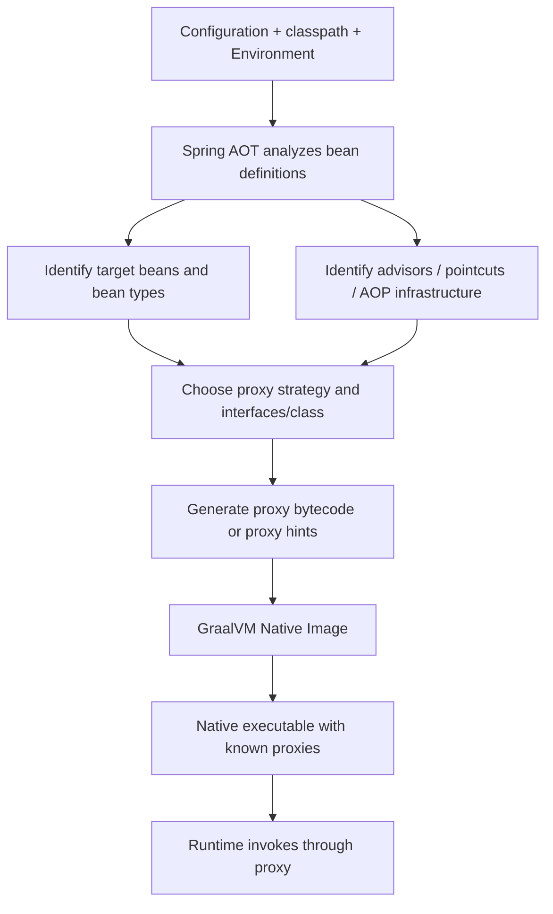

# Proxy creation conditions must be determined during bean analysis

> **Chapter:** Proxies and AOP  
> **Module:** `SPRING_BOOT_NATIVE_IMAGE`  
> **Goal:** Understand why Spring AOT must determine which beans need proxies, which interfaces a proxy will implement or which class it will extend, and which advisors apply; distinguish JDK proxies from CGLIB; recognize limitations when changing profiles, bean conditions, or the classpath after build; and test proxies in AOT mode and on the native executable.

## 1. Why must proxy creation conditions be known ahead of time?

Spring AOP adds behavior to beans by placing a **proxy** in front of the real object. When code calls a method on the proxy, the proxy can run additional logic such as opening a transaction, logging, checking permissions, caching results, or measuring timing before forwarding to the target object.

On a standard JVM, Spring can discover matching advisors and create proxies during application startup. With GraalVM Native Image, the class set and dynamic proxy capabilities are constrained by build-time analysis. Required proxies must be recognized and prepared ahead of time by Spring AOT so Native Image can include the bytecode or proxy metadata in the executable.

This requires Spring AOT to understand **the bean model and AOP conditions at analysis time**:

- Which beans exist in the application context?
- What is each bean's actual type, and which interfaces does it implement?
- Which advisors/aspects are present, and to which beans or methods do they apply?
- Does configuration choose JDK dynamic proxies or class-based proxies?
- Which methods, classes, or interfaces must be present in the proxy?
- Which profiles, conditionals, and classpath determined that structure?

If those conditions are only decided after the native binary runs, Spring cannot by default generate additional proxy classes or change the set of proxies already prepared in the AOT output.



**Key point:** AOT does not snapshot a running proxy object and save it into the binary. It analyzes the bean model and generates the outputs needed so that when the native application starts, Spring can restore the exact proxy mechanism for the identified beans.

## 2. Conditions that determine whether a proxy is created

A typical AOP flow includes these parts:

1. The application declares AOP infrastructure, such as `@EnableAspectJAutoProxy` or `@EnableTransactionManagement`.
2. Spring registers the corresponding advisor/aspect or infrastructure beans.
3. The auto-proxy creator inspects target beans and applicable advisors.
4. If a bean requires advice, Spring creates an appropriate proxy.
5. Consumers receive the proxy via dependency injection and invoke methods on the proxy.
6. The proxy executes advice and then forwards the call to the target object in interceptor order.

Example of a transactional service:

```java
@Service
public class PaymentService {

    @Transactional
    public void capture(String paymentId) {
        // Record payment within a transaction.
    }
}
```

`@Transactional` is processed by Spring's transaction infrastructure. When the matching bean is created, Spring AOP can provide a proxy so calls to `capture` pass through the transaction interceptor.

Example of a custom aspect:

```java
@Aspect
@Component
public class TimingAspect {

    @Around("execution(* com.example.payment..*(..))")
    public Object measure(ProceedingJoinPoint joinPoint) throws Throwable {
        long start = System.nanoTime();
        try {
            return joinPoint.proceed();
        }
        finally {
            long elapsed = System.nanoTime() - start;
            System.out.println(joinPoint.getSignature() + ": " + elapsed);
        }
    }
}
```

Aspects and pointcuts are part of the conditions Spring uses to decide which beans/methods need advice. If an aspect only exists under a specific profile or is enabled by a conditional property, its presence can change the proxy topology.

### 2.1. AOT processes bean definitions, not full business execution

During AOT processing, Spring prepares the application context up to the stage where bean definitions can be analyzed. This process is not simply starting the production application and calling every service method.

Spring AOT uses configuration, classpath, `Environment`, and processors to generate code, bytecode, and `RuntimeHints`. At native runtime, generated initializers restore the context according to the processed model.

Therefore, the information needed to decide on proxies must be inferable from bean definitions and metadata at build time. If a bean is registered arbitrarily by runtime code, or an advisor is loaded from an external plugin after the binary is built, AOT cannot automatically create the corresponding proxy.

### 2.2. Bean types must be specific enough

Spring AOT should not have to guess the implementation from an overly generic declared type. With `@Bean` factory methods, declaring a more specific return type helps Spring infer the target class, interfaces, and methods to process.

Example:

```java
@Bean
PaymentOperations paymentOperations() {
    return new DefaultPaymentService();
}
```

Spring only sees the return type `PaymentOperations` from the factory method signature. If AOT processing needs information based on the implementation, declaring the concrete type is usually better:

```java
@Bean
DefaultPaymentService paymentOperations() {
    return new DefaultPaymentService();
}
```

Consumers can still inject by the `PaymentOperations` interface. The bean name remains `paymentOperations`. Declaring the concrete type gives the framework more information when analyzing the bean definition; it does not force every consumer to depend on the implementation.

If using lambda/method-reference instance suppliers or registering singletons directly at runtime, note that such cases may not be fully transformed by AOT. Prefer bean definitions with explicit types and factory methods.

## 3. Choosing the proxy type: JDK dynamic proxy or CGLIB

Spring AOP has two common strategies.

### 3.1. JDK dynamic proxy — interface-based proxying

A JDK proxy implements one or more interfaces. Consumers interact with the proxy through those interfaces; method calls through the interface are routed to an invocation handler, and then to the appropriate interceptors/target.

Example:

```java
public interface PaymentOperations {
    void capture(String paymentId);
}

@Service
public class DefaultPaymentService implements PaymentOperations {

    @Override
    @Transactional
    public void capture(String paymentId) {
        // Business operation
    }
}
```

With an interface proxy, consumers should inject `PaymentOperations`:

```java
@Service
public class CheckoutService {

    private final PaymentOperations payments;

    public CheckoutService(PaymentOperations payments) {
        this.payments = payments;
    }
}
```

The proxy implements `PaymentOperations` and is not an instance of `DefaultPaymentService`. Therefore, casting the proxy to the implementation class can throw a `ClassCastException`. If a consumer needs to call a method not in the interface, an interface proxy does not expose that method.

In a native image, the JDK proxy's interfaces must be known ahead of time so GraalVM can generate the corresponding proxy. Spring AOT can aggregate proxy hints from the analyzed bean and AOP model.

### 3.2. CGLIB — proxying by subclassing the target class

CGLIB creates a subclass of the target class and overrides overridable methods to insert interceptors.

```java
@Service
public class DefaultPaymentService {

    @Transactional
    public void capture(String paymentId) {
        // Business operation
    }
}
```

If an interface proxy is not used or configuration requires class-based proxying, Spring can use CGLIB. For native images, the proxy class bytecode must be generated during the AOT phase to be included in the build output.

Several important limitations:

- **`final` classes** cannot be extended to create a CGLIB proxy.
- **`final` methods** cannot be overridden, so they cannot receive CGLIB advice via subclass proxying.
- **`private` methods** cannot be overridden; Spring proxy-based AOP does not directly advise `private` methods.
- Package-private methods from a superclass in a different package may not be visible/overridable under Java rules.
- JPMS configuration and class/package visibility can also affect subclassability.

If the application needs CGLIB proxies, design target classes and methods to be inheritable/overridable, and check modifiers before building native.

### 3.3. Configuring the proxy strategy

In Spring Framework, the proxy strategy depends on interfaces and the auto-proxy creator configuration. Spring Boot typically configures class-based proxying via `spring.aop.proxy-target-class`, defaulting to `true` in auto-configuration; project configuration can change this.

You can declare explicitly:

```yaml
spring:
  aop:
    proxy-target-class: true
```

Or choose interface-based proxying if the application wants an interface contract:

```yaml
spring:
  aop:
    proxy-target-class: false
```

With annotations such as `@EnableAspectJAutoProxy` or `@EnableTransactionManagement`, the `proxyTargetClass` attribute can also affect the strategy. Multiple AOP/transaction configurations are merged into a shared auto-proxy creator; a single request for class-based proxying can affect more than one bean.

**Do not rely on implicit defaults.** Specify the proxy strategy explicitly in build/runtime configuration and test it with your actual Spring Boot version. Standalone Spring Framework and Spring Boot auto-configuration can have different defaults.

## 4. Which conditions must be fixed when running Spring AOT?

Spring AOT assumes the application structure is determined at build time. This directly impacts proxies.

| Element | Can it change after native build? | Reason |
|---|---|---|
| Whether a target bean exists | Cannot be assumed | Bean definitions were already processed by AOT |
| Aspect/advisor registered conditionally | Cannot be assumed | Advisors may decide which beans need proxies |
| Interfaces implemented by a JDK proxy | Cannot be added arbitrarily | Proxy metadata must be known at build time |
| Target class of a CGLIB proxy | Cannot be swapped to an arbitrary class post-build | Subclass bytecode is prepared for the analyzed class |
| Profile that changes the bean graph | Must be selected appropriately at AOT time | `@Profile` is evaluated in the build context |
| Property that only changes values inside a method | Usually changeable | Does not alter bean/proxy structure if it does not control conditions |
| Endpoints/timeouts/credentials | Usually changeable | Runtime configuration when the corresponding bean already exists |
| Adding an advisor JAR/plugin after deploy | No | Native classpath is fixed at build time |
| Toggling AOP via runtime conditional | Cannot expect proxy topology to change | Conditions affect the AOT-processed structure |

Example:

```java
@Configuration(proxyBeanMethods = false)
class PaymentAopConfiguration {

    @Bean
    @Profile("production")
    Advisor paymentAdvisor() {
        // Advisor only exists in the production profile.
        return createPaymentAdvisor();
    }
}
```

If the AOT build does not include the `production` profile, this advisor may not appear in the processed model. Simply enabling `SPRING_PROFILES_ACTIVE=production` when running native does not guarantee Spring will recreate the advisor and proxy for the target bean.

If two different AOP topologies are needed, create two distinct build variants, or design a stable advisor/bean topology and move the differences into runtime values inside the advice/target bean.

## 5. Do not confuse AOP proxies with configuration class proxies

Spring can create a subclass for `@Configuration` classes when `proxyBeanMethods=true` so calls between `@Bean` methods are routed through the container, ensuring proper singleton/bean scope semantics.

This is **configuration class enhancement**, distinct from a service's AOP proxy:

| Proxy/enhancement type | Purpose | Example |
|---|---|---|
| Configuration class enhancement | Coordinate calls between `@Bean` methods on a configuration class | `@Configuration(proxyBeanMethods = true)` |
| Spring AOP proxy | Apply advisors/interceptors to bean methods | `@Transactional`, `@Cacheable`, custom `@Aspect` |
| JDK dynamic proxy | Proxy a set of interfaces | `PaymentOperations` |
| CGLIB subclass proxy | Proxy a class via subclassing | `DefaultPaymentService` |

`@Configuration(proxyBeanMethods = false)` disables configuration class enhancement, but does not disable service AOP proxies. Conversely, enabling CGLIB for AOP does not mean every `@Configuration` class needs configuration changes.

When inspecting generated bytecode in AOT output, identify which purpose each generated proxy class serves to avoid misdiagnosis.

## 6. Proxy limitations that remain in Native Image

Native Image does not fix the inherent limitations of Spring proxy-based AOP.

### 6.1. Self-invocation does not go through the proxy

```java
@Service
public class OrderService {

    public void placeOrder() {
        this.saveOrder();
    }

    @Transactional
    public void saveOrder() {
        // Save order
    }
}
```

The `this.saveOrder()` call invokes the method directly on the same target object, bypassing the external proxy. Consequently, transaction advice may not be applied to the internal call.

This is not a Native Image bug or a missing proxy hint. Move the method needing advice to another bean, call it via an injected proxy, or choose an appropriate weaving mechanism if self-invocation interception is genuinely required.

### 6.2. Final/private methods are not advised by CGLIB

CGLIB subclasses must override methods. `final`/`private` methods cannot be overridden, so the proxy cannot insert interceptors through that mechanism.

With JDK proxies, only methods belonging to the proxied interfaces are part of the proxy's invocation contract. Implementation-specific methods not present on the interface cannot be called through the proxy interface.

### 6.3. Adding new advisors or targets at runtime

If an application loads plugins/advisors after the native binary has been built, Spring cannot automatically have bytecode/proxy metadata for that new class/interface combination. Determine the set of plugins and advisors at build time, or design extension points that do not require generating dynamic proxies outside the packaged set.

### 6.4. Proxy type mismatch with consumer type

A bean proxied with a JDK interface while a consumer expects the implementation class can cause injection/casting failures. Conversely, a CGLIB proxy requires a subclassable target class. Verify a consistent proxy strategy and injection types.

## 7. How does Spring AOT generate proxy output?

In a standard JVM application, proxy classes may be generated during startup. In the native workflow, Spring AOT prepares required proxies at build time:

- **CGLIB proxies:** Spring generates subclass bytecode during AOT processing so Native Image can analyze and package it.
- **JDK dynamic proxies:** Spring AOT collects interfaces needing proxying and generates corresponding proxy hints/metadata for GraalVM.
- **Reflection/other hints:** other dynamic operations involving targets/advisors may need additional `RuntimeHints` if the framework cannot infer them.

Generated bytecode outputs can be inspected in the AOT classes directory. In typical Spring Boot 3.x configurations, common locations are:

| Build tool | AOT generated sources | AOT generated classes | AOT resources/hints |
|---|---|---|---|
| Maven | `target/spring-aot/main/sources` | `target/spring-aot/main/classes` | `target/spring-aot/main/resources` |
| Gradle | `build/generated/aotSources` | `build/generated/aotClasses` | `build/generated/aotResources` |

Exact paths depend on plugin versions and configuration. Check the current build's logs/task outputs. Generated bytecode is not as human-readable as source; you can use `javap` to inspect class files when needed.

### 7.1. Custom JDK proxies outside Spring AOP

If the application creates a JDK proxy manually via `Proxy.newProxyInstance()` for an interface set known at build time, you may need to register separate proxy hints:

```java
import org.springframework.aot.hint.RuntimeHints;
import org.springframework.aot.hint.RuntimeHintsRegistrar;

public class PaymentProxyHints implements RuntimeHintsRegistrar {

    @Override
    public void registerHints(RuntimeHints hints, ClassLoader classLoader) {
        hints.proxies().registerJdkProxy(PaymentOperations.class);
    }
}
```

Enable the registrar:

```java
@Configuration(proxyBeanMethods = false)
@ImportRuntimeHints(PaymentProxyHints.class)
class PaymentProxyConfiguration {
}
```

This is an example for a **manually created JDK proxy** or a case where the framework cannot infer the required proxy. For Spring AOP proxies created from bean definitions/advisors already supported by Spring AOT, let the framework collect and generate proxy output; do not speculatively register duplicate proxies.

If the proxy implements multiple interfaces, register the exact interface set and order/compatibility attributes required by JDK proxies. Registering only one interface when the runtime proxy actually needs several can leave the native image missing the corresponding proxy.

## 8. Testing proxy creation conditions before building native

Do not merely verify that the application starts. Verify whether target beans are proxied, which proxy type is chosen, and whether advice actually runs.

### 8.1. Checking proxies on an AOT-enabled JVM

After building an artifact containing AOT-generated code, you can run the application on the JVM in AOT mode to verify the generated initializers without waiting for native compilation to finish:

```bash
# Maven example: activate the native profile to package AOT output
./mvnw -Pnative package

# Run the JAR containing AOT output on the JVM
java -Dspring.aot.enabled=true -jar target/native-demo.jar
```

With Gradle, ensure the GraalVM Native Image plugin is applied so Spring Boot configures the required AOT tasks. JAR paths and artifact names depend on the project.

In an integration test, you can verify:

```java
Object bean = applicationContext.getBean(PaymentOperations.class);

assertThat(AopUtils.isAopProxy(bean)).isTrue();
assertThat(AopUtils.isJdkDynamicProxy(bean)).isTrue();
```

If the project chooses CGLIB, use `AopUtils.isCglibProxy(bean)` and verify the appropriate proxy class. Do not assert one proxy type if the build configuration permits the other.

### 8.2. Verifying that advice is executed

A test can use an aspect that records how many times a method is invoked:

```java
AtomicInteger interceptedCalls = new AtomicInteger();

@Around("execution(* com.example.payment.PaymentOperations.capture(..))")
public Object count(ProceedingJoinPoint joinPoint) throws Throwable {
    interceptedCalls.incrementAndGet();
    return joinPoint.proceed();
}
```

Invoke the method through the bean injected from the Spring container and assert the counter increments. You can also verify transaction status or side effects appropriate to the real advisor.

Tests must call the **injected proxy**, not instantiate the target object directly with `new`. Testing the target directly bypasses the AOP infrastructure.

### 8.3. Testing the native executable

After AOT-enabled JVM tests pass:

1. Build the native executable with Maven/Gradle according to your project setup.
2. Start the binary in the test environment.
3. Call endpoints/use cases that pass through the proxied bean.
4. Confirm that advice is executed and business results are correct.
5. Test beans using JDK proxies and CGLIB proxies if the application uses both.
6. Verify profile/conditional compatibility with the AOT configuration.
7. Capture logs and generated output if the native runtime fails to create a proxy.

A passing JVM test is not enough to prove proxy metadata or generated bytecode is present in the native image. The native executable is the final proof.

## 9. Proxy condition test matrix

| Case | Build/AOT configuration | Runtime | Expectation |
|---|---|---|---|
| P0 — No advisor | Bean does not match pointcut | Same configuration | Bean does not need an AOP proxy |
| P1 — With advisor | Advisor applies to target bean | Same topology | Proxy is created, advice runs |
| P2 — JDK proxy | Target has interface, config chooses interface proxy | Inject via interface | Proxy implements interface and method is callable |
| P3 — CGLIB proxy | Class-based proxy enabled | Eligible target class | Subclass proxy is created, advice runs |
| P4 — Final target | CGLIB requested but target is `final` | Same configuration | Build/AOT or test detects it cannot be proxied under that strategy |
| P5 — Final method | CGLIB target has a `final` method | Call `final` method | Do not expect that method to be advised by subclass proxy |
| P6 — Conditional advisor | Advisor exists only when condition holds at AOT time | Runtime uses same condition | Proxy topology matches build |
| P7 — Different profile | AOT with profile A, runtime selects profile B changing advisors/beans | Profile mismatch | Detect incompatible configuration; do not assume new proxies appear |
| P8 — Self-invocation | Internal method called via `this` | Same binary | Do not expect internal call to go through proxy |
| P9 — Custom JDK proxy | Interface proxy created by custom code | Native binary | Proxy hints sufficient for registered interface set |

### 9.1. Results to record

For each case, record:

- Build revision and Spring Boot/Spring Framework/GraalVM versions.
- Active profiles and properties affecting advisor/bean conditions during AOT.
- Target bean class and interfaces.
- Proxy strategy (JDK/CGLIB).
- Expected list of advisors/pointcuts.
- Generated proxy class or corresponding proxy hint.
- AOT-enabled JVM test result.
- Native executable test result.
- Side effects proving the advice ran.

Do not mark PASS just because the application starts. A proxy can exist without advice applying to the tested method; check both the proxy type and interceptor behavior.

## 10. Common errors

| Symptom | Possible cause | Resolution direction |
|---|---|---|
| Native build missing proxy class | AOT did not detect bean/advisor or target type is unclear | Check bean definitions, return types, and build conditions |
| JVM has proxy, native does not | Generated proxy bytecode/hints not produced or not included in native input | Inspect AOT output and build logs |
| `ClassCastException` when injecting implementation | Bean uses JDK interface proxy while consumer expects concrete class | Inject via interface or choose CGLIB appropriately |
| `Cannot subclass final class` | CGLIB chosen for a `final` target | Use interface proxy or redesign target |
| Advice does not run for `final`/`private` method | Method cannot be overridden/intercepted by CGLIB | Change visibility/design or choose another mechanism |
| Transaction not applied on internal call | Self-invocation bypasses proxy | Move method to another bean or call through proxy |
| Changed profile but advisor does not appear | Profile/conditional was already resolved at AOT time | Rebuild with the matching topology |
| Custom JDK proxy fails on native | Missing proxy hint for interface set | Register `RuntimeHints` for the exact interface set |
| Proxy exists but pointcut does not match | Pointcut/target type differs from expectation | Check advisor, method signature, and inferred class |
| Bean type too generic | AOT cannot infer concrete target class | Declare concrete return type on factory method |

## 11. Diagnostic workflow for a missing proxy

When a bean exhibits AOP behavior on the JVM but fails to work properly on native, proceed in order:

1. **Confirm the bean is in the AOT context.** Check profiles, conditions, and bean definitions.
2. **Confirm AOP infrastructure is present.** For example, transaction management, auto-proxy creator, or aspect beans are registered.
3. **Confirm advisors apply.** Check pointcuts, target class, and method signatures.
4. **Confirm the proxy strategy.** JDK proxies need the exact interface set; CGLIB needs overridable target classes/methods.
5. **Inspect AOT output.** Look for generated proxy bytecode or JDK proxy hints in build outputs.
6. **Run an AOT-enabled JVM.** Verify generated initializers/proxy configuration before native compilation.
7. **Run the native binary.** Invoke the method through the Spring bean proxy and assert advice actually executes.
8. **Adjust build-time configuration.** If topologies differ, create build variants; if only runtime values differ, keep the bean/advisor topology stable and move values into configuration.

Do not fix by blindly adding broad proxy hints for all interfaces before determining whether the gap lies in JDK proxy metadata, CGLIB generated bytecode, or the advisor creation condition itself.

## 12. Pre-release checklist for native images with AOP

- [ ] Identified which beans need proxies and which advisors/aspects apply.
- [ ] Bean definitions, target types, and interfaces can be inferred at AOT build time.
- [ ] Profiles and conditionals affecting beans/advisors are selected at build time.
- [ ] JDK/CGLIB proxy strategy is explicitly determined without relying on implicit defaults.
- [ ] If using JDK proxies, required interface sets are handled by Spring AOT/hints.
- [ ] If using CGLIB, target classes and methods are subclassable/overridable.
- [ ] Advice is not expected to run on self-invocation or uninterceptable `private`/`final` methods.
- [ ] Configuration class enhancement is not confused with service AOP proxies.
- [ ] Inspected generated proxy bytecode/hints in AOT output.
- [ ] AOT-enabled JVM tests confirm proxy types and advice behavior.
- [ ] Native executable tests confirm the same behavior on the release artifact.
- [ ] Runtime profiles/config do not alter the AOT-processed bean/proxy topology.

## 13. Key takeaway

Proxy creation conditions must be determined when Spring AOT analyzes beans because the native executable needs to know target beans, advisors, interfaces or target classes, and the proxy strategy ahead of time. JDK dynamic proxies require a known set of interfaces; CGLIB requires subclassable classes and proxy bytecode prepared at build time.

Keep the bean/advisor topology stable between the AOT build and runtime. Operational values such as endpoints, timeouts, or business data can change as long as they do not alter bean/proxy creation conditions. Finally, verify both that **the proxy is created properly** and that **advice actually executes** on the native executable; only then do you have proof that AOP is compatible with the released binary.

### References

- [Spring Framework — Ahead of Time Optimizations](https://docs.spring.io/spring-framework/reference/core/aot.html)
- [Spring Framework — Proxying Mechanisms](https://docs.spring.io/spring-framework/reference/core/aop/proxying.html)
- [Spring Boot — GraalVM Native Images, Proxy Class Generation](https://docs.spring.io/spring-boot/docs/3.2.5/reference/html/native-image.html)
- [Spring Boot — Advanced Native Images Topics](https://docs.spring.io/spring-boot/reference/packaging/native-image/advanced-topics.html)
- [Spring Framework Javadoc — RuntimeHints](https://docs.spring.io/spring-framework/docs/current/javadoc-api/org/springframework/aot/hint/RuntimeHints.html)
