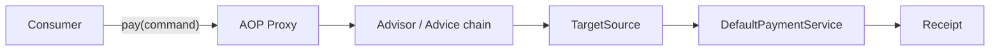
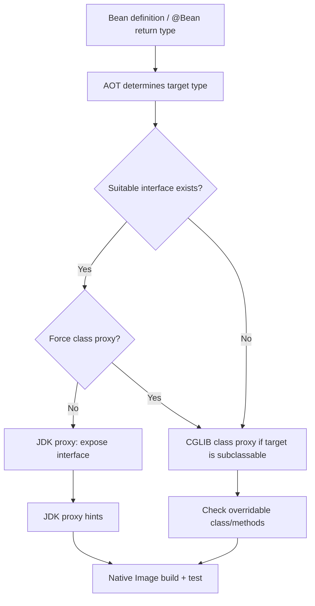

# How return types, interfaces, and target metadata affect proxy generation

Spring AOP does not weave advice directly into every application object. Instead, Spring typically creates a **proxy** in front of the target object. The proxy receives calls from consumers, finds matching advisors, runs advice, and then forwards the call to the target. The shape of the proxy depends on **the interfaces exposed by the bean**, **the target type known to Spring**, and **the configuration choosing JDK proxies or CGLIB**.

In Spring Boot Native Image applications, this information also matters at build time. Spring AOT analyzes bean definitions to prepare the container and proxies that can be determined ahead of time. If a bean type is declared too generically, the target is only found via runtime data, or proxy interfaces are generated dynamically in ways AOT cannot observe, code generation and native hints may lack necessary information.

## 1. Learning objectives

After this lesson, you will be able to:

- Explain the relationship between target object, proxy object, interfaces, and bean return types.
- Distinguish JDK dynamic proxies and CGLIB class proxies.
- Predict when consumers can inject by interface or concrete class.
- Understand the impact of `@Bean` method return types on type prediction and Spring AOT.
- Inspect target metadata via `TargetSource`, `TargetClassAware`, and `AopUtils`.
- Recognize limitations of `final` classes, `final` methods, `private` methods, and self-invocation.
- Verify proxy types and prepare proxy hints when building a Spring Boot Native Image.

## 2. Target objects and proxy objects are two distinct objects

Suppose we have a payment service:

```java
public interface PaymentOperations {
    Receipt pay(PaymentCommand command);
}

@Service
public class DefaultPaymentService implements PaymentOperations {
    @Override
    public Receipt pay(PaymentCommand command) {
        // Process payment.
        return new Receipt("accepted");
    }
}
```

Without AOP, consumers can receive a `DefaultPaymentService` instance directly. When transaction advice, caching, security, or custom aspects are present, Spring may return a proxy instead of the target:



- **Target object** contains the actual business logic, e.g., `DefaultPaymentService`.
- **Proxy object** is the object consumers see and invoke.
- **Advice/Advisor** defines additional logic before, after, or around the invocation.
- **TargetSource** supplies the target object to the proxy. The default `TargetSource` typically returns the same target; other implementations can supply targets from a pool, thread, or swapping mechanism.

The proxy must expose a type that consumers can invoke. With JDK proxies, the exposed type is one or more interfaces. With CGLIB proxies, the exposed type is a subclass of the target class.

## 3. Two ways Spring creates AOP proxies

Spring AOP uses two common mechanisms:

| Criterion | JDK dynamic proxy | CGLIB class proxy |
| --- | --- | --- |
| Proxy type | Object implementing the selected interfaces | Subclass generated from the target class |
| Condition | Needs at least one interface to proxy | Can be used when target has no interface or configuration forces class proxying |
| Injectable types | Interfaces implemented by the proxy | Interfaces and the target class if the class can be subclassed |
| Methods only on implementation | Cannot be called via proxy if not on interface | Can be called if method is overridable and proxy exposes class type |
| `final` class | Not an inherent barrier for JDK proxy | Cannot be subclassed |
| `final` method | Can be intercepted when call goes through JDK proxy interface | Cannot be overridden to intercept |
| `private` method | Not an interface method, so cannot be called via proxy | Cannot be overridden/intercepted |
| Native Image | JDK proxy interfaces must be known and hints registered | Spring AOT needs target/proxy type; pre-generated proxy classes must be tested |

### 3.1. JDK dynamic proxy

A JDK proxy creates an object implementing the specified interfaces. Example:

```java
PaymentOperations payment =
    (PaymentOperations) Proxy.newProxyInstance(
        PaymentOperations.class.getClassLoader(),
        new Class<?>[] { PaymentOperations.class },
        (proxy, method, args) -> {
            System.out.println("Before " + method.getName());
            try {
                return method.invoke(target, args);
            }
            catch (InvocationTargetException ex) {
                throw ex.getTargetException();
            }
        }
    );
```

This is a Java Reflection API example illustrating the JDK proxy mechanism, not the recommended way to manually create proxies in Spring. Spring manages targets, advice, and exception handling through its AOP infrastructure.

Key characteristics:

- The proxy is an instance of `PaymentOperations`.
- The proxy is **not** an instance of `DefaultPaymentService`.
- Consumers can call `pay` through the interface.
- Methods present only on `DefaultPaymentService` and not declared on the interface cannot be called through a `PaymentOperations` proxy reference.

If you attempt to cast:

```java
Object bean = applicationContext.getBean("paymentService");

PaymentOperations operations = (PaymentOperations) bean; // Valid
DefaultPaymentService concrete = (DefaultPaymentService) bean;
// ClassCastException if the bean is exposed via a JDK proxy.
```

Therefore, when using JDK proxies, consumers should depend on the **interface contract** rather than the concrete implementation.

### 3.2. CGLIB class proxy

CGLIB generates a subclass of the target class. The proxy can override overridable methods and insert interceptors before delegating to the target.

Example:

```java
public class DefaultPaymentService {
    public Receipt pay(PaymentCommand command) {
        return new Receipt("accepted");
    }
}
```

When generated with CGLIB, the proxy conceptually looks like:

```java
class DefaultPaymentService$$SpringCGLIBProxy
        extends DefaultPaymentService {
    @Override
    public Receipt pay(PaymentCommand command) {
        // Run interceptor chain then delegate to target.
        return interceptorChain.invoke(target, command);
    }
}
```

This is **pseudocode illustrating inheritance**, not the exact class name or source code Spring generates. Because the proxy is a subclass, it can be assigned to a variable of the target class type, provided the target class can be subclassed.

Limitations to remember:

- `final` classes cannot be subclassed by CGLIB.
- `final` methods cannot be overridden, so they cannot be advised via subclass proxying.
- `private` methods cannot be overridden and are not proxy call points.
- `static` methods belong to the class and do not dispatch polymorphically via an instance, so they are not intercepted by AOP proxies like instance methods.
- Package-private methods in a superclass from a different package may not be accessible/overridable and face similar restrictions to non-visible methods.

In Kotlin, classes and methods are `final` by default unless you use an open-class plugin or declare `open`. When forcing CGLIB, check the final bytecode and the project's class-opening rules.

## 4. Configuring proxy type selection

### 4.1. Defaults of Spring Framework and Spring Boot

Two defaults are often confused:

- **Spring Framework core:** when a target has an interface and class proxying is not forced, Spring AOP can use JDK dynamic proxies; if the target has no interface, CGLIB is used.
- **Spring Boot auto-configuration:** configures Spring AOP by default to use CGLIB class proxies. You can switch to JDK proxies via `spring.aop.proxy-target-class=false`.

In `application.properties`:

```properties
# Tell Spring Boot to use JDK interface proxies
spring.aop.proxy-target-class=false
```

Or force CGLIB:

```properties
spring.aop.proxy-target-class=true
```

With pure Spring Framework configuration:

```java
@Configuration
@EnableAspectJAutoProxy(proxyTargetClass = false)
class AopConfiguration {
}
```

Set `proxyTargetClass=true` to request class-based proxies. Different AOP/transaction configurations can share a unified auto-proxy creator; a single configuration forcing class proxies can cause other related proxies to switch to CGLIB as well. Therefore, verify the actual proxy rather than looking at a single annotation in isolation.

### 4.2. Do not choose a proxy type solely for performance

Performance differences between JDK proxies and CGLIB should generally not be the primary deciding criterion. Choose based on:

- The contract consumers need to use.
- Whether methods outside interfaces need to be exposed.
- Whether target classes can be subclassed.
- Whether beans are injected by interface or concrete class.
- AOT/native capabilities and the metadata the build must know.
- Design testability and maintainability.

## 5. How do return types and interfaces affect this?

A proxy may expose only part of the target's API. Return types at multiple points determine which part of the API Spring and Java can see.

### 5.1. Interface return types limit the contract consumers see

Suppose:

```java
public interface PaymentOperations {
    Receipt pay(PaymentCommand command);
}

public class DefaultPaymentService implements PaymentOperations {
    @Override
    public Receipt pay(PaymentCommand command) {
        return new Receipt("accepted");
    }

    public void rebuildSettlementCache() {
        // Internal API only on implementation.
    }
}
```

With a JDK proxy exposing only `PaymentOperations`:

- Consumers can call `pay`.
- Consumers cannot call `rebuildSettlementCache` through the proxy.
- The target class having a `public` method does not make that method appear automatically on the interface proxy.

If a method is part of the contract consumers need, add it to the appropriate interface or use a class proxy if there is a clear reason.

### 5.2. `@Bean` return types must be specific enough for Spring AOT

Spring AOT analyzes bean definitions at build time and does not rely on instantiating every bean instance to re-infer all metadata. Therefore, a `@Bean` method's return type should be **the most specific type that can be accurately exposed**.

Example of an overly generic return type:

```java
@Configuration(proxyBeanMethods = false)
class PaymentConfiguration {
    @Bean
    PaymentOperations paymentService() {
        return new DefaultPaymentService();
    }
}
```

During AOT, the declared type for the bean is `PaymentOperations`. Metadata present only on `DefaultPaymentService`, such as annotated members or specific lifecycle callbacks, may go undetected when AOT analyzes the bean definition.

Instead, declare the concrete return type:

```java
@Configuration(proxyBeanMethods = false)
class PaymentConfiguration {
    @Bean
    DefaultPaymentService paymentService() {
        return new DefaultPaymentService();
    }
}
```

Consumers can still inject by interface:

```java
@Service
class CheckoutService {
    private final PaymentOperations payments;

    CheckoutService(PaymentOperations payments) {
        this.payments = payments;
    }
}
```

These two decisions serve two different goals:

1. **Factory method return type:** gives the container and AOT accurate target type information.
2. **Consumer injection type:** depends on the contract exposed by the proxy. With JDK proxies, inject the interface; do not cast to the implementation.

Declaring a concrete return type does not mean every runtime proxy will be an instance of the concrete class. If Spring creates a JDK proxy, the final object still implements only the proxied interfaces.

### 5.3. Avoid overly generic return types

The following declarations typically reduce what AOT can know:

```java
@Bean
Object paymentService() {
    return new DefaultPaymentService();
}

@Bean
PaymentOperations anotherPaymentService() {
    return new DefaultPaymentService();
}
```

`Object` or a generic interface can obscure:

- Annotations on the implementation class.
- Methods used as lifecycle callbacks.
- Field/method injection declared on the implementation.
- Metadata used to identify the target class and proxy.
- Specific types needed when analyzing pointcuts or proxies.

Declare `DefaultPaymentService` if that is the real implementation and is known ahead of time. If using a `FactoryBean` or manual definition registration, provide explicit type/generic metadata, such as `ResolvableType` for generic targets.

## 6. Target class and TargetSource affect proxy generation

### 6.1. TargetSource provides target metadata

`TargetSource` is the abstraction an AOP proxy uses to obtain the target object on a method invocation. This interface provides key information:

- `getTargetClass()`: the target type the proxy expects to work with.
- `isStatic()`: whether the target is fixed.
- `getTarget()`: obtains the target instance for the call.
- `releaseTarget(target)`: returns the target to its managing source when needed.

`TargetSource` extends the `TargetClassAware` contract, where `getTargetClass()` lets Spring know the target type without relying on an already instantiated instance. This is vital metadata when the container needs to predict bean types or prepare proxies.

With a standard target source, the same object is returned for every call. With pooling or hot-swappable target sources, the target instance can change, but the proxy must maintain a compatible contract.

### 6.2. Why must the target class be determinable?

To create a proxy, Spring needs to know:

- For JDK proxies: which interfaces the proxy must implement.
- For CGLIB: which class will be subclassed.
- Which methods can be advised and which methods can be invoked through the proxy.
- Which types must be retained by Spring AOT and Native Image.

If a target source returns objects whose classes are decided purely by runtime data, Spring cannot reliably pre-create a proxy of the exact shape. When multiple target classes exist, all targets must be compatible with the same contract exposed by the proxy.

### 6.3. Inspecting target metadata when debugging

Spring provides utilities to distinguish proxies from target classes:

```java
import org.springframework.aop.support.AopUtils;

Object bean = applicationContext.getBean("paymentService");

System.out.println("JDK proxy: " + AopUtils.isJdkDynamicProxy(bean));
System.out.println("CGLIB proxy: " + AopUtils.isCglibProxy(bean));
System.out.println("Target class: " + AopUtils.getTargetClass(bean).getName());
```

`AopUtils.getTargetClass(bean)` attempts to retrieve the target class rather than returning only the generated proxy class. When inspecting nested proxy chains, Spring also offers utilities in `AopProxyUtils`. These are diagnostic tools; do not unwrap targets to bypass advice in business flows.

### 6.4. `this` and `target` in pointcuts

Because Spring AOP is proxy-based, `this` and `target` have distinct meanings:

- `this` refers to the proxy object.
- `target` refers to the business object behind the proxy.

Example:

```java
@Aspect
@Component
class PaymentAspect {
    @Before("this(com.example.payment.PaymentOperations)")
    void calledThroughPaymentProxy() {
        // Proxy type implements PaymentOperations.
    }

    @Before("target(com.example.payment.DefaultPaymentService)")
    void targetIsDefaultPaymentService() {
        // Target object is DefaultPaymentService.
    }
}
```

With a JDK proxy, `this(PaymentOperations)` can match because the proxy implements the interface. `target(DefaultPaymentService)` matches against the target object's class. Changing the proxy type or target can change pointcut matching results.

## 7. Method return types and the proxy API

The method return type exposed on the interface is the contract consumers compile against. If the implementation has a covariant return type, consumers calling through the interface still see the return type declared on the interface.

Example:

```java
interface PaymentOperations {
    PaymentResult pay(PaymentCommand command);
}

class DefaultPaymentService implements PaymentOperations {
    @Override
    public AcceptedPayment pay(PaymentCommand command) {
        return new AcceptedPayment("accepted");
    }
}
```

If `AcceptedPayment` is a subtype of `PaymentResult`, the implementation can use a covariant return type. However, when invoked through a `PaymentOperations` JDK proxy reference, the compile-time type of the result is `PaymentResult`. Consumers should not depend on a more specific type if the interface does not expose it.

This matters for:

- Generic service interfaces and type erasure.
- APIs returning subtypes known only on the implementation.
- Methods with annotations or metadata specific to the implementation.
- Reflection/serialization of return values in Native Image.

If a controller or client needs to serialize a DTO, ensure that DTO is inferred or provided with runtime hints. The proxy method return type and the DTO's runtime type are two distinct layers of metadata.

## 8. Impact on Spring AOT and GraalVM Native Image

### 8.1. AOT needs to know bean types before instances exist

During AOT processing, Spring prepares `ApplicationContext` from bean definitions and metadata determinable at build time. AOT does not simply boot the entire application like normal runtime and inspect every object. Therefore, `@Bean` method return types and target class metadata play a major role.

Spring AOT can generate:

- Java source code to restore bean definitions and container state.
- Bytecode, often including determinable dynamic proxies.
- `RuntimeHints` for reflection, resources, serialization, and JDK proxies.

If a bean definition only exposes `Object` or an overly generic interface, AOT may miss required implementation metadata. This is why exposing the exact target type on bean factory methods is good practice while consumers continue programming against interfaces.

### 8.2. JDK proxies require interface hints

GraalVM Native Image needs to know the interfaces used to create JDK dynamic proxies. Spring AOT can collect proxies created by Spring infrastructure and generate corresponding hints when information is known.

If the application creates JDK proxies manually from a fixed interface list, you can register proxy hints:

```java
import org.springframework.aot.hint.RuntimeHints;
import org.springframework.aot.hint.RuntimeHintsRegistrar;

class PaymentProxyRuntimeHints implements RuntimeHintsRegistrar {
    @Override
    public void registerHints(
            RuntimeHints hints, ClassLoader classLoader) {
        hints.proxies().registerJdkProxy(PaymentOperations.class);
    }
}
```

This example registers a JDK proxy with the `PaymentOperations` interface. If the proxy implements multiple interfaces, you must register the exact set of interfaces used by the proxy-creation code.

### 8.3. CGLIB and dynamically created proxies

CGLIB class proxies rely on subclassing. Target classes must be subclassable and methods needing advice must be overridable. Spring AOT can prepare bytecode for proxies determinable during analysis; however, code that manually builds proxies or target classes from data appearing only at runtime can fall outside what AOT can infer.

Therefore:

- Avoid proxying `final` classes or `final` methods when CGLIB advice is required.
- Do not rely on runtime classpath scanning to discover implementations absent at build time.
- Provide accurate target class/interface metadata in bean definitions.
- For custom JDK proxies, register proxy hints.
- For complex library-generated proxies, inspect AOT output and test the native executable directly.

### 8.4. Dynamic `TargetSource` and closed-world

A `TargetSource` can change target instances, but targets must share a contract compatible with the generated proxy. If a pool holds multiple implementations, ensure they all implement the proxied interface or are compatible with the proxied target class.

Native Image needs to know the types that will be used. If a `TargetSource` loads a new implementation from a plugin or a class name from a database after deployment, those types will not automatically appear in the binary. Register needed implementations from build inputs or use a runtime registry with a pre-known set of strategy classes.

## 9. Common errors when choosing proxies

| Symptom | Cause | Resolution |
| --- | --- | --- |
| `ClassCastException` when casting bean to implementation | Bean is exposed via a JDK proxy implementing only interfaces | Inject the interface or configure class proxies if the concrete type is truly needed |
| Bean not found when autowiring concrete class | Proxy type is not assignable to the target implementation | Choose the contract interface or review `proxyTargetClass` |
| Implementation method is not advised | Method is not on the JDK proxy interface or cannot be overridden with CGLIB | Add method to interface or use class proxy with an overridable method |
| CGLIB fails to create proxy | `final` target class or non-overridable method | Design open classes and check method visibility |
| AOT misses implementation metadata | `@Bean` return type declared too generically | Return the concrete implementation type |
| Native Image reports missing JDK proxy | Proxy interface not detected by AOT or created manually at runtime | Register `RuntimeHints.proxies()` for required interfaces |
| Aspect does not run on internal call | Self-invocation uses `this` to call another method on target, bypassing proxy | Split into another bean, call through proxy, or use an appropriate mechanism |
| `TargetSource` returns multiple incompatible types | Proxy contract does not cover target instances | Standardize interface/target class or separate proxies by type |
| Boot and Framework configs give different results | Boot defaults to CGLIB, core Framework may use JDK proxies | Check properties/configuration and the actual proxy |

## 10. Testing proxy types and target metadata

### 10.1. Verifying the proxy type

In an integration test:

```java
import static org.assertj.core.api.Assertions.assertThat;

import org.junit.jupiter.api.Test;
import org.springframework.aop.support.AopUtils;
import org.springframework.beans.factory.annotation.Autowired;
import org.springframework.boot.test.context.SpringBootTest;

@SpringBootTest
class PaymentProxyTests {
    @Autowired
    PaymentOperations paymentOperations;

    @Test
    void exposesPaymentOperationsContract() {
        assertThat(paymentOperations).isInstanceOf(PaymentOperations.class);
        assertThat(AopUtils.getTargetClass(paymentOperations))
            .isEqualTo(DefaultPaymentService.class);
    }
}
```

If the test wants to verify specifically JDK or CGLIB, add the corresponding assertion:

```java
assertThat(AopUtils.isJdkDynamicProxy(paymentOperations)).isTrue();
```

Or:

```java
assertThat(AopUtils.isCglibProxy(paymentOperations)).isTrue();
```

Only use the assertion matching the selected test configuration. Do not hard-code one proxy type if production allows configuring the other; instead, test the shared contract and write separate tests for each proxy mode you support.

### 10.2. Test matrix

| Configuration | Target | Result to verify |
| --- | --- | --- |
| JDK proxy | Class implementing interface | Proxy implements exact interface; not cast to concrete class |
| JDK proxy | Class without interface | Cannot use pure JDK proxy; requires interface or class proxy |
| CGLIB proxy | Non-`final` class | Proxy is a subclass; overridable methods are advised |
| CGLIB proxy | `final` class | Cannot create subclass proxy |
| CGLIB proxy | `final`/`private`/`static` method | Do not expect method to be intercepted |
| AOT | `@Bean` returning generic interface | Check whether implementation metadata is obscured |
| AOT | `@Bean` returning concrete type | Inspect generated initialization and proxy type |
| Native Image | Known JDK proxy interfaces | Verify proxy hints and actual calls |
| Native Image | Runtime-derived proxy interfaces/targets | Check whether they can be predicted/registered ahead of time |

### 10.3. Self-invocation

A proxy only intercepts calls that pass through the proxy. If a method on the target calls another method using `this`, the internal call does not go back out through the proxy:

```java
public class PaymentService {
    public void checkout() {
        this.validate(); // Does not go through the proxy.
    }

    @Transactional
    public void validate() {
        // Transaction advice may not be triggered by self-invocation.
    }
}
```

If both operations need advice, extract the method into another bean or route calls through the proxy. Switching from JDK to CGLIB does not solve self-invocation by itself.

## 11. Workflow for choosing proxies in Spring Boot Native Image

1. **Identify consumer contract:** which interfaces do consumers need, and do they truly need to call methods on the implementation?
2. **Identify target type:** is the bean declared via component class or `@Bean` method? Is the return type specific enough for AOT?
3. **Choose proxy strategy:** JDK if an interface contract fits; CGLIB if class proxying is needed and the class can be subclassed.
4. **Inspect methods:** are methods `public`/`protected` and overridable? Are any `final`/`private`/`static`?
5. **Inspect `TargetSource`:** is the target class known ahead of time and do target instances share a contract?
6. **Run AOT:** observe generated code/bytecode and `RuntimeHints`; verify the proxy type is prepared.
7. **Build Native Image:** verify required JDK proxy hints or proxy classes.
8. **Test native binary:** invoke methods through the exact references consumers use, verifying advice, target resolution, and type errors.



## 12. Comprehensive hands-on lab

**Context:** a payment service has the `PaymentOperations` interface, `DefaultPaymentService` implementation, and an aspect measuring execution time. The Spring Boot application will be built into a Native Image.

1. Create `PaymentOperations` and `DefaultPaymentService` with method `pay`.
2. Create an `@Aspect` using `@Around` to measure `PaymentOperations.pay` execution time.
3. Start with Spring Boot's default configuration and use `AopUtils` to inspect the proxy type.
4. Set `spring.aop.proxy-target-class=false`, rerun, and verify the bean still implements `PaymentOperations` but is not a `DefaultPaymentService`.
5. Change the `@Bean` method return type from `PaymentOperations` to `DefaultPaymentService`; observe the difference in AOT type prediction while keeping consumers injecting by interface.
6. Create a `final` implementation and try forcing CGLIB; document why a subclass proxy cannot be created.
7. Run AOT, inspect proxy bytecode/hints, and build Native Image.
8. Run the native binary, call the payment endpoint, and verify advice runs and the target class is correct.
9. If creating a custom JDK proxy outside Spring AOP, register a proxy hint for the exact interfaces and rebuild.

**Self-check question:** Why can a `@Bean` method returning an interface still run fine on the JVM yet cause AOT to miss implementation metadata? Because AOT relies on bean definitions and declared types; when a factory method exposes only an interface, implementation-specific members/lifecycle metadata may not be recognized at build time.

## 13. Key takeaways

- Proxy and target have distinct roles: consumers invoke the proxy, and the proxy forwards calls through advice to the target supplied by `TargetSource`.
- JDK proxies expose interfaces; CGLIB proxies subclass the target class. Choose based on contract and subclassability, not just habit.
- Spring Boot configures CGLIB by default; Spring Framework core can use JDK proxies when a target has interfaces and class proxying is not forced.
- A JDK proxy cannot be cast to the target implementation. CGLIB can be assignable to the target class if the class is non-`final` and the proxy can be generated.
- `@Bean` method return types should be the exact target type so Spring AOT sees implementation metadata; consumers should still inject by interface when using JDK proxies.
- `TargetClass`/`TargetSource` and proxy interfaces must be determinable during AOT. Target classes or interfaces appearing only at runtime make proxy generation/native hints unpredictable.
- Spring AOT can generate sources, proxy bytecode, and `RuntimeHints` for JDK proxies; dynamically created custom proxies must be checked and registered with appropriate hints.
- Test proxy types, interface contracts, target metadata, `final` methods, and the native executable to ensure advice is genuinely applied.

When return types, interface contracts, and target metadata are declared clearly, Spring has sufficient information to create the right proxy and AOT can prepare the required components before GraalVM compiles the application.

## Official references

- [Spring Framework — Proxying Mechanisms](https://docs.spring.io/spring-framework/reference/core/aop/proxying.html): JDK dynamic proxies, CGLIB, and class proxy limitations.
- [Spring Boot — Aspect-Oriented Programming](https://docs.spring.io/spring-boot/reference/features/aop.html): CGLIB default and `spring.aop.proxy-target-class` configuration.
- [Spring Framework — Ahead of Time Optimizations](https://docs.spring.io/spring-framework/reference/core/aot.html): bean type precision, generated bytecode, and runtime hints for JDK proxies.
- [Spring Framework — TargetSource](https://docs.spring.io/spring-framework/reference/core/aop-api/targetsource.html): how proxies obtain target objects and `TargetSource` implementations.
- [Spring Framework — Understanding AOP Proxies](https://docs.spring.io/spring-framework/reference/core/aop/proxying.html): proxy semantics, targets, and self-invocation.
