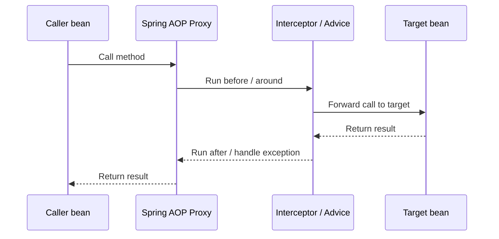
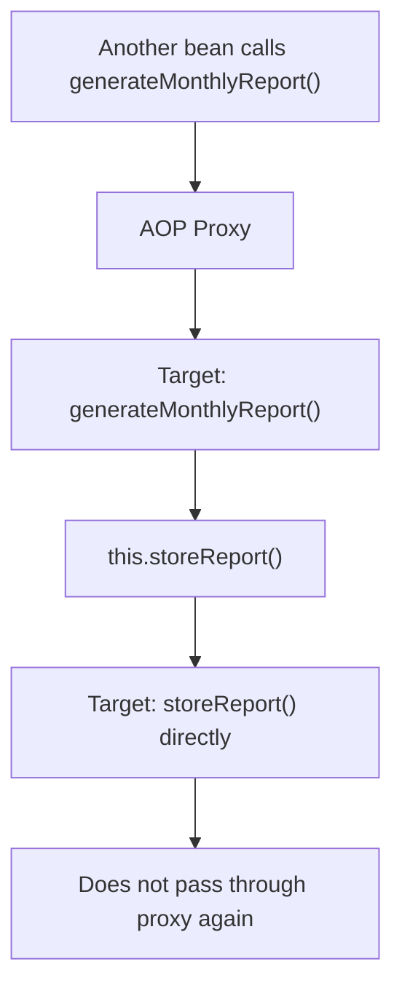
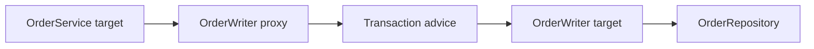

# Self-invocation within the same object and inherent AOP limitations

## Lesson objectives

Spring AOP typically applies advice through a **proxy** wrapping a bean. When a bean method is called from another bean, the call can pass through the proxy so Spring executes transactions, caching, async processing, retries, or aspect logic. However, when a method inside an object directly invokes another method on the same object, the internal call typically bypasses the proxy.

This phenomenon is called **self-invocation**. It is an inherent limitation of proxy-based AOP, not a bug specific to GraalVM Native Image.

In the **Spring Boot Native Image** module, you need to understand this boundary so you can design beans and test properly on both the JVM and the native executable. Spring AOT can prepare proxies and metadata for native images, but it does not automatically turn internal calls into proxied calls.

After this lesson, you will be able to:

- Describe the path of a call through a proxy versus an internal call within the same object.
- Explain why `@Transactional`, `@Cacheable`, `@Async`, and other advice may not run during self-invocation.
- Recognize the limitations of JDK dynamic proxies and class-based proxies.
- Choose to refactor using a collaborator bean, transaction API, or AspectJ when appropriate.
- Verify AOP behavior on both the JVM and Spring Boot Native Image.

## 1. How does proxy-based Spring AOP work?

### 1.1. The proxy sits between caller and target

When Spring creates an advised bean, the container can return a proxy representing that bean. Callers interact with the proxy; the proxy executes matching interceptors/advice before forwarding the call to the target object.



A proxy can apply multiple pieces of advice in the appropriate order. For example, a call to a `@Transactional` method can have the transaction interceptor open a transaction before invoking the target and commit/roll back after the target returns or throws an exception.

### 1.2. Self-invocation goes straight to `this`

Consider a bean:

```java
@Service
class ReportService {

    public void generateMonthlyReport() {
        this.storeReport();
    }

    @Transactional
    public void storeReport() {
        // Persist report data
    }
}
```

When another bean calls `reportService.generateMonthlyReport()`, the external call can go through the proxy. Inside the target, however, the expression `this.storeReport()` invokes the method directly on the current object itself. It **does not go back through the proxy**, so the transaction advice attached to `storeReport()` is not triggered by that call.



This is the key point: annotations remain on the method, but annotations do not automatically intercept every Java call. With proxy-based AOP, advice is applied only when a call passes through the proxy and matches the corresponding pointcut/advisor.

### 1.3. External calls and internal calls differ

| Call style | Path | Target method advice |
|---|---|---|
| Bean A calls bean B via Spring-injected reference | Typically through B's proxy | Can be applied |
| Controller calls service bean through proxy | Typically through service's proxy | Can be applied |
| Method in target calls `this.otherMethod()` | Directly on the same target | Bypassed in proxy mode |
| Method calls another collaborator bean | Through collaborator's reference | Can be applied |

The word "can" matters: a call through a proxy still must satisfy advisor conditions, visibility/proxy type rules, and corresponding configuration. Simply having a proxy does not mean every method is advised.

## 2. Real-world example: @Transactional bypassed by self-invocation

### 2.1. Easy-to-misunderstand configuration

Suppose `placeOrder()` orchestrates the order flow, while `persistOrder()` is expected to run in a transaction:

```java
@Service
class OrderService {

    private final OrderRepository orderRepository;

    OrderService(OrderRepository orderRepository) {
        this.orderRepository = orderRepository;
    }

    public void placeOrder(Order order) {
        validate(order);
        this.persistOrder(order);
    }

    @Transactional
    public void persistOrder(Order order) {
        orderRepository.save(order);
    }

    private void validate(Order order) {
        if (order == null) {
            throw new IllegalArgumentException("Order is required");
        }
    }
}
```

A caller invokes `orderService.placeOrder(order)` through the Spring proxy. However, `placeOrder()` is not marked `@Transactional`; when the target calls `this.persistOrder(order)`, the transaction interceptor is not traversed. Consequently, the transaction declared on `persistOrder()` is not started by this internal call.

If the repository itself has its own transaction, some database operations might still run inside a transaction created by the repository. That does not mean `OrderService.persistOrder()`'s transaction boundary worked. Verify the exact boundary your application intends.

### 2.2. Propagation is also affected

Suppose the internal method is declared as:

```java
@Transactional(propagation = Propagation.REQUIRES_NEW)
public void writeAuditRecord(AuditRecord record) {
    auditRepository.save(record);
}
```

If another method in the same target calls `this.writeAuditRecord(record)`, `REQUIRES_NEW` is not processed by the proxy's transaction interceptor. If an outer transaction already exists, the internal call does not automatically split off into a new transaction.

Similarly, attributes such as `readOnly`, `timeout`, isolation level, and rollback rules only take effect when transaction advice is actually applied to that invocation.

### 2.3. Why can this bug be hard to spot?

- The code compiles normally and Spring starts successfully.
- The `@Transactional` annotation is still visible on the method when reading source code.
- Some tests invoke the transaction-annotated method directly from outside, so they still pass.
- When the business flow enters through an internal orchestration method, the transaction boundary can differ from expectations.
- A repository or another collaborator may create its own transaction, making symptoms appear only in certain flows.

Therefore, inspect the **actual call path**, not just annotations in source code.

## 3. Which AOP features are affected by self-invocation?

Self-invocation does not affect only transactions. Any feature implemented via proxy-based advice can run into the same limitation.

### 3.1. @Cacheable and @CacheEvict

Example:

```java
@Service
class ProductService {

    public Product findProduct(String id) {
        return this.loadProduct(id);
    }

    @Cacheable(cacheNames = "products", key = "#id")
    public Product loadProduct(String id) {
        return productRepository.findById(id).orElseThrow();
    }
}
```

If a caller invokes `findProduct()` through the proxy, the internal call to `loadProduct()` still executes directly on the target. The cache interceptor is not invoked for `loadProduct()`, so the cache may not be read/written as expected.

Likewise, a method making an internal call to a `@CacheEvict` method may not trigger cache eviction. When observing cache hits/misses, check whether the method was called through the proxy.

### 3.2. @Async

Example:

```java
@Service
class NotificationService {

    public void notifyCustomer(Customer customer) {
        this.sendAsync(customer);
    }

    @Async
    public void sendAsync(Customer customer) {
        // Send notification
    }
}
```

If `notifyCustomer()` calls `this.sendAsync()`, the call does not go through the async interceptor. The method can execute synchronously on the current thread instead of being submitted to the executor as expected.

This can increase request processing latency or run blocking work on an inappropriate thread.

### 3.3. Retry, validation, and other advice

Annotations like `@Retryable` (when using Spring Retry), method validation, or custom aspects also rely on proxies/advice in their corresponding configurations. If a method is called internally on the same target, that method's advice may not run.

| Feature | Possible symptom on self-invocation |
|---|---|
| `@Transactional` | Does not open a transaction, or fails to apply `REQUIRES_NEW` or rollback rules as desired |
| `@Cacheable` | Does not read/write cache via interceptor |
| `@CacheEvict` | Cache is not evicted on internal call |
| `@Async` | Work executes synchronously on caller thread |
| `@Retryable` | Does not retry when method throws an exception |
| Custom `@Around` aspect | Does not run logging, timing, or permission check logic attached to method |

Exact behavior still depends on advisors, pointcuts, and how features are enabled. This table describes the general limitation of proxy-based AOP.

Features must also be enabled and have their corresponding infrastructure: transaction management, caching, async, or retry must be configured per Spring Boot/Spring Framework and the libraries in use (for example **@EnableCaching**, **@EnableAsync**, **@EnableRetry** where applicable). Enabling the feature properly does not eliminate the self-invocation limitation.

## 4. Limitations of each proxy type

Spring AOP can use JDK dynamic proxies or class-based proxies (typically created with CGLIB). Choosing the proxy type affects the bean type callers see and which methods can be intercepted.

### 4.1. JDK dynamic proxy

A JDK dynamic proxy creates a proxy object implementing interfaces. Callers typically must reference the bean through an interface:

```java
public interface PaymentService {
    void pay(PaymentRequest request);
}

@Service
class DefaultPaymentService implements PaymentService {
    @Override
    @Transactional
    public void pay(PaymentRequest request) {
        // Process payment
    }
}
```

When Spring creates a JDK proxy, calls through `PaymentService` can be intercepted. Methods not on the interface cannot be called through that proxy type. Thus, injecting the implementation class directly while the bean is wrapped in a JDK proxy can cause type-incompatibility errors.

### 4.2. Class-based proxy

A class-based proxy generates a subclass of the target class and overrides interceptable methods. Example:

```java
@Service
class InvoiceService {

    @Transactional
    public void issueInvoice() {
        // Issue invoice
    }
}
```

Class-based proxies can apply advice to overridable methods. However:

- `final` classes cannot be subclassed by CGLIB.
- `final` methods cannot be overridden to insert advice.
- `private` methods cannot be overridden and are not join points for proxy-based method interception.
- In modern Spring Framework, class-based proxies can support `protected` and package-private methods in eligible cases; when broad compatibility and clear APIs are desired, `public` methods on a service interface remain more predictable.
- `static` methods are not instance calls routed through a proxy.

Both JDK proxies and class-based proxies share the same self-invocation limitation: a direct call from the target to `this.otherMethod()` does not pass through the proxy.

### 4.3. Changing proxy type does not fix self-invocation

Switching from JDK proxies to CGLIB can resolve certain reference-type or method-proxying issues, but it does **not** make internal calls route back through the proxy. This is an issue of call path, not merely proxy type.

## 5. How to handle self-invocation

There is no single solution for every case. Prefer designs where AOP boundaries are expressed clearly across the beans or APIs callers invoke.

### 5.1. Extract the advised part into a collaborator bean

This is usually the clearest and easiest-to-test approach. Move the operation needing a transaction into a separate bean:

```java
@Service
class OrderService {

    private final OrderWriter orderWriter;

    OrderService(OrderWriter orderWriter) {
        this.orderWriter = orderWriter;
    }

    public void placeOrder(Order order) {
        validate(order);
        orderWriter.persistOrder(order);
    }

    private void validate(Order order) {
        if (order == null) {
            throw new IllegalArgumentException("Order is required");
        }
    }
}

@Service
class OrderWriter {

    private final OrderRepository orderRepository;

    OrderWriter(OrderRepository orderRepository) {
        this.orderRepository = orderRepository;
    }

    @Transactional
    public void persistOrder(Order order) {
        orderRepository.save(order);
    }
}
```

Now `OrderService` calls `OrderWriter` through a Spring-injected dependency. If `OrderWriter` is proxied, the `persistOrder()` call passes through the proxy and the transaction interceptor can open a transaction.

Diagram:



Benefits:

- The transaction boundary has a clear name and responsibility.
- `OrderWriter` can be tested independently.
- No need to access a self-proxy.
- Spring AOT can analyze bean relationships and proxies more cleanly.

### 5.2. Place advice on the externally called method

If the entire `placeOrder()` operation should run within a single transaction, place `@Transactional` directly on the orchestrating method:

```java
@Service
class OrderService {

    @Transactional
    public void placeOrder(Order order) {
        validate(order);
        persistOrder(order);
    }

    private void persistOrder(Order order) {
        // Operations belonging to placeOrder's transaction
    }

    private void validate(Order order) {
        // Validate data
    }
}
```

Callers invoke `placeOrder()` through the proxy, so a transaction is opened for the entire method body. The internal call to `persistOrder()` is still not intercepted separately, but if it only needs to participate in the already-open transaction, a second transaction advice is unnecessary.

Do not apply this approach if the goal is an independent boundary such as `REQUIRES_NEW`, custom timeout, or separate rollback rules for the internal method. In that case, use a collaborator bean or an explicit transaction API.

### 5.3. Use `TransactionTemplate` for programmatic boundaries

If a transaction only wraps a section of code, `TransactionTemplate` makes that boundary explicit without relying on self-invocation:

```java
@Service
class OrderService {

    private final TransactionTemplate transactionTemplate;
    private final OrderRepository orderRepository;

    OrderService(
            TransactionTemplate transactionTemplate,
            OrderRepository orderRepository) {
        this.transactionTemplate = transactionTemplate;
        this.orderRepository = orderRepository;
    }

    public void placeOrder(Order order) {
        validate(order);
        transactionTemplate.executeWithoutResult(status -> {
            orderRepository.save(order);
            writeAuditRecord(order);
        });
    }

    private void writeAuditRecord(Order order) {
        // Write audit inside current transaction
    }
}
```

`TransactionTemplate` must be configured with an appropriate `PlatformTransactionManager`. The code inside the callback executes within the transaction managed by the template. This is useful when you want the transaction boundary around a specific block without needing a separate `public` method solely to receive advice.

### 5.4. Calling through a self-proxy when clearly justified

You can inject a proxy reference to the bean itself and call through that reference, for example with a lazy self-reference:

```java
@Service
class ReportService {

    @Autowired
    @Lazy
    private ReportService self;

    public void generateMonthlyReport() {
        self.storeReport();
    }

    @Transactional
    public void storeReport() {
        // Persist report data
    }
}
```

The `self.storeReport()` call passes through the proxy instead of `this`. However, self-injection introduces confusing dependencies, can complicate bean lifecycles, and makes designs harder to test. Spring treats self-references as a fallback option in autowiring; do not use it instead of separating responsibilities when a collaborator bean is the natural solution.

### 5.5. Using `AopContext` when truly necessary

Another option is retrieving the current proxy from `AopContext`:

```java
@EnableAspectJAutoProxy(exposeProxy = true)
@Configuration
class AopConfiguration {}

@Service
class ReportService {

    @Transactional(readOnly = true)
    public void generateMonthlyReport() {
        ((ReportService) AopContext.currentProxy()).storeReport();
    }

    @Transactional(propagation = Propagation.REQUIRES_NEW)
    public void storeReport() {
        // Persist report data
    }
}
```

This approach requires exposing the proxy and ensuring the call is currently inside a proxy-managed invocation. Otherwise, `AopContext.currentProxy()` can throw `IllegalStateException`. It also couples business code directly to Spring AOP and a thread-bound mechanism. Use it only with a clear reason and thorough testing; collaborator beans are usually easier to maintain.

### 5.6. AspectJ weaving when self-invocation must be intercepted

AspectJ weaving works by modifying bytecode to apply aspects instead of relying solely on proxies wrapping beans. As a result, internal calls can be intercepted if the join point and pointcut match.

For transaction management, Spring supports AspectJ mode through corresponding configuration such as `@EnableTransactionManagement(mode = AdviceMode.ASPECTJ)` and the appropriate weaving dependency/infrastructure. Compile-time weaving or load-time weaving must be configured properly; this is an advanced option, not a simple toggle that magically weaves every call.

When using Native Image, prefer determining and weaving bytecode before the AOT/native compilation phase. Load-time weaving based on dynamic class loading needs separate evaluation because Native Image uses a closed-world model unlike a normal JVM runtime. Test the entire pipeline on your actual Spring/AspectJ version before choosing this option.

### 5.7. Comparing the options

| Approach | Advantages | Trade-offs |
|---|---|---|
| Extract collaborator bean | Clear boundaries, easy to test, fits dependency injection | Can increase bean count and require redesigning responsibilities |
| Place advice on entry method | Simple if entire use case shares one boundary | Does not create an independent boundary for internal methods |
| `TransactionTemplate` | Explicit boundary, does not depend on proxy calls | Business code orchestrates transactions directly |
| Self-injection / `AopContext` | Can call through proxy without splitting beans | High coupling; requires configuration and careful testing |
| AspectJ weaving | Can intercept self-invocation | More complex toolchain and build; must verify native compatibility |

In most Spring Boot applications, start by extracting a collaborator or placing the transaction boundary at the entry method. Only choose a self-proxy or weaving when technical requirements genuinely demand them.

## 6. Testing and diagnosing self-invocation

### 6.1. Checking whether a bean is wrapped by a proxy

Spring provides utilities in **AopUtils** to identify proxies:

```java
import org.springframework.aop.support.AopUtils;

Object bean = applicationContext.getBean("orderService");

boolean isProxy = AopUtils.isAopProxy(bean);
boolean isJdkProxy = AopUtils.isJdkDynamicProxy(bean);
boolean isClassProxy = AopUtils.isCglibProxy(bean);
```

These values help confirm whether a bean retrieved from the context is a proxy and of which type. They do **not** prove that a specific call passed through advice. To verify that, observe transaction/cache/thread state or interceptor logs at the exact execution point.

### 6.2. Checking transactions directly inside a method

You can use **TransactionSynchronizationManager** to observe an active transaction:

```java
@Component
class TransactionProbe {

    private volatile boolean transactionActive;

    void record() {
        transactionActive =
                TransactionSynchronizationManager.isActualTransactionActive();
    }

    boolean wasTransactionActive() {
        return transactionActive;
    }
}

@Service
class ProbeService {

    private final TransactionProbe probe;

    ProbeService(TransactionProbe probe) {
        this.probe = probe;
    }

    public void outerCall() {
        this.transactionalMethod();
    }

    @Transactional
    public void transactionalMethod() {
        probe.record();
    }
}
```

When a caller invokes **outerCall()** through the proxy, the internal call to **transactionalMethod()** does not trigger the transaction interceptor; the probe records no transaction created by that method. When a caller invokes the bean proxy directly via **transactionalMethod()**, the transaction interceptor can open a transaction and the probe records an active state.

This example requires a valid **PlatformTransactionManager** and transaction management configuration. Do not annotate the test method itself with **@Transactional**, otherwise the test's transaction can skew the observation. In real systems, also check for transactions created by repositories or other frameworks.

### 6.3. Test comparing external calls vs. internal calls

Illustrative test with Spring Boot Test and AssertJ:

```java
@SpringBootTest
class SelfInvocationTransactionTests {

    @Autowired
    ProbeService probeService;

    @Autowired
    TransactionProbe probe;

    @Test
    void internalCallDoesNotApplyMethodTransactionAdvice() {
        probeService.outerCall();

        assertThat(probe.wasTransactionActive()).isFalse();
    }

    @Test
    void externalCallPassesThroughTransactionProxy() {
        probeService.transactionalMethod();

        assertThat(probe.wasTransactionActive()).isTrue();
    }
}
```

This is a conceptual test; the project needs a transaction manager, test dependencies, and the corresponding imports. The first test proves that an internal call bypasses the method's advice; the second serves as a control via an external call through the proxy.

### 6.4. Observing logs and threads

When diagnosing:

- Enable logging at an appropriate level for the transaction interceptor package, such as **org.springframework.transaction.interceptor**, to observe transaction boundaries.
- Record **Thread.currentThread().getName()** inside methods annotated with **@Async**; under self-invocation, the method may run on the caller thread.
- For caching, enable cache implementation logs or use a spy/mock to confirm whether cache get/put/evict is actually invoked.
- For retries, count body executions and verify whether the advisor/pointcut applies.

Logs are only supporting evidence. Combine logs with tests asserting state or call counts to avoid drawing conclusions from a generic startup message.

## 7. Self-invocation in Spring AOT and GraalVM Native Image

### 7.1. AOT prepares proxies, not Java call semantics

Spring AOT analyzes application configuration and prepares components needed at runtime. For proxies Spring can identify, AOT can generate the code/hints needed so the native compiler handles the proxy properly.

However, AOT **does not rewrite**:

```java
this.transactionalMethod();
```

into a call through the proxy. The native executable still executes a direct instance call according to Java semantics. Therefore, if self-invocation bypassed transaction/cache/async advice in JVM proxy mode, compiling to native will not automatically fix that issue.

### 7.2. Pre-generated proxies and custom dynamic proxies

In a Spring Boot Native Image application:

- Proxies managed by Spring and detected during AOT can be handled via generated code or runtime hints appropriate for the framework version.
- JDK proxies, class-based proxies, and proxies for interface combinations must be tested according to the proxy type the application actually uses.
- Libraries that manually create dynamic proxies, generate classes via bytecode, or use custom reflection may require additional metadata/hints.
- Do not add Runtime Hints to fix self-invocation; hints only address retaining metadata or generating required proxies, not changing the path of internal calls.

### 7.3. Testing on both JVM and native

A useful testing workflow:

1. Run JVM tests to verify proxy boundaries and self-invocation.
2. Run Spring AOT processing and verify required proxy/bean metadata has been prepared.
3. Build the native executable or native container image.
4. Run smoke/integration tests on native to verify transaction, cache, async, or retry behavior is correct.
5. Compare logs, threads, transaction state, and business outcomes between JVM and native.

If the application uses AspectJ weaving, ensure bytecode is woven **before** the AOT/native compilation phase. Then test the exact woven artifact; JVM tests running against unwoven bytecode do not prove the behavior of the native build.

### 7.4. Common errors

| Symptom | Possible cause | Resolution direction |
|---|---|---|
| **@Transactional** on internal method does not open transaction | Self-invocation calls target directly | Extract collaborator or place transaction on entry method |
| **REQUIRES_NEW** does not create separate transaction | Transaction interceptor does not receive internal call | Call through collaborator proxy or use appropriate transaction API |
| **@Cacheable** does not produce cache hit | Cacheable method called via `this` | Move method to another bean or intentionally call through proxy |
| **@Async** still runs on request thread | Internal call bypasses async interceptor | Extract async worker into a separate bean and invoke via dependency |
| Injecting implementation class fails | Bean wrapped in JDK proxy exposing only interfaces | Inject via interface or choose class-based proxy if appropriate |
| Advice does not apply to `final`/`private` method | Proxy cannot override/intercept that method | Change design/visibility or consider weaving when justified |
| Works on JVM but native lacks proxy | Custom dynamic proxy or unprepared metadata | Check AOT output, Runtime Hints, and library support |
| AOT/native runs but transactions remain wrong | Inherent self-invocation issue of proxy mode | Fix bean/call boundaries; do not just add hints |

## 8. Safe AOP design checklist

Before relying on AOP annotations, verify:

- Does the caller invoke the bean through a Spring-managed reference?
- Is the advised method called from another bean, or only via `this`?
- Does the bean use a JDK proxy or a class-based proxy?
- Is the method declared on the interface exposed by the proxy?
- Is the method `private`, `final`, or inside a `final` class?
- Is the transaction boundary placed properly at the use case's entry point?
- If nested transactions or `REQUIRES_NEW` are needed, does the call actually pass through the proxy?
- Do tests observe transaction/cache/thread state rather than merely checking that annotations exist?
- Does the native build handle any custom proxies and metadata used by the application?

## 9. Hands-on lab

1. Create **OrderService** where **placeOrder()** internally calls **persistOrder()**; annotate only **persistOrder()** with **@Transactional**.
2. Use a probe to check **TransactionSynchronizationManager.isActualTransactionActive()** inside **persistOrder()**. Compare calling through **placeOrder()** versus calling **persistOrder()** directly on the injected bean.
3. Extract **persistOrder()** into an **OrderWriter** bean. Re-run the test and verify a transaction opens when **OrderService** calls **OrderWriter**.
4. Try the same phenomenon with **@Cacheable** or **@Async**, observing cache operations or thread names.
5. Build the native application and re-run tests/smoke tests to verify proxy behavior matches the fixed design.

### Self-check questions

1. Why can a call through a proxy apply **@Transactional**, whereas calling **this.persistOrder()** within the same target cannot?
2. Does switching from JDK proxy to CGLIB solve self-invocation? Explain.
3. When should you extract a collaborator bean instead of using **AopContext.currentProxy()**?
4. Why cannot **@Profile** or Runtime Hints fix the call path of an internal Java call?
5. If self-invocation must be intercepted in many places, when is AspectJ weaving worth considering and what must be prepared before native compilation?

**Key takeaway:** proxy-based AOP only applies advice to calls passing through the proxy. Internal calls via `this` go straight to the target and bypass interceptors, regardless of annotations on the method. Place boundaries on entry methods, extract collaborators, or use explicit transaction APIs; only use self-proxies or AspectJ when there is a clear technical justification. Spring AOT helps prepare proxies for Native Image but does not alter inherent self-invocation limitations.
