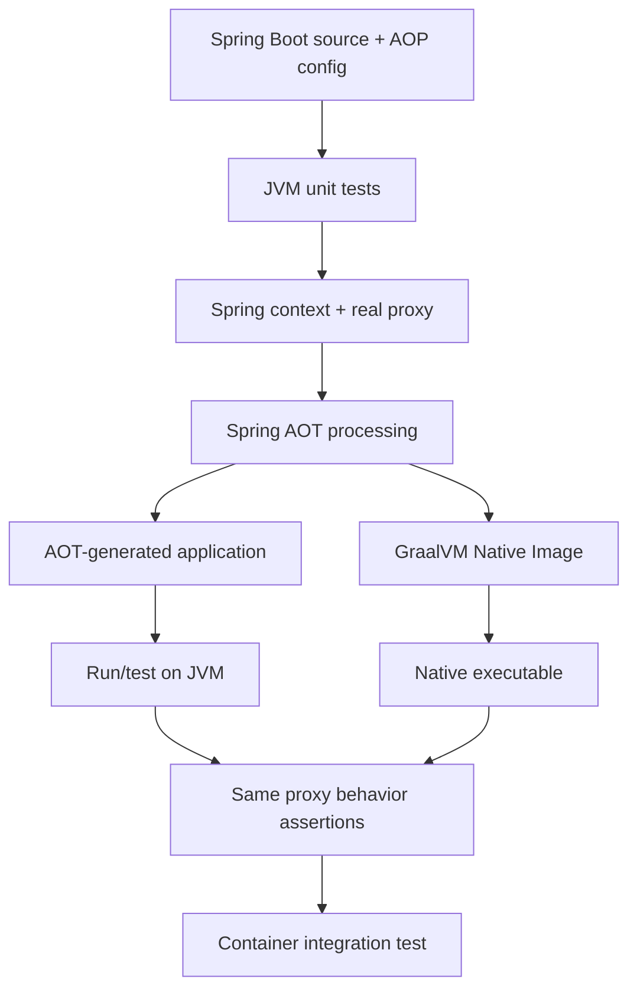

# Testing behavior through real proxies on AOT JVM and native binaries

## 1. Why must real proxies be tested?

Spring AOP typically places a proxy between callers and the target bean to execute transactions, security, logging, retries, metrics, or other cross-cutting logic. A unit test calling the target class directly can verify business logic, but it does not prove that calls went through the proxy and interceptors.

When moving a Spring Boot application to **Spring AOT** and **GraalVM Native Image**, you must verify multiple layers of behavior:

- Does Spring create the right beans and proxies in the application context?
- Does the proxy use the expected JDK interface or class-based strategy?
- Are advisors/aspects applied and executed in the right order?
- Do calls through the proxy reach the target, return results, and propagate exceptions properly?
- Does that same behavior hold in the AOT-processed context and the native executable?

In the **SPRING_BOOT_NATIVE_IMAGE** module, this testing is part of compatibility verification before benchmarking startup/memory, packaging containers, and operating the native build. A successful native build only proves the compiler produced an executable; it does not prove proxies and advice execute properly along every code path.



## 2. Distinguishing test targets and test doubles

To test a proxy, tests must retrieve the bean from the Spring container. Do not instantiate the target with `new InvoiceService()` and invoke it directly, because that object bypasses the Spring-managed proxy.

Example target:

```java
@Service
public class InvoiceService {
    public String issue(String customerId) {
        return "invoice:" + customerId;
    }
}
```

Aspect with an observable side effect:

```java
@Aspect
@Component
public class InvocationCounterAspect {
    private final AtomicInteger calls = new AtomicInteger();

    @Around("execution(* com.example.invoice.InvoiceService.issue(..))")
    public Object count(ProceedingJoinPoint joinPoint) throws Throwable {
        calls.incrementAndGet();
        return joinPoint.proceed();
    }

    public int count() {
        return calls.get();
    }
}
```

Test retrieving the bean from the application context:

```java
@SpringBootTest
class InvoiceProxyTest {

    @Autowired
    InvoiceService invoiceService;

    @Autowired
    InvocationCounterAspect counter;

    @Test
    void callPassesThroughSpringProxy() {
        assertThat(AopUtils.isAopProxy(invoiceService)).isTrue();

        String result = invoiceService.issue("C-100");

        assertThat(result).isEqualTo("invoice:C-100");
        assertThat(counter.count()).isEqualTo(1);
    }
}
```

This example requires the appropriate Spring AOP/AspectJ dependencies and component-scanning of the aspect. The counter confirms the advice actually ran; checking `AopUtils.isAopProxy` alone does not prove the pointcut matched or the interceptor was invoked.

In test suites with parallel tests or shared contexts, counters must be reset/isolated per test to avoid order dependencies. You can use a test-scoped recorder or check the increment relative to the pre-call value.

## 3. Verifying the actual proxy type

Spring can use JDK dynamic proxies or class-based proxies. Use Spring AOP utilities to inspect:

```java
assertThat(AopUtils.isAopProxy(invoiceService)).isTrue();

if (AopUtils.isJdkDynamicProxy(invoiceService)) {
    // Proxy implementing interfaces.
}

if (AopUtils.isCglibProxy(invoiceService)) {
    // Class-based proxy.
}
```

Do not always assert CGLIB if the application permits JDK proxies or configuration can change. Tests should assert **the intended architectural contract**: for example, that an interface proxy must be used because clients depend only on the interface, or that a class-based proxy must be used because the bean has no interface.

When checking class-based proxies, note that target classes/methods needing interception must not be `final` per subclass proxy restrictions. `private` methods also cannot be overridden to insert advice this way.

## 4. Testing results, side effects, and exceptions

A working proxy must preserve the target's contract while executing advice. Include at least these cases:

| Scenario | What to verify |
|---|---|
| Successful call | Advice runs, target runs, return value is correct |
| Target throws exception | Advice runs as designed, exception/cause propagates properly |
| Pointcut does not match | Advice does not run outside intended scope |
| Multiple calls | Advice execution count matches invocation count |
| Self-invocation internal call | Explicitly verify whether advice runs per proxy semantics |
| Ineligible bean | Context does not create unintended proxies |

Exception testing example:

```java
assertThatThrownBy(() -> invoiceService.issue("INVALID"))
    .isInstanceOf(IllegalArgumentException.class)
    .hasMessageContaining("invalid customer");

assertThat(counter.count()).isEqualTo(1);
```

This assertion assumes the target throws the exception and the advice calls `proceed()` without swallowing it. If the aspect retries or translates exceptions, expected behavior should reflect that policy.

## 5. Testing advisor ordering and multi-advice interaction

A bean may have multiple pieces of advice applied, such as security, transactions, and metrics. Order can affect outcomes:

- Security rejects unauthorized requests before the target runs.
- Transactions open before calling the target and commit/roll back afterward.
- Metrics measure timing around the call.
- Retries may invoke the target multiple times.

Do not test each aspect solely in isolation; test their combination on critical business flows. Use logs/test recorders to confirm entry/exit order if ordering is part of the contract. For transactions, verify rollback via database state or a real transaction manager suited to the test environment, not merely by asserting an annotation exists.

Also distinguish Spring proxy AOP from AspectJ compile-time/load-time weaving. Tests for proxy-based Spring AOP do not automatically prove other weaving modes behave identically.

## 6. Self-invocation and proxy boundaries

In proxy-based AOP, a call from one method of the target to another method on the same `this` typically does not go through the proxy:

```java
@Service
class OrderService {

    public void placeOrder() {
        this.persistOrder();
    }

    @Transactional
    public void persistOrder() {
        // Persist order.
    }
}
```

If `placeOrder()` calls `persistOrder()` directly on the same object, transaction advice may not run. This is a proxy characteristic, not a Native Image-specific bug.

Tests should cover an external call through the bean proxy and a self-invocation case if business logic relies on it. The fix is usually moving the advised method to another bean or designing service boundaries so calls traverse the proxy. Do not use reflection to invoke internal methods expecting it to automatically resolve these semantics.

## 7. Testing the application after Spring AOT on the JVM

Spring AOT processes the application context at build time and generates sources/resources/hints. Testing the AOT context on the JVM helps separate AOT issues from Native Image compiler/runtime-specific issues.

General workflow:

1. Run regular JVM tests for a baseline.
2. Run Spring Boot's AOT task with target profiles/properties.
3. Compile generated AOT sources according to the plugin's task graph.
4. Run the application using AOT output on the JVM if your plugin version provides a corresponding task/run configuration.
5. Repeat proxy assertions: bean is a proxy, advice runs, target results and exceptions are correct.

Task names and how to run an AOT-processed application depend on the Spring Boot Gradle/Maven Plugin version. With Gradle, check the task graph via `./gradlew tasks --all`; with Maven, inspect lifecycle goals configured by the plugin. Do not assume every version shares identical task names like `runAot` or `bootRunAot`.

Common Gradle steps example:

```bash
./gradlew test
./gradlew processAot
./gradlew compileAotJava
```

These tasks illustrate AOT processing and compiling generated code; they do not by themselves prove the AOT application ran and proxies worked. Use the AOT-supported run method provided by your plugin version or an appropriate integration test.

## 8. Testing on the native binary

After AOT and Native Image build succeed, run **the exact executable just produced**. Do not run tests only on the JVM and assume the native binary behaves identically.

Testing sequence:

```bash
./gradlew nativeCompile
```

Then run the executable from the project's output path, for example:

```bash
./build/native/nativeCompile/api-app
```

Paths/filenames vary by Gradle configuration; Maven typically places output under `target/`. On Windows, the executable may have a `.exe` extension. Verify you run the exact file produced by the latest build, not a stale artifact.

Invoke the business endpoint that triggers the proxy:

```bash
curl -i http://localhost:8080/api/invoices/C-100
```

The example endpoint must be implemented in the application and call through the Spring-proxied bean. To verify advice, observe a safe side effect such as a counter, audit event, or test recorder. Plain text logs can help, but are weak assertions if logging configuration is not controlled.

For native integration tests, you can use GraalVM Build Tools' native test capability if your project is configured for it. How native tests run depends on the plugin and version; check your project's task list and docs. If there is no native test task, launch the executable as a separate process and call HTTP endpoints from a test client.

## 9. Testing inside a container

A native executable might work on a developer machine yet fail when packaged in a container due to OS, libc, system library, user, or runtime configuration differences.

After building the application image with Cloud Native Buildpacks or a Dockerfile, test:

- Container startup and readiness succeed.
- Requests pass through controller/service proxies and advice actually executes.
- Runtime environment variables/profiles are correct.
- Required resources, native libraries, and mounted files exist.
- Container user has appropriate permissions.
- Memory/CPU limits do not cause the process to be killed.
- Container restarts preserve data that must remain durable.

If proxies work on the local executable but fail inside the container, verify the image contains the exact binary/digest, profile/config, and matching build report. Do not immediately add proxy hints when the root cause might be the container running an old artifact or different configuration.

## 10. JVM, AOT JVM, and native test matrix

| Behavior | Standard JVM | AOT-processed JVM | Native executable |
|---|---|---|---|
| Bean is created | PASS/FAIL | PASS/FAIL | PASS/FAIL |
| Bean is a proxy matching required strategy | PASS/FAIL | PASS/FAIL | PASS/FAIL |
| Advice executes on expected pointcut | PASS/FAIL | PASS/FAIL | PASS/FAIL |
| Target returns expected result | PASS/FAIL | PASS/FAIL | PASS/FAIL |
| Exceptions propagate properly | PASS/FAIL | PASS/FAIL | PASS/FAIL |
| Transaction/security/retry | PASS/FAIL | PASS/FAIL | PASS/FAIL |
| Self-invocation semantics | PASS/FAIL | PASS/FAIL | PASS/FAIL |

This table is meant to be filled in with actual test results. Do not treat AOT-processed JVM as requiring a dedicated task in every version; if the toolchain does not provide a way to run AOT output on the JVM, document the alternative test scope and verify native directly.

## 11. Distinguishing proxy errors from Native Image metadata errors

When a native test fails, categorize first:

| Symptom | Cause category | Check |
|---|---|---|
| Bean does not exist | Component scan, profile, condition, AOT bean graph | Context configuration and AOT output |
| Bean exists but is not a proxy | AOP not enabled, pointcut/advisor does not match | Spring AOP configuration |
| Proxy exists but advice does not run | Pointcut, self-invocation, `final`/`private` method | Proxy strategy and call path |
| JDK proxy fails on creation | Interface set unrecognized/missing hints | `ProxyHints` and AOT integration |
| Class-based proxy fails | Incompatible subclass/bytecode generation | Framework/library AOT support |
| Advice runs but target reflection fails | Missing reflection metadata | `RuntimeHints`/member category |
| Resource in advice cannot be read | Wrong resource metadata/path | Resource hints and classpath |
| Container fails to start | OS/library/config/permission | Run image and deployment environment |

Proxy metadata, reflection metadata, and resource hints solve different problems. Do not broadly register everything before identifying which category the error belongs to.

## 12. Principles for writing stable tests

- Retrieve beans through the Spring context; do not manually `new` targets in proxy tests.
- Assert both target results and advice side effects.
- Verify the proxy strategy by contract, without hard-coding generated class names.
- Reset counters/recorders between tests.
- Do not make tests depend on execution order or wall-clock time.
- Use real dependencies/configurations where AOP must be verified; mock only at boundaries outside the test objective.
- Test exceptions, non-matching pointcuts, and self-invocation.
- Re-run against AOT output and the native executable/container.
- Tie test reports to commit, toolchain, and artifact digest.

## 13. Checklist before accepting proxies in Native Image

- Target beans are Spring-managed and proxied in the context.
- Proxy strategy matches the design (JDK or class-based).
- Aspects/advisors are discovered, pointcuts match, and advice executes.
- Target results, exceptions, and side effects are correct.
- `final`/`private`/self-invocation limitations have been addressed.
- Spring AOT runs with the exact profile and dependency graph.
- Proxy/reflection/resource metadata has been added in the right places if needed.
- The freshly built native executable is run and tested on real code paths.
- The container image runs the exact binary and deployment configuration.
- Test reports are linked to specific artifacts before benchmarking/releasing.

## 14. Self-check questions

1. Why does calling a target directly with `new` fail to test a Spring AOP proxy?
2. What does `AopUtils.isAopProxy` prove, and what does it not prove?
3. Why should you assert advice side effects in addition to method return values?
4. How does self-invocation affect transaction or logging advice?
5. What are the differences between testing on a standard JVM, an AOT-processed JVM, and a native executable?
6. When a native proxy fails, how do you distinguish missing proxy metadata from a non-matching pointcut?
7. Why should integration tests be re-run inside the target container?

**Key takeaway:** proxy tests must go through real Spring-managed beans and verify both the target and advice. Repeating the same contract across the JVM, AOT output when runnable, the native executable, and the container proves proxy behavior is compatible before releasing a Spring Boot Native Image.
