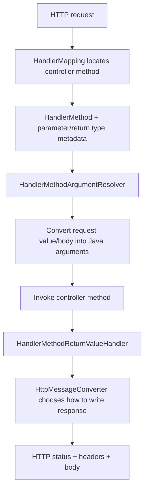
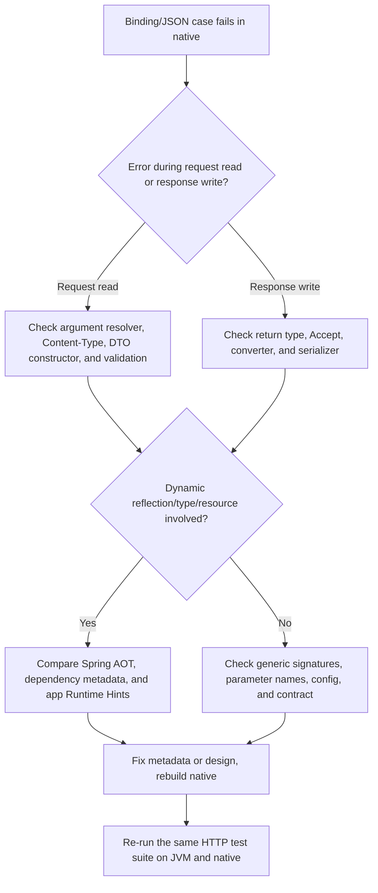

# Request and Response Types Inferred from Endpoint Declarations

In Spring Boot Web MVC, an endpoint's signature is a vital part of its HTTP contract. Spring reads the annotations, parameter types, and return type of a controller method to determine **how to extract data from the request, convert that data into Java objects, invoke the method, and write the result as a response**.

For example, from the declaration:

```java
@PostMapping("/orders")
OrderResponse create(@Valid @RequestBody CreateOrderRequest request) {
    // ...
}
```

Spring knows the body needs to be read and converted into `CreateOrderRequest`, and the returned `OrderResponse` needs to be written as the HTTP response. Jackson typically handles JSON conversion when the media type matches. With GraalVM Native Image, the data types, constructors, annotations, and metadata required by binding and serialization must be retained or properly declared.

This lesson belongs to the **Binding and JSON** chapter of the `SPRING_BOOT_NATIVE_IMAGE` module. We will trace from endpoint declarations to request/response types, understand how Spring MVC and message converters infer types, identify limitations around generic types and parameter names, and test the binding path on a native executable.

## 1. Where Does Spring MVC Infer the Endpoint Contract From?

Spring MVC discovers handler methods in controllers and builds endpoint metadata from:

- Mapping annotations: `@RequestMapping`, `@GetMapping`, `@PostMapping`, `@PutMapping`, `@PatchMapping`, `@DeleteMapping`.
- Parameter annotations: `@PathVariable`, `@RequestParam`, `@RequestHeader`, `@CookieValue`, `@RequestBody`, `@ModelAttribute`, `@RequestPart`.
- Parameter Java types: `String`, `long`, records, DTOs, collections, generic types, or multipart types.
- Return annotations and types: `@ResponseBody`, `ResponseEntity<T>`, `HttpEntity<T>`, `ModelAndView`, `void`, `StreamingResponseBody`, and reactive types when using the corresponding stack.
- Configured media types and message converters: `Content-Type`, `Accept`, Jackson converters, string converters, byte-array converters, and other converters.



Key takeaway: Spring does not infer the contract solely from the method name. Mapping annotations along with parameter and return types form the metadata the framework uses. When a declaration is ambiguous or open to multiple interpretations, use explicit annotations to avoid relying on convention.

## 2. Reading Request Types from Controller Parameters

An endpoint can receive data from multiple parts of an HTTP request. Each annotation selects a different binding mechanism.

```java
@RestController
@RequestMapping("/api/orders")
class OrderController {

    @GetMapping("/{id}")
    OrderResponse find(
            @PathVariable("id") long id,
            @RequestParam(name = "expand", defaultValue = "false") boolean expand,
            @RequestHeader(name = "X-Request-Id", required = false) String requestId) {
        // ...
    }

    @PostMapping
    OrderResponse create(@RequestBody CreateOrderRequest request) {
        // ...
    }
}
```

| Declaration | Data Source | Java Type Spring Needs to Bind |
| --- | --- | --- |
| `@PathVariable("id") long id` | A segment in the URL path | `long` |
| `@RequestParam("expand") boolean expand` | Query parameter or form parameter depending on config | `boolean` |
| `@RequestHeader("X-Request-Id") String requestId` | HTTP header | `String` |
| `@CookieValue("SESSION") String session` | Cookie | `String` |
| `@RequestBody CreateOrderRequest request` | HTTP body | `CreateOrderRequest` |
| `@ModelAttribute SearchCriteria criteria` | Query/form fields bound into an object | `SearchCriteria` |
| `@RequestPart("file") MultipartFile file` | One part of a multipart request | `MultipartFile` |

Spring uses `HandlerMethodArgumentResolver` implementations to resolve each parameter. For request bodies, the framework picks an `HttpMessageConverter` based on content type and target type. For path, query, and header values, the framework converts input strings into Java types through the appropriate conversion service or converter.

### 2.1. Why Should Path and Query Parameter Names Be Explicit?

You can write:

```java
@GetMapping("/{id}")
OrderResponse find(@PathVariable long id) {
    // ...
}
```

In some configurations, Spring infers the name `id` from bytecode parameter-name metadata. This depends on the compiler retaining parameter metadata (e.g., the `-parameters` flag) and the framework version in use. If metadata is absent, the application may fail at startup or when resolving the parameter.

Explicit declaration:

```java
@GetMapping("/{id}")
OrderResponse find(@PathVariable("id") long id) {
    // ...
}
```

This makes the contract clearer and less dependent on parameter-name inference. Similarly, specify names in `@RequestParam("page")` and `@RequestHeader("X-Tenant")` when HTTP names are a critical part of the API contract.

In native builds, enabling compiler parameter metadata remains helpful for frameworks or libraries that rely on parameter names. However, **do not use `-parameters` as a substitute for explicit annotations** when request parameter names must remain stable.

## 3. Request Body Types Inferred from @RequestBody

When a parameter is annotated with `@RequestBody`, Spring reads the body via an `HttpMessageConverter`. If the request has `Content-Type: application/json` and a Jackson converter is configured, JSON is deserialized into the Java type declared on the parameter.

Record DTO example:

```java
import jakarta.validation.constraints.Min;
import jakarta.validation.constraints.NotBlank;

public record CreateOrderRequest(
        @NotBlank String sku,
        @Min(1) int quantity) {
}
```

Controller:

```java
@PostMapping(
        path = "/api/orders",
        consumes = MediaType.APPLICATION_JSON_VALUE,
        produces = MediaType.APPLICATION_JSON_VALUE)
ResponseEntity<OrderResponse> create(
        @Valid @RequestBody CreateOrderRequest request) {

    OrderResponse response = orderService.create(request);
    return ResponseEntity.status(HttpStatus.CREATED).body(response);
}
```

With this declaration, Spring/Jackson needs to:

1. Receive the JSON body.
2. Identify the target type `CreateOrderRequest`.
3. Instantiate the record via its canonical constructor and populate component values accurately.
4. Run Bean Validation triggered by `@Valid` if a validation provider is present.
5. Invoke the controller method with the bound object.

If the JSON is syntactically invalid or cannot be converted to the target type, Spring normally returns HTTP 400 under default exception handling. If data parses cleanly yet violates validation constraints, `MethodArgumentNotValidException` is typically raised and handled as HTTP 400. The exact error contract can be customized via `@ControllerAdvice`.

### 3.1. Mutable DTO with Constructor and Setters

Another option is a JavaBean:

```java
public class CreateOrderRequest {
    private String sku;
    private int quantity;

    public CreateOrderRequest() {
    }

    public String getSku() {
        return sku;
    }

    public void setSku(String sku) {
        this.sku = sku;
    }

    public int getQuantity() {
        return quantity;
    }

    public void setQuantity(int quantity) {
        this.quantity = quantity;
    }
}
```

Jackson typically creates the object via the default constructor and assigns properties using setters or fields according to visibility settings. For this type, a native image may require metadata for the constructor and reflectively accessed members if they are not inferred automatically.

Do not assume every DTO requires manually declaring every reflection member. Spring AOT and Jackson integrations can infer many standard cases. Run native tests against real DTOs and only add hints if a specific access path is unhandled.

### 3.2. Explicit Constructor with @JsonCreator

When a DTO lacks a default constructor or needs controlled deserialization, you can declare a constructor explicitly:

```java
import com.fasterxml.jackson.annotation.JsonCreator;
import com.fasterxml.jackson.annotation.JsonProperty;

public class MoneyRequest {
    private final long amount;
    private final String currency;

    @JsonCreator
    public MoneyRequest(
            @JsonProperty("amount") long amount,
            @JsonProperty("currency") String currency) {
        this.amount = amount;
        this.currency = currency;
    }

    public long getAmount() {
        return amount;
    }

    public String getCurrency() {
        return currency;
    }
}
```

`@JsonCreator` and `@JsonProperty` clarify the constructor and properties Jackson uses. This is helpful when you want the JSON contract to be independent of compiler parameter names. Native builds still need to retain appropriate metadata for the constructor and annotations; Jackson/Spring integrations may supply part of the hints, which should be verified on your target version.

## 4. Response Types Inferred from the Return Type

Spring MVC selects a `HandlerMethodReturnValueHandler` based on the return type and annotations of the handler method. In a `@RestController`, the result is usually written to the HTTP response body via an `HttpMessageConverter`.

```java
public record OrderResponse(
        long id,
        String sku,
        int quantity,
        String status) {
}

@GetMapping("/api/orders/{id}")
OrderResponse find(@PathVariable("id") long id) {
    return orderService.find(id);
}
```

The Jackson converter normally serializes `OrderResponse` into JSON. Properties are inferred from record components or getters following Jackson rules.

You can return `ResponseEntity<T>` to control status codes and headers:

```java
@PostMapping("/api/orders")
ResponseEntity<OrderResponse> create(
        @Valid @RequestBody CreateOrderRequest request) {

    OrderResponse response = orderService.create(request);
    URI location = URI.create("/api/orders/" + response.id());

    return ResponseEntity.created(location).body(response);
}
```

Here, `ResponseEntity<OrderResponse>` describes the HTTP response wrapper, while `OrderResponse` is the body type. Spring takes status 201 and the `Location` header from `ResponseEntity`, then serializes the body using the appropriate converter.

| Return Type | Common Spring Interpretation |
| --- | --- |
| `OrderResponse` in `@RestController` | Serializes the object into the response body |
| `ResponseEntity<OrderResponse>` | Uses status, headers, and body supplied by `ResponseEntity` |
| `List<OrderResponse>` | Serializes the collection and its elements |
| `Page<OrderResponse>` | Serializes the `Page` type according to Jackson and application configuration |
| `String` | Typically writes a text body; check content negotiation/converters |
| `byte[]` | Writes a binary body |
| `void` | Depends on annotations and whether the response was already written/modified; no JSON body by default |
| `StreamingResponseBody` | Streams data incrementally rather than serializing a single standard object |

The return type must match the media type advertised by the API. If an endpoint declares `produces = application/json`, return a type that serializes cleanly to JSON and test the actual content type.

## 5. Generic Types and Java Type Erasure

The Java compiler erases most generic type parameters at runtime, but class files can still preserve generic signature metadata. Spring uses abstractions like `MethodParameter`, `ResolvableType`, and `GenericTypeResolver` to infer complete types in many scenarios.

Example:

```java
@GetMapping("/api/orders")
ResponseEntity<List<OrderResponse>> list() {
    return ResponseEntity.ok(orderService.findAll());
}

@PostMapping("/api/batches")
List<OrderResponse> createBatch(
        @RequestBody List<CreateOrderRequest> requests) {
    return orderService.createBatch(requests);
}
```

Spring/Jackson needs to know that the collection elements are `OrderResponse` or `CreateOrderRequest`, not merely the raw type `List`. If generic metadata is missing or code uses raw types, the converter may deserialize elements into an unintended type or lack enough information to instantiate the right objects.

Avoid writing raw types:

```java
// Not recommended: loses element type information in the declaration.
List createBatch(@RequestBody List requests) {
    // ...
}
```

Keep full generics:

```java
List<OrderResponse> createBatch(
        @RequestBody List<CreateOrderRequest> requests) {
    // ...
}
```

With nested generic types or custom wrappers, check how the framework resolves generic signatures and how Jackson constructs `JavaType`. Native Image must also retain metadata related to the types and members used along the serialization/deserialization path.

### 5.1. Custom Response Wrappers

Example:

```java
public record ApiResponse<T>(
        boolean success,
        T data,
        String traceId) {
}

@GetMapping("/api/orders/{id}")
ApiResponse<OrderResponse> find(@PathVariable("id") long id) {
    return new ApiResponse<>(true, orderService.find(id), "trace-123");
}
```

Generic signatures allow Spring/Jackson to recognize that `data` has type `OrderResponse`. If a response is built from `Object`, raw types, or dynamic reflection, that information may no longer be complete. Designing strongly typed generic wrappers makes contracts easier to read and test.

## 6. Content-Type, Accept, and Message Converters

Java types alone do not dictate how bodies are read or written. Spring also inspects media types.

- `Content-Type` describes the format of the incoming request body.
- `Accept` describes the response format the client wants to receive.
- `consumes` and `produces` on mappings restrict which media types an endpoint supports.
- `HttpMessageConverter` is selected based on target/source types and media types.

Example:

```java
@PostMapping(
        path = "/api/orders",
        consumes = MediaType.APPLICATION_JSON_VALUE,
        produces = MediaType.APPLICATION_JSON_VALUE)
ResponseEntity<OrderResponse> create(
        @RequestBody CreateOrderRequest request) {
    // ...
}
```

Some common scenarios:

| Request/Response | Expected Outcome to Verify |
| --- | --- |
| JSON body + `Content-Type: application/json` | Jackson converter reads the DTO properly |
| JSON body with missing/wrong Content-Type | May fail to select a converter; typically leads to 415 or a conversion error depending on the request |
| Client sends `Accept: application/xml` when endpoint only produces JSON | Content negotiation fails; typically returns 406 |
| Response is `String` | Converter and media type may differ from a JSON object |
| Response is `byte[]` | Verify content type and binary bytes |
| Multipart request | Verify `@RequestPart`, multipart resolver, and size limits |

Native parity tests should send the exact headers a real client uses. Calling a controller method directly in a unit test does not exercise argument resolvers, message converters, status codes, or content negotiation.

## 7. Path/Query Binding and Type Conversion

Example order lookup endpoint:

```java
@GetMapping("/api/orders/{id}")
OrderResponse find(
        @PathVariable("id") long id,
        @RequestParam(name = "includeLines", defaultValue = "false") boolean includeLines) {
    return orderService.find(id, includeLines);
}
```

Spring takes string values from the URL and converts them to `long` or `boolean`. If `id=abc`, conversion fails and the request typically receives HTTP 400. For date/time types, enums, or custom value objects, conversion requires suitable formatters or converters.

Custom converter example:

```java
import java.util.Locale;

import org.springframework.core.convert.converter.Converter;
import org.springframework.stereotype.Component;

@Component
class OrderCodeConverter implements Converter<String, OrderCode> {

    @Override
    public OrderCode convert(String source) {
        return new OrderCode(source.trim().toUpperCase(Locale.ROOT));
    }
}
```

```java
@GetMapping("/api/orders/by-code")
OrderResponse findByCode(@RequestParam("code") OrderCode code) {
    return orderService.findByCode(code);
}
```

This binding path uses Spring's conversion service, not Jackson JSON deserialization. When debugging native issues, determine whether the failure lies in the resolver/conversion layer or in the message converter; the two mechanisms have different configurations and metadata.

## 8. Native Metadata That May Affect Binding and JSON

Jackson may use introspection, annotation metadata, constructor/property access, and reflection depending on DTO types and configuration. Spring AOT and integrations can automatically infer many requirements from controller mappings and model types.

Cases to watch closely:

- DTOs selected by class name from configuration or requests.
- Non-standard constructors, private constructors, or factory methods invoked via reflection.
- Polymorphic deserialization with subtypes referenced only in metadata/annotations.
- Custom Jackson serializers/deserializers that dynamically access members.
- Mixin annotations registered via dynamic configuration.
- Generic types that are raw or lack signatures.
- Custom modules/services discovered via `ServiceLoader`.
- Resources such as schemas, templates, or mapping files read by dynamic names.

Polymorphic DTO example:

```java
import com.fasterxml.jackson.annotation.JsonSubTypes;
import com.fasterxml.jackson.annotation.JsonTypeInfo;

@JsonTypeInfo(use = JsonTypeInfo.Id.NAME, property = "kind")
@JsonSubTypes({
        @JsonSubTypes.Type(value = CardPaymentRequest.class, name = "card"),
        @JsonSubTypes.Type(value = BankPaymentRequest.class, name = "bank")
})
public sealed interface PaymentRequest
        permits CardPaymentRequest, BankPaymentRequest {
}

public record CardPaymentRequest(String token, long amount)
        implements PaymentRequest {
}

public record BankPaymentRequest(String account, long amount)
        implements PaymentRequest {
}
```

The subtypes are declared explicitly in annotations, giving the framework an opportunity to recognize them. If subtypes are resolved from external string names without metadata or registration, the native image may lack the required classes or reflection metadata.

### 8.1. Do Not Add Hints Indiscriminately

Do not register every constructor, method, and field of every DTO by default. Run native integration tests to pinpoint which binding path fails, inspect stack traces and generated metadata, and then add minimal hints if needed.

The Spring Framework Runtime Hints API can declare reflection for a type:

```java
hints.reflection().registerType(
        LegacyRequest.class,
        MemberCategory.INVOKE_DECLARED_CONSTRUCTORS,
        MemberCategory.INVOKE_PUBLIC_METHODS);
```

This snippet only illustrates the required access categories; select the categories matching actual Jackson or custom serializer usage. If Jackson/Spring libraries already provide hints for that usage path, do not duplicate metadata in your application.

## 9. A Complete Controller to Verify Request/Response Inference

The following example combines common binding types in one controller:

```java
package com.example.orders;

import java.net.URI;
import java.util.List;

import jakarta.validation.Valid;

import org.springframework.http.HttpStatus;
import org.springframework.http.MediaType;
import org.springframework.http.ResponseEntity;
import org.springframework.web.bind.annotation.*;

@RestController
@RequestMapping("/api/orders")
class OrderController {

    private final OrderService service;

    OrderController(OrderService service) {
        this.service = service;
    }

    @PostMapping(consumes = MediaType.APPLICATION_JSON_VALUE)
    ResponseEntity<OrderResponse> create(
            @Valid @RequestBody CreateOrderRequest request) {

        OrderResponse response = service.create(request);
        return ResponseEntity.created(
                URI.create("/api/orders/" + response.id()))
                .body(response);
    }

    @GetMapping("/{id}")
    OrderResponse find(@PathVariable("id") long id) {
        return service.find(id);
    }

    @GetMapping
    List<OrderResponse> list(
            @RequestParam(name = "status", required = false) String status) {
        return service.findByStatus(status);
    }

    @PostMapping("/batch")
    List<OrderResponse> createBatch(
            @Valid @RequestBody List<CreateOrderRequest> requests) {
        return service.createBatch(requests);
    }
}
```

Inferred contract:

| Method | Request Data | Input Java Type | Response Body Type |
| --- | --- | --- | --- |
| `POST /api/orders` | JSON body | `CreateOrderRequest` | `OrderResponse`, status 201 |
| `GET /api/orders/{id}` | Path variable | `long` | `OrderResponse` |
| `GET /api/orders?status=...` | Query parameter | Nullable `String` | `List<OrderResponse>` |
| `POST /api/orders/batch` | JSON array body | `List<CreateOrderRequest>` | `List<OrderResponse>` |

This controller illustrates the contract, assuming `OrderService`, DTOs, and validation are already defined. In real implementations, handle missing IDs, business errors, batch validation, and body size limits.

## 10. Testing Binding on JVM and Native Image

A unit test calling a method directly bypasses Spring MVC. To verify that request and response types are inferred properly, use integration tests that send HTTP requests.

Example using `@SpringBootTest(webEnvironment = RANDOM_PORT)` and `TestRestTemplate`:

```java
import org.junit.jupiter.api.Test;
import org.springframework.beans.factory.annotation.Autowired;
import org.springframework.boot.test.context.SpringBootTest;
import org.springframework.boot.test.web.client.TestRestTemplate;
import org.springframework.http.HttpStatus;
import org.springframework.http.ResponseEntity;

import static org.assertj.core.api.Assertions.assertThat;

@SpringBootTest(webEnvironment = SpringBootTest.WebEnvironment.RANDOM_PORT)
class OrderHttpTests {

    @Autowired
    TestRestTemplate http;

    @Test
    void createsAndReadsOrder() {
        CreateOrderRequest request = new CreateOrderRequest("COFFEE", 2);

        ResponseEntity<OrderResponse> created =
                http.postForEntity("/api/orders", request, OrderResponse.class);

        assertThat(created.getStatusCode()).isEqualTo(HttpStatus.CREATED);
        assertThat(created.getBody()).isNotNull();
        assertThat(created.getBody().sku()).isEqualTo("COFFEE");

        long id = created.getBody().id();
        ResponseEntity<OrderResponse> found =
                http.getForEntity("/api/orders/" + id, OrderResponse.class);

        assertThat(found.getStatusCode()).isEqualTo(HttpStatus.OK);
        assertThat(found.getBody()).isNotNull();
        assertThat(found.getBody().quantity()).isEqualTo(2);
    }
}
```

This example tests an application with record DTOs and a configured service. To test error cases, add JSON bodies missing `sku`, `quantity` equal to 0, malformed JSON, and invalid `id` values.

For native, run the same test cases against the native executable or corresponding native test setup. Do not rely solely on `RuntimeHintsPredicates`: hint unit tests do not replace real Jackson deserialization and serialization inside the compiled binary.

### 10.1. Minimum Test Matrix

| Case | Request | Expectation |
| --- | --- | --- |
| Valid JSON object | `POST` body with `sku` and `quantity` | 201, body with expected type/values |
| Missing required field | JSON without `sku` | 400 per validation/contract |
| Wrong data type | `quantity` as an unconvertible string | 400 |
| Validation failure | `quantity = 0` | 400, order not created |
| Malformed JSON | Invalid JSON body | 400 |
| Invalid path variable | `/api/orders/abc` | 400 when converting to `long` |
| Invalid query parameter | `?includeLines=maybe` for boolean | 400 |
| Generic collection | JSON array creating a batch | Elements bound to right DTO, response returns list |
| Content negotiation | Different `Accept`/`Content-Type` headers | 406/415 or contract-defined response |
| Polymorphic body | `kind` `card`/`bank` | Correct subtype and fields |

Run the exact same matrix on both JVM and native using identical request headers, bodies, and initial data. Compare status codes, content types, JSON fields, and side effects. Fields like timestamps or request IDs may vary across runs; normalize according to the contract instead of ignoring all differences.

## 11. Investigating Cases Where Binding Works on JVM but Fails in Native

| Symptom | Cause to Examine | How to Verify |
| --- | --- | --- |
| JSON body creates object but fields are null | Property name/constructor/record component mapping mismatch | Check JSON contract, Jackson annotations, and constructors |
| Native reports it cannot instantiate DTO | Constructor/creator lacks required reflection metadata | Read stack trace, inspect generated hints and DTO type |
| Polymorphic type fails to resolve | Subtype not registered or metadata missing | Check `@JsonSubTypes`, subtype registration, and class reachability |
| Collection becomes `List<Map>` or unexpected type | Raw generic type or missing generic signature | Declare `List<Dto>` or explicit generic wrappers |
| Path variable name not found | Relied on parameter name without compiler metadata | Specify name explicitly in `@PathVariable("id")`, check compiler `-parameters` |
| Request returns 415 | `Content-Type` incompatible with converter/`consumes` | Check request headers and converters |
| Request returns 406 | `Accept` incompatible with `produces`/converter | Check content negotiation |
| Custom serializer fails in native | Serializer uses dynamic reflection/resources | Inspect hints provided by app/dependencies |
| Native test passes but real endpoint fails | Test only invokes methods directly or skips HTTP converters | Use HTTP integration tests against the native executable |

Investigation workflow:



## 12. Designing APIs for Predictable Binding

Useful principles when writing controllers:

- Use dedicated DTOs for requests and responses; do not expose JPA entities directly.
- Use records or explicit constructors for immutable request DTOs when appropriate.
- Specify names explicitly for important path, query, and header parameters.
- Preserve full generic types; avoid raw `List`, `Map`, or `ResponseEntity`.
- Set `consumes`/`produces` when the API contract requires fixed media types.
- Use `@Valid` and validation constraints to reject bad data at the HTTP boundary.
- Define consistent error responses using `@ControllerAdvice`.
- Restrict polymorphic deserialization by arbitrary class names from external inputs; use a subtype allowlist.
- Verify custom Jackson modules/serializers have necessary native metadata.
- Write HTTP integration tests that execute against the native executable.

Avoid adding overly broad reflection hints to mask an unclear contract. Many binding errors stem from raw generics, missing parameter names, or inconsistent JSON schemas; fixing the contract first usually makes both JVM and native easier to maintain.

## 13. Pre-Release Checklist for Native APIs

- [ ] Every endpoint has clear mappings and parameters carry appropriate annotations.
- [ ] Important path, query, and header names are declared explicitly.
- [ ] Request DTOs have clear constructor/record mappings and appropriate validation.
- [ ] Response DTOs and generic wrappers preserve complete type information.
- [ ] Jackson annotations, custom modules, and polymorphic subtypes are verified.
- [ ] `Content-Type`, `Accept`, `consumes`, and `produces` match the contract.
- [ ] Spring AOT/dependencies supply hints for standard binding paths.
- [ ] Custom reflection/resources have minimal hints where needed.
- [ ] HTTP integration tests cover success, parse errors, validation, generic collections, and content negotiation.
- [ ] The same request suite runs against the real native executable.
- [ ] Status codes, bodies, headers, and side effects match the JVM build.
- [ ] Broad hints or raw types are not used to hide contract design flaws.

### Self-Assessment Questions

1. Which information in a controller declaration does Spring MVC use to infer parameter binding?
2. Why does `@RequestBody List<CreateOrderRequest>` provide better metadata than raw `List`?
3. What is the difference between `@PathVariable` and `@RequestBody` regarding data source and conversion mechanism?
4. What information does `ResponseEntity<OrderResponse>` supply beyond the body type?
5. Why does a unit test calling a controller method directly not prove Jackson binding works in native?
6. When a DTO constructor lacks parameter-name metadata, how do `@JsonCreator` and `@JsonProperty` help?
7. When an endpoint returns 415 or 406, how should you inspect `Content-Type`/`Accept` and converters?
8. When should you add Runtime Hints for a DTO, and why should you avoid registering all members of every class?

## References

- [Spring Framework — Web MVC: Method Arguments](https://docs.spring.io/spring-framework/reference/web/webmvc/mvc-controller/ann-methods/arguments.html): how Spring resolves controller arguments.
- [Spring Framework — Web MVC: Return Values](https://docs.spring.io/spring-framework/reference/web/webmvc/mvc-controller/ann-methods/return-types.html): how the framework handles return types.
- [Spring Framework — Message Converters](https://docs.spring.io/spring-framework/reference/web/webmvc/message-converters.html): converting request/response bodies by media type.
- [Spring Boot — GraalVM Native Images](https://docs.spring.io/spring-boot/reference/packaging/native-image/introducing-graalvm-native-images.html): native image workflow and Spring AOT's role.
- [Jackson Annotations](https://github.com/FasterXML/jackson-annotations): `@JsonCreator`, `@JsonProperty`, and polymorphic type annotations.

**Expected outcome:** accurately read endpoint signatures and identify request/response types, HTTP data sources, converters, and required metadata. When migrating Spring Boot to GraalVM Native Image, explicitly declared contracts, full generic types, and integration tests executed against the native binary make binding and JSON handling predictable and easier to diagnose.
