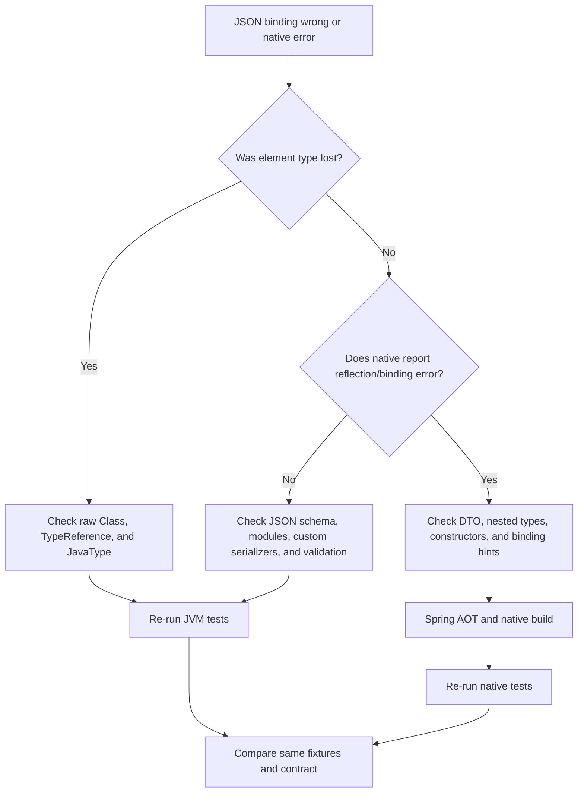

# Types Converted Only Through Generic Code or Generics Losing Information

## 1. Why Is JSON Binding Prone to Errors When Moving to Native?

In the **SPRING_BOOT_NATIVE_IMAGE** module, we use **Spring AOT** to prepare a Spring Boot application for **GraalVM Native Image**, then verify compatibility, measure startup time and memory, package containers, and run the native build. A common group of errors occurs at the **binding and JSON** layer: the application works on the JVM, yet the native executable fails to properly convert DTOs, generic collections, or types chosen only at runtime.

The root cause usually involves two issues:

1. **Generic type information loss:** Java uses type erasure. If code only passes `List.class` or `Map.class` to Jackson, the library does not know the element or value types to instantiate.
2. **Binding requires reflection:** Jackson and HTTP message converters may read constructors, fields, accessors, annotations, generic signatures, or subtypes via reflection. Native Image needs sufficient metadata for these dynamic accesses.

For example, given the same JSON:

```json
[
  {"id": 101, "customer": "An"},
  {"id": 102, "customer": "Binh"}
]
```

If read using `List.class`, Jackson may produce a `List` containing `LinkedHashMap` maps instead of `List<Order>`. If read using `TypeReference<List<Order>>`, Jackson has the element type information. However, when running natively, `Order` and any nested types still need to be recognized or registered for data binding as required by the framework and version in use.

After this lesson, learners will be able to:

1. Explain type erasure and why a raw `Class` does not fully describe a generic JSON type.
2. Choose `TypeReference`, `JavaType`, or `ParameterizedTypeReference` for each API.
3. Write generic helpers without accidentally losing the caller's concrete type.
4. Register DTOs, nested DTOs, and polymorphic subtypes with Spring binding hints when needed.
5. Distinguish generic type resolution from reflection reachability.
6. Test JSON binding on both JVM and native executables using identical data and contracts.

> **Principle:** preserving type information and preserving reflection metadata are two separate requirements. `TypeReference<List<Order>>` solves describing the generic type for Jackson; it does not automatically register all constructors, fields, or subtypes for Native Image.

## 2. Type Erasure: Why Is a Raw List Not Enough?

Java generics are implemented via **type erasure**. Type parameters are usually erased or replaced with their bounds in bytecode. Thus:

```java
List<Order> orders = new ArrayList<>();
List<Customer> customers = new ArrayList<>();

System.out.println(orders.getClass() == customers.getClass()); // true
```

Both objects have the runtime class `java.util.ArrayList`. From `orders.getClass()`, you cannot infer that elements are `Order`; from `customers.getClass()`, you cannot infer that elements are `Customer`.

Jackson needs the target type to convert each JSON object into the proper Java type. If only a raw class is provided:

```java
List<?> values = objectMapper.readValue(json, List.class);
```

Jackson knows it needs to create a `List` collection, yet lacks information to construct `Order` for each element. For JSON objects, the result is typically maps; for arrays, strings, or numbers, Jackson uses the corresponding general-purpose types. This can cause errors to appear only later when code casts fields or calls DTO-specific methods.

| Target Type | Information Jackson Receives |
| --- | --- |
| `List.class` | Knows only the raw collection; element type is unspecified. |
| `List<Order>` via `TypeReference` | Knows both the collection and the `Order` element type. |
| `Map<String, List<Order>>` via `TypeReference`/`JavaType` | Knows key type, value collection, and nested element type. |
| `Page<Order>` via type token/`JavaType` | Knows the generic wrapper and the actual type argument `Order`. |

Generic signatures of fields or methods may remain in class files and be readable via reflection, but **they are not automatically passed to Jackson through a raw `Class<?>` variable**. Code must supply the proper `Type`/`JavaType` or a type token.

## 3. Jackson TypeReference: Preserving Generic Types at the Call Site

`com.fasterxml.jackson.core.type.TypeReference<T>` uses the **super type token** technique: creating an anonymous subclass so its generic superclass retains the concrete type in declaration metadata.

### 3.1. Reading a Generic Collection

DTO example:

```java
package com.example.orders;

public record Order(Long id, String customer) {
}
```

Reading JSON:

```java
import com.fasterxml.jackson.core.type.TypeReference;
import com.fasterxml.jackson.databind.ObjectMapper;
import java.util.List;

ObjectMapper mapper = new ObjectMapper();

List<Order> orders = mapper.readValue(
    json,
    new TypeReference<List<Order>>() {}
);
```

The anonymous subclass `new TypeReference<List<Order>>() {}` retains `List<Order>` in its generic superclass signature. Jackson can analyze the type argument and instantiate each element as `Order`.

Importantly, the type token must be created where the concrete type is known. Do not replace `List<Order>` with raw `List.class` if the code expects DTOs rather than generic maps.

### 3.2. Multi-Level Nested Generics

For `Map<String, List<Order>>`, the type token must preserve the entire structure:

```java
TypeReference<Map<String, List<Order>>> type =
    new TypeReference<Map<String, List<Order>>>() {};

Map<String, List<Order>> ordersByRegion =
    mapper.readValue(json, type);
```

Jackson parses the outer raw type as `Map`, key type as `String`, value type as `List<Order>`, and inner list element type as `Order`. If only `Map.class` is used, Jackson has no information to construct `List<Order>` for each value.

### 3.3. A Common Mistake in Generic Helpers

A helper is often written like this:

```java
static <T> T decode(
        String json,
        ObjectMapper mapper) throws JsonProcessingException {
    return mapper.readValue(json, new TypeReference<T>() {});
}
```

This snippet **cannot preserve the caller's actual type argument as the author usually expects**. The anonymous subclass only sees the generic method's type variable `T`; the method type parameter is already erased at runtime. Jackson cannot automatically know whether the caller wanted `List<Order>` or `Map<String, Order>`.

Pass the type token from the caller instead:

```java
static <T> T decode(
        String json,
        TypeReference<T> targetType,
        ObjectMapper mapper) throws JsonProcessingException {
    return mapper.readValue(json, targetType);
}

List<Order> orders = decode(
    json,
    new TypeReference<List<Order>>() {},
    mapper
);
```

In this example, the caller creates the type token where `List<Order>` is known, and the helper merely accepts and forwards the token. Another option is accepting a pre-constructed `JavaType`. Never create `new TypeReference<T>() {}` inside a helper expecting it to recover an erased type.

### 3.4. When Is a Generic Method Accepting `Class` Appropriate?

```java
static <T> T decode(
        String json, Class<T> targetClass, ObjectMapper mapper)
        throws JsonProcessingException {
    return mapper.readValue(json, targetClass);
}
```

This method fits non-generic types or when the caller only needs a concrete `Class<T>`:

```java
Order order = decode(json, Order.class, mapper);
```

However, you cannot pass `List<Order>.class` because Java has no class literal for parameterized types. `List.class` only represents a raw list. When nested generics are needed, accept `TypeReference<T>` or `JavaType`.

## 4. JavaType: Building Types Dynamically from Classes and Type Arguments

Jackson `JavaType` is useful when the target type is assembled from classes and type arguments at runtime, such as in plugin registries, endpoint configurations, or generic wrappers selected via metadata.

### 4.1. Building `List<Order>`

```java
import com.fasterxml.jackson.databind.JavaType;
import com.fasterxml.jackson.databind.ObjectMapper;
import com.fasterxml.jackson.databind.type.TypeFactory;
import java.util.List;

ObjectMapper mapper = new ObjectMapper();
TypeFactory types = mapper.getTypeFactory();

JavaType orderListType =
    types.constructCollectionType(List.class, Order.class);

List<Order> orders = mapper.readValue(json, orderListType);
```

`constructCollectionType` describes the raw collection class alongside its element type. This avoids anonymous subclasses and works well when the element type is already held in a `Class<?>` variable.

### 4.2. Building `Map<String, List<Order>>`

```java
TypeFactory types = mapper.getTypeFactory();

JavaType orderListType =
    types.constructCollectionType(List.class, Order.class);

JavaType mapType = types.constructMapType(
    Map.class,
    types.constructType(String.class),
    orderListType
);

Map<String, List<Order>> ordersByRegion =
    mapper.readValue(json, mapType);
```

`constructMapType` takes a key type and a value type. Here, the value type is already `List<Order>`, rather than collapsing into a raw `List`.

### 4.3. Building Generic Wrappers

Suppose an API returns:

```java
public record ApiResponse<T>(String requestId, T data) {}
```

You can construct `ApiResponse<Order>`:

```java
JavaType responseType = types.constructParametricType(
    ApiResponse.class,
    Order.class
);

ApiResponse<Order> response = mapper.readValue(json, responseType);
```

For nested wrappers like `ApiResponse<List<Order>>`, construct the list `JavaType` first and pass it as the actual type argument:

```java
JavaType orderList = types.constructCollectionType(List.class, Order.class);
JavaType responseOfOrders = types.constructParametricType(
    ApiResponse.class,
    orderList
);

ApiResponse<List<Order>> response =
    mapper.readValue(json, responseOfOrders);
```

`TypeFactory` overloads may differ across Jackson versions; check the API version managed by Spring Boot dependency management. The core idea remains preserving the type structure as a `JavaType` instead of falling back to a raw class.

### 4.4. Selecting Types Dynamically via an Allowlist

If configuration selects one of a few known types, you can map keys to `JavaType`:

```java
Map<String, JavaType> supportedTypes = Map.of(
    "orders", types.constructCollectionType(List.class, Order.class),
    "customers", types.constructCollectionType(List.class, Customer.class)
);

JavaType target = supportedTypes.get(configuredKind);
if (target == null) {
    throw new IllegalArgumentException("Unsupported payload kind");
}

Object value = mapper.readValue(json, target);
```

An allowlist lets the application control which types may be decoded. Do not take arbitrary class names from requests and invoke `Class.forName`/`constructType` without validating the input source and restricting supported types.

## 5. Spring ParameterizedTypeReference for HTTP Clients

Spring's `ParameterizedTypeReference<T>` uses the same super type token concept, tailored for Spring APIs accepting generic types, especially when reading HTTP bodies.

### 5.1. RestTemplate Returning `List<Order>`

```java
ParameterizedTypeReference<List<Order>> responseType =
    new ParameterizedTypeReference<List<Order>>() {};

ResponseEntity<List<Order>> response = restTemplate.exchange(
    url,
    HttpMethod.GET,
    HttpEntity.EMPTY,
    responseType
);

List<Order> orders = response.getBody();
```

Passing `List.class` to an overload expecting a raw class causes the response converter to build a collection of maps instead of `Order`. `ParameterizedTypeReference` retains `List<Order>` so Spring/Jackson processes the response body properly.

### 5.2. WebClient

```java
Mono<List<Order>> ordersMono = webClient.get()
    .uri("/api/orders")
    .retrieve()
    .bodyToMono(new ParameterizedTypeReference<List<Order>>() {});
```

Spring preserves the generic response type via `ParameterizedTypeReference`. Jackson still needs the ability to bind DTOs and nested types when converting JSON into objects; a type token does not replace reflection hints.

### 5.3. Generic Helper for HTTP Responses

Just like Jackson `TypeReference`, pass the token into the helper:

```java
static <T> Mono<T> getBody(
        WebClient client,
        String path,
        ParameterizedTypeReference<T> bodyType) {
    return client.get()
        .uri(path)
        .retrieve()
        .bodyToMono(bodyType);
}

Mono<List<Order>> orders = getBody(
    webClient,
    "/api/orders",
    new ParameterizedTypeReference<List<Order>>() {}
);
```

Do not instantiate `new ParameterizedTypeReference<T>() {}` inside a helper expecting it to recover the caller's concrete type. The caller must create the token where the target type is known and pass it in.

## 6. Generic Binding in Spring MVC and Jackson

Spring MVC uses `HttpMessageConverter` to convert request and response bodies. For JSON, the Jackson converter typically relies on parameter/return value type metadata together with the configured `ObjectMapper`.

Controller example:

```java
@RestController
@RequestMapping("/api/orders")
class OrderController {

    @PostMapping("/batch")
    List<Order> createBatch(@RequestBody List<Order> orders) {
        return orderService.createAll(orders);
    }
}
```

Here, `List<Order>` is declared on the method signature so Spring can inspect the generic parameter. However, `Order` is still a DTO that Jackson must bind: constructors/record components, property accessors, annotations, and nested DTOs may require reflection metadata for native builds.

With a wrapper:

```java
record PageResult<T>(List<T> content, int page, int size, long totalElements) {}

@PostMapping("/search")
PageResult<Order> search(@RequestBody OrderSearchRequest request) {
    // ...
}
```

The generic return type `PageResult<Order>` helps Spring understand the response contract. If Jackson needs to introspect/bind `PageResult` and `Order` in a native image, verify existing AOT support or add binding hints for those concrete types.

### 6.1. Raw Types Corrupt Data Without Always Failing Immediately

This pattern easily hides problems:

```java
List rawOrders = mapper.readValue(json, List.class);
Map first = (Map) rawOrders.get(0);
String customer = (String) first.get("customer");
```

The code may run, yet the application loses type safety. Failures often surface late when casting fields, calling DTO methods, or passing data to another service. Use `List<Order>` with proper type tokens/`JavaType`, and enforce schema/validation at the API boundary.

### 6.2. Immutable DTOs, Records, and Constructor Binding

Jackson can construct objects via constructors, record canonical constructors, creator methods, or property-based binding. For example:

```java
public record Customer(Long id, String name) {}

public class Order {
    private final Long id;
    private final Customer customer;

    @JsonCreator
    public Order(
        @JsonProperty("id") Long id,
        @JsonProperty("customer") Customer customer) {
        this.id = id;
        this.customer = customer;
    }

    public Long getId() { return id; }
    public Customer getCustomer() { return customer; }
}
```

In a native image, constructors and properties used by Jackson need to be backed by hints/AOT metadata. With Spring, you can use `@RegisterReflectionForBinding` to register types for data binding when auto-detection is insufficient.

### 6.3. Polymorphic JSON and Subtypes

A field may declare a base type while JSON identifies the implementation:

```java
@JsonTypeInfo(use = JsonTypeInfo.Id.NAME, property = "kind")
@JsonSubTypes({
    @JsonSubTypes.Type(value = CardPayment.class, name = "card"),
    @JsonSubTypes.Type(value = BankTransfer.class, name = "bank")
})
sealed interface Payment permits CardPayment, BankTransfer {}

record CardPayment(String token) implements Payment {}
record BankTransfer(String accountNumber) implements Payment {}
```

When binding `Payment`, Jackson needs to know the valid subtypes and how to instantiate them. Register the base type along with concrete subtypes in binding hints when needed; never allow arbitrary class names to be picked from JSON.

Avoid enabling broad polymorphic default typing for JSON from untrusted sources. Use an explicit named subtype allowlist, validate payloads, and verify security policies before deserializing.

## 7. Registering Binding Hints for DTOs and Generic Wrappers

Spring Framework provides the `@RegisterReflectionForBinding` annotation to register reflection hints for types requiring data binding. For example:

```java
import org.springframework.aot.hint.annotation.RegisterReflectionForBinding;
import org.springframework.context.annotation.Configuration;

@Configuration(proxyBeanMethods = false)
@RegisterReflectionForBinding({
    Order.class,
    Customer.class,
    PageResult.class
})
class JsonBindingConfiguration {
}
```

This annotation is useful when a type is used in binding yet the access path is not obvious enough for static analysis. Place the configuration in an application context processed by Spring AOT or on an appropriate type according to your Spring Framework version's API.

**Note on generics:** Java has no `PageResult<Order>.class`. Registering the raw class `PageResult.class` describes the wrapper type needing reflection for binding; `Order.class` is the concrete element type that must also be recognized if Jackson binds it. For nested DTOs or subtypes, register any additional concrete types required. A generic type token (`TypeReference`/`JavaType`) must still be supplied at the JSON read site.

### 7.1. When Is `RuntimeHintsRegistrar` Needed?

If you need to register binding for a list of types determined in build configuration, you can use a registrar:

```java
import org.springframework.aot.hint.RuntimeHints;
import org.springframework.aot.hint.RuntimeHintsRegistrar;
import org.springframework.aot.hint.TypeReference;
import org.springframework.aot.hint.MemberCategory;

public final class AdditionalJsonHints implements RuntimeHintsRegistrar {
    @Override
    public void registerHints(RuntimeHints hints, ClassLoader classLoader) {
        hints.reflection().registerType(
            TypeReference.of("com.example.plugins.JsonOrderPlugin"),
            MemberCategory.INVOKE_DECLARED_CONSTRUCTORS,
            MemberCategory.INTROSPECT_PUBLIC_METHODS
        );
    }
}
```

This example shows a plugin loaded by string name; for standard Jackson DTOs, prefer `@RegisterReflectionForBinding` or Spring-supported binding hints. The registrar must be wired via `@ImportRuntimeHints` on a configuration class inside the application context. Do not register invocation categories for a DTO if Jackson only needs standard binding/introspection and the dedicated annotation already expresses it accurately.

### 7.2. Hints Do Not Replace Schemas and Validation

Reflection hints only solve runtime accessibility. They do not verify whether JSON is business-valid, do not conjure a `TypeReference<List<Order>>` when code passes raw `List.class`, do not safely pick a subtype when a payload lacks a valid discriminator, and do not add missing dependencies or classes to the classpath.

Keep the three layers distinct: **type tokens** describe the target type; **binding hints** let the framework access necessary types; **validation** checks data after conversion.

## 8. Testing JSON Binding on JVM and Native

A good test suite covers both generic type resolution and reflection binding. Do not stop at checking whether `ObjectMapper` can process a trivial JSON string.

### 8.1. Unit Test for TypeReference

```java
@Test
void readsNestedGenericPayload() throws Exception {
    String json = """
        {
          "north": [
            {"id": 1, "customer": "Lan"}
          ]
        }
        """;

    TypeReference<Map<String, List<Order>>> target =
        new TypeReference<>() {};

    Map<String, List<Order>> result =
        objectMapper.readValue(json, target);

    assertThat(result.get("north").get(0).id()).isEqualTo(1L);
    assertThat(result.get("north").get(0).customer()).isEqualTo("Lan");
}
```

The test verifies that the map, list, and DTO elements are all instantiated properly. On Java versions without text blocks, use string literals or JSON test resources.

### 8.2. Unit Test for JavaType

```java
@Test
void readsGenericWrapperWithJavaType() throws Exception {
    JavaType orderList = objectMapper.getTypeFactory()
        .constructCollectionType(List.class, Order.class);
    JavaType responseType = objectMapper.getTypeFactory()
        .constructParametricType(ApiResponse.class, orderList);

    ApiResponse<List<Order>> result =
        objectMapper.readValue(json, responseType);

    assertThat(result.data()).hasSize(1);
    assertThat(result.data().get(0)).isInstanceOf(Order.class);
}
```

Verify the actual runtime type of elements, not just collection size. If a generic helper is shared across multiple places, add tests confirming callers pass the proper `JavaType`/type token.

### 8.3. Testing Polymorphic DTOs

Create payloads for each valid discriminator (`card`, `bank`) and an invalid value. Confirm that valid payloads instantiate the right subtype, fields/constructors are fully bound, unsupported discriminators are rejected per the API contract, and no arbitrary class names from payloads are loaded outside the allowlist.

### 8.4. Native Integration Tests

Run the same JSON test cases against the native executable or plugin-supported native test mode. Include simple DTOs and immutable records; `List<Order>`, `Map<String, List<Order>>`, `ApiResponse<List<Order>>`; nested DTOs; custom serializers/deserializers; polymorphic subtypes; invalid data; and different profiles/configurations if they alter which types get bound.

If JVM passes while native fails, read the stack trace to distinguish a raw type/type erasure error from missing reflection metadata. The two errors have different fixes: type tokens/`JavaType` fix type description; binding hints fix DTO/member accessibility.

## 9. Build Workflow with Maven and Gradle

### 9.1. Maven

For a project configured with Spring Boot AOT and GraalVM Native Build Tools:

```bash
./mvnw clean test
./mvnw -Pnative spring-boot:process-aot
./mvnw -Pnative native:compile
```

Verify that DTOs and nested DTOs are on the classpath; `@RegisterReflectionForBinding` or registrars are discovered by Spring AOT; the native build uses the right GraalVM/plugin/profile; and the native executable binds all defined JSON test cases.

### 9.2. Gradle

For a project configured with the Spring Boot Gradle plugin and GraalVM Native Build Tools:

```bash
./gradlew clean test
./gradlew processAot
./gradlew nativeCompile
./gradlew nativeCompile --info
```

Verify that the AOT task is in the appropriate task graph and the right GraalVM/toolchain is selected. When using the native test task, inspect the test report to see which tests actually executed.

### 9.3. Running Inside a Container

After building the native executable or an image via Buildpacks, run smoke tests with the exact JSON fixtures used on the JVM. Check UTF-8 charset, timezone, environment variables, Jackson module configuration, resource bundles, and external dependencies. A successful image build does not prove that every binding path has been exercised.

## 10. Common Errors and Troubleshooting

| Symptom | Possible Cause | How to Verify |
| --- | --- | --- |
| JSON array becomes `List<LinkedHashMap>` | Used raw `List.class`, missing element type. | Use `TypeReference<List<Order>>` or `JavaType`. |
| Generic helper returns object/map instead of DTO | Created `new TypeReference<T>() {}` inside generic method; `T` was erased. | Accept `TypeReference<T>`/`JavaType` from caller. |
| `List<Order>` works on JVM but fails constructor in native | DTO lacks binding hints or constructor/member is unsupported. | Register binding type, inspect native stack trace and DTO shape. |
| `ApiResponse<List<Order>>` binds wrapper only, `data` has wrong type | Type token only described raw `ApiResponse` or dropped nested generic. | Build nested `JavaType` or full `TypeReference`. |
| Record/immutable DTO fails deserialization in native | Constructor/property metadata or Jackson version/config mismatch. | Check creators, component names, Jackson modules, and binding hints. |
| Polymorphic JSON reports unrecognized subtype | Subtype undeclared/unregistered or wrong discriminator. | Use an explicit subtype allowlist and register binding for concrete subtypes. |
| Custom deserializer works on JVM but fails in native | Deserializer instantiates DTO via reflection or dynamic class name. | Inspect deserializer and register required types/members. |
| `TypeReference` present yet class still missing | Type token does not add classes to classpath or reflection metadata. | Check dependencies, class reachability, and binding hints. |
| Hint predicates pass yet JSON still fails in native | Predicate only checks one set of metadata while another nested DTO/subtype/member is missing. | Run native integration tests with reproducing payload and expand hints accurately. |
| Invalid JSON fails silently or misbehaves | Raw types, coercion, or overly permissive Jackson config masks data errors. | Enable schema/validation tests, check strict coercion and error handling. |

### 10.1. Diagnostic Tree



## 11. Lab Exercise: API Returning a Generic Wrapper

**Context:** a service has an `/api/orders` endpoint returning JSON structured as `ApiResponse<List<Order>>`. The application has an HTTP client using a generic helper to read responses. JVM works, but legacy code uses raw `List.class` and the native executable still lacks metadata for DTOs.

### Tasks

1. Create `Order`, `Customer`, and `ApiResponse<T>`, where `Order` contains a nested DTO or record.
2. Write a test reading JSON with `TypeReference<List<Order>>`.
3. Write a test reading `ApiResponse<List<Order>>` using `JavaType` constructed via `TypeFactory`.
4. Create a generic helper accepting `TypeReference<T>` or `JavaType` from the caller; do not construct a type token from `T` inside the helper.
5. Create an HTTP client using `ParameterizedTypeReference<List<Order>>` to read responses.
6. If there is a polymorphic field, declare a subtype allowlist and test valid and invalid discriminators.
7. Register DTOs, nested DTOs, and subtypes via `@RegisterReflectionForBinding` when needed; only add a registrar for special cases.
8. Run JVM tests, Spring AOT, native build, and the same JSON fixtures on the native executable.
9. Document type erasure errors (if any), reflection/binding errors (if any), and the separate fix for each group.

### Results Record

| Evidence | Details to Record |
| --- | --- |
| JSON contract | Sample request/response and expected Java types. |
| Generic type token | `TypeReference`, `JavaType`, or `ParameterizedTypeReference` used. |
| DTO graph | Wrapper, nested DTOs, subtypes, and constructor/binding shape. |
| Runtime hints | Registered types and rationale. |
| JVM tests | Binding, validation, and malformed data results. |
| Native build/tests | GraalVM/Spring/Jackson versions, logs, and results with identical fixtures. |
| Container smoke test | Image/architecture, endpoints, and JSON responses. |

### Completion Criteria

- [ ] Can explain why raw `List.class` cannot represent `List<Order>`.
- [ ] Generic helper accepts a type token or `JavaType` from the caller.
- [ ] Nested generic wrapper is bound by Jackson with the correct types.
- [ ] DTOs, nested DTOs, and polymorphic subtypes have appropriate native metadata.
- [ ] JVM and native yield identical results across the JSON fixture suite.
- [ ] Malformed data and unsupported subtypes are handled explicitly.
- [ ] Build and smoke test evidence exists on the real artifact/container.

## 12. Self-Assessment Questions

1. Why does `List<Order>.class` not exist, and why is `List.class` insufficient for Jackson to instantiate `Order`?
2. By what mechanism does `TypeReference<List<Order>>` store the generic type?
3. Why does `new TypeReference<T>() {}` inside a generic helper fail to recover the caller's concrete type?
4. When should you use Jackson `JavaType` instead of `TypeReference`?
5. What problem does `ParameterizedTypeReference` solve in Spring HTTP clients?
6. Why does a type token not automatically register reflection metadata for Native Image?
7. When binding `Payment` by a JSON discriminator, why must you maintain a subtype allowlist?
8. What evidence distinguishes a type erasure error from a missing binding hints error?

## 13. Official Documentation

Exact APIs depend on the Jackson and Spring Framework versions managed by Spring Boot. Consult the docs matching your project's version:

- [Jackson — ObjectMapper API](https://javadoc.io/doc/com.fasterxml.jackson.core/jackson-databind/latest/com/fasterxml/jackson/databind/ObjectMapper.html): `readValue`, `JavaType`, and binding overloads.
- [Jackson — TypeReference API](https://javadoc.io/doc/com.fasterxml.jackson.core/jackson-core/latest/com/fasterxml/jackson/core/type/TypeReference.html): super type token for generic types.
- [Jackson — TypeFactory API](https://javadoc.io/doc/com.fasterxml.jackson.core/jackson-databind/latest/com/fasterxml/jackson/databind/type/TypeFactory.html): constructing `JavaType` for collections, maps, and parametric types.
- [Spring Framework — ParameterizedTypeReference API](https://docs.spring.io/spring-framework/docs/current/javadoc-api/org/springframework/core/ParameterizedTypeReference.html): preserving generic types for Spring APIs.
- [Spring Framework — RegisterReflectionForBinding API](https://docs.spring.io/spring-framework/docs/current/javadoc-api/org/springframework/aot/hint/annotation/RegisterReflectionForBinding.html): registering reflection hints for data binding.
- [Spring Framework — Ahead-of-Time Processing](https://docs.spring.io/spring-framework/reference/core/aot.html): Runtime Hints and the AOT process.
- [Spring Boot — GraalVM Native Image](https://docs.spring.io/spring-boot/reference/packaging/native-image/index.html): Spring AOT and Native Image integration.

**Key takeaway:** type tokens/`JavaType` preserve the generic structure Jackson needs to instantiate the right objects; binding hints let Native Image retain and access the necessary DTOs, constructors, properties, or subtypes. Testing both layers against the same JSON fixtures is how you verify that a native Spring Boot application converts data according to contract.
