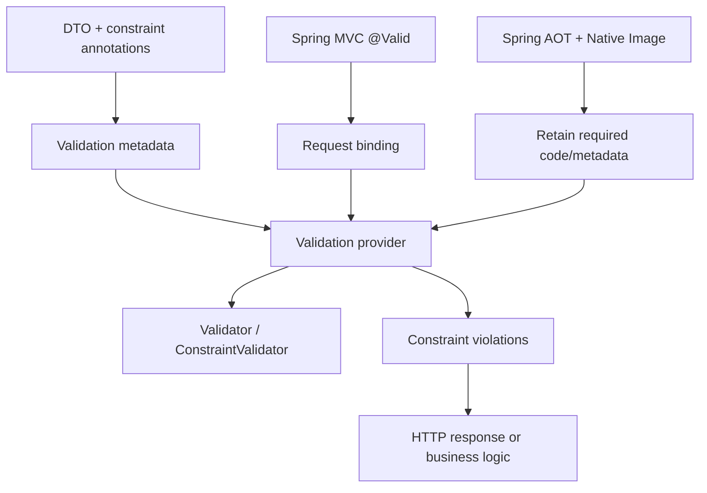

# Bean Validation, Annotations, and Required Metadata

## 1. Bean Validation Operates on Metadata

Spring Boot commonly uses **Bean Validation** to validate input data before executing business logic: request bodies must contain required fields, strings must not exceed limits, emails must be well-formed, and numbers must fall within allowed ranges. Rules are typically declared with annotations such as `@NotNull`, `@NotBlank`, `@Size`, `@Email`, `@Min`, and `@Valid`.

These annotations form **constraint-describing metadata**. The validation provider (typically Hibernate Validator in Spring Boot applications) reads the metadata, determines which constraints apply to properties or parameters, and executes the corresponding validators. Thus, Bean Validation is not just a handful of `if` checks; it relies on annotation discovery, class structure inspection, validator lookup, and sometimes dynamic object instantiation.

When migrating an application to **Spring AOT** and **GraalVM Native Image**, verify that the validation metadata and code paths used by the application are recognized and supported. Spring and Hibernate Validator integrations already provide AOT/native support depending on version; do not assume every custom constraint, validator, or metadata access pattern is automatically handled.

In the **SPRING_BOOT_NATIVE_IMAGE** module, the goal is to build a Spring Boot application with Maven/Gradle, verify compatibility, and run it as a native executable. This lesson focuses on annotations, DTOs, constraint metadata, and cases that need verification in Native Image.



## 2. Declaring Constraints on DTOs

Customer creation request example:

```java
package com.example.customer;

import jakarta.validation.constraints.Email;
import jakarta.validation.constraints.NotBlank;
import jakarta.validation.constraints.Size;

public record CreateCustomerRequest(
    @NotBlank
    @Size(max = 80)
    String fullName,

    @NotBlank
    @Email
    @Size(max = 254)
    String email
) {
}
```

Records keep DTOs concise and immutable. Constraint annotations placed on record components can be used to define validation rules for the corresponding data. In regular Java classes, annotations can be placed on fields, getters, or parameters depending on annotation targets and how the provider reads metadata.

Basic constraints:

| Annotation | Purpose | Notes |
|---|---|---|
| `@NotNull` | Value must not be `null` | Does not forbid empty strings |
| `@NotBlank` | String must not be `null` and must contain at least one non-whitespace character | For `CharSequence` |
| `@NotEmpty` | String/collection/map/array must not be empty | Does not check whitespace |
| `@Size` | Restricts length/size | `null` is usually considered valid; combine with `@NotNull` if needed |
| `@Email` | Checks email format according to validator | Does not verify mailbox existence |
| `@Min`, `@Max` | Numeric bounds | For supported numeric types |
| `@Pattern` | Validates string with a regular expression | Beware of overly complex regexes |

Do not expect a single annotation to apply to every data type automatically. Pick constraints suited to each type and business rule.

## 3. Enabling Validation in Spring MVC

With Spring MVC, add the validation starter dependency matching your Spring Boot version, then place `@Valid` or `@Validated` at the data entry point.

```java
@RestController
@RequestMapping("/api/customers")
class CustomerController {

    @PostMapping
    ResponseEntity<?> create(
            @Valid @RequestBody CreateCustomerRequest request) {
        return ResponseEntity.ok(
            Map.of("name", request.fullName(), "email", request.email())
        );
    }
}
```

Once the request body is bound, Spring MVC triggers Bean Validation for arguments marked with `@Valid`. Upon violation, the framework typically creates validation errors and returns HTTP 400 under default exception handling. The response payload structure depends on the Spring Boot version and error-handling configuration.

Distinctions:

- `@Valid` triggers cascading validation per Bean Validation.
- `@Validated` is a Spring annotation that also supports validation groups and method validation in corresponding contexts.
- `@NotBlank` and other constraints are Jakarta Bean Validation metadata; having annotations alone without a provider/validation integration is not enough to enforce them.

## 4. Cascading Validation for Nested Objects

Request with an address example:

```java
public record AddressRequest(
    @NotBlank String city,
    @NotBlank String country
) {}

public record CreateCustomerRequest(
    @NotBlank String fullName,
    @Valid @NotNull AddressRequest address
) {}
```

`@Valid` on the `address` property instructs the provider to continue validating constraints inside that object. If `@Valid` is missing, constraints on the nested object may not cascade as expected.

For collections:

```java
public record OrderRequest(
    @NotEmpty
    List<@Valid OrderLineRequest> lines
) {}
```

Container element constraints allow attaching constraints to generic elements. Use a compatible Jakarta Validation provider and Java/Jakarta API version. Test empty collections, `null` elements, and invalid elements.

## 5. How Does the Provider Read Constraint Metadata?

The validation provider builds metadata from classes and annotations. Metadata can describe:

- Which beans/properties carry constraints.
- Constraints placed on fields, getters, constructors, or method parameters.
- Validation groups and group sequences.
- Message templates, payloads, and constraint attributes.
- Cascading validation and container element constraints.
- Constraint composition and custom validator classes.

Example reading metadata via API:

```java
BeanDescriptor descriptor =
    validator.getConstraintsForClass(CreateCustomerRequest.class);

PropertyDescriptor emailProperty =
    descriptor.getConstraintsForProperty("email");

boolean hasConstraints =
    emailProperty != null && emailProperty.hasConstraints();
```

Metadata APIs are helpful for frameworks, UI generators, or configuration checks. If an application only calls `validator.validate(dto)`, the provider still needs internal metadata to evaluate constraints, though the application does not necessarily call the descriptor API itself.

For Native Image, focus on the code paths actually executed: the provider may need to read annotations, access properties/constructors, or instantiate validators. Inspect the support provided by your Hibernate Validator and Spring Framework versions rather than broadly registering every DTO for reflection.

## 6. Custom Constraints and `ConstraintValidator`

When standard constraints cannot express a business rule, you can create a custom annotation.

```java
@Target({ FIELD, PARAMETER, RECORD_COMPONENT })
@Retention(RUNTIME)
@Constraint(validatedBy = SupportedCountryValidator.class)
public @interface SupportedCountry {
    String message() default "Unsupported country";
    Class<?>[] groups() default {};
    Class<? extends Payload>[] payload() default {};
}
```

Validator:

```java
public class SupportedCountryValidator
        implements ConstraintValidator<SupportedCountry, String> {

    private static final Set<String> ALLOWED =
        Set.of("VN", "SG", "JP");

    @Override
    public boolean isValid(String value, ConstraintValidatorContext context) {
        return value == null || ALLOWED.contains(value);
    }
}
```

DTO usage:

```java
public record AddressRequest(
    @NotBlank
    @SupportedCountry
    String country
) {}
```

Points to watch:

- Constraint annotations must use `@Retention(RUNTIME)` so the provider can read metadata at runtime.
- `@Constraint(validatedBy = ...)` links the validator.
- `initialize()` can receive annotation attributes if the validator needs configuration.
- Validators should be stateless or manage state safely because providers may reuse instances.
- Define `null` handling explicitly; custom constraints are often paired with `@NotNull` or `@NotBlank`.

Custom validators are application- or library-supplied code. If a validator uses reflection, loads classes by name, reads resources, or calls native libraries, those paths must be checked specifically when building a Native Image.

## 7. Method Validation and Parameter Metadata

Beyond request DTOs, Bean Validation can validate method parameters and return values. Spring method validation example:

```java
@Service
@Validated
class TransferService {

    public void transfer(
            @NotBlank String sourceAccount,
            @NotBlank String targetAccount,
            @Positive BigDecimal amount) {
        // Business operation.
    }
}
```

Spring can apply method validation via an AOP proxy depending on configuration and framework version. Consequently, the problem can involve two sets of metadata:

1. Jakarta Validation constraint metadata.
2. Proxy/AOP metadata to intercept method invocations.

If method validation works on the JVM yet fails in native, check whether the bean is proxied, whether the method is invoked through the proxy, whether the provider discovers constraints, and whether custom validators are native-compatible. Do not attribute every method validation failure to reflection.

## 8. Annotation Retention and Targets Matter

An annotation can only be read at runtime if its retention policy allows it. For constraints, `RUNTIME` is essential so the provider can detect the annotation while running.

Targets must be chosen based on where the constraint is applied:

- `FIELD`: class fields.
- `METHOD`: getters/properties or methods.
- `PARAMETER`: parameters.
- `ANNOTATION_TYPE`: meta-annotations and constraint composition.
- `TYPE_USE`: type-use and container element constraints.
- `RECORD_COMPONENT`: record components in Java versions supporting records.

If a custom annotation lacks the required target, the compiler may reject placing it at the intended location. If retention is not `RUNTIME`, the provider cannot read the annotation during validation.

## 9. Spring AOT and Native Image: What Metadata Must Be Retained?

Spring AOT analyzes the application context and framework integrations, generating code and Runtime Hints. GraalVM Native Image then performs reachability analysis. For Bean Validation, items to verify include:

- Constraint annotations and DTO metadata are discovered by the provider.
- Validator implementations are on the runtime classpath and reachable.
- Constructor/property access needed by the provider is supported.
- Custom constraint validators can be instantiated by the provider/Spring integration.
- Method validation proxies are created and calls actually pass through the proxy.
- Validation message bundles/resources exist in the native image if loaded dynamically.

Do not assume every DTO requires registering all constructors, methods, and fields with reflection hints. Spring Boot, Spring Framework, and Hibernate Validator releases may supply their own AOT/native integrations. Start by using library versions with official support and inspecting build logs. Add hints only when errors occur or uncovered dynamic code paths exist.

Example `RuntimeHints` that might be needed for a custom class if a library uses reflection not recognized by the framework:

```java
class ValidationRuntimeHints implements RuntimeHintsRegistrar {
    @Override
    public void registerHints(RuntimeHints hints, ClassLoader classLoader) {
        hints.reflection().registerType(
            SupportedCountryValidator.class,
            MemberCategory.INVOKE_DECLARED_CONSTRUCTORS
        );
    }
}
```

This is a conditional example, not a mandatory setup for every custom validator. If the provider or Spring AOT already registers the constructor, or the validator is instantiated via a recognized static path, duplicate hints may be unnecessary. Register the registrar via `@ImportRuntimeHints` or the appropriate AOT mechanism.

## 10. Validation Message Bundles and Resources

Constraints often carry message templates, for example:

```java
@NotBlank(message = "{customer.name.required}")
String fullName;
```

Messages may be resolved from `ValidationMessages.properties` or a configured message source. If message files reside on the classpath and are accessed dynamically by name or pattern, check that the resources exist in both the JAR and the Native Image.

Example:

```text
src/main/resources/
  ValidationMessages.properties
  ValidationMessages_vi.properties
```

If the native executable lacks a message bundle, errors may occur when validation constructs violations, or fallback messages may behave unexpectedly. Verify resource packaging and add Spring resource hints when needed. Do not register external filesystem config paths as classpath resources.

## 11. Testing Validation on JVM and Native Image

A test suite should cover:

| Case | Expected Result |
|---|---|
| Valid DTO | Request accepted |
| Required string null/blank | Validation violation |
| String exceeding limit | Violation from `@Size` |
| Malformed email | Violation per provider |
| Invalid nested object | Caught by cascading validation |
| Custom constraint fails | Custom validator returns `false` |
| Invalid method parameter | Method validation rejects proxy call |
| Message bundle | Message content matches locale |

Controller test example:

```java
@SpringBootTest
@AutoConfigureMockMvc
class CustomerValidationTest {

    @Autowired
    MockMvc mvc;

    @Test
    void rejectsBlankName() throws Exception {
        mvc.perform(post("/api/customers")
                .contentType(MediaType.APPLICATION_JSON)
                .content("""
                    {"fullName":" ","email":"a@example.com"}
                    """))
            .andExpect(status().isBadRequest());
    }
}
```

The example uses Java 15+ text blocks and `MockMvc`; add the corresponding static imports and dependencies. The expected response body depends on the application's exception handling, so the test focuses on HTTP status here.

Run JVM tests:

```bash
./mvnw test
```

or:

```bash
./gradlew test
```

Then run Spring AOT and native compilation per project setup:

```bash
./gradlew processAot
./gradlew nativeCompile
```

Or the corresponding Maven native profile. Finally, call the endpoints on the native executable or container using both valid and invalid payloads. Passing JVM tests does not prove the native binary has sufficient metadata.

## 12. Common Errors

| Symptom | Possible Cause | Investigation Direction |
|---|---|---|
| Annotations present but no validation runs | Missing validation provider/starter or missing `@Valid` | Dependencies and controller parameters |
| Custom constraint is never called | Validator unlinked/unregistered or wrong target | `@Constraint`, retention, targets |
| Passes on JVM, fails validation in native | Unsupported metadata/provider/validator path | Stack trace, AOT integration, and runtime hints |
| Nested constraints do not run | Missing `@Valid` on association or container element | DTO declarations |
| Method validation does not run | Missing `@Validated`, proxy not created, or self-invocation | Spring AOP / method validation setup |
| Localized message is wrong | Missing resource bundle or locale not selected | Resource packaging and message source |
| Validator fails during instantiation | Constructor/dependencies/side effects incompatible with AOT | Validator instantiation and custom initialization |

## 13. Native Image Compatibility Checklist

- Use the Jakarta Validation API/provider matching your Spring Boot version.
- Constraint annotations have appropriate retention and targets.
- DTOs and nested objects are annotated with `@Valid` in the right places.
- Custom `ConstraintValidator` classes are on the runtime classpath and instantiable.
- Verify method validation proxies separately from constraint metadata.
- Message bundles/resources are packaged in the artifact if used.
- Prefer built-in AOT/native integrations from the framework and provider.
- Add `RuntimeHints` only for dynamic code paths that genuinely need them.
- Run validation tests on the native executable and container.
- Record Spring Boot, Hibernate Validator, GraalVM, and plugin versions.

## 14. Self-Check Questions

1. How does Bean Validation use annotations and metadata to evaluate constraints?
2. Why does a custom constraint need `RUNTIME` retention?
3. What is the difference between `@Valid` and `@Validated` in Spring?
4. Why do nested objects require cascading validation?
5. What factors should be checked when a custom `ConstraintValidator` works on the JVM yet fails in Native Image?
6. Why does method validation also involve proxies and AOP?
7. When is a resource hint needed for validation message bundles?

**Remember:** Bean Validation relies on annotations and metadata to locate constraints, validators, and cascading rules. With Spring AOT/Native Image, verify that the provider, custom validators, proxies, and message resources are all compatible; test valid requests, invalid requests, and the actual native executable.
