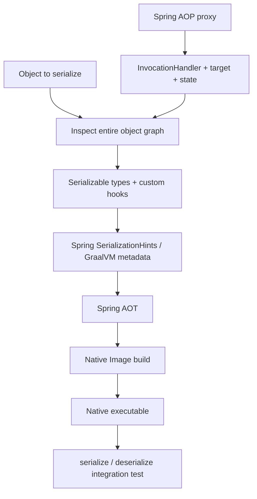

# Registering Serializable Types and Proxy Serialization Limits

## 1. Why Does Serialization Need Verification When Using Native Image?

Java serialization allows converting an object graph into a byte stream and reconstructing objects from that stream. This mechanism commonly appears in caches, sessions, messages, state persistence, or legacy library integrations. A class participating in Java Object Serialization typically implements `java.io.Serializable`, but simply having the marker interface does not mean every object graph can be serialized successfully.

With **GraalVM Native Image**, the program is analyzed and compiled ahead of time. Serialization has distinct metadata requirements because the runtime must know which classes are allowed to be serialized/deserialized, how to reconstruct objects, and special components such as serialization constructors, `writeObject`, `readObject`, `writeReplace`, or `readResolve`. The required configuration depends on the GraalVM version, serialization mode, and how the framework integrates.

In the **SPRING_BOOT_NATIVE_IMAGE** module, serialization must be verified on the native executable itself, especially when objects contain proxies created by Spring AOP. A proxy may add an invocation handler and internal state to the object graph; having the target class implement `Serializable` does not automatically make the proxy or handler serializable.



## 2. Serializable Is Only the Starting Point

DTO example:

```java
import java.io.Serializable;

public record CustomerSnapshot(
    String customerId,
    String displayName
) implements Serializable {
}
```

A regular class can also implement the marker interface:

```java
public class InvoiceSnapshot implements Serializable {
    private static final long serialVersionUID = 1L;

    private final String invoiceId;
    private final long total;

    public InvoiceSnapshot(String invoiceId, long total) {
        this.invoiceId = invoiceId;
        this.total = total;
    }
}
```

`serialVersionUID` helps control class version compatibility during deserialization. If undeclared, the JVM may compute a default value based on class structure; changing the class can change that value and cause `InvalidClassException`.

However, when serializing an object, Java processes the **entire object graph** reachable from the root object. If a field references a non-serializable object and is not excluded or transformed via custom serialization, the operation can throw `NotSerializableException`.

For example:

```java
public class UserSession implements Serializable {
    private static final long serialVersionUID = 1L;

    private String userId;
    private Object connection; // May not be Serializable
}
```

Implementing `Serializable` on `UserSession` does not make `connection` serializable. You need to design the object graph carefully, mark appropriate fields as `transient`, or provide custom serialization if there is a clear reason.

## 3. Object Graph and Fundamental Limits

Before configuring Native Image, identify:

- Which objects serve as the roots of serialize/deserialize operations.
- Which fields reference other objects and their actual types at runtime.
- Whether collections/maps contain serializable elements.
- Whether there are `transient` fields, static fields, or external resources such as sockets/files/database connections.
- Whether there are custom serialization hooks or `Externalizable`.
- Whether there are proxies, lambdas, generated classes, or dynamically loaded classes in the graph.

Certain types generally should not be serialized directly:

| Data type | Issue |
|---|---|
| Socket, stream, database connection | Open resources, not state that can be safely restored |
| Thread, Executor, lock | Synchronization state and lifecycle are unsuitable for arbitrary persistence/restoration |
| Framework request/response objects | May contain containers, streams, or non-serializable references |
| Spring application bean/proxy | May contain targets, interceptors, handlers, and internal state |
| Classloader, reflection objects | Environment/runtime-dependent, hard to maintain compatibility, and carries security risks |

It is generally better to serialize small, stable DTOs or snapshots rather than serializing entire Spring beans or framework object graphs.

## 4. Serialization and Deserialization Are Not the Same Capability

Serialization writes an object graph to bytes; deserialization reads bytes and reconstructs objects. The two directions can have different metadata requirements in Native Image.

For example:

```java
byte[] serialize(Object value) throws IOException {
    try (var output = new ByteArrayOutputStream();
         var stream = new ObjectOutputStream(output)) {
        stream.writeObject(value);
        return output.toByteArray();
    }
}

Object deserialize(byte[] bytes)
        throws IOException, ClassNotFoundException {
    try (var input = new ByteArrayInputStream(bytes);
         var stream = new ObjectInputStream(input)) {
        return stream.readObject();
    }
}
```

During deserialization, the runtime needs to resolve the class matching the stream information and instantiate the object according to Java serialization rules. The constructor of a `Serializable` class is not invoked in the normal way during reconstruction; the non-`Serializable` superclass initialization chain and serialization hooks have their own rules.

Do not assume that registering a regular constructor for reflective invocation is sufficient for all Java serialization cases. Use serialization metadata matching the mechanism and GraalVM version.

## 5. Spring RuntimeHints for Serialization

Spring AOT provides serialization hints through `RuntimeHints.serialization()`. Example of registering specific types:

```java
import org.springframework.aot.hint.RuntimeHints;
import org.springframework.aot.hint.RuntimeHintsRegistrar;

public class SnapshotSerializationHints
        implements RuntimeHintsRegistrar {

    @Override
    public void registerHints(RuntimeHints hints, ClassLoader classLoader) {
        hints.serialization().registerType(CustomerSnapshot.class);
        hints.serialization().registerType(InvoiceSnapshot.class);
    }
}
```

Registering the registrar:

```java
@Configuration
@ImportRuntimeHints(SnapshotSerializationHints.class)
class SerializationConfiguration {
}
```

This example uses the Spring RuntimeHints API at a basic level. Verify the API signature against your project's Spring Framework version and only register types that are actually serialized/deserialized. If a library/provider already contributes serialization hints via AOT, avoid unnecessary duplicate declarations.

A serialization hint does not make a class that does not implement `Serializable` become serializable. Nor does it make the entire object graph safe; the Java serialization contract and class constraints still apply.

## 6. GraalVM Reachability Metadata

GraalVM Native Image has metadata dedicated to serialization alongside reflection, resource, and proxy metadata. The format, file locations, and supported options depend on the GraalVM version. Some versions provide a tracing agent to observe serialization on the JVM and generate suggested configuration.

Do not copy serialization JSON from another GraalVM version without checking the corresponding schema and documentation. For Spring Boot applications, prefer Spring RuntimeHints when appropriate because Spring AOT can collect hints from both the application and dependencies.

Two layers to distinguish:

- **Spring SerializationHints**: the Spring AOT API for libraries/applications to contribute information.
- **GraalVM serialization metadata**: the format/mechanism Native Image uses during the build.

Spring AOT is responsible for integrating hints with Native Image according to the corresponding toolchain; you should not mix Java serialization APIs, Spring hints, and GraalVM JSON into a single configuration concept.

## 7. Custom Serialization Hooks

Java serialization supports special methods:

- `private void writeObject(ObjectOutputStream out)`
- `private void readObject(ObjectInputStream in)`
- `Object writeReplace()`
- `Object readResolve()`
- `Externalizable.writeExternal/readExternal`

For example:

```java
public class AccountSnapshot implements Serializable {
    private static final long serialVersionUID = 1L;

    private String accountId;
    private transient String accessToken;

    private void writeObject(ObjectOutputStream out) throws IOException {
        out.defaultWriteObject();
    }

    private void readObject(ObjectInputStream in)
            throws IOException, ClassNotFoundException {
        in.defaultReadObject();
        accessToken = null;
    }
}
```

Custom hooks must follow the signature and visibility rules of Java serialization. If Native Image needs to discover or invoke these methods, verify that serialization metadata is generated properly; do not simply add arbitrary reflection hints and assume all hooks work.

Do not serialize secrets like access tokens without clear security requirements and key management. `transient` can exclude a field from default serialization, but it is not a comprehensive safeguard if a custom hook still writes it to the stream.

## 8. Proxies Have Their Own Serialization Limits

Spring AOP can create proxies for beans. With a JDK dynamic proxy, the proxy object implements a set of interfaces and holds an `InvocationHandler`. For a proxy to be serializable via Java serialization, important conditions include:

1. The proxy class must belong to a serializable proxy mechanism.
2. The required interfaces must satisfy serialization requirements according to how the proxy is created.
3. `InvocationHandler` must be serializable.
4. The target object and state held by the handler must be serializable or handled via custom serialization.
5. Transient dependencies/state must be validly restored after deserialization.

Example of creating a serializable JDK proxy:

```java
public interface GreetingService extends Serializable {
    String greet(String name);
}

public class GreetingHandler
        implements InvocationHandler, Serializable {

    private static final long serialVersionUID = 1L;

    @Override
    public Object invoke(Object proxy, Method method, Object[] args) {
        if (method.getName().equals("greet")) {
            return "Hello " + args[0];
        }
        return null;
    }
}
```

Creating the proxy:

```java
GreetingService proxy = (GreetingService) Proxy.newProxyInstance(
    GreetingService.class.getClassLoader(),
    new Class<?>[] { GreetingService.class },
    new GreetingHandler()
);
```

This example illustrates a serializable interface proxy; the handler does not hold a complex target. In real applications, if a handler contains a target or advisors, that entire graph must also satisfy serialization requirements. Never conclude that a Spring AOP proxy is automatically serializable just because its target interface extends `Serializable`.

## 9. Why Should Spring AOP Proxies Usually Not Be Serialized?

A Spring AOP proxy can hold references to:

- Target bean.
- Advisor chain and `MethodInterceptor`.
- `BeanFactory` or infrastructure references.
- Transaction manager, security context, or other services.
- Stateful invocation handlers or callbacks.
- Classloader/framework state.

Many of these components are non-serializable or meaningless when transferred to another process/machine. Even if serialization succeeds, deserialization can produce objects holding stale references or lacking the infrastructure needed to function.

Therefore, a generally better design is to serialize **business data** (DTOs/snapshots) and re-acquire Spring beans/proxies from the application context on the receiving side. Do not serialize proxies to pass through messages/caches unless the library and architecture have an explicit contract supporting it.

Class-based proxies also have their own limitations: proxy/subclass classes and framework state do not naturally form a stable serialization contract. RuntimeHints for JDK proxies do not solve serialization for all class-based proxies.

## 10. Proxy Hints Differ from Serialization Hints

The two hint groups serve different purposes:

| Hint | Purpose |
|---|---|
| Reflection hints | Access classes/constructors/methods/fields via reflection |
| JDK Proxy hints | Prepare proxies for a set of interfaces |
| Serialization hints | Support types used by Java serialization |
| Resource hints | Retain classpath resources |
| JNI hints | Support Java/native interaction points when needed |

Successfully creating a proxy does not mean it is serializable. Registering a type for serialization also does not automatically generate JDK proxy metadata for its interface set. If an application truly needs to serialize proxies, you must verify proxy creation, interfaces/handlers, the object graph, and serialization metadata together.

## 11. Testing Serialization on JVM and Native Image

Write round-trip tests for DTOs:

```java
@Test
void serializesAndDeserializesSnapshot() throws Exception {
    CustomerSnapshot source =
        new CustomerSnapshot("C-100", "Lan");

    byte[] bytes = serialize(source);
    Object restored = deserialize(bytes);

    assertThat(restored).isEqualTo(source);
}
```

For regular classes that are not records, implement `equals/hashCode` or assert each field individually. Beyond round-trip, check:

- Object graphs containing non-serializable fields.
- Version compatibility and `serialVersionUID`.
- Custom `writeObject/readObject`, `writeReplace/readResolve`.
- Proxy handlers and target state if proxy serialization is required.
- Post-deserialization behavior, especially how transient dependencies are recreated.

Native workflow:

1. Run serialization unit/integration tests on the JVM.
2. Register Spring SerializationHints or GraalVM metadata as needed.
3. Run Spring AOT and the Native Image build.
4. Run the same round-trip tests on the native executable/native test pipeline.
5. Test in the target container with the same representative data.
6. Record the Spring/GraalVM versions and the metadata types used.

Passing JVM tests does not prove Native Image has sufficient metadata. Conversely, a passing native build does not prove every production object graph can be serialized.

## 12. Security Notes on Deserialization

Java native serialization carries security risks if untrusted bytes are accepted. Deserialization can construct complex object graphs and trigger logic in classes/hooks; libraries on the classpath can expand the gadget surface.

- Do not deserialize arbitrary data from clients or untrusted sources.
- Prefer formats with explicit schemas like JSON/Protobuf with DTOs and validation.
- If Java serialization must be used, apply an appropriate allowlist/filter using `ObjectInputFilter`, limiting depth, references, bytes, and classes.
- Authenticate the data source and protect integrity.
- Do not serialize Spring beans, proxies, connections, credentials, or objects containing secrets.
- Keep dependencies patched and audit serialization libraries.

Native Image does not automatically eliminate gadget/deserialization risks. Hints only assist build/runtime metadata; they are not an input security mechanism.

## 13. Common Pitfalls

| Symptom | Possible cause | Resolution |
|---|---|---|
| `NotSerializableException` | An object in the graph is not serializable | Find the offending field, use DTOs/snapshots or custom serialization |
| JVM serializes successfully but native fails | Missing serialization metadata or version support | Check hints/schema and native tests |
| Deserialization throws `InvalidClassException` | `serialVersionUID` or class schema changed | Manage versions and data migration |
| Proxy cannot be serialized | Handler/interface/target graph is not serializable | Avoid serializing proxies or design the graph explicitly |
| Proxy does not work after deserialization | Infrastructure/dependencies were not restored | Retrieve the bean from the Spring context instead of storing proxies |
| Secret appears in bytes | Field was serialized or written by a custom hook | Remove secrets from DTOs/graphs and audit hooks |
| Hints declared but error persists | Registrar was not discovered by AOT or metadata is incomplete | Check AOT registration, rebuild, and test the exact path |

## 14. Design and Implementation Checklist

- Only serialize DTOs/snapshots with a clear data contract.
- Inspect the entire object graph, not just whether the root class implements `Serializable`.
- Manage `serialVersionUID` and compatibility for long-lived persisted data.
- Identify custom serialization hooks and transient state.
- Avoid serializing Spring AOP proxies, `BeanFactory`, connections, and infrastructure.
- If serializing a JDK proxy is unavoidable, verify interfaces, `InvocationHandler`, and the entire handler/target graph.
- Register serialization hints according to the actual Spring/GraalVM API version.
- Test round-trips on the native executable and container.
- Never deserialize untrusted data; use filters/allowlists if Java serialization is mandatory.
- Never include secrets in serialized bytes or artifacts.

## 15. Self-Check Questions

1. Why does implementing `Serializable` on the root class not guarantee the object graph can be serialized?
2. What problem does `serialVersionUID` help address?
3. How do Spring SerializationHints differ from reflection hints?
4. What conditions allow a JDK dynamic proxy to be serializable?
5. Why are Spring AOP proxies generally unsuitable data for serialization?
6. Do proxy hints replace serialization hints?
7. Why is Java deserialization from untrusted sources still dangerous in Native Image?
8. What tests are needed to confirm compatible serialization on a native binary?

**Key takeaway:** Java serialization depends on the entire object graph and restoration hooks; proxies also carry handlers, targets, and infrastructure. Prefer DTOs/snapshots, register serialization metadata as needed, avoid serializing Spring proxies without an explicit contract, and test round-trips on the Native Image itself.
