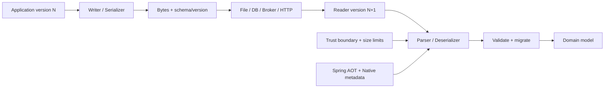

# Data Formats, Version Compatibility, and Risks of Receiving Untrusted Data

> **Chapter:** Serialization and JNI  
> **Module:** `SPRING_BOOT_NATIVE_IMAGE`  
> **Goal:** Choose an appropriate serialization format for APIs, messages, and persisted data; design schemas that can evolve across versions; recognize risks when deserializing untrusted data; configure required metadata for Spring AOT/GraalVM Native Image; and test both on the JVM and the native executable.

## 1. Serialization Is a Data Contract Across Two Points in Time

Serialization converts program state or data into a form that can be written to a file, database, cache, or message broker, or transmitted over a network. Deserialization reads that stored/transmitted form and reconstructs the data for the program to use.

A data flow typically has at least two sides:

- **Writer:** the application version that produces the data.
- **Reader:** the application version that reads that data later or in another service.

Both sides may run the same version, but in real-world systems they are often deployed out of sync. A new producer may send data to an older consumer; a rollback may read data written by a newer version; a backup file may be restored months later.

Therefore, serialization is not just a question of “how to write an object into bytes.” It is also **a contract covering structure, data types, field semantics, schema versions, and trust policies**.

With Spring Boot Native Image, this contract carries an additional requirement: GraalVM Native Image needs to know the required classes and dynamic operations ahead of time. Spring AOT can generate code and runtime hints for some binding/serialization paths; paths that are not inferred must be declared and tested.



Three questions to answer before choosing a format:

1. **Where is the data exchanged?** Public APIs, internal messages, caches, long-term storage files, or communication with native libraries.
2. **Which version must be able to read which data?** Same version only, newer reader reading older writer, older reader reading newer writer, or both directions.
3. **Who controls the input data?** Only authenticated internal services, or can users/partners send arbitrary bytes.

## 2. Common Formats and Their Usage Scope

No single format is best for every situation. Choose based on compatibility, performance, debuggability, language coupling, and security model.

| Format | Characteristics | Strengths | What must be managed |
|---|---|---|---|
| **Java Object Serialization** | Writes object graphs via Java's mechanism, using `Serializable`/`Externalizable` | Can preserve object structure and references; useful for some legacy Java systems | Tightly coupled to class names/hierarchy/`serialVersionUID`; risks when deserializing untrusted data; requires metadata for Native Image |
| **JSON** | Text, object/array/string/number/boolean/null | Human-readable, ubiquitous for HTTP APIs, multi-language support | Schema rules usually live outside the payload; must manage unknown fields, enums, polymorphism, and parser limits |
| **Protocol Buffers** | Binary, fields identified by tag numbers and a `.proto` schema | Compact, fast, explicit schema, defined evolution rules | Must not change/reuse field numbers; must manage generated code and schemas |
| **Apache Avro** | Binary or JSON, reader/writer schemas used during decoding | Well suited for event/data pipelines, supports schema resolution | Must store or retrieve the writer schema; requires a schema registry/compatibility workflow |
| **CBOR** | Data model close to JSON but binary-encoded | Useful when a binary format and extended data types are needed | Still requires a schema/contract, size limits, and validation |

### 2.1. Distinguishing Java Objects from Data Transfer Objects

A domain object often contains behavior, entity relationships, lazy proxies, internal state, or dependencies that should not become an external data contract.

For example, do not return a JPA entity directly:

```java
@Entity
class PaymentEntity {
    @Id
    private Long id;

    @ManyToOne(fetch = FetchType.LAZY)
    private CustomerEntity customer;

    private BigDecimal amount;

    // getters/setters
}
```

If the serializer accesses `customer`, the ORM may trigger lazy loading, create reference cycles, or inadvertently expose internal data. A database schema change could also unintentionally alter the JSON API.

Create a DTO with an explicit structure instead:

```java
public record PaymentResponse(
        String paymentId,
        long amountMinor,
        String currency,
        String status
) {
}
```

A DTO is a data contract. A domain entity is a business model. Separating the two lets internal code evolve without coupling clients to the application's implementation.

## 3. Java Object Serialization: Convenient but Tightly Coupled to Classes

Java native serialization commonly uses:

- `Serializable` to mark a class as serializable via the default mechanism.
- `ObjectOutputStream` to write an object graph to a byte stream.
- `ObjectInputStream` to reconstruct an object graph.
- `serialVersionUID` to identify the serialization version of a class.
- `writeObject`/`readObject` to customize the write/read process.
- `writeReplace`/`readResolve` to substitute objects in the serialization stream.
- `Externalizable` when a class manages its own data format via `writeExternal`/`readExternal`.

Minimal example:

```java
import java.io.Serializable;

public final class PaymentSnapshot implements Serializable {

    private static final long serialVersionUID = 1L;

    private String paymentId;
    private long amountMinor;
    private String currency;

    public PaymentSnapshot(
            String paymentId,
            long amountMinor,
            String currency) {
        this.paymentId = paymentId;
        this.amountMinor = amountMinor;
        this.currency = currency;
    }
}
```

Writing an object:

```java
try (var output = new ObjectOutputStream(
        Files.newOutputStream(Path.of("payment.snapshot")))) {
    output.writeObject(snapshot);
}
```

Reading an object:

```java
try (var input = new ObjectInputStream(
        Files.newInputStream(Path.of("payment.snapshot")))) {
    Object value = input.readObject();

    if (!(value instanceof PaymentSnapshot snapshot)) {
        throw new InvalidObjectException("Unexpected root type");
    }

    // Validate snapshot before use.
}
```

A Java serialization stream stores class names, class descriptors, and the state of serializable fields. When reading, the runtime must locate the matching classes and build the object graph. If a class changes incompatibly or is no longer on the classpath, reading can fail.

**Do not use Java native serialization as a public API format or accept raw bytes directly from untrusted clients.** It tightly couples data to Java classes and presents a large deserialization attack surface.

## 4. Version Compatibility of Java Serialization

### 4.1. Role of `serialVersionUID`

`serialVersionUID` is the version identifier of a serializable class. When reading a stream, the runtime compares the UID in the stream against the current class's UID. If they differ, `InvalidClassException` may be thrown.

Declare the UID explicitly:

```java
private static final long serialVersionUID = 1L;
```

If omitted, Java computes a default UID from certain class characteristics. Seemingly minor changes in class structure or compiler differences can cause the UID to change unexpectedly.

However, **keeping the UID unchanged does not automatically make every class change compatible**. The UID is only part of the verification mechanism. If you change field types, alter the hierarchy, or change data semantics, the reader may still fail to restore state accurately.

### 4.2. Class Changes and Their Impact

| Change | Common impact | Action needed |
|---|---|---|
| Add non-static, non-transient field | Newer reader may receive a default value if the older stream lacks the field | Initialize valid defaults or migrate |
| Remove field | Newer reader ignores old field data; older reader may receive default when reading new stream | Determine if business information is lost |
| Rename field | May be treated as removing the old field and adding a new one | Use mapping/custom serialization if data must be preserved |
| Change field type | Often incompatible or requires explicit conversion | Use custom `readObject`/`writeObject` or a new format |
| Change superclass/hierarchy | May alter stream structure and break compatibility | Avoid changing hierarchies for long-lived persisted data |
| Change `static`/`transient` | Changes whether the field is written | Evaluate legacy data and data that must be preserved |
| Change business invariants | Stream still reads, but object may be invalid | Validate and migrate after reading |

### 4.3. Custom `readObject` to Restore Invariants

Deserialization does not call the normal constructor of a serializable class in the same way creating a new object does. Therefore, never assume constructor-only validation is sufficient.

For example:

```java
private void readObject(ObjectInputStream input)
        throws IOException, ClassNotFoundException {

    input.defaultReadObject();

    if (paymentId == null || paymentId.isBlank()) {
        throw new InvalidObjectException("paymentId is required");
    }

    if (amountMinor < 0) {
        throw new InvalidObjectException("amountMinor must be non-negative");
    }

    if (currency == null || currency.length() != 3) {
        throw new InvalidObjectException("currency is invalid");
    }
}
```

In sensitive classes, consider:

- `transient` for data that must not be written to the stream.
- `serialPersistentFields` to control the list of fields in the serialization format.
- `writeReplace` to write a serialization proxy instead of the internal object.
- `readResolve` to substitute the object after reading if the contract requires it.
- Defensive copies for mutable arrays/collections.
- Invariant and initialization state checks before the object is used.

Private fields can still appear in the byte stream. Anyone possessing the bytes can inspect their contents. Do not serialize passwords, tokens, secrets, or sensitive data expecting the `private` modifier to protect them.

## 5. JSON: Readable Contracts That Still Require Schema Management

JSON is usually the right choice for Spring Boot REST APIs. A payload might look like this:

```json
{
  "eventId": "evt-1001",
  "paymentId": "pay-501",
  "amountMinor": 259900,
  "currency": "VND",
  "occurredAt": "2026-11-23T08:30:00Z"
}
```

JSON does not carry full versioning rules on its own. Readers must know:

- Which fields are required?
- Which fields are optional and have defaults?
- Are unknown fields ignored or rejected?
- How are new enum values handled?
- What precision/range limits apply to numbers?
- What timezone and format do timestamps use?
- How does `null` differ from an omitted field?

### 5.1. Adding Fields While Keeping Compatibility with Older Data

Suppose version 1 is:

```json
{
  "paymentId": "pay-501",
  "amountMinor": 259900
}
```

Version 2 adds an optional field:

```json
{
  "paymentId": "pay-501",
  "amountMinor": 259900,
  "channel": "MOBILE"
}
```

For a new reader to read old data, `channel` needs a clear default policy. For an old reader to read new data, the old reader must accept unknown fields or have a matching compatibility policy.

With Jackson, unknown-property behavior depends on `ObjectMapper` and Spring Boot configuration. Decide explicitly rather than relying on unchecked defaults. You may allow ignoring unknown fields at a boundary requiring forward compatibility, while still validating the fields the application actually uses.

### 5.2. JSON Changes That Easily Break Contracts

| Change | Risk |
|---|---|
| Add optional field with default | Usually low risk if readers handle unknown fields appropriately |
| Add required field | Older readers or old payloads may lack the field |
| Rename field | Old and new readers no longer share the same key |
| Change number to string | Clients may fail to parse or hit binding errors |
| Change nullability | May cause validation failures or change semantics |
| Remove enum value | Older/newer readers may encounter an unrecognized value |
| Change timezone/timestamp semantics | Data parses successfully but is misinterpreted |
| Enable overly broad polymorphic typing | Creates class instantiation risks from type metadata |

### 5.3. Polymorphic Deserialization and Type Metadata

Some APIs use a type discriminator field to select a subtype. For example:

```json
{
  "kind": "card",
  "cardNumberToken": "tok-123"
}
```

If polymorphism is needed, use an explicit allowlist of subtypes, such as `@JsonTypeInfo(use = JsonTypeInfo.Id.NAME)` paired with `@JsonSubTypes`, and verify every subtype that can be instantiated.

Avoid enabling broad default typing for untrusted payloads. In particular, do not use client-supplied class names as type IDs that let Jackson load arbitrary classes. Type resolver configuration must restrict the allowed set of types. Jackson warns that default typing can pose security risks if input comes from untrusted sources.

### 5.4. Validation After Parsing

Successful parsing only proves data can map onto a DTO. It does not prove the data is business-valid.

For example:

```java
public record CreatePaymentRequest(
        @NotBlank String orderId,
        @Positive long amountMinor,
        @NotBlank @Pattern(regexp = "[A-Z]{3}") String currency
) {
}
```

Controller:

```java
@PostMapping("/payments")
ResponseEntity<PaymentResponse> create(
        @Valid @RequestBody CreatePaymentRequest request) {
    return ResponseEntity.ok(paymentService.create(request));
}
```

Limit request body sizes at the HTTP/gateway layer, limit depth and element counts where the format/parser supports it, and validate ranges and invariants before calling business logic.

## 6. Protocol Buffers: Schema Evolution via Field Numbers

Protocol Buffers assigns a tag number to each field. Tag numbers are part of the wire format and must remain stable across versions.

For example:

```protobuf
syntax = "proto3";

message PaymentCreated {
  string event_id = 1;
  string payment_id = 2;
  int64 amount_minor = 3;
  string currency = 4;
  int64 occurred_at_epoch_millis = 5;
}
```

A later version adds a field:

```protobuf
syntax = "proto3";

message PaymentCreated {
  string event_id = 1;
  string payment_id = 2;
  int64 amount_minor = 3;
  string currency = 4;
  int64 occurred_at_epoch_millis = 5;
  string source_channel = 6;
}
```

With the binary wire format, a new field with a new tag can generally be ignored by older readers if the runtime preserves unknown fields as expected. Newer readers can receive older messages and see default values for the new field.

**Never reuse a previously published tag number.** When removing a field, reserve its number and name:

```protobuf
message PaymentCreated {
  reserved 6;
  reserved "source_channel";

  string event_id = 1;
  string payment_id = 2;
  int64 amount_minor = 3;
  string currency = 4;
  int64 occurred_at_epoch_millis = 5;
  string settlement_reference = 7;
}
```

Important principles:

- Do not change the tag number of an active field.
- Do not reuse a deleted tag.
- Reserve deleted field tags and names.
- Be cautious when changing scalar types, modifying `oneof`, enums, and cardinality.
- Distinguish binary Protobuf from ProtoJSON/TextFormat: JSON encoding compatibility rules are not identical to the binary wire format.
- Verify that generated code and the schema compiler share matching versions.

## 7. Apache Avro: Reader Schema and Writer Schema

Avro binary typically does not include field names or full per-byte type information. Therefore, the reader needs the schema used to write the data (**writer schema**) and the schema the application expects to read (**reader schema**).

Initial schema example:

```json
{
  "type": "record",
  "name": "PaymentCreated",
  "namespace": "com.example.events",
  "fields": [
    { "name": "eventId", "type": "string" },
    { "name": "amountMinor", "type": "long" }
  ]
}
```

New reader schema adding a field with a default:

```json
{
  "type": "record",
  "name": "PaymentCreated",
  "namespace": "com.example.events",
  "fields": [
    { "name": "eventId", "type": "string" },
    { "name": "amountMinor", "type": "long" },
    { "name": "sourceChannel", "type": ["null", "string"], "default": null }
  ]
}
```

When reading data written by the older schema, the reader can use the default for the new field. When the writer has a field the reader lacks, the reader can skip that field according to schema resolution rules.

With Avro, manage:

- The writer schema ID or schema version accompanying the message/file.
- A schema registry or immutable versioned schema store.
- Backward, forward, or full compatibility policies.
- Default values for new fields when readers need to read old data.
- Schema resolution tests between writer and reader versions.

Do not store raw binary payloads without a way to identify the corresponding writer schema. Data lacking a schema or schema ID may become impossible to decode accurately after the system evolves.

## 8. Backward, Forward, and Full Compatibility

Three common terms in schema management:

- **Backward compatibility:** a newer reader can read data written by an older writer.
- **Forward compatibility:** an older reader can read data written by a newer writer.
- **Full compatibility:** supports both directions.

Specific schema registry conventions may vary in check scope (adjacent versions vs. all prior versions). Read the policy of the registry you use.

| Rollout scenario | Typical requirement |
|---|---|
| Deploy new consumers before new producers | New readers must read old data (backward) |
| Deploy new producers before new consumers | Old readers must handle new data (forward) |
| Producers/consumers deploy independently with rollback | Aim for full compatibility |
| Long-term storage and multi-year replay | Test new readers against historical writer schemas |
| Internal-only traffic on a synchronized version | Stricter policies may be acceptable, but still require a rollback plan |

### 8.1. Reader/Writer Matrix to Test

| Writer | Reader | Question |
|---|---|---|
| V1 | V1 | Does same-version round-trip preserve data accurately? |
| V1 | V2 | Can the newer reader read old data? |
| V2 | V1 | Can the older reader tolerate new fields/enums? |
| V2 | V2 | Does the newer version preserve intended semantics? |
| V1 | V3 | Can the current reader read data stored from a much older version? |
| V3 | V1 | Can a rollback read data produced by the newer version? |

Do not test parsing alone. Verify **data semantics after parsing**. A field may parse cleanly yet change units from cents to major units, shift timezones, or alter enum semantics, breaking business logic.

## 9. Risks of Receiving Untrusted Data

Untrusted data can originate from:

- HTTP request bodies or multipart uploads.
- Message brokers with external producers.
- User-uploaded import/export files.
- Caches or databases containing tampered data.
- Backups/restores from external systems.
- JNI/native libraries or devices sending buffers.
- A compromised internal service.

Do not judge trustworthiness merely by whether bytes arrive from an internal network or database. Identify trust boundaries and who controls the writer.

### 9.1. Java Deserialization and Gadget Chains

Java native deserialization can instantiate objects and invoke custom logic such as `readObject` while constructing the object graph. If a stream can specify arbitrary classes on the classpath, a chain of classes with side effects (**gadget chain**) can be exploited to execute dangerous behavior or cause denial of service.

The risk is not merely “reading the wrong type.” It can include:

- Invoking methods with side effects during object construction.
- Unexpected reflection or class loading.
- Creating extremely deep graphs or excessive references.
- Allocating oversized arrays/objects.
- Consuming excessive CPU/memory during parsing.
- Leaving objects in invalid states before validation completes.

**Do not deserialize Java object streams from unauthenticated clients or untrusted sources.** Prefer formats with explicit schemas such as JSON or Protobuf, then validate and map to domain objects.

### 9.2. `ObjectInputFilter` and Graph Limits

If Java serialization must be read in a legacy system, use `ObjectInputFilter` with an explicit class allowlist and resource limits. JDK 9 introduced serialization filtering; newer versions add context-specific filter support.

Example for a small snapshot containing only `PaymentSnapshot` and `String`:

```java
static ObjectInputFilter paymentSnapshotFilter() {
    return info -> {
        if (info.depth() > 8
                || info.references() > 128
                || info.streamBytes() > 64 * 1024
                || info.arrayLength() > 4_096) {
            return ObjectInputFilter.Status.REJECTED;
        }

        Class<?> type = info.serialClass();
        if (type == null) {
            return ObjectInputFilter.Status.UNDECIDED;
        }

        if (type == PaymentSnapshot.class || type == String.class) {
            return ObjectInputFilter.Status.ALLOWED;
        }

        return ObjectInputFilter.Status.REJECTED;
    };
}
```

Set the filter before reading the object:

```java
static PaymentSnapshot readSnapshot(byte[] bytes)
        throws IOException, ClassNotFoundException {

    if (bytes.length > 64 * 1024) {
        throw new InvalidObjectException("Snapshot is too large");
    }

    try (var input = new ObjectInputStream(
            new ByteArrayInputStream(bytes))) {

        input.setObjectInputFilter(paymentSnapshotFilter());

        Object value = input.readObject();
        if (!(value instanceof PaymentSnapshot snapshot)) {
            throw new InvalidObjectException("Unexpected root object");
        }

        validateSnapshot(snapshot);
        return snapshot;
    }
}
```

The example above permits only a very narrow graph. If classes contain collections, arrays, or other types, expand the allowlist deliberately and test the real graph. Do not switch to broad wildcards like an entire package just to make an error disappear.

A filter restricts classes and graph complexity; it **does not replace business validation**. You still need to check fields, invariants, data ownership, and payload integrity. Filtering also does not make Java serialization a good choice for public APIs.

### 9.3. Parser Limits for JSON and Binary Formats

JSON lacks Java Object Serialization's default gadget chains, yet it can still be abused through:

- Oversized payloads or excessive nesting depth.
- Field/array/map counts exceeding limits.
- Huge numbers or overflows during type conversion.
- Unconstrained polymorphic type metadata.
- Very long strings or high-complexity regex/validation.
- Unknown fields carrying heavy payloads that spike memory/CPU.

Protobuf/Avro also need limits on message size, collection count, string length, nesting/recursion, and proper unknown-field handling. A more compact binary format does not mean input is automatically safe.

### 9.4. XML and Formats with Extensible Parsers

If a system accepts XML, configure the parser securely to block DTDs and external entities when the use case does not need them. XXE can cause the parser to access local files or internal URLs. Never enable external include/resolution features merely to make a document parse.

### 9.5. Type Validation and Domain Validation

Split validation into multiple layers:

1. **Transport limits:** limit bytes, request size, timeouts, and ingestion rate.
2. **Syntax/schema validation:** verify payload structure, types, required fields, and version.
3. **Domain validation:** verify values lie within business bounds, valid currency, non-negative amounts, valid state transitions.
4. **Authorization:** verify the caller has permission to submit/read/modify that object.
5. **Integrity/authenticity:** if data is stored or crosses trust boundaries, verify origin and integrity using appropriate protocols.

Successful parsing does not imply authorization to execute business logic. A syntactically valid `paymentId` might still belong to another user.

## 10. Spring AOT and Native Image: Which Metadata Does Serialization Need?

Native Image uses static build-time analysis to determine which code is reachable. Reflection or serialization paths that the compiler cannot infer may be missing from the executable.

Spring AOT generates initialization code, bytecode, and `RuntimeHints`. RuntimeHints can describe reflection, resource, serialization, and JDK proxy requirements. Some cases are inferred automatically by Spring, such as DTOs used in controller responses. DTOs used in custom code or client bodies may require explicit declarations.

### 10.1. JSON Binding Is Not Java Native Serialization

Two frequently confused concepts:

- **JSON binding:** Jackson or a codec converting JSON to a DTO and vice versa. Spring AOT can infer many reflection hints automatically; `@RegisterReflectionForBinding` declares DTOs the framework cannot infer.
- **Java Object Serialization:** `ObjectOutputStream`/`ObjectInputStream` using the `Serializable` mechanism. This requires separate metadata specifically for Java serialization.

Example DTO used with a custom `WebClient`:

```java
public record PartnerPayment(
        String id,
        long amountMinor,
        String currency) {
}
```

If Spring AOT cannot infer the DTO from a controller signature or bean contract, you can register binding hints:

```java
@Configuration(proxyBeanMethods = false)
@RegisterReflectionForBinding(PartnerPayment.class)
class PartnerClientAotConfiguration {
}
```

This annotation serves reflection/binding for the data type, not Java Object Serialization calls. For Spring MVC, WebFlux, or message converter request/response types, check whether Spring already infers hints before adding duplicate declarations.

### 10.2. Declaring Java Serialization in Spring RuntimeHints

In Spring Framework 6.0–6.2, you can register types needing Java serialization via `RuntimeHints.serialization()`:

```java
public class PaymentSnapshotRuntimeHints implements RuntimeHintsRegistrar {

    @Override
    public void registerHints(RuntimeHints hints, ClassLoader classLoader) {
        hints.serialization().registerType(PaymentSnapshot.class);
    }
}
```

Register the registrar:

```java
@Configuration(proxyBeanMethods = false)
@ImportRuntimeHints(PaymentSnapshotRuntimeHints.class)
class PaymentSnapshotAotConfiguration {
}
```

Starting in Spring Framework 7.0.6, the `RuntimeHints.serialization()` API was deprecated in favor of `RuntimeHints.reflection().registerJavaSerialization(...)`. Example for newer versions:

```java
public class PaymentSnapshotRuntimeHints implements RuntimeHintsRegistrar {

    @Override
    public void registerHints(RuntimeHints hints, ClassLoader classLoader) {
        hints.reflection().registerJavaSerialization(PaymentSnapshot.class);
    }
}
```

Use the API matching your project's actual Spring Framework version. Do not copy a Spring 7.1 example into a Spring 6.2 application without verifying compilation.

### 10.3. GraalVM Native Image Metadata

With current Native Image versions, serialization metadata may reside in the `reflection` section of `reachability-metadata.json`. For example:

```json
{
  "reflection": [
    {
      "type": "com.example.payment.PaymentSnapshot",
      "serializable": true
    }
  ]
}
```

By convention, the metadata location is typically under:

```text
src/main/resources/META-INF/native-image/<groupId>/<artifactId>/reachability-metadata.json
```

Older Native Image versions may use a separate `serialization-config.json` file with a different schema. Use the exact schema/documentation for the GraalVM version pinned in your project toolchain. When using Spring RuntimeHints, Spring AOT generates the corresponding GraalVM metadata; do not maintain two manual configuration sources without a clear reason.

GraalVM can also recognize certain `ObjectInputFilter.Config.createFilter(...)` calls with constant patterns to register allowlisted classes for serialization. This is build-time assistance for metadata; the filter must still be installed and enforced when reading streams to protect the application.

### 10.4. Testing RuntimeHints

You can unit-test registrars with `RuntimeHintsPredicates` to verify a type is registered for serialization or binding. Spring Core also provides AOT testing utilities and a RuntimeHints Agent to record calls requiring hints during tests.

Hint tests are one layer of build-metadata verification. They do not replace integration tests on the native executable: the binary must actually write/read or bind data in the target use cases.

## 11. Testing Compatibility and Safety Across Versions

A solid workflow must keep **old data fixtures** and run them against newer readers. Do not only serialize and deserialize within the same test using the same class version, because that does not test schema evolution.

### 11.1. Storing Fixtures by Writer Version

Example test directory layout:

```text
src/test/resources/serialization/
  java-v1/payment.snapshot
  java-v2/payment.snapshot
  json-v1/payment-created.json
  json-v2/payment-created.json
  protobuf-v1/payment-created.bin
  protobuf-v2/payment-created.bin
  avro-v1/payment-created.avro
```

Each fixture should record metadata:

- Format and schema version.
- Writer version that produced the fixture.
- Encoding/charset/timezone if relevant.
- Test purpose and expected semantic value.
- Hash or checksum if the fixture is stored as an immutable test asset.

Never record real secrets or real personal data in fixtures.

### 11.2. Writer/Reader Test Matrix

| Test | Input | Reader | Expectation |
|---|---|---|---|
| Same-version round trip | V1 | V1 | Preserves data and semantics accurately |
| Backward compatibility | V1 | V2 | Newer reader reads old data |
| Forward compatibility | V2 | V1 | Older reader handles new data per contract |
| Long-term replay | Old V1/V2 | Current V | Historical data migrates/reads properly |
| Unknown field | Payload with new field | Old reader | Ignored or rejected per policy |
| Missing field | Payload missing new field | New reader | Proper default/migration |
| Unknown enum | New enum value | Old reader | Intentional fallback or error |
| Invalid type/range | Payload with wrong type or value | Reader | Rejected cleanly |
| Truncated/corrupt | Truncated or tampered bytes | Reader | Safe failure, no half-built objects used |
| Oversized/deep graph | Oversized or overly deep payload | Reader | Bounded before exhausting resources |

### 11.3. Testing on JVM and Native Image

For Spring Boot Native Image, at least three layers are required:

1. **Unit/schema tests on JVM:** verify migration, validation, and reader/writer compatibility.
2. **AOT/RuntimeHints tests:** verify hints and dynamic access paths are registered.
3. **Native integration tests:** run the actual native binary, read old fixtures, write new fixtures, parse JSON/Protobuf/Avro payloads, and handle rejected inputs.

A JVM JAR reading Java serialization does not prove the native executable has sufficient metadata. Conversely, a successful native build does not prove older streams are compatible with current classes.

## 12. JNI Boundary: Parsed Data Must Still Be Validated Before Calling Native Code

If an application calls C/C++ via JNI, parsed data may cross another memory boundary. Never pass offsets, lengths, pointers, or buffers controlled by external input directly into a native method.

Use a Java wrapper that validates first:

```java
public final class ImageDecoder {

    public byte[] decode(byte[] input, int offset, int length) {
        Objects.requireNonNull(input, "input");

        if (offset < 0 || length < 0
                || offset > input.length
                || length > input.length - offset) {
            throw new IllegalArgumentException("Invalid input range");
        }

        if (length > 2_000_000) {
            throw new IllegalArgumentException("Input is too large");
        }

        return decodeNative(input, offset, length);
    }

    private native byte[] decodeNative(
            byte[] input,
            int offset,
            int length);
}
```

The expression `offset > input.length - length` is commonly used to avoid integer overflow during range checks; the example above writes the condition safely before adding offset and length.

Principles:

- Check null, length, offset, overflow, and maximum size on the Java side.
- Keep buffer ownership/lifetime clear.
- Never allow native code to write past allocated memory bounds.
- Validate return values from native code before bringing them into the domain model.
- Do not treat data that passed a JSON/Protobuf parser as safe to forward straight into JNI.

JNI metadata for Native Image is a separate requirement from serialization metadata. If a native library calls back into Java or uses JNI to access classes/members, declare appropriate JNI hints and test on the native executable.

## 13. Format Selection and Versioning Design Workflow

When starting a new data flow:

1. **Identify the boundary:** external API, event broker, cache, backup file, or IPC.
2. **Choose a format matching the contract:** JSON for common HTTP APIs; Protobuf for schema-defined binary messages; Avro for data pipelines requiring writer/reader schemas; consider Java serialization only for legacy Java systems with controlled trust boundaries.
3. **Define the schema/version policy:** required/optional/default, unknown fields, enums, numeric ranges, timestamps, and migration.
4. **Determine the trust level:** who can send data, whether data has authentication/integrity protection, and whether filtering or sandboxing is needed.
5. **Set resource limits:** body bytes, array length, nesting, object references, timeouts, and rates.
6. **Prepare native metadata:** reflection/binding hints, Java serialization metadata, or JNI hints depending on actual operations.
7. **Create fixtures:** keep payloads from older writer versions and test with the current reader.
8. **Test rollout/rollback:** new producer with old consumer, new consumer with old producer.
9. **Run native integration:** test the same fixtures and negative cases on the final executable.
10. **Monitor production:** log schema ID/version and parse/validation error categories without logging raw secrets or sensitive payloads.

### 13.1. Choosing a Format by Scenario

| Scenario | Typically sensible choice | Reason |
|---|---|---|
| REST API for web/mobile/partners | JSON DTO | Easy to inspect, language-neutral, ubiquitous |
| Internal events needing compact payloads and clear schemas | Protobuf or Avro | Schema evolution and tooling support |
| Data lake/stream processing | Avro or columnar format per workload | Writer/reader schemas and pipeline tooling |
| Temporary in-process cache | Object cache or internal format depending on lifecycle | Does not necessarily require a durable contract |
| Existing legacy Java snapshot files | Java Serialization with filter and migration plan | Must stay compatible with legacy data, restrict read sources |
| User-uploaded input | JSON/CSV/format with bounded parser | Avoid Java native deserialization |
| Data crossing JNI | Buffer/struct with explicit length and schema | Validate before crossing memory boundaries |

## 14. Data Protection and Native Compatibility Checklist

- [ ] Identified writer/reader versions and data trust boundaries.
- [ ] Selected formats based on contracts rather than arbitrarily serializing domain entities.
- [ ] Java native serialization is not used to deserialize input from untrusted sources.
- [ ] If Java streams must be read, classes are allowlisted and depth, references, bytes, and array length are bounded via `ObjectInputFilter`.
- [ ] `serialVersionUID` is explicitly declared; class changes have been compatibility-tested.
- [ ] Passwords, tokens, and sensitive data are not serialized.
- [ ] `readObject`/migration includes necessary validation and defensive copies.
- [ ] JSON unknown fields, nulls, required fields, enums, and polymorphic types follow an explicit policy.
- [ ] Published Protobuf tag numbers are never changed or reused; deleted fields are reserved.
- [ ] Avro writer schemas are stored/retrievable so readers can resolve schemas.
- [ ] Old writer fixtures exist and backward/forward/full compatibility tests follow policy.
- [ ] Parsers enforce size, depth, element count, and processing time limits.
- [ ] Spring AOT hints are verified for DTO/Java serialization types not automatically inferred by the framework.
- [ ] Native executable is tested with old fixtures, new payloads, malformed payloads, and out-of-bounds inputs.
- [ ] JNI wrappers validate buffers, offsets, lengths, and overflow before calling native code.

## 15. Key Takeaways

A data format is a **contract with a lifecycle**. Java Object Serialization couples data to classes and carries high risk when deserializing untrusted sources; JSON is readable but requires explicit schemas and validation; Protobuf uses stable field numbers; Avro requires writer and reader schemas to resolve data across versions.

With Spring Boot Native Image, distinguish JSON binding hints from metadata for Java native serialization. Spring AOT can infer some DTO hints automatically and supports additional registration via RuntimeHints; GraalVM Native Image requires serialization metadata for classes actually passing through `ObjectInputStream`/`ObjectOutputStream`. Afterward, verify compatibility and security on **the native executable itself**. Successfully parsed data must still pass validation, authorization, and resource limits before entering business logic or JNI.

### References

- [Spring Framework Reference — Ahead of Time Optimizations and Runtime Hints](https://docs.spring.io/spring-framework/reference/core/aot.html)
- [Spring Framework Javadoc — RuntimeHints](https://docs.spring.io/spring-framework/docs/current/javadoc-api/org/springframework/aot/hint/RuntimeHints.html)
- [Spring Framework Javadoc — ReflectionHints](https://docs.spring.io/spring-framework/docs/current/javadoc-api/org/springframework/aot/hint/ReflectionHints.html)
- [GraalVM Native Image — Reachability Metadata and Serialization](https://www.graalvm.org/latest/reference-manual/native-image/metadata/)
- [Oracle Java Secure Coding Guidelines — Serialization and Deserialization](https://www.oracle.com/java/technologies/javase/seccodeguide.html)
- [Oracle Java — Addressing Deserialization Vulnerabilities](https://docs.oracle.com/en/java/javase/21/core/addressing-serialization-vulnerabilities.html)
- [Java Object Serialization Specification — Versioning](https://docs.oracle.com/en/java/javase/26/docs/specs/serialization/version.html)
- [Java API — ObjectInputFilter](https://docs.oracle.com/en/java/javase/26/docs/api/java.base/java/io/ObjectInputFilter.html)
- [Protocol Buffers — Proto Best Practices](https://protobuf.dev/programming-guides/dos-donts/)
- [Protocol Buffers — Language Guide](https://protobuf.dev/programming-guides/editions/)
- [Apache Avro — Specification and Schema Resolution](https://avro.apache.org/docs/1.12.0/specification/)
