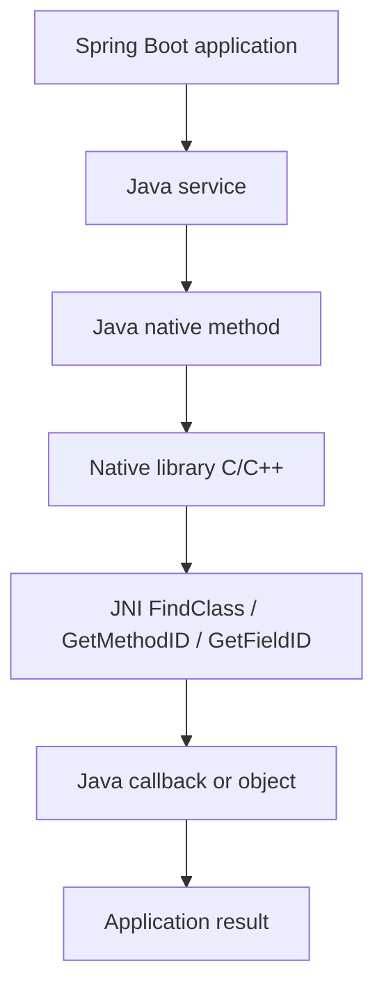

# JNI and the Classes, Fields, and Methods Called by Native Code

## 1. Why Do JNI Access Points Need to Be Described?

Java Native Interface (JNI) is the interface that allows Java code and C/C++ native code to interact within the same process. A Spring Boot application may use JNI directly or via dependencies, such as libraries for image processing, cryptography, data compression, machine learning, or device SDKs.

On the JVM, native code can use the JNI API to find classes, retrieve method IDs/field IDs, instantiate objects, and invoke Java methods. With GraalVM Native Image, reachability analysis happens primarily at build time. Classes and members accessed solely by native code may not appear in the normal Java call graph. If not described with appropriate metadata, they may not be retained or may not be accessible in the way JNI requires.

Spring AOT provides **RuntimeHints** to declare runtime capabilities ahead of time. For JNI, the `RuntimeHints.jni()` API describes the types and access permissions needed by native code. This lesson focuses on listing the classes, constructors, fields, and methods that C/C++ actually calls, registering hints in Spring AOT, and then verifying on the native executable.

## 2. Two Call Directions Across JNI

Two interaction directions must be distinguished:

- **Java calling native code:** Java declares a method with the `native` keyword and calls that method. The native library executes the C/C++ work.
- **Native code calling back into Java:** C/C++ uses the JNI API to find classes, obtain constructor/method/field IDs, instantiate objects, or invoke Java methods.



This lesson focuses on the classes/members that **native code calls into**. This access path is easily missed because Java bytecode does not necessarily contain direct calls to them.

## 3. JNI Resolves Classes and Members by Name and Signature

Example of native code finding a class and calling a method:

```c
jclass callbackClass = (*env)->FindClass(
    env, "com/example/nativebridge/NativeCallback");

jmethodID onDone = (*env)->GetMethodID(
    env, callbackClass, "onCompleted", "(I)V");

(*env)->CallVoidMethod(env, callback, onDone, status);
```

The strings in the example have exact meanings:

- `com/example/nativebridge/NativeCallback`: the class name in JNI internal name format, separating packages with `/`.
- `onCompleted`: the method name.
- `(I)V`: the JNI method descriptor, taking one `int` and returning `void`.

If the descriptor is wrong, `GetMethodID` fails to find the method. If the class/member is right but lacks proper JNI metadata in Native Image, the operation can still fail. Therefore, you need to check both **names/signatures** and **hints**.

## 4. Documenting the Contract Before Registering Hints

Suppose a native library processes a background task and invokes a Java callback. Before writing a registrar, tabulate every access point:

| Type | Member | JNI operation | Purpose |
|---|---|---|---|
| `NativeCallback` | Class | `FindClass` | Locate the callback type |
| `NativeCallback` | Constructor | `GetMethodID("<init>", ...)` if native creates the object | Instantiate callback |
| `NativeCallback` | `onCompleted(int)` | `GetMethodID` + `CallVoidMethod` | Invoke callback |
| `NativeResult` | Field `code` | `GetFieldID` / `SetIntField` | Read or write status |
| `NativeResult` | Field `message` | `GetFieldID` / `SetObjectField` | Exchange message |
| `NativeResult` | Constructor | `NewObject` | Create result from C/C++ |

The table must reflect the actual native code. If Java creates the callback and passes the object reference to C, native code does not need constructor access to create the callback. If C instantiates `NativeResult`, you must declare the appropriate instantiation permission.

Do not register every member of every class in a package just as a precaution. Metadata should reflect the verified JNI contract.

## 5. RuntimeHints.jni() and JNIAccess

Spring AOT provides APIs in the `org.springframework.aot.hint` package:

```java
RuntimeHints hints = new RuntimeHints();

hints.jni().registerType(
        NativeCallback.class,
        JNIAccess.INVOKE
);
```

`hints.jni()` returns the registry for types accessed from JNI. `registerType` declares the type along with the permissions needed by native code. Constants in `JNIAccess` represent capabilities such as invoking methods, allocating or constructing objects, as well as public/declared scopes according to the Spring Framework version's API.

Common permissions include:

| Permission | When to consider |
|---|---|
| `INVOKE` | Native invokes Java methods via JNI |
| `ALLOCATE` | Native needs to allocate objects using a supported JNI mechanism |
| `CONSTRUCT` | Native creates instances via constructors |
| `PUBLIC` | Native accesses public members |
| `DECLARED` | Native needs access to members declared on the type, including non-public members where supported |

The exact enum values and combinations must be checked against your project's Spring Framework version. Do not assume all versions share the same constants or semantics. Use Javadoc/IDE and tests to confirm.

## 6. Registering a Callback Class Where Native Only Invokes Methods

Suppose Java creates a callback and passes its reference into the native library:

```java
package com.example.nativebridge;

public final class NativeCallback {

    public void onCompleted(int status) {
        System.out.println("Native task status: " + status);
    }
}
```

Native code only receives an already-created object from Java and invokes a method:

```c
jclass type = (*env)->GetObjectClass(env, callback);

jmethodID method = (*env)->GetMethodID(
    env, type, "onCompleted", "(I)V");

(*env)->CallVoidMethod(env, callback, method, status);
```

With this contract, what matters is that native code has permission to invoke the method. You can register:

```java
hints.jni().registerType(
        NativeCallback.class,
        JNIAccess.INVOKE
);
```

There is no need to add a constructor hint merely because the class has a constructor: Java creates the callback before passing it to native code. If C/C++ also reads or writes fields, add the corresponding permission and check API support for field access.

## 7. When Native Creates Java Objects

Some native libraries construct objects themselves to return results to Java. For example:

```c
jclass resultClass = (*env)->FindClass(
    env, "com/example/nativebridge/NativeResult");

jmethodID constructor = (*env)->GetMethodID(
    env, resultClass, "<init>", "(ILjava/lang/String;)V");

jobject result = (*env)->NewObject(
    env, resultClass, constructor, code, message);
```

Java class:

```java
package com.example.nativebridge;

public final class NativeResult {

    private final int code;
    private final String message;

    public NativeResult(int code, String message) {
        this.code = code;
        this.message = message;
    }

    public int code() {
        return code;
    }

    public String message() {
        return message;
    }
}
```

Here native code needs to locate the class, obtain the constructor ID, and invoke `NewObject`. Hints must describe the ability to look up the type and instantiate it via JNI, typically requiring `CONSTRUCT` and/or related permissions depending on the Spring/GraalVM API version. If native code subsequently calls getters via JNI, also add method invocation capability.

Do not confuse JNI constructor access with Java reflection constructor hints. They belong to two separate metadata mechanisms.

## 8. Field Access: GetFieldID, GetIntField, and SetObjectField

JNI provides APIs to read/write instance fields. Example of native code reading a field:

```c
jfieldID codeField = (*env)->GetFieldID(
    env, resultClass, "code", "I");

jint code = (*env)->GetIntField(env, result, codeField);
```

Or writing an object field:

```c
jfieldID messageField = (*env)->GetFieldID(
    env, resultClass, "message", "Ljava/lang/String;");

(*env)->SetObjectField(env, result, messageField, message);
```

If the field is private, JNI access permissions and metadata must match the declared field scope. Do not assume `INVOKE` covers field access. Check `JNIAccess` in the version you are using; if the Spring API does not express specific field permissions sufficiently, use appropriate Native Image reachability metadata and test on the executable.

The field descriptor must also be exact:

| Java field type | JNI descriptor |
|---|---|
| `int` | `I` |
| `long` | `J` |
| `boolean` | `Z` |
| `String` | `Ljava/lang/String;` |
| `byte[]` | `[B` |
| `Invoice` | `Lcom/example/Invoice;` |

A descriptor mistake can cause `GetFieldID` to return null even when the field name is right.

## 9. Registering JNI Hints via RuntimeHintsRegistrar

Centralize metadata in a registrar:

```java
package com.example.nativebridge;

import org.springframework.aot.hint.JNIAccess;
import org.springframework.aot.hint.RuntimeHints;
import org.springframework.aot.hint.RuntimeHintsRegistrar;

final class NativeBridgeHints implements RuntimeHintsRegistrar {

    @Override
    public void registerHints(
            RuntimeHints hints,
            ClassLoader classLoader) {

        hints.jni().registerType(
                NativeCallback.class,
                JNIAccess.INVOKE
        );

        hints.jni().registerType(
                NativeResult.class,
                JNIAccess.CONSTRUCT,
                JNIAccess.INVOKE
        );
    }
}
```

This example illustrates permission to invoke the callback method and construct/invoke methods on the result type. If native code only constructs the result while Java reads getters directly, JNI invoke permission for getters may not be needed. If native accesses fields directly, add the appropriate field permissions.

Attach the registrar to a configuration class:

```java
@Configuration(proxyBeanMethods = false)
@ImportRuntimeHints(NativeBridgeHints.class)
class NativeBridgeConfiguration {
}
```

The configuration class must belong to the `ApplicationContext` processed by Spring AOT. If the registrar is not discovered, even correct registration code will not appear in native metadata.

## 10. JNI Hints Do Not Replace Reflection Hints

Both JNI and Java reflection can access members dynamically, but the caller differs:

| Mechanism | Example | Hints |
|---|---|---|
| JNI calling a Java method | `CallVoidMethod` | `hints.jni()` |
| JNI instantiating an object | `NewObject` | Corresponding JNI construct/allocate |
| Java calling `Method.invoke` | Reflection | `hints.reflection()` |
| Java calling `Constructor.newInstance` | Reflection | `hints.reflection()` |
| Java reading a classpath file | ClassLoader | `hints.resources()` |
| Creating a JDK dynamic proxy | `Proxy.newProxyInstance` | `hints.proxies()` |

A type may require both JNI hints and reflection hints if a library calls it from C/C++ and also uses reflection in Java code. Do not assume one kind of hint covers the other.

Similarly, JNI hints do not bundle `.so`, `.dll`, or `.dylib` files. Native libraries must be supplied and loaded for the proper architecture/ABI separately.

## 11. Class Names, Method Descriptors, and Overloads

JNI resolves methods by name plus descriptor. If Java has overloads:

```java
public void onCompleted(int status) {}
public void onCompleted(String message) {}
```

The two methods have different descriptors:

- `onCompleted(int)`: `(I)V`
- `onCompleted(String)`: `(Ljava/lang/String;)V`

If native code calls the second overload while hints or C code describe the first overload, lookup will mismatch. Similarly, a constructor descriptor must include all parameters and return type `V`.

When refactoring Java classes, treat JNI signatures as a compatibility contract. Changing packages, renaming methods, changing parameter types, or moving fields may require updating both C/C++ code and hints. Have integration tests verify signatures on both sides.

## 12. Classloader, Thread, and Reference Lifecycle

JNI code must follow runtime rules, not just metadata:

- `JNIEnv*` is bound to the current thread; do not pass it across threads for reuse.
- Native-created threads must attach to the runtime via supported JNI APIs before calling Java.
- Local references have bounded lifetimes; do not retain them arbitrarily across JNI calls.
- Global references must be released via `DeleteGlobalRef` when no longer needed.
- Check for exceptions after `FindClass`, `GetMethodID`, `GetFieldID`, and Java calls.
- The classloader context can affect class lookup; do not assume every thread shares the same context classloader.

Hints cannot fix misuse of `JNIEnv*`, global reference leaks, wrong signatures, or callbacks fired after an object's lifecycle has ended. Those bugs must be fixed in native code and tested separately.

## 13. Including the Native Library in the Runtime Image

If Java uses:

```java
static {
    System.loadLibrary("taskengine");
}
```

then the runtime must be able to locate the corresponding library, such as `libtaskengine.so` on Linux. Verify:

- Filename and loader search path.
- Architecture matching the executable.
- Compatible ABI/libc and dependent shared libraries.
- Read/execute permissions for the container user.
- The native library is packaged or mounted at the right location.

JNI hints only describe Java classes/members accessed via JNI. They do not automatically add library files into the native executable or OCI image. If the library is provided via a container layer, verify the runtime image contains both the file and its dependencies.

## 14. Testing JNI Hints

You can unit-test a registrar by constructing `RuntimeHints` and checking JNI entries via the predicate APIs provided by your Spring Framework version. Exact predicate names can vary; check Javadoc/IDE. Unit tests verify metadata registration, but do not prove the native executable collected and used the metadata properly.

Full workflow:

1. Unit-test the registrar to verify registered types and JNI permissions.
2. Run Spring AOT and confirm the registrar is discovered in the context.
3. Build the GraalVM Native Image.
4. Exercise the native-to-Java path: find classes, invoke callbacks, construct objects, or access fields per the contract.
5. Exercise the Java-to-native path: invoke native methods and verify results.
6. Test asynchronous callbacks, thread attach/detach, and reference lifecycles if applicable.
7. Run inside the target runtime container, verifying the native library and its dependencies.

Do not test only a simple callback if the actual library also constructs objects, reads fields, or calls other overloads. Every operation in the contract should be covered.

## 15. Troubleshooting Common Errors

| Symptom | Possible cause | Resolution |
|---|---|---|
| `FindClass` returns null | Wrong internal class name or type not supported | Check package/name and JNI hints |
| `GetMethodID` returns null | Wrong name, descriptor, or missing JNI permission | Cross-check signature and metadata |
| `GetFieldID` returns null | Wrong field name/descriptor or field not described | Check Java field and JNI field descriptor |
| `NewObject` fails | Mismatched constructor or missing construct capability | Check descriptor and JNI hints |
| Native callback fails while JVM works | Insufficient reachability metadata for native access | Register types/members via JNI hints |
| `UnsatisfiedLinkError` | Native library not found or missing dependency | Check filename, loader path, architecture, and ABI |
| Fails only on one architecture | Native library was not built for that target | Supply binary for the matching platform |
| Crash on callback thread | Incorrect thread/ENV/reference lifecycle | Fix JNI programming and test concurrency |

Always distinguish metadata errors from JNI programming errors or loader errors. Adding hints cannot fix a wrong method descriptor, a missing native library, or a memory/reference bug.

## 16. Hands-On Exercise: Callback and Result Object from a C Library

**Context:** A Spring Boot service calls `libtaskengine`. Java passes a callback; C/C++ invokes `onCompleted(int)` and creates a `NativeResult` to return.

**Step 1 — Write the Java contract.** Create `NativeCallback` and `NativeResult` with clear constructors and getters.

**Step 2 — Write the JNI contract.** Document internal class names, method names, constructor descriptors, field descriptors, and corresponding operations.

**Step 3 — Write the registrar.** Register callback invocation and result construction/invocation matching actual native operations. Add field access if C/C++ reads/writes fields directly.

**Step 4 — Import the hints.** Attach `RuntimeHintsRegistrar` with `@ImportRuntimeHints` to a configuration class in the AOT context.

**Step 5 — Verify the native library.** Build the library for the target architecture/ABI, verify shared library dependencies, and check the load path.

**Step 6 — Build the native executable.** Run Spring AOT and GraalVM Native Image, save compiler logs, and confirm metadata collection.

**Step 7 — Exercise both directions.** Call the native method from Java; verify C invokes the callback and returns the result object. Check exceptions, threads, and reference lifecycles.

**Step 8 — Run in container.** Place the executable and native library in a compatible runtime image, run under the deployment user, and repeat integration tests.

Completion criteria: all classes/members in the JNI contract are properly registered, the native library loads, callbacks/object creation work on both the native executable and container, with no descriptor or lifecycle errors.

## 17. Conclusion

When C/C++ code calls into Java, Native Image needs to know ahead of time which **classes, constructors, methods, and fields** JNI will look up and manipulate. Spring `RuntimeHints.jni()` provides a way to declare types and access permissions within Spring AOT. These declarations are distinct from reflection hints and do not replace packaging the native library.

Start from the actual JNI contract: internal class names, member names, descriptors, and operations. Register the right permissions, attach the registrar to the AOT context, test both callbacks and object/field access, and run the executable in the target runtime container. Combining accurate metadata with proper thread/reference management keeps JNI integration in Spring Boot Native Image stable and traceable.
