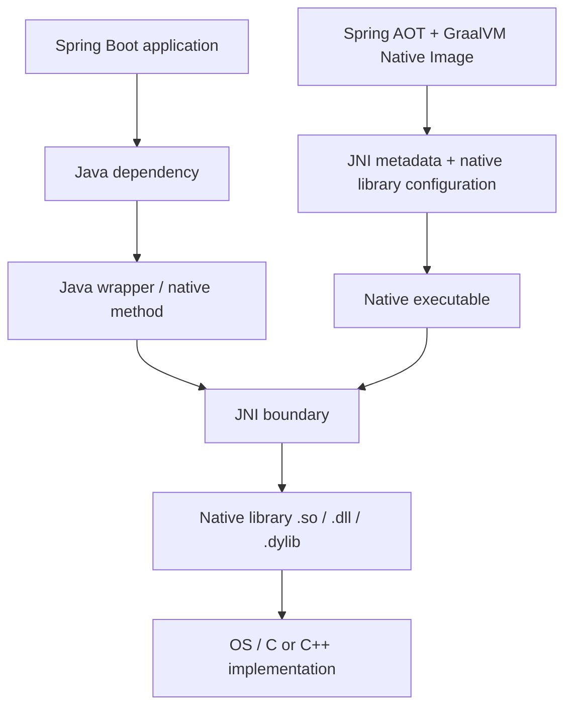

# Dependencies That Use JNI Even When the Application Writes No C Code

## 1. JNI Can Enter Through Dependencies

A Spring Boot application may contain only Java code and still depend on the **Java Native Interface (JNI)** through third-party libraries. JNI allows Java code to call native functions in OS libraries or C/C++ libraries; conversely, native code can also call into the JVM under the JNI contract.

Dependencies may use JNI to access system capabilities or improve performance, for example:

- Database drivers with native components or wrappers around C client libraries.
- Cryptography, compression, image/video processing, or CPU-optimized libraries.
- Native transports for networking.
- Libraries accessing hardware devices, specialized filesystems, or existing C libraries.
- Dependencies that select a native backend per OS/CPU at startup.

Therefore, having no `.c` or `.cpp` files in the repository does not prove an application does not use JNI. A dependency may contain Java wrappers calling `native` methods and loading `.dll`, `.so`, or `.dylib` libraries at runtime.

In the **SPRING_BOOT_NATIVE_IMAGE** module, it is necessary to identify such dependencies before building a GraalVM Native Image. The native executable must have appropriate JNI metadata, platform-matching native libraries, and a supported library loading mechanism. A successful build on a development machine does not guarantee the binary will run in the target container.



## 2. What Is JNI from a Java Perspective?

A Java class can declare a method with the `native` keyword:

```java
public final class FastChecksum {
    static {
        System.loadLibrary("fastchecksum");
    }

    public native long calculate(byte[] data);
}
```

The `calculate` method has no Java body; its implementation lives in a native library. When the method is called, the runtime looks up the registered native implementation or the one mapped by JNI naming conventions.

This example merely illustrates JNI structure. In real applications, such code typically lives inside a dependency rather than in the Spring Boot service's own source.

Signs to watch for when inspecting dependencies:

- Methods declared `native` in bytecode/classes.
- Calls to `System.loadLibrary` or `System.load`.
- Native library files packaged inside JARs, JAR classifiers, or downloaded separately.
- Startup code selecting backends based on OS/architecture.
- Exceptions such as `UnsatisfiedLinkError` or `NoClassDefFoundError` related to wrappers/native bindings.

JNI is a separate mechanism from reflection. A class may be called directly in Java yet still invoke native methods; in that case, the JNI side must be handled even if no reflection hint is needed for static Java calls.

## 3. Dependency Categories That May Use JNI Indirectly

| Dependency category | Why native code may be used | Examples to inspect |
|---|---|---|
| Networking | Native event loops or optimized transports | OS-specific native transports |
| Cryptography/TLS | Calls system crypto libraries or native backends | OpenSSL bindings, native providers |
| Compression | Uses C/C++ codecs for acceleration | zlib, zstd, lz4 wrappers |
| Database | Uses native client libraries or embedded engines | SQLite/JNI wrappers, database clients |
| Image/media | Calls codecs and image/video processing libraries | ImageIO plugins/native codecs |
| Machine learning | Native inference runtimes or accelerators | Tensor/runtime backends |
| Hardware/system integration | Accesses OS or device APIs | USB, serial, GPU bindings |

This is a checklist of categories to audit, not a claim that every library in these categories uses JNI or is incompatible with Native Image. Some libraries are pure Java, some use JNI, and some are migrating to the Foreign Function & Memory API or other mechanisms depending on version.

## 4. Finding JNI Dependencies in a Project

Start from the runtime dependency graph because test-only dependencies do not necessarily enter the production application.

With Gradle:

```bash
./gradlew :api-app:dependencies --configuration runtimeClasspath
```

Tracing a specific dependency:

```bash
./gradlew :api-app:dependencyInsight --dependency netty --configuration runtimeClasspath
```

With Maven:

```bash
./mvnw dependency:tree
```

Once a suspect dependency is identified, inspect the JAR and its contents:

```bash
jar tf path/to/library.jar
```

Look for native files by extensions like `.so`, `.dll`, `.dylib`, or directories like `META-INF/native`, `native/` depending on packaging. Some dependencies download libraries at runtime, so the native file may not reside in the main JAR.

You can inspect class bytecode with JDK tools:

```bash
javap -classpath path/to/library.jar -p -c com.example.NativeBridge
```

Look for `native` declarations and calls to `System.loadLibrary` in the selected class. Be sure to use the actual dependency's classpath and class names.

Do not conclude a dependency avoids JNI simply because no `.so` file appears inside its JAR: it may obtain native libraries from a separate package, the OS, or a runtime download.

## 5. Distinguishing JNI from Native Tools Invoked via Processes

Not every dependency calling external code uses JNI:

- **JNI**: the Java process invokes native functions across the JNI boundary within the same process.
- **Process invocation**: Java launches an external program via `ProcessBuilder` or a shell; this is a separate process.
- **Network client**: Java communicates with a service over sockets/HTTP; server code runs in another process/machine.
- **FFM API**: Java uses the Foreign Function & Memory API (JDK-dependent) to call native functions through a mechanism other than JNI.

Native Image handling differs accordingly. JNI requires JNI configuration/metadata and compatible libraries; process invocation requires the external executable to exist in the image with execute permissions; network clients require connection configuration; FFM requires checking support per JDK/GraalVM version.

Do not add JNI metadata to fix an error where `ProcessBuilder` cannot find an executable. Identify the dependency's actual boundary first.

## 6. JNI Metadata in Native Image

GraalVM Native Image needs to know which Java classes are used at the JNI boundary and how native code can access them. Depending on version, JNI configuration can describe:

- Classes looked up or instantiated from native code.
- Constructors/methods/fields accessed by native code via JNI.
- Java native methods registered or invoked.
- Types and members needed when Java and native code exchange objects.

Do not confuse JNI metadata with reflection metadata. Reflection describes dynamic access from Java reflection APIs; JNI describes access through the Java Native Interface. A library may need both, yet one permission set does not substitute for the other.

GraalVM Native Image has dedicated JNI configuration support. File syntax, schemas, and metadata delivery mechanisms change across GraalVM versions. Use documentation matching your exact version or metadata published by the library itself, rather than copying legacy configuration without verification.

## 7. Native Libraries Must Match the Target Platform

JNI libraries are OS- and architecture-dependent binaries. For example:

| Build/runtime target | Library type typically needed |
|---|---|
| Linux x86_64 | ELF shared object `.so` for x86_64 |
| Linux ARM64 | ELF shared object `.so` for aarch64 |
| Windows x64 | PE DLL `.dll` for x64 |
| macOS ARM64 | Mach-O dynamic library `.dylib` for arm64 |

You cannot use a Windows DLL inside a Linux container. Nor can you use an x86_64 binary on ARM64 just because the Java bytecode is identical.

Beyond architecture, ABI and shared libraries must be compatible. For example, a `.so` linked against a specific glibc or OpenSSL version may fail to run in a different run image. Inspect the native library's dependencies and the target run image.

On Linux, common inspection tools include:

```bash
file libfastchecksum.so
ldd libfastchecksum.so
```

`ldd` displays the ELF shared library dependencies in a Linux environment. Only run it on trusted binaries in an appropriate environment; for untrusted binaries, prefer static analysis tools like `readelf -d`. On Windows, use Visual Studio's PE/dependency inspection tools; on macOS, use `otool -L`.

## 8. Where Are Native Libraries Packaged?

A dependency may distribute native libraries in several ways:

1. A JAR containing multiple OS/architecture binaries under resource paths.
2. Separate classifier JARs for each platform.
3. A package manager or OS package installing the library onto the system.
4. The library downloading/extracting binaries from a JAR into a temp directory at runtime.
5. Native libraries pre-installed in the base/run image.

When using Cloud Native Buildpacks, the builder image and run image serve different roles. Build toolchains may live in the builder, whereas libraries required at runtime must be present in the application/run image. Never assume a native file present in the builder will automatically exist in the final container.

If a library extracts binaries into a temporary directory, the container needs that directory to exist and be writable. With read-only root filesystems, configure the temp directory and permissions according to the library's documentation.

## 9. Spring AOT and JNI: Different Roles

Spring AOT analyzes the Spring application context, generates initialization code, and contributes Runtime Hints. It can help prepare reflection, proxy, resource, and serialization metadata where integrations support them.

However, Spring AOT does not compile a dependency's C/C++ code or automatically guarantee that native libraries match the ABI. The Native Image build and packaging must handle JNI requirements and corresponding OS libraries.

A proper workflow must verify:

- The JNI dependency is on the application module's runtime classpath.
- The library version supports Native Image or provides metadata guidance.
- JNI metadata is supplied via a compatible GraalVM/Spring mechanism.
- The native library for the target OS/architecture is packaged or installed in the run image.
- Dynamic loading and temp extraction work in the runtime environment.
- JNI code paths are exercised in native integration tests.

## 10. Example of an Indirect Dependency in a Spring Boot App

Suppose an application uses an optimized checksum library. The controller only calls Java APIs:

```java
@RestController
class ChecksumController {

    private final ChecksumService checksumService;

    ChecksumController(ChecksumService checksumService) {
        this.checksumService = checksumService;
    }

    @PostMapping("/api/checksum")
    String calculate(@RequestBody byte[] payload) {
        return checksumService.calculate(payload);
    }
}
```

Service:

```java
@Service
class ChecksumService {

    private final FastChecksumLibrary library;

    ChecksumService(FastChecksumLibrary library) {
        this.library = library;
    }

    String calculate(byte[] payload) {
        return library.sha256(payload);
    }
}
```

The Spring code contains no `native` methods, yet `FastChecksumLibrary` may invoke JNI internally. Therefore, passing JVM tests on a laptop is not enough to prove the native executable will run in a Linux container.

If the library provides a Java fallback, determine which backend the runtime selects. If the native backend is selected, verify the library binary and JNI metadata; if a pure-Java fallback is selected, tests must verify its corresponding behavior and performance.

Do not write custom JNI hints for a library before reading its integration documentation. The vendor may already publish reachability metadata or dedicated Native Image instructions.

## 11. How to Test JNI Dependencies

A practical verification plan:

1. **Dependency inspection**: record artifacts/versions and identify the selected native backend.
2. **JVM smoke test**: invoke the API using the library on the JVM.
3. **Native build**: run Spring AOT and GraalVM Native Image with the right profile/target.
4. **Native smoke test**: invoke the same API on the newly built executable.
5. **Container test**: run the image on the real run image, verifying shared libraries and filesystem permissions.
6. **Architecture test**: run on the exact target OS/CPU; do not extrapolate from a developer machine with a different architecture.
7. **Fallback test**: if a Java fallback exists, verify both the native backend and fallback per product requirements.

Tests must actually invoke the JNI code path. An application that starts successfully without ever calling a native method does not confirm JNI works.

## 12. Diagnosing Common Errors

| Symptom | Possible cause | Where to check |
|---|---|---|
| `UnsatisfiedLinkError: no ... in java.library.path` | Native library not found or wrong path | Check load path, packaging, and runtime filesystem |
| `UnsatisfiedLinkError: ... not found` | Native method not linked/registered | Check JNI implementation, symbols, and metadata |
| `wrong ELF class` | Wrong architecture or bitness | Check `file`, architecture, and binary dependencies |
| `GLIBC_x.y not found` | Binary requires newer glibc than run image provides | Choose a compatible base/run image or rebuild |
| DLL/shared library dependency missing | Missing transitive dependency of the native library | Inspect PE/ELF dependencies and install runtime libraries |
| JVM works, native fails with JNI error | Missing JNI metadata or unsupported native mechanism | Read GraalVM diagnostics and vendor guidance |
| Fails only in container | Binary absent from image, wrong temp path/permissions/ABI | Inspect the final image and runtime user |
| Startup passes but endpoint fails | JNI path is only invoked when handling requests | Write tests that trigger the native call itself |

## 13. Indirect JNI Management Checklist

- Inspect the runtime dependency graph and library versions.
- Look for `native` methods, `System.loadLibrary`, native binaries, or runtime extraction.
- Distinguish JNI from process invocation, network calls, and FFM.
- Read the dependency vendor's Native Image documentation.
- Verify JNI metadata matches the GraalVM version.
- Package native libraries for the target OS/architecture.
- Check the run image's ABI and shared library dependencies.
- Provide a writable temp directory if the library extracts binaries.
- Run integration tests that actually invoke native methods on the executable/container.
- Record toolchain, dependency versions, target platforms, and artifact digests.

## 14. Self-Check Questions

1. Why can an application whose own source is pure Java still depend on JNI?
2. What clues help uncover a dependency that calls `System.loadLibrary` or declares `native` methods?
3. What is the difference between JNI and invoking an external executable via `ProcessBuilder`?
4. Why does reflection metadata not replace JNI metadata?
5. Which OS/architecture/ABI conditions must be checked for native libraries?
6. Why is verifying successful startup insufficient to prove a JNI dependency works?
7. What does Spring AOT assist with, and what remains the responsibility of GraalVM/native library packaging?

**Key takeaway:** JNI can be invoked indirectly through dependencies even when an application writes no C/C++ code. Inspect the runtime dependency graph, native methods, and loaded libraries, supply metadata matching the GraalVM version, package binaries for the target platform, and test JNI code paths inside the actual native container.
