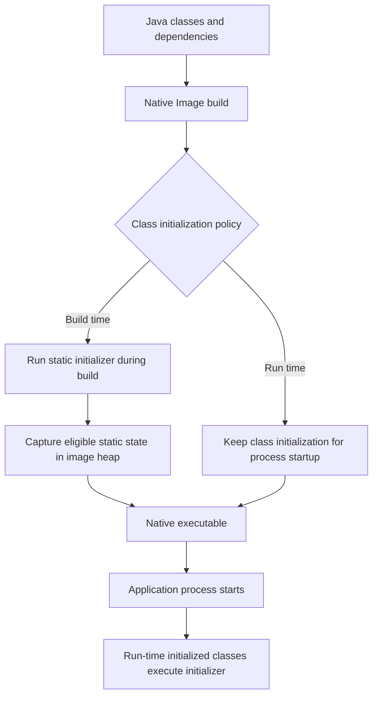

# Static Initializers Running at Build Time vs. Application Startup

## 1. Why Does Class Initialization Timing Matter?

In Java, a class can contain static fields and static initializers (`static` blocks). When the class is initialized, the JVM executes static field assignments and initializer blocks in the order they appear. On a standard JVM, this typically happens the first time the class is used according to Java's initialization rules.

GraalVM Native Image can perform certain class initialization during the executable build process rather than waiting until the process runs. This moves immutable initialization work to build time and can reduce startup time. However, if a static initializer reads environment variables, system time, files, the network, creates threads, or stores environment-dependent state, the result may be frozen into the image.

In the **SPRING_BOOT_NATIVE_IMAGE** module, two timings need to be understood:

- **Build-time initialization:** the static initializer runs during the Native Image build, and eligible static state may be stored in the image heap.
- **Run-time initialization:** the static initializer executes when the native application starts up and the class is initialized according to runtime rules.

This decision affects correctness, the reusability of the same binary across environments, startup time, and image safety. You should not switch every class to build-time just to reduce startup time.

## 2. Static Initializers in Java

A simple example:

```java
public final class TaxRules {

    static final int DEFAULT_RATE;

    static {
        DEFAULT_RATE = 10;
        System.out.println("TaxRules initialized");
    }

    private TaxRules() {
    }
}
```

When the class is initialized, the `static` block runs and assigns `DEFAULT_RATE`. On a standard JVM, this usually occurs on the first use that requires class initialization, such as reading a non-constant static field or calling a static method.

Another example:

```java
public final class AppEnvironment {

    static final String REGION =
            System.getenv("APP_REGION");

    private AppEnvironment() {
    }
}
```

The `REGION` value is read when the class is initialized. If Native Image initializes this class at build time, it may retain the `APP_REGION` value from the build environment. When running the same executable in staging or production, a different environment variable will not automatically recalculate the static field.

This is a classic risk example: an environment-dependent static field that is initialized too early.

## 3. Build-Time Initialization and the Image Heap

Native Image performs analysis and produces the executable before the application runs. If a class is initialized at build time, its static state can be placed into the **image heap** — a pre-initialized data area stored in the executable and used when the process starts.

Model:



Benefits of build-time initialization:

- Shifts certain immutable computations out of startup.
- Avoids repeating identical initialization work on every process launch.
- Can reduce startup time for suitable classes.

Risks:

- Values dependent on the build machine may get frozen.
- Static object graphs may retain unintended state in the image heap.
- Resources or handles valid only in the build process may be invalid at runtime.
- Side effects in initializers may occur at the wrong time.

Not every object created in a static initializer can be stored in the image heap. Native Image checks storability and safety rules; certain states may cause the build to fail.

## 4. What Does Run-Time Initialization Mean?

With run-time initialization, Native Image defers execution of the static initializer until the native application starts up and the class is initialized. Runtime-dependent values such as environment variables, the filesystem, or runtime configuration can be read in the actual process environment.

Example:

```java
public final class RuntimeSettings {

    static final String REGION;

    static {
        REGION = System.getenv().getOrDefault(
                "APP_REGION", "local");
    }

    private RuntimeSettings() {
    }
}
```

If the class is initialized at runtime, `APP_REGION` can reflect the running container's environment. However, reading it once into a `static final` field still means the value is kept for the lifetime of the process; it will not automatically reload if the environment or a file changes after the process has started.

For Spring Boot configuration, it is usually better to use `Environment`, `@ConfigurationProperties`, or dependency injection rather than reading the environment directly inside a static initializer. This clarifies the configuration source, property source precedence, and binding time.

## 5. Native Image Options Controlling Class Initialization

Native Image provides options to control when classes are initialized:

```bash
native-image --initialize-at-build-time=com.example.rules ...
```

and:

```bash
native-image --initialize-at-run-time=com.example.environment ...
```

These options can accept a list of packages/classes depending on the GraalVM version syntax. Package scope must be considered carefully: specifying a broad package can affect many internal classes and dependencies.

- `--initialize-at-build-time`: requests that the class be initialized at build time.
- `--initialize-at-run-time`: requests that class initialization be deferred until runtime.

Native Image also has default rules and automatic initialization analysis. Do not assume all classes default to runtime or all classes in dependencies are build-time. The outcome depends on the GraalVM version, classpath, and compiler safety analysis.

With Spring Boot Native Image, these options are typically configured via the Maven/Gradle Native Build Tools plugin or buildpack environment/configuration. Argument-passing syntax must match the plugin version in use.

## 6. A Static Initializer Suitable for Build Time

An example of immutable, environment-independent data:

```java
final class CurrencyTable {

    static final Map<String, Integer> SCALE;

    static {
        Map<String, Integer> values = new HashMap<>();
        values.put("VND", 0);
        values.put("USD", 2);
        values.put("JPY", 0);
        SCALE = Map.copyOf(values);
    }

    private CurrencyTable() {
    }
}
```

The initializer builds a map from fixed literals. It does not read files, the network, environment variables, the clock, or secrets. If the involved classes are determined by Native Image to be safe and are build-time initialized, the data can be pre-stored in the image heap.

Even so, there is no need to force every constant table to build time using manual options. Native Image can automatically handle suitable constants/initializers. Only configure when there is a measurable reason or a clear need to control behavior.

## 7. Static Initializers with Side Effects: Avoid Running at Build Time

Example creating a thread:

```java
final class BackgroundWorker {

    static final ScheduledExecutorService EXECUTOR;

    static {
        EXECUTOR = Executors.newSingleThreadScheduledExecutor();
        EXECUTOR.scheduleAtFixedRate(
                () -> System.out.println("tick"),
                1, 1, TimeUnit.SECONDS);
    }
}
```

This is a dangerous design for build-time initialization. Threads and executors belong to the build process and cannot be packaged as a running thread into the native executable. Native Image may report an error upon detecting a thread/unsupported state, or initialization must be moved to runtime.

Side effects to avoid in static initializers:

- Creating threads, executors, schedulers, or background workers.
- Opening sockets, database connections, or HTTP clients connecting from the build environment.
- Reading files using build-machine paths.
- Capturing the current time, random seeds, or environment variables when values must vary per process.
- Reading credentials, tokens, or private keys.
- Initializing OS/architecture-dependent native libraries if incompatible with the build target.
- Registering shutdown hooks or manipulating process state.

For runtime resources, move resource creation/cleanup into the bean lifecycle or a controlled runtime initialization method.

## 8. System Time and Random Values

A static initializer can generate values from time or randomness:

```java
final class BuildStamp {
    static final Instant CREATED_AT = Instant.now();
    static final UUID INSTANCE_ID = UUID.randomUUID();
}
```

If the class is initialized at build time, both the timestamp and UUID may be generated during the build process and stored in the image. Every container running the same binary might see the exact same values, which is usually wrong for an instance ID or startup time.

If you need process time, call `Instant.now()` at runtime or inject a `Clock`. If you need a per-instance ID, generate it when the process starts or per business request. If you need a build timestamp for artifact traceability, generate it intentionally as immutable build metadata and do not confuse it with application startup time.

## 9. Reading Files and Environment Variables in Static Initializers

A risky example:

```java
final class Rules {
    static final String CONTENT;

    static {
        try {
            CONTENT = Files.readString(
                    Path.of("/etc/orders/rules.json"));
        }
        catch (IOException ex) {
            throw new ExceptionInInitializerError(ex);
        }
    }
}
```

If build-time initialization occurs, Native Image may attempt to read the file on the build machine. Production files do not exist inside the build container, or content read during the build may get frozen into the image.

A better design is to read external files via a bean/service at runtime:

```java
@Component
class RulesLoader {

    private final RulesProperties properties;

    RulesLoader(RulesProperties properties) {
        this.properties = properties;
    }

    String load() throws IOException {
        return Files.readString(
                properties.path(), StandardCharsets.UTF_8);
    }
}
```

The path is supplied via `@ConfigurationProperties` or a runtime configuration source. Decide clearly whether to read once when the bean initializes or re-read on every use; the two options have different semantics and costs.

## 10. Class Initialization and Spring AOT Are Two Different Mechanisms

Spring AOT analyzes the ApplicationContext and generates bean registration/initialization code along with RuntimeHints. Native Image class initialization determines **when a Java class's static initializer is executed**.

| Mechanism | Question answered |
|---|---|
| Spring AOT | Which beans/configurations are analyzed and what initialization code is generated? |
| Native Image class initialization | Does the class's static initializer run during the build or at runtime? |
| RuntimeHints | Which classes/members/resources/proxies need support at runtime? |
| Image heap | What build-time state is stored in the executable? |

A Spring bean being processed by AOT does not mean every class used by that bean is statically initialized at build time. Conversely, designating a class as build-time does not by itself register a Spring bean or alter condition evaluation.

When investigating bugs, identify the exact mechanism layer. If a bean does not exist because of `@ConditionalOnProperty`, that is an AOT/structural issue. If a static field holds the builder's environment value, that is a class initialization issue.

## 11. Class Initialization and Native Libraries

A class may load a native library in a static block:

```java
final class ImageCodec {
    static {
        System.loadLibrary("imagecodec");
    }

    static native byte[] resize(byte[] source);
}
```

Loading a library can depend on OS, architecture, loader path, and filesystem. Do not force such a class to be build-time initialized if the native library is only present in the runtime image or depends on a different deployment environment.

You must determine:
- Is the native library provided in the build environment or the runtime image?
- Does the target library share the same architecture/ABI as the executable?
- Does class initialization perform `System.loadLibrary` inside the build process?
- Does the library have side effects or hold native state that cannot be packaged?

For JNI, you also need to register type/member hints and package the native library properly. Class initialization policy does not replace JNI metadata or library packaging.

## 12. Diagnosing Class Initialization Errors

When a Native Image build fails, the message may indicate that a class was initialized too early or contains state that cannot be stored in the image heap. At runtime, you might see an initializer exception or unexpected static values.

Useful commands/measures:

```bash
native-image --verbose ...
```

Enable detailed logs via the build tool plugin when needed. Depending on the GraalVM version, there are diagnostic options to report class initialization and the reasons for the choice. Check the documentation for your exact version instead of copying outdated diagnostic options.

How to investigate:

1. Identify the first class appearing in the error.
2. Read the static field initializers and `static` block of that class.
3. Check dependent classes that are initialized transitively.
4. Look for environment/file/network/time/random/thread/native-library side effects.
5. Determine what static state was placed into the image heap.
6. Switch appropriate classes to run-time initialization or refactor side effects out of the static initializer.
7. Rebuild and run in the target runtime environment.

Do not solve every error by adding entire packages to `--initialize-at-run-time`. Doing so can slow down startup, change initialization order, or mask dependency initialization that needs proper handling.

## 13. Configuring via Maven and Gradle

When using GraalVM Native Build Tools, Native Image build arguments can be passed through the plugin configuration.

Illustrative Maven example:

```xml
<plugin>
    <groupId>org.graalvm.buildtools</groupId>
    <artifactId>native-maven-plugin</artifactId>
    <configuration>
        <buildArgs>
            <buildArg>--initialize-at-run-time=com.example.environment</buildArg>
        </buildArgs>
    </configuration>
</plugin>
```

Illustrative Gradle example:

```groovy
graalvmNative {
    binaries {
        main {
            buildArgs.add(
                '--initialize-at-run-time=com.example.environment'
            )
        }
    }
}
```

These are conceptual configurations; the DSL/XML schema and how arguments are passed depend on the Native Build Tools version. Place the argument in your project's appropriate plugin configuration and inspect the logs to verify it was actually forwarded to Native Image.

Specify full class names and a narrow scope. If the class belongs to a dependency, verify the exact package/class name against the resolved dependency version.

## 14. Testing the Difference Between Build Time and Runtime

Create a test class that reads an environment variable during static initialization:

```java
final class RegionHolder {
    static final String REGION =
            System.getenv("APP_REGION");
}
```

To test, build the native binary in an environment with `APP_REGION=build-region`, then run the executable with `APP_REGION=runtime-region`. If the class was initialized at build time, the observed value may be `build-region`; if initialized at runtime, the value may be `runtime-region`.

Do not use this example as a production design; it is a fixture to illustrate initialization timing. The test must ensure the class is actually initialized in the phase under investigation and not eliminated by the compiler as unreachable.

A controlled testing procedure:

1. Create a class with a static initializer reading an environment variable.
2. Record the build's default class initialization policy.
3. Build in environment A.
4. Run the executable with environment B.
5. Observe the static value and initializer logs.
6. Configure run-time initialization for the class.
7. Rebuild and run again with environment C.
8. Compare the results, recording the GraalVM version and build arguments.

Add tests for files, clocks, or randomness only when needed to prove the corresponding risk. Avoid tests with real side effects such as connecting to production services.

## 15. Guidelines for Deciding Build-Time vs. Run-Time Classes

| Initializer characteristic | Preferred choice |
|---|---|
| Only constructs immutable data from literals | May be suitable for build time |
| Pure, deterministic computation, environment-independent | May be suitable for build time |
| Reads environment variables or system properties that vary by deployment | Runtime |
| Reads external files or secrets | Runtime |
| Captures current time or per-process randomness | Runtime |
| Creates threads/executors/sockets/database connections | Runtime, though preferably moved out of the static initializer |
| Loads native libraries dependent on target/runtime paths | Requires careful analysis; generally avoid build-time unless suitable |
| Holds objects containing build-process handles/resources | Unsuitable for image heap |

This table represents design guidelines, not automatic compiler rules. A class with a mixed initializer may need refactoring: separating the deterministic computation and moving side effects into a bean lifecycle or runtime method. This is usually clearer than controlling the entire class with a broad option.

## 16. Hands-on Exercise: Detecting Frozen Values in an Image

**Context:** a Spring Boot application has a `DeploymentRegion` class that reads `APP_REGION` in a static initializer.

**Step 1 — Create the fixture.** Write a class with a `static final` field reading the environment and an endpoint returning the value for observation.

**Step 2 — Run on JVM.** Start with `APP_REGION=jvm-region`, call the endpoint, and record the result.

**Step 3 — Build native.** Set `APP_REGION=build-region` in the build environment, create the executable, and note the toolchain/build arguments.

**Step 4 — Run native.** Set `APP_REGION=runtime-region` when running the executable; observe the returned value.

**Step 5 — Switch initialization policy.** Configure the appropriate class using `--initialize-at-run-time`, rebuild, and repeat the test.

**Step 6 — Refactor the design.** Replace static environment access with `@ConfigurationProperties` or a bean receiving the value via Spring `Environment`. Re-run on both JVM and native.

**Step 7 — Check for side effects.** Confirm no secrets are read, network connections opened, or threads created inside static initializers running at build time.

Completion criteria: able to explain which value was frozen, identify the class initialization policy, demonstrate that runtime values pick up the process environment accurately, and refactor configuration to follow the Spring lifecycle.

## 17. Conclusion

In GraalVM Native Image, static initializers can run at build time or runtime. Build-time initialization can reduce startup work and store immutable state in the image heap, but risks freezing environment variables, timestamps, random values, file contents, or build-process resource state into the executable.

With Spring Boot Native Image, keep static initializers pure and deterministic if you want to benefit from build time; move configuration, secrets, filesystem access, networking, threads, and deployment-dependent resources to the runtime lifecycle. Use narrowly scoped initialization options, check logs/diagnostics, and test the binary in an environment different from the build environment to verify behavior before release.
