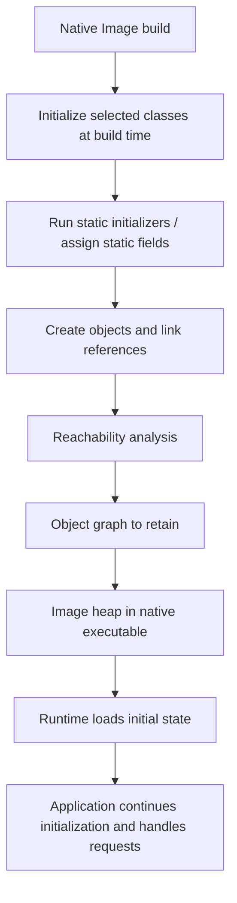
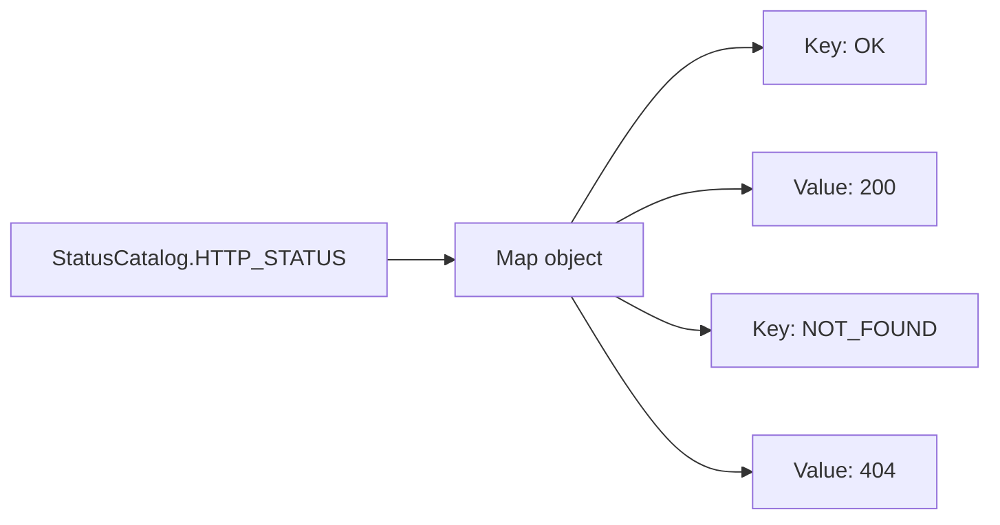

# The Image Heap and Values Stored from Static Fields

## Lesson Objectives

In a typical Java application, `static` fields are tied to class state and are initialized when the class is initialized by the JVM. When compiling a Spring Boot application into a **GraalVM Native Image**, certain classes may be initialized during the build process. The values held by `static` fields at that time can be stored along with their object graphs in the **image heap** of the native executable.

This helps the application start faster because part of the initialization work has already been performed ahead of time. However, if a class initializes too early, the binary may carry values tied to the build machine, build timestamp, environment variables, sensitive data, or unsuitable mutable state.

This lesson helps you:

- Explain the image heap and its relationship with class initialization.
- Identify object graphs retained from `static` field values.
- Distinguish data created at build time from data created at runtime.
- Detect time, environment, random, secret, and mutable state values at risk of being frozen into the binary.
- Choose which classes are suitable for build-time vs. run-time initialization.
- Verify the behavior of static state in Spring Boot Native Image.

## 1. What Is the Image Heap?

### 1.1. Native Image creates a snapshot of initial state

GraalVM Native Image analyzes the application and builds an executable for the target operating system and architecture. During the build, some classes are initialized early. Class initialization code (`<clinit>`) may assign values to static fields, invoke other methods, and instantiate objects.

Objects that remain reachable from static fields or eligible roots of classes initialized at build time can be written into the **image heap**. You can think of the image heap as the pre-prepared initial object state created during executable generation, instead of recreating all of that state when the application starts running.



The image heap is not a separate cache file that the application manually reads on startup. It is part of the state embedded into the native executable in a format managed by the Native Image runtime.

### 1.2. Object graphs from static fields

Consider the example:

```java
final class StatusCatalog {

    static final Map<String, Integer> HTTP_STATUS = Map.of(
            "OK", 200,
            "NOT_FOUND", 404,
            "ERROR", 500
    );
}
```

If `StatusCatalog` is initialized at build time and the `HTTP_STATUS` field remains used, the map and its associated objects can become part of the image heap. The graph does not consist only of the static variable; it can include the map object, internal nodes, and the keys and values referenced by the map.

Example of reference relationships:



This is a conceptual diagram; the actual internal structure of `Map.of` depends on the JDK. What to remember is that **a reference from a static field can retain the entire reachable object graph**, not just a scalar value.

### 1.3. Image heap vs. runtime heap

| Criterion | Image heap | Runtime heap |
|---|---|---|
| Creation time | During the Native Image build | While the native executable is running |
| Data source | Objects created during build-time initialization and still reachable | Objects created during execution |
| Location | Snapshot embedded into the native executable | Heap region managed by the runtime |
| Purpose | Provides pre-prepared initial state | Holds business objects, requests, caches, and runtime-generated state |
| Example | Immutable lookup table created from literals | Request DTOs, sessions, DB query results |

The image heap can reduce initialization work at startup. The runtime heap is still required for objects created while the application serves requests and executes business logic.

### 1.4. The image heap does not mean every static field is stored

Not all classes are initialized at build time, and not every field is guaranteed to be retained. Storage depends on:

- Whether the class is initialized at build time or runtime.
- Whether the field and object graph remain reachable after analysis.
- Whether the Native Image compiler can eliminate unused parts.
- Class initialization rules and build options.
- Constraints on objects, references, and state checked by Native Image.

Therefore, do not draw conclusions solely from a field being declared `static final`. Inspect class initialization and the actual build output.

## 2. Class Initialization Determines When Static State Is Created

### 2.1. Class initialization on the JVM

In Java, a class with a static initializer or static field initializer is initialized when the JVM performs an action requiring initialization under the language rules. That process happens once per class loader; static fields receive the values created during that initialization.

Example:

```java
final class BuildInfo {

    static final long INITIALIZED_AT =
            System.currentTimeMillis();

    static {
        System.out.println("BuildInfo initialized");
    }
}
```

On a standard JVM, `INITIALIZED_AT` is assigned when the class is initialized in the running process. Each time a new process launches, the value may differ.

### 2.2. Class initialization at build time

Native Image can execute class initialization during executable creation. When it does, the static initializer runs in the build environment; field values and created objects may be stored in the image heap if still reachable.

If `BuildInfo` is initialized at build time, `INITIALIZED_AT` may reflect the build timestamp rather than when the native application starts up. When running the binary days later, the value remains the one generated during that build.

### 2.3. Class initialization at runtime

When a class is configured to initialize at runtime, the static initializer executes inside the native process when the class is first used under class initialization rules. Static values are then created in the runtime environment.

Example:

```java
final class RuntimeSettings {

    static final String REGION =
            System.getenv("APP_REGION");

    static final long STARTED_AT =
            System.currentTimeMillis();
}
```

If `RuntimeSettings` is initialized at runtime, `REGION` and `STARTED_AT` are retrieved when the native application runs. If the class is initialized at build time, these values may be frozen into the image heap according to the build environment.

### 2.4. Comparing the two timings

| Property | Build-time initialization | Runtime initialization |
|---|---|---|
| Static initializer execution | During the native build process | Inside the native process |
| `System.currentTimeMillis()` value | May be the build timestamp | Time when the class is initialized at runtime |
| `System.getenv(...)` | Reads the build process's environment | Reads the runtime environment |
| Created objects | May be retained in the image heap if reachable | Created in the runtime heap |
| Suitable for | Fixed, safe, machine-independent data | Environment-specific config, mutable state, runtime resources |

**AOT does not mean every application class is initialized at build time.** Spring AOT prepares bean definitions and bootstrap code; deciding which classes are initialized at build time also depends on Native Image, the framework, libraries, and class initialization configuration.

## 3. static, static final, and Stored Values

### 3.1. static does not automatically mean build-time

The `static` keyword states that a field belongs to the class rather than individual instances. It does not by itself determine whether the field is initialized at build time or runtime.

```java
final class CounterState {
    static int requestCount;
}
```

The `requestCount` field is class-level state. When the class is initialized determines the initial value of the field. If the class initializes at runtime, the initial value is established in the native process. If the class initializes at build time, the initial state can enter the image heap; you should not use this pattern to hold a counter that must start fresh per process.

### 3.2. static final is not always a compile-time constant

Java defines the concept of a **constant variable**: a `final` variable of primitive type or `String` initialized with a constant expression. Values of this kind can be inlined by the compiler into the bytecode at call sites.

Example:

```java
final class AppConstants {
    static final int MAX_RETRIES = 3;
    static final String SERVICE_CODE = "PAYMENT";

    static final Instant BUILD_TIME = Instant.now();
    static final Map<String, String> LABELS = Map.of(
            "vi", "Thanh toan",
            "en", "Payment"
    );
}
```

`MAX_RETRIES` and `SERVICE_CODE` are examples of constant variables. `BUILD_TIME` and `LABELS` are not compile-time constants: they are references/objects created when the class initializer runs. If the class is initialized at build time and the objects remain reachable, they can be retained in the image heap.

`final` only prevents reassigning the reference/value after initialization; it **does not make the object immutable**. A `static final List` can still reference a mutable list.

### 3.3. References and object graphs

Example:

```java
final class FeatureCatalog {

    static final List<String> ENABLED_FEATURES =
            new ArrayList<>(List.of("search", "export"));
}
```

The `ENABLED_FEATURES` field is `final`, but the `ArrayList` object's contents can change. If the class is initialized at build time, this object may reside in the image heap. You should not assume it can be mutated like a static cache freshly allocated at runtime.

For read-only lookup data, prefer immutable structures such as `List.of`, `Set.of`, `Map.of`, or immutable value objects. For state that needs updating, initialize it at runtime and manage its lifecycle explicitly.

## 4. Which Values Are Safe to Store in the Image Heap?

### 4.1. Fixed, deterministic data

The following data is generally suitable for build-time preparation if it contains no environment-specific information:

- Status code tables defined from literals.
- Fixed lists of event types.
- Immutable metadata generated from source.
- Small, read-only lookup structures independent of the runtime environment.
- Immutable value objects with deterministic data that perform no I/O in their initializers.

Example:

```java
final class CountryCatalog {

    static final Map<String, String> COUNTRY_NAMES = Map.of(
            "VN", "Vietnam",
            "JP", "Japan",
            "SG", "Singapore"
    );
}
```

If `CountryCatalog` is initialized at build time, this immutable map can be placed in the image heap for immediate use when the application runs. This avoids recreating the same structure on every startup.

### 4.2. Time-dependent data

Values that need to reflect runtime timing should not be stored in static fields of build-time-initialized classes:

```java
final class RuntimeClock {

    static final Instant START_TIME = Instant.now();
    static final LocalDate TODAY = LocalDate.now();
}
```

If this class is initialized during the build, `START_TIME` and `TODAY` may retain the build machine's date/time. When the application runs on a different day or in a different timezone, the data will not reflect reality.

Read the time when needed:

```java
Instant requestTime = Instant.now();
LocalDate businessDate = LocalDate.now(clock);
```

For business logic that needs testing, inject `Clock` as a runtime bean instead of freezing dates/times into static fields.

### 4.3. Data dependent on the environment or build machine

Values such as the following may differ between the build machine and deployment environment:

- `System.getenv(...)`.
- `System.getProperty(...)`.
- `Locale.getDefault()` and `TimeZone.getDefault()`.
- `user.dir`, home directory, hostname, and absolute paths.
- Network interfaces, IP addresses, filesystem, and CI environment variables.

Risky example:

```java
final class HostConfiguration {
    static final String HOST =
            System.getenv("HOSTNAME");
    static final Path WORK_DIR =
            Paths.get(System.getProperty("user.dir"));
    static final ZoneId ZONE =
            ZoneId.systemDefault();
}
```

If this class is initialized at build time, the binary may carry the builder's hostname, working directory, or timezone. When running on another container or server, those values will not change automatically.

Move environment-specific configuration into `@ConfigurationProperties`, `Environment`, or an appropriate runtime configuration source.

### 4.4. Secrets and sensitive data

Do not read API keys, passwords, tokens, private keys, or production credentials inside static initializers that may run at build time.

```java
final class UnsafeCredentials {
    static final String API_KEY =
            System.getenv("PAYMENT_API_KEY");
}
```

If the class is initialized during the build, the secret value may become part of the state packaged into the executable. Anyone with the binary can inspect the artifact for embedded data; removing the environment variable from the container later does not remove a value already baked into the binary.

Supply secrets when the container/application starts via a secret manager, Kubernetes Secret, or equivalent security mechanism. Avoid printing secrets to build logs and do not pass production secrets into image-building CI jobs unless strictly required.

### 4.5. Randomness, seeds, and security state

Objects that generate random numbers or hold seeds should not be arbitrarily initialized at build time:

```java
final class UnsafeRandomState {
    static final SecureRandom RANDOM = new SecureRandom();
    static final UUID INSTANCE_ID = UUID.randomUUID();
}
```

If the class is initialized at build time, random state or UUIDs may be generated from the build environment and saved into the image heap. This can cause multiple instances to share an unintended initial state or compromise security requirements.

Create `SecureRandom`, instance identifiers, and required tokens at runtime following the application's lifecycle. Do not use a build-time value as a nonce, session secret, or per-instance unique identifier.

## 5. Mutable Objects and Resources That Should Not Be Frozen

### 5.1. Mutable static caches

Example:

```java
final class ProductCache {
    static final Map<String, Product> CACHE = new ConcurrentHashMap<>();
}
```

`ConcurrentHashMap` holds mutable state. If the class is initialized at build time and the map is placed in the image heap, it should not be treated as a brand-new cache independently created for each runtime instance. Native Image imposes constraints on objects in the image heap; modifying objects stored in the image heap may be caught or cause errors depending on the object type, access pattern, and runtime version.

Create caches at runtime, for instance using a Spring-managed bean:

```java
@Configuration(proxyBeanMethods = false)
class ProductCacheConfiguration {

    @Bean
    Map<String, Product> productCache() {
        return new ConcurrentHashMap<>();
    }
}
```

This bean is created during the runtime lifecycle of the ApplicationContext, so the cache starts with fresh state for the process. In real applications, prefer an appropriate cache abstraction/manager instead of exposing a raw map directly if you need eviction, metrics, or capacity limits.

### 5.2. Threads, executors, sockets, and connections

Do not initialize process- or OS-bound resources in static initializers that may run at build time:

- `Thread`, `ExecutorService`, or schedulers.
- Sockets, HTTP clients with connection pools, and network channels.
- Database connections, connection pools, or transaction managers dependent on runtime resources.
- File handles, locks, watchers, and native resources.
- Objects holding class loaders, thread contexts, or references to the build environment.

These resources must be created, managed, and closed within the runtime lifecycle. Use Spring's bean lifecycle (`@Bean`, `@PreDestroy`, `DisposableBean`, or equivalent mechanisms) to manage initialization and cleanup.

### 5.3. Side effects in static initializers

A static initializer should not:

- Call external APIs or connect to databases.
- Read files depending on the builder's working directory.
- Create directories, write files, or hold file descriptors.
- Register shutdown hooks or start threads.
- Fetch credentials or configuration only available in the deployment environment.

Native builds should be reproducible in CI without depending on production services. If an initializer performs side effects, builds may fail offline or produce binaries carrying inappropriate state.

## 6. Choosing Build-Time vs. Runtime Initialization

### 6.1. Use targeted class initialization options

Native Image supports options to control class initialization. Example:

```bash
# Request initializing the catalog class during the build
--initialize-at-build-time=com.example.catalog.StatusCatalog

# Let the runtime settings class initialize when the executable runs
--initialize-at-run-time=com.example.runtime.RuntimeSettings
```

The class names above are examples. Pass options to the actual `native-image` build invocation or the project's Native Build Tools configuration. Gradle/Maven configuration syntax depends on the plugin version.

Prefer configuring **narrowly by class or small class group**. Avoid enabling `--initialize-at-build-time` for the entire application or broad packages solely to reduce startup without inspecting static initializers and their dependencies.

### 6.2. Do not use build-time initialization to mask design flaws

If a library fails in native execution due to class initialization, do not immediately add that class to the build-time list. First determine:

1. What work does the static initializer perform?
2. Does it read environment variables, time, the filesystem, the network, or random state?
3. What objects are assigned to static fields?
4. Is that object graph safe to exist in the image heap?
5. Does the class truly need early initialization to optimize startup?

If the class depends on the runtime environment, it should usually be initialized at runtime or refactored to defer state creation.

### 6.3. Use runtime initialization for classes holding dynamic state

For example, a class containing environment-specific configuration:

```java
final class RuntimeSettings {

    static final String REGION =
            System.getenv("APP_REGION");

    static final Path DATA_DIR =
            Paths.get(System.getProperty("app.data-dir", "/var/app"));
}
```

You can instruct Native Image to initialize this class at runtime using the option:

```bash
--initialize-at-run-time=com.example.runtime.RuntimeSettings
```

Then the class initializer runs inside the native process environment. Whenever possible, a better design is to use `@ConfigurationProperties` and runtime beans instead of static configuration, as that is easier to test, modify, and manage.

### 6.4. Configuring via Gradle and Maven

With Gradle Native Build Tools, build arguments are typically declared in the binary configuration:

```groovy
graalvmNative {
    binaries {
        main {
            buildArgs.add(
                '--initialize-at-run-time=com.example.runtime.RuntimeSettings'
            )
        }
    }
}
```

With Maven Native Build Tools, build arguments can be configured in the plugin section:

```xml
<configuration>
    <buildArgs>
        <buildArg>--initialize-at-run-time=com.example.runtime.RuntimeSettings</buildArg>
    </buildArgs>
</configuration>
```

These are illustrative configuration forms. Place them in the plugin that actually performs Native Image compilation and check the plugin's schema/version. If building via Spring Boot Buildpacks, native image options may need to be passed through buildpack/builder configuration instead of local `nativeCompile` configuration.

## 7. Reading Logs and Tracing Class Initialization

### 7.1. Finding signs of build-time initialization

During native compilation, logs may display information about class initialization, classes initialized at build time/runtime, the image heap, or object statistics. Formatting and detail level vary by GraalVM version.

When a build encounters errors related to class initialization or objects in the image heap:

- Read the class mentioned in the error message.
- Locate the static initializer and static fields of that class.
- Trace the objects/references held by those fields.
- Check which classes were initialized beforehand and why.
- Determine whether the data was produced by the builder or needs to be created at runtime.

### 7.2. Tracing class initialization

Native Image provides class initialization diagnostic options such as:

```bash
--trace-class-initialization=com.example.runtime.RuntimeSettings
```

This option helps trace when and along what path the specified class is initialized. Check the documentation for your GraalVM version because diagnostic option names and output formats may vary.

You can run the build with detailed build tool logging:

```bash
# Gradle
./gradlew nativeCompile --info

# Maven
./mvnw -Pnative native:compile
```

`--info` increases output from Gradle; it does not automatically enable all Native Image diagnostics. If you need to pass additional native build arguments, configure them via the corresponding plugin.

### 7.3. Distinguishing class initialization errors from reflection errors

| Symptom | Issue category | What to check |
|---|---|---|
| Class initializes too early and reads build environment values | Class initialization | Switch the class to runtime initialization or remove the static dependency |
| Object graph from static field contains unsuitable state | Image heap | Inspect which objects are reachable and whether any are mutable/resources/secrets |
| Missing constructor/method during reflection | Runtime metadata | Add Runtime Hints/reflection metadata |
| Resource file not found | Resource inclusion | Register resource hints or packaging configuration |
| Native build connects to DB/network in static initializer | Build-time side effect | Defer connections to the runtime lifecycle |
| `static final` value is identical across instances despite different environments | Build-time snapshot | Inspect class initialization and the value's origin |

Not every Native Image failure is an image heap issue. Diagnose by exact class and operation before adding configuration.

## 8. Complete Example: Immutable Data vs. Runtime Configuration

### 8.1. Catalog suitable for early preparation

```java
package com.example.catalog;

import java.util.Map;

public final class StatusCatalog {

    public static final Map<String, Integer> HTTP_STATUS = Map.of(
            "OK", 200,
            "CREATED", 201,
            "NOT_FOUND", 404,
            "ERROR", 500
    );

    private StatusCatalog() {}
}
```

The catalog contains only literal data and does not read time, environment variables, or external resources. If the class is initialized at build time and the catalog remains reachable, the map's object graph can be stored in the image heap. This is a type of data better suited for build-time initialization.

### 8.2. Runtime configuration that should not be frozen

```java
package com.example.runtime;

import org.springframework.boot.context.properties.ConfigurationProperties;

import java.net.URI;

@ConfigurationProperties(prefix = "payment.provider")
public record PaymentProviderProperties(
        URI baseUrl,
        String apiKey
) {}
```

Register the configuration using `@ConfigurationPropertiesScan` or `@EnableConfigurationProperties` as appropriate for the application. Spring binds values from runtime configuration sources; there is no need to read secrets in a static initializer.

A bean using the configuration:

```java
@Configuration(proxyBeanMethods = false)
@EnableConfigurationProperties(PaymentProviderProperties.class)
class PaymentProviderConfiguration {

    @Bean
    PaymentProviderClient paymentProviderClient(
            PaymentProviderProperties properties) {
        return new PaymentProviderClient(
                properties.baseUrl(),
                properties.apiKey()
        );
    }
}
```

`PaymentProviderClient` is an example of an application client; a real implementation needs proper timeouts, connection pooling, TLS, and resource closing mechanisms. The bean is created by Spring according to the runtime lifecycle, while the URL and API key are supplied at deployment time.

### 8.3. Testing to detect frozen values

A simple check:

1. Build the native binary in an environment with `APP_REGION=build-region`.
2. Run the executable with `APP_REGION=runtime-region`.
3. Observe the value returned by the class.
4. If the class was initialized at build time, the value may still be `build-region`.
5. Switch the class to runtime initialization or use a configuration bean, rebuild, and confirm the value is `runtime-region`.

Do not use real secrets in tests. Use dummy strings to verify when environment reading happens.

## 9. Checklist for Designing Static State for Native Image

Before allowing a class to be initialized at build time, check:

- Does the static initializer call `System.currentTimeMillis()`, `Instant.now()`, `LocalDate.now()`, or random generators?
- Does it read environment variables, system properties, locale, timezone, hostname, or working directory?
- Does it read files or access the network, database, or secrets?
- Does any static field hold a mutable collection or object?
- Does the object graph contain threads, executors, sockets, connections, file handles, or native resources?
- Does the value need to vary across container instances or deployment environments?
- Is the object truly immutable and is the data deterministic?
- Does the class genuinely need build-time initialization, or can it initialize when the application runs?
- Have you inspected class initialization logs and run the native executable in the target environment?

## 10. Exercises

### Exercise 1 — Observing the image heap

Create a `StatusCatalog` class containing a read-only `static final Map`. Configure the class to initialize at build time, build the native binary, and look for image heap information in the logs if displayed by your GraalVM version. Document why the map and related objects may be retained in the executable.

### Exercise 2 — Detecting build-time values

Create a `BuildStamp` class with `static final String REGION = System.getenv("APP_REGION")`. Build with the dummy value `build-region`, then run the executable with `runtime-region`. Observe the result and explain it based on class initialization timing.

### Exercise 3 — Moving state to runtime

Set the `BuildStamp` class to runtime initialization or move the data into `@ConfigurationProperties`. Rebuild and verify the value received inside the native process.

### Exercise 4 — Analyzing mutable static state

Create a static `ConcurrentHashMap` and try updating it in the native executable after the class was initialized at build time. Observe any warnings/errors or behavior for your GraalVM version; then convert the cache into a runtime bean and compare. Do not use production data.

### Self-Check Questions

1. Why can a `static final Map` reside in the image heap even though the field is declared `final`?
2. How does a `static final String` initialized with a literal differ from a `static final String` assigned from `System.getenv()`?
3. If a class is initialized at build time, what point in time does `System.currentTimeMillis()` reflect?
4. Why should you avoid creating `SecureRandom`, database connections, or executors in a static initializer executed at build time?
5. When should `--initialize-at-run-time` be used, and when can immutable data be prepared at build time?
6. Does Spring AOT automatically turn all static fields into build-time state? Explain.

**Key takeaway:** the image heap stores object state prepared during the Native Image build, including object graphs reachable from static fields of classes initialized at build time. Immutable, deterministic data can help reduce startup work; time, environment variables, secrets, random state, mutable caches, and OS resources must be created at the proper runtime moment. Decide class initialization based on the nature of the data and verify using logs and the native executable.
